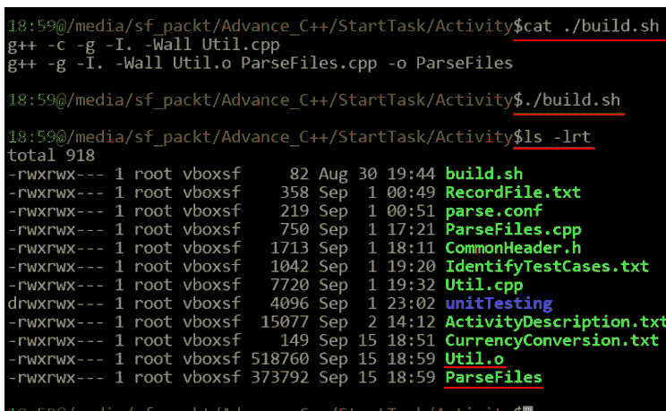
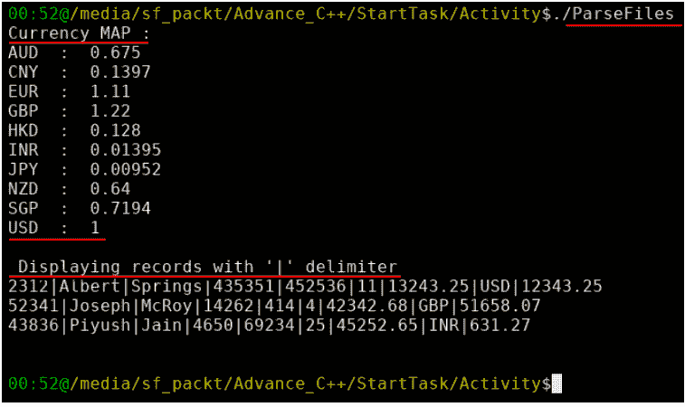

## 第 7 章 - 人人都会跌倒，重要的是如何站起来 – 测试与调试

### 活动 1：使用测试用例检查函数的准确性并理解测试驱动开发（TDD）

在本活动中，我们将开发用于解析 **RecordFile.txt** 和 **CurrencyConversion.txt** 文件的函数，并编写测试用例来检查这些函数的准确性。请按照以下步骤实施本活动：

- 1. 创建名为 **parse.conf** 的配置文件并写入配置。

- 2. 注意，这里只需要关注两个变量，即 **currencyFile** 和 **recordFile**。其余变量用于其他环境设置：

```
CONFIGURATION_FILE
currencyFile = ./CurrencyConversion.txt
recordFile = ./RecordFile.txt
DatabaseServer = 192.123.41.112
UserId = sqluser
Password = sqluser
RestApiServer = 101.21.231.11
LogFilePath = /var/project/logs
```

- 3. 创建名为 **CommonHeader.h** 的头文件，并声明所有实用函数，即 **isAllNumbers()**、**isDigit()**、**parseLine()**、**checkFile()**、**parseConfig()**、**parseCurrencyParameters()**、**fillCurrencyMap()**、**parseRecordFile()**、**checkRecord()**、**displayCurrencyMap()** 和 **displayRecords()**。

```
#ifndef __COMMON_HEADER__H
#define __COMMON_HEADER__H
#include<iostream>
#include<cstring>
#include<fstream>
#include<vector>
#include<string>
#include<map>
#include<sstream>
#include<iterator>
#include<algorithm>
#include<iomanip>

using namespace std;
```


```
bool fillCurrencyMap();
bool parseRecordFile();
bool checkRecord(vector<string> &);
void displayCurrencyMap();
ostream& operator<<(ostream &, const record &);
void displayRecords();
#endif
```

4. 创建一个名为 Util.cpp 的文件，并定义所有工具函数。编写以下代码来定义 trim() 函数：

```
#include<CommonHeader.h>

// Utility function to remove spaces and tabs from start of string and end of string..
string trim (string &str) { // remove space and tab from string.
    string res("");
    if ((str.find(' ') != string::npos) || (str.find(' ') != string::npos)){
// if space or tab found..
        size_t begin, end;
        if ((begin = str.find_first_not_of(" \t")) != string::npos){ // if string is not empty..
            end = str.find_last_not_of(" \t");
            if ( end >= begin )
                res = str.substr(begin, end - begin + 1);
        }
    }else{
        res = str; // No space or tab found..
    }
    str = res;
    return res;
}
```

5. 编写以下代码来定义 isAllNumbers()、isDigit() 和 parseLine() 函数：

```
// Utility function to check if string contains only digits ( 0-9) and only single '.'
// eg . 1121.23 , .113, 121. are valid, but 231.14.143 is not valid.
bool isAllNumbers(const string &str){ // make sure, it only contains digit and only single '.' if any
    return ( all_of(str.begin(), str.end(), [](char c) { return (
    isdigit(c) || (c == '.')); })
        && (count(str.begin(), str.end(), '.') <= 1) );
}
```

```
//Utility function to check if string contains only digits (0-9).. 
bool isDigit(const string &str){
    return ( all_of(str.begin(), str.end(), [](char c) { return
isdigit(c); }));
}
```

```
// Utility function, where single line of file <infile> is parsed using delimiter.
// And store the tokens in vector of string.
void parseLine(ifstream &infile, vector<string> & vec, char delimiter){
    string line, token;

    getline(infile, line);
    istringstream ss(line);
    vec.clear();
    while(getline(ss, token, delimiter)) // break line using delimiter
        vec.push_back(token);  // store tokens in vector of string
}
```

6. 编写以下代码来定义 parseCurrencyParameters() 和 check-Record() 函数：

```
// Utility function to check if vector string of 2 strings contain correct
// currency and conversion ratio. currency should be 3 characters,
conversion ratio
// should be in decimal number format.
bool parseCurrencyParameters( vector<string> & vec){
    trim(vec[0]);  trim(vec[1]);
    return ( (!vec[0].empty()) && (vec[0].size() == 3) && (!vec[1].
empty()) && (isAllNumbers(vec[1])) );
}
```

```
// Utility function, to check if vector of string has correct format for records parsed from Record File.
// CustomerId, OrderId, ProductId, Quantity should be in integer format
// TotalPrice Regional and USD should be in decimal number format
// Currecny should be present in map.
bool checkRecord(vector<string> &split){
    // Trim all string in vector
    for (auto &s : split)
        trim(s);
```

```
flag = false;
} else if ( split[0].find(parameter) == string::npos ){
    error = "In " + fileName + " file, first line doesnt contain
header ";
    flag = false;
}
}
    return flag;
}
```

8. 编写以下代码来定义 parseConfig() 函数：

```
// Function to parse Config file. Each line will have '<name> = <value>' format
// Store CurrencyConversion file and Record File parameters correctly.
bool parseConfig() {
    ifstream coffle;
    string error;
    if (!checkFile(confFile, configFile, "CONFIGURATION_FILE", '=', error))
{
        cerr << "ERROR: " << error << endl;
        return false;
    }

    bool flag = true;
    vector<string> split;
    while (confFile.good()){
        parseLine(confFile, split, '=');
        if ( split.size() == 2 ){
            string name = trim(split[0]);
            string value = trim(split[1]);

            if ( name == "currencyFile" )
                currencyFile = value;
            else if ( name == "recordFile")
                recordFile = value;
        }
    }

    if ( currencyFile.empty() || recordFile.empty() ){
        cerr << "ERROR : currencyfile or recordfile not set correctly." <<
endl;
        flag = false;
```

```
cout << endl;
}

ostream& operator<<(ostream& os, const record &rec){
    os << rec.customerId << "|" << rec.firstName << "|" << rec.lastName <<
    "|"
        << rec.orderId << "|" << rec.productId << "|" << rec.quantity <<
    "|"
        << fixed << setprecision(2) << rec.totalPriceRegional << "|" << rec.
    currency << "|"
        << fixed << setprecision(2) << rec.totalPriceUsd << endl;
    return os;
}
```

12. 编写以下代码来定义 displayRecords() 函数：

```
void displayRecords(){
    cout << " Displaying records with '|' delimiter" << endl;
    for (auto rec : vecRecord){
        cout << rec;
    }
    cout << endl;
}
```

13. 创建一个名为 ParseFiles.cpp 的文件，并调用 parseConfig()、fillCurrencyMap() 和 parseRecordFile() 函数：

```
#include <CommonHeader.h>
// Global variables ...
string configFile = "./parse.conf";
string recordFile;
string currencyFile;
map<string, float> currencyMap;
vector<record>      vecRecord;
int main(){
    // Read Config file to set global configuration variables.
    if (!parseConfig()){
        cerr << "Error parsing Config File " << endl;
        return false;
    }
    // Read Currency file and fill map
    if (!fillCurrencyMap()){
        cerr << "Error setting CurrencyConversion Map " << endl;
        return false;
```

```
}
if (!parseRecordFile()){
    cerr << "Error parsing Records File " << endl;
    return false;
}
    displayCurrencyMap();
displayRecords();
return 0;
}
```

14. 打开编译器。通过编写以下命令来编译和执行 Util.cpp 和 ParseFiles.cpp 文件：

```
g++ -c -g -I. -Wall Util.cpp
g++ -g -I. -Wall Util.o ParseFiles.cpp -o ParseFiles
```

两个文件都会生成对应的二进制文件。

在下面的截图中，你将看到这两个命令被存储在 build.sh 脚本中并执行。运行此脚本后，你将看到最新的 Util.o 和 ParseFiles 文件已生成：



图 7.25：生成的新文件

15. 运行 ParseFiles 可执行文件后，我们将收到以下输出：



图 7.26：生成的新文件

16. 创建一个名为 ParseFileTestCases.cpp 的文件，并为工具函数编写测试用例。编写以下针对 trim 函数的测试用例：

```
#include<gtest/gtest.h>
#include"../CommonHeader.h"

using namespace std;

// Global variables ...
string configFile = "./parse.conf";
string recordFile;
string currencyFile;
map<string, float>  currencyMap;
vector<record>      vecRecord;

void setDefault(){
    configFile = "./parse.conf";
    recordFile.clear();
    currencyFile.clear();
    currencyMap.clear();
    vecRecord.clear();
}
```

```
TEST(CurrencyParameters, correct_parameters){
    vector<string> vec {"INR","1.44"};
    ASSERT_TRUE(parseCurrencyParameters(vec));
}
```

20. 编写以下针对 checkFile 函数的测试用例：

```
//Test Cases for checkFile function...
TEST(checkFile, no_file_present){
    string fileName = "./NoFile";
    ifstream infile;
    string parameter("nothing");
    char delimit = ',';
    string err;
    ASSERT_FALSE(checkFile(infile, fileName, parameter, delimit, err));
}
TEST(checkFile, empty_file){
    string fileName = "./emptyFile";
    ifstream infile;
    string parameter("nothing");
    char delimit = ',';
    string err;
    ASSERT_FALSE(checkFile(infile, fileName, parameter, delimit, err));
}
TEST(checkFile, no_header){
    string fileName = "./noHeaderFile";
    ifstream infile;
    string parameter("header");
    char delimit = '|';
    string err;
    ASSERT_FALSE(checkFile(infile, fileName, parameter, delimit, err));
}
TEST(checkFile, incorrect_header){
    string fileName = "./correctHeaderFile";
    ifstream infile;
    string parameter("header");
    char delimit = '|';
    string err;
    ASSERT_FALSE(checkFile(infile, fileName, parameter, delimit, err));
}
TEST(checkFile, correct_file){
    string fileName = "./correctHeaderFile";
    ifstream infile;
```


22. 为 `fillCurrencyMap` 函数编写以下测试用例：

```
//Test Cases for fillCurrencyMap function...
TEST(fillCurrencyMap, wrong_delimiter){
    currencyFile = "./CurrencyWrongDelimiter.txt";
    ASSERT_FALSE(fillCurrencyMap());
}

TEST(fillCurrencyMap, extra_column){
    currencyFile = "./CurrencyExtraColumn.txt";
    ASSERT_FALSE(fillCurrencyMap());
}

TEST(fillCurrencyMap, correct_file){
    currencyFile = "./CurrencyConversion.txt";
    ASSERT_TRUE(fillCurrencyMap());
}
```

## Note

在前述函数中用作输入参数的 CurrencyWrongDelimiter.txt、CurrencyExtraColumn.txt 和 CurrencyConversion.txt 文件可以在此处找到：https://github.com/TrainingByPackt/Advanced-CPlus-Plus/tree/master/Lesson7/Activity01。

23. 为 `parseRecordFile` 函数编写以下测试用例：

```
//Test Cases for parseRecordFile function...
TEST(parseRecordFile, wrong_delimiter){
    recordFile = "./RecordWrongDelimiter.txt";
    ASSERT_FALSE(parseRecordFile());
}

TEST(parseRecordFile, extra_column){
    recordFile = "./RecordExtraColumn.txt";
    ASSERT_FALSE(parseRecordFile());
}

TEST(parseRecordFile, correct_file){
```

以下是这些问题的答案：

- 为什么 Bloom Filter 的性能提升如此微不足道？
  `std::unordered_set` 执行一次哈希操作，然后可能进行几次内存访问即可到达存储的值。我们使用的 Bloom filter 执行三次哈希操作和三次内存访问。因此，本质上，Bloom filter 所做的工作比哈希表更多。由于我们的词典中只有 31,870 个单词，Bloom filter 的缓存优势就丧失了。这又是传统数据结构分析与现实结果不符的另一个案例，因为缓存的原因。
- 使用更大或更小的容量 Bloom filter 的效果是什么？
  当使用更大的容量时，哈希冲突和误报会减少，但缓存行为会变差。相反，当使用更小的容量时，哈希冲突和误报会增加，但缓存行为会改善。
- 使用更少或更多的哈希函数会发生什么？
  使用的哈希函数越多，误报越少，反之亦然。
- 在什么条件下，这个版本会比 Speller2.cpp 中的版本快得多？
  Bloom filter 在测试几个位成本低于在哈希表中访问值的成本时效果最好。这只有在 Bloom filter 位完全适合缓存且词典不适合时才成立。

datettime: 470, 473
dbname: 500, 503, 505-506
dbpasswd: 505-506
dbuser: 505-506
deadlock: 322, 355-356
debugger: 47-56, 66, 477, 516-523, 532
decimal: 172, 412-415
decipher: 1
declarator: 91
decltype: 175-176, 183-185
declval: 183-185
decouple: 290
decrement: 182
dedicated: 392, 478, 491
deduce: 83, 159, 174, 177, 305, 492
defunct: 228
delegate: 317-318
demangle: 42
department: 524
deprecated: 91, 235
derived: 110, 142, 144, 146, 148, 151, 153, 228, 317, 393-395, 431, 439
detach: 326, 332, 334-335, 339, 343, 355-357, 359-360, 367, 371, 373, 375, 378, 381, 384
dialog: 9-10, 13, 24, 47, 62, 76, 82-85, 90, 98, 105-107, 124, 127, 276-285
dividend: 342-345
d-pointer: 276
dropdown: 24-25, 48-49, 127, 162, 171, 190, 539, 545
dynamic: 72, 155-156, 194-195, 200, 219, 232, 254, 271, 591

E
eclipse: 3-4, 8-9, 13-14, 16, 18, 20, 22, 25, 27, 30-31, 47-48, 56-58, 62-63, 68, 76, 86, 88, 95, 104, 118, 123, 127, 147, 162, 171, 186, 206, 216, 223, 245, 260, 266, 286, 297, 302, 309, 336, 432
elision: 199, 212, 233
equation: 108, 546
equivalent: 123, 190, 315, 542, 545-546, 576
extends: 72

F
faulty: 29
fclose: 99-101, 200, 220-221, 224
fconverter: 384
feature: 52, 56, 110, 131, 145, 157, 162, 165, 183, 191, 218, 262, 274, 276-277, 290, 313, 373, 460, 491-492, 564, 566
features: 2, 22, 50, 61, 134, 271, 313, 318, 432, 459, 474, 538, 568, 617
female: 396
fetched: 499, 506, 588, 614
fields: 30, 46, 280, 524-525, 527-528, 594-595, 598
floatnum: 402, 419
flowchart: 526
frequency: 583
fstream: 227, 399-401, 403

G

generalize: 183
generate: 4-7, 107, 112, 114, 122-123, 128, 131, 146, 165, 170, 175, 179, 201, 218, 282-284, 316, 535, 566, 575, 587, 593
getvalue: 263
global: 46, 77, 96-98, 154-156, 194, 213, 217, 256, 261, 308, 346, 356, 450, 557
glvalue: 182
gninja: 6
godbolt: 40, 535, 538-539, 563
granular: 509
graphs: 598
greatest: 89, 109
gritty: 152

I
identity: 134-135, 182
idioms: 322, 535, 568
ifndef: 26, 66, 484, 492, 510
import: 3, 8-9, 68, 76, 147, 286
increment: 182, 340-341, 350-351, 554-555, 569-570, 579
init-value: 74
inline: 111-112, 126, 128, 253, 307, 398, 469, 589, 613
inputs: 28, 61, 333
insertion: 106, 126, 257, 580, 583
integers: 16, 29, 81, 108, 270, 342-343, 378, 513, 537, 539, 543, 548, 556, 571, 574

# K

579, 583, 586-587
inverse: 121
isdigit: 525-526, 529
isnumeric: 529
isocpp: 115, 171, 244
kernel: 442, 559
keyword: 112-113, 122, 125, 144-145, 147-148, 161, 256, 264, 269, 274, 394

# L

leverage: 139, 442, 462
linearly: 206, 586
linkages: 156
literal: 73, 93, 182, 255, 479-480
location: 9, 74, 76, 91-92, 152, 178, 202, 229, 306, 405, 478-480, 515, 520, 541-542, 590
logger: 392, 439-441, 469-470, 473-474
loggers: 469
loxley: 75, 81
luckily: 47
lvalue: 181-182, 230, 237

# M

macros: 227, 317, 468, 559
magnitude: 584
margin: 590
marginally: 550
matrices: 108, 134, 136-137, 252
matrix: 108, 120-122, 134-136, 151-152, 252, 274-275

minimal: 492, 505, 568
mismatch: 490
mockdb: 502, 507-508
mutable: 309-311, 313
mutexes: 223, 370, 385, 389, 463
myclass: 44, 93-94, 161, 186, 238
myfunc: 44
myname: 309
myobject: 44
mythread: 325-326
myvehicle: 143
myvehicle-: 143

# N

nbytes: 453-454, 456
negative: 29, 425, 542
nullip: 507
number: 22, 44, 52, 59, 68, 74-76, 81, 87, 93-94, 97, 100, 110, 115, 121, 131, 140, 164, 168, 170, 172, 197, 213, 262, 270, 274-275, 278, 280, 309, 312-313, 315-316, 344, 356, 401, 413, 416-419, 430, 446-447, 450-451, 454-455, 458, 468, 481, 483-485, 492, 502, 510, 549, 553-554, 557, 561, 564, 568, 574, 576, 581, 584-585, 590, 594, 604, 614, 617
numerical: 458

# O

objdump: 40, 46
object: 1, 32, 36-40, 46, 53, 59, 68, 72, 93-94

111-112, 115-116, 120, 123, 125, 128, 134, 151-153, 156, 161, 177-178, 182-184, 199, 208, 212-213, 215, 219, 226-229, 233, 235, 237-238, 241, 262, 280, 282, 286, 292, 294-295, 297, 299-300, 304, 310, 325-326, 332-333, 337-340, 358-359, 361, 363, 365-366, 369-371, 377-378, 380-382, 384, 395, 397-398, 400, 407-410, 418, 431-432, 435-436, 438-439, 441, 447-450, 460-461, 463-464, 473, 494, 499, 508, 556, 558
offset: 447, 453-454, 456, 542, 564
opaque: 276
opcode: 453, 541
operator-: 129, 231, 237, 255
optimize: 126, 157, 253, 532, 550, 561, 569, 590, 599, 601, 614, 617
ostream: 106, 126, 131, 257, 394, 398, 431-432, 434, 438-441, 464
overlap: 545
overload: 126, 132, 134, 174, 253-254, 262, 398, 439
override: 114, 144-145, 148, 304, 397, 430, 436-438, 474

# P

paradigm: 72, 227
parallel: 17, 323-324, 336,

setevent: 449
setfill: 425
setpanel: 239
setscroll: 238, 240
sfinae: 139-140,
  164-166, 169, 183-185,
  190-191, 220
showpos: 426-427
signature: 39, 42, 46,
  121-122, 156, 300,
  371, 455, 528-529
simplify: 66, 139,
  468, 546, 607
simulating: 322, 486
simulation: 385, 388, 470
simulator: 322, 385, 389,
  392, 470-471, 473-474
singleton: 464
solution: 17, 31, 68, 86,
  137, 191, 221, 253, 271,
  276, 283, 318, 388,
  474, 531, 546, 616
splicing: 215
stdout: 438
stream: 108, 125, 394-397,
  399-402, 404-405,
  407, 410, 412, 425, 428,
  430-432, 435-436,
  438-439, 441, 462-464,
  467, 470, 474
streambuf: 394,
  436-439, 441, 464
streams: 349, 389,
  391-393, 399-401,
  407, 409, 411-412, 428,
  430-431, 441, 459, 462,
  467, 470, 474, 617
string: 15, 75, 161, 164,
  172-173, 176, 182,
  190-191, 208, 218, 227,
  230, 242, 256-259, 277,
  287-289, 309, 313-314,
353, 362-366, 368-375,
377-384, 394-398,
402-411, 424-425,
428-431, 433-434,
440, 453, 457, 465, 467,
478-480, 483-485, 490,
492-493, 497, 500-505,
508, 512, 514, 524-525,
528-529, 542, 553-555,
566, 569-571, 573, 577,
580, 584, 591-592, 594,
599-601, 603-605,
607-610, 612-613
stringbuf: 407
stringify: 171-173
strings: 161, 354, 364-367,
384-385, 395, 407,
428, 436, 465
strlen: 480, 488-489, 493,
497-498, 505, 594
strong: 71, 107, 159
stronger: 579
strongly: 72-73, 86, 93
strsum: 314
strtime: 434, 440
struct: 72, 99, 111, 133,
151, 165-166, 175, 185,
238-239, 250-251, 267,
277, 281, 284, 287-289,
291, 293-295, 297-298,
300-301, 304, 308, 447,
453, 455, 457, 484-486,
510, 594-596, 598
structure: 4, 57, 151, 186,
208, 238, 240, 252, 300,
392, 446-447, 449-450,
453-457, 483, 510, 580,
594-595, 598, 615
subscriber: 290
subset: 159
sumfunc: 16, 26-27,
35-39, 152
summary: 68, 137, 191,
271, 318, 389, 474,
532, 555, 617
summation: 16,
537, 546, 548
syntaxes: 99
systems: 1-2, 4, 8, 90, 93,
107, 201, 204, 276, 422,
459, 474, 536, 548, 558

T

tables: 197
tabular: 555
tabulation: 458
testcases: 494-496
testnull: 494-495
testrun: 495, 498
testsuite: 494-495
thereof: 57, 94
threshold: 64-65, 312
toolbar: 25, 48-49, 52-53
toolchain: 72, 152
topics: 194, 365, 392, 617
top-left: 10
top-right: 77, 544
totally: 156, 572
totalprice: 525
tricky: 370
trigger: 240, 252,
275, 280, 454
triggered: 316
triggering: 454
truevalue: 424
truncate: 444
try-catch: 376-378,
381, 488
two-fold: 603
two-step: 4
typedef: 161-163,
165-166, 190, 447
typedefs: 399, 407


typeid: 176
typeindex: 176
typename: 163-167, 169, 172-178, 180, 182, 187, 247, 313-316, 398, 418, 433, 439, 510-512, 522
type-safe: 99
velocity: 30
verbose: 33
verify: 18-19, 26, 31, 134, 538, 558, 600
virtual: 144-148, 150, 430, 436-437, 500-502, 573, 591
voltage: 267-270

U
underscore: 59
unequal: 410
unicode: 227, 255, 599
uniform: 549, 581, 584, 595
unions: 108, 132-133, 151
unique: 155, 161, 221, 227, 235-238, 241-243, 245-250, 280-289, 316, 332-333, 363, 368, 385, 446-447
unix-like: 4, 548
userid: 478
userinput: 335
username: 35-36, 500, 505, 507

V
validity: 499, 507
variant: 72, 93, 133, 238, 276, 313
vector: 149, 160, 162, 183, 186-187, 190, 227, 230, 255, 261, 287-289, 295-296, 298, 306-307, 310-311, 357, 363-366, 387, 394, 497, 500, 504, 528, 544, 546-549, 566-569, 571-573, 577, 580, 582-587, 589-590, 594-598, 615

W
webserver: 501, 503, 505-507
winapi: 450
wordcount: 599-601, 603-605, 607, 609-610, 612-613
wouldn: 171
wrapped: 214, 429
wrapper: 299, 430-431, 438, 441, 463-464
wrappers: 394, 467
writefile: 446-448, 450
writepos: 228

X
xvalue: 182

Y
yields: 7
