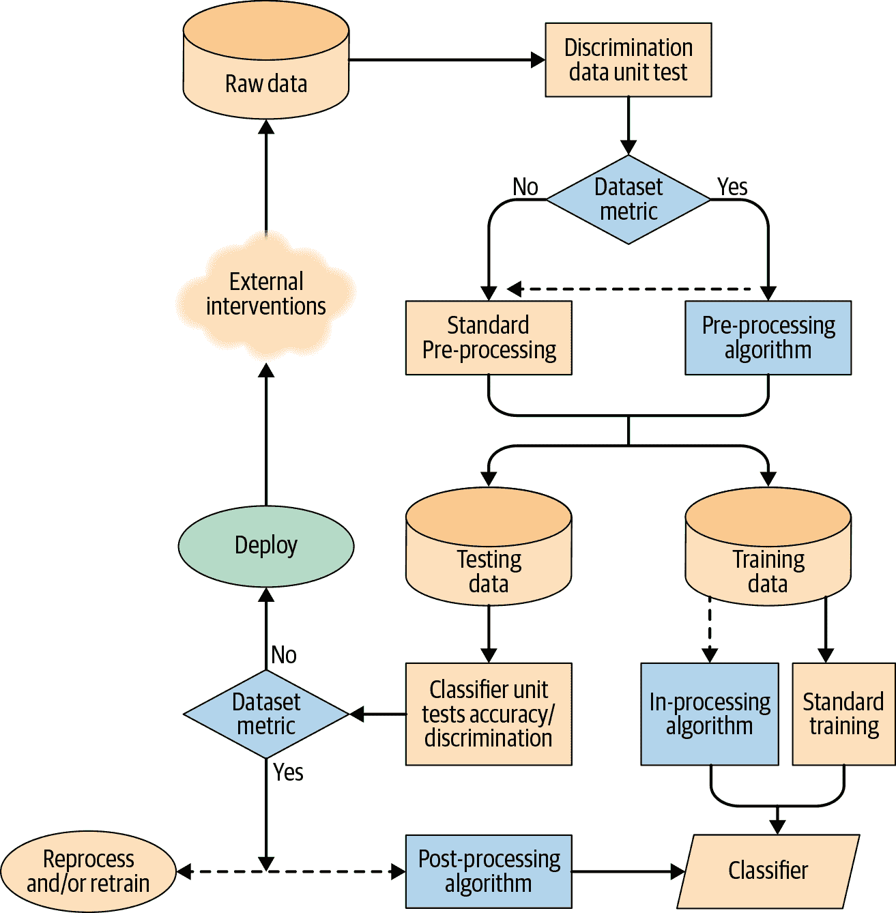
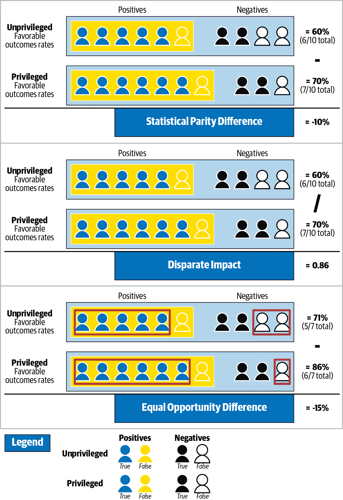

# 第 1 章 使用 `AIF360` 理解和度量偏见

偏见可能发生在机器学习流水线的任何阶段（图 1-1），公平性指标和偏见缓解算法可在流水线的各个阶段执行。我们建议尽可能频繁地检查偏见，使用与您的应用相关的尽可能多的指标。我们还建议将持续偏见检测集成到您的自动化流水线中。`AIF360` 兼容端到端的机器学习工作流，设计为易于使用和扩展。实践者可以轻松地从原始数据得到一个公平的模型，同时理解中间结果，研究人员可以以最小的工作量贡献新功能。

在本章中，我们将了解当前的工具和术语，然后开始探讨 `AIF360` 的指标如何工作。

## 工具和术语

近年来，开发了多个开源库以助力构建更公平的 AI 模型。大多数仅解决偏见检测，而不解决偏见缓解。只有少数工具包（如 `Themis-ML` 和 `Fairness Comparison`）两者兼顾，但由于其易用性和许可证限制，往往限于商业用途。IBM 公平性研究人员主动统一这些工作，如表 1-1 所示，将一套全面的偏见指标、偏见缓解算法、偏见指标解释和工业易用性汇集在一个开源工具包 `AIF360` 中。

### 表 1-1. 偏见与公平性方面的其他开源库

| 开源库 | 优缺点 |
| --- | --- |
| `Fairness Measures` | 提供多种公平性指标，包括均值差异、不同影响和比值比。它还提供数据集，但部分数据集不在公共领域，访问或使用数据需要获得所有者的明确许可。 |
| `FairML` | 通过量化各种输入对模型预测的相对影响，为预测模型提供审计工具，可用于评估模型的公平性。 |
| `FairTest` | 检查预测标签与受保护属性之间的关联。该方法还提供了一种识别输入空间区域的方法，算法在这些区域可能会产生异常高的错误。该工具包还包含丰富的数据集目录。 |
| `Aequitas` | 这是一个面向数据科学家和政策制定者的审计工具包；它拥有 `Python` 库和网站，可上传数据进行偏见分析。它提供多种公平性指标，包括人口统计学平等、统计平价和不同影响，以及一个“公平性树”帮助用户确定其特定情况下应使用的正确指标。`Aequitas` 的许可证不允许商业用途。 |
| `Themis` | 一个开源偏见工具箱，可自动生成测试套件以衡量预测系统决策中的歧视。 |
| `Themis-ML` | 提供公平性指标，如均值差异、一些偏见缓解算法，^(a) 累加反事实公平估计器，^(b) 和拒绝选项分类。^(c) 该代码库包含本书所述方法的一个子集。 |
| `Fairness Comparison` | 包含多种偏见检测指标以及偏见缓解方法，包括不同影响移除器，^(d) 偏见移除器，^(e) 和双朴素贝叶斯。^(f) 主要作为一个测试平台编写，允许以一致的方式比较不同的偏见指标和算法，也允许添加额外的算法和数据集。 |

^(a) F. Kamiran 和 T. Calders，“无歧视分类的数据预处理技术”，载于*知识与信息系统* 33 卷，第 1 期，2012 年，1–33 页。  
^(b) M. J. Kusner 等，“反事实公平性”，载于*神经信息处理系统进展*，2017 年，4,069–4,079 页。  
^(c) F. Kamiran 等，“歧视感知分类的决策理论”，载于*IEEE 国际数据挖掘会议论文集*，2012 年，924–929 页。  
^(d) M. Feldman 等，“认证与移除不同影响”，载于*ACM SIGKDD 国际知识发现与数据挖掘会议论文集*，2015 年 8 月，259–268 页。  
^(e) T. Kamishima 等，“带有偏见移除正则化项的公平性感知分类器”，载于*机器学习与数据库知识发现*，2012 年，35–50 页。  
^(f) T. Calders 和 S. Verwer，“用于无歧视分类的三种朴素贝叶斯方法”，载于*数据挖掘与知识发现* 21 卷，2010 年，77–292 页。

`AIF360` 是一个可扩展的开源工具包，用于度量、理解和减少 AI 偏见。它汇集了来自工业界和学术界公平性研究人员的顶级偏见指标、偏见缓解算法和指标解释器。`AIF360` 工具包的目标如下：

*   促进对公平性指标和缓解技术的更深入理解
*   为公平性研究人员和行业实践者提供一个开放的通用平台，以共享和基准测试他们的算法
*   帮助推动公平性研究算法向工业应用的转变

`AIF360` 目前包含实现了整个 AI 公平性研究社区八篇已发表论文技术的 `Python` 包。目前有 77 个偏见检测指标和 10 个偏见缓解算法，可以按照类似 `scikit-learn` 的 `fit`/`transform`/`predict` 范式的标准方式调用。该工具包是开源的，包含文档、演示和其他工件。

## 术语

为了有效使用 `AIF360` 工具包，熟悉相关的公平性术语会有所帮助。以下是一些需要了解的专业机器学习术语：

**有利标签**  
: 其值对应于为接收者提供优势的结果的标签（如获得贷款、被录用、不被逮捕）

**受保护属性**  
: 将人口划分为结果应当平等的群体的属性（如种族、性别、种姓和宗教）

**特权值（受保护属性的）**  
: 表示历史上处于系统性优势地位的群体的受保护属性值

**公平性指标**  
: 训练数据或模型中不想要的偏见的量化

**歧视/不想要的偏见**  
:

尽管*偏见*可以指代任何形式的偏好（无论公平与否），但我们的关注点在于*不良偏见*或*歧视*，即特定优势群体被置于系统性优势地位，而特定劣势群体被置于系统性劣势地位。这涉及种族、性别、年龄和性取向等属性。

## 应该使用哪些指标？

AIF360 目前包含 77 个公平性指标来衡量偏见（参见图 1-2），因此很难理解在每个用例中应使用哪些指标。由于不存在适用于所有情况的单一最佳指标，建议使用多个指标，并在您组织内的主题专家和关键利益相关者的指导下谨慎选择。AIF360 拥有指标的差值版和比率版，它们本质上传达相同的信息，因此您可以根据查看结果的用户的习惯进行选择。

AIF360 的 [API 文档](https://oreil.ly/LSBZO) 允许您查看其所有指标和算法，以及每个指标、算法或解释器的定义；其所基于的研究；其源代码；以及其参数和异常。以下列出的 API 类别中列出了几类指标。如果您的用例需要针对训练数据的指标，请使用 `DatasetMetric` 类中的指标（及其子类，如 `BinaryLabelDatasetMetric`）。如果应用程序需要针对模型的指标，请使用 `ClassificationMetric` 类。以下是相关类：

**`BinaryLabelDatasetMetric`**：基于单个二元标签数据集计算指标的类

**`ClassificationMetric`**：基于两个二元标签数据集计算指标的类

**`SampleDistortionMetric`**：基于两个结构化数据集计算指标的类

**`Utility Functions`**：用于实现指标的辅助脚本

### 个体公平性指标与群体公平性指标

如果您的用例关注个体公平性，请使用 `SampleDistortionMetric` 类中的指标或一致性指标。如果您关注群体公平性，请使用 `DatasetMetric` 类（及其子类，如 `BinaryLabelDatasetMetric`）以及 `ClassificationMetric`。如果您的用例同时关注*个体和群体*公平性，且需要使用单一指标，请使用 `ClassificationMetric` 类中的广义熵指数及其特化形式——泰尔指数和变异系数。不过，可以同时检查多个指标，包括来自个体公平性和群体公平性的指标。

### 世界观与指标

如果您的用例遵循 WAE 世界观，请使用人口统计学平价指标（如 `disparate_impact` 和 `statistical_parity_difference`）。如果您的用例遵循 WYSIWYG 世界观，请使用机会均等指标（如 `average_odds_difference` 和 `average_abs_odds_difference`）。其他群体公平性指标（通常标记为“机会均等”）介于这两种世界观之间。相关指标包括以下内容：

*   `false_negative_rate_ratio`
*   `false_negative_rate_difference`
*   `false_positive_rate_ratio`
*   `false_positive_rate_difference`
*   `false_discovery_rate_ratio`
*   `false_discovery_rate_difference`
*   `false_omission_rate_ratio`
*   `false_omission_rate_difference`
*   `error_rate_ratio`
*   `error_rate_difference`

### 数据集类

`Dataset` 类及其子类是处理所有形式数据的关键抽象。训练数据用于学习分类器，而测试数据用于进行预测和比较指标。除了机器学习流水线的这些标准方面外，公平性应用还要求将受保护属性与数据中的每个实例或记录相关联。为了保持通用格式，独立于所应用的算法或指标，AIF360 构建 `Dataset` 类的方式使得所有相关属性（特征、标签、受保护属性及其各自的标识符）都存在于该类的每个实例中并可从中访问。子类添加了进一步的属性来区分数据集，并规定其可与哪些算法和指标交互。

结构化数据是公平性文献中研究的主要数据集类型，由 `StructuredDataset` 类表示。`BinaryLabelDataset`（二元标签数据集）作进一步区分——它是一种结构化数据集，每个实例只有一个标签，且只能取两个值中的一个：有利或不利。非结构化数据可以通过构建一个与 `StructuredDataset` 类平行的类来适配 AIF360 架构，而不会影响不适用于非结构化数据的现有类或算法。

## 偏见指标的透明度

我们现在将重点转向改进偏见指标透明度的更广泛问题。

### 解释器类

AIF 360 工具包优先考虑解释公平性指标的需求，因此 IBM 研究人员开发了 `Explainer` 类，以配合 `Metrics` 类提供关于计算出的公平性指标的进一步见解。可以创建扩展 `Explainer` 类的不同复杂度的子类，以输出对不同类型用户有意义的解释。AIF360 首个版本中实现的解释器功能是通过打印 JSON 输出进行基本报告。未来的版本可能包括偏见的细粒度定位、可操作的补救分析和反事实公平性。

### AI 事实表

阻碍 AI 公平性和信任的一个障碍是缺乏标准实践来记录 AI 服务是如何创建、测试、训练、部署和评估的。组织正在要求 AI 服务的透明度，以及它们应该和不应该如何被使用。为了满足这一需求，[AI 事实表](https://oreil.ly/Bvo10)^(1) 以类似于食品营养标签或家电规格表的方式，提供关于机器学习模型重要特征的信息。它们将包含系统操作、训练数据、底层算法、测试设置和结果、性能基准、公平性和鲁棒性检查、预期用途、维护和再训练等信息。示例问题如下：

*   用于训练服务的数据集是否有数据表或数据声明？
*   是否对数据集和模型进行了偏见检查？如果是，请描述所检查的偏见策略、偏见检查方法和结果。
*   是否对数据集执行了任何偏见缓解？如果是，请描述缓解方法。
*   算法输出是否可解释或可阐释？如果是，请解释如何实现（例如，通过直接可解释的算法、局部可解释性或基于示例的解释）。
*   解释的目标用户是谁（机器学习专家、领域专家、普通消费者、监管机构等）？
*   服务是否在任何额外数据集上进行了测试？它们是否有数据表或数据声明？
*   描述测试方法。
*   是否保留服务运行中的使用数据？
*   如果输入偏离训练或测试数据，预期会有什么行为？
*   数据到 AI 服务的整体工作流是如何被追踪的？

这些信息将帮助用户了解服务如何工作、其优势和局限性，以及它是否适合他们正在考虑的应用。

^(1) M. Arnold et al., “FactSheets: Increasing Trust in AI Services through Supplier’s Declarations of Conformity” in *IBM Journal of Research and Development* 63, no. 4/5, (July/September 2019): 6, [*https://oreil.ly/Bvo10*](https://oreil.ly/Bvo10)。
