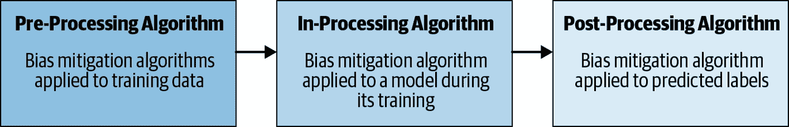
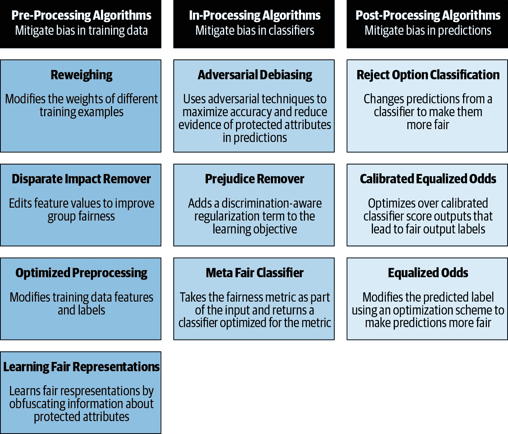

# 第 2 章 偏见缓解算法

我们可以在机器学习流水线的不同节点衡量数据和模型的公平性。在本章中，我们将探讨预处理、训练中处理和后处理这三类偏见缓解算法。

## 大多数偏见源于您的数据

AIF360 的偏见缓解算法根据其在机器学习流水线中的部署位置进行分类，如图 2-1 所示。作为一般准则，如果您可以修改训练数据，则可以使用其预处理算法。如果您可以更改机器学习模型的学习过程，则可以使用训练中处理算法。如果您需要将学习到的模型视为黑盒，且无法修改训练数据或学习算法，则需要使用后处理算法。

## 预处理算法

考虑到大多数偏见内在于数据，预处理是缓解偏见的最佳时机。通过预处理算法，您尝试在训练算法之前通过操纵训练数据来减少偏见。尽管这在概念上很简单，但有两个关键问题需要考虑。首先，数据可能以复杂的方式存在偏见，因此算法很难将一个数据集转换为一个既准确又无偏见的新数据集。其次，可能涉及法律问题：在[某些情况下](https://oreil.ly/d_PGf)，在非原始数据上训练决策算法可能违反反歧视法。

截至 2020 年初，AIF360 中的预处理算法如下：

**重加权预处理**：为每个（群体，标签）组合中的训练样本生成不同的权重，以确保分类前的公平性。它不更改任何特征或标签值，因此如果您无法进行值更改，这是理想选择。

**优化预处理**：学习一种概率变换，在群体公平性、个体失真和数据保真度约束及目标下编辑数据中的特征和标签。

**学习公平表征**：寻找一种能很好地编码数据但模糊受保护属性信息的潜在表征。

**差异影响移除器**：编辑特征值以增加群体公平性，同时保持组内的排序顺序。

如果您的应用要求变换过程的透明度，差异影响移除器和优化预处理是理想选择。

## 训练中处理算法

您可以通过使用在训练算法中惩罚不需要的偏见的训练中处理算法，将公平性纳入训练算法本身。训练中处理是通过公平性约束（例如，老年人的录取率应与年轻人相同）来完成的，这些约束会影响训练算法中的损失函数。以下是 AIF360 中一些最广泛使用的训练中处理算法：

**对抗去偏**：学习一个分类器以最大化预测准确性，同时降低对手从预测中确定受保护属性的能力。这种方法能得到一个公平的分类器，因为预测结果无法携带对手可利用的任何群体歧视信息。

**偏见移除器**：向学习目标添加一个感知歧视的正则化项。

**元公平分类器**：将公平性指标作为输入的一部分，并返回针对该指标进行优化的分类器。

## 后处理算法

在某些情况下，用户可能只能访问黑盒模型，因此必须使用后处理算法。AIF360 后处理算法（参见图 2-2）可用于在训练算法后通过操纵输出预测来减少偏见。后处理算法易于应用于现有分类器，无需重新训练。然而，后处理中的一个关键挑战是找到既能减少偏见又能保持模型准确性的技术。AIF360 的后处理算法包括以下内容：

**均等几率**：求解一个线性规划，以找到更改输出标签的概率，从而优化均等几率。

**校准均等几率**：在校准分类器得分输出上进行优化，以找到更改输出标签的概率，目标为均等几率。

**拒绝选项分类**：在决策边界周围不确定性最高的置信带内，给非特权群体有利结果，给特权群体不利结果。

## 持续流水线衡量

支配数据的概率分布会随时间变化，导致训练数据分布偏离实际数据分布。也可能难以获得足够的标记训练数据来正确建模当前的数据分布。这被称为*数据集漂移*或*数据集偏移*。在不匹配的数据上训练模型会严重降低预测准确性和性能，因此偏见衡量和缓解应以类似于功能测试与每次应用变更集成的方式，集成到您的持续流水线衡量中。
