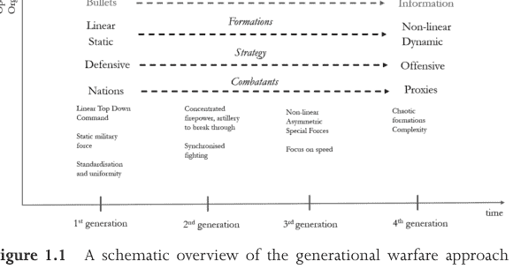
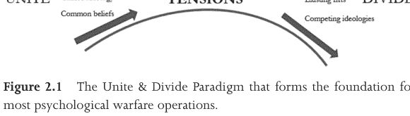
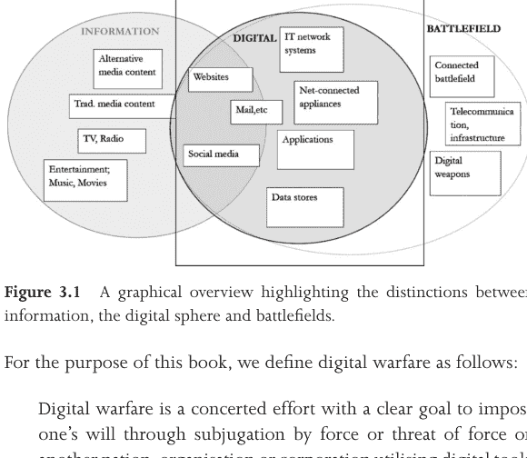
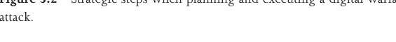

# 第五章：数字时代的闪电战

当今的战争往往与过去的战争截然不同。事实上，它们往往甚至不被称作战争，但其目标似乎永恒不变，即将己方意志强加于对手。战争理论家谈论非对称战争或非线性战争，但这是现在正在发生的事情吗？AI的武器化是否适合这一背景，还是说它完全是另一回事？本章提供了一个关于进攻性数字战争将如何实施的已实现及尚属假设的策略手册，并且令人惊讶的是，其中既有克劳塞维茨的元素，也有闪电战的元素。理解正在发生的事情以及未来的预期，将使企业领导层洞察一个他们可能不希望存在的不愉快现实，但通过预先警告，他们可以预先武装，以应对一种前所未有的、可怕的数字威胁，这种威胁能够摧毁一个不幸的对手。

生存。有些人认为战争是解决问题的一种有效但粗糙的工具，但不幸的是，它被应用得太频繁，而且通常用于并不真正适合军事解决方案的问题上，至少从长远来看是这样。战争除了带来的死亡和破坏之外，还有其他也许同样有害的后果。即使试图严格控制，释放暴力浪潮也会带来道德、文化和社会影响，这些影响不可避免地会蔓延到战场之外的领域。据说发动战争容易，但结束战争却很难，历史上不乏战争后果波及数代的证据。虽然纯粹为了战争而战争确实存在，但那种有组织的施虐式寻欢作乐所幸是例外，相反，战争通常被用作实现经济和/或政治目标的工具。因此，必须从综合的角度考虑军事能力，在外交、经济、政治甚至心理性质等其他可用工具的背景下进行优化。

鉴于战争已被证明是如此的变革性转折点，关于如何最好地进行战争的理论可以追溯到几千年前。普鲁士将军卡尔·冯·克劳塞维茨（1780–1831）被认为是现代战争策略的典型之父。他的著作《战争论》至今仍被广泛阅读，并且是许多军事院校课程的一部分。值得注意的是，尽管这部著作现在已有近两个世纪的历史，而且随着我们所见的技术升级（通常由武装冲突本身驱动），他那个时代的战争方式与今天的战争方式已截然不同。《战争论》被认为是一部难读的著作；首先，它是由他的遗孀从克劳塞维茨早期作品选集中死后编纂而成的，其中一些只是反映思想成形过程中的未完成草稿，而且这些内容并未按时间顺序定稿。此外，他复杂的写作风格，无论是德语原文还是英文译本，都反映了一种在许多方面与我们的世界观截然不同的世界观。克劳塞维茨显然受到他所处的启蒙时代的影响，在那个时代，质疑公认的真理和教条极大地推动了科学的发展。本着这种精神，他的著作是一种突破

“无非是一场规模更大的决斗，[并且]是一种迫使敌人服从我们意志的武力行为，” 而且物质力量构成了“使敌人无能为力”的手段。²

因此，他认为战争不应被视为一个独立的问题，而必须从政治角度加以情境化，战争策略的设计必须考虑到政治目标。在当前环境下，人们可以在某种程度上进一步扩展克劳塞维茨关于战争的观点，即战争是出于政治目的使用有组织力量的能力，无论其是否导致实际暴力。因此，可以被视为可信的暴力威胁或许已经构成战争，当然，这使得战争的定义比先前认为的要少得多血腥。这尤其考虑到一些国家拥有核威慑力量，这将冷战时代归类为一场实际的战争，在冷战中，耀武扬威有时能产生预期的政治效果——1962年的古巴导弹危机就是一个例子，还有东西方之间由至少表面上非国家附属的民兵甚至犯罪集团进行的无数代理战争。因此，可以说，中美之间当前的贸易战，如果最终包含可信的暴力威胁作为后盾，那么根据这一定义也将被归类为真正的战争。诸如此类的哲学思考使得战争的定义变得非常模糊，人们难免会偶尔触及通常和传统上被理解为战争的范围边缘，即具有一定规模、持续一段时间的有组织暴力。确定战斗人员是谁也很重要，他们不必仅仅是国家间的对手，也可能包括国内团体，这些团体通过协调作战寻求对现有或想象中的国家的政治控制，这通常与犯罪活动重叠。总而言之，一个保守的核心战争定义如下：

- 有组织的暴力
- 由两个或两个以上可区分的群体彼此发动

在引发冲突的武装冲突中，克劳塞维茨与现有的战争理论相距甚远，后者仅关注静态的阵型。⁴

因此，通过煽动沙文主义、替罪羊或其他类似策略，在人们中鼓起激昂的战争热情，可以为发动军事行动提供心理支持；至少在最初，需要某种军事天才来利用战场上必然出现的任何意外机会，直觉在其中发挥着重要作用，最后由政府设定的理性且现实的政治目标，共同构成最佳的三位一体组合。因此，战争战略必须由这些经过校准的考量来塑造，而不是在固定环境中，而是能够随着变化而调整。值得注意的是，其军备的技术能力并未成为这一三位一体的一部分，这并非出于历史原因，在克劳塞维茨的时代，新武器的发展十分显著，正是政治的制约和目标决定了其实际部署的程度。⁵

## 有战争，然后又有战争...

为了证明非理性扭曲任何被感知的战争逻辑，克劳塞维茨区分了战争在其最纯粹或最极端的形式——绝对战争——中，战争不受政治控制，可以自由放任，没有任何火力限制。绝对战争实际上将意味着一场消灭战争，直到一方被彻底抹去。形成鲜明对比的是有限战争，这是最常见的形式，其中政治考量会影响，几乎总是会适度影响，军事目标以及实现目标的总体手段。尽管战术上的短期目标通常留给将军们自行决定。克劳塞维茨花费了大量时间来探讨这种理想化的纯粹形式与现实中战争的差异，现实中战争始终受到诸多实际制约。它们只有在政治野心是彻底消灭敌人时，并且给予武装力量一张白手令时，才会重合。

话虽如此，这并不意味着战争整体是完全随机的，它可以被分解为各个部分，其中一些部分随机性很小，因此可以高度精确地规划。近期情况通常可以由经验丰富的军事领导层相对较好地预测，在这些情况下，因果关系适用得相当好，特别是如果存在明显的军事资源和技术优势，这将明显偏向结果的概率。然而，在大多数情况下，摩擦会出现，并以非线性特征为突出，例如当某种变化突然跨越一个阈值时，该阈值通常是事先未知的，它会触发政权转变（一个统计学术语），导致条件发生急剧变化，以前的参数不再适用。因此，任意小的变化就可能产生完全不同的轨迹，并且轶事中充满了许多关于战斗如何以这种方式获胜的故事。

克劳塞维茨可能在不知情的情况下，准确地描述了混沌环境固有的不可预测性特征，认识到不可能事先知道什么特征会触发导致灾难性后果的骚动。因此，对混沌的承认解释了为什么克劳塞维茨避免提供太多详细的战术建议；这在任何通用术语中都是不可能的。因此，他建议，能够认识到哪些摩擦具有导致剧烈变化的倾向，并且足够敏捷地将其利用于己方的洞察力和胜利的指挥官，才是真正的胜利者。他也明确理解，历史对战役的解释必须谨慎解读，因为决定性因素或事件链作为真正的根本原因如此微妙和复杂，以至于很可能既未被目击者完全理解，也未被后来的历史学家完全理解，这就解释了为什么历史事件会随着话语的变化而被频繁重新解释。还认识到，有意识的行为不可避免地经常会产生意想不到的后果，而且采取看似非常重要行动却收效甚微的情况并不罕见，而看似微不足道的举动有时却会产生巨大的影响。⁷

## 那么，克劳塞维茨是否对如何实际进行战争的任何实用建议完全保持沉默？

鉴于克劳塞维茨对战争的动态看法，出于必要，他能够提供的普世原则注定是很少的，例如显著的三位一体，这也可能解释了它们至今仍具有的持久性；然而。它们宽泛的灵活性也一直是人们对其的主要批评之一。但，除了这些之外，他是否还提供了一些更硬性的实际指导，说明如何实际进行战争？在选择军事目标时，克劳塞维茨提出了识别敌人的 Schwerpunkt 的想法，通常被翻译为重心（COG），也可以理解为努力的重点。本质上，它是集中军事努力的点，不一定是防线中最薄弱的点，而是能够提供通往胜利突破的最快路径的插入点。他给出了一些例子，说明这可能是什么：在一个由 rival 团体争夺控制的国家，通常是首都，而在民众起义中，schwerpunkt 将是其领导人的个性和公众舆论。在第二次世界大战中，阿道夫·希特勒很可能是盟军应该攻击的 schwerpunkt，以便迅速结束战争，令人惊讶的是，他们没有组织更多暗杀他的企图。因此，它可以同时具有物理和心理目标。概述 schwerpunkt 的边界和方向的文件是 Aufmarschanweisungen（部署指令）。一旦确定，（军事）能量将针对 schwerpunkt 引导。攻击它提供了通过引导作战方法来建立 schwerpunktlinie 的最佳机会，schwerpunktlinie 被描述为从自己的作战基地到 schwerpunkt 之间最短、最直接的距离。当然，通过将努力集中在已确定的 schwerpunkt 上意味着其他战线的部队必须减少，从而为敌人考虑攻击的自身 schwerpunkts 打开了大门 ⁸

克劳塞维茨还讨论了进攻-防御二分法。他认为防御是更强大的战争形式，因为它只有

能够理解并利用不可预见情况的敏捷而有韧性的战斗人员，才可能取得胜利。

克劳塞维茨理论的一个实际应用，至少部分如此，就是著名的德国第二次世界大战战术闪电战，可译为“闪电战”。虽然该词的起源尚不清楚，但其部署相当直接，尽管在当时是不寻常的。它源于德国在第一次世界大战东线战场上的经验，与被困在堑壕战中的西线不同，东线以更传统的自由流动的军事战役和战斗为特征。战后研究强调，规模并非决定性因素，而是规模较小但高度协调的单位可能比规模较大行动缓慢的部队具有更大的战斗力。速度是一个重要因素，因为通过确保优越的机动性和更快的决策，适应性强且机动化的部队可以比对手更快地行动。¹⁰

这些见解构成了闪电战战术的基础，闪电战战术是将武装能力混合搭配，寻求优化和集中军事力量，通常针对更强大的对手。这是通过找到突破防线薄弱点的机会，即前述的 schwerpunkt，从而寻求迅速而决定性地取得胜利来实现的。 surprise 元素在制造震惊感方面发挥了重要作用，这有助于瓦解敌人的战斗意志。因此，心理影响对于此类大胆冒险是否成功至关重要。它是动员步兵、坦克、炮兵和飞机以高度协调的方式运作，寻求创造集中的压倒性力量，通过 surprise 在敌人有机会重整和巩固力量之前给予致命一击，这构成了闪电战攻击的核心。闪电战战术也影响了指挥链结构，其中下级军官的倡议被提倡；因此，攻击通常是在没有详细明确命令的情况下发起的，这以便规避不可避免会出现的任何摩擦。攻击的意图是

通常由军事总部指挥层逐级向下传达，同时允许部队指挥官在战斗中自行斟酌解释和运用各种手段以实现目标。与严格层级指挥链相比，这使执行速度大大提高；在严格层级指挥链中，即使是细枝末节也需要先获批准才能执行。闪电战的精神气质在于“权力越高，命令越笼统”，把细节留给下层去补充。¹¹,¹²

闪电战战术的成功取决于若干因素。鉴于其作战、速度以及联合兵力深入突破前线并力图夺取敌后深远目标的本质，它需要有利的地形——平坦的地面以保持高速，并便于坦克和机械化步兵通行。它需要空中优势，以便将空军的攻击与地面部队的前进相结合，并且需要天气有利于己方，即晴朗的天空。出其不意和心理手段对于制造混乱至关重要，尤其是在敌军意想不到的区域发起全力进攻时，可使敌军陷入恐慌。这降低了遭到反击或敌军迅速重新集结的风险。但闪电战战术的根本基础中也存在一个固有缺陷，即速度本身，这反而降低了其成功率。在突破敌军防线后，必须迅速迫使其投降，因为进攻推进的速度使得难以及时跟上充足的预备队和补给。这对于确保能够保持势头至关重要，避免出现空隙和断层，以免让灵活应变的对手有机会牺牲领土以重新集结到更有利的位置。这一点在1941年“巴巴罗萨行动”中阻碍了德军向苏联的推进。补给线过度延伸是闪电战的一大风险。

一些战争战略家指责克劳塞维茨的理论和闪电战的实际运用都算不上真正的学说，因为他们认为这些理论缺乏连贯性，而且过于灵活，可以有太多不同的解读方式

利用掩蔽和伪装来取得优势。渗透而非正面迎敌成为更受青睐的战术。战场上的线性形态开始消失。

第二代战争向第三代现代战争过渡，其中就包括闪电战战术。无线电通信使部队之间的协调成为可能，凸显了速度与隐蔽相对于静态阵地的优势。二战成为线性战争的终点，出其不意的机动制胜开始占据主导，往往力求深入打击敌军后方。当然，这意味着传统军事层级的剧烈变革：下级军官被赋予更多权力，可以在关键时刻临机决断，而总部指挥的角色转而聚焦于协调与战略。严格的团级作战原则开始瓦解。随着运输能力的提升，伞降和直升机成为促成突然性的关键工具。特种部队成为大多数武装部队不可或缺的组成部分。这些第三代战术在很大程度上仍然是一种综合战争形态，也解释了为何当今武装部队在人力上比上个世纪要少得多。当然，随着导弹和远程轰炸机的出现，技术在相当程度上可以完全取代部队部署。14,15

第四代战争起源于冷战时期，代理人战争和非国家作战人员的使用变得普遍，因为直接的核对抗可能导致双方同归于尽，实际上在政治上已不可能。矛盾的是，尽管武器变得更加先进和致命，但人们却更加明确地关注“攻心”行动，力求争取争议地区民众的支持，其中特别强调心理战以及建立解放运动或叛乱团体。第四代战争日益模糊了战争与政治、士兵与平民之间的界限。民族国家在很大程度上失去了对暴力的垄断，私人团体可以像第一代之前的海盗那样，再次在冲突和冲突制造中发挥关键作用。第四代战争通常具有以下特征：

- 政治复杂性高
- 采用叛乱战术，如颠覆、恐怖主义和游击战术，打击软目标，且往往针对对手的文化或社会叙事
- 作战人员通过高度分散的结构组织起来，缺乏层级，规模小，通信和资金支持网络分散
- 心理战发挥重要作用
- 军事努力与混合战争中的政治、经济和社会工具相结合
- 低强度冲突中，如何对待非战斗人员成为战术难题

因此，第四代战争的作战人员具有以下特征：缺乏层级权威、缺乏正式结构、具有耐心和灵活性、能够在需要时保持低调，且规模小、所需投入（相对）较低。第四代战争发生在所有领域：经济、政治、媒体、军事和民事，并迫使常规军事单位调整战术，以相应方式进行作战。16,17

如今的战争在多维层面展开，远远超越了单纯的物理暴力，往往侧重于运用非暴力手段。甘地或许是最早证明以非暴力应对暴力的力量的人之一：在英国殖民当局不断升级暴力时，他却缓和局势。他以此针对集体心理，谋求占据道德制高点，使敌人显得像恃强凌弱的暴君，从而在国内外丧失支持。对于第四代战争中与政府军对抗的作战人员而言，在战场上获胜往往是物理上的不可能，因为其武器库无法胜过国家级对手。相反，

特兰基耶承认，与以往时代不同，现代战争通常不会被正式宣战，这使得对手得以继续利用和平时期的法律，并公开或隐蔽地开展活动。因此，敌人会竭尽全力维持和平的假象。因此，揭露第四代游击式运动最可靠的方法，就是尽早宣布进入战争状态，至少最迟也要在政治暗杀、恐怖主义、游击活动等斗争的最初迹象出现时宣布。因此，及时获取信息成为关键。特兰基耶因支持将酷刑作为反叛乱技术的一部分而受到严厉批评，但他为这些做法辩护，称其是阿尔及尔战役取得胜利的关键因素之一，并辩称信息本身毫无价值，尤其是在危机期间，如果不能迅速加以利用。19 随着时间推移，对信息的依赖只增不减，许多欺骗行动需要借助信息来从心理上影响敌人，这正是第2章要讨论的内容（图1.1）。

图1.1 世代战争方法与克劳塞维茨关键概念的概略对比。

## 注释

- 1. 冯·克劳塞维茨，卡尔. 《战争论》（[Vom Kriege] 编辑兼翻译：霍华德，迈克尔；帕雷特，彼得. 普林斯顿，新泽西州：普林斯顿大学出版社，(1989) [1832]）。
- 2. 同上。
- 3. 巴斯福德，克里斯托弗. 《政策、政治、战争与军事战略》（克劳塞维茨主页，1997–2015）。http://www.clausewitz.com/readings/Bassford/StrategyDraft/index.htm （访问于2021年1月1日）。
- 4. 冯·克劳塞维茨，卡尔. 《战争论》（[Vom Kriege] 编辑兼翻译：霍华德，迈克尔；帕雷特，彼得. 普林斯顿，新泽西州：普林斯顿大学出版社，(1989) [1832]）。
- 5. 同上。
- 6. 同上。
- 7. 拜尔兴，艾伦·D. 《克劳塞维茨、非线性与战争的不可预测性》（《国际安全》，第17卷，第3期（1992–1993年冬季））。第59–90页。
- 8. 冯·克劳塞维茨，卡尔. 《战争论》（[Vom Kriege] 编辑兼翻译：霍华德，迈克尔；帕雷特，彼得. 普林斯顿，新泽西州：普林斯顿大学出版社，(1989) [1832]）。
- 9. 同上。
- 10. 科鲁姆，詹姆斯·S. 《闪电战的根源：汉斯·冯·塞克特与德国军事改革》（《现代战争研究》。劳伦斯：堪萨斯大学出版社，1992）。
- 11. 弗里泽，卡尔-海因茨. 《闪电战传奇：1940年西方战役》（[Blitzkrieg-legende: der westfeldzug 1940] 译：J.T. 格林伍德. 安纳波利斯，马里兰州：海军学院出版社，2005）。
- 12. 奇蒂诺，罗伯特·M. 《德国的战争方式：从三十年战争到第三帝国》（劳伦斯：堪萨斯大学出版社，2005）。
- 13. 纳维赫，西蒙. 《追求军事卓越：作战理论的演变》（伦敦：弗兰克·卡斯出版社，1997）。
- 14. 林德，威廉·S.；南丁格尔，基思；施密特，约翰·F.；萨顿，约瑟夫·W.；威尔逊，加里·I. 《战争面貌的改变：进入第四代》（《海军陆战队公报》，1989年10月）。第22–26页。
- 15. 林德，威廉·S. 《理解第四代战争》（2004年1月15日）。www.antiwar.com （访问于2021年1月1日）。
- 16. 桑顿，罗德. 《非对称战争》（莫尔登，马萨诸塞州：政体出版社，2007）。
- 17. 维斯特，杰森. 《第四代战争》（《大西洋月刊》，2001年12月1日）。

## 欢迎来到心理战的隐秘世界

> Der ganze Krieg setzt menschliche Schwäche voraus, und gegen sie ist er gerichtet.
> 一切战争都以人类的弱点为前提，并试图利用这些弱点。
> 卡尔·冯·克劳塞维茨（1780–1831）
> 传奇的德国战争战略家

除了克劳塞维茨，孙子往往是普通人所熟悉的另一位著名军事理论家。他是一个极具神话色彩的人物，若真有其人，他是一位中国将军（约公元前544年—约公元前496年）。在提及今天通常所说的心理战的最早文献时，孙子常常被引用。他的《孙子兵法》尤其以其深刻的格言而闻名，这些格言至今仍被广泛引用，或许在管理顾问中比在军事圈中引用得更多，甚至已被用滥。然而，尽管其中某些格言确实有用，但从战略角度来看，他的著作整体上缺乏克劳塞维茨那种深刻的连贯性。孙子有时会被拿来与克劳塞维茨更注重实际战斗的战略进行对比，因为他设计了许多欺骗和迷惑敌人、使其不进行正面交战便放弃作战的方法。然而，这位创始人的深层目的。因此，信息及其各种形式是心理战的关键基础，因此心理战常常被称为信息战。然而，第二次世界大战后技术突飞猛进，信息战已扩展到涵盖许多其他方面，心理战如今被视为其中的一个子集。广义而言，信息战包括：

- 间谍与情报活动，涵盖从黑客入侵到破解密码的一切
- 破坏活动，包括病毒、拒绝服务攻击及类似手段
- 防御策略，即通过各种电子防护手段（包括防病毒软件）维护信息平台的完整性
- 欺骗，这在很大程度上等同于心理战，这也是本章的重点

心理战行动可大致分为三类：

- 1. **白色宣传。** 坚持客观事实，尽可能避免偏见，并完全承认信息来源。
- 2. **灰色宣传。** 大体真实的陈述，或含有真实成分、且没有可被证明错误的内容。来源通常不予披露。
- 3. **黑色宣传。** 提供伪造和欺骗性信息，并将其归因于虚假来源³

宣传类别的区分凸显了心理战的关键基础——可信度。一场宣传活动要想被视为合理，其受众至少必须默认消息来源是可信的，否则其信息将被拒绝，甚至可能引发反效果，使人们对所宣扬的内容采取相反立场。因此，是否被视为可信，成为心理战工具能否成功的决定性因素；这一规则鲜有例外。有人认为，可信度是说服的前提；实质上，在你让一个人照你说的做之前，你必须先让他相信你说的话。⁴ 可信度不仅针对目标受众，也针对其他媒体资源，人们常说它“得来不易，失去却易”。同时，在希望迅速取得成果的雄心与建立可信度的艰苦工作之间，存在一个明显的矛盾。当需要快速回应时，使用灰色或黑色宣传的诱惑始终存在——因为其来源是刻意错误的，这种做法可能带来短期胜利或缓解，但会毁掉长期行动的成功前景。因此，灰色和黑色行动伴随着巨大风险，因为受宣传影响的群体迟早会看穿其中的谎言，宣传发起者和消息来源也会被认定是虚假和不可靠的。因此，同一发起者若将各类宣传混用，一旦目标受众发现矛盾之处，或者发起者从一开始就被认为不值得信赖，那么连真实陈述也会被稀释，被视为半真半假甚至彻头彻尾的谎言。对于在冲突中寻求道德高地的政府而言，它们只能坚持白色宣传，以在公民和其他国家面前保持自身的诚信。这一见解已成为当今大多数民主国家政府机构遵循的黄金法则，即只允许白色宣传，意味着信息和来源都经过客观核实并被明确说明。例如，历史学家已表明，第二次世界大战中同盟国的大部分宣传都可归类为白色宣传。这可能在政府军与叛乱分子等交战方之间造成一种不对称关系。戴维·加卢拉在其著作《反叛乱作战》（Counterinsurgency Warfare，1964、2006）中强调了这种信息使用上的不对称性：叛乱分子没有公民责任，可以自由使用一切手段；必要时，他可以撒谎、欺骗和夸大其词。他没有义务证明自己的任何说法，人们通常根据他的承诺而非行为来评判他。因此，灰色或黑色宣传对他来说将是一种强大的信息武器，他心里清楚政府不能同样自由地使用这些手段，甚至很可能根本不能使用。这就形成了一种不对称优势，因为他们不会像对手政府那样受到行为准则、国际公约和国家责任履行的约束。事实证明，只有在威权政体中才有可能部署灰色和黑色宣传，因为那里没有政治反对派去驳斥言论或揭露骗局；不过，无论如何，大多数民众本来就已经对任何政府声明（高度）怀疑。但对于合法政权而言，心理战的目标必须是告知而非欺骗。这种信息管理和组织方式上的不对称，至少在短期内会有利于叛乱分子，他们可以利用这一优势，主动发布负面言论和诋毁性宣传，迫使守方陷入被动应对模式，始终忙于驳斥指控，大多只能对很可能是虚假的陈述作出回应和反应，而叛乱分子则希望其宣传至少有一部分能够站得住脚。

戴维·基尔卡伦在2009年出版的著作《偶然的游击战》（Accidental Guerrilla）中描述了叛乱分子对信息的重视，包括信息的处理与传播。叛乱分子将宣传视为主要手段，常常有意协调物理攻击，以增强一场精心策划的宣传运动。⁵ 政府在心理战运动中必须始终坚守真相，这可能成为瓶颈和弱点，因为在消息发布之前，它们需要进行适当的事实核查。这种回应上的时间延迟往往至关重要，因为宝贵的势头会丧失，而且通常是第一时间发布的不实消息最能留在集体记忆中。延迟的回应往往登不上头条，也容易被人遗忘。但由于政府受法律、政治和层级官僚体制的约束，它们往往无法以果断的速度作出回应。⁶

## 心理战中部署的一些已知战术

心理战旨在改变行为，要么试图让对手从主动模式转为被动模式：最典型的情况是停止侵略；更具挑战性的是，将侵略转向其自身领导层。可以大致区分为两个时间框架：一种是一次性的短期框架，宣传者寻求即时的情绪反应，如震惊，通常使用欺骗和彻头彻尾的谎言来制造轰动效应。另一种是长期运动，旨在改变目标受众的叙事，且往往是永久性改变。前者是更可能成功的战术，但效果短暂；后者则需要付出大量努力和时间才能有所回报。

宣传的设计应当很像营销口号，遵循四个基本标准：必须被看到、被理解、被记住，并被付诸行动。⁷ 宣传者需要完全了解目标受众，即与其现有的观点、信仰和倾向保持一致，以打造出能产生预期共鸣的信息。对此，法国哲学家和社会学家雅克·埃吕尔（1912–1994）——他撰写了一些最具影响力的宣传著作——被引述道：

> 宣传者基于其对人的认识、人的倾向、欲望、需求、心理机制和条件作用来构建其技术。⁸

因此，宣传者并非试图改变政治忠诚、民族或宗教态度，或其他根深蒂固的信念，而是寻求在这些问题上与目标群体的感受保持一致，使信息显得像是来自受众内部而非外部，从而产生共鸣。支持而不是背离普遍观点的信息更有可能产生效果。宣传者如同营销经理，基于人类的生物学洞察来策划其宣传活动。

通过群体本能，人们倾向于作为群体的一部分做出决策，而情绪，特别是如果能够引发强烈情绪如愤怒和恐惧，会扭曲并倾向于压倒理性论证。关于群体行为的研究表明，人们会顺从群体，即使群体的决策与个人私下的信念和价值观相悖。这种顺从倾向正是宣传者所寻求利用的。9,10

心理战活动部署了众所周知的 conjuring 和操纵技巧，其中一些可以追溯到古希腊修辞学著作，因此在某种意义上是永恒的，这些技巧也在营销中被广泛使用，以影响预期受众的行为，许多旨在触发即时的情绪反应。在其最基本的设计中，它要么寻求团结其目标受众，要么分裂其目标受众，如图 2.1 所示。一些最常见的宣传技巧包括以下内容：

- **选择性省略**，或摘樱桃，可能是最常见的技巧，这是一种从各种事实中只选择那些最有效地加强和证实宣传者目标的过程。它包括收集与主题相关的可用材料，并选择最有效地支持首选观点的材料。它分为两个

图 2.1 构成大多数心理战行动基础的团结与分裂范式。

主要阶段：首先是精心选择有利事实，向目标受众呈现以获得期望反应，其次宣传者利用这些事实作为结论的基础，试图引导受众通过承认所呈现的事实来接受结论。本质上，这是叙事的框架。

- **简化。** 这是一种将情况的众多事实减少的技术，以便所有人都清楚行为或决策的对错、善恶。它为复杂问题提供简单的黑白解决方案；大谎言是简化的一种经典类型。陈述是积极且坚定的；从不使用限定词。它具有以下特征：

- 它渴望为他人思考：有些人接受他们无法亲自核实的资讯，只要来源对他们来说是可以接受的，或信息提供者被认为是一位专家。其他人则在阅读、观看或听到内容时几乎不加辨别地吸收，因为他们只是太懒惰或不关心去充分思考问题，而另一些人则受教育程度不足，乐于接受方便的简化。

- 它简洁，因为简化给人一种用寥寥数语直击要害的印象。

- 它建立自尊：有些人不愿相信任何领域，除了他们自己的领域，是难以理解的。简化强化了这类个体的自尊。这就是他们想相信的，因为他们害怕所讨论的主题实际上可能超出他们的理解能力。

- **刻板印象**是一种用于将个人、群体、国家或事件纳入易于产生良好或不良期望形象的现成类别的简化形式。刻板印象将主体或事件纳入简单的模式，而没有任何区别的个体特征。

- **重复**，当一个想法或立场被重复以期从受众那里引出几乎自动的反应，或强化受众的观点或态度时使用。这种技巧极其有效且有用，因为人类基本上是习惯的生物，并且通过重复发展技能和价值观。¹¹

如前所述，可信度是任何成功宣传的基础，因此确立自己为可信来源是任何宣传者的关键任务。因此，大多数宣传广播都包括对权威的呼吁，即使有时只是微妙的，它引用杰出的专家来通过他们的知识和指导支持论点或行动。要成为特定主题的专家，通常需要具备四个特征：

- 1. **成就。** 人们对在自己领域表现出卓越能力和熟练程度的权威有信心。这种成就应与证词的主题相关。
- 2. **与目标的认同。** 人们对与之有共同纽带的权威有更大的信心。
- 3. **权威地位。** 官方的权威地位可能会使证词更具说服力。
- 4. **无生命物体。** 将无生命物体的物理属性转移到信息上的装置，如纪念碑、国家旗帜或宗教象征，可以作为代表权威的无生命物体。¹²

专家意见是建立改变观点的合法性的有效工具，并且它通常具有扩大效应，因为一旦某个来源被接受为一个主题的权威，另一个相关主题也可能被确立，基于对该专业知识的先前接受。对于宣传者来说，确定受众对专家的感知形象变得非常重要。他们是恭敬地仅基于思想领导力接受信息，还是持怀疑和拒绝态度？因此，为了获得可信度，宣传设置安排必须精心设计，以避免目标受众的任何拒绝或嘲笑。信息来源必须有权为信息背书，这应包括口号式标语，理想情况下是自我延续的，通常带有隐含的刻板印象元素。针对规范和价值观的德行词汇

并在附着于个人或议题时产生积极形象，应包含此类词汇，例如对和平、幸福、安全、明智领导、自由和类似陈词滥调的引用。证词是另一个重要手段，可能包括引用的引语以支持或拒绝特定政策、行动、计划或人格。这是为了促使目标受众认同权威，并接受权威的观点和信仰为自己的观点。这些可能是官方认可类型，即权威已批准所归属的想法、概念、行动或信仰的认可。

一旦可信度建立起来，就可采用多种常见的宣传策略来推广期望的信息：

- **断言。** 断言是作为事实呈现的积极陈述。它们暗示所陈述的内容是显而易见的，无需进一步证明。断言可能是真也可能不是真，因此可以是白色、灰色或黑色宣传的一部分。
- **搭便车与不可避免的胜利。** 这种技巧试图说服目标受众采取“每个人都在采取”的行动方针。它强化了人们自然渴望加入人群并站在胜利一方的欲望。不可避免的胜利邀请尚未加入搭便车的人加入，而那些已经或部分加入搭便车的人则得到保证，继续留在车上是最好的行动方针。
- **光荣的泛泛之谈。** 通过诉诸爱国、家庭或家园等情感，或对和平、自由、荣耀和荣誉的渴望，宣传者寻求在不刻意审视实际原因的情况下获得对他们信息的认可。然而，所激发的情绪必须极具吸引力，并与高度持有的信念和价值观相联系，以至于它们本身能够在没有支持信息或理由的情况下承载信念。光荣的泛泛之谈本身通常往往模糊，对不同的人意味着不同的东西，但它们总体上必须具有有利的含义，看起来良好且有德行。

针对目标群体内部的差异以及经济、种族、宗教或社会差异。它还可能针对对执政精英或政党的敌意、对税收制度的攻击、繁重的官僚机构、地区间的差距，或仅仅是认识到个人相对于政府的无力感。有许多手段可用于促进暗示：

- **引导性问题**，宣传者提出的问题每个都只有一个可能的答案，显然对对手不利。在军事情况下，它通常旨在引导对手走向投降或逃亡，作为被看似更强大的战斗人员彻底消灭的唯一可行替代方案。
- **幽默**可以是另一种形式的暗示，关于敌人的笑话和漫画在那些通常拒绝直接指控或断言的人群中很容易找到受众。关于极权领导人及其下属的笑话有明显的倾向，会在公民中迅速且广泛地传播，并可能削弱其权威。
- **纯粹的动机。**这种技术明确表明，宣传者所代表的一方正以目标受众的最佳利益行事，暗示敌人则恰恰相反。
- ** guilt by association**，即将某个人、团体或思想与目标受众所鄙视的其他人、团体或思想联系起来。暗示的基础在于指控这种联系并非偶然。
- **两害相权取其轻。**将正在采取的行动描述为或许不理想，但任何替代方案都会导致更糟糕的结果。通常会将对不愉快或限制性条件的指责投射到敌人身上，并与此技术相耦合。
- **合理化。**与笼统和模糊密切相关，其中利用这些来合理化被主流话语视为可疑的行为或信仰。
- **替罪羊。**这种技术试图通过将宣传运动的对象标记为目标受众所恐惧、憎恨、厌恶或认为不 desirable 的事物，来在受众中煽起偏见。这种诉诸恐惧的手段常被使用；然而，如果没有巧妙设计，它是一种可能适得其反的技术。
- **寻求不赞同。**它用于让目标群体撤回对某项行动或想法的认可，方法是暗示该行动或想法源于敌人和/或在敌人中流行。
- **转移。**将积极或消极的品质，通常是责任，从一个团体或个人投射到另一个团体或个人上的技术。
- **模糊。**通过包含概括性内容来实现，这些内容因故意模糊而允许接收者自行解读。其意图是通过使用未定义短语来影响他们，而不分析其有效性或试图确定其合理性或适用性。¹³,¹⁴

## PSYCHOLOGICAL WARFARE ENTERS THE DIGITAL AGE

投入了大量资源和努力进行心理战行动，但它们成功了吗？这是一个比假设更难回答的问题，因为必须考虑测量问题以及何为成功的定义。首先，必须区分寻求即时效果的心理行动和旨在改变叙事的长期行动。二战的证据呈现出混合的图景，并且曾有全面尝试来衡量其成功，例如 OSS 人员（中央情报局的前身）丹尼尔·勒纳对各种策略有效性的分析。他得出结论，除非胜利本就迫在眉睫时通过扩音器播放投降指令外，很少有证据表明其中任何一种策略取得了显著成功。但客观衡量心理战的成败是困难的，因为条件远非受控实验。同样，更直接的努力，如朝鲜战争期间对美国战俘的洗脑也证明只是暂时的；获释后，战俘曾表现出的亲共产主义同情心消失了。对于长期宣传活动，结果甚至更加不确定：冷战期间，美国和东欧集团在心理影响行动上花费了大量资金；然而，没有历史学家将心理战活动认定为苏联解体的根本原因。大量证据表明成功的宣传行动属于那种使用令人难以置信的真相技巧的类型，无论是否真实，都造成了损害后果，通常是对企业而言，在短期内，有时在较长时期内。其目的往往出于财务（即股价）或其他原因，以快速而猛烈的节奏迅速损害其声誉，造成即时混乱和震惊，从而使防御安排和反击难以迅速建立。随着世界进入数字时代，这一趋势被加剧，心理战转入线上，并可被塑造成一种混合形式，这种形式是通过数字战组成部分的融合而实现的。数字时代正在证明是心理战的助推器，其成功的变体可被标记为数字时代的闪电战。许多人现在令人信服地认为，国家之间不断进行着数字战争，但也使企业暴露于风险，成为代理目标，有时国家是侵略者，有时是险恶的竞争对手、黑客活动人士或犯罪企业。

第三章将讨论数字领域战争的历史事件，突出已知的策略及其演变。

## NOTES

- 1 Szunyogh, Béla. Psychological Warfare; An Introduction to Ideological Propaganda and the Techniques of Psychological Warfare (New York: William-Frederick Press, 1955) p. 13.
- 2 Doob, Leonard W. The Strategies of Psychological Warfare (Public Opinion Quarterly, Vol. 13, Issue 4 (1949)). pp. 635–644.

- **造成数据或物理设备损害：**破坏或扭曲信息，或在物理世界中滥用计算机控制设备以关闭电网或破坏应用程序和工具

虽然数字战可以如上所述被分解为不同的领域，但迄今为止尚无共识定义，这从国际法角度来看值得注意，因为这成为是否将其视为战争行为的问题时变得棘手。语义在这里起作用，因为战争不一定等同于正式的战争，因此落在战争的法律定义之外，而该定义会触发某些后果。一个说明性的例子是2008年冲突期间俄罗斯封锁并试图关闭格鲁吉亚的互联网接入，这可能当时至少不会违反国际协定。但如果一家私人公司，无论是否协助政府，关闭另一个国家的互联网接入，那将构成明确的违规。它也说明了制定定义之所以更加复杂，是因为谁被视为交战方，如果他们是国家行为者、私营企业，甚至个人。反向考虑也可能适用，因为在宣战期间，军事力量释放病毒以破坏对手基础设施当然构成战争行为，但同一冲突中单个黑客做同样的事情可能不被视为战争行为。鉴于这些模糊性，人们正在为“数字日内瓦公约”提出案例，但迄今为止主要国家似乎不感兴趣，可能因为他们希望保留使用数字战工具的权利并充分了解其潜力，然后再同意更正式的协议。然而，确实存在一些界定数字领域战争活动的定义，例如欧盟对网络战的定义，它指出其需要针对另一个国家，读作（图3.1）：

> Cyber warfare refers to any action by a state, group or criminal organisation facilitated by or using cyberspace targeting another state.¹

图 3.1 突出信息、数字领域和战场之间区别的图形概览。

为本书目的，我们对数字战争的定义如下：

数字战争是通过强制或以武力威胁来征服另一国家、组织或公司，以实现自身意志的、有明确目标的协同努力，利用数字工具实施。

然而，威权政权，如中国和俄罗斯，对战争的看法与传统的西方观点存在明显差异。这最好用俄罗斯总参谋长瓦列里·格拉西莫夫将军在一篇被广泛引用的文章中的引语来描述：

> 信息空间为削弱敌人的作战潜力提供了广泛的不对称可能性。在北非，我们见证了利用信息网络影响国家结构和民众的技术使用。有必要完善信息空间中的活动，包括防御我们自己的目标。²

中国人民解放军的观点也比传统的西方观点更宽泛，没有明确区分和平时期与战时，以及军事目标与民用目标之间的界限。在中国看来，信息战超出了数字活动范畴，而是指建立信息主导权。³ 通过协调外交、经济、政治和军事努力，并以符合其军事战略指导方针的方式将这些努力嵌入信息环境中，中国的目标是赢得政治主动权并取得心理优势。⁴ 在此精神下，中国的信息行动还包括心理侦察，以查明和确定目标群体心理态度的任何弱点，以便通过进攻性心理战加以利用。⁵ 因此，对于中国和俄罗斯的学说而言，战争与和平之间的界限是模糊的，从其官方声明可以推断，他们认为自己处于持续的（信息）战争状态。特别是对于中国政权而言，控制信息并垄断被视为不可质疑的真理，不允许其公民偏离，是确保其政治权力的关键工具。这是因为中国认为国家最终对其公民和私营企业拥有控制权，强制其有法律义务收集被认为对国家安全必要的信息。实际上，这意味着平民与士兵之间的分界已被否定，因为他们在要求下被迫充当间谍或数字士兵。数字战争被视为一种更便宜、风险更小的策略，以实现更柔和的政治目标，并在许多情况下秘密攻击对手。在这种视角下，新技术和工具的进步使得数字领域成为启动升级程度战争的试验场，经常在匿名状态下运作。它证明是一个持续的试错领域。

## 数字战争的特征

数字战争具有若干特征，使其在概念上和实践上与传统战争有所区别。这些独特的特征通过首字母缩略词 CHAOS 结构化如下：

- **廉价**。数字战争是一种非常具有成本效益的行动，与其造成的破坏相比，关闭一个国家大部分基础设施并实质上将其劫为人质。与军事部署不同，永久性破坏和附带损害的程度通常很小，死亡率也很低，尽管仅使用数字武器库的末日情景是可以设想的。数字战争的目标更像是一种勒索方式，通过传达或实施关闭或破坏重要功能的手段，威胁迫使社会或公司屈服，而不是通过占领领土或破坏来实现预期目标。
- **打了就跑**。数字攻击依赖于利用对手网络和系统的弱点。一旦攻击执行并暴露弱点，防御方就可以寻求补救，基本上使进一步依赖该特定技术的攻击变得或多或少无用。随着全球安全社区协调努力修复发现的漏洞，数字防御应用可以相对快速地分发。这使得数字战士利用安全漏洞的窗口往往是一次性的打了就跑机会。
- **匿名性**。历史上，战争中的战斗人员总是为人所知，因为传统上攻击前会先宣战。在数字战争中，攻击者的身份不再总是为人所知。数字武器可能只是由任何具有合理编程技能和不良品行的人编写的一段代码，他代表什么以及代表谁可能永远无法完全确定。
- **机会主义**。新推出的技术为数字战士提供了发现可能发动攻击的弱点的可能性，并且随着升级的不断流动，精通技术的战斗人员可供攻击的范围将十分充足。也可能存在某些事件有利于攻击，例如政治运动、经济或金融状况，或可以通过部署数字战争工具而加剧的社会问题。
- **可扩展性**。数字武器既易于整合到混合战争战略中，也在战略上能够做到这一点。它允许对战争采取可扩展的方法，其中数字部分可以落在和平与战争之间的某种黄昏地带，并提供根据需要扩大攻击规模的独特能力。启动病毒或发起心理战行动并不像在冲突中开第一枪或投下第一枚炸弹那样确定。它也可以更具选择性地并以代理方式选择其对手，例如某个组织、公司甚至与主要对手有关联的个人，并从那里升级为瘫痪整个社会的广泛数字战争攻击。

在此背景下，区分有针对性攻击和无差别攻击也很重要。有针对性攻击专注于特定个人或组织，寻求获取情报或从事某种破坏性活动，而无差别攻击可能寻求有效关闭或阻止整个国家的互联网访问。

## 数字攻击的分类法

数字攻击形式多样，取决于对恶意软件的访问以及目标类型。总体而言，攻击可以是主动的或被动的。“主动攻击”试图破坏系统或影响其运行，而“被动攻击”则寻求收集并利用系统中的信息，但不寻求对其造成损害，因为这会危及隐蔽任务。还需要对肇事者进行分类，因为攻击可以由内部人员或组织外部人员策划。内部攻击是由个人或团体，通常是员工，已经获得某种授权访问系统资源的人发起的，他们决定恶意使用此特权。外部攻击是由不熟悉访问边界的人管理，寻求通过非法进入系统并识别安全漏洞的方式进入系统

另一台网络流量非常缓慢或不存在的计算机。这可能是空闲计算机，被称为僵尸。

- 主机
  - **键盘记录**。这是记录键盘上敲击的键的动作，通常是秘密进行的，以便使用键盘的人不知道其行为正在被监控。然后数据可以由操作记录程序的人检索。
  - **数据抓取**。一种技术，其中程序秘密地从另一程序产生的人类可读输出中提取数据。
  - **后门**。后门是故意编码到软件中的一段代码，允许某人访问其加载的系统。通常不希望插入后门，因为它们可能被黑客利用以获得访问权限。

## 主动攻击类型

- 拒绝服务 DoS 攻击
  - 分布式拒绝服务 DDoS 攻击
- **欺骗**。欺骗攻击是指某人或程序通过伪造数据成功冒充他人，以寻求获得非法优势的情况。
- **混合威胁攻击**。混合威胁攻击通常试图利用多个漏洞进入系统。通过并行启动多种不同的攻击，攻击者可以利用比单一攻击更多的入口点。由于这些威胁基于多个单一攻击，因此更难检测。
- 网络
  - **中间人**。这是一种攻击，攻击者秘密中继并可能更改两个相信彼此直接通信的各方之间的通信。攻击者必须能够拦截所有相关

不太可能出现在计算机系统的内存位置，并附着在它认为适合执行其代码的任何文件上。它每次复制时还可以改变其数字足迹，使其在计算机中更难追踪。病毒是一种恶意代码或程序的类型，旨在改变计算机的运行方式，并设计为从一台计算机传播到另一台计算机。病毒通过插入或附着于支持宏的合法程序或文档来执行其代码。在此过程中，病毒有可能造成意外或破坏性的影响，例如通过破坏或销毁数据来损害系统软件。

- **蠕虫。** 蠕虫与病毒不同，不需要另一个文件或程序来复制自身，因为它是一个自维持的运行程序。蠕虫通过使用协议在网络上复制。蠕虫可以修改和删除文件，甚至可以在计算机上注入额外的恶意软件。有时计算机蠕虫的目的只是不断复制自身，耗尽系统资源，例如通过使共享网络过载来耗尽硬盘空间或带宽。除了对计算机资源造成破坏外，蠕虫还可以窃取数据，安装后门，并允许黑客控制计算机及其系统设置。
- **特洛伊木马。** 特洛伊木马旨在执行合法任务，但也会执行未知且不想要的活动。它可以成为许多病毒和蠕虫安装到计算机上的基础，例如键盘记录器和后门软件。特洛伊木马可以嵌入到软件的试用版中，并且可以在用户甚至不知道的情况下收集有关目标的额外情报。
- 语义攻击
  - 语义攻击是对正确和错误信息的修改和传播。被修改的信息本可以在不用计算机的情况下完成，尽管使用它们可以找到新的机会。

## 防御框架的组成部分

为了充分管理和减轻通过各种手段执行、且动机各异的这种多样化攻击，建立了一项信息安全标准，以通用地确定安全级别，称为 CIA 三要素，而且不，它与同名缩写的美国情报机构无关。相反，它指的是三个关键因素：资源保密性、完整性和可用性，以及这些因素被破坏的风险。

保密性意味着控制对专有数据的访问，以防止未经授权的披露。保护保密性的对策包括：

- 通过建立访问控制和身份验证机制进行数据标记
- 传输中、传输中和存储中的数据加密
- 隐写术、远程擦除功能以及对所有有权访问数据的人员进行充分的教育和培训

完整性是关于确保数据未被欺诈性篡改从而被破坏。数据在任何时候都必须是正确、真实和可靠的。确保完整性涉及保护使用中的数据、传输中的数据（例如发送电子邮件或上传或下载文件时）以及存储时的数据。保护数据完整性的对策包括加密、哈希、数字签名、数字证书、入侵检测系统、审计、版本控制、以及强大的身份验证机制和访问控制。完整性的概念比仅仅涵盖数据更广泛。它还与不可否认性相关，意味着无法否认某事，例如使用电子邮件中的数字签名；例如发送者不能否认已发送消息，收件人也不能声称收到的消息与发送的消息不同。

最后，可用性：系统、应用程序和数据如果不能在需要时访问，对公司及其用户来说价值不大。因此，可用性意味着网络、系统和应用程序正常运行，以确保授权用户在需要时及时、可靠地访问资源。拒绝服务攻击，即有意且恶意地降低系统、网站、基于网络的应用程序或基于网络的服务的性能，或使系统完全无法访问，是黑客破坏可用性的常用策略。但当然，除了未设计的攻击外，还有其他因素会中断可用性，包括硬件或软件故障、停电、自然灾害和人为错误。帮助确保可用性的对策包括服务器、网络、应用程序和服务的冗余；服务器和存储的硬件容错；定期软件修补和系统升级；备份；全面的灾难恢复计划；以及 DoS 保护解决方案。潜在地，还存在附带损害的风险，蔓延到组织的进一步部分，并且不寻常地也影响第三方，例如客户和供应商。

CIA 三要素的三个因素构成了公司安全基础设施的基石，因为维护它们可以降低数字攻击的风险。因此，数字安全安排可以通过根据已知威胁和漏洞对公司数据、应用程序和关键系统的保密性、完整性和可用性可能产生的影响进行评估来评估。

为了说明数字战争的各个方面，按复杂性和工作量排序，本章的其余部分将重点介绍一些案例研究，描述战略考虑以及部署的特定数字武器。

### 案例研究 破坏

1999 年 4 月，任何登录美国海军网站的人，在其参与前南斯拉夫内战期间，都非常惊讶地发现的是粗俗语言和侮辱，而不是预期的信息。¹¹ 还有几个北约网络服务器完全没有响应，以及其他政府机构的网站，例如 NASA 和能源部，大量非机密但敏感的文件被下载和窃取。调查人员追踪到攻击源自莫斯科以外的计算机，但从未进行正式法律程序，且案件的细节仍属机密。最终发现，黑客能够使用当时先进的黑客技术创建后门，在 2 年内访问系统，从而进入系统。

2003 年，美国再次发现似乎是协调的国家支持攻击，这次针对的是洛克希德-马丁和桑迪亚等国防承包商，也针对涉及军事基地和设施的安全网络。此次攻击被指定为一个被称为“高级持续威胁”的组织，名为 Titan Rain。高级持续威胁在数字安全术语中已成为指代具有同时对多个目标进行长期攻击能力的先进黑客组织；然而，他们的行动模式通常会留下行为模式，为执法提供证据。黑客组织 Titan Rain 继续对其他几个国家和国防承包商发动攻击，包括 2008 年的英国和 BAE。

2010 年，Google 注意到一次入侵，该入侵被称为“奥罗拉行动”，起源于 2009 年。Google 曾通过一种被称为“ spearphishing ”的技术成为目标，这意味着通过发送包含恶意邮件的感染邮件来针对特定电子邮件收件人，邮件中包含一个漏洞，诱使收件人点击邮件中的链接，从而使攻击者获取其密码或访问其计算机。Google 注意到，对于肇事者来说，主要目标是获取中国异议人士的电子邮件账户访问权限，并怀疑中国当局在背后，这导致 Google

## 生成式人工智能

班级：计科2201　　姓名：张某某　　学号：2022XXXX

1. 请列举至少三种生成式人工智能的应用场景并简要说明。

答：
1. 文本生成：用于智能写作、新闻生成、文案辅助等；
2. 图像生成：用于绘画、设计、广告、影视制作等；
3. 音视频生成：用于配音、虚拟主播、动画制作等。

2. 请简述生成式人工智能的主要伦理风险。

答：
1. 隐私安全：可能泄露用户个人敏感信息；
2. 算法偏见：可能加剧社会不公平；
3. 知识产权：AI生成内容的版权归属不清；
4. 虚假信息：可能被用于制造深度伪造内容。

## 案例研究 破坏

当沙特阿拉伯公司阿美石油的员工于2012年8月15日走进办公室时，他们很快注意到自己的电脑无法使用；一次攻击影响了他们几乎所有的3万台电脑。他们无法访问数据，并且在恢复正常运行之前花了超过一周时间。一名不满的员工被指责为事件的责任人；然而，后续的调查将矛头指向伊朗政府，该员工被指控秘密为其工作，由一个名为“正义之剑”的组织协调，该组织后来对事件负责。破坏数据比仅仅获得对计算机系统的读写访问权限要困难得多，因为文件的写入和准备通常遵循受控的顺序，这意味着要永久销毁数据，需要管理员级别的访问权限，因为通常情况下被删除的文件实际上只是隐藏在硬盘上，可以很容易地恢复和检索。这种性质的破坏性病毒自20世纪80年代中期就已存在，一个早期例子是“耶路撒冷计算机病毒”，能够破坏其感染的计算机中的所有可执行文件，但仅在13号星期五才生效，这是一个传奇的恶作剧，仍然能够造成相当大的损害。犯罪团伙更喜欢的做法是只加密数据，而不是永久删除它，然后要求支付解密密钥的费用，这一概念被称为勒索软件；其首次已知案例可追溯至1989年。¹⁴

国家作为数字战争行动的一部分参与实际破坏数据或软件的情况相对罕见；然而，最著名的案例之一是由国家支持的，它已成为最著名和最壮观的攻击之一，即 Stuxnet。它被设计用于破坏使伊朗用于核浓缩计划的离心机运转的软件。当它于2010年被发现时，

黑客还发现了 Windows 中的其他弱点，这些弱点被利用来植入病毒。最终证实，是美国和以色列情报机构通过一个后来被称为“方程式组织”的组织在 Stuxnet 背后。政府机构在攻击背后这一消息引起了他们的大量批评，因为他们没有通知微软他们发现的漏洞，本质上使任何 Windows 用户都处于风险之中，并且可能也在其他未报告的案例中被利用。¹⁵

## 数字战争的合理性

通过对上述案例研究的描述，可以区分并突出数字战争与传统战争之间的对比。数字战争在很大程度上是非致命的战争，生命通常不会受到威胁，尽管关闭重要系统可能造成的间接附带损害。它的成本远低于地面部队部署，且无人员风险。在一定程度上可以匿名进行，使攻击责任的归属变得非常困难。混淆是一个重要的概念，尤其是在黑客攻击中，甚至黑客组织试图复制其他黑客组织（臭名昭著的）签名代码。然而，大规模攻击，尤其是针对国家的攻击的发起者往往会被揭露，因为它们通常需要复杂的先进技能，只有少数独立黑客组织能够掌握，因此潜在嫌疑人的名单往往很少，其中几乎所有人都至少与国家有某种联系，尽管联系松散。从法律角度来看，这些数字战争技术中的许多都没有受到任何国际立法的规范，因此不会被归类为战争行为，但除心理战活动外，大多数会被视为犯罪。

## 数字战争攻击的执行

在数字战争行动中攻击或入侵系统需要部署一系列工具，通常通过一系列顺序步骤进行。有几个框架区分了这些步骤；然而大多数都遵循下面将描述的某些通用程序，通过洛克希德·马丁的“网络杀伤链”突出显示（图 3.2）。对于每个步骤，攻击者可以使用各种工具和技术，随后对于每个步骤，防御者都有建立预防措施的可能性。这些将涵盖数字战争的间谍、破坏和破坏类别；心理行动遵循单独的模型，该模型已在第 2 章中描述，但可以协调以增强影响。

一旦数字攻击的目标和目的被制定并设定，通常会遵循以下七个步骤：

- 1. **侦察**。收集和分析目标的数据，寻求识别可被利用的漏洞。
- 2. **武器化**。创建或利用可以访问并入侵已识别漏洞的工具。
- 3. **入侵**。激活武器化恶意软件以攻击目标计算机网络或系统。
- 4. **利用和安装**。将恶意软件植入目标网络或系统。收集数据或识别感兴趣的数据。建立持久性和混淆，例如通过升级代码以保持隐蔽并掩盖非法活动的痕迹。
- 5. **指挥和控制**。控制系统，最好通过安装远程控制访问和/或拥有从指挥节点捕获命令的工具；
- 6. **行动**。上传收集的数据或执行命令以破坏或加密系统。
- 7. **伪装**。一个最终步骤，可以说经常被添加。此步骤是隐藏和删除数字攻击的痕迹，所使用的技术通常与利用和安装步骤相同。

### 图 3.2 规划和执行数字战争攻击时的战略步骤。

对于最简单的攻击形式，如 DoS，仅步骤 2 和 4 相关，网页篡改将遵循步骤 2–4。以下各节将详细介绍每个步骤，通过描述 2017 年乌克兰的“NotPetya”攻击来增加特征，这可能是最接近全面数字战争的事件之一。¹⁶ NotPetya 看起来像是勒索软件病毒，于 2017 年 6 月开始传播，最初被归因于某个寻求利润的犯罪黑客组织。最终发现它实际上是针对乌克兰的伪装数字攻击，俄罗斯被归为肇事者，美国中央情报局认为俄罗斯军事情报局 GRU 很可能策划了此次攻击，尽管俄罗斯对此坚决否认。¹⁷ 俄罗斯的动机却并不缺乏，因为当时它与乌克兰处于冲突状态。

NotPetya 病毒从国有银行、能源公司和政府机构和部门的计算机中擦除了数据，并传播到私人公司，最终也在乌克兰以外造成了重大损害。估计攻击成本约为 100 亿美元，包括尝试检索和恢复丢失数据的成本。它影响了乌克兰的大部分基础设施，一个机场被封锁，甚至切尔诺贝利核电站的监测系统也受损。¹⁸

攻击的实际目标仍未确定；然而，看起来它是一次实力展示，旨在展示俄罗斯的实力，能够在广泛战线上对乌克兰的基础设施造成重大损害。然而，攻击者表现出克制，因为他们获得了对基础设施系统的访问权限，有可能造成物理损害但避免了这样做，强调了实力展示的印象。

## 漏洞利用与安装

“零日”（zero day）一词通常指通过已识别的漏洞加以利用、从而获取系统访问权限的漏洞利用代码。这种访问可以通过软件、硬件，或如上一阶段所述的人类行为中识别出的任何安全弱点实现。一旦攻击者能够在系统内部执行代码，其目标通常变为尝试获取更高管理权限，从而访问更多数据和计算机。在此阶段，攻击者还会寻求在网络服务器上安装后门和/或 Webshell，以通过添加 AutoRun 键等功能来巩固其立足点和持久化控制点。同时，尝试隐藏恶意软件的存在也很重要，方法包括清除操作痕迹和漏洞入口的使用痕迹，以避免被监控网络和审查使用模式的安全扫描检测到。如果普通标准用户试图请求甚至列出敏感数据，安全网络会察觉；而用户最终至少也会注意到自己的设备是否消耗了过多的内存、磁盘空间或网络带宽等资源。这在一定程度上变成了入侵者与安全软件及其分析师之间的捉迷藏游戏，因为入侵者必须不断确保自己领先于可能暴露活跃恶意软件的安全软件更新。

示例

- 安装后门，除建立系统首个立足点的软件外，还能植入额外的、可能更具破坏性的恶意软件
- 使用多态技术，即编写能够改变自身特性以规避检测的代码（多态，polymorphism），甚至完全重写自身代码（变形，metamorphism）
- 尝试获取其他用户的密码，从而使用多个账户在系统中隐藏，这不仅便于隐藏，还可能提高获取更高安全级别访问权限的机会
- 创建能够识别并精确定位“有价值”数据的数据嗅探器

## NotPetya 事件

NotPetya 攻击的目标最初被认为是一起敲诈勒索行动，即通过加密整个存储驱动器并向受影响用户显示信息，要求支付赎金以换取数据解锁。然而，进一步分析证明这是一个虚假目标，因为所提供的解密密钥无法正常运作，意味着即使有人支付了赎金，也不可能解密受影响的存储器，数据实际上遭到永久销毁。调查还发现，部分受感染的磁盘实际上已被该病毒破坏。

## 注释

- 1 欧洲网络安全局（ENISA）。《ENISA 网络安全及相关术语概述》（2017年9月）。https://www.enisa.europa.eu/publications/enisa-position-papers-and-opinions/enisa-overview-of-cybersecurity-and-related-terminology （访问于2021年1月1日）。
- 2 瓦列里·格拉西莫夫。《科学在预测中的价值》（《军事工业信使》，2013年2月27日）。https://vpk-news.ru/sites/default/files/pdf/VPK_08_476.pdf ；译文下载自 IES https://www.ies.be/files/Gerasimov%20HW%20ENG.pdf （访问于2021年1月1日）。
- 3 程·迪恩。《网络巨龙：中国信息战与网络作战内幕》（西港，康涅狄格州：普雷格安全国际，2017年），第27页。
- 4 同上，第44页及之后。
- 5 同上，第128页。
- 6 埃伦·梅斯默。《塞尔维亚支持者攻击北约与美国网站》（CNN，1999年4月6日）。http://edition.cnn.com/TECH/computing/9904/06/serbnato.idg/index.html （访问于2021年1月1日）。
- 7 埃内肯·蒂克、卡德里·卡斯凯与利斯·维胡尔。《国际网络事件：法律考量》（2010年，第18–22页）。https://ccdcoe.org/library/publications/international-cyber-incidents-legal-considerations/ （访问于2021年1月1日）。
- 8 国土安全部/网络安全与基础设施安全局。《理解拒绝服务攻击》（安全提示 ST04-015，2009年11月4日）。https://us-cert.cisa.gov/ncas/tips/ST04-015 （访问于2021年1月1日）。
