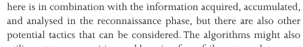
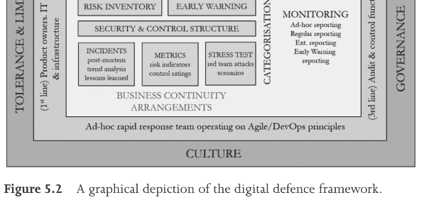
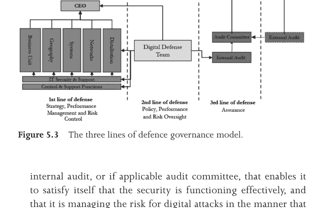
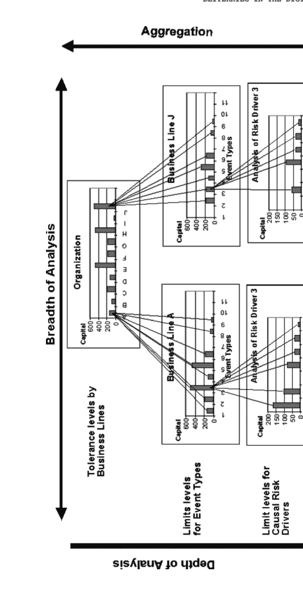

# 第四章

## 人工智能武器化

> 所有试图让我们的道德准则适应技术时代处境的努力都已失败。
> 
> 马克斯·玻恩（1882–1970）
> 
> 德国物理学家，量子力学先驱

这一章的内容实在难以在时间上固定，因为新的人工智能技术和工具正以越来越快的速度不断被开发和发布，到本书付印时，某些方面可能已经过时。然而，新一代人工智能的基本设计原则可以让我们洞察其武器化版本可能的样子及其能力。本章将讨论如何将这些整合到数字战争战略中，为近期可能出现的情况提供线索。如今，人工智能本身就像智能一样，作为一个概念很难界定，对其的许多哲学思考当然也值得单独成书。不过，自20世纪50年代起源以来，人工智能就意味着要模仿人类思维及其解决问题能力，这些能力可应用于日常和抽象情境。因此，人工智能最初指的是“通用人工智能”这一概念，旨在模拟

这一分析。

由于人工智能依赖于建立统计预测和模式识别，大量数据能够对算法进行校准和微调，使其越来越擅长识别更细微、更隐蔽的模式，并据此做出决策。这形成了反馈循环；随着更多数据的可用，它们可以增强算法，使其预测能力更强大。此外，现代计算环境（如云计算）所提供的原始计算能力，使得关联和分析大型数据集成为可能，因为与十年前相比，这些数据如今已经标准化且使用成本低廉。因此，大数据（其中很大一部分大体上是公开可得的，例如社交媒体上的数据）可被用于改进应用程序和算法。这些可能性显然也适用于数字战争，并将对数字武器的设计特征形成起到决定性作用。这正在影响传统网络安全的观点，后者强调两个方面：

- **代码漏洞**。攻击者试图识别代码或代码结构中的弱点，这些弱点可被利用以进入系统，进而实施间谍活动或破坏。
- **社会工程学**。攻击者试图通过各种针对人的操纵手段获取密码或类似信息，或通过欺诈性消息植入恶意软件，从而进入受限制的网络和系统。它还可以包括诱导毫无戒心的用户泄露机密数据或无意中传播病毒的行动。

但是，随着人工智能应用被武器化，必须增加一个方面，即识别各种数据模式中的弱点。模式识别作为一种技术，已经在许多应用中被大量使用，包括：

- 图像识别，该技术目前已发展到即使是在画质相对较低且模糊的动态图像中，也能轻松识别出个人面孔的阶段

更先进的人工智能应用的设计。它们旨在模仿人脑的过程，由相互连接的节点层组成，这些节点层被视为生物神经元的对应物，对输入进行数学计算，然后将结果传递到下一层，依此类推。这样，下一层中的每个节点都会接收来自前一层的计算结果，直到能够做出预测。随后，将这个预测与预期结果进行比较，并对节点间的每个连接进行调整和校准，直到预测与预期结果之间的误差降到最低。简而言之，“深度”指的是比典型神经网络使用更多的网络和层；过去只能处理单层神经网络，但随着计算能力的提高，已经可以计算多个。从这个意义上说，深度学习技术不仅仅是大规模的神经网络，它还可以部署其他技术，例如比较不同的回归模型以寻求最佳性能。与我们人类从错误中学习的方式类似，深度学习算法反复执行任务，不断进行哪怕很微小的调整，以提高结果的准确性，直到达到最优化。未来将包含这类人工智能方法的部分恶意软件类型如下：

- **蠕虫**是一种恶意软件，通过使用神经网络，识别目标属性（如地理位置、软件和用户活动）来运作，并在无需人工干预的情况下自行从一个系统传播到另一个系统。因此，蠕虫感染既难以遏制，也难以根除，因为蠕虫能够自我传播，并能将文件加密作为其“命令与控制”功能之一。由于能够通过每次被检测到的事件中迭代学习并做出相应调整来规避检测，蠕虫可以确定是什么导致自己被检测到，并据此重新设计自身，在准备

为了下一次攻击。例如，如果代码的特定部分导致了检测，它可以自行编程以更改该特定代码，或者如果其行为的某些方面被防病毒软件标记，它可以添加随机性以规避模式匹配规则。著名的蠕虫，例如前述的 WannaCry 和 NotPetya，已证明能够加密计算机文件并在被阻止和根除之前影响全球各地的系统。¹,² 下一代蠕虫将被增强，使其战术可以包括冒充人类互动、通过智能钓鱼邮件运行、部署机器学习或深度神经网络来掩盖勒索软件攻击，并且将操纵目标系统使其自行禁用安全措施。³ 一些安全专家预见，随着自动化的自我传播，将有可能在动态改变恶意软件的可识别特征的同时感染大量系统，从而减缓或完全避免检测。⁴ 这种类型的恶意软件可以被启用使其隐藏在其他应用程序内部以降低被检测的风险，并且具有如此隐蔽的特征，以至于防御者很难识别出正在进行数字攻击的信号。⁵

### Trojans
Trojans 是另一种类型的恶意软件，它创建自己的新文件版本以欺骗检测例程。IBM Research 开发了 DeepLocker，该技术于 2018 年向公众展示，旨在突出现有的<|message|> 人工智能方法如何与当代技术相结合来设计新一代恶意软件。它是怀着特定的隐蔽战术而开发的，即在识别出所寻求的目标并激活之前避免被检测。以视频会议软件为伪装，DeepLocker 在达到满足给定条件的系统之前会抑制其激活，然后释放其恶意代码。这使得恶意代码极难识别，除非知道激活条件，否则几乎不可能逆向工程。具有这些特征的恶意软件可以在不被

创建并插入完全定制的、可信的电子邮件，个性化到数百万封，这将大大提高其成功率。⁷

Deepfakes，即“深度学习”和“虚假媒体”短语的混合，将对数字武器产生巨大影响，目前最好通过使用自然语言处理软件的自动化聊天机器人来理解，有时被称为网络喷子。它们通过发送消息运作，试图通过在各种社交媒体上使用“正常”语言来表现得像人类，但迄今为止通常都很粗糙，以至于将其与真人区分开来很少是一个大问题。但改进的人工智能算法开始改变这一切，使这些机器人越来越难以检测。已经有算法能够分析一个人的语言使用、词语选择和语气，然后在提供足够数据的情况下相当令人信服地冒充该个人。对具有犯罪意图的团体的最终目标是能够生成针对特定个人的电子邮件或消息，并说服他们发件人是真实的人，甚至是他们已经建立了稳定关系的人。更惊人的是，现在已经有可能制作出相对令人信服的假视频和音频，将 deepfakes 提升到一个险恶的新水平，这些假内容变得如此逼真，以至于即使经过专业审查，有时也看起来真实，并且很可能说服至少一些目标相信其信息的真实意图。

2019 年，三星莫斯科的人工智能实验室发布了一个质量异常高的 deepfake。它是通过使用生成对抗网络 GAN 开发的。GAN 包含两个相互竞争的神经网络。一个网络称为生成器，根据真实图像准备一个特征。然后它将该特征展示给另一个网络，称为判别器，后者判断该图像是真实还是虚假。随着图像的创建然后被评判，复制品的真实感会随着判别器判断真实与否的能力下降而成比例提高。这种机器

学习技术的强大之处在于，它可以被训练仅从一张单一图像生成动态图像。计算机视觉技术，如焦点识别，可以与 GAN 结合来跟踪图像或视频中的特定对象。以前的方法需要数十万张图像，通常是视频的单个帧来训练模型模仿个人面孔，但这个特定模型只需要不超过 16 张图像，并且面部角度越多，就越能无缝地复制目标个人。该算法使用特定的面部特征，在模型的元训练阶段识别眼睛、鼻子、嘴巴和下颌线。一旦 GAN 理解了这些运动，它就可以以逼真的方式叠加新图像。该算法仅需要可以通过社交媒体或对目标个人的监视轻松获取的图像质量。⁸

Nvidia 的 StyleGAN 工具利用一种称为风格迁移的计算机视觉技术来生成合成肖像。StyleGAN 可以将一个人的特征转移到另一个人身上，制作出完全独特、合成的图像。按构建方式，它可以将高层次属性，例如人的姿势或身份，改变为低层次属性，包括头发长度和颜色以及皮肤特征在其生成过程中。这在创建更真实的在线人物时是一种有用的技术，其中社交媒体活动依赖于专门编程的机器人将叙事推向公众前沿。通过 StyleGAN，可以使用合成生成的图像创建稳健且独特的个人资料，这些图像被调整以适应真实人物的姿势或特征，据一些人称这可能已经在发生。⁹ GAN 也已应用于文本生成，据报道俄罗斯已部署数千个 twitter 机器人进行影响活动，尽管其中大多数很容易被识别为机器人。

通过面部特征点跟踪的增强，该跟踪识别面部的特定特征，它允许程序准确交换目标面孔。类似的技术已经存在于

到目前为止，这大多只是科幻小说的一部分，但通用人工智能长期以来的愿望是拥有能够自行学习的应用程序，这一点可以在无监督机器学习的<|message|> 形式中窥见。例如，一个基于无监督机器学习的 Twitter 机器人不得不很快下线，因为它开始模仿不雅的人类行为，包括它从 Twitter 用户那里学到的脏话。实质上，它正在变得人性化，但不是以预期的方式。这是机器学习应用程序在没有人类监督的情况下很容易模仿现实中不期望的版本的有趣例子。

但就目前而言，模式寻求算法仍然很大程度上需要人类的启动和干预，用代码编写何时、何地以及如何开始在根据预设标准的数据类型上寻找模式。加速人工智能革命的很大一部分原因是编程代码现在可以比以前更大程度地重复使用。这意味着新算法不再经常需要从头编写，而是通过开源设施，可以重用现有代码，尽管通常会为特定目的进行定制。因此，现在许多人工智能应用程序的核心代码都是公开可访问的。这意味着十年前仅研究人员才能使用且难以获取、被视为专有知识产权的算法，现在几乎可以立即供任何编写应用程序或软件的人使用。能够利用这些开源资源，恶意软件开发者和安全专家可以大大推进病毒和反病毒在攻击与反攻击的循环中。黑客正在将开源代码与插件和定制调整相结合来创建恶意软件。这些可以用于隐藏嵌入在看似标准应用程序中的恶意软件，其中代码的恶意行为要到应用程序到达特定目标时才会被触发。代码通常通过私钥控制，该私钥作为触发器来确定解锁和释放隐藏恶意软件的时间和地点。例如，正如第 3 章所讨论的，在对爱沙尼亚和

乌克兰，恶意软件开发人员自身并未编写太多代码，而是结合了暗网上可用的代码和工具，并利用其攻击已知弱点。这凸显了人工智能的一大优势，即其适应新环境或利用以往事件中获取的知识的能力。因此，算法可以具备学习和记忆攻击中有效方法以及如何规避威慑手段的能力。它们可以被设计得具有韧性，能够承受失败的渗透尝试，并调整自身以在后续攻击中成功。而且，它们一旦进入计算机网络，就能自我传播，因为它们被开发用于更广泛地搜索安全漏洞，其动态能力使其造成的破坏难以预见，因此它具有机会主义性质，利用大量攻击可能性。随着速度不断加快、无处不在，它正在创建更难以保护、更容易被利用的自组织网络，为基于群集的攻击打开了大门，在这种攻击中，单个应用程序或代码元素作为更大规模协调攻击的一部分执行特定功能。当一个人将人工智能算法整合到能够通信的互联设备网络中时，这些设备不仅能自行发起攻击，还能根据在攻击过程中学到的信息实时定制攻击——这是一个智能机器人集群，可以实时共享信息并相互学习。通过整合这些自学习技术，就能创建能够快速评估漏洞并应用方法来阻止防御措施的攻击。

总之，新兴的人工智能一代带来了许多特性，我们已经可以在数字武器的设计中注意到其中一些的影响：

- **大数据**。虽然获取大数据本身并非人工智能，但它为开发算法提供了素材，并正在成为数字战争的战场。由于现在可以存储和利用更多的数据，以前未知的模式可以被识别并用于攻击。

与其他秘密获取的数据结合，帮助创建潜在目标的心理和社会画像。收集、分类和分析这些数据过去将是一项非常耗时的工作，但通过利用自动化工具，这些工具可以促进识别和确认目标本人可能都没有完全意识到的模式，而这些模式容易被欺诈性利用或复制。模式识别算法可以根据政治倾向来定位群体，通过追踪某些政治观点（如左翼、右翼）或特定议程倡导者（环保、宗教）常见的词汇和短语，并专门用恶意软件只攻击这些个人，而不是其他人，寻求恐吓或以其他方式骚扰他们。

另一个途径是更传统的黑客方法，即非法访问系统以收集情报。对于计算机系统和网络，人工智能可以帮助检测数据在开放互联网上往来传输的模式，并连同审查系统留下的元数据，将有可能识别目标使用的软件和平台，以及使用时间和方式。同样，对于人类操作员来说，分析这些是一个复杂且耗时的过程，但配备了最新的人工智能应用以及如今廉价的数据处理成本，将使这一工作比以往容易得多。

人工智能应用还可以通过预测分析来搜索目标，从而增加攻击机会。在营销中，算法已经是识别潜在客户的标准手段，通过分析数千个因素来定时和校准促销活动的内容。

## 武器化阶段

虽然编写代码和组合工具包的工作在大多数情况下仍将是一项人类任务，但随着更先进的人工智能工具变得可用且更容易组合、修改和使用，恶意行为者的武器库将大大增强。这还包括开源人工智能代码库，这些代码库将降低成本，并增加设计更强大恶意软件的可能性，同时减少对高级编码能力和其他人工输入的需求。借助更先进的侦察战术，可以收集到更多关于目标个人及其行为的信息。更好的情报可以增强预测武器化代码可能遇到并需要规避的安全措施的能力。收集到的这些知识和行为模式可用于创建算法，自动化并预测其必须击败的安全安排。通过持续测试协议，可以基于特定的系统设置和安全软件组合不同的工具包来检测风险，例如前面描述的GAN。通过这种定制变体设计的恶意软件，然后可以用于如此复杂程度的定制攻击，这种复杂程度是人类可能能够开发的。这种复杂性还可以通过应用多态代码得到增强，多态代码可以识别其所运行的系统，并调整代码以显得安全而不被发现。举个简单的例子，一段代码可能能够判断出自己运行在一台设计师的电脑上，因为该电脑安装了设计软件，于是重写自身及其功能，使其看起来像是来自Adobe的代码，以避免被检测。该代码可以通过利用多态方法动态更改，变为“if photoshop_installed=true then rename_to_AdobePlugin”，从而使其更难被检测，并在入侵尝试中更有效。

## 入侵阶段

入侵阶段意味着将恶意代码送入目标计算机或系统。人工智能在这里的明显用途是与侦察阶段获取、积累和分析的信息相结合，但也有其他潜在策略可以考虑。算法还可能利用模式识别和从失败中学习，试图克服那些跟踪和警报异常流量及数据模式的安全系统。

目前使用的一种简单方法是在系统或网络上隐蔽安装恶意软件，即诱骗用户点击电子邮件附件。显然，如果它看起来过于明显是欺诈或仅仅被视为垃圾邮件，那么它会很快被发现并删除，通常邮件内容无法引起指定收件人的共鸣。但随着更先进的语言模型，特别是专门的自然语言处理工具，这些工具可以用来生成更接近特定社交媒体群组中对话的文本，或使用定制的企业行话，从而看起来像是真实人类的帖子或电子邮件，这将增加目标个人积极回应并下载包含恶意代码的可疑数据或文档的机会。这也意味着初始攻击可能不包含恶意软件，而是首先尝试诱骗和吸引用户回答一些算法计算出的特定问题。

用户可能会在信任建立后对此作出积极回应，从而为后续在相应对话链中传递恶意代码创造条件。这种方式将进一步降低被发现的风险，就像通过大规模分发电子邮件来植入恶意软件，然后希望尽可能多地欺骗受害者一样。因此，与依赖来自陌生来源、使用通用语言的电子邮件相比，利用精心伪造的虚假档案，以专门设计的语言进行定向攻击，将提高成功的可能性。

具备动态响应新信息能力的智能代理和模式识别工具，正使得无需程序员和黑客再通过自动化方法不断搜寻弱点、寻找最有前景的攻击载体成为可能。通过汇总和分析这些弱点，它们可以帮助制定针对每个目标独一无二的策略，从而使防御变得困难得多。随着深度伪造音频和视频的出现，可以模仿高级管理人员，打电话给下级员工并指示其安装特定软件或打开电子邮件附件，从而渗透网络。

如今，许多系统都是基于大量开源组件开发的，其原则是任何人都可以访问和阅读代码，以改进代码、消除缺陷，或将部分代码用于其他应用。GitHub 上存有庞大的代码库，许多组织在没有进行更严格安全审查的情况下，就直接使用其中提供的模块，有时还会对其进行修改以用于内部系统。开源架构在拥有诸多优点的同时，显然也伴随着重大的安全漏洞。因此，通过识别特定代码序列（例如 GitHub 代码库中的代码序列）中潜在的安全漏洞，攻击者可以借助代码识别工具，扫描内部系统中具有相似结构的代码、依赖于带有已知弱点模块块的代码，或直接从某个模块复制而来的代码，并加以利用。

从根本上说，这不仅开辟了一条破坏数据的途径，或者像震网病毒那样破坏硬件，而且还能通过篡改对手依赖特定数据集的业务模式，直接影响其决策。因此，经过人工智能增强的恶意软件将能够凭借显著增强的渗透性和破坏性，实现更精准的攻击。

总之，人工智能的应用将使恶意软件表现得更加接近人类，从这个意义上说，攻击的精准度会更高。例如，恶意软件可以更好地理解人类自然语言，从而生成包含恶意软件的定制化消息。此外，它还能通过自动化以人类无法达到的规模运作，不仅大幅增加攻击数量，还大幅增加攻击类型，包括数据泄露、勒索行动、破坏和中断攻击，以及变种攻击，从而不再需要相应数量的人员参与。攻击链中各阶段所建议的部分人工智能方法和工具概要如下表所示。

| 侦察 | 武器化 | 入侵 | 利用/扩展 | 命令与控制 | 行动 | 伪装 |
|---|---|---|---|---|---|---|
| 情报收集与分析，包括人工情报与系统 | 攻击规划 | 网络钓鱼与鱼叉式网络钓鱼 | 网络与系统测绘 | 域名生成 | 自学习恶意软件 | 规避发现的混淆技术 |
|  | 攻击代码生成 | 密码攻击 | 网络行为分析 | 自学习恶意软件 | NLP 操纵 |  |
|  | 分类器操纵 | 验证码攻击 |  | 基于蜂群的命令与控制 |  |  |
| 筛选最有前景的目标 |  |  |  |  |  |  |
| 漏洞检测 |  |  |  |  |  |  |
| 学习目标的标准行为 |  |  |  |  |  |  |

## 注释

- 1. Svensson, Erik, Magnusson, Jonas, & Zuave, Erik. Kryptomaskar och deras konsekvenser Åtgärder för cybersäkerhet utifrån fallen WannaCry och NotPetya (FOI-R--4774--SE ISSN 1650-1942, FOI，2019年6月).
- 2. Fruhinger, Josh. 什么是 WannaCry 勒索软件？它如何感染，谁应为此负责？（CSO，2018年8月30日）. https://www.csoonline.com/article/3227906/what-is-wannacry-ransomware-how-does-it-infect-and-who-was-responsible.html （访问于2021年1月1日）.
- 3. Lando, Gabriel. 机器对机器：审视人工智能驱动的勒索软件（FileCloud 博客，2018年8月27日）. https://www.filecloud.com/blog/2018/08/machine-vs-machine-a-look-at-ai-powered-ransomware/#.X-McsthKg2w （访问于2021年1月1日）.
- 4. Rhode, B.（编）. 人工智能与进攻性网络武器（Strategic Comments，第25卷，第10期，2019年）.
- 5. Stoecklin, Marc Ph. DeepLocker：人工智能如何驱动隐蔽的新型恶意软件（Security Intelligence，2018年8月8日）. https://securityintelligence.com/deeplocker-how-ai-can-power-a-stealthy-new-breed-of-malware/ （访问于2021年1月1日）.
- 6. 同上.
- 7. 网络安全与基础设施安全局. 警报（AA20-280A）Emotet 恶意软件（国家网络意识系统，2020年10月6日）. https://us-cert.cisa.gov/ncas/alerts/aa20-280a （访问于2021年1月1日）.
- 8. Barber, Gregory. 深度伪造技术越来越好，但仍易于识别（Wired，2019年5月26日）. https://www.wired.com/story/deepfakes-getting-better-theyre-easy-spot/ （访问于2021年1月1日）.
- 9. Satter, Raphael. 专家：间谍使用人工智能生成的面孔与目标建立联系（纽约：美联社，2019年6月13日）. https://apnews.com/article/bc2f19097a4c4ffaa00de6770b8a60d （访问于2021年1月1日）.
- 10. Hosseini-Asl, Ehsan, Zhou, Yingbo, Xiong, Caiming, & Socher, Richard. 用于无监督非平行语音域自适应的多判别器 CycleGAN（Salesforce Research，2018年7月9日）. https://arxiv.org/pdf/1804.00522.pdf （访问于2021年1月1日）.

与之竞争的国家也在储存和维护这些武器。人的意图似乎仍然重要，而且，因为我们的心理构成在200年里没有太大变化，甚至可能2000年来也没有变化，所以从克劳塞维茨的视角来分析数字战争是有价值的，并能就战争的未来提供宝贵的历史视角。但新的情况是，数字领域的出现创造了一个全新的维度和新的投放机制，提高了攻击的速度、范围、隐蔽性、精准度、扩散性以及攻击的广度，因为数字世界正日益成为真正重要的世界。即便可以说目前还没有发生过全面数字战争的实例，但已经有一些事件预示了未来可能的形态，这些事件是混合战争战略的一部分，而这类战略通常包含以下几个数字层面：

- 它们以多样化的工具为核心，这些工具大多具有非军事、非致命特性。
- 它们往往在匿名状态下或通过代理组织实施行动，使得溯源十分困难。
- 数据或信息正越来越多地被用作弹药，在此过程中，影响认知的能力可能具有决定性作用。
- 心理战被用来利用并试图在对手之间制造社会、宗教、政治、族裔或其他方面的分裂。
- 所谓的“震撼真相”，即使它们实际上是谎言，也被用来制造即刻的冲击效果，从而有效地使对手丧失还手之力（至少是暂时的），并使其转入守势。
- 数字工具和社交媒体行动被整合到总体战略中，以加速并加乘影响。
- 我们有意或无意留下的数据痕迹，正在成为一个新的战场。
- 可以通过施加经济压力来加剧攻击的严重性。
- 在进攻和防御两方面，越来越多地运用情报来制定更为精准的战略。

在混合冲突中，目标有时会是“弃子牺牲”类型，例如在更大势力附近被单独挑出来以使其屈服于其支配的小国。这一情景同样适用于附属企业，无论是被直接攻击还是作为附带损害被波及。这可以延伸到基本上任何被用来威胁主要对手的代理目标，通常具有经济性质。它们将被视为易于捕捉的对象，因为它们往往缺乏适当自卫的能力，也不太可能进行报复。因此，使用常规武器的能力和意愿仍然会发挥作用，因为攻击一个拥有令人印象深刻的军备库且嗜战成性的国家，将会是一个可能不会满足于数字上的针锋相对，而是可能寻求在“现实生活中”打击其敌人的对手。因此，侵略者需要考虑的不仅是报复的可能性，还有报复可能采取的形式。之前描述的对爱沙尼亚和乌克兰的攻击就是典型案例，说明一个实力远超的国家，在本例中被指认为罪魁祸首的俄罗斯，将如何以几乎没有报复风险的方式打击其较小的邻国。对于弱势一方，可行的策略之一是确保他们始终比其他潜在受害者跑得更快，通过拥有最具韧性的防御，或与更强大的国家结盟，以便他们可能被放过，因为还有更容易的目标可供攻击。与传统战争不同，侵略者涵盖范围很广，从国家到犯罪团伙、黑客行动主义者，甚至可能是不满但资源丰富的个人。有时这些人会联手合作，基于“敌人的敌人就是我的朋友”这一理念，无论理由如何，都能在不同程度上发动极具破坏性的数字攻击，甚至可能造成人员伤亡。本章的亮点是务实的认识，即数字战场将 overwhelmingly 涉及企业，无论是作为代理目标还是直接目标，并且现在对它们来说至关重要的是理解数字战争策略，其中一些与克劳塞维茨有关。提及闪电战是恰当的，因为它定义了其中许多策略：快速执行、通过人工智能增强的数字工具组合以最大化破坏效果，以及对心理战的高度重视以制造震撼。 Schwerpunkt 通常在一般规则下具有抽象性质，例如针对企业的品牌，无论是直接还是间接，这可能会导致其商业上的灭亡。由于某些数字攻击，例如关闭电网，确实具有造成身体伤害的倾向，无论是有意还是无意，它们因此应属于真正的战争定义。正如前所述，这一观点得到了以下见解的支持：它们通常由使用常规武器的威胁所支持，如果事态升级，特别是涉及国家时。 然而，鉴于数字军火库在很大程度上是非致命的，且“传统”战争的数量已减少，数字冲突的目标，与克劳塞维茨的观点一样，仍然共享他所定义的战争的最终目标，即通过瓦解对手的意志来征服，但在这种情况下不一定需要把敌人的头打爆。 从某种意义上说，数字战争既加剧了战争，也减少了战争。 有人指出我们现在正处于持续冲突状态的观点确实是成立的，但它是无血的，而且许多人很少注意到它，通常是匿名和秘密进行的，即使在最糟糕的情况下，通常也只是暂时中断互联网连接、在线银行服务无法使用，或电网关闭。 麻烦，确实如此，但它们通常不会持续超过几个小时，然后一切恢复正常。 这意味着世界已进入一个时代，其特征是低强度冲突的持续噪音，通常在幕后进行并针对代理目标进行，然而有时会爆发为全面战争。

侵略者本质上有两种核心策略可供选择，以征服对手：第一种是寻求消除其自卫的能力，或更可能的是心理意志，通过削弱其抵抗拒绝敌对要求的决心。另一种是通过施加如此高的成本或经济或政治痛苦，或有时仅仅是展示这种能力，使对手愿意在期望的条款上谈判结束敌对行动，或其威胁。 这两种替代方案中的第一种

渗透已识别的漏洞，如果攻击能够造成如此严重的损害，以至于它们会摧毁 Schwerpunkt 并使其超出快速修复的范围。 这作为一种进攻，如果恶意软件被消除，数据和服务得到恢复，并且如果敌人无法不断重新发明其数字武器库，很快就会衰退。 因此，如果防御者能够迅速堵住安全漏洞并中和恶意软件，攻击势必会消退，因为已知漏洞已被耗尽，优势随后转移到防御者一方，这一方面仍然使克劳塞维茨的前提成立。

克劳塞维茨三位一体也适用于数字环境，心理战寻求通过影响活动煽动激情；深度伪造可以被用来产生能够激发所需情绪的感觉。 目标设定背后存在理性，可能出于政治或纯粹经济目的，在这些目标与被发现和报复的风险之间进行权衡。 最后，创造性部分，或在克劳塞维茨的术语中是不理性的部分，现在可能比传统战争更重要，它寻求通过识别和规避漏洞和安全漏洞来克服数字摩擦。 然而，危险也存在，因为与传统战争不同，计算机系统如今高度互联，因此并非总是能够预见任何可能中断非预期目标的附带损害，例如病毒开始传播并感染外部系统，造成不可预测的摩擦，甚至可能影响攻击者。

## 数字攻击的解剖学

第3章中提出的 CHAOS 首字母缩略词是一种方法，为侵略者如何在最广泛的意义上构建数字攻击提供指导，随着新兴的人工智能技术，这一首字母缩略词的每个组成部分都将被强调。

- Cheap. 低成本的代码序列和来自众多库的现成工具，例如 GitHub，以及数据测试现在变得更加容易获取，使得数字武器的开发变得更加可行，涵盖更广泛的能力。 现在比以前更容易检测模式，特别是对社交媒体数据进行分析，在那里进行欺诈活动的机会已显著增加。 这提供了一个全新的可启用军火库的前景，而具有造成破坏的险恶意图的潜在数字战士的数量成倍增加。

- Hit-and-run. 社交媒体和其他平台的增加使用使得武器化和利用企业和个人用户应用、网络和系统中的安全漏洞变得更容易。 已经观察到人工智能工具如何被用来利用人类本性固有的弱点，特别是经验法则、粗心大意以及为实际原因而使用以规避繁琐安全例行的其他习惯。 这在规模、速度和有效性上前所未有。 模式识别工具，特别是神经网络，在捕捉被忽视的形成可检测模式的做法方面特别有用，而企业通常对此并不知情，至少在官方上是如此。 利用这些异常通常是快进快出攻击中选定的插入点。

- Anonymity. 攻击的发起者和来源通常已被证明很难，甚至不可能识别。 在匿名下运作，或确实甚至伪装，是数字战争战略中经常刻意的一部分。 其无处不在和不可预测的特征改变了战争的进行方式和战斗的进行方式。 数字战争的匿名性使传统的风险缓解变得复杂，甚至在一定程度上阻止了传统的风险缓解，例如先发制人的威慑和报复威胁。 这种匿名性还允许以混合方式进行攻击的编排，包括在多个领域和平台上，也许是为了给人一种多个敌人以协调方式攻击的印象。 改进的人工智能技术特别有助于减少对通常可追踪的恶意软件“命令与控制”阶段的依赖，因为

实现其目标。组织的科技基础设施及其品牌都可以被视为事实上的 Schwerpunkt。它们所突出的特征在于，它们是经济性质的目标，在很大程度上依赖于数字技术，无论从进攻还是防御的角度来看。正如 CHAOS 缩写中所指出的，数字战争为攻击者提供的诸多优势将确保经济和政治目标成为首选方案，而非像过去那样寻求征服物质财产或领土，或是在本语境下对公司本身的实际接管。准备一次数字攻击不需要组建一支拥有庞大武器库的士兵军队，也不需要进行此类准备所需的复杂后勤安排，包括确保武装部队有足够的动力去打一场可能危及生命的战争，而历史表明这往往是一个重大的阻碍。质量将先于数量，如果攻击者能够聚集一批对信息技术安全，尤其是如何规避信息技术安全有着强烈兴趣的聪明头脑，那么一次成功的行动就很可能实现。此外，攻击可以从自己 premises 的安全环境中进行，几乎没有生命风险，也无需物理进入另一个国家。正如所指出的，归因远非一目了然，这种不透明的数字地下世界允许攻击者在模糊性的掩护下行动，如果再配合指定的心理战行动，就意味着责任可以指向其他行为者，采用“分而治之”的方式，播下混乱，从而进一步提高此类攻击的效率。正如第 4 章所强调的，通过人工智能赋能技术使数字武器的功能得到改善，能够自主行动并不断嗅探安全漏洞，将使针对它们的防御安排变得越来越难以维持。发起数字攻击的交战方将有两个主要目标，要么渗透并针对对手，或其关联第三方的网络和系统，以进行间谍活动或破坏，要么针对品牌和声誉，寻求暂时或永久性的损害，或是制造对是否还能信任目标公司的怀疑。

通过社交媒体渠道影响公众舆论，即使是晦涩的渠道，如果巧妙操作，往往也会在主流媒体中产生回响，并且可以在相对较小的预算下进行。其影响可以通过自动化手段增强和传播，例如通过精心策划的社交媒体账号和聊天机器人营造出受欢迎和公众高度关注的印象。聊天机器人的任务是让社交网络的算法相信，植入的文章或帖子获得了其他看似真实用户的广泛支持，从而制造出一种共同意见的感知，看起来对某个论点有巨大支持，而事实上这是捏造的。

到目前为止，也可能无人不知，各种社交媒体上内容和用户的真正爆炸式增长，不同的观点和议程，使得真理的概念变得极其流动和难以捉摸。我们进入了一个谎言、半谎言、阴谋、怀疑和公开的秘密已成为（社会）现实的组成部分的时代。这是一个企业自豪地维护诚信和信任，却发现自己在充满挑战的环境中运营的环境，因为总有人会质疑它们及其动机，有时出于险恶的原因。已知的见解是，信任需要很长时间来建立，需要数年甚至数十年，但可能在几分钟内蒸发。在这样一个多维的格局中，人类通过经验法则和概括性假设来运作，以帮助他们在一个碎片化的世界中导航并避免信息过载。显然，通过应用这些启发式捷径，主要是通过习惯的力量，认知错误在所难免，而一个善于利用的敌人可以利用这一点来设计欺骗性宣传活动以改变叙事。1,2

随着真理的概念被稀释到几乎成为一个相对术语的地步，一种某种虚无主义情绪势必会变得普遍，这意味着如果对品牌的完整性发起攻击，信誉将难以维持。敌对者可以通过一种专门的策略传播怀疑来

在俄罗斯情报圈中，至少从 1960 年代起就已开发出方法，以系统地利用这些人类心理模式。它被称为“反射控制理论”，旨在操纵人类对现实的感知。7 该理论的核心是识别向目标受众传递信息的最高效策略，无论在时机还是内容上，都能微妙地改变他们的潜在动机和决策方式，这是通过让他们相信采取某种行动符合其最佳利益来实现的，即使客观上并非如此。之前描述的生成对抗网络目前主要用于制作奇思妙想的深度伪造，用于制作假色情视频和政治讽刺，但质量的迅速提升使其更难与真实的影片区分开来，它们将成为心理战行动的重要组成部分。这些可以几乎瞬间生成，因为生成器和判别器神经网络之间用于将其与真实材料对齐的迭代比较以机器速度和高精度运行。同样令人担忧的是，对这些深度伪造的任何收集到的反馈都可以作为另一个生成对抗网络的输入，其中这些反馈被分析以学习如何更好地制作操纵性帖子作为回应，在相当短的时间内就能找到合适的语气，推动其目标开始改变态度、偏好或行为，使其朝向所期望的方向发展。8

这些宣传活动的一个重要部分是不披露指定的新闻和帖子确实是有意欺骗，因此它们通常是秘密进行的，发起者不遗余力地掩盖不仅是他们自己而且是他们的动机；从这个角度来看，心理战本质上是非宣战的。因此，它们必须以这样的方式设计，使其能够与目标受众的喜好和厌恶相呼应，符合他们的道德和心理倾向，这些倾向是通过收集心理画像数据获得的，并在此数据的基础上集中注意力和努力。通过应用这种“过滤器”，它为一种抽象性质的 Schwerpunkt 提供了路径。9

除了宣传工作之外，这一第一阶段还包括对目标网络和系统的渗透，这将为攻击的第二阶段奠定基础，其中植入的恶意软件试图控制或破坏信息技术基础设施或应用程序。这启动了随后的第二阶段。

## 第二阶段：灰色地带战争

当对目标公司道德正当性或经济可行性的前景已植入足够的怀疑，并且恶意软件已被秘密安装时，第二阶段可能开始。它将主要在灰色地带环境中运作，这意味着法律后果可能并不那么直接明了。在这种环境中，意图和动机可能难以确定，包括识别与疑似肇事者的联系，操作的运作方式也可能故意被模糊或模仿已知黑客组织的风格以进一步掩盖踪迹。这将使数字取证在追究责任和收集证据的任务中变得具有挑战性，在某些情况下甚至是不可能的任务。由于不知道攻击者的潜在动机和身份，这营造了一种不确定性的氛围，在这种氛围中，被攻击方很难保证他们实际上控制着正在发生的事情，更重要的是接下来可能发生的事情。这种混乱和无序带来的后果进一步削弱了对目标的信任和信誉，将其描绘成无助，不知道接下来会发生什么或何时会停止，如果真的会停止的话。根据克劳塞维茨的理论，Schwerpunkts 将为攻击提供最佳的切入点，因为它们使对手最脆弱。防御者必须持续评估渗透安全措施的难度水平，不仅围绕关键信息技术资源，还包括外围防御较弱的应用程序和系统，甚至是外包的系统，这些系统仍可能破坏整体可访问性和功能性并留下受损的声誉。因此，这需要一个全面的

特别是，存在某些主题，新一代自主人工智能将在这些主题上产生特别重大的影响：

- *聚合*，人工智能应用能够比以往更简洁、更迅速地在更大规模上收集、整理、融合和分析数据，以识别模式，从而构建更精确的恶意软件，使其能够以更高的概率以定制方式规避安全安排，而非目前主要的标准化的做法
- *重复*，这些技术能够提供比大多数需要人工监督的现有人工智能应用更一致、更持久的任务和行动重复能力，而目前所需的人工工作有时相当可观，这会影响数字攻击的规模和程度
- *欺骗*，包括社会工程行动，其中机器生成的响应等显得比以往更像人类，它们可以给人留下对方是真实人类的印象，并且如果配备了内部信息，例如通过自然语言处理软件收集语言样本并模仿行话以营造熟悉感，就能够诱捕目标。这不仅针对人类，也针对用于判断对方是人还是机器的其他应用和软件，例如垃圾邮件或机器人过滤器。

## COMBATANTS

数字作战人员可以被视为六大主要类别，有趣的是，有许多攻击中这些主体以在常规战争中不常见的合作方式进行；因此它们之间存在相当模糊的界限。不仅他们的动机不同，尽管有时会重叠，而且他们的能力也不同，这在很大程度上但并非完全与分配的预算相关。它们是：

1 国家资助实体。国家资助实体由各种机构、数字武装力量或情报部门的一部分组成，有时组织成附属的“私人”安全公司，国家在其中持有影响力股份。它们可以作为招募有才华的个人黑客或黑客团体的渠道，为特定项目提供咨询，并不总是清楚他们最终实际上为谁工作。国家资助实体通常是数字作战人员中资金最充足的。它们的大部分行动都集中在心理战上，以推广首选的政治叙事，影响外国政府遵守其要求，或试图在目标国家制造政治、社会或民族不稳定。但也包括间谍活动，不仅针对军事目标，而且特别表现出对非法收集经济信息和知识产权的浓厚兴趣，这些信息被提供给国内企业以增强其竞争力。在较小程度上它们参与破坏活动，这也可能包括代理目标，例如构成被攻击国家基石的银行和能源公司；俄罗斯对爱沙尼亚和乌克兰的数字攻击就是典型案例。特别是中国、朝鲜和俄罗斯被指出是数字攻击中的积极国家。由于它们还拥有武装力量、外交和政治工具，其数字行动可以成为更广泛的混合政治/战争战略的一部分。

2 犯罪集团。他们的策略将从简单的分布式拒绝服务（DDoS）攻击和不太复杂的恶意软件到更先进的工具不等，旨在通过勒索和敲诈勒索金钱，其中深度伪造预计将在未来发挥重要作用。他们的策略不仅涉及攻击网络和系统，还可能包括威胁破坏公司声誉的活动。在光谱中技术较不精细的部分通常是年轻、经验不足的

## Figure 5.1 An overview of the strategic options available to combatants engaging in digital warfare.

## COMPONENTS OF DIGITAL WARFARE

- COMBATANTS
  - State sponsored
  - Criminal groups
  - Hacker groups
  - Hacktivists
  - Individual (ex)
  - Combined forces

- WHAT'S NEW
  - Weaponised AI
  - Chat Bots
  - Deepfakes
  - Problem seeking algorithms
  - Polymorphic code
  - et al

- CORPORATE TARGETS
  Different combatants seek specific objectives & strategic targets
  - SME
  - Listed companies
  - Multinationals
  - Proxy targets
  - Politically sensitive firms

## STRATEGIES

Attacking brand
Deep price or stock price, take-over
NO NEED TO TAKE OVER
DEPLOYING REPORTING TECHNIQUES

Attacking systems (stealing IP)
Espionage for crime
Sabotage for crime
CHALLENGE for crime
Data exfiltration

## ATTACK VECTORS

## HYBRID COMBINATIONS

- ESPIONAGE
- SABOTAGE
- Data Destruction
- DDoS
- REPUTATION
- Defacement
- Doxing
- FINANCIAL CRIME
- Blackmail
- Theft

Attacking systems
Attacking brand

## CORPORATION (domestic battlefield)

LEADERSHIP
Board of Directors
Org & Risk oversight
Management (C-level)
Strategy, Risk Appetite

FRAMEWORK
ISO 27001
NIST CSF
GDPR

## INCIDENT RESPONSE TEAM
Incident management
Scenario & stress tests

## IT Dept & Ops

- PEOPLE & Education
- Awareness & tools
- INFRASTRUCTURE
- Vulnerability Management
- IDENTITY & KEYS
- Access & security
- Administrative security

## DIGITAL DEFENSE

- Team
- Real-time monitoring
- Reporting
- Risk assessment
- Legal requirements
- Security architecture
- Technical policy & tools
- Security policy & tools

FIREWALL et al

## DIGITAL ENVIRONMENT (external battlefield, i.e. social media)

- Social Listening tools
- Threat Intelligence
- Threat hunting & mitigation

3rd party dependencies SLA, back-ups

这些观点应构成可行防御框架安排的基础。数字战争已超越了仅仅针对技术（无论是硬件还是软件）的攻击，并且存在一个社会维度，所有数据痕迹越来越多地被用作攻击的切入点。因此，通过促进对数字模式的理解，并认识到这些模式并非静态而是流动和动态的，随着新产品和服务、渠道以及员工和合作伙伴的出现而不断变化，捕获并隔离它们是应对数字攻击的关键缓解措施。

## THE DIGITAL DEFENCE FRAMEWORK

数字防御框架需要从对数字攻击解剖结构的理解开始，分解为代表既定策略的各个类别。通过确定并映射针对这些类别的持续敌对活动，一个组织良好的数字防御最有可能减少，或如果可能完全消除此类攻击的全部影响（图5.2）。

Figure 5.2 A graphical depiction of the digital defence framework.

来自各种作战人员的动机。分层防御框架可以确保检查和制衡的各层能够以协调的方式行动。因此，它应采用整体视角，嵌入到一个关注公司可能面临的威胁和风险的整体文化中。这在元层面上通过“不出意外”文化来表达，即在整个公司范围内建立风险监控和可视化的层级，并分配角色和责任以迅速处理和升级任何新兴事件，成为建立数字防御的指导原则。

规范和正式化适当文化的首要文件需要是一份由高级管理层和董事会批准的战略文件，以表明其重要性以及与其他指导文件同等的地位，突出公司基本原则。战略的目标应是正式化和传达组织抵御数字攻击的方法，包括其识别、评估、管理、衡量、监控和报告其现在和未来可能面临的所有与数字战争相关风险的方法。概述数字防御的战略文件至少应包括以下目标：

- 促进客户和股东价值的创造、提升客户价值和服务、实现战略和业务目标，并保护公司的资产，包括员工福祉以及在业务和地区范围内最大程度减少犯罪行为。
- 协助董事会和高级管理层阐明并传达整体风险承受能力和数字防御管理策略。
- 建议政策和指南以控制和加强公司的数字防御
- 通过在所有相关

- 支持内部审计职能和其他控制单位对全公司现有安全安排和控制措施的适当性与充分性进行有效、全面、独立且持续的质询。

## 政策网络

由于数字攻击的形式多种多样，即使公司设有专门的数字防御部门，部分潜在的数字风险敞口也可能由其他职能主要负责。这取决于司法管辖区和行业，以及外部法规和标准——这些法规和标准要么是强制性的，要么具有足够的重要性，以至于人们应当遵守。战略文件中的指导原则的实际实施在政策文件的层级结构中进行了概述，其中一些是为数字防御职能制定的，另一些则部分通过其他职能的角色和职责来体现。这些政策应被映射和关联起来，以便理解并调整任何潜在的政策纠缠，避免职能之间和职能内部可能出现的控制缺口。应考虑的政策通常包括以下内容。

- 概述数字防御团队角色与职责的政策
- 董事会运作政策
  - 董事会期望
  - 层级与组织结构
  - 战略与业务发展
  - 声誉、公共关系与品牌管理
  - 控制环境与审计职责
- 商业行为与道德准则政策
- 新产品、业务和服务审批政策
- 反洗钱政策与客户关系政策
  - 了解你的客户政策
  - 服务标准
- 客户与关系管理
- 数据保护，即GDPR
- **人力资源政策**
  - 工作场所与健康安全
  - 招聘
  - 雇佣实践，包括社交媒体行为
  - 个人股票交易与投资
  - 培训与教育
  - 绩效评估
- **监管、法律与合规政策**
  - 公司行动与事件
  - 诉讼与法律风险
  - 授权委托书与签署权限
  - 披露（“举报”）
- **反欺诈政策**
- **外包与供应商控制政策**
- **业务连续性政策**
- **风险容忍度政策声明**

## 治理结构

一个被广泛认可的治理模型，尤其在金融服务领域，用于确保高效处理各种风险，包括与技术的多个维度相关的风险，即三道防线模型（图5.3）。其设计原则是，管理风险的角色和职责必须明确界定，因为这构成了系统化识别和审查风险方法的基础，在此背景下进行了调整，以适应数字防御结构的要求。

- **第一道防线**。董事会设定数字风险的可接受容忍度，批准数字防御职能的战略，并负责安全安排和相关内部控制。它批准相关的适当政策，并寻求定期保证，在

  

  *图5.3 三道防线治理模型。*

  内部审计（或如适用，审计委员会）的支持下，使其能够确信安全运作有效，并且正在按照其批准的方式管理数字攻击风险。首席执行官在高级管理层的支持下，对组织面临的数字风险负有全面责任，并在数字防御团队、业务单元和支持单元负责人的支持下管理这些风险。首席执行官定期向董事会报告整个组织的数字风险管理情况。每个业务单元内的管理层和员工对管理遭受数字攻击的风险负有主要责任。他们必须对其各自责任范围内出现的任何风险的识别、评估、管理、监控和报告承担个人责任。

- **第二道防线**由数字防御团队组成。他们向高级管理层和业务单元管理层提供操作和技术支持与建议。在数字攻击风险的识别、评估、管理、计量、监控和报告方面提供的任何协助，主要以监督和按需方式提供。

数字防御团队需要在业务单元、IT职能和控制单元（如内部审计）之间找到自己的位置。那么，数字防御团队的角色和职责是什么？

正如三道防线模型所述，除非另有规定，其主要职能是提供咨询。其主要职责包括提供工具来识别、监控、计量和报告与数字攻击风险相关的所有信息，开展专项调查，并协调安排临时措施以转移正在进行的攻击。数字防御团队是组织内数字作战各方面的卓越中心。其关键作用是确保与重大数字风险识别和补救相关任务的有效及时完成。在涉及数字作战的任何监管联系和报告要求时，该团队作为联络点。其中一些关键职责包括：

- 向业务单元提供并指导压力测试、红队测试以及针对现有安全安排的情景测试，反馈结果，并根据需要就必要改进提供建议。
- 制定可接受数字风险的容忍度/限制水平指南。
- 帮助评估替代风险缓解策略的有效性。
- 在数字作战领域提供培训和教育的协助。
- 定期和按需提供有关数字攻击风险的报告和管理信息。
- 整理和监控适当的指标、事件信息、控制状态以及其他适当的数字风险跟踪指标。
- 汇总数据并维护数字风险清单。
- 分析和验证数字风险数据。
- 向高级管理层和董事会定期报告数字风险及具体调查结果。

数字环境。为了全面了解风险全域，风险清单除了对照已知数字攻击类型进行映射和分类外，还应与现有控制和指标挂钩，以评估其状态，并为每项风险指定负责的所有者；以往事件的数量和现有的业务连续性安排也应纳入风险清单。建立这样一种对风险全域的鸟瞰式监督，将有助于形成对更广泛主题和“热点”的理解。为了定性评估风险水平，应尽可能将各个风险敞口与频率和严重性的估计联系起来，以进行优先级排序，从而不断努力减少弱点并填补控制缺口。

## 数字攻击事件

通过整理和传播以往的数字攻击事件，可以建立一种企业记忆，提供“经验教训”来源和趋势分析，从而对以往发生的攻击类型、策略、恶意软件、可能的话战斗者类型以及数字战场提供有价值的见解。然而，这要求按照标准化的调查程序和模板，对每起事件进行深入的事后审查。该过程应着眼于最大程度降低未来发生类似事件的风险。存储事件的存储库应支持多维分析，因为其设计必须既容纳定量信息，也容纳定性信息，涉及按类别划分的财务损失、因果因素、业务单元、受影响流程、日期等，符合报告规则。这些信息应进行分类和整理，以便研究反复出现的趋势和模式。事后审查的一个重要部分是确定是否存在更大的图景，例如某次单独攻击是否像是更大事件的一部分？我们是唯一受攻击的组织吗？这会不会是代理攻击？作为该分析的一部分，识别肇事者并归因归属是重要的，这可能已经

应与国内和国际执法机构合作进行，同时确保法律后果和潜在的惩罚得以执行。事后分析还需要包含一个实际的“经验教训”阶段，涵盖：

- 已确定的入口点和恶意软件类型
- 事件分类
- 确定有多少数据被泄露或窃取
- 识别任何受影响的客户或第三方
- 执行全面的安全审查，确保病毒不再潜伏于网络或系统中
- 更新安全策略，以防止未来发生类似攻击
- 对于社交媒体上发生的品牌攻击，需要收集和分析另一组信息

## 风险指标

指标旨在衡量风险清单中识别并纳入的风险。因此，它们提供与特定流程中特定项目相关的信息。这些项目有助于预测特定风险。它们可能表明，在某个给定流程中存在一些问题，一旦发生数字攻击，这些问题可能导致损失。应尽可能在所有主要流程中确定风险指标，以确保对数字环境进行持续监控。随后，应开发适当的管理信息，以报告这些风险指标的状态，使管理层能够根据要求采取措施，旨在缓解任何已发现的控制缺口或风险，从而避免或限制潜在损失。通过持续跟踪指标，可以揭示风险水平及风险上升的新趋势，并据此采取行动。因此，风险指标的构建必须遵循一个主要设计原则：

捕捉并正确反映与数字攻击相关的风险的实际水平。

为确保风险清单中的全部项目都与某种定量跟踪指标相关联，需要进行一项映射工作（该工作可成为风险与控制（自我）评估的一部分），旨在为所有已识别的风险敞口和控制措施确定风险指标。单个风险指标的分析和设计方式需要在正式化的背景下进行（通常逐指标进行）：

- **单一与总体层面。** 单独研究和监控某个风险指标是否有意义，还是应与其他风险指标结合进行分析？
- **随时间变化的趋势。** 为了更好地理解数字风险敞口的演变，分析随时间变化的趋势可能非常有效。然而，如果某个流程经过了重大重新设计、系统升级或防火墙变更，历史数据的价值将有限，因此需要持续进行评估，以判断历史数据对每个风险指标的相关性。
- **报告频率。** 单个风险指标能够多长时间有意义地更新一次，该频率是否足以对相关风险敞口进行充分分析和管理？能否对全部项目应用实时监控？
- **优化计量单位。** 哪种计量单位能为分析提供最佳的信息价值？另一个关键问题是，在分析风险指标时，应关注绝对值还是相对值。
- **细分类型。** 通常，风险指标可以拆分为多种不同形式。可以按组织单位、客户、产品、系统、地理区域等进行衡量。决定哪种细分能提供最有意义的信息，只能通过逐案例的细致审查来确定。
- **频率与严重性。** 风险指标旨在捕捉事件的发生情况，还是实际/潜在影响的程度？

需要注意的是，数字防御的目的并不是完全消除数字攻击的风险，部分原因是成本考虑，同时也因为数字攻击的类型不断演变，可能会出现目前尚无防御手段的未知类型；而是要尽一切合理手段确保数字攻击的风险被最小化，使其保持在可容忍的界限之内。这些界限可以通过建立风险容忍度来正式化，并部分作为基准比较的手段，容忍度会因风险类型以及评估或经历风险的业务单元而异。因此，风险容忍度表达了组织愿意承担多大的风险，或对一定水平的安全漏洞的接受程度，容忍度可以用定量和定性两种方式表述。理想情况下，风险容忍度应以一致、现实且可衡量的术语进行量化，以便不仅在公司整体层面，还能在个别业务线和地理区域中支持风险排序。此外，可以为不同类型的客户、平台、网络、产品和服务设定容忍度水平，以清晰区分并确定风险热点可能所在。在切实可行的情况下，数字防御团队应尝试进行定量风险分析，以支持容忍度水平的设定，这最好以货币形式进行（尽管这并非总是容易）。被认为可接受的风险容忍度货币水平应与利润目标保持一致，以便恰当地理解风险与回报之间的关系。为便于容忍度水平的管理，需要建立系统和控制措施，以确保其得到遵守。在设定风险容忍度时，应考虑以下指导原则：

- 董事会可以将其风险容忍度表达为一个单一的货币金额，即其愿意为追求公司利润目标而承担的风险。在较低层级，风险容忍度用非财务术语表达的可能性与用财务术语表达的可能性一样大。
- 风险容忍度必须与公司的整体战略和目标相关联。风险指标、对控制与安全安排及事件的评估通常用于管理关键数字风险，并将支持对容忍度水平的监控。这些

图5.5 容忍度逐级分解为与特定风险类型和数字攻击事件的单个风险原因相关的限额。理想情况下，容忍度和限额水平都应赋予货币价值。

汇集情报以随时了解数字战争领域的发展，包括新类型的恶意软件和所采用的战术，数字防御团队可以根据这些洞察，通过运行作战模拟演练对现有控制措施和防御机制进行压力测试，以识别潜在漏洞，并教育员工提高其处理和应对各种可能攻击的技能。已知的攻击者策略可以按照CHAOS首字母缩略词或类似方法进行结构化，以更好地理解一旦攻击发起可能如何展开。因此，早期预警信号通常要么是一条重要的外部情报，要么是限额被突破，这表明数字攻击的风险水平已经上升，损失发生的可能性正在增加。这将需要采取某种行动，首先是向指定接收者发布专项报告，并可能调查限额突破的原因，或启动一项行动计划以降低即将发生的数字攻击的风险。这些临时早期预警报告将补充为不同受众准备的定期报告，旨在准确反映数字攻击风险的当前状态和数字防御的质量。

## 数字防御的支柱：控制与安全基础设施

控制与安全基础设施（从防火墙到识别恶意软件和病毒的软件）构成了数字防御的支柱；然而，这些设施通常以零散的方式安装和维护，无意中留下了潜在空隙，而经过精心侦察的黑客可以利用这些空隙。然而，对已公开的、因有效缓解和消除数字风险方面的不足而导致的失败案例进行研究后会发现，其通常比精心设计的恶意软件设法绕过防火墙和类似防御的能力更为普通。缺乏一个全面框架，明确界定角色与职责、行动与恢复

计划应如何应对数字攻击通常代表了大多数安全失败。高效的数字防御基于以下几个原则：

- 前述的三道防线框架
- 一个总体上的双重控制机制，或“四眼原则”，以避免关键或高风险流程或系统仅受一名员工影响的情况。从数字防御的角度来看，涉及敏感数据（客户静态数据、合同数据和支付数据）的业务流程应受双重控制。是否涉及敏感数据应在对各种流程进行风险分类时进行评估。对于高风险流程，双重控制必须是强制性的。

评估控制质量的责任，无论其实际形式如何，应在四个层级中进行安排：

- 个人层级
- 管理控制
- 由内部审计或企业安全部门等专业部门进行的评估
- 由外部方进行的评估（外部审计师和监管机构）

在这些层级中，数字防御团队根据需要提供建议，或可自行主动采取行动，通过负责召集响应团队来建立临时安全安排，以视必要立即终止威胁。

## 个人层面的控制

为了管理风险，员工——无论其职位如何——必须将自己视为风险的保管人。在此背景下，数字防御文化和对可能风险的认识发挥着至关重要的作用。

个人层面的控制质量可受以下因素影响：

- 采取预防措施，包括
  - 明确定义的招聘、留任和解聘员工的决策流程，包括基于绩效协议的胜任力模型和评估
  - 员工的谨慎选拔、任命、晋升和培训
- 最优地传达政策、文化、适用价值观，以及根据战略而定的目标和指标
- 培训，旨在提高风险意识
- 确保可能的惩戒措施，例如对员工不当行为的制裁，已明确定义并在必要时实施
- （高级）管理层的示范行为

## 管理控制

鉴于组织规模和经常需要的专业知识，管理层必须委派任务和权限层级。管理层尽管如此，仍需对已委派的任务负责。因此，管理层必须在业务流程和系统中建立风险控制措施。作为产品和流程的责任方，业务管理负责创造保障产品、服务和流程完整性的条件（例如，职责分离、双重控制、系统访问安全）。在此方面，适当的管理信息至关重要。监督这些控制的结构并监控其正确运行主要是业务管理的责任。员工——在所有层级——不得免除其被委派任务的责任，并有义务对其行为负责。这也适用于管理数字风险。这种委派、问责和控制的形式有时被称为“通过业务线控制”或简称为“管理控制”。

## 专业部门的评估

由于组织规模和复杂性以及有时需要的专业知识，（高级）管理者不亲自执行其风险控制任务可能更高效、更有效。在这种情况下，风险控制任务被委派给专业职能部门。这些专业职能部门的目的是为（高级）管理层提供关于组织特定部分或给定流程内风险管理的独立专家意见。专业职能部门可能专注于特定类型的风险或特定组织单位。然而， senior 和业务管理的责任不能转移给这些专业职能部门。

## 业务连续性安排：临时响应团队的重要性

一旦事件发生，关键是要有一个团队和流程到位，以便迅速处理事件，首先使其停止并确保业务能够继续运营。数字防御的关键组成部分是授权一个团队处理安全事件，直到威胁被消除且系统和流程完全恢复运行。这应包括建立能够即时恢复功能并开发预防性安排以关闭安全漏洞的资源，通常采用敏捷或 DevOps 方法运行。但韧性需要在开始时就得到实现，这意味着关键的企业职能必须能够在压力下运行；这种能力可通过压力测试来确定，并将包括确保数据、应用程序甚至半手动操作例程的备份存在，以防标准例程和数据流被恶意软件破坏或变得无用。这也意味着要有员工能够在普通员工因某种原因无法工作时处理这些情况。

展望未来，企业将不再完全依赖安全分析师手动响应事件，而将越来越多地像攻击者一样依赖人工智能来准备并立即响应数字攻击。这同时意味着人类专业知识仍将管理战略监督和决策，并执行旨在从长远角度提高整体韧性的补救工作。而且防御算法将被配置为自我重写，这被称为对抗性机器学习。因此，如果对手试图攻击并感染位于内部网络中的服务器，对抗性机器学习算法的目标本质上是弄清发生了什么，并基于洞察动态纠正和加强网络。但要做到这一点，这些防御算法只能通过接触入侵的示例和观察来学习。此类洞察大多将通过某种模拟战游戏获得，而非实际暴露，其中雇佣的黑客将尝试识别安全系统、防病毒软件和其他防御措施中的弱点，通过寻求未被发现地潜入并制造混乱和破坏网络。简而言之，他们试图模拟敌人可能尝试规避防御设施和计算机系统内部的情况。通常，他们会详细研究软件代码，寻找可以为其提供网络后门的缺陷，或绕过访问控制并获得未经授权的特权以操纵计算机或服务器。由于查找安全漏洞是一个高度复杂且繁琐的过程，然后识别出构成安全风险的那些漏洞，研究人员正在开发一种使用称为符号执行的技术对软件进行自动分析过程，以促进此练习。也有兴趣将这种符号执行与机器学习相结合，以创建快速威胁分析，这将使安全分析师能够抵御攻击，不仅识别恶意代码，还能理解其最终使命或目标。目标是开发能够立即自主响应正在发生的攻击的高度动态便携式工具。

世界和科技行业携手合作，就以下建议措施达成共识：

- 威胁情报的共享与分析。鉴于数字战的性质，情报必须超越“需知”原则，转向在得到证实的组织间实行“需共享”原则的预先防范；这一做法必须在国际平台上以全面、协调的方式得到扩展和确立。信息共享与协作对于迅速有效的行动至关重要，而迄今为止这方面的执行一直很困难。
- 加强国际规则以将鲁莽国家的行为排除在外，并确保法律能够遏制数字攻击日益增长的趋势。国际法律和规范应包括继续制定规则，明确禁止已日益被注意到的那种广泛而鲁莽的数字战活动。已有措施正在推进，例如联合国政府专家组2015年的报告，该报告于2019年获得联合国广泛认可，并得到全球网络空间稳定委员会（GCSC）的多利益相关方支持。牛津进程等有前景的倡议已做了重要工作，突出了现有国际网络相关法律所允许的保护措施，国际规则应包括对民主和选举程序更强的保护，正如《巴黎网络空间信任与安全呼吁》原则所反映的那样。此外，各国政府应采取新的、协调一致的措施来遏制实质上是私人部门的数字武装力量或军火库，这已创造出一类类似雇佣兵的战斗人员，以支持国家组织的攻击。
- 加强对数字攻击国家问责的措施。政府和私营公司在过去几年中已开始对数字攻击的国家采取公开问责的实质性行动，并正在考虑法律措施的框架。

**高级攻击有效。** 正如本书所述，有一类非常先进的数字武器正在被投放，仍有很少的组织为此准备了充分的防御措施。

**机会主义攻击有效。** 各类攻击者能够迅速且以机会主义的方式，根据社会趋势调整其武器，例如新冠疫情，包括社会操纵工具、软件和虚假网站。

**基本安全措施有效。** 许多数字攻击，即使是复杂的攻击，也已通过相对简单的安保安排得到缓解或预防。组织持续维护和升级其安全常规可能会受到影响，但通常遭受的后果较不严重。

**国家通常更侧重间谍活动而非破坏。** 国家的主要关注点是入侵系统或分发间谍软件，以获取军事、经济或技术性质的机密信息。他们还在收集个人信息，包括来自移动设备的位置和活动数据。他们的目标范围很广，例如政府、军事单位、政党以及大多数行业的公司。有迹象表明，这些大范围的方法意味着其情报收集工具缺乏精确性，他们采用地毯式方法来识别机会。

**攻击者正在利用供应商和第三方服务。** 网站、设备和工具作为网络基础设施和升级机制的一部分，是攻击者寻求未来间谍和破坏活动的入侵点。

**数字战的组织和手段正在不断完善。** 专业化和不断改进的

## NOTES

- 1. Kahneman, Daniel. A Perspective on Judgment and Choice: Mapping Bounded Rationality (American Psychologist, Vol. 58 (2003)). pp. 697–720.
- 2. Chotikul, Diane. Soviet Theory of Reflexive Control in Historical and Psychocultural Perspective: A Preliminary Study (Naval Postgraduate School, Monterey, California, 1986).
- 3. Vosoughi, Soroush, Roy, Deb, & Aral, Sinan. The Spread of True and False News Online (Science, Vol. 359, Issue 6380 (09 Mar 2018)). pp. 1146–1151.
- 4. Chandler, Daniel & Munday, Rod. A Dictionary of Media and Communication, The Thomas Theorem (Oxford: Oxford University Press, 2011).
- 5. Metz, Cade. Finally, a Machine That Can Finish Your Sentence (New York Times, 7 June 2019). https://www.nytimes.com/2018/11/18/technology/artificial-intelligence-language.html (accessed 1 January 2021).
- 6. Paul, Christopher, & Posard, Marek N. Artificial Intelligence and the Manufacturing of Reality (The Rand Blog, 20 January 2020). https://www.rand.org/blog/2020/01/artificial-intelligence-and-the-manufacturing-of-reality.html#1 (accessed 1 January 2021).
- 7. Thomas, Timothy. Russia’s Reflexive Control Theory and the Military (Journal of Slavic Military Studies, Vol. 17, Issue 2 (2004)). pp. 237–256.
- 8. Barber, Gregory. Deepfakes Are Getting Better, But They’re Still Easy to Spot (Wired, 26 May 2019). https://www.wired.com/story/deepfakes-getting-better-theyre-easy-spot/ (accessed 1 January 2021).
- 9. Leonenko, S. Refleksivnoe upravlenie protivnikom [Reflexive control of the enemy] (Armeiskii sbornik (Army Collection), No. 8 (1995)). p. 28.
- 10. Smith, Brad. A Moment of Reckoning: The Need for a Strong and Global Cybersecurity Response (Microsoft on the Issues. The Official Microsoft Blog, 17 December 2020). https://blogs.microsoft.com/on-the-issues/2020/12/17/cyberattacks-cybersecurity-solarwinds-fireeye/ (accessed 1 January 2021).
- 11. United Nations General Assembly. 74/28. Advancing Responsible State behaviour in Cyberspace in the Context of International Security (Seventy-fourth session Agenda item 93 Developments in the field of information and telecommunications in the context of international security, Resolution adopted by the General Assembly on 12 December 2019). https://undocs.org/A/RES/74/28 (accessed 1 January 2021).
- 12 Global Commission on the Stability of Cyberspace. Advancing Cyberstability Final Report (November 2019). https://cyberstability.org/report/ (accessed 1 January 2021).
- 13 Oxford Institute for Ethics, Law and Armed Conflict. The Oxford Statement on the International Law Protections against Cyber Operations Targeting the Health Care Sector (Blavatnik School of Government, University of Oxford). https://www.elac.ox.ac.uk/the-oxford-statement-on-the-international-law-protections-against-cyber-operations-targeting-the-hea (accessed 1 January 2021).
- 14 Paris Call. Paris Call. For Trust and Security in Cyberspace. (Paris Call, 11 December 2018). https://pariscall.international/en/ (accessed 1 January 2021).

Cybersecurity & Infrastructure Security Agency. Alert (AA20–280A) Emotet Malware (National Cyber Awareness System, 6 October 2020). https://us-cert.cisa.gov/ncas/alerts/aa20-280a (accessed 1 January 2021).

Department of Homeland Security/Cybersecurity & Infrastructure Security Agency. Understanding Denial-of-Service Attacks (Security Tip ST04-015, 04 November 2009). https://us-cert.cisa.gov/ncas/tips/ST04-015 (accessed 1 January 2021).

Doob, Leonard W. The Strategies of Psychological Warfare (Public Opinion Quarterly, Vol. 13, Issue 4, (1949)). pp. 635–644.

Ellul, Jacques. Propaganda: The Formation of Men's Attitudes ([Propagandes] Translated by Konrad Kellen & Jean Lerner from original 1962 French edition. New York: Vintage Books, 1973).

Emerging Technology from the arXivarchive page. The First DDoS Attack Was 20 Years Ago. This Is What We've Learned Since (MIT Technology Review, 18 April 2019). https://www.technologyreview.com/2019/04/18/103186/the-first-ddos-attack-was-20-years-ago-this-is-what-weve-learned-since/ (accessed 1 January 2021).

Frieser, Karl-Heinz. The Blitzkrieg Legend: The 1940 Campaign in the West ([Blitzkrieg-legende: der westfeldzug 1940] trans. J. T. Greenwood. Annapolis, MD: Naval Institute Press, 2005).

Fruhinger, Josh. What is WannaCry Ransomware, How Does It Infect, and Who Was Responsible? (CSO, 30 August 2018). https://www.csoonline.com/article/3227906/what-is-wannacry-ransomware-how-does-it-infect-and-who-was-responsible.html (accessed 1 January 2021).

Global Commission on the Stability of Cyberspace. Advancing Cyberstability Final Report (November 2019). https://cyberstability.org/report/ (accessed 1 January 2021).

Google Official Blog. A New Approach to China (12 January 2010). https://googleblog.blogspot.com/2010/01/new-approach-to-china.html (accessed 1 January 2021).

Greenberg, Andy. Petya Ransomware Epidemic May Be Spillover From Cyberwar (Wired Magazine, 28 June 2017). https://www.wired.com/story/petya-ransomware-ukraine/ (accessed 1 January 2021).

Greenberg, Andy. The Untold Story of NotPetya, the Most Devastating Cyberattack in History (Wired Magazine, 22 August 2018). https://www.wired.com/story/notpetya-cyberattack-ukraine-russia-code-crashed-the-world/ (accessed 1 January 2021).

Griffin, Andrew. 网络攻击：切尔诺贝利辐射监测系统遭全球性黑客攻击（《独立报》，2017年6月27日）。https://www.independent.co.uk/news/world/europe/chernobyl-ukraine-petya-cyber-attack-hack-nuclear-power-plant-danger-latest-a7810941.html（访问日期 2021年1月1日）。

Haizler, Omry. 美国网络战历史：对现代网络作战结构和决策制定的影响（国家安全研究所。网络、情报与安全，第1卷，第1期，2017年1月）。https://www.inss.org.il/he/wp-content/uploads/sites/2/system-files/The%20United%20States%20Cyber%20Warfare%20History%20Implications%20on.pdf（访问日期 2021年1月1日）。

Headquarters; Department of the Army. 附录 I：心理战技术（《心理作战野战手册》第33-1号，1979年8月31日）。

Hosseini-Asl, Ehsan, Zhou, Yingbo, Xiong, Caiming, & Socher, Richard. 用于非平行语音域自适应的多判别器 CycleGAN（Salesforce Research，2018年7月9日）。https://arxiv.org/pdf/1804.00522.pdf（访问日期 2021年1月1日）。

Jowett, Garth S., & O’Donnell, Victoria. 宣传与说服（Thousand Oaks, CA：SAGE Publications, Inc.，第5版，2011年）。

Kahneman, Daniel. 判断与选择视角：有限理性图谱（《美国心理学家》，第58卷（2003年））。第697–720页。

Karlins, Marvin, & Abelson, Herbert I. 说服：观点与态度的改变（New York：Springer，第2版，1970年）。

Kilcullen, David. 意外游击队：在更大冲突中作战的小规模战争（Oxford：Oxford University Press，重印版，2011年）。

Lando, Gabriel. 机器对机器。人工智能驱动勒索软件概览（FileCloud 博客，2018年8月27日）。https://www.getfilecloud.com/blog/2018/08/machine-vs-machine-a-look-at-ai-powered-ransomware/#X-McsthK-g2w（访问日期 2021年1月1日）。

Leonenko, S. 反射性控制敌人 [Reflexive control of the enemy]（《军队文集》，1995年第8期）。第28页。

Lerner, Daniel. 对纳粹德国的心理战：Sykewar 运动，从D日到VE日（Boston, MA：MIT Press，1971年）。

Lind, William S. 理解第四代战争（2004年1月15日）。www.antiwar.com（访问日期 2021年1月1日）。

Lind, William S., Nightengale, Keith, Schmitt, John F., Sutton, Joseph W., Wilson, Gary I. 战争面貌的改变：进入第四代（《海军陆战队公报》，1989年10月）。第22–26页。

Messmer, Ellen. 塞尔维亚支持者攻击北约、美国网站（CNN，1999年4月6日）。http://edition.cnn.com/TECH/computing/9904/06/serbnato.idg/index.html（访问日期 2021年1月1日）。

Metz, Cade. 终于，一台能完成你句子的人工智能（《纽约时报》，2019年6月7日）。

Nakashima, Ellen. 中央情报局称俄罗斯军方在乌克兰发动“NotPetya”网络攻击（《华盛顿邮报》，2018年1月13日）。https://www.washingtonpost.com/world/national-security/russian-military-was-behind-notpetya-cyberattack-in-ukraine-cia-concludes/2018/01/12/048d8506-f7ca-11e7-b34a-b85626af34ef_story.html（访问日期 2021年1月1日）。

Nakashima, Ellen, & Warrick, Joby. 官员称 Stuxnet 是美国和以色列专家的作品（《华盛顿邮报》，2012年6月2日）。https://www.washingtonpost.com/world/national-security/stuxnet-was-work-of-us-and-israeli-experts-officials-say/2012/06/01/gJQAlnEy6U_story.html（访问日期 2021年1月1日）。

Naveh, Shimon. 追求军事卓越：作战理论的演变（London：Frank Cass，1997年）。

Oxford Institute for Ethics, Law and Armed Conflict. 《牛津声明》关于国际法对针对医疗卫生部门的网络行动的保护（牛津大学布拉瓦尼克政府学院）。https://www.elac.ox.ac.uk/the-oxford-statement-on-the-international-law-protections-against-cyber-operations-targeting-the-hea（访问日期 2021年1月1日）。

Paris Call. Paris Call。网络空间信任与安全（Paris Call，2018年12月11日）。https://pariscall.international/en/（访问日期 2021年1月1日）。

Paul, Christopher, & Posard, Marek N. 人工智能与现实的制造（The Rand Blog，2020年1月20日）。https://www.rand.org/blog/2020/01/artificial-intelligence-and-the-manufacturing-of-reality.html#1（访问日期 2021年1月1日）。

Pratkanis, Anthony, & Aronson, Elliot. 宣传时代：说服的日常使用与滥用（New York：Holt Paperbacks，2001年）。

Qualter, Terence H. 宣传与心理战（政治科学研究。New York：Random House，1962年）。

Rhode, B.（编）。人工智能与进攻性网络武器（《战略评论》，第25卷，第10期（2019年））。

United Nations General Assembly. 74/28. 在国际安全背景下推进网络空间负责任国家行为（第七十四届会议议程项目93 信息和电信领域的发展在国际安全背景下，2019年12月12日大会通过的决议）。https://undocs.org/A/RES/74/28（访问日期 2021年1月1日）。

US Department of Justice, U.S. Attorney’s Office, Eastern District of New York. 两起国际网络犯罪团伙被瓦解，八名被告因数字广告欺诈造成数千万美元损失被起诉（2018年11月27日）。https://www.justice.gov/usa0-edny/pr/two-international-cybercriminal-rings-dismantled-and-eight-defendants-indicted-causing（访问日期 2021年1月1日）。

Valery, Gerasimov. 科学在预测中的价值（《军工信使》，2013年2月27日）。https://vpk-news.ru/sites/default/files/pdf/VPK_08_476.pdf；翻译下载自 IES https://www.ies.be/files/Gerasimov%20HW%20ENG.pdf（访问日期 2021年1月1日）。

Vest, Jason. 第四代战争（《大西洋月刊》，2001年12月01日）。

von Clausewitz, Carl. 《战争论》[Vom Kriege] 编辑和译者 Howard, Michael；Paret, Peter, Princeton, NJ：Princeton University Press（1989年）[1832年]。

Vosoughi, Soroush, Roy, Deb & Aral, Sinan. 网络上真实与虚假新闻的传播（《科学》，第359卷，第6380期（2018年3月09日））。第1146–1151页。

Wadell, Kaveh. 困扰早期艾滋病研究人员的计算机病毒（《大西洋月刊》，2016年5月10日）。https://www.theatlantic.com/technology/archive/2016/05/the-computer-virus-that-haunted-early-aids-researchers/481965/（访问日期 2021年1月1日）。
