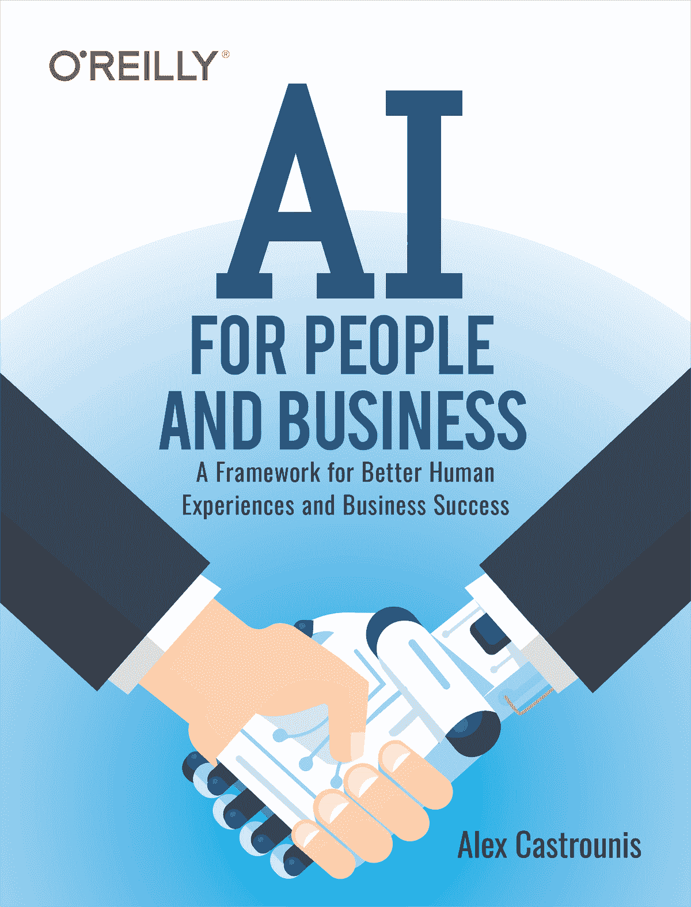
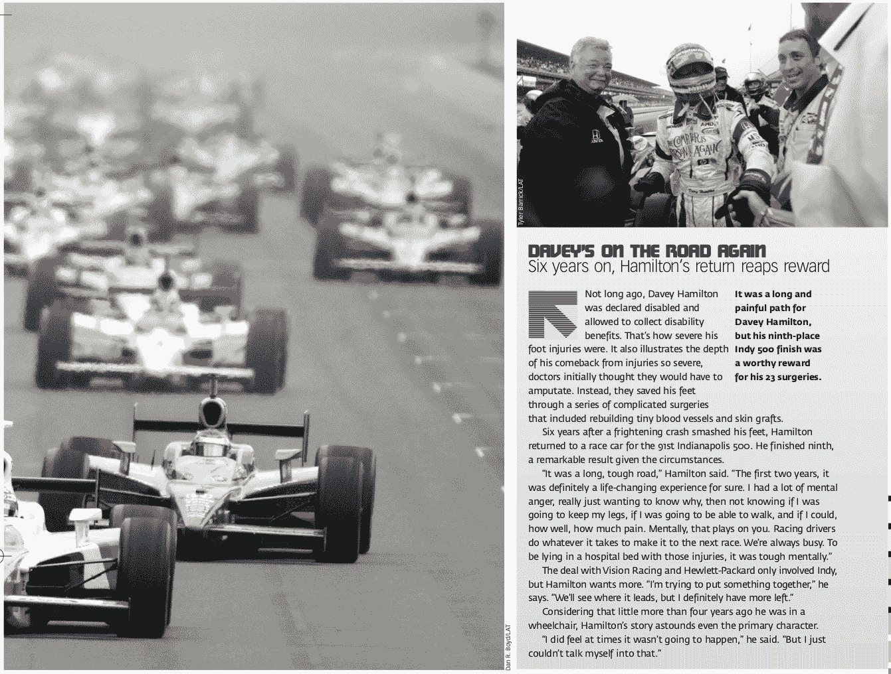

# 人们和企业的 AI：更好的人类体验和商业成功的框架

## 对 *AI for People and Business* 的赞誉

> 对于有兴趣了解人工智能并释放其益处的企业高管和管理人员来说，这是一本必读之作。Alex Castrounis 将复杂主题简化为任何人都可以开始在其组织内部利用人工智能。

> Dan Park，Uber 的总经理兼总监

> Alex Castrounis 一直走在帮助组织理解人工智能的潜力并利用其益处的前沿，同时避免可能导致失败的诸多陷阱。在这本必不可少的书中，他与我们分享了他的专业知识。

> Dean Wampler，博士，Lightbend 的快速数据工程副总裁

> 随着人工智能在许多不同行业产生的巨大影响，所有组织领导者发展基础理解变得至关重要……而这本书正是提供了这一点。

> David Bledin，Google 总监

> 一次迟来的深入探讨，阐述人工智能如何改变组织生态系统以及其中人们的生活。AIPB 框架是人工智能之旅中每位商界人士必不可少的路线图。

> Mark Fetherolf，Numinary Data Science 首席技术官，《Real World Machine Learning》（Manning）合著者

> 一份组织良好、非常易读的非技术性综述，介绍了经常被误解的人工智能和机器学习科学。我强烈推荐这本书给渴望在这一重要领域获得素养的企业领导者和好奇的消费者。

> Richard B. Noyes，天使投资人，前 Astra Pharmaceuticals NA 首席财务官

## 前言

### 本框架和本书的动机

获得应用数学硕士学位（获优异成绩）后，我成为了一名 IndyCar 赛车工程师和比赛策略师，曾在全球参加了 100 多场比赛，包括多次印第安纳波利斯 500。我还领导了 Andretti Autosport 的车辆动力学和数据科学部门，该部门帮助推动了四辆 IndyCar 赛车队的成绩。

在美国职业赛车运动中，赢得印第安纳波利斯 500 是最终目标。我在高中时参加了第一次印第安纳波利斯 500。如果你从未去过，我强烈推荐。这一赛事确实是赛车运动中最伟大的盛事，也是全世界规模最大的单日体育赛事。就容量而言，这条赛道本身是 [世界上最大的体育设施](http://bit.ly/2Wzj0a2)。

我参加的第一年，1992 年，竟然成为历史上最接近的印第安纳波利斯 500 完赛（至今仍是），最终以 Al Unser Jr. 以 0.043 秒的优势击败 Scott Goodyear 获胜！想想看！那是在近三小时的比赛中，平均时速超过 220 英里，行驶 500 英里（相当于从芝加哥开车到多伦多）之后，不到十分之一秒的一半！

我被震撼得如此之深，以至于那天我走出印第安纳波利斯赛车场（IMS）时告诉同行的人，我总有一天会从事 IndyCar 赛车运动，剩下的就是历史了。此外，非常巧合的是，我的赛车生涯始于为 Al Unser Jr. 工作，他正是我在孩童时期观看的那场印第安纳波利斯 500 的获胜车手。我加入时担任 Alan Mertens 的首席助理工程师，而 Mertens 正是设计出 Unser 于 1992 年获胜的那辆赛车的工程师！

图 P-1 显示了 2007 年印第安纳波利斯 500 之后《*Racer*》杂志上的一篇文章图片，当时我是 Davey Hamilton 的比赛工程师和策略师。图片中我站在右侧庆祝第九名的完赛，而发车位置是第 20 位，这是 Davey 在 2001 年德克萨斯赛车场发生可怕且严重的撞车事故后接受 23 次手术重建腿部和脚部后的惊人复出之战。

随着我的赛车生涯发展，我很快了解到职业赛车运动涉及在类固醇上产生竞争优势。在那个层面上比赛需要强烈的创新、持续的优化、完美、大量数据的先进分析、坚如磐石的团队合作与协作，以及以常人难以想象的速度即时执行和适应的能力。所有这一切都在巨大的压力和问责之下进行。最终，职业赛车运动的一切都在于最大化洞察力，以在尽可能短的时间内推动并受益于决策、行动和结果。这就是竞争优势和顶尖成绩的产生方式。

作为一名使用人工智能、机器学习和数据科学来优化赛车设定和比赛策略的 IndyCar 赛车工程师和比赛策略师，针对特定的车手、赛道布局（超级高速赛道、短椭圆形赛道、公路赛道、街道赛道）和条件（天气、赛道表面）组合，我能够帮助我的车队赢得许多比赛和领奖台成绩，包括赢得加州长滩的历史性的最后一场 Champ Car（前身为 CART）比赛。我直接与许多知名车手和车队老板合作，包括 Michael Andretti、Al Unser Jr.、Jimmy Vassar、Will Power、Tony Kanaan、Danica Patrick 和 Ryan-Hunter Reay 等。

你可能会想，这与这本书、它所涉及的框架以及人工智能一般有什么关系？答案是一切！让我解释一下。

在赛车运动中度过了大约 10 年后，我决定转型进入科技行业。我很快意识到，就像赛车一样，企业也在不断努力击败竞争对手以获胜。有件事很快变得清晰：赢得比赛所需的要素不仅适用于赛车，也适用于企业，无论行业或规模如何。虽然每个企业的“获胜”定义可能不同（例如，实现特定的业务利润和增长目标），但获胜所需的条件是相同的。在赛车和商业中，获胜，尤其是持续获胜，需要竞争优势，即以竞争对手无法做到的方式理解、行动并实现绩效水平。

基于我在赛车和商业领域的专业经验，竞争优势主要来自两个方面。首先，对于具有某种形式用户界面（UI）的产品，竞争优势来自卓越的设计、优化的用户体验（UX）以及令人愉悦的功能。其次，也是我认为最重要的，它来自于拥有“正确”的数据，制定利用数据的制胜策略，执行该策略，然后利用数据持续改进和优化事物。

自从离开赛车以来，我利用我在商业、分析和产品管理方面的专业知识，帮助各行各业不同规模的公司受益于技术创新和数字化转型，并构建优秀的数据产品。通过演讲和教学，我还帮助数千人掌握数据科学和高级分析的细节和益处。

我是 InnoArchiTech 的创始人、首席执行官和首席顾问，这是一家帮助企业领导者了解如何利用其数据的咨询公司。我的主要目标是帮助企业领导者制定利用数据的愿景和战略，并构建优秀的数据产品和解决方案。我非常有兴趣帮助消除与数据科学和高级分析相关的困惑。

本书及其所呈现的框架基于这些目标以及我近 20 年的现实世界创新、经验和专业知识；旨在通过建立在制胜的 AI 愿景和战略之上的端到端 AI 创新，指导创造更好的用户体验和商业成功。

# 本书导航

本书分为四个部分。第一部分 介绍并详细阐述 AI for People and Business（AIPB）框架、其北极星、优势和组成部分。它以非技术性的方式概述了 AI 和机器学习，以及现实世界 AI 应用和机会的概述。这将有助于激发想法，并提供开发相关 AI 应用和用例的愿景和战略所需的背景。

第二部分 是关于制定 AI 愿景的。它首先深入讨论 *为什么* 要追求 AI，然后为不同利益相关者（如企业、客户和用户）定义与 AI 愿景一致的目标。随后我们将讨论人们的需求和期望，以及如何将其转化为优秀的 AI 驱动产品和更好的用户体验。

第三部分 是关于制定 AI 战略的。它专注于科学创新、AI 就绪度和成熟度以及实现 AI 成功方面的关键考虑等概念。你应使用这些概念按照 AIPB 定义进行适当的评估，以制定填补差距和解决关键考虑因素的战略，以及制定与愿景一致的 AI 解决方案战略。

第四部分 以对 AI 对就业的潜在影响、最终想法以及 AI 的未来，特别是应预期和警惕的内容的讨论作为结尾。

请随时访问 [*https://aipbbook.com*](https://aipbbook.com) 获取最新的 AIPB 信息和资源。感谢您购买本书，希望您喜欢！

# O’Reilly 在线学习

近 40 年来，[*O’Reilly Media*](http://oreilly.com) 一直提供技术和商业培训、知识和见解，帮助企业取得成功。

我们独特的专家和创新者网络通过书籍、文章、会议和我们的在线学习平台分享他们的知识和专业技能。O’Reilly 的在线学习平台为您提供按需访问现场培训课程、深入学习路径、交互式编程环境，以及来自 O’Reilly 和 200 多家其他出版商的庞大文本和视频收藏。更多信息，请访问 [*http://oreilly.com*](http://oreilly.com)。

# 如何联系我们

请将有关本书的评论和问题发送给出版商：

*   O’Reilly Media, Inc.
*   1005 Gravenstein Highway North
*   Sebastopol, CA 95472
*   800-998-9938（在美国或加拿大）
*   707-829-0515（国际或本地）
*   707-829-0104（传真）

我们为本书设有网页，在此列出勘误、示例和任何其他信息。您可以通过 [*http://bit.ly/ai-for-people-and-business*](http://bit.ly/ai-for-people-and-business) 访问该页面。

请不要忘记更新上面的链接。

如需对本书发表评论或提出技术问题，请发送电子邮件至 *bookquestions@oreilly.com*。

有关我们的书籍、课程、会议和新闻的更多信息，请访问我们的网站 [*http://www.oreilly.com*](http://www.oreilly.com)。

在 Facebook 上找到我们：[*http://facebook.com/oreilly*](http://facebook.com/oreilly)

在 Twitter 上关注我们：[*http://twitter.com/oreillymedia*](http://twitter.com/oreillymedia)

在 YouTube 上观看我们：[*http://www.youtube.com/oreillymedia*](http://www.youtube.com/oreillymedia)

# 致谢

感谢您，本书的读者。撰写本书是一项重大而非常困难的工作，如果您阅读它并学到新的有价值的知识，那么一切都是值得的。

感谢 Alan Mertens 和 Chris Mower 冒着风险聘用一位名不见经传且相对缺乏经验的赛车工程师和赛车策略师。正是因为他们，我才得以在职业赛车运动的最高水平工作和竞争，环游世界，与这项运动历史上最伟大的名字合作，并体验到赢得比赛难以形容的激动。所有这些都为我赛后职业生涯的成功奠定了基础。

感谢所有在我职业生涯中帮助过我的老师、专家、同事和导师。那些出于造福他人的目的分享知识和专业技能的人，确实在帮助让世界变得更美好。

感谢 Matt Mayo 成为一位优秀的合作者，并将我介绍给 Marsee Henon。

感谢我的图书审阅者 Beth Partridge 和 Matt Kirk。他们都提供了宝贵的见解和想法，我的书因他们的帮助而变得更好。此外，我还要感谢所有在本書中被引用的高质量作品和思想的人，以及在途中提供建议的任何人。

感谢 O’Reilly Media 的所有人员，即使我可能没有直接或实质性地与他们互动，但他们帮助制作了本书。我还要感谢 O’Reilly Media 出版我的书。我读过许多 O’Reilly 的书籍，参加过会议，受益于其在线学习平台，并且总体上是其粉丝。能将我的名字与 O’Reilly Media 一起放在这本书上是一种荣幸。

特别是在 O’Reilly，我要感谢 Marsee Henon 介绍我认识我的收购编辑 Mike Loukides。感谢 Mike 以及 O’Reilly 的 Nicole Tache 分享我对本书的愿景、提供出色的点子，并帮助让本书成为可能。我还要感谢 Nicole 的编辑工作，她帮助我做出了许多必要的改进。

我要感谢所有参与本书制作的 O’Reilly 出版制作人员，特别是 Rebecca Panzer 和 Nan Barber。我还要感谢 Bob Russell 的校对专业知识。

我特别要感谢我的开发编辑 Jeff Bleiel，感谢他所有的精彩点子和改进，以及在我从咖啡店工作时，在我们会议期间忍受嘈杂的音乐和意式咖啡机噪音。最重要的是，我要感谢 Jeff 成为一位优秀的合作者，并帮助让我的书变得更好。

我要感谢 Kate Shoup，这位挚友和同行作者。她丰富的专业写作和编辑经验以及建议被证明是无价的。她在赛事活动中也是一个令人惊叹的主持人。感谢所有在我一生中一直支持我的其他好朋友。

特别感谢我的家人和朋友，他们提供了持续的爱与支持。特别是，我要感谢 Nancy 和 Richard Noyes 以及 Lourdes 和 Alain Weber 在整个写书过程中给予的关注、问候和鼓励。我还要特别感谢 Richard 立即提供审阅帮助，随后提供了宝贵的见解和建议。

最后，本书献给我的挚爱妻子 Stephanie 和母亲 Linda。我要感谢我的母亲她坚定不移的爱、支持，以及她在我一生中所做的牺牲。她对教育以及拥有多种选择的重视在很大程度上帮助我走到今天。最后，我要感谢我的妻子在写书过程中以及总体上给予我的坚强而坚定的爱、支持和耐心。她的智慧、见解和帮助让我的每件事都变得更好。没有她，我不可能写出这本书。
