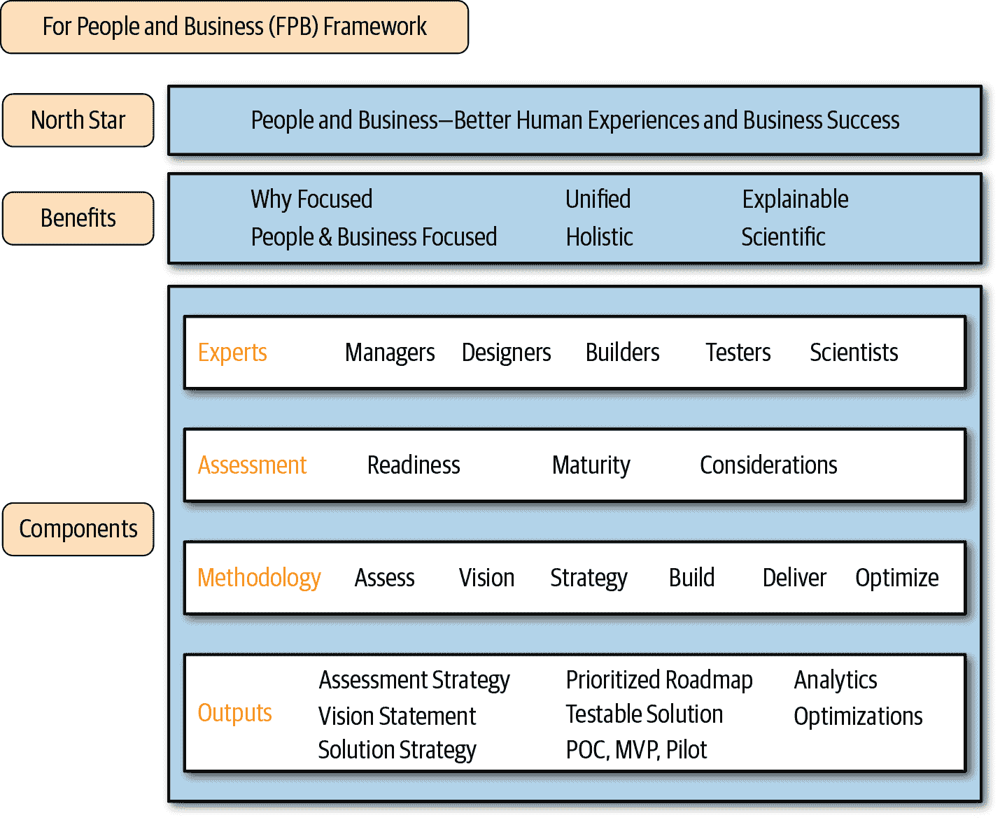
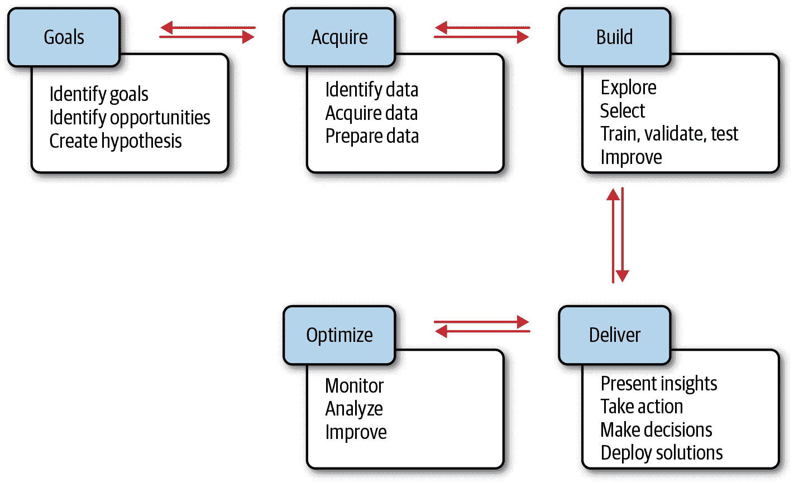
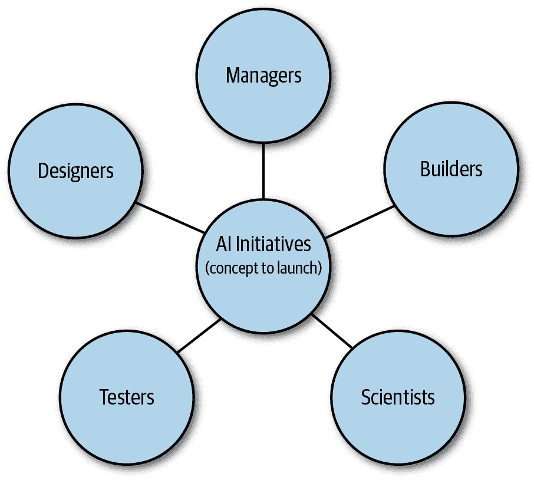
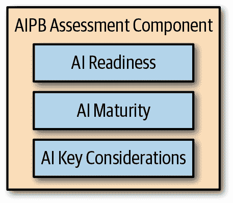
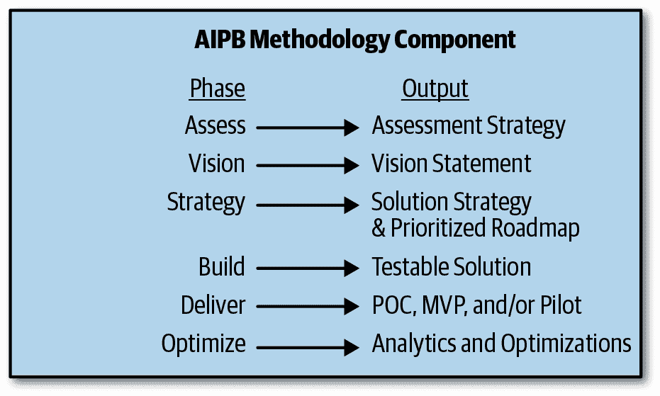

## 第 2 章 人与商业的 AI 框架简介

AI 是一组概念、工具和技术，具有巨大的颠覆性和变革潜力。从定义上讲，我们可以简单地将 AI 视为机器所表现出的可用于有益目的的智能（例如，执行任务、做出决策、协助人类、挽救生命）。具体的高效益和先进应用包括 [帮助盲人和视障人士“看”](http://bit.ly/31vKTmP) 以及从视网膜扫描图像中进行 [心血管疾病评估和风险因素预测](http://bit.ly/2KdmflG)。

在 AIPB 框架指导下制定和执行 AI 愿景和战略，是实现对人和商业都有益的基于 AI 的创新的关键；即创造更好的用户体验和商业成功的创新。本框架和本书涵盖的信息对任何希望确保以最大价值和效益成功交付基于 AI 的产品的企业都具有价值。

本章的目标是介绍 AIPB 框架及其所基于的更通用的面向人与商业框架（FPB）。本章深入讨论了 AIPB 的优势，同时简要介绍了以基础方式构建在其之上的其他组件——换句话说，评估、方法论和输出组件。我们将在下一章中更详细地讨论这些内容。

请注意，在本书的其余部分，我使用简化和涵盖性的术语“产品”来描述任何基于 AI 的业务、产品、服务或解决方案。

## 创新的通用框架

AIPB 框架是我开发的更通用 FPB 创新框架的具体应用。FPB 更通用，因为我们可以将其应用于任何形式的创新或新兴/最先进技术，例如面向人与商业的创新、面向人与商业的区块链、面向人与商业的物联网，以及面向人与商业的机器人技术。

FPB 框架由一个北极星、一个效益伪组件和四个核心组件组成，如 图 2-1 所示。FPB 框架在北极星、效益、结构和方法方面都是独特的。

如图所示顶部所示，FPB 的目的是以人和企业为中心进行创新，目标是创造更好的用户体验和商业成功。这就是北极星。该框架的独特优势由效益伪组件表示，如北极星下方所示，我们将很快详细讨论。

这个更通用框架中被定制以创建 AIPB 框架的部分是所涉及的专家（例如，数据科学家和机器学习工程师）、AI 特定的评估、方法论组件各个阶段中涉及的 AI 特定细节（例如，开发 AI 愿景和战略），以及一些输出（例如，可操作的洞察、增强智能和自动化）。Blockchain for People and Business 将类似地使用密码学专家、不同的评估、不同的愿景和战略以及不同的输出进行定制。其余部分或多或少相同。在本书的其余部分，我们将只提及 AIPB，但建议你记住 FPB 框架可以推广到其他形式的基于技术的创新。

你可以用电梯演讲的风格说，AIPB 作为一个基于 AI 的创新框架，能够通过其独特的价值主张（North Star、优势和关键差异化因素）创造更好的用户体验和业务成功（*why*），这需要专家通过独特的流程（评估和方法论）协作参与，以便产生期望的交付成果和结果（输出）。

# AIPB 优势核心组件

也许你会想知道我为什么要包含一个优势伪组件。通常，框架的优势在介绍或教授框架时会被讨论，但并未真正融入框架中。原因在于，框架的优势就像框架的 North Star 一样，是框架背后的 *why*；也就是说，使用它的全部原因，或者换句话说，就是其价值主张。如果我们不记得它为何对我们有益以及为何首先应该使用它，那么记住框架或模型中的其他一切有什么意义呢？

在深入探讨具体的 AIPB 优势之前，让我们先讨论实际的 AI 和机器学习流程以及相关模型。你可能已经熟悉 CRISP-DM，这是一种常用于数据挖掘、数据科学和机器学习的流程。我创建了自己的流程模型，我称之为 GABDO AI 流程模型，如 图 2-2 所示，并在 附录 B 中进行了深入介绍。

大多数机器学习流程模型，包括这个模型，都省略了应该在上游进行的工作；也就是说，AI 或机器学习愿景和战略的定义与开发。充其量，一些模型会提到需要提出正确的问题并识别目标和机会，但就这些而已。我谈过的许多高管和经理在如何开发现实世界的应用 AI 愿景和战略方面，以及从哪里开始方面真的很挣扎。他们对 CRISP-DM 和 GABDO 等战术层面的机器学习流程并不特别关心，而且理应如此。我在开发 AIPB 时的主要目标之一就是填补这一上游空白。AIPB 实现了这一点，而且正如你将看到的，还有更多。

# 现有框架与拼图中的缺失部分

一种看待 AIPB 独特方法的方式是通过将其与大多数现有的业务和产品开发框架、模型和方法进行比较。有许多流行的框架用于帮助制定业务战略、最大化产品开发成功和/或促进创新流程。我将这些分为以下流程类别（附带我推荐的一些具体方法），今后我们将将其称为 AIPB 流程类别：

*   评估（例如，差距分析、能力分析）
*   构思与愿景开发（例如，设计思维、头脑风暴、five *为什么*s）
*   业务与产品战略（例如，优势、劣势、机会和威胁 \[SWOT\]、波特五力、成本效益分析 (CBA)、产品市场契合金字塔）
*   路线图优先级排序（例如，延迟成本、CD3、卡诺模型、重要性与满意度）
*   需求获取（例如，设计思维、访谈）
*   产品设计（例如，设计思维、UX 设计、以人为本的设计）
*   产品开发（例如，Agile、Kanban、GABDO、持续交付）
*   产品评估、验证和优化（例如，最小可行产品 \[MVP\]/原型制作、成功指标、关键绩效指标 \[KPI\]、可用性测试）

所有这些流程类别和具体方法都非常有用（包括在 AIPB 中，AIPB 旨在模块化！），并且许多方法都存在 AIPB 旨在填补的共同差距。这些差距包括以下内容：

*   不 *为什么* 或目标导向（更关注细节、如何和什么）
*   业务导向（而不是以人为本）
*   孤岛化（涉及有限的参与者群体和专业知识广度）
*   不全面（关注更大流程的一个子集）
*   文档导向（要点列表、填好的画布、白板）
*   不可解释性导向（无助于在所有利益相关者之间生成共享的愿景和理解）
*   决定论（假设一切都可以提前知道和计划）
*   装配导向（只需按照线性流程或步骤集构建解决方案以达到最终结果）

AIPB 作为一个 *为什么*\-driven、以人为本和以业务为中心、统一、全面、协作/互动和科学的创新框架填补了所有这些差距，因此提供了许多显著的优势。

# AIPB 优势

我对 AIPB 的最终目标是帮助人们理解如何构建 AI 愿景和战略，将 AI 应用于现实世界的用例，并最终为最大成功执行其 AI 战略。正如你在书中后面会看到的，AIPB 还通过围绕 AI 就绪度、成熟度和其他关键考虑因素进行关键评估来指导差距识别以及规划 AI 计划的实施。

AIPB 通过提供以下优势来填补差距：

*   为什么导向
*   以人为本和以业务为本导向
*   统一和全面导向
*   可解释性导向
*   科学导向

让我们讨论 AIPB 的每个独特优势，以及它们如何提供 AI 驱动创新的端到端基础。这些思想将在全书中进一步展开。

## 为什么导向

理解市场和机会的传统方法包括初步市场调研，但我认为如果你主要依赖市场调研，你的创新还不够。人们不知道他们想要什么，市场只会告诉你已经存在的东西。

史蒂夫·乔布斯知道这一点，并不断创造出人们在产品可用之前不知道自己想要的功能的全新产品。他和其他人是如何做到这一点的？通过理解问题和需求，或者换句话说，就是 *why*。因此，我强烈建议主要关注问题和需求研究。这为真正的创新和真正伟大产品的创造提供了更好的路径。

*why* 应该被所有参与者普遍理解；换句话说，由所有利益相关者理解。在企业中，人们和部门通常通过不同的目标和 KPI 来激励。真正的创新需要建立一个 North Star *why*，并在所有人之间建立共享的愿景和理解，而不管特定人员或部门的目标和激励如何。

*why* 应该有助于开发能够将其变为现实的愿景和战略。许多现有框架专注于创建要点列表或在纸上或数字形式中填写画布，包括一些基于画布的 AI 和机器学习框架。

别误会——所有这些框架在指导方面都可能非常有帮助，但不幸的是，它们共享一些我建议我们应该改变的特征。具体来说，它们并不特别关注愿景或战略的制定。

## People and Business Focused
大多数商业框架主要关注业务层面。AIPB 同时关注人和业务。人们对任何企业或产品的成功至关重要，这是我在整本书中深入讨论的内容。

一些框架和公司已经开始认识到这一点，并使用诸如以客户为中心和以客户为关注等术语。有些甚至说我们现在正处于客户时代。这是一个朝着正确方向迈出的巨大步伐，但 AIPB 在这里改进了两点。

首先，并非从产品中获得价值的每个人都是客户。人们也可以是用户或受益者。此外，“客户”这个词听起来像是给人贴上美元符号的词。何不直接说以人为中心或以人为关注，这正是 AIPB 所旨在做到的。

人和企业并非相互排斥，也不代表零和博弈。人们和企业有不同的目标，这些目标通常可以同时实现。优秀的产品应能同时实现人们和企业的目标，而 AIPB 展示了如何做到这一点。AIPB 并不会在企业和人之间转移关注焦点，反之亦然。AIPB 专注于为两者制定愿景和战略。

## Unified and Holistic Focused
大多数商业和创新框架涉及有限的人员，因此专业知识范围有限。它们也倾向于关注单个流程或更大整体的一部分流程。AIPB 独特且在此基础上有所改进，通过创建统一且整体的框架，推动强大且协作的创新方法。现在让我们讨论 AIPB 的统一和整体方面。

AIPB 的统一之处在于它要求具有适当专业知识的人员根据具体 AIPB 阶段的需求进行协作，并且这*must not*仅包括高级高管和业务部门负责人。例如，优秀的高管和管理者可以在领导力、战略、指导和决策等方面提供很多帮助，尽管他们往往在某些专业领域所需的特定专业知识方面有所脱节，包括了解和理解应考虑的许多关键因素。鉴于此，无论职位级别如何，都应让合适的人参与。请注意，我使用的是“协作”一词而不是“共识”。对我来说两者有很大区别，我将在书中稍后讨论。

本章前面列出的一些框架假设拥有所有所需专业知识的人员团体将同时聚集在一起实施框架（例如，填写画布）。然而，其他框架确实强调了跨职能协作的必要性，并建议应涉及的人员类型，但框架可能仅关注整体创新过程的一个子集。

AIPB 认识到企业中在使用该框架进行创新时应代表的五类人员：经理、设计师、构建者、测试者和科学家。图 2-3 展示了这一点。

AIPB 也是一个整体框架。AIPB 不仅关注创新过程中的一个阶段或部分阶段，而是旨在实现整体性和端到端。AIPB 还包括以下框架组件、类别和阶段，其中方法论组件的每个阶段都有各自的输出。图 2-4 显示了三个评估组件类别，而 图 2-5 显示了方法论组件各阶段的阶段和输出。

在我看来，创新框架必须包含所有这些组件和阶段才可被视为整体。一个很好的商业类比是公司的高层领导；例如，C 套房。C 级高管的集体任务是拥有公司在财务、运营以及时间方面的全局（整体）、端到端视角；也就是说，深入了解公司的历史、现状和未来（例如，目标、举措、投资和战略）。

AIPB 同样对整个创新过程具有端到端的整体视角，包括其应采取的方向（愿景和战略）以及监督实际执行同时规划未来。AIPB 还可以在适当且有益的情况下整合现有框架和模型。它在这种意义上旨在模块化且不过于规定性，就像公司的 CTO 不一定规定软件开发人员必须使用什么持续集成框架一样。

## Explainable Focused
可解释性在 AI 和机器学习方面变得非常重要，而且理所当然。两者在工作原理和结果含义方面都可能相当不透明。使 AI 更具可解释性是一个伟大的目标，AIPB 的输出也应具有可解释性。

基于画布的框架的一个缺点是重点在于在框中写文字并创建要点列表。通常这些内容需要向未参与该过程的人和/或不太熟悉的人进一步解释。不太可能你能把一份填好的画布交给未参与该过程的人，让他们仅凭快速阅读就能完全理解其内容、价值及其影响。AIPB 产生可解释的输出，不应需要太多进一步解释。

我非常重视一切的*why*，以及在所有关键利益相关者之间产生共同愿景和理解。我认为创新框架的输出应以高度可解释的方式帮助促进这一点。

## Science Focused
鉴于创新、新兴和最先进的技术（如 AI 和机器学习）是关键要素并且本质上是探索性和实验性的，AIPB 以科学为导向。这很重要，因为这些领域基于统计学和概率，或者换句话说，存在某种不确定性。这意味着围绕 AI 技术进行规划和使用的整个过程在很大程度上是非确定性的，因此最好用科学的概念和科学方法等流程来表示。

为什么这是 AIPB 的优势？这是因为期望管理；也就是说，它有助于设定适当的期望。某些定律和定理本质上证明了最佳算法、精确数据、最佳数据特征和最佳模型性能等无法提前得知。AIPB 认识到这一点并据此帮助设定期望。

## Summary
在我看来，创新的目的是以新的和强大的方式造福人们和企业。这是通过围绕使这些利益成为现实的现实解决方案创建和执行基于技术的愿景和战略来实现的。此外，在关键利益相关者之间产生共同愿景和理解以及适当的期望管理是关键。由于本章概述的差距，使用一些现有框架很难实现这一点。

FPB 以及更通用的 AIPB 框架代表了一种独特而强大的创新方法，专注于同时造福人们和企业，以创造更好的用户体验和业务成功。AIPB 填补了大多数现有商业和创新框架的空白，其独特性在于其指导的北极星（人们和企业）、利益伪组件以及四个核心组件，我们将在接下来介绍。
