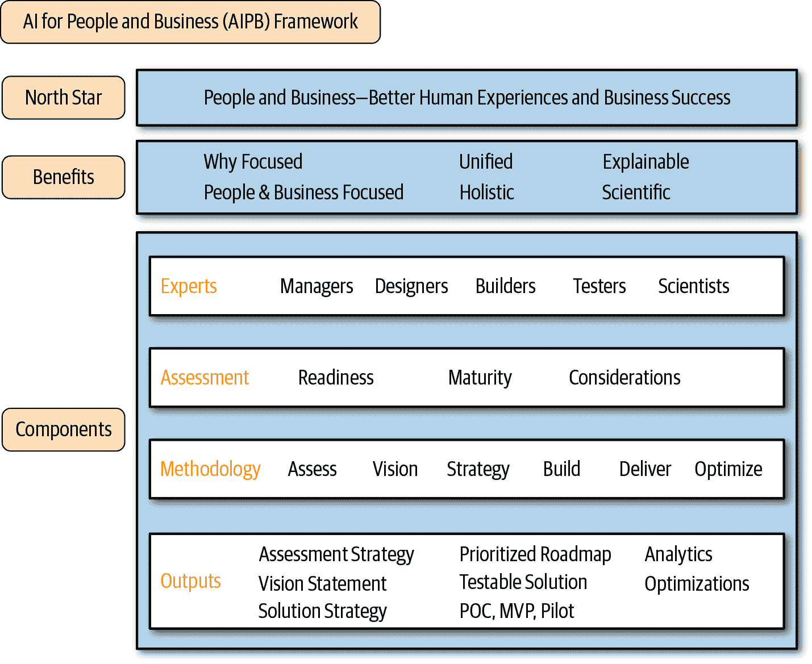
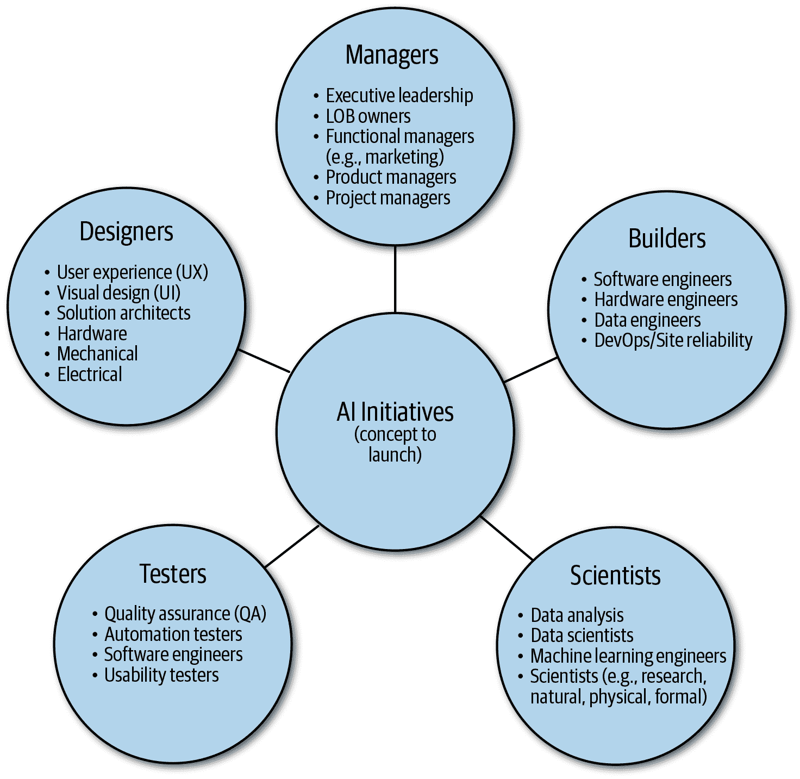
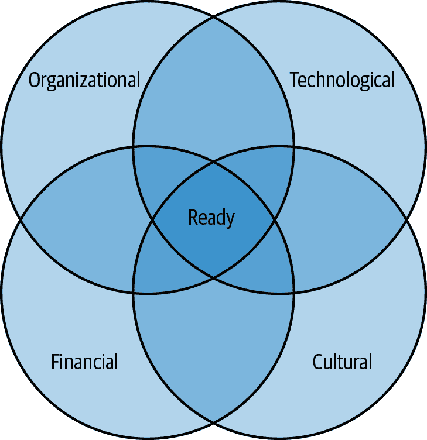
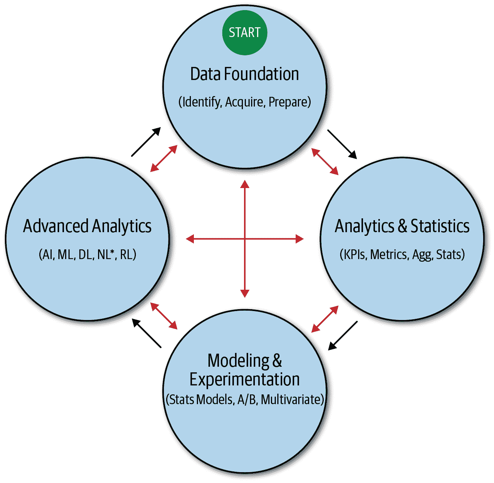
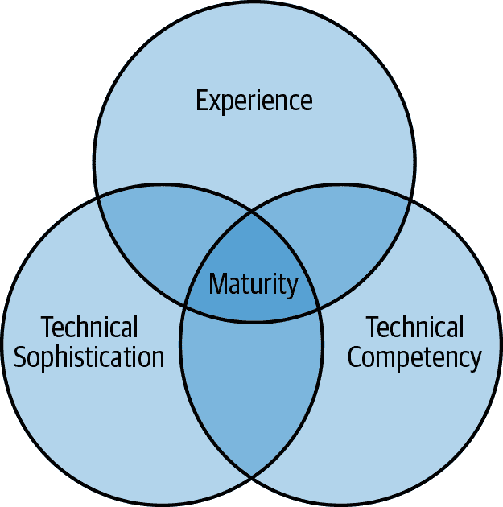
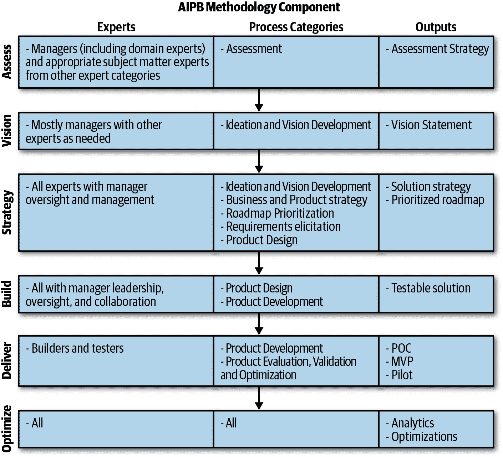
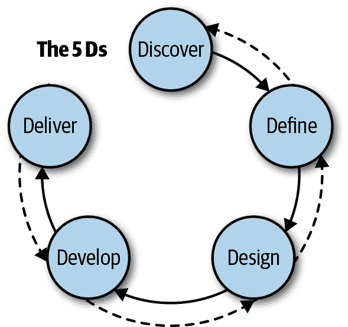

## 第 3 章。AIPB 核心组件

本章继续发展我们对如何使用 AIPB 进行创新以创造更好的用户体验和业务成功的理解。你会回忆起 AIPB 框架由一个北极星、利益伪组件和四个核心组件组成。图 3-1 对此进行了回顾。

我们已在上一章讨论了北极星和利益伪组件，因此让我们从讨论一个相关类比开始本章，然后详细了解四个 AIPB 核心组件：专家、评估、方法论和输出。我们还将讨论*翻转课堂*的概念，这是以新的、更高效、更有效的方式处理创新过程的重要要素。

在深入 AIPB 核心组件之前，让我们先讨论敏捷开发作为 AIPB 某些特征的类比。

## 一个敏捷类比

你可能熟悉敏捷软件开发运动以及 Scrum 和 Kanban 等相关方法论。敏捷是为了填补空白并解决使用*瀑布式方法*构建技术产品时先前遇到的许多问题而创建的。AIPB 类似地旨在填补空白并改进现有的商业和创新框架。

敏捷基于*敏捷宣言*以及[宣言定义](https://agilemanifesto.org/)的四个敏捷软件开发价值观：

* 过程和工具之上的个人和互动
* 全面文档之上的可工作软件
* 合同谈判之上的客户协作
* 遵循计划之上的响应变化

这四个价值观是所有敏捷原则和方法论的基础（有趣的是，价值观的表述是关于*如何*和*什么*而不是*为什么*）。尽管如此，AIPB 的利益伪组件类似于敏捷的“四项价值观”，并且旨在成为所有其他内容构建的基础。

继续我们的类比，AIPB 的专家组件类似于 Scrum 中定义的角色；^1 评估组件类似于 Scrum 团队进行的评估；^2 方法论组件类似于定期 Scrum 会议（又称仪式）；^3 最后，输出组件类似于 Scrum 定义的“产品工件”。^4

敏捷和 AIPB 都关注人员和流程。敏捷与 AIPB 的不同之处在于，敏捷不一定涉及从概念到发布创新计划所需的所有人员，也不代表创新过程的端到端。

例如，敏捷省略了创新的大部分愿景和战略方面，更专注于基于现有产品路线图的实际开发、部署和维护。话虽如此，敏捷方法非常有用，我是忠实拥护者，特别是 Kanban。我个人推荐 Kanban 用于产品开发，我们可以轻松地将其纳入 AIPB 的构建方法论阶段（本章后面会介绍）。

现在让我们讨论 AIPB 的每个核心组件。

## 专家组件

在追求 AI 计划时，你必须组建合适的专家。你还应在每个 AIPB 方法论阶段将他们召集在一起进行协作，以帮助确保最大成功。

通常做出关键产品决策的人（例如填写画布或 SWOT 列表）并不具备所有必要的专业知识。或者，他们无法正确地与目标市场产生共鸣；也就是说，他们不是客户或用户，因此更多地从商业角度看待事物，即使他们不认为这是事实。

关键的收获，也是 AIPB 框架的差异化因素，是正确的专家必须在适当的 AIPB 方法论阶段进行协作。并不需要达成共识，但需要专家的想法、意见和观点。从那里，计划负责人必须通过考虑所有专业知识做出最终决策，这一责任通常最好由产品经理为产品计划处理，并且随着时间的推移可能会更多地由数据产品经理处理，数据产品经理是一个新的面向数据和分析的产品管理角色。

那么这些专家是谁？AIPB 建立了五组专家：经理、设计师、建造者、测试者和科学家。某些人员可能根据框架的给定评估任务或方法论阶段而落入一个或多个类别。图 3-2 显示了这些类别以及每个类别中的一些示例角色。

让我首先解释我为什么选择建造者和科学家这两个类别，它们彼此之间有何不同，以及它们与传统职能 designation 有何不同。

你可能看过《乐高电影》。我强烈推荐如果你还没看过的话去看。电影围绕一个名叫 Emmet Brickowski 的角色展开，他是一名建筑工人。建筑工人是建造者，他们通过遵循说明使用乐高积木建造物体，就像购买乐高套装后所做的那样。这本质上与软件工程师根据产品需求和设计编写代码，或硬件装配工根据规格、材料和设计建造物理物体相同。我将这一组称为*建造者*——那些根据以一种或多种形式给出的说明进行建造的人。

电影还指定了另一个名为*大师建造者*的群体。大师建造者是那些能够利用想象力开发想法并创建建造新创新物体的说明，而无需自己需要明确说明的人。这些新想法和物体可以成为构建块，在其基础上可以构建更多新想法和物体，就像真正的乐高物体一样。开发新想法和成果以及验证和优化它们可能需要探索、假设开发和实验。例如，传统科学家（和数据科学家）、数学家和工程师完全适合这一类别。我将这一组称为*科学家*。

科学家历史上除了前科学家建立的定律、定理和经经验确定的结果之外，没有任何说明可以基于此来建立他们的新想法、假设和发现。这些历史发现通过提供指导和基础来帮助科学家建立新想法和发现，但它们并不能提供实现特定新发现的明确说明。

科学家作为大师建造者必须为此使用他们的专业知识和想象力。更具体地说，新的科学发现是通过以下一种或多种方式实现的：在先前科学的基础上构建、进行实验（思想、经验或两者兼有），以及通过现实世界或实验室观察。在所有情况下，科学家事先并不确定他们会发现什么；相反，他们由一组初始想法和假设指导。

鉴于人工智能和机器学习的统计、概率和科学本质，术语科学家最为恰当。创新按定义意味着创造新事物，因此默认情况下没有实现特定结果的说明。创新需要专业知识和想象力相结合，并辅以验证关键假设、降低风险并实现预期结果的策略。更进一步，与涉及不确定性较少的更确定性创新相比，科学创新是一个关键差异化因素，并且非常确定可以产生竞争优势。远见者与科学创新者能够在巨大不确定性面前创造成功成果，并且确实创造过，这正是他们伟大的原因。

总之，有些问题如果没有探索和实验就根本没有答案。这正是精益和敏捷产品开发背后的概念。创建你认为最能解决特定需求且最有可能实现产品市场契合的 MVP，然后迭代地实验和测试版本，以达到最佳解决方案——一个事先未知的解决方案。这就是科学方法的工作方式，也是我使用科学家一词的原因。

最后说明：数据科学家、机器学习工程师和人工智能研究人员并不是此过程中的唯一科学家。在某些情况下，用户体验（UX）设计师和其他人也可以被视为科学家。区分因素很简单，就是认识到需要某种假设和测试或实验才能做出发现并找到答案。例如，UX 研究人员会进行可用性测试以评估产品并确定用户是否理解如何使用某产品或产品功能。这本质上是实验性的，需要测试结果来获得洞察并推动对产品的可操作、数据驱动的更改。在实际测试之前无法预知结果。基于 AI 的科学创新也无不同，因此需要科学思维以及一个或多个科学家参与过程。这需要与从瀑布模型转向敏捷类似的心态转变。

设计师以及设计总体上也是人们以某种方式交互的任何技术的关键组成部分。因此设计师也是 AIPB 认可的非常重要的一类专家。我们在本书后面会更详细地讨论设计的重要性，特别是在 AI 解决方案的背景下。

测试人员是 AIPB 认可的另一组非常重要的专家。任何技术解决方案的解决方案质量以及责任和风险的最小化都是至关重要的；我认为在涉及数据和分析为中心解决方案的大多数情况下，例如使用 AI 的解决方案，更是如此。实现最大质量和最小风险的重要性，以及确保这一点的测试人员和其他 AIPB 专家，将在后面的章节中变得显而易见。

最后，经理也是 AIPB 认可的非常重要的一类专家，特别是在领导和管理 AI 计划方面。许多经理，包括高管，可能不是领域专家或技术主题专家（SMEs），但他们应精通以下方面：
*   组建专用团队
*   设定目标
*   制定策略
*   管理风险
*   做出关键决策
*   委派工作
*   提供方向和指导
*   提供自主权
*   促进协作和一致性
*   正确设定期望
*   保持计划按计划进行
*   提供所需资源（例如预算）
*   确保计划和业务成功

就像我以前的任何 IndyCar 赛车队一样，获胜发生在每个人都做好自己的工作并且做得非常好的时候。任何一个人都可能输掉一场比赛，但要赢得比赛，需要整个团队共同努力，达到可能达到的最高性能水平且不出错。

现在让我们把注意力转向 AIPB 的两个流程相关组件：评估和方法论。与其单独讨论输出组件，我们在方法论组件的每个阶段进行时查看适当的输出。

# AIPB 流程类别和推荐方法

AIPB 旨在模块化，如前所述。某些方法和框架经过时间检验，已被证明既有效又高效。这意味着无论哪种协作（*非* 共识型）流程和方法能让你得到最佳答案和输出，都是正确的。

请回顾 第 2 章 中 AIPB 流程类别和我推荐的一些方法，我在此章中再次列出以供参考。
*   评估（例如差距分析、能力分析）
*   构思和愿景开发（例如设计思维、头脑风暴、五个 *为什么*）
*   业务和产品战略（例如 SWOT、波特五力、成本效益分析（CBA）、产品市场契合金字塔）
*   路线图优先级排序（例如延迟成本、CD3、卡诺模型、重要性与满意度）
*   需求获取（例如设计思维、访谈）
*   产品设计（例如设计思维、UX 设计、以人为中心的设计）
*   产品开发（例如敏捷、看板、GABDO、持续交付）
*   产品评估、验证和优化（例如 MVP/原型制作、成功指标、KPI、可用性测试）

我在本章中适当列出我推荐的流程类别和方法，但鉴于本书更注重大局，我大多省略了现有方法（例如 SWOT）的细节。鼓励根据需要进行进一步研究。最后，我的建议基于我的经验和我发现最有效的方法。可能存在我尚未尝试但完全有效的替代方案，可应用于方法论组件阶段，合适的专家应根据其经验和专业知识选择使用什么。结果正确才是最重要的。AIPB 是模块化的，也是专家驱动的！

# 评估组件

追求 AI 计划和一般创新需要我们识别并解决某些差距和关键考虑因素，无论是部分还是全部。这是 AIPB 评估组件的基础：评估任何差距和关键考虑因素并确定解决策略。我将其分为以下三个类别：
*   AI 就绪度
*   AI 成熟度
*   AI 关键考虑因素

评估组件及其三个类别被表示为第一个 AIPB 方法论组件阶段（稍后讨论），任何计划进行应用 AI 转型的公司都应尽早解决。这些评估非常重要，以至于在 AIPB 中被表示为一个单独的核心组件。根据研究结果进行适当的评估并制定策略，AIPB 统称为“评估策略”，将有助于确保计划不会失败，更重要的是，确保它们从一开始就为获胜做好准备。

请注意，制定策略和解决就绪度、成熟度和关键考虑因素方面的差距不应被视为推进 AI、机器学习或一般创新的硬性前提。相反，应首先进行评估并制定评估策略。在我看来，大多数公司现在开始使用 AI 而不是以后是必要的，并在过程中填补差距并解决关键考虑因素。

## AI 就绪度和成熟度

# 就绪性与成熟度？

对我而言，就绪性意味着在着手某事之前在某些方面做好准备。图 3-3 展示了我创建的 AI 就绪模型，我在其中将 AI 就绪性分为四个类别。我在第 12 章中深入介绍了该模型。

成熟度另一方面代表一种或多种进展的衡量标准。尽管在技术背景下，成熟度通常以技术精熟程度的层级来讨论，但我以不同的方式来描述成熟度，正如我创建的几个模型所说明的那样，并且当它们专门结合在 AI 方面时，就代表了我对 AI 成熟度的定义方式。

这里预览展示了其中两个模型。首先，图 3-4 所示的是一个代表分析精熟度的成熟度模型，其次，图 3-5 所示的代表技术成熟度，通常作为在特定时间点围绕给定技术领域或技术方面的经验水平、技术精熟度和技术能力水平的集体衡量（混合）。

AI 就绪性和成熟度、对两者进行评估的基础，以及所有这些模型，都在本书的第三部分中得到了更详细的介绍，同样也包括我们必须考虑的与 AI 相关的关键问题。目前，关键的收获是就绪性和成熟度既是一个过程，也是一段旅程。在追求 AI 或机器学习任务之前，你不需要先建立数据仓库或提取、转换和加载（ETL）系统，但你确实需要识别差距，制定适当的策略，并开始让 AI 更加“就绪”，以便今天就开始推进你的 AI 成熟度计划。

# 方法论组件

让我们继续介绍 AIPB 的*方法论组件*，它由六个迭代阶段组成：评估、愿景、策略、构建、交付和优化。尽管在 AIPB 中被表示为独立组件，但我在此部分逻辑上合并了方法论和输出的讨论，因为每个方法论阶段都有特定的输出。图 3-6 展示了每个方法论阶段，以及相应的推荐专家、流程类别和输出，我们将在本节中贯穿介绍。

在深入每个阶段之前，让我们记住 AIPB 的北极星，即关注人与业务，具体目标是创造更好的人类体验和业务成功。这至关重要，因为该框架（和本书）是关于追求既惠及人们又惠及业务的 AI，而不仅仅是业务，更绝对不是会以任何方式伤害人们的 AI。AIPB 的这一方面至关重要，必须指导其他一切。

我们还讨论了我认为应在每个阶段协作参与的专家。在大多数情况下我使用高层级称谓（例如，设计师、科学家），并由你决定公司中谁是该学科最合适的“专家”来参与给定阶段。我也提供了一些示例角色。

对于所有方法论阶段以及为每个阶段生成适当的输出，所采用的方法应与许多现有框架通常建议的不同。这始于采用翻转课堂、协作、互动和/或设计思维式方法。这不是关于创建纸质表格、要点列表并填写方框；而是关于提出问题并回答它们。到达答案的方式真的并不重要，重要的是你能到达它们，并且它们是正确的，或者至少尽可能正确。同样至关重要的是，这些答案能够根据需要有效地传达给任何利益相关者。

根据阶段的不同，问题可能涉及目标、收益、成果、人员、风险、成本、权衡、考虑因素、假设、策略、技术或差距。无论如何，每个阶段的输出都应包括用通俗英语解释的内容，对任何人来说都高度可解释，无论其专业知识和背景如何。对于许多高管来说，这是必需的。

对于某些阶段，用易于理解的口头形式对正确问题的回答就足以产生共同理解并正确设定期望。根据我的经验，要点列表和其他形式的文档在这方面往往远远不够。

因此，基于此，让我们深入探讨 AIPB 方法论的阶段以及每个阶段的输出。请记住，所有阶段都可以迭代并参与反馈循环；换句话说，下游阶段的输出可能会建议对上游阶段进行迭代，以推动持续改进并最大化成果。

## 评估

概括一下，评估组件包括以下评估：

* AI 就绪性
* AI 成熟度
* AI 关键考虑因素

以下是围绕这些类别的某些问题，你的评估应回答：

* 我公司在 AI 就绪性方面存在哪些差距？
* 我公司是否能够追求科学创新（即具有敏捷性、探索性和实验性）？
* 我如何描述我公司的数据和分析成熟度？AI 成熟度如何？我需要解决哪些差距？
* 我们应该理解和解决哪些 AI 特定的关键考虑因素？
* 我们需要理解和测试哪些关键假设和潜在风险？

从 AIPB 流程类别来看，评估类别适用于回答这些问题。评估应产生一个计划——即策略。因此，AIPB 将该组件的输出定义为评估策略，其中包括填补与 AI 就绪性和成熟度相关的差距的策略，以及解决 AI 关键考虑因素的策略。如前所述，两者都不应被视为推进的硬性要求，但它们也不应仅仅以差距和考虑因素的要点列表形式停留在纸面上。将评估转化为评估策略至关重要；它有助于规划，最重要的是有助于避免潜在失败，同时确保最大成功。

许多 AI 计划会失败，正如前面所讨论的。我认为大多数失败的原因要么是缺乏我们所定义的评估策略，要么是缺乏愿景、策略和执行能力，正如我们接下来将要介绍的。无论哪种情况，都不要等到为时已晚才识别和解决潜在的失败点。

最后，鉴于这些评估的业务层面和战略性质，参与的专家应主要是管理人员（包括领域专家）和合适的主题专家。这包括执行领导层、功能上合适的执行官和管理人员（例如，CAIO、CDO、CAO、AI/数据科学副总裁、AI/数据科学总监），以及根据需要为特定专业知识和分析而引入的合适的个人贡献者团队负责人。

## 愿景

在我看来，针对新业务、产品、服务或功能的愿景是高层级的*为什么*、*如何*和*是什么*。为什么可以用目标、收益或成果来表达。*为什么*可以由解决特定问题、满足特定需求或消除特定痛点驱动，但也可以由想要创造更好的人类体验而驱动，而无需问题、需求或痛点。目标是定义“正确”的*为什么*，这可能意味着使用五*为什么*等技术来实现。

## 战略

一个很好的例子是诸如第一代 iPhone 等产品引入的滑动和捏合触摸交互。我认为很少有人会将其视为某种问题的解决方案，也很少有人当时认为这种类型的交互甚至是可能的。话虽如此，一旦人们体验到这些触摸交互，它就成为大众的惊喜点。此外，许多人将这些新的交互可能性视为他们甚至没有意识到的问题的解决方案。惊喜点可以以与解决问题和消除痛点相同的方式激发伟大的愿景。

回到 AIPB 对人和业务的侧重，关键在于为两者定义 *为什么*。对于企业而言，*为什么* 通常被表述为商业案例：它将在目标、KPI、目标、ROI 或类似指标方面如何帮助业务。这就是大多数框架或模型停止的地方。

AIPB 还必须为受益于该解决方案的人们定义 *为什么*，这些人可以是客户、终端用户或内部员工。几乎没有创新技术应用不会以某种方式影响人类。即使是完全的自动化也会影响人们，如果它被用来在没有工作重新分配、再培训或再技能提升的情况下消除工作岗位，则不一定是有益的。我们将在后面的章节中探讨自动化和工作流失的话题，但现在请记住，本书的主题是如何利用 AI 使人们和企业受益，其中包括有益的增强智能、工作重新分配、再培训和再技能提升，根据需要进行。

因此，关键在于定义商业案例，同时还要定义将直接体验 AI 解决方案的人们的预期收益，无论 AI 解决方案以洞察、推荐、预测、增强智能、优化或自动化的形式出现。所有这些形式的 AI 都可以使利益相关者受益，因此目标是确定利益相关者是谁以及他们如何受益。

那么你如何制定你的 AI 愿景，最终输出是什么？让我们从提出正确的问题开始：

*   我最感兴趣的是以下哪一项？例如实现公司目标、达到特定的 KPI 目标、解决问题、消除痛点、创造更好的用户体验、拯救生命、最大化患者治疗效果，或帮助残疾人士？
*   如果我基于上一个问题的答案开发一个基于 AI 的解决方案，它将如何使我的业务受益？它将如何使人们受益？
*   哪些 AI 机会将帮助我使这些收益成为现实（假设不止一个），我该如何选择和优先排序它们？
*   在高层次上，解决方案会是什么？
*   在高层次上，我将如何使该解决方案成为现实并取得成功？
*   潜在的 ROI 是什么？

你会注意到我对其中几个问题使用了“在高层次上”这个短语。原因是我们尚未经历制定使你的愿景成为现实的策略的实际过程，因此我们可能还不知道在过程中会发现的许多考虑因素、风险、细节、设计等。我们也尚未进行确定有前景的想法是否具有期望性、可行性和可行性的练习。愿景开发是一个迭代过程的起点，正如我之前提到的，它可能需要根据下游活动进行修改和改进。这完全没问题，如果有的话，这将有助于确保成功。

就回答这些问题并产生愿景阶段所需的输出而言，我建议将经理（包括领域专家）作为参与该过程的主要专家；例如，高级领导层以及功能上合适的执行人员和管理人员。你还应根据需要引入其他专家（特别是来自科学家类别的 AI 实践者），该过程应具有协作性和互动性，涉及高层次评估、头脑风暴和优先排序，因为可能存在多个优秀的机会。

对于 AIPB 方法论的愿景阶段，以及从 AIPB 流程类别来看，我建议采用头脑风暴和愿景开发类别。该类别中推荐的许多方法通常被产品经理和 UX 从业者成功采用。

愿景阶段的输出应为以人 *和* 业务为中心的愿景声明，明确以易于理解的方式说明所提出问题的答案，可以作为电梯演讲来传达。它应从 *为什么* 开始，描述 AI 应用的目的和目标（针对人和业务），*如何* 构建它，以及 *什么* 是解决方案。

一个类似的绝佳例子是亚马逊的“Working Backwards”以客户为中心的 methodology.^(5) 这是一种旨在从客户倒推以提出产品创意的方法，而不是反过来。

该过程的输出是由产品经理撰写的内部一页新闻稿，宣布尚未存在的成品。想法是新闻稿必须指明目标客户是谁，产品将为他们提供什么好处，现有产品为何失败，以及新产品将如何优于现有替代品。

亚马逊的 Ian McAllister 指出：

> “如果列出的好处听起来对客户来说并不有趣或令人兴奋，那么它们可能就不是（也不应该被构建）。相反，产品经理应继续迭代新闻稿，直到他们想出真正听起来像好处的好处。迭代新闻稿比迭代产品本身便宜得多（也更快！）”

> 
> Ian McAllister, Director

McAllister 建议用他所说的“Oprah-speak”来撰写这些新闻稿。换句话说，以你想象 [奥普拉·温弗里向她的观众解释它](http://bit.ly/2XeKbLo) 的方式来写。

虽然并非完全以我为 AIPB 推荐的那种愿景声明的措辞来表述，但它无疑是一个很好的例子。我特别喜欢他提出的“Oprah-speak”这个术语；也就是说，如果 Oprah 能向观众传达愿景并让每个人都理解它，那么它可能就构建得很好。我在 第二部分 的末尾提供了开发 AIPB 愿景的示例。

## 策略

有了以愿景声明形式存在的 AI 愿景后，下一步就是制定 AI 策略。我发现许多公司、高管和管理人员在制定 AI 策略（或数据和分析策略总体）方面存在困难。

AI 在现实世界中的应用相对较新，通常并不被很好地理解，充斥着过度的营销炒作，需要一定数量短缺的技术专业知识，并且需要接受非确定性和不确定性等不舒服的概念，才能真正理解并基于此制定策略。这些是 AI 领导力对于成功制定 AI 愿景和策略至关重要的众多原因之一。

那么，我所说的 AI 策略到底是什么意思？在 AIPB 的背景下，AI 策略是执行你的 AI 愿景以使其成功实现的计划。它还代表了将一个想法执行到成为持续优化的生产中解决方案的端到端流程的计划。由 AIPB 指导的 AI 策略应采取解决方案策略和优先路线图的形式。

解决方案策略（即计划）应定义执行以下操作所需的人员、流程和资源（例如工具）：

*   使你的 AI 愿景成功成为现实
*   在执行 AI 策略的同时执行你的评估策略举措

# 迭代执行五大 D（稍后讨论）

`AIPB` 解决方案策略的目的是通过帮助制定 `AIPB` 优先路线图来成功执行你的 AI 愿景。它还旨在确保下游 `AIPB` 方法论阶段、输出以及由此产生的 AI 计划的收益和成果得以成功实现。能够创建并执行成功的 AI 愿景和战略是推进 AI 计划的关键部分。

解决方案策略的实际格式不如策略本身重要。我们可以将它具体化为一份或多份文档、图表、白板或任何其他格式，只要它能发挥作用并完成任务即可。另一方面，优先路线图应具有明确定义的格式，我们稍后会讨论。

从产品战略、设计和开发方法论的角度来看，我使用我自己的模型版本，有些人称之为 `Five Ds`，用于描述构建成功 AI 产品和产品功能的迭代和端到端过程。图 3-7 显示了 `Five Ds` 的阶段。

请注意，`Five Ds` 概述的某些工作（例如，设计、开发、交付）的实际执行由 `AIPB` 的某些下游方法论阶段涵盖，因此在 `AIPB` 的战略阶段，`Five Ds` 的目的是制定成功执行这些下游阶段的计划。

为了作为你 AI 战略的一部分创建解决方案战略，请针对 `Five Ds` 的每个阶段回答以下问题。它们是在你愿景所定义的 AI 解决方案的背景下提出的。

## Discover

* *为什么*、目标、需求和/或痛点是什么？
* 解决方案如何创造更好的用户体验和业务成功？
* 谁是解决方案的利益相关者和受益者，你的愿景围绕他们展开？
* 解决方案的业务和个人用例是什么？
* 潜在市场是什么样的（市场分析），你的解决方案与竞争对手有何区别（竞争对手分析）？
* 如何确保你的解决方案能为人们和企业实现预期收益？
* 在适用时，如何确保解决方案高度令人愉悦、可使用且具有粘性（参见第 7 章和第 8 章）？
* 解决方案的完整程度如何——设计原型、`PoC`/`pilot`/`MVP`、完整解决方案？

## Define

* 将使用什么数据？数据是否已存在？是否需要生成任何新数据？如果是，通过什么机制（例如，增强方法、`IoT`）？是否有任何外部数据源会有所帮助（通过购买或公开可用）？
* 谁拥有每个数据源，需要采取哪些步骤才能获得访问权限？
* 是否需要数据管道（访问、摄取、ETL、处理、集成、存储）？
* 数据将如何为你的解决方案做准备（清洗、验证、转换、标注）？
* 将使用什么平台或工具（例如，亚马逊网络服务 `AWS` 或 Google Cloud Platform `GCP` 云）来训练、验证和优化模型或执行任何其他 AI 和机器学习任务？
* 你的解决方案需要哪些软件编程语言、架构和技术（技术栈）？这包括固件和嵌入式软件，如涉及 `IoT` 的软件，以及边缘和雾计算。
* 你的解决方案需要什么硬件、材料和制造？
* 你的解决方案的软件和硬件需求（功能性和非功能性）是什么，所有设计和工作软件/硬件都将基于此？请注意，这应置于软件的敏捷需求和硬件更瀑布式的背景下，因为俗话说：量两次，切一次。

## Design

* 你的解决方案需要哪些软件和硬件设计？这包括视觉设计、机械设计，以及与设计 `UX`（例如，信息架构、交互和流程设计、用户旅程、用例）或物理对象相关的任何其他资产。
* 需要哪些技术图表、图表、图形或示意图？

## Develop

* 你有哪些假设，将使用哪些 AI 和机器学习软件、算法和技术进行探索和实验？记住，这就是科学创新。
* 你将如何将所有需求和设计转化为高质量、成功的现实？
* 你将如何确保遵循软件和硬件开发的最佳实践？
* 你将使用什么敏捷软件开发方法（例如，`Lean`、`Kanban`、`Scrum`）？
* 你将使用什么持续集成/持续交付（`CI/CD`）和通用发布机制？
* 你将使用什么版本控制技术（例如，`Git`）和分支策略？
* 你将如何测试一切以确保最大质量？
* 你将如何测试可用性并衡量 `UX` 的其他方面？
* 你将如何衡量成功，将使用什么指标，以及必须在解决方案中构建什么跟踪机制？

## Deliver

* 你将如何将解决方案部署到生产环境，以便实际受益者在现实世界中使用它？
* 你将如何监控解决方案的健康状况并解决任何问题？
* 你将如何从新数据中持续学习并随着时间的推移对解决方案进行数据驱动的改进？
* 你将如何确保解决方案的预期收益正在被人们和你的业务实现（效能）？
* 你将如何监控解决方案的效能并解决任何问题（例如，过时的模型；即模型漂移）？
* 你将如何根据需要扩展解决方案，并确保满足所有其他非功能性需求？

你的解决方案战略完全关乎将你的 AI 愿景变为成功的现实。这始于执行发现，以指导最佳解决方案（优先路线图）的优先级和定义，然后指导你如何设计、构建、交付、监控和改进解决方案。

请注意，这里给出的一些发现问题也包含在我们关于开发你的 AI 愿景的讨论中。存在一些重叠。来自更高层愿景阶段的初始发现和理解将指导你的战略开发，并在发现和定义方面提高粒度。

从产品管理的角度来看，产品愿景和战略体现为优先产品路线图，该路线图包含通过持续交付（`CD`）、产品发布或两者交付可行解决方案的计划。产品路线图可以基于产品开发团队的估算进行时间约束，也可以是粗略的，不一定基于固定的时间和工作量估算。

后者更适用于开拓、创新和不确定性（即科学创新）程度不断提高的情况，并取决于你公司 AI 准备度和成熟度的程度。基于统计和概率的技术本质上是科学的、经验性的和非确定性的，这当然适用于使用最先进和新兴的 AI 技术。

以解决方案战略和优先路线图的形式开发端到端、基于 AI 的创新战略需要在企业的大多数职能领域具备专业知识。这意味着所有 `AIPB` 专家类别都可根据需要适用，而监督和管理是专家管理组的责任（尤其是产品经理，鉴于优先路线图输出）。

对于 `AIPB` 方法论战略阶段，以及从 `AIPB` 流程类别来看，我建议以下内容：

* 构思和愿景开发
* 业务和产品战略
* 路线图优先级排序
* 需求获取
* 产品设计

## Build

我在第 14 章中提供了创建 AIPB 策略的示例。

现在让我们继续讨论 AIPB 方法论的最后三个阶段，从执行策略并实际构建解决方案开始。鉴于本书的目标读者，且这三个阶段更具战术性，我们在此仅对其进行概览介绍，但本书的其余部分则侧重于开发 AI 愿景和策略，这些主题更适合目标读者。

构建阶段以软件、硬件和分析产品开发为中心，并在高层面上包括设计、开发和测试。它假设所有发现和定义工作已完成，并且有一份优先排序的路线图可指导构建阶段的流程。

实际上，迄今为止讨论的所有阶段往往都是迭代的，尽管人们尽力而为，一些需求、用例和其他定义性方面通常在开始时会被遗漏或未完全理解（敏捷，而非瀑布）。这意味着在构建过程中可能会继续进行一定程度的发现和定义工作。此外，最重要的是，我建议采用敏捷方法，以更细粒度（功能级别）、边做边完善的方式执行 Five Ds 流程，而不是一次性为整个路线图执行发现和定义（这更像是瀑布）。一位称职的产品经理和产品开发团队可以促进这一流程，而 Kanban 是我为本阶段推荐的开发方法。

在制定了优先排序的路线图和敏捷需求后，应进行设计、开发和测试工作。需求应包括功能需求和非功能需求。功能需求规定了解决方案应如何工作、外观和感觉，而非功能需求则规定了解决方案在可扩展性、可靠性和可维护性等方面的要求，例如。

测试包括软件测试、质量保证（QA）和用户验收测试（UAT）。请注意，任何不需要设计的工作都可以在设计工作与其他功能并行进行时开始（例如，数据准备、探索性分析、预测建模）。

所有专家都参与 AIPB 的构建阶段——经理、设计师、构建者、测试人员和科学家——其中经理的参与主要集中在领导、监督和协作上。产品相关角色（如产品经理）代表构建阶段专家经理组中的主要管理角色，尽管管理层中的其他利益相关者仍将通过演示、反馈收集和状态更新参与构建过程。

对于 AIPB 方法论的构建阶段，以及从 AIPB 流程类别来看，我建议采用产品设计和产品开发类别。与这两个类别相关的方法、技术和最佳实践往往会随着时间相对频繁地演变或变化，因此相关专家应据此做出决策并提供指导。

构建阶段的输出是一个可测试的解决方案，它可能代表解决方案的一部分或全部。输出可以来自一个或多个类别，例如设计、软件、硬件、模型和算法。关键点在于输出处于可测试状态。

可测试的设计输出包括所有相关的设计资产，例如线框图、模型、交互式原型和流程图。软件和硬件输出包括可执行并向利益相关者演示的工作功能。分析输出可以包括洞察、数据可视化、报告、描述性分析、预测模型或其他 AI 驱动的软件、模型和引擎（例如，推荐、自然语言处理）。

一旦每个路线图项目按照需求构建完成并成功通过最大质量的测试，它就会被交付，无论是持续交付（continuous delivery）还是作为一次发布，我们将在下一节讨论。

## Deliver

AIPB 的交付阶段是关于将高质量、可工作的解决方案交付到生产环境；即实际受益者（企业、用户、客户）将利用它的环境。在自动化情况下，解决方案被部署以自动化涉及真实世界数据的实际流程。

将可工作的解决方案部署到生产环境涉及专门的专家和流程。与构建阶段一样，部署过程的结果也具有功能和非功能需求。功能上，部署后解决方案必须按预期外观和工作。这通常通过某些生产测试进行验证（例如，冒烟测试、QA、UAT）。非功能上，解决方案必须能够在将要承受的真实世界条件下成功运行；例如，解决方案必须能够根据需要扩展并始终可用。

参与 AIPB 交付阶段的专家主要是构建者和测试人员。对于 AIPB 方法论的交付阶段，以及从 AIPB 流程类别来看，我建议采用产品开发和产品评估、验证和优化类别。与构建阶段一样，专家应采用最新的方法、技术和最佳实践。

交付阶段的输出是一个可工作的解决方案。对于新创新，它可能较为精简，并代表 MVP、PoC 或试点。我建议采用敏捷和精益方法作为关键策略，以确保尽可能快速地进行迭代验证、转向和成功。这意味着首先构建 MVP 以测试最具风险的假设、验证产品市场契合度、确保解决方案真正实现其目标，并更好地了解 UX 的方面，如可用性和愉悦感（我们在本书后面讨论的概念）。您可以在后续更新中继续构建和改进 MVP。

部署的解决方案应具有主动的健康监控、日志记录和跟踪（例如，标记、事件捕获）以检测问题并执行分析。监控和分析应提供关于解决方案健康状况的数据驱动洞察，解决方案是否提供了预期收益（对人和企业！）以及解决方案是否实现了预期 KPI 以及实现程度如何（例如，成功指标、ROI），并确保所有非功能需求都得到满足（例如，可扩展性）。

一个需要密切监控的具体且与 AI 相关的项目是陈旧模型和模型漂移。市场、趋势、潮流、环境（例如，经济）、竞争对手、兴趣和人们都在不断变化。因此数据也在不断变化，这意味着在昨天的数据上训练并优化到一定性能水平的模型可能在明天的数据上表现不佳。基于 AI 的解决方案通常需要持续的再训练和改进；换句话说，需要持续的数据收集、知识发展和持续学习。这最好通过开发数据反馈循环来实现，其中解决方案产生的新数据会定期反馈到系统中以进行更新学习和性能改进。

在您将解决方案部署到真实环境并持续监控和分析它（如前所述）之后，您需要将注意力转向优化，即下一节的主题。

## Optimize

优化阶段是 AIPB 方法论组件的最后阶段。在您交付了具有适当监控和跟踪的基于 AI 的解决方案，并确定该解决方案值得进一步开发（例如，以实现产品市场契合）之后，您应对其进行优化以获得更好的性能和用户愉悦感。

# 优化阶段

健康监控和日志记录应表明是否需要修复或优化任何功能性或非功能性问题。您应定期利用预建的数据反馈循环，通过持续学习和性能优化来解决模型陈旧和模型漂移的任何迹象。您应定期分析 KPI 和指标，以根据预期愿景和目标确定解决方案的有效性，并发现任何表明进一步改进和提升空间的模式和洞察。您还应定期征求、捕获和分析用户、客户和利益相关者的反馈，以进一步改进和优化解决方案。

实验和测试也是强大的优化工具，还具有帮助确定因果关系的额外好处。相关性并不意味着因果关系，预测模型通常无法揭示导致特定效果或结果的所有原因。诸如 A/B 测试和多变量测试之类的实验技术非常适合通过战略性实验实现持续优化，并加深因果理解。这些技术也可用于比较不同 AI 模型的有效性，以及总体上将 AI 解决方案与现状进行比较。

最后，人工智能和机器学习是快速发展和进步的领域。这在各个方面都是如此，包括研究、软件、算法和硬件（例如，深度学习优化处理器，如图形处理单元 \[GPUs\] 和张量处理单元 \[TPUs\]）。人工智能和机器学习部署的优化不仅与更好的模型性能（例如预测准确性）有关，还与硬件和训练成本的降低、训练速度的提高、计算复杂度和所需资源的减少，以及更快和自动化的分析有关。

AIPB 优化阶段涉及的专家包括每个人。优化阶段基于其上游的字面上的所有内容，任何和所有方面都可能被优化或至少改进。这包括 AIPB 流程类别中所有流程类别和相关方法的潜在参与。事实上，我是精益改善（kaizen）的大力倡导者。这是一个日语词汇，意为改善，侧重于持续改进，由精益制造运动和丰田著名的丰田生产系统（TPS）所推广。

优化阶段的输出是一个解决方案，其预期效益和结果绩效被充分理解，并在所有可能的方式中持续改进；例如，目标、KPI、提升度、用户愉悦度、效益和绩效。换句话说，输出是有效的分析和数据驱动的持续优化。

## 翻转课堂

回想一下我所说 AIPB 的独特价值在于其北极星、效益、结构和方法。我们已经讨论了北极星、效益和结构，现在让我们讨论推荐的方法。

许多熟练的教育者和各学科从业者（尤其是非常优秀的产品经理）采用了许多协作和互动技术（例如头脑风暴、优先级排序）。我在执行 AIPB 时，尤其推荐的一种方法，以及一般情况下，就是概念 *翻转课堂*。

翻转课堂“颠倒”了传统的课堂内外工作，要求学生在课外（即传统上用于做作业、研究和项目工作的时段）并且通常在线上复习教学材料（例如讲座、阅读材料）。这使得课堂时间可以通过讨论、协作、项目以及其他形式的实际“做”的形式，而不是仅仅听讲和被讲授，从而变得更加高效和有效。冒着显而易见的风险，实际上动手做才能把事情做成，并提供更好的学习、体验和理解。

采用正确的方法，这也可以很容易地转化为工作环境。与其安排会议并花费大量时间解释方法、技术和主题细节，不如让与会者在会前先回顾所有内容，以便会议纯粹专注于完成工作。例如，如果目标是创建一份与目标一致的优先路线图，请让与会者和参与者在会前先回顾将使用的优先级概念和技术。你可以提前回答人们的任何问题，但大部分协作时间应用于实际的选择和优先级排序，输出应为将推动下一步工作的优先路线图。

此外，人们经常向同事发送会议邀请，完全没有任何描述、议程或其他有助于他们理解会议目的和目标的信息。翻转课堂方法的一部分就是永远不要这样做。David Grady 有一个很棒的 TED 演讲，讲述了这一点，名为 [“如何拯救世界（或至少拯救你自己）免受糟糕会议的困扰。”](http://bit.ly/31wjQba) 始终让人们清楚地知道会议的目的、将涵盖的内容、议程、应有的成果以及任何其他相关信息。这很重要。

最后，人们可能会争辩说他们很忙，没有足够的时间在会议之外回顾建议的材料，或者可能根本不提前完成自己的部分。没有提前回顾材料的人通常会根据他们的问题或对要完成的工作和会议目标缺乏理解而显而易见。最终，你不能强迫人们，也许他们确实太忙了，但最终结果就是现实世界中经常看到的：无生产力和无效的会议、时间浪费、进展缓慢，有时甚至失败。这可能需要一次文化转变，但这是值得的。

## 摘要

AIPB 是一个独特的基于人工智能的创新框架，强调创新对个人和企业双方的益处。正如所讨论的，它具有许多益处，这些益处与框架独特的北极星（更好的用户体验和业务成功）、结构和方法相结合，是其关键差异化因素。AIPB 旨在成为实现最大成功的 AI 愿景、战略、执行和优化的一站式解决方案。

AIPB 要求在端到端基于人工智能的创新的所有阶段都纳入合适的专家并有效协作。每个阶段都是模块化的，所采用的流程类别和相关方法应由我推荐，或由相关专家根据其经验、专业知识和当前最佳实践确定。每个阶段的输出应推动创新朝着最终目标发展，即由 AI 驱动的更好的用户体验和业务成功。如需获取最新的 AIPB 信息和资源，请访问 [`https://aipbbook.com`](https://aipbbook.com)。

现在让我们把注意力转向从高层次和非技术角度理解人工智能和机器学习，然后仔细看看人工智能在当今现实世界中的使用方式以及它为明天带来的巨大潜力。

^(1) 例如，Scrum Master、产品负责人、团队成员和利益相关者。这些角色旨在在 Scrum 团队协作工作时汇集业务的声音、客户（或用户）的声音、领域专业知识和技术专业知识。这种协作用于确定任何给定产品或产品功能的期望性、可行性和可行性，并执行敏捷产品开发流程本身。

^(2) 例如，技术可行性和冲刺回顾。

^(3) 例如，冲刺计划（任务分配和估算）、每日 Scrum（又称每日站会）、冲刺评审（软件演示和反馈收集）以及冲刺回顾。

例如，产品路线图、产品和冲刺待办事项以及发布计划。

[`http://bit.ly/2XeKbLo`](http://bit.ly/2XeKbLo) and [`http://bit.ly/2WI5t4B`](http://bit.ly/2WI5t4B)
