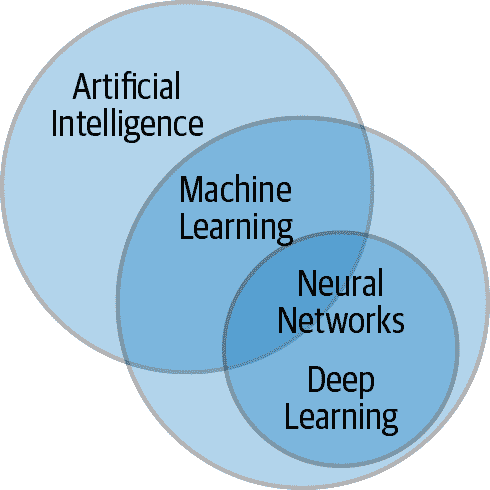
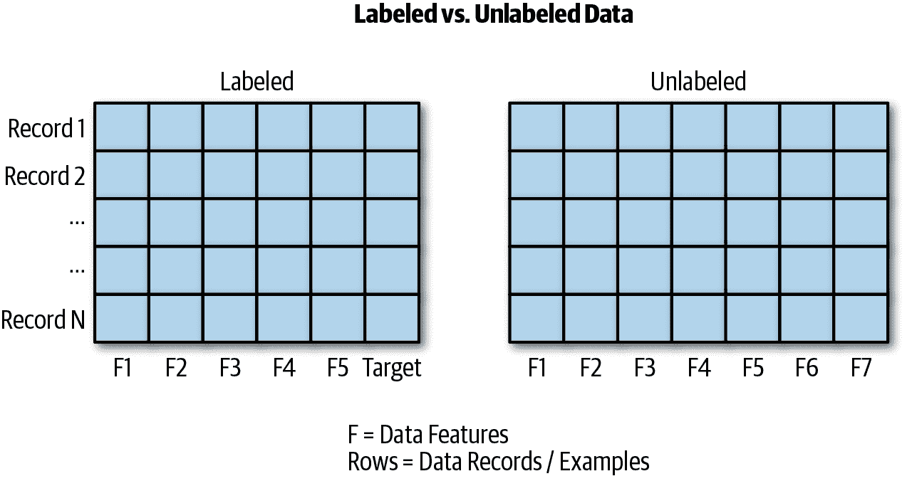
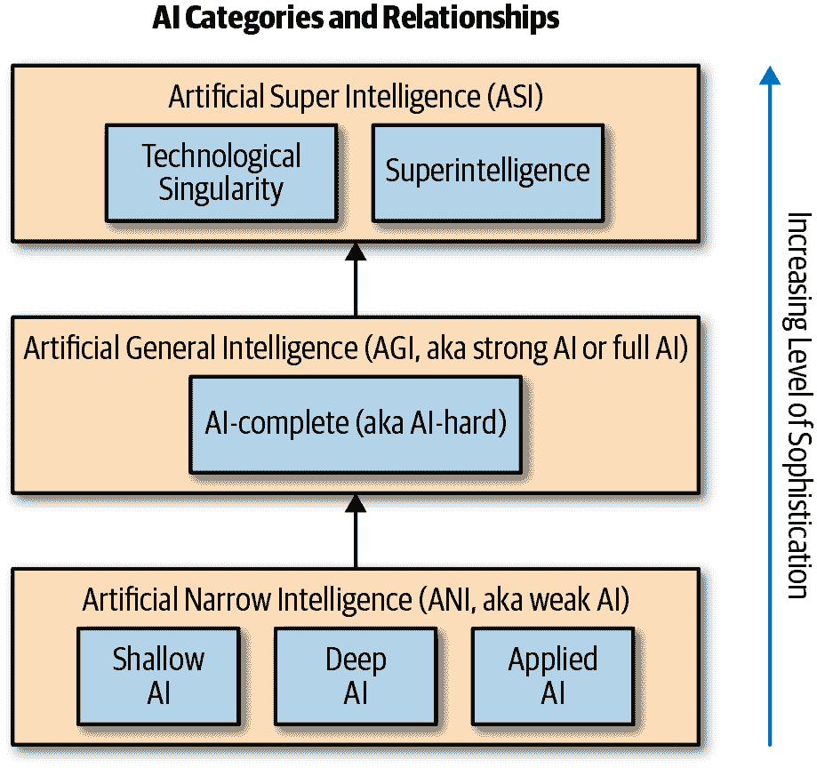
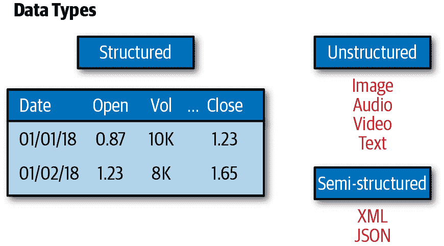

## 第 4 章. 人工智能与机器学习：非技术概述

虽然不必成为人工智能的专家或从业者才能制定人工智能愿景和战略，但对人工智能及其相关学科领域有高层次的理解对于做出高度明智的决策至关重要。帮助你建立这种理解是本章的目标。

本章定义并讨论与人工智能相关的概念和技术，包括机器学习、深度学习、数据科学和大数据。我们还讨论人类和机器如何学习，以及这与人工智能的当前和未来状态有何关联。本章最后将介绍数据如何驱动人工智能，以及实现人工智能成功所需的数据特征和注意事项。

本章有助于建立适当的层次背景，以便理解下一章关于人工智能的现实世界机会和应用。让我们从讨论数据科学领域开始。

## 数据科学是什么，数据科学家做什么？

让我们通过定义数据科学以及数据科学家的角色和职责来开启讨论，这两者都描述了开展人工智能和机器学习项目所需的领域和技能（请注意，更专业的角色变得越来越常见，例如机器学习工程师）。尽管数据科学家通常来自不同的教育和工作经验背景，但大多数人在我称之为[数据科学专长的四大支柱](http://bit.ly/2WDEbaL)的四个基本领域应具备扎实的能力（理想情况下是专家）。按任意顺序排列，这些是数据科学家应具备专业知识的领域：

* 一般商业或相关业务领域
* 数学（包括统计学和概率论）
* 计算机科学（包括软件编程）
* 书面和口头沟通

还有其他技能和专业知识也很受青睐，但我认为这四项是最主要的。实际上，人们通常在其中一两个支柱上比较强，但并不在全部四个方面都 equally strong。如果你碰巧遇到一位在所有方面都真正是专家的 数据科学家，你就找到了常被称为独角兽的人。具备在全部四个支柱上相当程度的专业知识和能力的人非常难找，人才存在明显短缺。

因此，许多公司开始围绕数据科学的特定支柱创建专业角色，这些角色组合起来相当于拥有一个数据科学家。例如，可以组建一个三人团队，其中一人具有 MBA 类背景，另一人是统计学家，另一人是机器学习或软件工程师。团队还可以包括数据工程师，例如。这样一来，团队可以同时开展多个项目，每个人在任何给定时间都专注于项目的特定方面。

基于这些支柱，数据科学家应该能够使用现有的数据源，并在需要时创建新的数据源，以便提取有意义的信息、生成深入的可操作洞察、支持数据驱动的决策并构建人工智能解决方案。这需要业务领域专业知识、有效的沟通和结果解读，以及利用任何和所有相关的统计技术、编程语言、软件包和库以及数据基础设施。简而言之，这就是数据科学的全部内容。

## 机器学习定义和关键特征

机器学习通常被视为人工智能的一个子集。我们首先讨论机器学习，以便为本章后面关于人工智能及其局限性的讨论奠定基础。

回顾我们对人工智能的简单定义，即机器表现出的智能。这基本上描述了机器从信息中学习并应用这些知识来做事以及从经验中继续学习的能力。在许多人工智能应用中，机器学习是一组用于人工智能应用流程中学习部分的 技术。具体技术我们稍后会讨论，可以被视为人工智能和机器学习的子集，通常包括神经网络和深度学习，如图 4-1 所示。



我非常喜欢我在 Google 设计博客文章中看到的这个简短而精炼的机器学习定义：[“机器学习是基于在数据中自动发现的模式和关系进行预测的科学。”](http://bit.ly/2IFZWlp)

我通常给出的非技术性机器学习定义是：机器学习是从数据中自动学习的过程，无需显式编程，并且能够随着经验扩展所学知识。与基于规则的技术相比，机器学习的关键区别在于缺乏显式编程，特别是在特定领域、行业和业务职能方面。在深度学习等高级技术中，可能根本不需要领域专业知识，而在其他情况下，领域专业知识则以特征的形式提供（在非机器学习应用中称为变量、数据字段或数据属性），这些特征被选中或设计用于训练模型。在任何情况下，不需要显式编程这一点都绝对至关重要，确实是理解机器学习最重要的方面。让我们通过一个例子来说明这一点。

假设你在机器学习出现之前是一名程序员，并且被要求创建一个预测模型，能够预测申请某类贷款的人是否会违约该贷款，因此是否应批准或不批准。你会编写一个非常特定于金融行业的长软件程序，其输入包括个人的 FICO 评分、信用历史和申请的贷款类型。代码将包含大量非常明确的编程语句（例如，条件语句、循环）。伪代码（用纯英语编写的编程代码）可能看起来像这样：

```
If the persons FICO score is above 800, then they will likely not default
  and should be approved
Else if the persons FICO score is between 700 and 800
    If the person has never defaulted on any loan, they will likely not
      default and should be approved
    Else the will likely default and should not be approved
Else if the persons FICO score is less than 700
    ...
```

这是一个非常明确编程的例子（基于规则的预测模型），其中包含以代码形式表达的关于贷款行业的特定领域专业知识。该程序被硬编码只能完成一件事。它需要领域/行业专业知识来确定规则（又称场景）。它非常僵化，不一定能代表导致潜在贷款违约的所有因素。该程序还必须为输入或贷款行业整体的任何变化手动更新。


如你所见，这并不特别高效或最优，也不会产生可能的最优预测模型。另一方面，使用正确数据的机器学习能够在没有任何显式编写的代码的情况下完成此任务，特别是表达贷款行业专业知识的代码。这里给出一个略显过度简化的解释，机器学习能够在不了解所涉及数据或领域的情况下将数据集作为输入，传入同样对数据或领域一无所知的机器学习算法，并生成一个具有专家级知识的预测模型，了解输入如何映射到输出，以便做出最准确的预测。如果你理解了这一点，你基本上就从高层次上理解了机器学习的目的。

值得一提的是，虽然机器学习算法本身能够在无需显式编程的情况下学习，但人类在机器学习驱动的 AI 解决方案的整个构思、构建和测试过程中仍然非常必要且深度参与。

# 机器学习的方式

机器通过多种不同的技术从数据中学习，其中最主要的是 *监督式*、*无监督式*、*半监督式*、*强化* 和 *迁移学习*。用于训练和优化机器学习模型的数据通常分为有标签或无标签，如 图 4-2 所示。



有标签数据具有目标变量或值，旨在为给定的特征值组合（又称变量、属性、字段）进行预测。在预测建模中，一种机器学习应用，模型在有标签数据集上进行训练，以便为新的特征值组合预测目标值。数据集中存在目标数据，这就是数据被称为有标签的原因。另一方面，无标签数据具有特征值，但没有特定的目标数据或标签。这使得无标签数据特别适合分组（又称聚类和分割）以及异常检测。

有一点值得注意的是，不幸的是，足够数量的有标签数据可能非常难以获得，并且生产成本可能很高，耗时也很长。标签可以自动添加到数据记录中，也可能需要由人工手动添加（将数据记录，即样本，视为电子表格或表格中的一行）。

监督学习是指使用有标签数据的机器学习，而无监督学习使用无标签数据。半监督学习同时使用有标签和无标签数据。

让我们简要地从高层次讨论不同类型的学习。监督学习具有许多潜在应用，如预测、个性化、推荐系统和模式识别。它进一步细分为两个应用：*回归* 和 *分类*。这两种技术都用于进行预测。回归主要用于预测单个离散或实数值，而分类用于为给定的输入数据集分配一个或多个类别或类别（例如，电子邮件的垃圾邮件或非垃圾邮件）。

无监督学习最常见的应用是聚类和异常检测，而总体而言，无监督学习主要集中在模式识别上。其他应用包括使用主成分分析（PCA）和奇异值分解（SVD）进行降维（简化数据变量数量并简化模型复杂度）。

尽管底层数据是无标签的，但在无监督学习过程本身之外的另一个过程中，当标签、特征描述或配置文件应用于发现的聚类（分组）时，无监督技术仍可用于有用的预测应用中。无监督学习的一个挑战是，很难很好地确定无监督学习生成的模型表现如何。输出取决于你的解读，它没有对错之分。这是因为数据中没有标签或目标变量，因此没有可用于比较模型结果的标准。尽管存在这一限制，无监督学习仍然非常强大，并且具有许多现实世界的应用。

半监督学习可以是一种非常有用的方法，当无标签数据充足而有标签数据不足时。我们在下一章中更详细讨论的其他流行学习类型包括强化学习、迁移学习和推荐系统。

在涉及有标签和无标签数据的机器学习任务中，该过程接收数据输入并将其映射为某种输出。大多数机器学习模型的输出出奇地简单，要么是一个数字（连续或离散，例如 3.1415），要么是一个或多个类别（又称类别；例如“spam”、“hot dog”），要么是一个概率（例如 35% 的可能性）。在更高级的 AI 案例中，输出可能是结构化预测（即一组预测值，而非单个值）、预测的字符和词序列（例如短语、句子），或最近芝加哥小熊队比赛的人工生成摘要（GO CUBS!）。

# AI 定义和概念

我们之前给出了 AI 的简单定义，即机器所表现出的智能，其中包括机器学习和深度学习等特定技术作为子集。在进一步发展 AI 的定义之前，让我们先定义智能的一般概念。智能的大致定义是：

> 学习、理解以及将所学知识应用于实现一个或多个目标

所以，基本上智能就是利用所学知识来实现目标并执行任务的过程（对人类而言，例子包括做出决策、进行对话和执行工作任务）。现在已经定义了智能的一般概念，很容易看出 AI 只是机器所表现出的智能。更具体地说，AI 描述的是机器能够从信息（数据）中学习，产生一定程度的理解，然后利用所学知识做某事的情况。

AI 领域与神经科学、心理学、哲学、数学、统计学、计算机科学、计算机编程等相关，并汲取其精华。AI 有时也被称为机器智能或认知计算，因为其基础和与认知的关系；即与发展知识和理解相关的心理过程。

更具体地说，认知和更广泛的认知科学领域这两个术语用于描述大脑的进程、功能和其他机制，这些机制使收集、处理、存储和使用信息以产生智能并驱动行为成为可能。认知过程包括注意力、感知、记忆、推理、理解、思考、语言、记忆等。其他相关且更深层次、更具哲学性的概念包括心灵、感知、意识和意识。

那么是什么驱动智能？对于 AI 应用而言，答案是数据形式的信息。在人类和动物身上，新的信息不断通过五种感官从经验和周围环境中收集。这些信息随后通过大脑的认知过程和功能进行处理。

令人惊讶的是，人类也可以从大脑中已存储的现有信息和知识中学习，通过将其应用于理解并发展对其他事物的知识，以及例如发展对新主题的想法和观点。你有多少次在利用已理解的信息思考某事后，产生“啊哈！”的瞬间，从而对其他事物产生新的理解？


经验在 AI 中也起着重要作用。AI 的实现依赖于使用特定任务相关数据的训练和优化过程。随着新数据的出现，AI 应用可以随着时间的推移得到更新和改进，这就是 AI 的从经验中学习方面。

从新数据中持续学习出于许多原因很重要。首先，世界及其人类居民一直在我们周围变化。潮流和时尚来来去去；新技术被引入，旧技术变得过时；行业被颠覆；新的创新不断涌现。因此，今天与在线购物相关的数据，例如，可能与明天或几年后你收到的数据非常不同。汽车制造商可能会开始询问是什么因素最有助于人们购买飞行汽车，而不是今天日益流行和广泛使用的电动汽车。

最终，数据及其训练出的模型可能会变得陈旧，这种现象被称为 *模型漂移*。因此，至关重要的是任何 AI 应用都必须得到刷新，并通过持续从新数据中学习来不断积累经验和知识。

# AI 类型

AI 通常会加上 strong 或 narrow 之类的限定词。我们接下来会介绍的这些限定词旨在描述所讨论的 AI 的性质。限定词所描述的 AI 方面可能与 AI 能同时执行的任务数量有关；在神经网络的情况下，与给定算法的架构有关；与 AI 的实际使用有关；或与使用 AI 解决给定问题的相对难度有关。

尽管这可能因参考资料或研究人员而异，但 AI 可以按类别和关系进行分组，如 图 4-3 所示。



从 *人工狭窄智能* (ANI) 开始，“weak”和“narrow”这两个术语可以互换使用，表示 AI 是专门化的，只能执行单一、狭窄的任务；它无法表现出认知能力。这意味着弱 AI 虽然通常相当令人印象深刻，但以任何方式都不是有感知、有觉知或有意识的。截至本文撰写时，几乎所有 AI 都被认为是弱 AI。

“Shallow”和“deep”是用于描述神经网络架构中隐藏层数量的限定词（在 附录 A 中详细讨论）。浅层 AI 通常指具有单个隐藏层的神经网络，而深度 AI（与深度学习同义）指具有一个以上隐藏层的神经网络。

Applied AI 名副其实。它是将 AI 应用于预测、推荐、自然语言和识别等现实世界问题。这些天你经常听到 *智能* 这个词用来描述 AI 驱动的软件和硬件解决方案（例如，智能家居）。也就是说，某种形式的 AI 被用作解决方案的一部分，尽管公司经常夸大其对 AI 的使用。鉴于今天所有 AI 都被认为是狭窄的，应用 AI 被显示为与狭窄 AI 相关。未来情况可能会改变，这就引出了下一个类别。

*通用人工智能* (AGI) 也被称为“strong”或“full” AI。AGI 设定了标准，因为它代表能够表现出认知并以与人类相同程度执行认知过程的机器智能。换句话说，它具有与人类功能等同的认知能力。这意味着机器可以执行人类能执行的任何任务，并且不受限于将智能应用于单一特定问题。这是一个极高的标准。我们将在本章后面更详细地讨论 AGI 及其实现挑战。

值得注意的是，某些 AI 问题被称为 *AI 完备* 或 *AI 难题*（例如，AGI，自然语言理解），这只是意味着这些问题非常先进且难以完全和普遍地解决。创造与人类同等智能的机器是一个非常困难的问题要解决，而且不是我们今天拥有的 AI。

*超人工智能* (ASI) 以及相关概念如技术奇点和超级智能，描述了 AI 以失控的方式自我改进并最终超越人类智能和技术进步的情景。尽管奇点和 [超级智能存在很大争议](http://bit.ly/2IVn1Av)，但在不久的将来（如果有的话）发生的可能性极低。此外，虽然现在不必担心，但值得注意的是，像深度强化学习这样的某些技术正被用于 AI 应用中进行自我导向学习，随着时间的推移而改进。

# 像人类一样学习

考虑一下，婴儿和非常年幼的孩子能够在几乎任何环境中（例如，位置、姿势、姿态、光照）识别出特定动物等物体，尽管他们可能只看过该动物的图片或插图一次。例如。这是大脑的非凡成就，涉及初始学习，然后将该学习应用于不同环境。

在 *MIT 技术评论* 上发表了一篇精彩文章，名为 [“人工智能的缺失环节”，由 Tom Simonite 撰写](http://bit.ly/2MVfLdr)。文章讲述了人类学习的方式以及 AI 技术必须如何发展才能以类似的方式学习并最终表现出类人智能。Google 的 Jeff Dean 在文中被引用说：“最终，无监督学习将成为构建真正智能系统的一个非常重要的组成部分——如果你看看人类是如何学习的，它几乎完全是无监督的。” Yann LeCun 进一步阐述道：“我们都知道无监督学习是最终的答案。”

文章指出，婴儿自行学习到物体被其他物体支撑（例如，咖啡桌上的书），因此受支撑的物体不会因重力而掉到地上。孩子们还学习到无生命物体在他们离开房间后会留在房间的同一位置，他们可以期望回来时它们仍然在那里。他们在没有明确教导的情况下做到这一点，换句话说，这种学习是无监督的，不涉及标记数据，其中标签可能是父母教孩子某件事。

孩子们还通过尝试不同事情随着时间的推移而学习，例如通过实验和试错。他们即使不应该这样做，或者即使知道某些结果可能是负面的，也会这样做，但他们这样做是为了学习因果关系并了解周围的世界。这种学习方法与强化学习高度类似，强化学习是 AI 研究和开发中非常活跃的领域，有可能帮助在类人智能方面取得重大进展。

在人类学习总体背景下，人类能够感知周围的世界并自行赋予事物意义。这些事情可以是识别模式、物体、人和地点。可以是弄清楚某物如何工作。人类也知道如何使用自然语言进行交流。人类学习的大部分以无监督的、自我学习和试错的方式进行。这些都是人类大脑的非凡成就；这些成就用算法和机器来模仿是非常困难的，正如我们接下来所讨论的。

# AGI、杀手机器人和一招鲜


# AGI：为什么真正的通用人工智能仍然遥不可及

## AGI 仍然遥不可及

AGI——即制造出能够做到并理解人类能够做到的任何事情、至少与人类一样好的 AI——仍然遥不可及。这意味着我们现在不必担心杀人机器人，或许永远也不必担心。Pedro Domingos 在他的著作 *《主算法》*^(1) 中写道：“人们担心计算机变得太聪明而接管世界，但真正的问题是它们太愚蠢，而它们已经接管了世界。”他进一步表示，考虑到机器学习的方式，以及最重要的是计算机没有自己的意志，AI 接管世界的可能性为零。

## 为什么 AGI 很困难

AGI 是一个非常难以解决的问题。想想看——要在机器中真正复制所有人类智能，AI 需要能够观察周围的世界，以持续且自主的方式自我学习（即表现出真正的自主性），以便不断理解一切，并可能像人类一样自我改进。它需要理解人类所做的一切，甚至更多，并能够将知识泛化并迁移到任何情境。这在很大程度上就是儿童和成人所做的。但当无监督学习没有正确答案时（正如我们之前讨论的），你如何做到这一点？你如何训练机器在不教它的情况下学习——也就是说，让它自我学习？

这些都是很好的问题，答案是不会，至少不是用当今最先进的 AI 和机器学习方法。目前，AI 中最先进的技术包括神经网络、深度学习、迁移学习和强化学习。这些技术并不特别适合无监督学习应用。它们也非常专注于单一的高度专业化的任务。

## 当前的 AI 是专门化的，而非通用的

一个训练用于识别图像中猫的深度学习神经网络无法同时预测你三年后的房价；它的能力仅限于识别图像中的猫。如果你想要一个预测模型来预测你的房价，你必须创建并训练一个单独的模型。因此，AI 目前并不擅长多任务处理，每个实例基本上都只会一招。

## 人脑不是计算器

尽管人脑的工作原理对神经科学家来说仍然是个谜，但有一点似乎很清楚：大脑并不是像计算机那样纯粹的计算机器。人们认为大脑通过一种复杂的、基于算法的生物神经网络机制来处理感官信息，该机制可以根据模式存储记忆、解决问题，并基于信息回忆和预测驱动运动行为。

这个过程始于出生并持续终生，并且通常以高度无监督、试错的方式进行，正如前面提到的。大脑不可思议的记忆存储和回忆机制使其与纯计算机器区别开来，也是人类无监督学习成为可能的原因。单个人脑能够持续学习并存储整个生命周期中学习到的所有信息和形成的记忆。机器如何模仿这一点？它不会——至少在不久的将来不会。

与人类的无监督和自我学习不同，计算机器完全依赖于极其详细的指令。这就是我们所说的软件代码。即使是自动学习且非显式编程的预测模型（AI 和机器学习的魔力）也被整合到由计算机程序员编写的基于软件的程序中。鉴于 AI 的当前技术水平，如果机器没有针对它在任何环境和任何条件下可能遇到的每一种可能的感官场景进行训练或编程，AGI 就是不可能的。

## 机器缺乏自由意志

其中的一个含义是，智能机器无法像人类一样拥有自由意志；也就是说，在有限甚至无限的可能性面前，像人类一样做出任何合理决策或采取任何行动的能力。除了强化学习等技术外，智能机器仅限于将输入映射到特定输出。

## 人类能够适应并进行因果推理

人类大脑另一方面，能够对以前遇到过或未遇到过的情境做出反应。它们能够自然地实时整合来自五感的感官信息，毫不费力，且速度相对很快。人类能够持续适应环境中未计划的变化，例如与人进行意外的对话（如电话、偶遇朋友），弄清楚为什么电视突然无法打开，应对天气的突然变化，对事故做出反应（如汽车、洒落、破碎的玻璃），错过公交车，判断电梯停用（人类立即知道去寻找楼梯），信用卡无法使用，购物袋破裂，避免突然跑到他们面前的小孩——现实世界的例子几乎无限。

人类也能够思考，这一过程不需要感官输入数据。你可以坐在海滩上凝视着海浪，同时思考与海滩和海洋完全无关的许多事情，但今天的 AI 算法就像绞肉机：你需要把牛肉放进绞肉机才能得到碎牛肉。除了强化学习等技术外，AI 算法在没有相关输入的情况下不会产生输出，尤其是不会产生接近人类思维的东西。

在 *《为什么这样》*^(2) 中，作者讨论了人类还能够基于对世界因果理解（因果关系）和反思能力进行推理、做决策、采取行动并得出结论。反思意味着我们能够回顾性地审视自己的决策或行动，分析结果，并决定是否会在不同情况下做不同的事，或下次在类似情况下做不同的事。这是一种自然的人类学习形式，其输入是之前采取的行动或做出的决策。

我们还拥有对世界的因果理解，并在一生中不断发展这种理解。我们知道相关性不等于因果性，然而大多数 AI 和机器学习算法都是基于相关性（如预测分析），并且完全没有因果概念。一个众所周知的例子是，冰淇淋销售的增加伴随着溺水死亡的增加，因此预测算法可能会学习到冰淇淋消费增加导致溺水。稍加思考，人类很容易就能推断出缺失的因素，*称为混杂变量*，是年份和温度，它们才是两者增加的真正原因。AI 将无法弄清楚这一点。

## 自动化不等于自主

最后，自动化和自主之间存在显著差异，两者在机器人和 AI 向 AGI 发展的背景下都高度相关。自动化是通过编写软件程序来实现的，这些程序可以一次性或重复地自动执行过去需要一定人工协助的任务。自主另一方面则完全关乎独立性、自我导向以及对环境交互和变化做出反应的能力。现有的机器人和 AI 应用中，自动化和自主都有不同程度的存在，目前大多数应用更偏向自动化方面。


真正的自主性非常困难，原因在 AGI 的背景下已有提及，同时也因为感知技术（如计算机视觉）的局限性。计算机视觉和图像识别在受控且一致的环境下的物体检测和识别方面取得了长足进步，但在不断变化、不一致且充满意外的、更能反映现实的环境中理解事物方面，技术表现并不理想。

# 驱动 AI 的数据

AI、机器学习、大数据、物联网以及任何其他形式的分析驱动型解决方案都有一个共同点：数据。事实上，数据驱动着数字技术的方方面面。

本章涵盖数据的力量，包括使用数据做决策、AI 应用中常用的数据结构和格式、数据存储和常见数据源，以及数据就绪的概念。

## 大数据

世界从未像今天这样收集或存储如此多的 数据。此外，数据的种类、总量和生成速度正以惊人的速度增长。例如，营收超过 400 亿美元的领先矿业公司 Rio Tinto，已采用大数据和 AI 来根据[每分钟产生 2.4 太字节的传感器数据](http://bit.ly/2x2ChpK)做出数据驱动的决策！

大数据领域致力于高效地获取、整合、准备和分析来自这些庞大、多样且快速变化的数据集的信息。然而，由于硬件和/或计算能力的限制，处理这些数据集并从中提取价值可能不可行或无法实现。为应对这些挑战，需要新的创新硬件、软件工具和分析技术。大数据一词用于描述数据集、技术和定制工具的这种组合。

此外，任何类型的数据如果没有某种形式的配套分析，基本上是无用的（除非数据本身被货币化）。除了上述描述外，人们还用大数据来描述对非常大的数据集进行分析，这可能包括 AI 和机器学习等高级分析技术。

## AI 应用的数据结构和格式

从高层次来看，我们可以将数据分为*结构化*、*非结构化*或*半结构化*，如图 4-4 所示。



让我们从结构化数据开始。我们可以把结构化数据想成……就是具有结构的数据。虽然在图 4-4 中以表格形式展示，但结构化数据通常是有组织的，可以很容易地放入表格、电子表格或关系数据库等。例如。结构化数据通常被描述为具有特征，也称为*属性*或*字段*。以这种方式结构化时，通常被称为数据模型，并且查询、连接、聚合、过滤和排序数据变得相对容易。

图 4-4 展示了表格格式的结构化数据示例。在这种情况下，数据按列和行组织，其中行代表单个数据示例（又称记录、样本或数据点）。列代表每个示例的数据特征。图 4-4 还展示了标记数据和未标记数据的示例，这些概念我们之前讨论过。

非结构化数据与结构化数据相反，因此在任何方面都未被组织或结构化，也没有数据模型对其进行表征。常见示例包括图像、视频、音频以及评论、电子邮件正文和转写为文本的语音等文本。

请注意，非结构化数据可以被标记，图像就是常见的例子。图像可以根据其主要主题进行标记；例如，根据描绘的动物类型将图像标记为猫或狗。

半结构化数据具有一定的结构，但不像结构化数据那样容易组织成表格。示例包括 XML 和 JSON 格式，两者常用于软件应用程序中的数据传输、负载以及在平面文件中的表示。

与 AI 应用相关的数据的最后一种类型和格式是*序列数据*，其中*语言*和*时间序列*是两个常见示例。序列数据是指按序列排序的数据，其排序机制是某种索引。在时间序列数据中，时间是索引，而物联网或数据采集系统中的传感器是时间序列数据来源的绝佳示例。

序列数据的另一个示例是语言。语言不仅以语法和在交流中的使用为特征，还以字母和单词的序列为特征。句子是单词的序列，当单词序列被重新排列时，它很容易产生不同的含义，或者在最坏的情况下完全没有意义。单词的排列方式具有非常具体的含义，对使用该语言的人来说最有意义。

## 数据存储与来源

公司和人们通常会产生大量数据，而且往往通过不同的、非统一的软件和硬件应用程序生成，每个应用程序都建立在独特的“后端”或数据库之上。数据库用于永久和临时数据存储。数据库有许多不同类型，包括它们在磁盘上物理存储数据的方式、存储的数据类型（例如，结构化、非结构化和半结构化）、支持的数据模型和模式、使用的查询语言，以及处理可扩展性和安全性等治理和管理任务的方式。在本节中，我们重点介绍 AI 应用中最常用的一些数据库：*关系数据库*和*NoSQL 数据库*。

关系数据库管理系统（RDBMS）非常适合存储和查询结构化关系数据，尽管有些也支持存储非结构化数据和多种存储类型。关系数据意味着数据库中不同部分（即表）存储的数据通常根据预定义的关联类型（例如一对多）相互关联。每个表（或关系）由行（记录）和列（字段或属性）组成，每行都有唯一的标识符（键）。关系数据库通常提供其他数据库不具备的数据完整性和事务保证。

NoSQL 数据库系统因其可扩展性和高可用性方面的优势而被创建，并获得了广泛的流行。这些系统还被描述为现代的 Web 级数据库，通常无模式、提供易于复制的功能，并具有简单的应用程序编程接口（APIs）。它们最适合非结构化数据和涉及海量数据的应用程序——例如大数据。事实上，其中许多系统旨在处理非凡的请求和数据量，可以利用大规模的水平扩展（例如数千台服务器）来满足需求。

NoSQL 数据库有多种类型，其中文档、键–值、图和宽列是最常见的。不同类型主要指数据的存储方式以及数据库系统本身的特性。值得注意的是，近年来备受关注的另一种数据库系统。*NewSQL* 数据库系统是关系数据库系统，结合了类似 RDBMS 的保证和类似 NoSQL 的可扩展性和性能。

## 特定数据源

有很多具体类型的数据源，在任何一家大型公司中，很多数据源会同时使用。某些类型的数据可用于自动化和优化面向客户的产品和服务，而其他类型的数据更适合优化内部应用。以下是潜在数据源的列表，我们将逐一查看：

*   客户
*   销售和营销
*   运营


## 数据来源和类型

* 事件和交易型
* 物联网
* 非结构化
* 第三方
* 公共

大多数公司使用客户关系管理工具，即 CRM。这些工具管理与现有和潜在客户、供应商以及服务提供商的互动和关系。此外，许多 CRM 工具能够原生地和/或通过集成来管理多渠道客户营销、沟通、定位和个性化。因此，CRM 工具可以成为以客户为中心的 AI 应用的非常重要的数据源。

尽管许多公司将 CRM 工具用作其主要客户数据库，但客户数据平台（CDP）工具（如 AgilOne）用于通过整合围绕客户行为、参与度和销售的数据源来创建单一、统一的客户数据库。CDP 工具旨在供非技术人员使用，并且与数据仓库类似，用于推动高效的分析、洞察收集和定向营销。

销售数据是公司拥有的最重要、如果不是最重要的一些数据。典型的数据来源包括有实体店的公司的销售点数据、在线购物应用的电子商务数据，以及服务销售的应收账款。许多在实体店销售产品的公司也在网上销售产品，因此能够使用这两类数据源。

市场部门通过多个渠道与客户沟通并提供优惠，并据此生成渠道特定的数据。常见的营销数据源可以包括电子邮件、社交媒体、付费搜索、程序化广告、数字媒体参与度（例如，博客、白皮书、网络研讨会、信息图表）以及移动应用的推送通知。

运营数据围绕业务职能和流程展开。示例包括与客户服务、供应链、库存、订购、IT（例如，网络、日志、服务器）、制造、物流和会计相关的数据。运营数据通常最适合用于深入了解公司内部运营，以便改进并可能自动化流程，以实现提高运营效率和降低成本等目标。

对于主要围绕数字产品（如软件即服务（SaaS）应用和移动应用）构建的公司，通常会产生和收集大量基于事件和交易的数据。值得注意的是，尽管单笔销售当然可以被视为交易，但并非所有交易数据都与销售相关。事件和交易数据可以包括银行转账、提交申请、放弃在线购物车，以及用户交互和参与度数据，如点击流和 Google Analytics 等应用收集的数据。

随着物联网革命如火如荼，研究表明它将产生高达[11 万亿美元的经济价值](https://mck.co/2In3SbP)，通过超过[到 2025 年全球超过 750 亿台联网设备](http://bit.ly/2WOtMcz)。毋庸置疑，联网设备和传感器产生的数据量巨大且不断增加。这些数据对 AI 应用非常有用。

公司还拥有大量价值很高的非结构化数据，这些数据通常很少被使用。如前所述，非结构化数据可以包括图像、视频、音频和文本。文本数据在源自产品或服务客户评论、反馈和调查结果时，对自然语言处理应用特别有用。

最后，公司通常会使用多个第三方软件工具，这些工具可能未在此部分提及。许多软件工具允许数据与其他工具集成并导出以进行分析和可移植性。在许多情况下，第三方数据也可以购买。最后，随着互联网的爆炸式增长和开源运动的兴起，还有大量免费且非常有用的公开可用数据可供我们使用。

利用数据帮助生成深度可操作的洞察并推动 AI 解决方案的关键在于数据的可用性和访问性，无论是否将数据集中化，以及所有的数据就绪性和质量考虑，我将在下一节中介绍这些内容。

## 数据就绪性和质量（“正确”数据）

让我们以一个在 AIPB 中是主要考虑因素的关键概念结束本章——数据就绪性和质量的概念。能够成功驱动特定 AI 解决方案的高质量且就绪的数据（按我们的定义）就是我所说的“正确”数据。这是解决方案成功的关键所在。

我将数据就绪性这一术语统称为以下内容：

* 数据量充足
* 数据深度充足
* 数据均衡良好
* 高度代表且无偏的数据
* 完整的数据
* 清洁的数据

在逐一介绍这些数据就绪性要点之前，让我们先讨论*特征空间*的概念。术语“特征空间”指的是在用于特定问题的数据集中包含的所有特征中可能出现的特征值组合的数量。在许多情况下，由于一种被称为*维度诅咒*的现象，增加更多特征会导致给定问题所需的数据量呈指数级增长，我们将在随后几段的侧边栏中进一步讨论该现象。

### 数据量充足

让我们从数据量充足的需求开始。需要足够的数据来确保学习过程中发现的关系具有代表性和统计显著性。此外，数据越多，模型可能就越准确。更多的数据还允许使用更简单的模型，并减少从现有特征创建新特征的需求，而这一过程被称为*特征工程*。特征工程可以简单到转换单位；有时，它涉及从其他特征的组合中创建全新的指标。

### 数据深度充足

一般来说拥有足够数量的数据是不够的：AI 应用还需要足够多样的变异数据。这就是数据深度充足发挥作用的地方。深度意味着有足够多样的变异数据来充分填充特征空间——一组足够好的不同特征值的组合，使得模型能够正确学习数据特征本身之间的底层关系，以及在标记数据中存在时数据特征与目标变量之间的关系。

此外，想象一下有一个包含数千行数据的数据表。假设绝大多数行都由完全相同的特征值重复构成。在这种情况下，如果模型只能学习到重复特征数据与目标之间所表示的关系，那么拥有大量数据对我们来说并没有什么好处。需要注意的是，任何给定数据集都不太可能包含所有特征值的所有组合，因此完全填满给定的特征空间。这是可以的，也是通常预期的情况。你通常可以在数据具有足够变异的情况下获得足够的结果。

### 数据均衡良好


相关概念是数据平衡，这适用于标记数据集。数据集的平衡程度指的是数据集中目标值的比例。假设你有一个垃圾邮件与非垃圾邮件的数据集，用来训练电子邮件垃圾邮件分类器。如果 98% 的数据是非垃圾邮件，只有 2% 是垃圾邮件，分类器可能没有足够的垃圾邮件示例来学习真实世界的垃圾邮件可能包含的内容，从而有效地将所有新的、尚未见过的未来邮件分类为垃圾邮件或非垃圾邮件。目标值比例相等是理想的，但很难实现。通常，某些值或类别只是更罕见，因此代表性不均。你可以使用一些数据建模准备技术来尝试弥补这一点，但这超出了本次讨论的范围。

## 高度代表且无偏的数据
另一个相关概念是具有代表性的数据。这类似于拥有足够的数据深度来充分填充特征空间。具有代表性的数据不仅意味着尽可能填充特征空间，还意味着代表给定模型在现实世界中在所有情况下、现在和未来可能看到的特征值的范围和多样性。从这个角度来看，重要的是确保数据不仅具有足够的特征值多样性和组合，而且还涵盖投入生产后可能出现的现实世界范围和组合。

如果你处理的数据是从更大数据集中的样本或选择，重要的是避免样本选择偏差，或简单地说抽样偏差（一种选择偏差）。避免偏斜或有偏的数据样本会产生高度代表性的数据，如前所述。随机化是帮助减轻抽样偏差的有效技术。另一种更严重、应避免的偏差形式被称为算法偏差，我们将在 第 13 章 中进一步讨论该主题。

## 完整数据
数据完整性意味着在监督学习应用中拥有所有可用的数据，这些数据包括领先因素、贡献者、指标或其他方式来描述具有与目标变量关系最大且影响最大的数据。 当可用数据不包括对某物价值贡献最大的因素时，创建预测模型的难度会非常大。

有时，简单地添加额外的数据特征就可以解决问题，而其他时候，必须从现有特征和原始数据中创建新特征；换句话说，就是特征工程过程，如前所述。确保数据完整的一部分还包括确保处理任何缺失值。处理缺失值的方法有很多，例如插补和内插，但进一步讨论超出了本文范围。

## 清洁数据
最后，数据清洁度是数据就绪的关键部分。结合特征工程和特征选择，数据清洗和准备是人工智能和机器学习开发中最关键的两个任务。数据清洗和准备——通常也被称为 *数据清洗*、*数据整理*、*处理*、*转换* 和 *清理* ——通常作为实际的数据科学和建模过程的一部分来处理，我在 附录 B 中深入介绍了该过程。数据很少是干净且适合机器学习和人工智能任务的。通常需要大量工作来清洗和处理数据，实践者们常说人工智能和机器学习工作的 80% 是清洗数据，另外 20% 才是酷的部分；例如，预测分析和自然语言处理（NLP）。这就是经典帕累托法则的体现。

我们可以因多种不同的原因认为数据“脏”。通常数据包含明显的错误。例如，在准备数据集时可能出现错误，导致标题与实际数据值不匹配。另一个例子是标记为“Email”的电子邮件地址数据特征，但所有值都由电话号码组成。有时值不完整、损坏或格式不正确。例如，电话号码可能由于某种原因全部缺少一位。也许数据中存在应为数字的文本字符串。数据集通常还包含奇怪的值，例如 `NA` 或 `NaN`（非数字）。可靠且无误的数据是数据真实性的衡量标准，非常受追捧。

# 关于因果关系的说明
一个非常重要的概念值得提及的是因果关系的区别，以及它与人工智能、机器学习和数据科学的关系。尽管测量数据中捕获的效果相对容易，但找到导致观察到的效果的根本原因通常要困难得多。

在预测分析中，有方法可以使用某些模型类型的参数（我在 附录 A 中介绍）来估计某个特征或因素对特定结果的影响，从而相对和定量地衡量预测变量对我们感兴趣并试图预测的目标变量的影响。同样，我们可以使用统计技术来衡量特征之间的相关性，例如它们彼此关联的紧密程度。这两种技术都非常有用并提供有用信息，但这些信息可能具有误导性。

作为一个完全人为的例子来说明这一点，也许我们确定棉花糖销量增加与房价上涨直接相关，两者之间的相关性似乎非常强。我们可能会得出结论棉花糖销售导致了房价上涨的效果，但我们很聪明，知道这极不可能，一定还有其他事情在发生。通常还有我们没有测量或不知道的其他因素在起作用（即前述的混杂变量）。

在这个例子中，也许在大型企业涌入导致房地产需求和增长大幅增加的地区，烤棉花糖已成为餐厅里超级流行的甜点。这里房价上涨的真正根本原因是企业的涌入，而棉花糖销量的增加只是该地区的趋势，但两者同时发生。

理解特定效果的真正根本原因是理想的，因为它使我们能够获得最深入的理解和洞察力，并做出最合适和最优化的改变（即以正确的量拉动正确的杠杆），以实现特定结果。已经设计了各种测试和实验方法（例如 A/B 测试和多变量测试）来确定因果关系，但对于某些场景（例如试图确定肺癌的原因），这些技术在实践中可能难以或不可能执行。因此，其他技术已被设计出来，例如 *观察性因果推断*，它试图从观察数据中获得相同的洞察。

# 摘要
希望本章能帮助你更好地理解人工智能及其相关领域的定义、类型和差异。我们讨论了人类和机器如何学习，以及人工智能和机器学习代表了机器从数据中学习而无需显式编程的技术，然后利用获得的知识执行特定任务。这就是机器表现出智能的原因；这是秘诀。它使人类能够以他们单独无法实现的方式使用分析。


数据科学另一方面代表了我所称的数据科学专业四大支柱（业务/领域、数学/统计、编程和有效沟通），以及科学流程，以便培养充足的数据并迭代生成深刻的、可操作的洞察并开发 AI 解决方案。

我们还讨论了数据如何推动 AI 解决方案，以及实现 AI 成功所需的重要数据特征和考虑因素。最重要的是，这包括数据就绪性和质量的概念。这两者对于 AI 成功都是必需的。

在从本章获得的知识基础上，让我们接下来讨论 AI 的现实世界机会和应用。这应该有助于激发想法并提供制定 AI 愿景所需的背景，而 AI 愿景是本书第 II 部分 的主题。

^(1) Domingos, Pedro. *The Master Algorithm: How the Quest for the Ultimate Learning Machine Will Remake Our World*. 纽约：Basic Books，2015 年。

^(2) Pearl, Judea and Dana Mackenzie. *The Book of Why: The New Science of Cause and Effect*. 纽约：Basic Books，2018 年。
