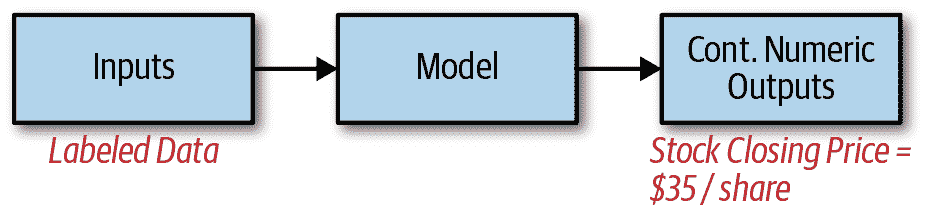
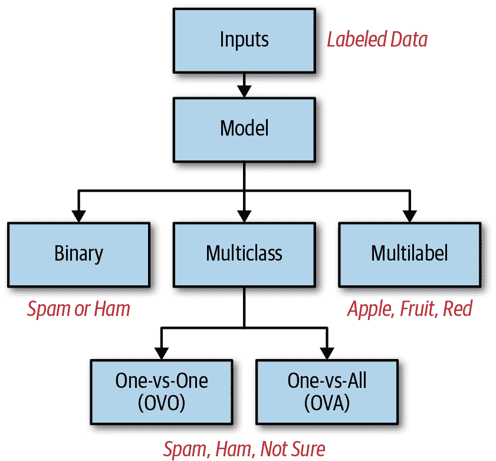
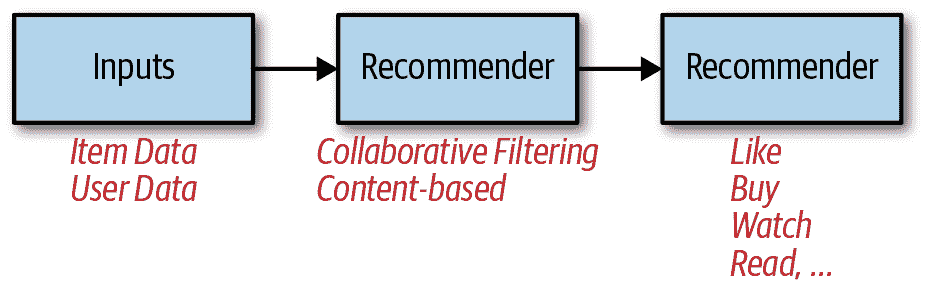
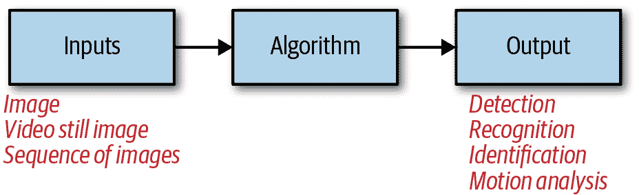
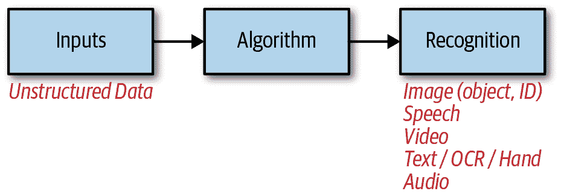
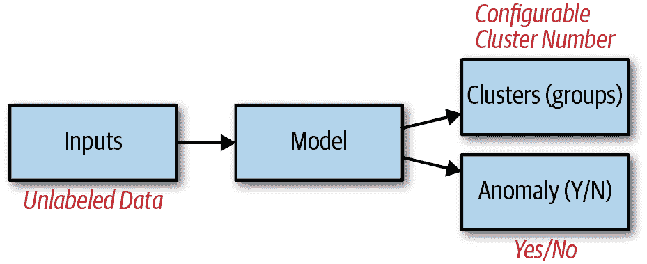
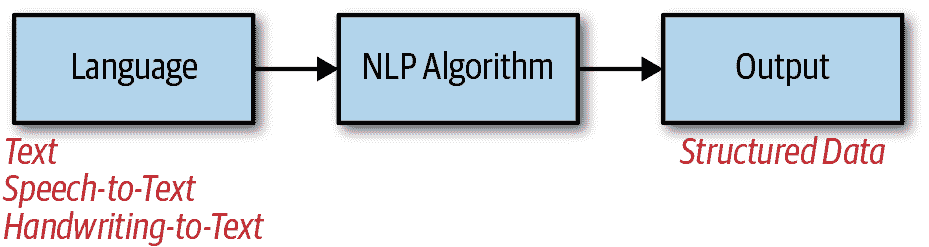
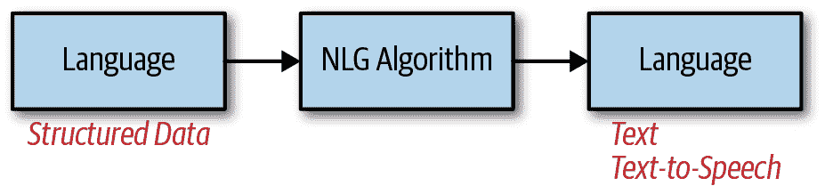
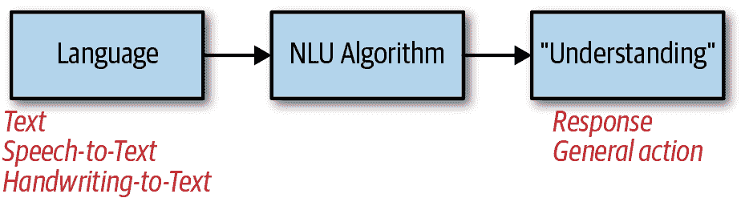
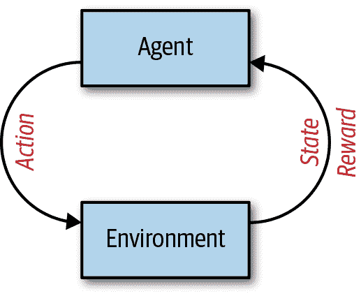

## 第 5 章. 真实世界的 AI 应用与机会

我被问到最多的一个问题是如何在现实世界应用中使用 AI。本章是对现实世界 AI 应用和示例的高层次概述。特别是，本章的目标是展示 AI 如何创造现实世界的价值并帮助激发 AI 创新的愿景。

值得注意的是，这个主题本身就可以是一整本书，因此这里的目标是让你了解应用类型如何在高层次上运作，并提供一个或多个我们如何应用每一种的示例。在深入具体现实世界的应用和示例之前，让我们回顾一下 AI 的当前状态和可用机会。

## AI 机会

[2018 年麦肯锡 AI 采用报告](https://mck.co/2YNGNVb)指出，AI 在产生最多价值的业务领域获得了最多的 traction，按从高到低的采用顺序包括服务运营、产品和/或服务开发、营销和销售、供应链管理、制造、风险、人力资源、战略和企业财务。此外，它还显示了[采用 AI 数量最多的行业](https://mck.co/2YNGNVb)，从高到低包括电信、高科技、金融服务、专业服务、电力和天然气、医疗保健系统和服务、汽车和装配、旅行/运输/物流、零售以及制药/医疗产品。

PWC 估计 AI 可能会为全球经济到 2030 年贡献高达[$15.7 万亿美元](https://pwc.to/2DOYhpd)，而麦肯锡估计某些 AI 技术“有可能在 19 个行业的九个业务职能中每年创造[$3.5 万亿美元至 $5.8 万亿美元的价值。”](https://mck.co/2Hv22VP)

Teradata 估计全球 80% 的企业公司已经[在其组织中纳入某种形式的生产 AI](http://bit.ly/2HQMwCS)，而 Forrester 估计“真正以洞察驱动的企业将从其信息不足的同行那里夺取[$1.2 万亿美元的年收入](http://bit.ly/2HyJNzz)。”

正如这些行业和数据所示，AI 代表着巨大的机会，并且正在各行业和业务职能中被广泛采用。鉴于物联网的当前兴起，这些数字可能会显著增加。IDC 预测到 2021 年全球物联网支出总额将接近 1.4 万亿美元，并且[全球物联网市场将增长到 2020 年的 4570 亿美元](http://bit.ly/2VW2Iwk)。

## 如何将 AI 应用于现实世界应用？

另一个我经常被问到的问题（通常是高管和经理）是：“我如何应用 AI 来做出决策和解决问题？”很少有人真正了解 AI 是什么，它能做什么，或具体如何将其应用于现实世界应用。理想情况下，一位具有 AI 专业知识和商业头脑的企业高管、经理或从业者可以帮助回答这个问题，但我包含了这一部分，针对那些在高管层面没有 AI 专业知识的奢侈，或者希望自己弄清楚的人。

与 AI、机器学习和数据科学相关的所有内容，包括潜在应用，都可能远非显而易见。事实上，它可能令人望而生畏和不知所措。你如何知道哪些技术适用于哪些用例？你如何知道哪些 AI 应用和结果对你的行业或业务职能最常见？你应该在什么粒度级别思考？作为高管或经理，关键是简单地了解顶层方法，让数据科学家和机器学习工程师弄清楚尝试哪些具体技术。关键词是“尝试”——这是一个实验性和科学性的过程！

在我经验中，AI 在业务与技术方面之间的翻译是主要挑战之一。这部分是因为 AI 非常技术性，对许多人来说普遍难以理解。也是因为 AI 和利用数据创造价值的天空几乎是无限的。

让我进一步解释。大多数 AI 和机器学习技术可以以一种或另一种方式应用于所有行业和业务职能。无论是初创公司还是企业公司，无论是医疗保健、制造还是零售公司，每家公司都有数据。同样，无论是营销、销售还是运营，每个业务职能（即部门）都有数据。

保险公司希望预测客户流失，就像零售公司一样，两者都可以使用相同的技术。我们可以使用图像识别来取代进入办公楼的门禁卡，就像我们可以用它在放射图像中诊断癌症一样。在这种情况下，所使用的技术和识别或识别图像中某些物体的目标或多或少是相同的。唯一真正的不同是使用的数据和行业应用。对于那些对 AI 不太熟悉的人来说，这通常是一个难以理解的事情，对于那些更熟悉的人来说，也很难解释。

业务人员、领域专家和 AI 从业者必须协作工作，以确定有哪些机会，选择和优先考虑要追求的机会，并确定本章概述的哪些方法会最有效。以下大多数方法并非特定于行业；相反，它们可以定制到特定的数据和目标。此外，你应根据对所考虑行业或业务职能的潜在价值（和/或投资回报率）来战略性地识别和优先考虑 AI 机会和应用。

表 5-1 应能回答你的一些问题，特别是关于你如何应用 AI 的方式。这些技术以一种或另一种方式适用于几乎每种类型的行业和业务职能。由于不同的行业和业务职能实在太多，无法在本次讨论中实际包含，我采取了提供特定目标类型然后列出一个或多个有助于实现该目标的技术的方法。本列表和本章的整体内容并非详尽无遗。

表 5-1. 按目标划分的 AI 技术示例

| 目标 || 技术 |

| --- | --- |

| 预测连续数值（例如，股价） || 监督学习（回归） |

| --- | --- |

| 预测（或分配）类别、分类或标签（例如，垃圾邮件或非垃圾邮件） || 监督学习（分类） |

| 创建相似数据的分组（以了解每个组的特征；例如，市场细分） || 无监督学习（聚类） |

| 识别高度异常和/或危险的异常值（例如，网络安全、欺诈） || 无监督学习（异常检测） |
| 为客户个性化您的产品、服务、功能和/或内容 || 推荐（例如，媒体、产品、服务）；排名/评分；个性化（例如，内容、优惠、信息传递、交互、布局） |
| 检测、分类和/或识别特定的空间（空间）、时间（时间）或时空（两者；例如，音频、视频）模式；检测和分类人类情感（来自语音、文本、图像和视频） || 识别（图像、音频、语音、视频、手写、文本）；计算机视觉（例如，检测：运动、手势、表情、情感）；自然语言处理（NLP） |
| 让 AI 自学以随时间优化流程（例如，游戏、自动化） || 强化学习 |
| 允许人员和流程快速、轻松地找到高度相关信息（例如，文章、图像、视频、文档） || 搜索（文本、语音、视觉）；排名/评分 |
| 将非结构化文本/语音（例如，主观反馈、评论、文档）转化为可量化、客观且可操作的分析、洞察和预测 || 自然语言处理（NLP） |
| 创建个人或虚拟助手、聊天机器人或语言驱动代理（例如，Amazon Alexa、Apple Siri） || 自然语言处理（NLP）；自然语言理解（NLU）；示例：问答和对话 |
| 创建更好的预测 || 时间序列方法 |
| 从一种类型生成另一种类型的数据（例如，文本、音频、图像、视频、语音） || 生成式 AI（包括自然语言生成 \[NLG\]） |
| 自动化数据科学和机器学习流程的某些方面 || AutoML |
| 构建涉及软件、硬件和固件的混合应用（例如，自动驾驶汽车、机器人、物联网） || 所有技术均可单独或组合使用 |
| 预测或翻译序列（例如，语言翻译；预测字符、单词或句子） || 深度学习；序列到序列学习 |
| 增强智能或自动化流程（例如，重复性繁琐任务、决策、洞察） || 所有技术都可能单独或组合使用 |
值得一提的是，你可以将其中许多技术组合到单个 AI 应用中——一个利用多种方法的应用程序。记住，几乎所有今天的 AI 都是狭窄的，有点像一招鲜。这意味着我们目前还没有算法能同时完成其中多于一项。再次强调，诀窍在于让业务人员、领域专家和 AI 实践者一起合作，根据需要选择最佳的方法和组合。
# 真实世界的应用和示例
现在让我们深入了解按方法类别划分的真实世界 AI 应用概述以及示例。所给的示例远非详尽无遗，且主要侧重于商业（我们将在 第 9 章 中介绍以人为中心的示例）。此外，我本可以按行业或业务职能对应用进行分组，但我选择按方法类型进行分组，正如我们之前讨论的那样，每种方法很可能在某种程度上适用于任何行业或业务职能。
其目的是让你在不陷入技术细节的情况下，对不同类型的技术和应用获得扎实的理解，因此重点在于可解释性。我们将以过度简化的方式使用“algorithm”一词来描述单个算法、模型或使用多个算法的软件程序。在每个类别中，我讨论数据类型输入、算法作为黑盒（为简化起见，即使真实算法并非黑盒），以及输出。
由于这旨在作为高层次概述，建议你进一步研究任何感兴趣的具体应用，以及它们在你选择的行业或业务职能中是如何应用的。也有许多资源可供进一步了解技术细节和使用的具体算法。
## 预测分析
*预测*，即 *预测分析* 或 *预测建模*，是基于带标签，有时也带未标签的输入数据预测输出的过程。在机器学习和 AI 的背景下，预测分析可进一步分为回归或分类。
以下两个关于预测的小节涵盖了从带标签（监督）数据进行预测。涉及时间序列和顺序数据的预测分析将在后面的章节中介绍。
### 回归
图 5-1 演示了回归是如何将带标签的输入数据传递通过预测模型（我们为简化起见假设全程为黑盒），并从连续数字范围生成数值（例如，股票收盘价）的过程。

应用包括 [客户终身价值和净利润](http://bit.ly/30DDpxB)、[收入和增长预测](http://bit.ly/2YKUl3H)、[动态定价](http://bit.ly/2Hv4VG9)、[信用](http://bit.ly/30DNwCM) 和 [贷款违约风险](http://www.underwrite.ai)，以及 [算法股票交易](http://bit.ly/2Qgg4xk)。
### 分类
分类是将带标签的输入数据传递通过模型（分类器），并为输入分配一个或多个类别（类别/标签）的过程，如 图 5-2 所示。

二元分类器的标准示例是电子邮件垃圾邮件过滤器。电子邮件代表传递通过分类器模型的输入数据，模型随后确定电子邮件是否为垃圾邮件或非垃圾邮件，not-spam 在此指代良好的非垃圾邮件。垃圾邮件被发送到垃圾邮件文件夹，非垃圾邮件被发送到收件箱。
假设加入了第三个类别并标记为“unsure”。现在分类器可以为给定的电子邮件输入分配三种可能的类别：spam、not-spam 和 unsure。这是因为可能存在多于两个类别，所以这是多类分类的示例。在这种情况下，电子邮件客户端可以有一个“Possibly Spam”文件夹供用户审查和验证每封邮件，从而教会分类器如何更好地区分 spam 和 not-spam。
当有三个或更多可能类别可分配给输入时，算法可以选择为输入分配单个类别，也可以为给定输入的每个可能类别分配概率。在后一种情况下，概率最高的类别可作为分配的类别，或所有类别的概率可按你想要的任何自定义方式使用。在此示例中，假设新收到的电子邮件被判定为 85% 可能是 spam，10% 可能是 not-spam，5% 可能是 unsure。你可以只说该邮件是 spam，因为概率最高，也可以以其他方式使用不同的概率。
最后，某些算法可以为同一输入分配多个标签。与图像识别相关的示例可以是红色苹果的图像作为输入数据，为图像分配多个类别，如 red、apple 和 fruit。在此示例中，为图像分配全部三个类别是合适的。
应用包括 [信用风险和贷款审批](http://bit.ly/30BRI68) 和 [客户流失](https://amzn.to/2WYyNQv)。分类可以与本章后面讨论的识别应用相结合。
## 个性化和推荐系统

## 推荐系统

推荐系统是一种个性化形式，利用现有信息为个人用户提供更相关的建议和结果。你可以用它来提高客户转化率和销售额、愉悦度和留存\]，例如。事实上，[亚马逊通过增加这些引擎使收入增长了 35%，Netflix 上观看的 75%内容由其推荐生成](http://bit.ly/2CjeoM5)。

推荐系统是一种特定的信息过滤系统。你也可以使用搜索、排序和评分技术进行个性化，我们将在本章后面讨论。推荐系统通过获取诸如商品（例如，产品、文章、音乐、电影）或用户数据等输入，并将数据通过推荐模型或引擎进行处理来做出推荐，如图 5-3 所示。

值得一提的是与推荐系统相关的“冷启动问题”。冷启动问题指的是智能应用尚没有足够信息为特定用户或群体做出高度个性化和相关推荐的情况。一个例子包括尚未生成关于其偏好、兴趣或购买历史信息的用户。另一个例子是当商品（例如，衣服、产品、视频、歌曲）首次向公众推出时。你可以使用多种技术来帮助解决这个问题，但由于篇幅限制，我们这里不讨论这些。

推荐系统应用包括为产品、电影、[音乐和播放列表](http://bit.ly/2VN5AH6)、书籍和电视节目（例如，Amazon、Netflix、Spotify）生成推荐。除了推荐之外，个性化内容还可以包括新闻、信息流、电子邮件和定向广告（例如，Twitter）。其他例子包括[个性化医疗和医疗治疗计划](http://bit.ly/2X0eRN6)、个性化图像和缩略图（例如，[YouTube](http://bit.ly/2YJ6TbU)、[Netflix](http://bit.ly/2EkPQ8f)、[Yelp](http://bit.ly/2wgh5fy)）、[葡萄酒推荐](https://cnb.cx/2HJmRf1)、个性化购物如[完美夹克搭配](https://www.thenorthface.com/xps)、时尚搭配（例如，[StitchFix](http://bit.ly/2Ep11ws)）和[自动完整服装推荐](https://www.findmine.com)。

## 计算机视觉

计算机视觉是一个广泛的领域，当涉及图像和视频等视觉信息时，它包括模式识别（下一节讨论的另一种方法）。计算机视觉表示获取诸如照片图像、视频静帧和图像序列（视频）等输入，将数据通过模型处理并产生输出的过程，如图 5-4 所示。

输出可以是对特定物体、特征或活动的识别、检测和辨识。视觉相关应用意味着一定程度的自动化，特别是在自动化视觉时，通常在应用中需要人工（例如，检查）。机器视觉一词用于描述在工业应用中使用的类似且部分重叠的技术，如检查、过程控制、测量和机器人技术。

计算机视觉有很多非常有趣且强大的应用，用例正在迅速增长。例如，我们可以用计算机视觉进行：

*   [视频分析和内容筛查](http://bit.ly/2ErGuHJ)
*   [唇读](http://bit.ly/2JAY1kP)
*   为自主车辆（例如，汽车、无人机）提供“视力”
*   [视频识别与描述](http://bit.ly/2WZ9xJX)
*   [视频字幕](http://bit.ly/2LZrKGe)
*   [人类互动预测](http://bit.ly/2WqBFZG)例如拥抱和握手
*   [机器人和控制系统](https://www.bostondynamics.com)
*   [人群密度估计](http://bit.ly/2Hu6hRs)
*   [人数统计](http://bit.ly/2VKhstc)（例如，[队伍](http://bit.ly/2WVedAI)、基础设施规划、零售）
*   [检查和质量控制](http://bit.ly/2QiKIGh)
*   [零售客户人流路径和参与度分析](http://bit.ly/2WjiSze)

无人机（UAV）通常被称为无人机。通过应用计算机视觉，无人机能够执行检查（例如，石油管道、手机信号塔）、探索区域和建筑物、帮助制图任务以及[配送购买商品](https://amzn.to/2wgiRNK)。计算机视觉也越来越多地用于公共安全、安保和监控。当然，应注意确保应用是合乎道德的并且造福于人们。

关于计算机视觉最后一点需要注意。我之前使用了“视力”一词。人类能够通过五种常见感官感知周围的环境和世界，即视力、嗅觉、听觉、触觉和味觉。信息通过感觉器官被“感知”，然后传递到我们的神经系统以翻译信息并决定是否应采取何种行动或反应。计算机视觉是赋予人工智能应用视力感的类似机制。

## 模式识别

模式识别涉及获取非结构化输入数据，将数据通过模型处理，并检测特定模式的存在（检测）、为识别出的模式分配类别（分类），或实际识别出被识别模式的主体（辨识），如图 5-5 所示。

这些应用中的输入可以包括图像（包括视频——一系列静止图像）、音频（例如，语音、音乐、声音）和文本。文本可进一步表征为数字、手写或印刷（例如，纸张、支票、车牌）。

对于以图像为输入的情况，目标可能是物体检测、识别、辨识或三者兼具。一个很好的例子是人脸识别。训练模型在图像中检测人脸并将检测到的物体分类为人脸，是物体识别的一个例子，其中物体是未识别的人脸。“检测”一词用于表示检测到与背景不同的东西。它还可以包括物体位置测量和在检测到的物体周围指定边界框。识别是将类别或标签（本例中为面部）实际分配给检测到的物体的过程，而辨识在此基础上更进一步，为检测到的人脸分配身份（例如，Alex 的脸）。图 5-6 展示了一些图像识别示例。

生物识别如人脸识别可用于自动标记图像中的人物。通过指纹识别特定人物是[另一种生物识别形式](http://bit.ly/2YHta9W)。

其他应用包括：

*   [从图像和视频中读取文本](http://bit.ly/2wfHPNi)
*   [图像标记和分类](http://bit.ly/2HLprBu)
*   [基于图像的汽车保险车辆损坏程度评估](https://cnb.cx/2VKFapc)
*   [从图像和视频中提取信息](http://bit.ly/2Es10rF)
*   [基于面部和语音的情绪识别](http://bit.ly/2JBiw11)
*   [面部表情识别](https://thght.works/2X7dyfH)

音频识别应用包括：

*   [语音识别](http://bit.ly/2I33b43)
*   [将语音转换为文本](http://bit.ly/2Wi8tUl)
*   [说话人分离与识别](https://zd.net/2M2uzGH)
*   [语音情感分析、实时客户服务和销售电话通话情感智能分析](http://bit.ly/2X8HLus)
*   [采伐和森林砍伐声音检测](http://bit.ly/2wkqq61)

* 缺陷检测（例如，由于制造缺陷或零件故障）

最后，手写或印刷文本可以通过光学字符识别（OCR）和手写识别过程转换为数字文本。文本也可以转换为语音，但这更可被视为生成式应用，而非识别式应用。我们将在本章后面讨论生成式应用。

## 聚类与异常检测

聚类和异常检测，如图 5-7 所示，是两种最常见的无监督机器学习技术。它们也被视为模式识别技术。

这两个过程都接受未标记的输入数据，通过相应的算法（聚类或异常检测）处理，然后在聚类的情况下产生分组，或在异常检测的情况下判断某物是否异常。让我们先讨论聚类。

聚类将未标记数据转化为相似数据的分组。组的数量由执行聚类任务的人员决定，通常是数据科学家。实际上并没有正确或错误的聚类数量，但通常会通过试错选择一个数字，和/或被认为是对给定应用而言理想的数量。

由于数据未标记，实践者必须为每个组分配某种意义或标签，以最好地描述它（例如，体育爱好者）。然后模型可用于将新数据分配到其中一个组，从而假设该组的标签或描述。这可以被视为一种预测分类的形式；即，将类别（通过标记的组）分配给新的数据点。将新的数据点（例如，客户）分配到聚类（又称细分）中，提供了一种更好地定位、个性化并战略性地定位产品并以适当方式向每个群体销售的方法。

聚类应用包括[市场/客户细分和定位](http://bit.ly/2JAyNmE)、[3D 医学图像分割](http://bit.ly/2HMohFJ)、[购物产品分组](http://bit.ly/2VHm2IL)，以及社交网络分析.^(1)

异常检测是一种用于检测异常数据模式的技术；即高度不寻常、超出常态或异常的模式。异常检测应用包括[基于音频的缺陷和裂纹检测](http://bit.ly/30F3cpd)、网络安全、网络安全、质量控制（例如，制造缺陷检测），以及计算机和网络系统健康（例如，[NASA](https://go.nasa.gov/2QgIwiv)、[故障和错误检测](http://bit.ly/2M33GCi)）。

在网络安全和网络安全领域的异常检测应用中，常见威胁包括恶意软件、勒索软件、计算机病毒、系统和内存攻击、拒绝服务（DoS）攻击、网络钓鱼、非预期程序执行、凭证窃取、数据传输和窃取等等。毋庸置疑，异常检测的应用案例数不胜数。

## 自然语言

自然语言是人工智能开发和应用中一个非常有趣且令人兴奋的领域。它通常分为三个子类别：自然语言处理（NLP）、自然语言生成（NLG）和自然语言理解（NLU）。让我们分别介绍它们。

### NLP

NLP 是将语言输入（以文本、语音或手写形式）通过 NLP 算法处理，然后生成结构化数据作为输出的过程，如图 5-8 所示。存在许多潜在的 NLP 用例和输出。

值得一提的是，NLP 有时被认为是对 NLG 和 NLU 的上位集，因此人工智能中的自然语言应用总体上可被视为一种 NLP 的形式。其他人则认为它是特定的一组自然语言应用，其中一些我们现在将讨论。

与 NLP 相关的特定任务和技术包括量化和客观的文本分析、语音识别（语音转文本）、主题建模（例如，在文档中发现的主题及其各自的突出程度）、文本分类（例如，《权力的游戏》）、情感分析（例如，正面、负面、中性）、实体检测（例如，人、地点）、命名识别（例如，大峡谷、迈尔斯·戴维斯）、语义相似性（例如，单个词语和一般文本之间意义的相似性）、词性标注（例如，名词、动词）和机器翻译（例如，英语到法语翻译）。

一个具体的 NLP 应用涉及[录制商务会议、转录它们，然后提供会议摘要](https://reason8.ai)，并围绕讨论的主题和会议表现提供分析（[*https://www.chorus.ai*](https://www.chorus.ai)）。[另一个应用](https://textio.co)使用 NLP 分析职位描述并根据性别中立性、语气、用词、措辞等因素分配总体评分。它还提供改进评分和整体职位描述的更改建议。

其他应用包括：
* [基于情感的新闻聚合](http://bit.ly/2Qf8p2q)
* [基于社交媒体情感的投资](http://bit.ly/30E8hOv) 和 [品牌监控](http://bit.ly/2M35gEe)
* [基于留言板的家长疫苗担忧洞察](http://bit.ly/2YGi1Gn)
* [电影评论情感分析](http://bit.ly/2M5BxuB) 和 [产品评论](http://bit.ly/2WfiQIN)
* [动物声音翻译](http://bit.ly/2JZGIJU)

许多基于云的服务提供商现在提供 NLP 服务和 API，提供其中一些功能。

### NLG

NLG 是将语言以结构化数据形式作为输入，通过 NLG 算法处理，然后生成语言作为输出的过程，如图 5-9 所示。语言输出可以是文本或文本转语音形式，例如。结构化输入数据的示例包括比赛的体育统计数据、广告表现数据或公司财务数据。

应用包括：
* [基于句子和文档自动生成文本摘要](http://bit.ly/30F6JUO) ([*https://arxiv.org/abs/1602.06023*](https://arxiv.org/abs/1602.06023), [*https://arxiv.org/abs/1603.07252*](https://arxiv.org/abs/1603.07252))
* 回顾（例如，新闻和体育）
* [关于图像的故事](http://bit.ly/30C2lpf)
* [商业智能叙述](http://bit.ly/2JVWQvW)
* [为医院研究项目招募人员](http://bit.ly/2Y4LLgg)
* [以自然语言格式的患者医院账单](http://bit.ly/2QjBvNZ)
* [幻想足球选秀摘要和每周对战回顾](http://bit.ly/2WLzNeV)
* [房产描述和房地产市场报告](http://bit.ly/2WLzNeV)
* [美联社公司盈利报道](http://bit.ly/31I6WqP)

[Andrej Karpathy](http://bit.ly/2WPniKm) 创建了可自动生成维基百科文章、婴儿名字、数学论文、计算机代码和莎士比亚作品的模型。其他应用包括[生成手写文本](http://bit.ly/2WL2kMN) 和[甚至笑话](https://arxiv.org/pdf/1703.09902.pdf)。

### NLU

最后，NLU 是将语言输入（文本、语音或手写）通过 NLU 算法处理，然后生成对语言的“理解”作为输出的过程，如图 5-10 所示。生成的理解可用于采取行动、生成响应、回答问题、进行对话等。

需要注意的是，术语“理解”可以非常深刻且具有哲学性，并且还涉及诸如理解力之类的概念。理解力大致指的是不仅能够理解信息（与单纯的死记硬背相对），而且能够将这种理解融入现有知识，并将其作为不断增长的知识库的一部分加以使用。缺乏类人语言理解和理解力是当前基于自然语言的 AI 应用的主要不足之一，而这种不足源于机器实现类人语言理解所伴随的非凡难度。还记得我们关于 AI-complete/AI-hard 问题的讨论吗？这绝对是一个例子。

在不展开全面哲学讨论的情况下，我们就将术语“理解”定义为算法（再次强调，极度简化）能够对输入语言做的事情不仅仅是解析它并执行诸如文本分析之类的更简单任务。NLU 是一个比 NLP 和 NLG（以及一般 AI 问题）更难解决的问题，并且是实现通用人工智能（AGI）的重要基础组成部分。

鉴于 NLU 的当前最先进水平，应用包括 [个人和虚拟助手](http://bit.ly/2Ro08cN)、[聊天机器人](http://bit.ly/2x4aSnm)、[客户成功（支持和服务）代理](https://www.answeriq.com) 以及销售代理。这些应用通常包括某种形式的书面或口头对话，通常围绕 [信息收集](http://bit.ly/31DMoiX)、[问答](https://arxiv.org/abs/1412.1632) 或某种形式的帮助展开。

具体例子包括个人助手，如 Amazon 的 Alexa、Apple Siri、Google 的 Assistant 以及 [Nuance 的 Nina](http://bit.ly/2WVaGGJ)。聊天机器人示例包括 [机油和润滑专家](http://bit.ly/2KWppKb)、[求职面试](https://www.apli.jobs/)、[学生贷款资金指导](https://www.nextgenvest.com) 以及 [商业保险专家代理](http://bit.ly/2J2ak7p)。这是一个非常活跃的研究和 AI 潜在进步领域，因此绝对值得关注。

## 时间序列和基于序列的数据

在许多情况下，数据以序列形式捕获，其中数据顺序很重要并且由特定索引决定。最常见的数据序列索引之一是时间，按时间排序的数据称为时间序列数据。市场交易时段的日度股价波动、DNA 序列、物联网传感器数据以及风力模式等科学现象都是时间序列数据的良好示例。时间序列分析和建模可用于学习、预测和预测时间依赖关系，包括由趋势、季节性、周期和噪声引起的时间依赖关系。

字母和单词的序列对于某些应用也是有效的序列数据类型，这些序列被赋予诸如 n-gram、skip-gram、句子、段落，甚至是语言本身等标签，其中语言可以是口语、书面语或数字表示。音频和视频数据也是顺序的。

应用包括：

*   预测（回归和分类）
*   [异常检测](http://bit.ly/2WNz8Vh)
*   [预测未来货币汇率](http://bit.ly/2Ilikku)
*   [实时健康趋势跟踪](http://bit.ly/31DKRcN)
*   [市场预测](https://ubr.to/2ITkIOn)
*   [天气预报](http://bit.ly/2KV0EOt)
*   [基于序列的推荐](http://bit.ly/31FOZsT)
*   [情感分析](https://arxiv.org/pdf/1801.07883.pdf)
*   [DNA 序列分类](http://bit.ly/2WUGw6s)
*   [文本序列生成](https://stanford.io/2WPh5Tt)
*   [序列到序列预测](http://bit.ly/2RmWobJ)，例如 [机器翻译](http://bit.ly/2XUGQOH)

## 搜索、信息提取、排序和评分

许多强大的 AI 应用围绕查找、提取和排序（或评分）信息展开。这主要适用于非结构化和半结构化数据，特别是包括文本文档、网页、图像和视频等示例。我们可以使用这类数据，在某些情况下连同结构化数据一起，用于信息提取、提供搜索结果或优先推荐，以及根据相关性、重要性或优先级对项目进行排序或评分。这组技术在许多情况下与个性化相关联，因为搜索结果和其他项目可以根据对特定用户或群体的相关性从最相关到最不相关进行排序。

目前，许多搜索任务是通过在诸如 Google 之类的搜索引擎中输入或语音进行操作的，该搜索引擎由 Google 专有的基于 AI 的搜索算法驱动。电子商务应用也有自己的搜索引擎来搜索产品。搜索可以由文本、声音（语音）和视觉输入驱动。基于文本的搜索应用包括 Google Search（我敢打赌你已经猜到了！）、Microsoft Bing 以及去中心化、透明的和 [社区驱动的搜索](https://www.presearch.io)。

基于声音和图像的搜索应用包括：

*   [服装](https://markable.ai) 和 [时尚搜索](https://www.syte.ai/retailers)
*   [歌曲和艺术家搜索](http://bit.ly/2RhGRd2)
*   [Pinterest Lens 搜索](http://bit.ly/2Zt8WRB)
*   [图像和视频搜索](http://bit.ly/2XT1IpR)
*   [字体搜索](http://bit.ly/2WPhjKj)

视觉搜索是基于图像内容进行的。已经有购物应用以这种方式工作。用户拍摄照片并将其提交给视觉搜索引擎。然后使用该图像生成相关结果，例如服装。其中一些基于图像的引擎也可以展示视觉上相似的项目和推荐。

排序和评分方法是对分类技术的替代方案，应用包括：

*   [销售](http://bit.ly/2MOEUGn) [线索](http://bit.ly/31B1CVY) 评分
*   [信息和文档检索](https://arxiv.org/pdf/1710.05649.pdf)（例如，网页搜索）
*   [机器翻译](http://bit.ly/2KX5aMi)
*   [致病基因搜索和鉴定](http://bit.ly/2ZqcFiO)
*   [基于序列的蛋白质结构预测](http://bit.ly/2KX5aMi)

## 强化学习

强化学习（RL）是一种与迄今为止描述的完全不同的 AI 技术（回想一下我们在讨论人类学习方式时曾简要提到过它）。总体思路是有一个虚拟代理在虚拟环境中采取行动，目标是获得积极奖励。每个动作都可能导致环境状态发生变化，而每个采取的动作都由称为 *策略* 的模型决定。策略试图确定在给定状态下应采取的最佳行动。如果这看起来不太有意义也不用担心；我举一个例子，希望能让它更清晰。图 5-11 显示了 RL 的视觉表示。

你可以将 Ms. Pac-Man（为什么不叫她 Ms. Pac-Woman 呢？）作为一个例子。在任何给定屏幕上，Ms. Pac-Man 的目标是吃掉所有豆子，但从更宏观的角度来看，她的目标是获得尽可能多的分数。为什么获得最大分数是真正的目标，或者说是游戏的 *为什么*？首先，你得分越多，获得的免费生命就越多，因此你能玩的时间越长，并继续累积更多分数。其次，如果你能通关或创造世界纪录，你就能获得真正的炫耀资本，谁不想拥有呢？

在这种情况下，得分就是奖励，Ms. Pac-Man 是智能体，环境是屏幕，而环路中的人类（玩家）则是通过摇杆来决定采取什么行动的策略。环境也有状态。有一只普通的非无敌 Ms. Pac-Man，她必须躲避追她的鬼魂，同时吃豆子和水果；然后还有无敌的 Ms. Pac-Man，她吃了无敌药丸（我完全不知道它实际叫什么）并且可以吃鬼魂获得大量额外分数。无敌与非无敌之间的变化是环境状态的变化，也是智能体在环境中能力的变化。

值得注意的是，玩 Ms. Pac-Man 的人有时会以完成屏幕、尽可能走得更远为目标，而不是最大化得分。在这种情况下，人们只会利用无敌状态尽快不受阻碍地吃尽可能多的豆子，可能不会通过吃鬼魂来最大化得分。不过，假设你有一个强化学习应用，其目标是最大化得分。在这种情况下，该应用会尝试学习如何做到这一点，这将涉及吃尽可能多的鬼魂和水果。

这里还有一件事需要提及。得分是正向奖励。触碰鬼魂并失去一条生命是负向奖励。随着时间的推移，强化学习应用应尝试最大化得分并最小化损失生命。尽管这个例子是在游戏的背景下提出的，但我们可以用强化学习做很多其他事情。

应用包括：

* [击败围棋世界冠军](http://bit.ly/2FgrME0)
* [寻找神经网络的最佳配置](http://bit.ly/2FnMDFd)
* [机器人技术](http://bit.ly/2WWyIBb)
* [优化药物剂量](http://bit.ly/2RjLdk7)
* [交通信号控制优化](http://bit.ly/2x3bcmA)
* [化学反应优化](http://bit.ly/31FY84A)
* [自动驾驶](http://bit.ly/2Zxr25a)

## 混合、自动化和杂项

在关于实际应用的这一最后部分中，我指出了一些我归类为混合或杂项的应用，因为它们涉及多种、组合的方法，或不符合已讨论的任何类别。

示例应用包括：

* [自主自动驾驶汽车和车队](https://www.nutonomy.com) 和 [自动驾驶穿梭车](http://bit.ly/2KnkFO6)
* [实时飞行路线预测和空中交通流量优化](http://bit.ly/2IoIGSY)
* [无人驾驶赛车](https://roborace.com)
* [仓库物流和拣选自动化](http://bit.ly/2MWHHgQ)
* [狗](http://bit.ly/31OzcIi) 和 [类人机器人](http://bit.ly/2KnZJqq)
* [机器人类人手部灵活性](http://bit.ly/2WMajJh)
* [珊瑚礁监测水母机器人](https://bbc.in/2XT64xd)
* [医院患者护理工作流程自动化](http://bit.ly/2Xmu0Mf)
* [疾病爆发预测](http://aime.life)
* [降低制冷费用](http://bit.ly/2Zrz8w3)
* [空间天气预测](https://www.swpc.noaa.gov)
* [会议安排自动化](https://x.ai)
* [预测性维护](http://bit.ly/2ZtJAmG)
* 与物联网相关的智能系统等

另一个非常有趣的 AI 发展领域是生成式应用，这基本上是指 AI 能够为特定应用从某种类型的输入生成某物的能力。一些示例包括：

* [从文本生成图像](http://bit.ly/2FeXscQ)
* [生成图像和图像区域描述](http://bit.ly/2XkaPTl)
* [生成星系和火山的图像](https://go.nature.com/2XVfXdu)
* [从草图生成图像](http://www.k4ai.com/cgan)
* [根据歌曲特征生成音乐](https://www.jukedeck.com)
* [多样化语音](http://bit.ly/2IUpifk) 和 [语音生成](http://bit.ly/2XWAjDo)
* [合成歌唱](http://bit.ly/2L4LdDB)
* [从设计 mockup 生成软件代码](http://bit.ly/2XVg6h2)
* [从文本生成视频](https://www.wibbitz.com)

其他应用包括诸如风格迁移的转换（例如，将普通图像转换为“美术”呈现 [transforming a normal image to a “fine art” rendition](https://deepart.io) 采用梵高或毕加索的风格）。另一种技术称为 [超分辨率成像](http://bit.ly/2WP86So)，其中 2D 图像通过 [生成缺失的 3D 图像数据](http://bit.ly/2KlWJuv) 转换为 3D 图像。最后，[图像自动着色](http://bit.ly/2MRa543) 是另一个有趣的 AI 应用。

## 总结

希望本章能帮助解答问题，或至少给你一些想法，说明如何利用不同的 AI 方法来解决问题并实现目标。如我们所讨论的，不同技术的选择绝不匮乏。关键在于以适当的水平理解可用的选项，然后作为整体 AI 愿景和战略的一部分，选择和优先考虑高价值的用例和应用。这是 AIPB 的重要组成部分，我们现在将注意力转向开发 AI 愿景。

^1 Hu, H. (2015). Graph-Based Models for Unsupervised High Dimensional Data Clustering and Network Analysis. UCLA. ProQuest ID: Hu_ucla_0031D_13496. Merritt ID: ark:/13030/m50z9b68. Retrieved from [eScholarship](http://bit.ly/2Wimlhl).
