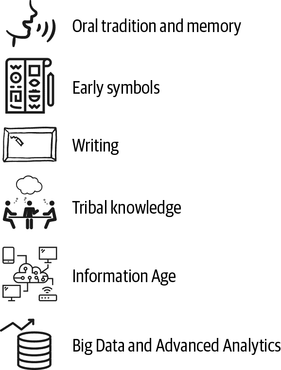

## 第 7 章 为人和企业定义目标
如前所述，*为什么* 应该是人工智能愿景的驱动力和北极星，在 AIPB 的情况下，即在最高层面上实现更好的人类体验和业务成功。我们也可以更细粒度地表述 *为什么*，并简单地称之为目标。所有举措都应与一个或多个目标保持一致。

本章为您概述了不同的人工智能解决方案利益相关者类型以及与之相关的潜在目标。这些目标突出了人工智能对人和企业为何都有益。

## 定义利益相关者并介绍其目标

AI 是一种通过表现出智能的机器创造价值的技术。我们可以将创造的价值表达为收益或目标。人们和企业追求 AI 计划的目标取决于利益相关者是谁；换句话说，就是目标旨在产生的收益的接收者。

AI 应用存在三种潜在的利益相关者，单一解决方案有时会涉及全部三种。这些是业务利益相关者（例如，盈亏责任人、董事会成员、股东）、客户和用户。接下来我们将探讨各自的特征和差异；在本书的其余部分，我将业务利益相关者简称为“business。”

一个拥有全部三个利益相关者的产品示例是像 Twitter 这样销售广告的社交媒体平台。在这种情况下，企业有某些目标，而客户（广告商）有其他目标，用户又有其他目标。让我们以 Twitter 为例。

正如大多数人所知，Twitter 是一家社交媒体科技公司，它创建了一个平台，允许人们阅读和撰写 *推文*。单条推文可以包含文本、URL 和话题标签。在这种情况下的利益相关者是 Twitter（企业）、广告商（客户）以及 Twitter 平台的用户。各自的目标不同。

对于大多数上市公司而言，主要目标是提高盈利能力并随着时间的推移增长收入。社会责任和稳定性也是上市公司的常见目标。实际上，公司通常有大量目标（又称目标），包括主要和次要目标，并配有关键绩效指标（KPI）来衡量它们。这些目标经常会随着时间而改变或重新排序。

如果目标是增长收入，最常见的方法是客户获取、留存和增长。如果目标是增加利润，显然增加收入会有帮助，但这也可以通过降低成本来实现。降低成本可以通过多种方式实现，包括自动化、提高效率和消除沉没成本。

一种经常被忽视却至关重要的提高收入和竞争优势的方式是创建设计精良的产品，并提供最佳的 UX。我无法强调这一点的重要性。大多数人会停止使用笨重、不直观或总体上功能失常的产品。请记住，我们使用“产品”一词也包括服务，因此与服务公司合作的 UX 同样至关重要。此外，大多数人如果某个产品的 UX 好得多且比竞争对手更令人愉悦，即使功能较少，也更愿意使用它。最终，UX 和愉悦感是实现客户留存和增长的关键要素，并在 第 8 章 中进一步讨论。

值得注意的是，[ISO 9241-11 标准](https://www.iso.org/obp/ui) 将可用性定义为在特定使用环境中，指定用户使用产品实现指定目标的有效性、效率和满意度的程度。这引出了粘性的概念。我们可以有很多种方式来定义粘性。一般来说，我们可以将其视为用户留存和参与度的衡量指标。产品和服务是粘性的，如果用户不仅继续使用它们，而且大量使用，并在替代品和竞争对手面前使用它们。Twitter 在其特定类型的应用中实现了这一点。

让我们回到提高利润和收入增长的业务目标。不过我们实际上还没有深入 enough。 正如本书前面所讨论的，有一种名为 [五问法](http://bit.ly/2VVmGY2) 的技术，由丰田汽车公司的丰田佐吉开发。其基本思想是通常存在许多更深层次的解释，在原始技术中用于确定问题的根本原因。使用该技术的人应询问问题为何发生，然后根据上一个问题的答案再次询问为什么，重复五次或更多次（尽管五次通常足够），直到发现根本原因。

将该技术应用于 Twitter 的某些目标^(1)，问题就变成了“Twitter 为什么想要增加收入和利润？”Twitter 高管可能会回答说，增加的利润将使公司能够聘请更多更好的人才，或使股东或客户满意，例如。下一个问题可能是 Twitter 为什么想要聘请更好的人才？这可能会继续下去，成为某种程度的兔子洞。鉴于此，选择适当的目标层级有一点主观的艺术，实际上，AI 计划通常还需要定义比增加收入更细化的应用特定目标，例如。定义更细化、应用特定的目标必须由业务人员、领域专家和 AI 从业者共同协作协助。

无论如何，我们已经确定了此示例中的业务目标，那么客户目标是什么？在我们的示例中，客户是广告商（请注意，有时用户和客户是同一人），那么企业为什么要做广告？因为它使他们能够获取新客户、保持市场可见度、增强品牌认知度并从竞争对手中脱颖而出。

这些客户也可能希望实现最佳的广告效果，并在与供应商和广告平台合作时享受良好的 UX。也许在像 Twitter 这样的大型科技公司中，UX 并不是那么关键，因为如果广告商想要接触和触达公司庞大的用户群，他们的选择并不多。幸运的是，许多供应商并不是大型科技公司，UX 绝对很重要。

最后，在我们的 Twitter 示例中，用户是使用企业提供的产品、服务或解决方案的人。除非用户主要使用 Twitter 账户付费推广企业、产品或服务，否则用户有跟上新闻、人物、信息和事件的目标。用户还希望分享自己的想法和观点并与其他人互动。这些共同构成了用户的主要目标之一。

其他用户目标包括出色的 UX、设计、易用性、优秀的功能以及 API 访问（针对开发者）等。在功能集相同的两种产品中，用户几乎总是会选择设计更好、可用性更好、总体上使用起来更愉悦的产品。许多用户愿意放弃额外功能来换取这些东西。

# 按利益相关者划分的目标

为了简化后续内容，我将两个主要利益相关者称为个人和企业（这也是本书标题和框架的含义！）个人利益相关者具有与商业无关的人类利益、需求和愿望。这包括 B2C 情况下的用户和人类客户。

另一方面，业务利益相关者关注的是企业的利益、需求和愿望（例如，高管、董事、股东），并且可以包括 B2B 情况下的客户公司。

在本节中，我们将更深入地讨论利益相关者特定目标的概念，并讨论 AI 如何帮助改善人类体验。目标和收益是 AIPB 的关键基础要素——最终，它们驱动着其他一切。

针对每个利益相关者讨论的一些目标会重叠，这也是合理的。它们可能是相同的或相似的，但可以从每个利益相关者的角度以不同的方式来看待和体验。在继续前进时请记住这一点。

## 目标与 AI 对企业的目的

# 业务目标与人工智能应用

企业通常在组织的各个层面和不同部门都有不同的目标。组织的顶层目标是 C 级高管、董事会成员和股东最关心的目标。示例包括增加收入、增加利润、降低成本、在特定时间内实现一定百分比的公司增长、提高运营效率，以及在拓展现有市场的同时开拓新市场。

业务部门（LoB）经理通常有不同的目标，这些目标应与一个或多个顶层目标保持一致（尽管并非总是如此）。市场营销副总裁/负责人的常见目标可能是提高品牌曝光度和认知度、增加入站销售和潜在客户、优化公司和产品的定位与信息传递，以及提高用户对品牌的参与度。许多目标都可以与像增加收入这样的顶层目标保持一致，例如。

在组织各个层面对目标进行对齐，使得一项举措能够同时实现多个目标（例如，通过增加入站潜在客户来增加收入）。对齐的目标是举措试图实现 *为什么*。事实上，举措是战略的战术部分，而战略则是实现由特定目标集定义的愿景的计划。

除了实现业务目标之外，以下是业务利益相关者可能利用人工智能产生的非详尽结果列表：

* 生成深度可操作的洞察并做出更好的决策
* 增强人类智能
* 创建新颖且创新的商业模式、产品和服务
* 开拓新市场或扩大总可寻址市场（TAMs）
* 影响新的和优化的流程
* 推动差异化和竞争优势
* 转变业务并颠覆行业

让我们逐一审视这些内容，从深度可操作的洞察和做出更好决策的能力开始。

## 深度可操作洞察

我在可操作洞察和“深度”可操作洞察之间划出了区别，这基于不同的分析成熟度水平。让我们更详细地讨论这些不同的分析成熟度水平，以及我如何定义常规洞察与深度洞察之间的区别。

你可能熟悉商业智能（BI）领域。BI 最佳的描述是获取对企业不同方面和绩效的数据化理解的过程，涵盖过去和现在，并对可比较的时间段进行比较。我们使用专门的工具访问和查询特定数据源来利用数据生成指标、描述性统计和数据可视化，以便更好地理解模式、趋势和一般洞察。在这种情况下，我称之为获得“浅层”洞察，而这些洞察通常很大程度上依赖于 BI 专家或分析师对数据的解读，并且可能因人而异。

BI 工具可以提供查看数据的方式，但通常无法告诉你数据意味着什么以及如何最好地采取行动以实现最佳结果。知道上个月销售额增长了 5% 很令人感兴趣，但如果不知道确切原因，或如何维持或扩大销售增长，那就不太有用。事实上，如果没有先进分析技术的辅助，某些 KPI/指标变化往往不明显，甚至人类也难以发现其原因。

总体而言，分析可以细分为更具体的类别，包括 *描述性*、*预测性* 和 *规范性* 分析。描述性分析查看过去的数据以获得洞察，正如我们对 BI 的描述。因此 BI 与描述性分析相关。

预测性分析使用现有的历史数据来了解如果采取某些行动或变化，未来可能会发生什么；换句话说，如果拉动杠杆。为此目的创建了精细调校的预测模型。

规范性分析更进一步，不仅预测某些行动和变化会发生什么，还为特定结果提供最佳行动或决策（例如通过自动化或推荐）。预测性和规范性分析生成了我所称的“深度”可操作洞察。这两个分析领域让你了解预期结果以及针对特定结果的最佳行动；因此，它们提供的洞察比分析师仅凭对历史数据的解读所获得的洞察要深入得多。

我们可以将预测分析和规范性分析视为高级分析这一更大类别的子领域，该类别还包括其他机器学习和人工智能技术。先进分析技术可以生成深度可操作洞察，并使个人和企业做出更好的决策。事实上，人工智能可以帮助在总体上生成更好、更快、更高效的决策、行动和结果。

深度可操作洞察可以以自动化、临时或自助的方式生成，并应用于更好地指导战略业务和产品决策，以及创造更好的用户体验。你应该将先进分析技术视为 BI 的补充而非替代。

## 增强人类智能

增强人类智能（增强智能）似乎是大型组织目前追求人工智能解决方案的最大原因之一，甚至是最大原因。

增强智能指的是这样一个理念：人工智能应被用于自动化和协助人们在执行工作时定期执行的许多常规、机械、乏味和/或繁琐的任务。这使员工能够专注于对其公司以及自身最有价值的工作方面——那些最令人愉快、从而提高工作满意度的任务。此外，增强智能还能让员工更具创造性、生产力和效率。

确保员工的幸福和愉悦应位列任何公司优先事项的最高位置。这一点尤其重要，因为大多数人每天在工作中的时间比在家中多，因此保留优秀人才的重要性。

在大多数职业和行业中，增强智能具有许多潜在应用。其中一个例子是在客户服务中。很多人致电客户服务中心的问题并不需要人工回答。事实上，当不需要时将每个电话都转接给人工，往往会导致那些可能因需要人类智能的理由或帮助而致电的非常有价值的客户长时间等待并产生糟糕的客户体验。使用涉及自然语言处理（NLP）等先进分析和人工智能技术，这些呼叫中心可以使用增强智能来判断电话是否可以通过人工智能处理或是否需要人工，并据此进行路由。这使代表能够完全专注于最高价值的工作，并在自动化部分执行得非常出色时提供最佳体验。

另一个非常有趣的例子是自动化科学，卡内基梅隆大学就此创建了一个 [硕士学位项目](http://bit.ly/2WZr4S9)。其理念是，科学家通过利用能够帮助他们通过自动化识别和选择实验的机器，能够在更短的时间内简化并解决更复杂的问题，总体上完成更多工作（提高生产力）。这也有助于最大化人工智能驱动的实验策略的成果和成本效益，因为 [机器已被证明比人类好得多](http://bit.ly/2Hz75ER) 于此。

## 创建新颖且创新的商业模式、产品和服务

使用人工智能的另一个原因是发现并开发新的创新商业模式、产品和服务。我们可以利用人工智能创建新的产品，这些产品可以作为独立产品呈现，也可以作为更大产品套件中的产品。人工智能还可以用于按智能水平和由此产生的价值来区分功能。也就是说，你可以利用人工智能围绕分层固定价格或订阅价格生成新的商业模式，这些价格基于通过增加使用高级人工智能功能所提供的价值。从研发角度来看，这是有意义的，因为人工智能资源通常成本并不低，这因此提供了一个更好地证明收回开发成本的模型。

在金融投资行业中，这方面的一个良好例子是 robo-advisors（即算法驱动的自动化投资）的引入和普及。尽管 robo-advisors 起源于创新型初创公司，[更大的既有公司也推出了自己的 robo-advisor 产品](https://whr.tn/2QkKi26)。

除了引入以低成本、低维护和高可访问性投资工具为中心的新的商业模式和产品外，robo-advisors 还使公司能够开拓新市场并扩大其现有的 TAM。我们接下来讨论这一点。

## 开拓新市场或扩大 TAMs

正如前面所讨论的，人工智能可以驱动针对现有产品不适用的新市场的新产品。产品也可能已占据其 TAM 的一定比例，但由于功能有限或已达到顶峰而无法扩大其 TAM 份额，或者如果在功能或愉悦度方面有轻微改进，就可能有许多用户会采用某款产品。人工智能有可能为现有产品引入非常令人兴奋且高价值的改进，从而帮助获取此前犹豫不决的市场中的新客户，或者，更好的是，完全获取新客户。

例如，robo-advisor 市场预计到 2025 年将达到 16 万亿美元，其增长在很大程度上归因于“基于哈里·马科维茨获得诺贝尔奖的现代投资组合理论的投资策略以及以典型财务顾问费用的零头定价的投资管理”，根据一篇[2018 年 6 月刊于 *《美国新闻与世界报道》* 的文章](http://bit.ly/2YDe6Km)。这代表了某些成熟公司可寻址总市场的显著扩张，也识别并捕获了正在寻找传统财务顾问和费用结构低成本替代方案的个人和公司的全新市场。

## 影响新的和优化的流程

我们还可以利用人工智能优化现有流程并创建创新的新流程。我们可以利用自动化来实现这两个目的并减少低效率和降低成本。在客户服务示例中，引入人工智能用于呼叫路由和低级支持，将一个基于人工智能的新流程引入到此前主要基于人力的流程中。它还有助于优化现有流程，因为代表可以更充分地用于执行增值工作，并且也有助于提高他们在执行日常工作时的满意度。在制造、车队管理和其他行业中可能存在许多类似的应用。

一个很好的例子涉及药物发现，即寻找治疗疾病、障碍、综合征和病症的新药的流程。[Insilico Medicine](https://insilico.com) 的人工智能部门正在利用深度学习等人工智能技术来创新和优化药物发现流程并最大化流程成果，尤其是在应用于与癌症和衰老相关的疾病时。该公司将这些技术与包括多组学、药物和临床数据在内的数据源结合使用。根据其使命宣言，他们利用人工智能通过人工智能解决方案延长健康寿命。

## 推动差异化与竞争优势

创新、差异化以及产生竞争优势相辅相成。我们在这里从高层次审视每一个，因为这些主题很容易值得一整本书（并且确实如此）。

创新既是过程也是结果。创新的定义有很多，但大致上，我们可以将其视为产生新想法从而导致创建新产品、服务和流程的过程。

我从两种方式思考创新：改进已有事物的创新，以及导致从未做过的事情的创新。在讨论每一种之前并提供背景，让我们看一下图 7-1，它展示了我创建的关于数据演进的图表。数据和信息术语相互关联且在某种程度上同义，因为数据 simply 指的是信息的数字版本（即 0 和 1、位和字节）。

正如图 7-1 所示，数据和信息最初以口头传统和记忆的形式出现。下一步是象征性和书面信息，随后是信息的有组织分组。资本主义和工业革命的爆发促使企业形成大型、高度正式化和专业化的业务职能（例如工程、销售、营销），其部门内拥有大量专业知识（部落知识），但这些知识并未集中或 readily 可供其他团队使用。

二十一世纪带来了 *信息时代*，也称为 *数字时代*。这是数据（数字信息）和技术的时代，直到最近主要以数据存储和集中化、互联网和云计算、SaaS 平台、移动应用和传统数据分析（例如 BI）为特征。由于高性能、低成本的计算和数据存储资源的巨大进步，以及数据源的激增，我认为我们现在正处于 *大数据和高级分析* 的时代。

回到改进已有事物的创新，传统数据分析和 BI 是很好的例子。尽管数据集中化、互联网和云计算、软件和 BI 确实有助于生成跨多个数据源的洞察，并以提供业务职能间更大可访问性的方式呈现，但生成历史洞察（描述性分析）并据此采取行动在后一种意义上并不真正构成创新。此外，BI 需要人们（例如数据分析师、经理）进行分析和解释以得出洞察，就像先前的历史先例和直觉等方法一样，其中经验是这些方法所依据的洞察的数据。

在后一种意义上的创新是构建从未构建或从未做过的事物，尤其针对终端消费者（例如人员、业务、流程）。我认为高级分析如人工智能和机器学习绝对符合这一创新类别。高级分析使得自动预测性和规范性分析（并且无需显式编程）成为可能，以及本书中涵盖的许多其他内容。更重要的是，先进分析使人们能够生成人类 *无法* 单独发现的深度洞察，从而也导致了以前不可能实现的结果。

## 差异化与竞争优势

AI 及其所激发创新的确是企业及其产品实现差异化的绝佳方式。差异化可能由多种因素造成。它可能仅仅因为一家公司起步较早，因而在时机上具有差异化（例如先行者优势），尽管许多公司很可能会跟进并最终赶上。另一种可能是公司开发了非常具体的知识产权（IP），该知识产权要么受法律保护，要么难以复制。另一原因可能仅仅是出色的流程、服务、方法以及用户体验。无论如何，差异化是开发公司独特价值主张的关键。

例如，围绕新兴和最先进的先进分析技术（如人工智能和机器学习）的持续创新，是产生差异化和竞争优势的绝佳方式，同时也有助于避免商品化和下行价格压力。只要你拥有竞争优势，包括出色的用户体验，你的产品很可能会取得成功并占据较大的市场份额。

一个真正引人注目的例子是亚马逊最近推出的[亚马逊 Go 商店](https://amzn.to/30GeI3S)。可以把它们想象成便利型商店，人们可以走进去，拿取要购买的商品，然后在没有任何人工协助或实体支付交易的情况下离开。根据 Go 网站的说法，这一实现的依赖于多种不同的 AI 和机器学习技术，包括计算机视觉、传感器融合（结合和评估不同类型的传感器数据以提高准确性）以及深度学习。尽管未来这可能变得司空见惯，就像商品化发生时那样，目前这绝对是令人震惊的东西，具有重大的颠覆性和竞争优势潜力。

其他例子包括 nuTonomy 和 Zoox 等公司，两者都在帮助推动自动驾驶汽车。nuTomomy 特别是在创建软件来为无人驾驶汽车车队提供动力，并使这些车队可供城市居民使用。

### 转变业务并颠覆行业

最后，人工智能作为创新的工具可以并且已经改变了企业并颠覆了行业。谷歌是转型企业的绝佳例子。该公司最初专注于其搜索引擎和算法。在试图优化搜索产品的过程中，谷歌聘请了一些最聪明、最受过良好教育的专业技术人员，以开发极其先进、复杂且最先进的技术以及基于高级分析的产品和算法。如今，谷歌基本上是一家[人工智能驱动的公司](https://ai.google/about)，在其许多产品中都融入了人工智能和机器学习。

这带来了巨大的差异化和竞争优势，现在谷歌控制着绝大多数搜索结果，以及很大一部分人类人口所看到的结果。因此，其他以人工智能为先的公司出现，试图创建开放、社区驱动和去中心化的搜索作为替代方案。很有趣的是要看看这是否会获得动力并占据市场份额，以及是否有任何方式真正颠覆搜索行业。谷歌已经长期掌握着它。

截至本文撰写时，人工智能正获得巨大的势头和普及度，新的现实世界应用每天都在涌现，但人工智能也仍处于起步阶段。开始使用人工智能的公司不一定是转型企业，但它们肯定具有行业颠覆潜力。

Uber 和 Lyft 等共享出行平台就是很好的例子。这些平台已经彻底颠覆了出租车行业。最终，在许多情况下，取决于既有企业是适应和采用这种颠覆，还是倒闭。

## 人工智能的目标与目的

那人们呢？如前所述，人们的兴趣、需求和欲望（因此目标）与企业不同，通常人们有很多潜在的心理、体验、情感、社会和其他因素决定解决方案是否能充分实现某个目标并持续使用。

正如本书的标题和副标题所示，人工智能可以为人们带来许多好处，包括创造更好的人类体验。这在企业作为创造解决方案的主体时是正确的，这些解决方案以我们很快将探讨的方式使人们的生活和体验变得更好。在适当的同理心和视角下，企业应优先考虑购买或使用其产品的人的目标。这里的重点是人工智能对人的具体关注和视角，而非企业。这是本书以及本节的关键前提之一。

以下是利益相关者可能因基于人工智能的创新而体验到的结果类别的非详尽列表：

*   更好的健康和健康相关结果
*   更好的个人安全和保障
*   更好的财务表现、储蓄和洞察
*   更好的用户体验、便利性和愉悦感
*   更好的、更简单的规划和决策
*   更好的生产力和享受
*   更好的学习和娱乐

现在让我们以非常简要和高层次的方式逐一介绍这些类别。请记住，在我们继续的过程中，虽然其中一些非常明显，但人工智能能够帮助在所有这些类别中产生益处和结果，这一点不太明显且未被广泛理解。我将在接下来的两章中对这些内容以及相关主题和概念进行更详细的阐述，并在第 9 章中为每个类别提供人工智能相关的具体示例，该章专门聚焦于人工智能以实现更好的人类体验。

### 更好的健康和健康相关结果

人们显然非常关心拥有良好的健康，并在出现任何健康相关问题时获得尽可能最好的结果。本类别和下一个类别都与人类生存的基本需求——身体和心理密切相关。

### 更好的个人安全和保障

与健康类别及其与生存需求的关系一样，人类显然也非常关心个人安全和保障。这在公共场所、工作场所和家庭中都是如此。

### 更好的财务表现、储蓄和洞察

人们希望改善其财务表现（例如收入和投资），降低成本，节省更多资金，并获得有关其当前财务状况以及投资对未来财富影响的更好洞察。

### 更好的用户体验、便利性和愉悦感

人们每天以多种方式和多种目的与技术互动，最常见的是通过某种用户界面。这些界面的例子包括网站、网页应用、移动应用、桌面应用和联网设备（例如个人助理）。这些界面不仅限于此处提到的更明显的软件界面，还包括电视、交通工具（例如汽车和飞机）、工作相关设备、剧院和音响系统等。

人们自然希望这些互动和体验易于理解、简单易用和体验，理想情况下也令人愉悦。人们也经常非常关注提高便利性并减少完成任务所需的时间，这主要是由于日程繁忙和其他原因。

### 更好的、更简单的规划和决策

人们每天需要在生活的许多领域进行规划和决策，通常是在其专业知识之外（例如退休规划和投资组合管理）的领域，并且可供选择的选项太多。因此，人类高度有动力在可能且有益的情况下寻找简化、自动化和改进规划和决策的方法。创造更简单、更好的计划和决策的能力是关键。

## 更高的生产力、效率和享受
人们非常有兴趣提高他们在工作内外执行任务时的生产力、效率以及整体享受程度。我们在讨论面向企业使用的增强智能时已经在工作背景下涵盖了这一点，不过这里的视角转向了人类这一侧。
人们在日常的非职业生活中也使用技术并执行任务。我们大多数人会在工作之外创建清单、撰写文档和电子邮件、购买杂货，并执行其他行政类任务。增强智能同样适用于这些情况。

## 更好的学习和娱乐
人们希望学习并获得娱乐，同时找到新的、更好的、更有趣的方式来做到这两者。这有助于增加知识和幸福感，同时减少无聊。此外，当那些不总是被认为有趣的事情被设计得有趣时，人类会喜欢（例如，学习。

# 摘要
总体而言，当所有这些对人的益处结合起来时，关键的结论是 AI 可以帮助人们以更好的方式完成“工作”，并获得更好的体验。由 AIPB 指导的 AI 愿景应被视为实现这一目标的工具——对个人和企业都适用。企业应通过这一视角利用 AI，并认识到如果他们能够帮助人们以更好的方式完成工作，同时创造更好的人类体验，那么收入、利润以及其他一切都将随之而来。
识别目标及其相关的利益相关者是制定 AI 愿景和战略的关键第一步，对于任何以创新为驱动的愿景和战略而言亦是如此。毫不巧合，目标识别和优先级排序是 AIPB 的关键要素。关键是从问清楚你到底想实现什么开始，最重要的是，*为什么*。
此外，企业目标与人类目标不同。AI 能够帮助实现两者目标，事实上有些目标可以同时实现，而且其中许多目标是互利的。最后，正如 Chip Heath 在他的书 *Made to Stick* 中写道：“你不能有五个北极星，你不能有五个最重要的目标。”这确实是真的，因此请务必优先排序并选择一两个最重要的目标开始，然后根据需要稍后再添加更多。
最后，值得重申的是，本章讨论的目标是在相对较高的层面呈现的。实际上，AI 计划通常还需要定义比本章涵盖的更细粒度的应用特定目标。定义更细粒度、应用特定的目标必须由业务人员、领域专家和 AI 从业者共同协作协助完成。
现在我们已经阐明了 *为什么* 的重要性以及拥有目标的重要性，让我们将焦点转向是什么使产品伟大，以及 AI 如何能够创造更好的人类体验。对这些主题的更好理解将帮助你创建 AI 愿景。
^(1) 请参阅以下财务报告：[*http://bit.ly/2L92fAo*](http://bit.ly/2L92fAo) 和 [*http://bit.ly/2FsFgfP*](http://bit.ly/2FsFgfP)
