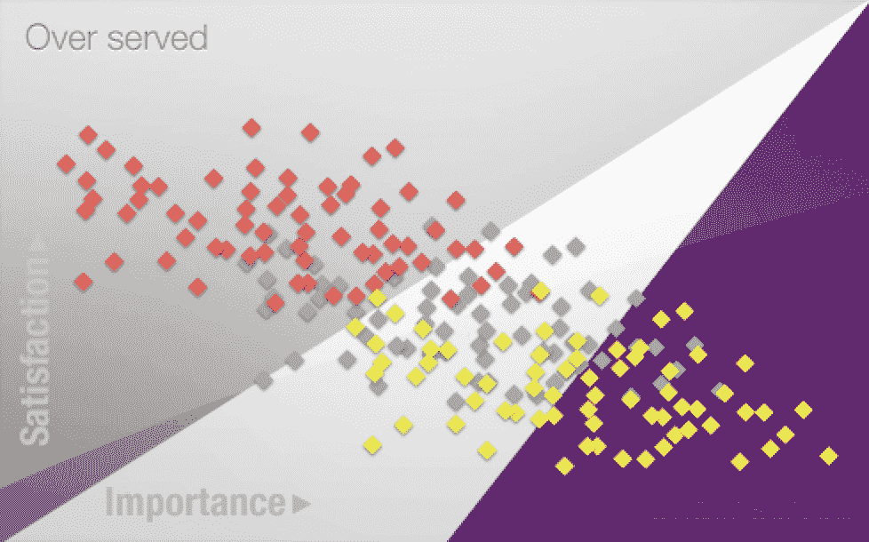
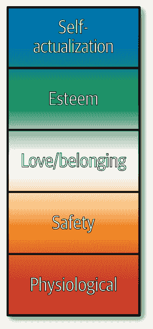
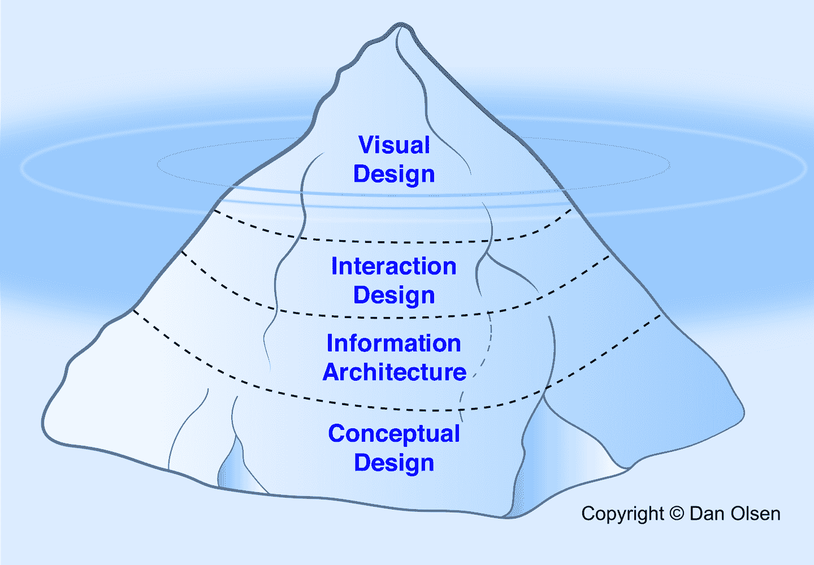
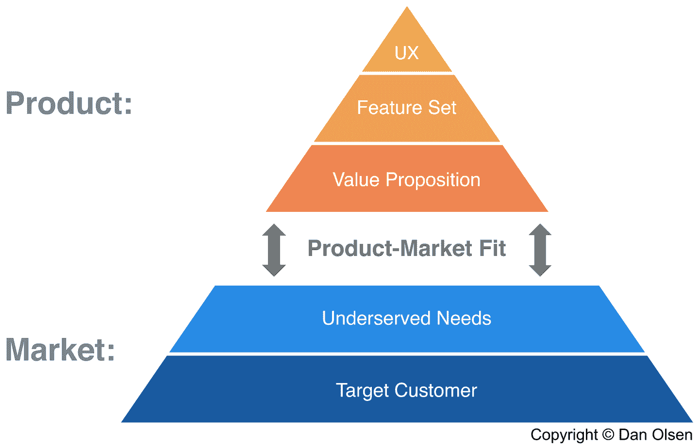

## 第 8 章。是什么造就了伟大的产品
现在我们已经涵盖了 AI 对个人和企业双方的目标和目的，让我们把注意力转向如何围绕构建能够实现这些目标的伟大产品来创建 AI 愿景。
本章旨在为你概述重要性与满意度概念、我认为造就伟大产品的四个要素，以及在构建 AI 解决方案时可使用的精益和敏捷开发概念。

## 重要性与满意度
让我们先讨论重要性与满意度的概念。在下一节介绍造就伟大产品的四个要素时，这提供了有用的背景信息供参考。
我们之前介绍了“Jobs to Be Done”框架，它是名为结果驱动创新（ODI）的一个更大战略和流程的一部分。如讨论所述，人们会雇用企业、产品和服务来完成一项“工作”。人们雇用产品来完成工作的原因往往并不明显，或不被“雇用”者立即理解，也不易解释。
有时，原因是因为某个产品让他们“感觉”到某种方式，这有点无形但确实真实。示例包括雇用一碗冰淇淋让你感觉更好、雇用一把牙刷来完成牙齿清洁工作、雇用会计师的服务来完成年度报税工作，最后，雇用 Gmail 等电子邮件客户端来完成电子邮件工作。
著名作家和哈佛教授 Clayton M. Christensen 及其合著者指出，除了功能之外，还可能存在 [强大的社会和情感因素](http://bit.ly/2BC0G8t) 影响人们对解决方案是否很好完成工作的感知，体验方面也可能非常重要。最终，如果被“雇用”的公司、产品和服务做得非常好，人们倾向于继续与之合作，否则他们可能会被“解雇”。
此外，所有工作都由步骤组成，而 Jobs to Be Done 框架是一种有组织的方式，用于头脑风暴并 [解锁创新想法](http://bit.ly/2YGHX4E)，围绕如何使步骤更简单、更快或不必要。这代表了人们通常创建产品方式的巨大变化。它将焦点从业务指标转向客户指标，从使产品更好转向使人们的工作和结果更好。
换句话说，重点在于需要完成的工作，而不是产品本身。它也关注客户的声音，而不是假设知道客户需要或想要什么。产品创意应自然而然地产生，这种方法同时促进创新和更大的业务成功。满意的客户意味着更成功的企业。片刻之后，我们将详细审视以人为中心的产品设计和开发的额外概念和方法。
Jobs to Be Done 还高度强调机会和结果的概念，作为客户重要性及其对现有替代方案满意度的函数。图 8-1 显示了这种关系。
图 8-1 显示了三个不同的市场细分，特别是那些结果服务不足或服务过度的细分。这提供了一种图形化方式来细分客户，基于理解他们试图完成的工作以及客户期望结果所代表的机会程度。最大的机会在于客户需求在很大程度上未得到满足，在这种情况下意味着完成工作和实现期望结果的重要性很高，而客户对完成工作替代方式的满意度很低（右下象限）。

值得注意的是，我们可以将重要性与满意度的关系应用于单个功能以及整个产品。这是在以利益为驱动的产品开发中帮助确定功能优先级和顺序的一种方法。基于我们对人们为何“雇用”企业、产品和服务来完成“工作”的理解，让我们现在讨论是什么造就了伟大的产品，这最终可以防止它们被“解雇”。

## 伟大产品的四个要素
什么造就了伟大的产品？是什么导致人们使用一种产品而不是另一种？是什么导致人们每天使用产品而不是每月一次？是什么导致人们随着时间的推移更频繁地与产品互动，并且每次使用的时间更长？
这归结为四个主要要素：
*   产品只需正常工作
*   能够满足人类需求、欲望和喜好

*   设计与可用性

*   愉悦感与粘性

让我们依次讨论这些要素。

## 产品即刻可用

没有什么比产品无法正常工作或工作不佳更让我想停止使用它。质量很重要，你应该投入时间和精力来确保这一点，然而事实并非总是如此。不能正常工作的产品可能存在错误、经常崩溃，或需要变通方法。相反，“即刻可用”的产品完全按照预期执行，方式也完全符合预期，且无错误。或者至少对于非基于错误的产品而言是如此。让我进一步解释。

并非全部但大多数人工智能和机器学习模型在某种程度上是基于错误的，这意味着模型使用训练数据集进行训练，直到在测试数据集上测试时所选的性能指标（例如，准确率）处于可接受范围内。人工智能和机器学习解决方案并不完美，也无法做到 100%正确。可接受范围的另一种说法是性能指标（以及随后的错误水平降低）“足够好”。

不幸的是，“足够好”并不是一个非常量化的衡量标准。此外，有时达到目标性能水平，甚至可接受的性能水平都可能非常困难，这取决于许多因素，而且某些错误可能导致生死后果，这些都是我们在本书后面讨论的话题。

尽管如此，“足够好”的好处往往远大于潜在的缺点，这使其成为一个合理的目标。此外，一些应用可以非常接近完美。商务人员、领域专家和人工智能从业者必须协作确定特定应用中哪些错误是可以接受的（足够好）。当本节中的所有标准都得到满足，包括“足够好”时，人工智能应用应该“即刻可用”，这是一个重要的目标。

## 满足人类需求、欲望和喜好的能力

产品真正满足人类需求、欲望或喜好的能力至关重要，乍看之下似乎显而易见，但绝对值得讨论。这里有很多细微差别将在本节中探讨，包括三者之间的区别。

首先，在开发技术解决方案（包括基于人工智能的解决方案）时，越是优先考虑并理解人类的需求、欲望或喜好，产品的成功度越高，用户的人类体验也越好。只要技术能够解决问题或以愉悦的方式满足某些需求、欲望或喜好，人类并不一定关心使用的是什么技术或底层机制。人工智能的最佳应用是那些使用人工智能被抽象化、用户只知道产品满足其中一项或多项需求且优于替代方案的应用。

为了更好地理解人类需求相关的概念，让我们简要回顾一下马斯洛需求层次理论。

### 马斯洛需求层次理论

我们中的许多人都熟悉马斯洛需求层次理论，或至少听说过它。这些需求是人类动机的[content]
*   设计与可用性

*   愉悦感与粘性

让我们依次讨论这些要素。

## 产品即刻可用

没有什么比产品无法正常工作或工作不佳更让我想停止使用它。质量很重要，你应该投入时间和精力来确保这一点，然而事实并非总是如此。不能正常工作的产品可能存在错误、经常崩溃，或需要变通方法。相反，“即刻可用”的产品完全按照预期执行，方式也完全符合预期，且无错误。或者至少对于非基于错误的产品而言是如此。让我进一步解释。

并非全部但大多数人工智能和机器学习模型在某种程度上是基于错误的，这意味着模型使用训练数据集进行训练，直到在测试数据集上测试时所选的性能指标（例如，准确率）处于可接受范围内。人工智能和机器学习解决方案并不完美，也无法做到 100%正确。可接受范围的另一种说法是性能指标（以及随后的错误水平降低）“足够好”。

不幸的是，“足够好”并不是一个非常量化的衡量标准。此外，有时达到目标性能水平，甚至可接受的性能水平都可能非常困难，这取决于许多因素，而且某些错误可能导致生死后果，这些都是我们在本书后面讨论的话题。

尽管如此，“足够好”的好处往往远大于潜在的缺点，这使其成为一个合理的目标。此外，一些应用可以非常接近完美。商务人员、领域专家和人工智能从业者必须协作确定特定应用中哪些错误是可以接受的（足够好）。当本节中的所有标准都得到满足，包括“足够好”时，人工智能应用应该“即刻可用”，这是一个重要的目标。

## 满足人类需求、欲望和喜好的能力

产品真正满足人类需求、欲望或喜好的能力至关重要，乍看之下似乎显而易见，但绝对值得讨论。这里有很多细微差别将在本节中探讨，包括三者之间的区别。

首先，在开发技术解决方案（包括基于人工智能的解决方案）时，越是优先考虑并理解人类的需求、欲望或喜好，产品的成功度越高，用户的人类体验也越好。只要技术能够解决问题或以愉悦的方式满足某些需求、欲望或喜好，人类并不一定关心使用的是什么技术或底层机制。人工智能的最佳应用是那些使用人工智能被抽象化、用户只知道产品满足其中一项或多项需求且优于替代方案的应用。

为了更好地理解人类需求相关的概念，让我们简要回顾一下马斯洛需求层次理论。

### 马斯洛需求层次理论

我们中的许多人都熟悉马斯洛需求层次理论，或至少听说过它。这些需求是人类动机的[content]
*   设计与可用性

*   愉悦感与粘性

让我们依次讨论这些要素。

## 产品即刻可用

没有什么比产品无法正常工作或工作不佳更让我想停止使用它。质量很重要，你应该投入时间和精力来确保这一点，然而事实并非总是如此。不能正常工作的产品可能存在错误、经常崩溃，或需要变通方法。相反，“即刻可用”的产品完全按照预期执行，方式也完全符合预期，且无错误。或者至少对于非基于错误的产品而言是如此。让我进一步解释。

并非全部但大多数人工智能和机器学习模型在某种程度上是基于错误的，这意味着模型使用训练数据集进行训练，直到在测试数据集上测试时所选的性能指标（例如，准确率）处于可接受范围内。人工智能和机器学习解决方案并不完美，也无法做到 100%正确。可接受范围的另一种说法是性能指标（以及随后的错误水平降低）“足够好”。

不幸的是，“足够好”并不是一个非常量化的衡量标准。此外，有时达到目标性能水平，甚至可接受的性能水平都可能非常困难，这取决于许多因素，而且某些错误可能导致生死后果，这些都是我们在本书后面讨论的话题。

尽管如此，“足够好”的好处往往远大于潜在的缺点，这使其成为一个合理的目标。此外，一些应用可以非常接近完美。商务人员、领域专家和人工智能从业者必须协作确定特定应用中哪些错误是可以接受的（足够好）。当本节中的所有标准都得到满足，包括“足够好”时，人工智能应用应该“即刻可用”，这是一个重要的目标。

## 满足人类需求、欲望和喜好的能力

产品真正满足人类需求、欲望或喜好的能力至关重要，乍看之下似乎显而易见，但绝对值得讨论。这里有很多细微差别将在本节中探讨，包括三者之间的区别。

首先，在开发技术解决方案（包括基于人工智能的解决方案）时，越是优先考虑并理解人类的需求、欲望或喜好，产品的成功度越高，用户的人类体验也越好。只要技术能够解决问题或以愉悦的方式满足某些需求、欲望或喜好，人类并不一定关心使用的是什么技术或底层机制。人工智能的最佳应用是那些使用人工智能被抽象化、用户只知道产品满足其中一项或多项需求且优于替代方案的应用。

为了更好地理解人类需求相关的概念，让我们简要回顾一下马斯洛需求层次理论。

### 马斯洛需求层次理论

我们中的许多人都熟悉马斯洛需求层次理论，或至少听说过它。这些需求是人类动机的显著驱动因素，主要面向身体和心理的生存与健康，以及自我实现。提出它的目的在于提供一个简要回顾，并在技术和人工智能的特定背景下讨论这些需求。

图 8-2 显示马斯洛需求层次理论为一个五层层次结构，需求类别按重要性从下到上依次为：生理、安全、归属与爱、尊重和自我实现。

该层次结构的底层四层被称为 *缺陷需求*。人类最有动力去填补缺陷部分中较低的需求，因为它们对基本身体生存至关重要，而且人类被剥夺得越多，就越有动力去填补这些需求。随着这些需求得到满足，动机就会转向填补更具社会性和心理性的需求。有趣的是，该框架表明，在满足缺陷需求后，动机可能会再次增加，甚至显著增加，以便满足自我实现需求（层次结构的顶端）。与基于缺乏满足的缺陷需求不同，自我实现需求是由个人成长和自我实现的渴望驱动的。示例包括职业成长、成为行业专家、攀登珠穆朗玛峰或学习演奏乐器。

最初 [Maslow stated](http://bit.ly/2JzpuUj) 认为需求必须按顺序满足，但后来澄清说，一旦某个需求“或多或少”得到满足，对该需求的动机就会下降，关注点将转向下一个未满足的需求集合（显著需求）。尽管人们自然会尝试从层次结构的底部到顶部满足需求，但生活事件和其他情况（例如疾病诊断、离婚、被裁员）往往使这种过程成为迭代且不断变化的动态。

Maslow 还认为，由于人与人之间存在根本差异以及驱动他们的动机不同，层次结构中较高的某些需求可能变得比甚至基本的生理或其他较低需求更重要（厌食症即为示例）。此外，人们可能同时受到多种需求的驱动。社交媒体就是一个很好的例子。人们经常使用社交媒体，因为它提供了爱与归属感，同时也有助于提升个人自尊。

还值得注意的是，马斯洛需求层次理论存在某些 [批评](http://bit.ly/2wfJCSx)。其中一些包括其框架中缺乏精神、利他（将他人需求置于自身需求之前）和社会（以自我为中心与以社会为中心的文化）需求，而这些需求显然可能非常强大。

### 需求、欲望和喜好的区别

需要做出一个重要区分，那就是人类需求、欲望和喜好之间的区别。它们都相似且相关，但并不相同。

像马斯洛需求层次理论中所包含的那样的需求代表人类为生存、强健的心理健康以及在自我实现情况下的自我成长所必需的东西。另一方面，欲望代表人类想要拥有的东西，但不一定需要它们在心理和身体上生存。

某个欲望与需求相距越远，人们的关注点就越会放在效用、可用性和愉悦感等概念上（稍后会进一步讨论）。此外，人类可能会想要（渴望）某样东西，因为他们认为它会满足其非关键需求，或认为拥有后会喜欢它，但事实并非总是如此。想想孩子们起初想要的所有玩具，但第一次使用后就再也没有见过光。

喜好是最终结果——一个人是否喜欢某样东西（例如产品、食物、旅行目的地）的程度，无论他们是否想要它。我们经常会遇到尝试我们不知道或不想要的东西的机会（例如超市样品），然后才意识到自己有多喜欢或不喜欢它。

人类需求、欲望和喜好是强大的力量，驱动着人类决策、技术创新，以及优秀产品与非优秀产品之间的差异。考虑到所有这些，让我们将讨论转向实际满足需求、欲望和喜好，以及为此我们必须考虑的因素。

### 以人为中心而非以业务为中心的产品和功能

用技术产品真正满足人类需求和欲望往往说起来容易做起来难。原因有很多，其中最重要的一点 arguably 是设计和构建以人为中心的产品和功能与以业务为中心的产品和功能之间的差异。产品往往是以业务为中心而非以人为中心的方式制作，这通常会导致产品无法妥善解决用户的需求、欲望和喜好。

企业主和员工并不是其产品的客户或用户，尽管很多人经常像他们是客户一样创建产品创意并做出产品决策。这导致产品和功能以业务为中心而非以人为中心，简单来说，任何面向用户的产品或功能越不以人为中心，其成功性就越低。

一个相关且促成的因素是所谓的 *最高薪人士意见* 问题（又称 HiPPO 问题，通常指公司所有者和高级管理人员）。HiPPO 问题发生时，产品决策会不成比例地基于 HiPPO 而非实际客户或用户。这一问题的另一种表现是 HiPPO 凌驾于那些在打造优秀产品方面具有更大专业知识的人之上（例如，UX 设计师、产品经理）。

最后，业务利益相关者通常与各自的业务职能相关的目标和激励措施不同，因此倾向于相互竞争，以争取能直接使他们受益的产品功能。如果管理不当或放任不管，这可能变成失控的局面，导致产品最终包含除厨房水槽之外的所有东西。这最终会导致糟糕的 UX，并削弱产品满足人类需求、欲望和喜好能力，因为所需功能可能会被淹没在大量非必要功能和 UI 元素中。

产品始终应以利益为驱动，而非以功能为驱动，最重要的是以用户的需求、欲望和喜好作为一切事物的驱动力。有许多方法可以确保这一点并避免所讨论的问题；例如通过 UX 研究和设计、以人为中心的设计、以用户为中心的设计，特别是设计思维。

一个例子是以同理心为核心的研究和设计，它被融入到设计思维过程的同理心阶段（在 第 9 章 中讨论）。同理心设计侧重于观察消费者并理解他们的需求，而非仅依赖市场研究或非消费者视角。

此外，Google 发起了一项名为 [以人为中心机器学习（HCML）](http://bit.ly/2YIn88T) 的努力，以处理其中一些考量，同时关注如何以包容的方式利用 AI 和机器学习。该努力强调了 UX 公理的重要性，即“你不是用户”，并 [提供了一个视角](http://bit.ly/2HP4qG0) 使他们能够“跨产品审视，以了解 ML 如何在解决问题的同时保持以人为本的需求，同时以只有 ML 才可能实现独特方式来解决。”

作为本节的最后说明，有许多方法可以衡量产品是否满足人类的需求、欲望和喜好。它们包括产品绩效分析（例如，销售、客户获取）、客户参与度和留存分析，以及分析用户反馈等。

## 设计与可用性

设计在创建产品愿景和战略时常常被低估，然而它对产品成功至关重要。设计是一个非常宽泛的术语，因此需要一些具体性。本书关于利用人工智能等新兴技术进行创新；因此，我们关注与创新和技术相关的设计。

[Dan Olsen](https://dan-olsen.com)，一位产品管理顾问和 *精益产品手册* 的作者^(1)，创建了我们在本章中讨论的两个框架。第一个称为 *UX 设计冰山*，第二个称为 *产品市场契合金字塔*（在本章后面介绍）。让我们先介绍 UX 设计冰山，见 图 8-3。

冰山露出水面的部分是用户所看到并与之交互的部分；换句话说，就是 UX 的视觉和交互部分。冰山在水面以下的层级是 UX 的基础——它是设计基础。让我们简要讨论一下这些基础要素，从底部开始。

概念设计代表了设计过程的最早阶段。在此阶段会形成对用户需求的高层次理解，并随后转化为解决方案或产品将是什么样子和感觉的初步概念。从设计角度来看，这是从问题空间映射到解决方案空间的开始。

信息架构是设计过程中设计师确定产品中信息如何逻辑组织以及用户检索信息的路径或流程的部分。逻辑组织包括整个产品中信息的结构和布局。例如，产品导航和子导航顺序及选项，以及信息流中的内容布局，都是信息架构的方面。

交互设计是用户与产品交互的设计。这可以表现为产品中的导航和流程，以及与 UI 的单个元素交互，例如输入信息、语音（变得更为主导）、选择、点击、滑动和捏合。交互设计还包括交互反馈设计，例如消息、通知和错误（例如，验证）等。

最终面向用户的设计层是视觉设计。这是设计的美学方面——产品的 UI 看起来如何。这包括颜色、对比度、字体、排版、标识、图形元素、定位和尺寸。这不是一个完整列表，但希望这有助于确定视觉设计的关键领域。

按照 UX 设计冰山所述设计和实施所有内容并不意味着设计或 UX 会好或有效。即使你已经满足了优秀产品的头两个标准：产品“只需工作”并且能够满足人类的需求或欲望，也同样如此。人们需要理解产品呈现的信息，以及如何与之交互。在大多数情况下，人们第一次体验技术产品时并未阅读用户手册或接受过培训（想想你尝试过的大多数移动应用）。

这就是非常重要概念 *可用性* 发挥作用的地方。这是一个完整的领域，包含重要的研究、概念和测试方法论，其深入讨论超出了本文范围。话虽如此，让我们讨论可用性的最重要概念和关键要点。

在书 *别让我思考*^(2) 中，作者 Steve Krug 谈到，尽可能地，网页或应用的目的和功能应几乎不需要用户花费脑力就能理解和使用；用户只需“明白”。他使用诸如自明、明显和自解释等术语来交替描述这一点。

尽管他用自明和自解释这两个术语来解释可用性并认为它们相同，但我认为略有不同。我通常用三种可用性程度的类别来向人们解释可用性，从次优到最优。这些类别是“需要解释”（次优）、“自解释”和“自明”（最优）。我们可以将这些类别应用于任何为用户直接交互提供界面的技术（例如，网页应用、移动应用、智能家居）。请注意，这些类别更代表一个光谱而非严格的划分。

“需要解释”类别意味着 UX 并不是特别“可用”。这意味着用户要理解和使用技术界面，需要一定程度的解释。这种解释可以是培训或文档的形式，例如。这是次优的，如果可能的话应避免。

下一个层级是“自解释的”，这已经相当不错了，而且大多数优秀（而非伟大）的产品在易用性方面就处于这一水平。“自解释的”意味着虽然并非立即显而易见，但通过仔细观察、阅读文本以及研究 UI 中的上下文，就应该能阐明一切的含义以及如何使用。

“自明的”是最佳情况。它意味着无需任何解释，因为 UX 的方方面面都完全且立即显而易见。这是一个非常高的标准，很明显对每个用户都无法实现，但希望对大多数用户而言可以。这也是真正伟大产品的显著特征。

# 愉悦与粘性

愉悦和粘性是关于伟大产品的两个极其重要的概念，两者都导向成功且拥有高度参与和留存用户的产品。

愉悦这一概念在名为卡诺模型（Kano Model）的框架中得到了很好的体现，该模型是由东京理科大学质量管理教授狩野纪昭（Noriaki Kano）在 1980 年代开发的产品开发和客户满意度理论。^(3) 愉悦也是一个心理和情感概念，对产品或服务的成功至关重要。人们更喜欢使用使用起来愉快且让他们感觉良好的产品（令人愉悦的）。即使这意味着放弃花哨的功能（features）也是如此。简单而令人愉悦的产品几乎总是优于相反的替代品。

粘性基本上意味着用户在首次使用后会持续使用产品；从商业角度来看，这是用户参与度和留存度的衡量指标。我们都很熟悉粘性产品与非粘性产品之间的区别，即使我们并不了解这一术语。

让我们先谈谈愉悦。卡诺模型将其归类为“愉悦者（delighters）”的产品功能，是指客户不期望但能带来巨大享受提升和惊喜感的功能。愉悦者是秘诀；它们是关键的产品差异化因素和竞争优势的来源。客户满意度会随着愉悦者功能的引入和增强实施而呈指数级增长。这些是真正的差异化因素，能让人们选择你的产品而非其他产品，同时也能带来极佳的体验和享受程度。

所有公司都应尝试确定其产品的愉悦者是什么，然后加以实施。潜在的投资回报率是 *巨大*，很容易产生忠实的客户，他们还会代为宣传和推广公司的产品。假设你打造了一款令人愉悦的伟大产品，最终口碑会传播开来，产品将取得巨大成功。正如 [Dharmesh Shah](http://bit.ly/2HDSVlX) 所说，“不要让客户满意。要制造满意的客户。”

值得注意的一个有趣之处是，今天的愉悦者就是明天的必备功能。想想 iPhone。我能想到的很少有产品在推出时不仅有一个愉悦者，而是多个。漂亮的相对高分辨率触摸屏，支持多种交互（例如捏合缩放）、相机和照片库、音乐播放器和库、应用等。这简直是愉悦者的天堂，像这样的手机被称为 *智能手机*。

现在我们已经去掉了“智能”这一称谓，所有这些功能都已成为所有手机的基本门槛——必备功能。另一个有趣的现象是，AI 现在正成为手机愉悦感的来源，功能包括自动图像分类、基于面部识别的安全、动话表情（animoji）和照片优化等。展望未来，我很容易想象到手机、平板电脑和电脑不再拥有键盘界面，所有交互都由语音驱动的时代。今天的愉悦者成为明天必备功能的概念，也与一个被称为 *AI 效应* 的概念一致；也就是说，当某些应用变得司空见惯时，它们似乎不再由 AI 驱动（例如 Google Search）。我们现在越来越多地看到这种情况发生。

接下来我们讨论粘性。你的手机上可能有一百多个应用。问题是，其中有多少是你每天使用的？进一步说，有多少是你每天多次使用的？有多少每周一次，有多少每年一次？我们手机上的应用都属于这些不同的使用频率和次数组。粘性应用（以及一般产品）是指你真正使用并且经常使用的应用。就像愉悦一样，粘性也可以成为产品成功的巨大推动力。事实上，了解是什么让产品具有粘性的前景，已经促使人们对其进行研究和撰写。

在 Nir Eyal 的著作 *上瘾：如何打造习惯养成型产品* 中，他提出了 *钩子模型*，这是他为构建他所称的习惯养成技术而创建的。该模型由反馈循环的四个组成部分构成。这些组成部分是触发、行动、可变奖励和投入。在高层次上，其理念是触发因素促使人们执行某些行动和行为，而这些行为反过来应以不可预测且能产生欲望的方式得到奖励（鉴于惊喜元素，这一概念与愉悦类似），然后以用户做出某种投入来改善下一次的反馈循环结束。正如 Nir 所说，[“这些投入可以被利用，使触发因素更具吸引力，行动更轻松，奖励更令人兴奋，每一次通过钩子都如此”](http://bit.ly/30NV4mC)。

愉悦和粘性在构建基于 AI 的产品，或任何产品和服务时都不应被忽视或低估。除了创新带来的好处以及成功使用新兴技术的能力外，这些还是差异化和竞争优势的关键来源。

现在我们已经涵盖了伟大产品应具备的四个组成部分，让我们在此背景下讨论 Netflix。

# Netflix 与关注最重要的事情

正如 [MathWorks 白皮书](http://bit.ly/2HNHhDW) 中所述，Netflix 指出，与终极 \[AI\] 模型性能相比——使用率、UX、用户满意度和用户留存度才是其认为最重要的，并且更符合其业务目标。

从产品角度来看，这些说法极具趣味，因为 Netflix 的优化更以用户为中心，而非以性能为中心。这是有道理的，特别是考虑到 Netflix 可以承受一定程度的不完美性能，因为该公司例如并未将机器学习用于癌症诊断。

这里真正有趣的收获是，Netflix 指出的四件事与我提出的使产品伟大的四件事直接相关。只是能正常工作主要带来留存，易用性带来全部三项（出色的 UX、满意度和留存），愉悦带来高满意度和留存，而满足人类需求和欲望的能力也会带来高满意度和留存。始终询问 *为什么* 并着眼于优化原因以实现预期效果，而不是反过来。

# 精益与敏捷产品开发

现在我们已经确定了什么使产品伟大以及从人类角度看它们的目的，那么如何确保你能快速、高效且风险最小地构建成功的伟大产品呢？这归结为两件事。第一是确保你拥有产品市场契合度，并且你的产品优于替代品，其中“更好”可以指价格、功能和愉悦等。第二是你实际上能够成功执行并交付一款实现产品市场契合的创新产品。

图 8-4 显示了产品-市场匹配金字塔，这是 [丹·奥尔森](https://dan-olsen.com) 创建的第二个框架。实现产品-市场匹配在创建由人工智能驱动等创新新产品时尤为重要，尤其是旨在开拓新市场的产品。

产品-市场匹配金字塔在逻辑上分为两个部分：市场和产品。当产品与目标客户市场之间的金字塔所有层级都得到满足时，就称该产品实现了产品-市场匹配。这就是确保产品成功的关键。

底部两个市场层级表明，识别你的目标客户及其未被满足的需求是你产品乃至整个业务应建立的基础。

产品随后在此基础上构建，从产品的价值主张开始。这就是我在整本书中重点关注的 *why*。它可以在需求、欲望、目标或你选择的任何背景下进行表述，但最终这是指导其他一切的北极星。价值主张也是你需要确定该产品将如何变得更好的地方，如前所述。

从那里开始，确定一组产品功能及其相关功能以使价值主张成为现实，然后创建 UX。UX 是客户或用户与之交互以体验和享受产品提供的价值的部分。

定义产品-市场匹配金字塔所代表的一切内容涉及创建假设并做出必须经过测试的关键假设。这就是精益和敏捷产品开发发挥作用的地方。在更广泛的产品开发意义上，精益和敏捷方法（如看板和 Scrum）旨在快速构建和迭代，以便测试风险假设并构建可工作的软件，而不是大量的文档。随后提到的可工作软件能够由实际客户或尽可能接近客户的非业务人员进行测试。

这些方法还允许公司尽可能快速地测试产品-市场匹配，并在需要时进行更改或转型以取得成功。人们创建了许多概念和框架来帮助指导这一过程。它们被称为 *快速失败*、*构建-衡量-学习反馈循环* 和 *假设-实验-测试-洞察反馈循环*。

通常，这一迭代过程的早期部分基于最小可行产品（MVP）的概念。如本书前面所述，MVP 提供了一种机制来帮助降低风险并避免不必要的时间和成本支出。主要思想是应尽可能快地构建最少的 UX 和软件功能并交到用户手中，以便正确测试最具风险的假设并验证产品-市场匹配和用户愉悦感。

从定性角度来看，MVP 应该是令人愉悦的、可用的、可靠的和功能性的。另一个有趣的概念是最小可爱产品（MLP）。[Y Combinator 的 Sam Altman](http://bit.ly/2Ft5HSR) 说过：“与其构建让大量用户喜欢的东西，不如构建让少数用户热爱的东西。” 无论是 MVP、MLP、试点、概念验证还是原型，其目的如所述是相同的。

## 摘要

优秀的产品之所以优秀，并不仅仅因为它们所构建的技术。优秀的产品应该“即插即用”，满足一个或多个人的需求或欲望，易于使用和理解，并且令人愉悦且具有粘性。创建人工智能愿景和战略以实现所有这些目标将有助于确保人工智能解决方案的成功。

在 Ben Horowitz 的书 *关于艰难之事的艰难之事*^(4) 中，他引用前老板的话说：“我们关心的是人、产品和利润……按此顺序。” 尽管他指的是公司员工，我认为这 100% 也适用于构建优秀的产品。如果产品首先以客户和用户为中心，成功和利润将随之而来。

在将这些考虑因素纳入你的人工智能愿景和战略后，重要的是通过定义和构建 MVP 或可比较的可测试解决方案来确定如何测试你的最具风险的假设和用户愉悦感。你可以通过精益和敏捷方法有效地促进这一过程，这些方法将使你能够在最短的时间内学习最多的信息并做出任何必要的更改。

现在让我们把注意力转向人工智能的 UX，并将我们所学到的内容具体应用于创造更好的用户体验，这是 AIPB 的主要目标。

^(1) Olsen, Dan. *精益产品手册：如何通过最小可行产品和快速客户反馈进行创新*。新泽西：Wiley，2015。[*https://dan-olsen.com*](https://dan-olsen.com)

^(2) Krug, Steve. *别让我想，再版：网页可用性的常识方法*。3rd ed., New Riders, 2014.

^(3) Coppenhaver, Robert. *从声音到成果 - 客户之声问题、工具和分析：了解和与客户互动的经过验证的技术*。Packt Publishing, 2018。[*http://bit.ly/2VK9CQ8*](http://bit.ly/2VK9CQ8)

^(4) Horowitz, Ben. *关于艰难之事的艰难之事：当没有简单答案时建立企业*。New York: HarperCollins, 2014.
