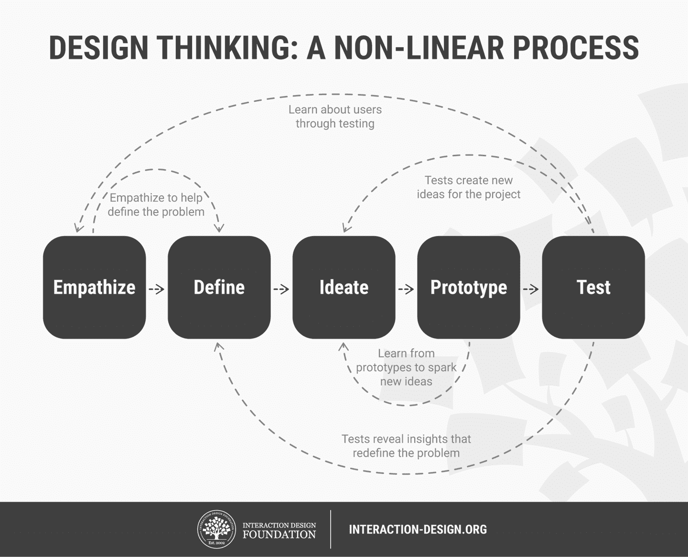

## 第 9 章. 人工智能助力更好的用户体验

在 第 8 章 中，我们讨论了是什么让产品变得伟大，以及为什么理解这一点对于开发成功的 AI 愿景和战略至关重要。本章的目标是在此讨论的基础上构建，并以优秀产品和设计良好的 UI 为基础，作为创造更好用户体验的背景。

你可能听说过 UX、UI、以用户为中心、以人为中心和以客户为中心等术语。通常这些术语用于数字产品设计或客户服务的背景下。这些概念也适用于人工智能和机器学习应用，并且应成为任何人工智能愿景和战略的核心。新兴技术如人工智能并不存在于真空中，因此适当的 design 考虑和处理至关重要。这是日益增长的 *人工智能 UX* 概念的基础。

本章首先对“体验”一词进行几个定义。这将为本章其余部分提供背景。随后将介绍人工智能如何具体帮助创造更好的用户体验。然后我们讨论三个概念：*UX 界面*；*体验经济*；以及被称为 *设计思维* 的设计方法。所讨论的一切都高度适用于创建人工智能愿景和战略。

## 体验定义

我们都有关于体验概念的直觉想法，但其正式定义是什么？以下是 [Collins 词典中的三个定义](http://bit.ly/2wh6rp6)，我认为最能概括这一点：

*   Experience 用于指构成某人生活或性格的过去事件、知识和感受。
*   体验是你所做或发生在你身上的事情，尤其是对你产生重要影响的事情。
*   如果你经历某种特定情况，你正处于那种情况中或它发生在你身上。

我认为这些定义不言自明，需要很少的进一步解释。在人的背景下，关键的收获是体验的概念存在于特定产品或对象的背景之外。我们可以将人类与产品的互动和使用描述为一种体验，事实上确实如此。整个 UX 设计领域正是基于这一点。

## 人工智能对用户体验的影响

AI 在创造更好的用户体验方面也具有巨大潜力，并且已经在许多应用中实现了这一点。请回顾 第 7 章 中列出的非详尽结果类别清单，这些类别是利益相关者可能因基于 AI 的创新而体验到的：

* 更佳的健康和健康相关结果
* 更佳的个人安全与保障
* 更佳的财务表现、储蓄和洞察
* 更佳的 UX、便利性和愉悦感
* 更佳且更简单的规划和决策
* 更佳的生产力和享受
* 更佳的学习和娱乐

当用于创造其中一个或多个结果时，AI 能够创造更好的用户体验。请注意，在本书中，我以两种方式使用“better”一词。首先，用来描述体验的改善和情感方面；例如，在纯粹积极的意义上，愉悦感、享受感和幸福感的增加。其次，我也希望“更好的用户体验”这一概念包括预防不良和次优体验以及减轻其严重程度。

另外需要注意的是，“更好”的认定高度个人化，在许多情况下是主观的。有些人可能会认为某些技术及其对生活的[content]
AI 在创造更好的用户体验方面也具有巨大潜力，并且已经在许多应用中实现了这一点。请回顾 第 7 章 中列出的非详尽结果类别清单，这些类别是利益相关者可能因基于 AI 的创新而体验到的：

* 更佳的健康和健康相关结果
* 更佳的个人安全与保障
* 更佳的财务表现、储蓄和洞察
* 更佳的 UX、便利性和愉悦感
* 更佳且更简单的规划和决策
* 更佳的生产力和享受
* 更佳的学习和娱乐

当用于创造其中一个或多个结果时，AI 能够创造更好的用户体验。请注意，在本书中，我以两种方式使用“better”一词。首先，用来描述体验的改善和情感方面；例如，在纯粹积极的意义上，愉悦感、享受感和幸福感的增加。其次，我也希望“更好的用户体验”这一概念包括预防不良和次优体验以及减轻其严重程度。

另外需要注意的是，“更好”的认定高度个人化，在许多情况下是主观的。有些人可能会认为某些技术及其对生活的影响非常有益而无法离开，而另一些人可能会发现某些技术或实现方式弊大于利。虽然我认为许多人会发现以下内容代表着人类巨大的潜在利益，但最终由人们自行决定，这完全没问题。

本节的目的是给出 AI 如何为这些类别中的每一个创造更好的用户体验的益处、方法以及示例。我提供的方法和示例远非详尽无遗，而且每天都有新的现实世界用例和应用出现，AI 技术和算法也在不断进步。

以下许多示例都建立在基于 AI 的领域的技术之上，例如预测分析、规范分析（自动化和/或优化的建议、行动和决策）以及强化学习。

## 更佳的健康和健康相关结果

AI 在改善人类的健康和健康相关结果、身体和心理方面具有巨大潜力。潜在的基于 AI 的健康益处示例包括以下内容：

* 预防疾病
* 疾病的早期诊断和治疗（身体和心理）
* 个性化且优化的治疗方案和效果
* 更佳的健康结果和延长寿命
* 协助残疾人士
* 减少事故和伤害

### 身体健康

现实世界的示例包括：

* [精准匹配配对肾脏捐赠](http://bit.ly/2wdSKHd)
* [基于视网膜扫描的心血管疾病和中风风险评估](http://bit.ly/2En8IDB)
* [肺癌早期诊断和个性化治疗](http://www.optellum.com)
* [基于超声心动图的冠心病诊断](http://bit.ly/2VJVgPN)
* [优化药物剂量](http://bit.ly/2VMQOjo)
* [预防突发性心脏死亡](http://bit.ly/2W1CBEn)
* [重症监护单元设备设置优化](http://bit.ly/2HwFELG)
* [基于图像的皮肤癌检测和诊断](https://go.nature.com/2JzVJT0)

### 心理健康

现实世界的示例包括：

* [自杀预警与预防](https://cnb.cx/2QoB1q4)
* [抑郁症和精神病预测](http://bit.ly/2Mk0P8v)
* [面向不适合饲养动物的环境（如医院）的类动物治疗机器人](http://www.parorobots.com)（例如，医院）
* [基于视频访谈的早期痴呆检测](http://bit.ly/2YHxNAL)

另一个例子是患者预期寿命预测（[`http://bit.ly/2Eu3J3V`](http://bit.ly/2Eu3J3V) 和 [`http://bit.ly/2WXkV9c`](http://bit.ly/2WXkV9c)）。

这是一个非常活跃且前景广阔的 AI 发展领域。AI 还可以帮助医生和患者做出更好的决定，选择何种医疗治疗方案。在需要治疗的医学诊断情况下，AI 能够提供成功概率并为给定的治疗策略提供建议，从而帮助人们做出有时至关重要的人生决定。

## 更佳的个人安全与保障

AI 能够在公共场所、工作场所和家庭中改善人们的个人安全与保障，并防止和最大程度地减少相关潜在问题。潜在的基于 AI 的安全和保障益处示例包括以下内容：

* 减少事故和伤害
* 改善在线、网络和家庭安全
* 改善公共安全

现实世界的示例包括：

* [自动驾驶汽车](http://bit.ly/2HOJBua)
* [提升建筑工地效率和安全](http://bit.ly/2YR4pbB)
* [任意特定位置的实时预测安全与风险](https://prn.to/2QiraC4)
* [预测自然灾害](https://go.nature.com/2YIyLNc)（例如，地震震级）
* [电子邮件垃圾邮件和钓鱼过滤](https://tcrn.ch/2VLdDDY)
* [犯罪分析与预防](http://bit.ly/2QgehbJ)
* [预测性维护](http://bit.ly/2WtHSEd)
* [欺诈检测与预防](http://bit.ly/2M3oJor)
* [身份盗窃检测](http://bit.ly/2QjXC7d)
* [个人数据保护](http://bit.ly/2M6kSXB)
* [基于人脸识别的家庭安全](http://bit.ly/2YINFDa)

## 更佳的财务表现、储蓄和洞察

AI 能够帮助人们实现更好的财务表现、储蓄以及随着时间的推移对财富的洞察。潜在的基于 AI 的财务表现、储蓄和洞察益处示例包括以下内容：

* 改善财务预测和预报
* 改善财务规划和实现目标财务目标的能力
* 改善成本和总体节省

现实世界的示例包括：

* [低碳和绿色电力的增长](http://bit.ly/2HMXyJb)
* [基于图像的太阳能板节能估算](http://bit.ly/2HxPuNk)
* [基于预测的节能决策](http://bit.ly/2HMXyJb)
* [智能设备和家居](https://nyti.ms/2VG1joE)
* [个性化促销和优惠带来的折扣和节省](https://www.betterment.com)
* [用于投资组合表现的机器人顾问](https://www.wealthfront.com)

截至撰写本文时，机器人顾问是一个非常受欢迎的例子，多个公司完全专注于 AI 驱动的投资组合管理，包括投资选择和再平衡。其理念是，与传统财务顾问方法相比，这些平台可以实现更好且成本更低的表现，并且完全自动化。

用户不仅有获得更好且自动化的退休投资组合表现的潜力，而且还可以获得对其投资组合表现的更佳分析和洞察。回到分析瘫痪的概念，更好的洞察通常并不意味着要查看更多的数据和图表；恰恰相反。它意味着拥有非常简化和精选的数据和洞察，告诉你基本上所需了解的一切，同时在你选择时可以看到更多（想想执行摘要的概念）。AI 和机器学习正是以这种方式生成洞察。

## 更佳的 UX、便利性和愉悦感

当人们与技术互动时，AI 能够为人们创造更好的用户体验、便利性和愉悦感。潜在的基于 AI 的 UX、便利性和愉悦感益处示例包括以下内容：

* 更容易、更快、更相关的产品、内容、媒体、信息和服务发现
* AI 优化的 UI 布局和交互
* 简化且多样化的技术交互
* 提高任务便利性

现实世界的示例包括：

# AI 应用与优势

* 个人助理（例如，亚马逊的 Alexa、苹果的 Siri、谷歌的 Assistant）
* 通过搜索引擎和推荐系统降低搜索和浏览摩擦（例如，Google、Amazon、Netflix）
* [对话式产品推荐](http://bit.ly/2VLUUZ8)
* 特定的[歌曲和音乐艺术家识别](https://blog.shazam.com/)
* [来自酒瓶标签的葡萄酒评分和评论](https://www.vivino.com)
* [特定手势检测与识别](http://bit.ly/2X3n1Ez)
* [实时多人姿态检测](http://bit.ly/30BBqtL)
* [基于图像的问答](http://bit.ly/2Mk2Bqb)
* [聊天机器人驱动的花卉](http://bit.ly/2WjKKn0) 和 [披萨订购](http://bit.ly/2VLV7vo)
* 能够减少任务所需的出行和步骤（例如，使用移动应用存款支票，而不是去银行）
* [语音-](http://bit.ly/2JVGV0w) 和 [基于图像的搜索](http://bit.ly/2JxQyTX) 以及交互
* [口袋大小的即时语言翻译](http://bit.ly/2QiUF6F)。

Amazon 和 Netflix 都创建了许多人非常熟悉的个性化推荐引擎。添加这些引擎带来了巨大的商业价值。[Amazon 在添加这些引擎后收入增长了 35%，Netflix 上观看的 75% 的内容由其推荐产生](http://bit.ly/2CjeoM5)。

让我们谈谈 *为什么* 这些引擎对这些公司如此巨大成功。浏览和搜索东西对许多人来说被视为一种负担，因此是摩擦和时间投入的领域。随着物品数量显著增长，这种情况只会变得更糟，以至于有些人开始出现分析瘫痪。这是由于选项太多而产生的现象，导致难以做出选择或决定，最终可能导致放弃。推荐有助于缓解这一问题。

引擎越好，推荐中包含用户如果费力浏览数千件商品本会选择的确切商品的可能性就越高。另一个好处是，用户可能会被介绍到他们原本可能不知道但可能非常合适的类似商品；例如，要购买的产品或要观看的电影。最后，用户还能够轻松找到相关商品（例如，与电池充电器购买配套的电池）。

另一个好处是，提供推荐是一种个性化，而个性化对人们来说变得越来越重要，尤其是年轻一代。人们希望在对他们最重要的事情上获得个性化体验。大多数软件和技术传统上都是通用的，旨在吸引大众，这可能会降低对大量人群的整体体验。

让我们重新审视 Amazon 和 Netflix 在引入推荐引擎后经历的巨大提升。Amazon 巨大的收入提升很大程度上归功于订单规模的增加。人们不再一次只购买一件商品（如果有的话）——例如由于前面描述的搜索摩擦、时间投入和分析瘫痪——人们可以轻松找到并将与其它商品配套的商品、令人耳目一新的商品或随时可得的商品添加到购物车中（可将其视为杂货店收银线冲动购买的数字等价物）。

随着 Netflix 引入推荐，人们对该平台的参与度大大提高，并且能够更轻松、更快速地找到想要的内容。他们被介绍到一些他们不知道但最终会喜欢的新电影和电视节目。在许多情况下，人们已经成为 Netflix 连续追剧者，因为平台会在你正在观看的内容结束时立即推荐新的观看内容。你所需要做的只是点击继续。

最终，推荐的引入可能阻止了 Netflix 作为一家公司走向失败。想想我们在移动设备上尝试的所有应用，其中许多并不“粘性”（即有用且令人愉悦），因此被闲置不用。Netflix 完全可能发生这种情况。Netflix 初次推出时，其目录没有很多热门作品，规模也不大，但正在增长。将这一点与用户基本上被要求费力搜索大量不相关内容相结合，很容易导致 Netflix 被彻底放弃，尤其是取决于人们愿意花费多少时间和耐心。显然这种情况并没有发生，这很可能很大程度上归功于推荐体验的引入。粘性强的应用可以带来显著的客户留存率提升。

事情变得越容易，同时提供最大价值，UX 就越好，用户参与度也越高。从商业角度来看，这会导致客户/用户流失减少和更好的留存。值得注意的是，虽然我们所涵盖的一些内容可以改善 UX，但出色的设计和可用性仍然至关重要。人们喜欢并使用设计良好的产品；相反，人们不喜欢并完全放弃设计不良的产品。再次，这与前面提到的 AI 的 UX 概念有关。

## 更佳且更易的规划与决策

AI 能够帮助做出更好、更易的规划和决策。潜在的基于 AI 的规划和决策益处示例包括以下内容：

* 简化、更准确和自动化的规划与决策制定
* 在专业领域之外提供规划和决策制定帮助
* 更好的预测和预报
* 避免分析瘫痪
* 剔除非最优选项和决策

实际案例包括：

* [自动化规划与排程](http://bit.ly/2wdEnmx)
* [增强智能](http://bit.ly/2HAmmW4)
* [退休投资](https://www.betterment.com) 和 [投资组合管理](https://www.wealthfront.com)
* [用于销售规划的准确房价预测](http://bit.ly/2X4f9CS)
* [拼车预计到达时间](https://ubr.to/2VNTFsB)

在商业环境中，但从人的角度来看，AI 可以为公司中的业务经理创造更好的体验。大多数领导者和经理每天去工作，目标是产生影响并推动业务成功，通常是通过战略规划和做出关键决策。成功完成这些事情通常会带来自我实现和满足感、奖励和奖金、晋升、职位安全、股东和公众的赞扬，以及同事和员工的尊重。AI 是所有这些事情的推动者。

当你不再做出盲目或凭直觉的决策而没有对结果的良好估计，而是能够做出数据驱动的决策，并且成功概率高、结果可以提前预测时，这也是一种相当了不起且令人振奋的感觉。缺乏创新、渐进式进步和现状无法提供这些益处和改善的人类体验。

## 更佳的生产力、效率和享受

AI 可以在执行任务时帮助提高生产力、效率和享受。潜在的基于 AI 的生产力和享受益处示例包括以下内容：

* 更具生产力和愉悦的工作（更好的工作）
* 减少完成任务所需的资源
* 提高效率
* 改进组织

实际案例包括：

* [增强智能](http://bit.ly/2HAmmW4)
* [图像标记与分类](http://bit.ly/2HLprBu)
* [电子邮件类别预测](http://bit.ly/2VVzzBk)。

## 更佳的学习与娱乐

AI 能够帮助为人们创造更好、更有趣的学习和娱乐。潜在的基于 AI 的学习和娱乐益处示例包括以下内容：

# 引言

* 发现新颖且更相关的媒体和娱乐选项
* 更优质且更有趣的学习
* 更优质且更有趣的游戏体验

学习相关的示例包括 [自适应](http://bit.ly/2Qk0Asn)、[差异化与个性化学习](http://bit.ly/2Espjpn)。

真实媒体个性化和推荐的实际示例包括：

* [YouTube 视频推荐](http://bit.ly/2XtbRfI)
* [电影和电视节目推荐](http://bit.ly/2wcaUt8)
* [音乐和播放列表推荐](http://bit.ly/2VN5AH6)
* [基于排名的新闻推荐](http://bit.ly/30DNFGl)

娱乐示例包括：

* [自适应和智能游戏](http://bit.ly/2QiWP6g)
* [虚拟现实](http://bit.ly/2WldY4O)
* [增强现实](https://adobe.ly/2VZ87CF)

现在我们已经定义并涵盖了关于体验的概念、益处和示例，以及 AI 如何帮助为人类创造更好的体验，让我们把注意力转向人类直接与技术交互的界面。

## 体验界面

我们大多数人都非常熟悉提供基于技术用户体验的最常见界面。今天的前三大是网页、移动端和桌面。也就是说，随着物联网和连接硬件设备的持续兴起和普及，许多新界面现在包括个人助手（例如，Amazon Echo）、智能家电、智能家居设备（例如，门锁、灯泡、暖通空调）、智能汽车和其他创新界面。

值得一提的是，语音作为一种用户输入形式变得越来越普遍，并且正朝着完全主导的方向发展。截至本文撰写时，大多数两岁和三岁的孩子现在几乎都是使用数字设备（如手机和平板电脑（例如 iPhone 和 iPad））的专家。他们在打字方面的经验主要是在数字意义上；也就是说，在这些设备上的虚拟键盘界面上，包括表情符号在内的一切。

现在想象一个孩子在很小的时候仍然是使用技术的专家，只是他们对界面和与技术交互的全部了解都仅通过说话。他们只是走来走去，对着一切说话以使其发生。实际上必须输入任何东西的想法在时间和精力方面既原始又浪费。为什么要打字，当你可以说话时？听起来熟悉吗？为什么要寄信浪费邮票、信封、纸张和你的时间，而你只需写电子邮件？我们已经看到语音变得更加主导，我所指的完全主导可能不会太遥远。

因此总结一下，我迄今为止概述的两个主要类别是传统的基于软件的界面和连接设备界面，两者都见证了语音作为输入和交互形式急剧上升。我们可以利用这些界面提供用户可以交互的 AI 驱动功能。

当前示例包括个性化、推荐、自动投资组合再平衡和投资，以及包含洞察的仪表板。如前所述，还有其他高级应用，例如帮助盲人“看见”、自动驾驶车辆和 AI 驱动的机器人技术进步。

值得注意的是，并非所有 AI 应用都有用户界面，自动化是最明显的例子，但请注意，我们讨论过的关于产品优秀的其他一切仍然非常适用。

## 体验经济

能够实现卓越人类体验的 AI 解决方案最有可能成功。人工智能等新兴和最先进的技术能够改善现有体验、创造新体验并消除不良体验。

*体验经济*一词用于描述当今人们更喜欢将时间和金钱花在体验上而不是产品和商品上这一事实。示例包括旅行、参加音乐会或体育赛事、跳伞、冲浪、会见你最喜欢的作者（哎呀），观看芝加哥小熊队在 108 年后赢得世界大赛（这很容易是我一生中最好的体验之一），你明白我的意思。

这一趋势主要由千禧一代和更年轻的 Z 世代（1996 年后出生）推动。Z 世代是首个真正的数字原生代，超过 [美国人口的五分之一](https://bloom.bg/2EsS0Tp)。额外的研究表明，74% 的美国人更喜欢购买体验而不是产品，而 49% 的 Z 世代和千禧一代愿意 [出售一些家具和衣服以便能更多旅行](http://bit.ly/2JYPdER)。

为了应对消费者体验的巨大需求，[公司越来越多地设计和推广它们](http://bit.ly/2JzDNZ1)。基于体验的服务也可以成为关键的差异化因素和竞争优势的来源。在许多情况下，某些体验已经存在并可用很长时间，但不一定随时可用或处于人们的关注焦点。体验经济有助于解决这个问题，并且由于体验驱动的产品，也使体验更容易安排、经历和分享。这也为以体验为中心的 AI 产品代表了巨大的机会。

人们不仅仅是在寻找体验本身；相反，他们更喜欢个性化体验，而这正是 AI 擅长的领域。个性化（如推荐）是转化和收入增长的最大驱动力之一。同样，个性化体验的总体潜力是巨大的。AI 已被用于推动个性化数字体验，但也可以用于定制非数字体验。

## 设计思维

设计思维是一种以人为中心、以需求为中心的方法论和流程集合，尤其适用于解决复杂且定义不清或未知的 问题，[这些问题与创新最相关](http://bit.ly/2YKfKtD)。它旨在成为产品设计师和用户之间高度协作的过程。设计思维的主要优势之一是其以人为中心的方法。设计思维的最终目标是构建基于真实用户如何思考、感受和行为的产品。尽管这些概念自 1950 年代就已存在，但设计思维现在已成为一种流行且广泛使用的技术。

Tim Brown 说设计思维过程是一个重叠空间的系统，而不是有序步骤的序列。\] 他确定的三个重叠空间是灵感、构思和实施。“灵感是激发寻找解决方案的问题或机会，”[他写道](http://bit.ly/2YKfWJn)。“构思是产生、开发和测试想法的过程。实施是从项目阶段进入人们生活的路径。”footnote:\[*Change By Design: How Design Thinking Transforms Organizations and Inspires Innovation*. New York: Harper Business. 2009.

设计思维是在开发你的 AI 愿景和战略时非常有用的方法。设计思维能够帮助解决技术问题，但你也可以将其扩展到解决超出技术和产品的 问题。我在此基于 Interaction Design Foundation 提出的 [设计思维过程的五个阶段](http://bit.ly/2YKfKtD) 提供该方法论的简要概述。该组织以及许多其他组织都将其设计思维方法源自斯坦福大学的 d.school，这是领先的设计思维教育机构。

设计思维的五个阶段是 *共情*、*定义*（问题）、*构思*、*原型* 和 *测试*。这可能看起来与精益和敏捷产品开发方法论有些相似。这是因为它是一种类似的方法，但应用于剩余产品开发过程之前的设计过程。图 9-1 显示了设计思维过程。

# 设计思维流程
设计思维是一种非线性和迭代的过程。它始于对人类及其需求或他们所面临的问题产生共情。它本应是一种沉浸式的发现形式，在问题实际存在的真实环境中与实际人群一起进行。一个关键方面是必须搁置所有假设，以便更好地理解用户及其需求。

定义阶段解释起来较为直观，其关键特征是问题定义应以以人为中心的问题陈述形式呈现。这源于对共情阶段所做观察的全面分析。定义阶段是构思阶段的基础和推动者。在构思阶段，关于用户及其需求所获得的理解被用来快速产生想法并“跳出思维定式”，为问题陈述中定义的问题寻找解决方案。

构思阶段可以采用多种构思技巧，例如头脑风暴、头脑书写、最糟糕的想法和 SCAMPER。完成前三个阶段后，可成为构建产品低成本、缩小版的基础。这与 MVP 的概念类似。在这种情况下，原型通常使用常见的设计工具构建，而不是创建实际软件。原型用于实验，以便迭代出针对所定义问题的最佳解决方案。

此原型阶段也有助于揭示有风险的假设以及尚未考虑或发现的产品固有约束和考量。它还有助于巩固产品在真实用户使用情境下的潜在成功，特别是他们在使用产品时的行为、思维和感受。

流程的最后阶段是测试阶段，尽管请记住该流程是迭代的而非线性的。测试阶段通常会导致对问题陈述的修改，以及对用户和使用条件的理解。最终目标是尽可能深入地了解产品及其用户。设计思维应促进从问题空间到解决方案空间的以人为中心的映射，并且做得正确时，应能产生能够满足人类需求的成功产品。

## 摘要
本章的关键要点是，AI 完全有能力兑现提供更好人类体验的承诺。确保这一点的首要方式是了解实际用户的需求、想要和喜好，然后应用以人为中心的方法论，如设计思维，来创建能够兑现的 AI 愿景和战略。

在讨论 AI 在医学和其他领域改善生活的潜力时，《麻省理工科技评论》的编辑 David Rotman 指出，如果 AI 未被用于造福尽可能多的人，则会产生公众怨恨的风险。他写道：“危险不在于直接的政治反弹，而在于未能拥抱和投资于该技术丰富的可能性。”

我完全同意。AI 的主要关注点和目标应该是帮助尽可能多的人，并且随着基于 AI 的技术进步，这也是 AI 将继续创造更好人类体验的方式。我们现在已经涵盖了开发成功 AI 愿景所需的一切基础，这也有助于 AI 战略的制定。第 10 章 以开发 AI 愿景和所得愿景陈述的示例作为结尾，结束了本书的第二部分。
