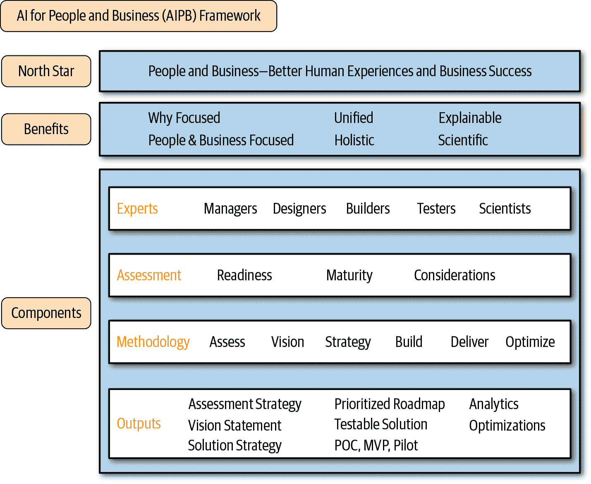

## 第 10 章. 一个 AI 愿景示例
现在我们已经介绍了 AIPB，以及如何详细创建 AI 愿景，让我们使用一个假设示例来创建一个 AIPB AI 愿景。

我们的 AI 愿景示例灵感来源于 Grant Achatz，一位备受推崇的厨师和餐馆老板，以其位于芝加哥的餐厅 Alinea 而闻名。根据 *Restaurant* 杂志的世界[50 佳餐厅](http://bit.ly/2Rua7NT)榜单，Alinea 被评为美国第二佳餐厅，世界第七。本书出版时，Alinea 还获得了[连续八年三颗米其林星](http://bit.ly/2LfsncC)！

非常不幸的是，Achatz 先生在 33 岁时被诊断出患有 4b 期舌癌。尽管大多数肿瘤专家告诉 Achatz，唯一的治疗方案需要切除 75% 的舌头并永久性地破坏他的味觉，但来自芝加哥大学医学中心的一位名为 Everett Vokes 的肿瘤学家提供的另一意见建议了一种创新的治疗方案。他的计划旨在通过靶向化疗和放疗来挽救 Achatz 的舌头和味蕾，这被证明是成功的，尽管确实导致了[暂时失去味觉](https://n.pr/2WXucSJ)。今天，[Achatz 如今已摆脱癌症](http://bit.ly/2N4VVMG)。

Achatz 的味觉最终恢复了，他的故事呈现出一个引人注目的 AI 机会。让我们基于此示例构建一个 AIPB 愿景。如果基于技术的口腔传感器能够与 AI 算法结合，将感官输入映射到我们所称的味道会怎样？让我们尝试使用 AI 创建一种数字映射，其类似于使我们的味觉发挥作用的基于化学的感官机制。我们想这样做是为了帮助像 Achatz 这样失去味觉的人。

## 空间-时间感测与感知
人类感知苦、酸、咸、甜、鲜美和金属等味道。这发生在化学物质与我们口腔中的某些神经细胞接触时，进而激活其他神经细胞。大脑最终接收到这些信息并感知到“味道”，或我们也称之为风味。^(1)

Jeff Hawkins 在他的书 *On Intelligence* 中写道：“你听到声音，看到光，感受到压力，但在大脑内部，这些信息类型之间并没有根本区别……大脑所知道的只有模式。你的感知和对世界的认知都是由这些模式构建的……进入你大脑的所有信息都以轴突上的空间和时间模式形式出现。”

我们人类常常理所当然地认为自己有感知和感知的能力，并可能认为我们的大脑 somehow 直接看到、听到、品尝、嗅闻和触摸。实际上，我们的大脑存在于寂静和黑暗中，只能通过感官器官接收信号模式间接感知，这些信号在深入我们大脑的旅程中经过了大量神经元和突触（更多信息请参阅附录 A）。到大脑接收时，这些信号的空间和时间模式不过是神经元的激活。换句话说，大脑将这些激活解释为我们看到的图像，例如，即使这些激活对大脑来说代表的并不是我们实际感知到的所见。就像电影 *The Matrix* 中的流式符号以及它们实际上代表其他东西一样；在这种情况下，是矩阵中正在发生的事情。

所有这些例子都与人工神经网络和深度学习的工作方式非常相似。输入进入（在这种情况下，是触发神经激活信号的感测化学物质），网络产生诸如预测或分类之类的结果。在人类感官输入的情况下，输出可能是特定的声音、气味、感觉、视觉图像，或（你知道接下来是什么）风味。

## AI 驱动的味觉

我们有兴趣创建全球首个基于技术、由 AI 驱动的味觉传感机制，以帮助那些不再能够品尝的人。假设此前从未有过类似的尝试。今后，我们将此解决方案称为 Tasterizer，假设的公司为 Tasty Co。请注意，我们目前拥有一个初步的高层愿景，而尚未进行任何评估或制定计划。我们暂时不需要这样做。

回顾我们的 AIPB 框架，如 图 10-1 所示。

我们从北极星开始：更好的用户体验和业务成功。那么这个愿景将如何同时满足两者？幸运的是，答案相对容易。恢复味觉显然能带来更好的用户体验，这一点已成定局。

发明这种假设性解决方案的企业能够以多种方式实现业务成功，而不仅仅是与销售相关。基于此类产品的企业及其员工，可以为其产品能够帮助有需要的人而感到非常自豪。这是一个双赢的局面。他们也能感到欣慰，因为他们能够真正创新并因此创造新产品、商业模式并开拓新市场。当然，还有显而易见的业务收益，例如销售和收入（假设在此示例中该业务的市场足够大，并且你是先行者）。

我们现在已在高层面上确定了对人和企业双方的益处，并可以继续制定愿景声明。请记住，所有相关的、AIPB 推荐的专家都应协作以制定每个 AIPB 方法论组件阶段的预期输出。对于愿景阶段，这包括管理人员（业务人员和领域专家）和科学家（AI 从业者）。不允许采用最高薪人士意见（HiPPo）方法和委员会设计，而诸如 *flipped classroom* 之类的概念则高度推荐。将所有会议用作高效、有效的实际协作工作会议，而不是教学和学习会议。提前让每个人知道如何快速上手，最好以需要最少时间和精力的方式来适应繁忙的日程。

还请回顾，对于 AIPB 方法论的愿景阶段，以及在 第 2 章 中介绍的 AIPB 流程类别，我推荐创意构思和愿景开发类别。这包括使用推荐的方法，如设计思维、头脑风暴和五个 *why*s。请注意，这旨在作为一个高层且过于简化的示例。在现实世界中使用 AIPB 开发 AI 愿景应涉及本书迄今为止讨论过的所有与愿景相关的内容。

在一切确定之后，为完成我们的示例，让我们创建愿景声明。

## 我们的 AIPB 愿景声明

> 对于那些失去味觉能力的人，我们 Tasty Co. 正在帮助恢复人们的味觉，以便他们能够再次品尝食物和饮料（*why* for people）。这使 Tasty Co. 能够通过开拓一个全新的市场并扩展我们有益人类健康的产品组合来创造新的收入（*why* for business）。我们能够做到这一点得益于我们专利的 Taste-Fusion 技术，该技术将最先进的微传感硬件与最新的 AI 技术相结合，以便将食物和饮料的化学物质映射到人类大脑感知的味道（*how*）。结果就是我们所称的 Tasterizer（*what*）！

我们可以根据特定受众的需要将此声明修改为仅关注人或仅关注企业，但创建能够识别对人和企业双方 *why* 的愿景声明的练习是必须的，而且是许多公司都没有做到的。正如 Simon Sinek  famously 所说，“People don’t buy what you do, they buy why you do it.” 确保你清楚地了解使用你的产品的人所获得的益处，然后围绕它构建一个优秀的产品。

^(1) [*https://www.ncbi.nlm.nih.gov/books/NBK279408*](https://www.ncbi.nlm.nih.gov/books/NBK279408)
