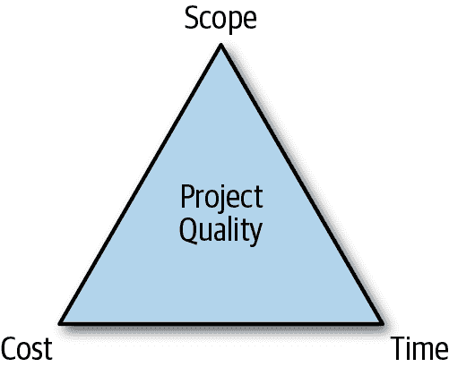
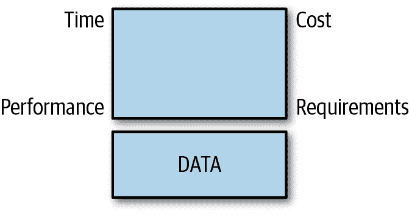

## 第 11 章. AI 成功所需的科学创新

我们现在开始为制定有效的、与愿景一致的 AI 战略奠定基础框架。本章对于有兴趣使用 AI 的高管和经理来说非常重要，特别是对于战略规划和适当设定期望。

AI 是一个高度复杂的科学领域，主要由探索、实验和不可预测的结果驱动。因此，你应将 AI 视为一种研发形式，包括期望设定和预算编制。AI 也是一个研究非常活跃且不断进步的领域，以越来越多样的方式和非常快的速度应用。

我经常被业务高管和经理询问 AI 能为他们创造什么价值（包括投资回报率），构建 AI 解决方案需要多少时间和成本，将实现什么解决方案性能，哪种 AI 技术或方法效果最好，以及需要什么确切的数据来确保一定的性能水平。

正如许多研发计划一样，人们通常无法在前期回答这些问题中的许多问题（这正是研发的全部目的！）AI 也是如此，尽管我发现这在很大程度上尚未被很好地理解。关键点在于，AI 是一个科学发现的领域，而不是设计和组装的领域。让我们讨论原因。

### AI 作为科学

让我们重新审视数据科学领域中的“科学”一词。我们大多数人都记得在学校学到的科学方法。*牛津英语词典* 对科学方法的定义如下：

> 一种程序方法，自 17 世纪以来一直表征自然科学，由系统的观察、测量和实验以及假设的提出、检验和修改组成。

另一个相关的 *牛津英语词典* 定义，关于“经验性”一词，定义如下：

> 基于观察或经验，或可通过观察或经验验证，而非基于理论或纯逻辑。

最后，*牛津英语词典* 对非决定论的定义如下：

> 指、涉及或指定一种计算模式，在某些点上存在不可预测的进行方式选择。

这三个定义都适用于 AI、机器学习和数据科学。这些领域基于统计学和概率，本质上是科学的、经验性的和非决定论的。这意味着这些领域的成功并非来自逻辑、理论或纯粹的专业知识，而是来自经验、试错和科学方法的应用，或非常相似的过程。

# 新的 AI 项目：不确定性与科学创新

我无法足够强调这一点。人工智能、机器学习和数据科学并不是只要具备一定经验、复杂性和能力（我们将在下一章中再次讨论这些概念）就能让你确切知道对于某个应用会得到什么、需要什么、需要多长时间以及花费多少的领域，并且这些经验、复杂性和能力必须与应用成功所需的确切（或极其接近）的数据集和技术相匹配。我们在本书其余章节中使用“新 AI 项目”（包括机器学习）这一表述，指代数据团队在经验、复杂性和能力背景下处理相对新颖的数据和/或技术项目的情形。

举例来说，构建一个简单的待办清单移动应用。假设它的全部功能只是允许用户注册账户，然后使用该应用创建和管理待办清单。将移动应用设计、开发并部署到 iTunes（iPhone）和 Google Play（Android）应用商店，整个过程相对是确定性的，并且不需要应用科学方法，也不需要经验观察和数据收集。UX 和 UI 设计师会开发界面和体验，开发人员会基于设计和其他需求构建应用，QA 和自动化测试人员会验证应用质量和无缺陷，DevOps 工程师会将应用提交到应用商店发布。假设你拥有一支经验丰富的团队，参与其中的每个人都应该能够大致估算构建移动应用所需的时间、精力以及具体任务。这是在技术开发中确定性且非科学性的一个很好的例子。

相反，在开始一个新 AI 项目时，如果不先访问和探索数据，就不可能知道需要多少数据准备（例如、清洗、处理）。同样也不可能知道现有数据（无论是否已准备好）是否适合解决手头的问题，或者是否需要额外的数据处理、特征工程和数据增强。确定所有这些都需要探索、实验和经验。让我解释原因。

在人工智能和机器学习领域经常被提及的一个概念被称为 *可处理性*。*Merriam-Webster* 将 tractable 定义为“容易处理、管理或加工的”，并且它与“可塑的”一词同义。有些问题根本就是不可处理的，意味着它们极其困难或无法解决。在人工智能和机器学习中，不可处理的项目或任务通常是由于选择了错误的方法（即、模型、算法或技术）或没有“正确”的数据或特征。通常这会从无法使用给定方法和数据创建合适的模型中变得明显。深度学习等先进技术能够凭借其特征提取能力克服一些不可处理性问题；也就是说，深度学习不需要人类手动执行特征选择和特征工程，但在其他情况下，可能需要更多和/或更好的数据或更合适的算法。

还有一个概念叫做“没有免费午餐定理”，它在很大程度上基于 [优化的数学](http://bit.ly/2Fs01sh)。许多人将该定理在机器学习应用中的解释为：无法提前确定对于给定应用哪种精确模型和模型配置表现最好。你必须经历一个经验性（实验性）过程才能确定这一点，即使找到了表现良好的模型，也不能保证它是表现最好的模型。幸运的是，AI 工具供应商和机器学习从业者对帮助应对这些 AI 开发事实的需求很强。特别是，工具正在积极开发中，以帮助加速探索性发现过程，以便获得初始模型性能估计，更好地了解手头数据的完成工作能力，并更快地选择最佳模型或算法。

对于一个新 AI 项目（再次，“新”如前所述），要求所有事情在开始前就已知，包括时间、成本、性能和需求，这是一条通往失败和失望的道路。未能理解这一点通常会导致利益相关者期望设定不当，并且高管要么直接拒绝推进这些举措，要么花费过多的时间来做出推进决策。所有这些都可能导致错失机会、延迟成本惩罚，以及在竞争对手手中失败。

另一个需要考虑的事情来自于从 80/20 帕累托法则的角度来看这个问题；也就是说，目标（足够好）的模型性能的 80% 相对容易实现（例如、通过模型选择和模型配置），而另外的 20% 则需要不确定性和不可预测的时间、成本和精力的指数级增长（例如、数据增强、特征工程）。确切的比例将取决于具体的应用以及其性能的重要性。并非所有 AI 解决方案都需要相同的性能水平（例如、医疗诊断与产品推荐）。

鉴于本节以及总体上所涵盖的一切，涉及人工智能等科学领域的创新应被称为科学创新。简单地加上“科学”一词更符合现实，应该有助于适当设定期望，最终可以带来更成功的举措。以下是我创建的一个简单公式，我认为它最好地代表了这一点：

*   科学的 + 经验的 + 非确定性的 = 科学创新成功

科学创新需要一种思维和方法的转变，类似于从瀑布到敏捷的转变。公司已经做出了这种转变，或者仍在进行中（这可能需要一段时间），这是由于重大的瀑布式失败，以及理解精益和敏捷方法相对于瀑布的诸多好处。尽早采用科学创新思维和方法是 AI 成功的关键。

## TCPR 模型

到目前为止所描述的一切都至关重要，以至于我开发了一个模型和一些类比来更好地说明所有内容。谈到新 AI 项目时，我在开始前最常听到的就是这些问题。

*   交付解决方案需要多长时间，成本（时间和成本）是多少？
*   解决方案会有多好（性能）？
*   在开始前需要什么才能达到目标性能水平（需求）？

所有这些问题合在一起基本上是在问：在开始新 AI 项目之前，而不先提供对可用数据准备情况和质量的了解，我想确切知道我会得到什么，它要花多少钱，需要多长时间，以及我需要什么确切数据（记住“正确”的数据？）来确保风险得到缓解、及时交付和最终成功。

与传统商业智能（BI）等已知数量不同，例如，我们通常无法提前回答新 AI 项目的这些问题。这里的关键短语是“已知数量”。在 第 12 章 中，我们讨论了提前回答这些问题的能力实际上是成熟度的一个函数，并且我提出了我创建的模型以更好地说明这一点。

现在，让我们解释为什么这些问题对于新的 AI 项目而言非常难以提前回答，有时甚至是不可能的。我们通过将其置于项目管理和一个相关类比的背景下来说明。项目管理领域经常提到一个范围、成本和时间构成的三角模型，用于特定项目质量水平。它是平衡的，事实上是一个平衡方程，因为一个组成部分的改变必然会影响或需要调整另一个组成部分。图 11-1 展示了这个三角形。

如果你不熟悉，其思想是如果一个组成部分被固定（最常见的是由于预算而固定的成本），另外两个就成为权衡杠杆。在预算（成本）固定的情况下，资源（人力）数量由预算决定，因此在给定时间内能够完成的工作量（范围）也就固定了。要求工作更快完成（时间更短）必然需要成本增加，因为需要更多的人来缩短交付时间（假设增加人手实际上会减少交付时间——实际上往往并非如此）。相反，要求完成更多的工作（范围增加）必然需要更多的时间，而人手（成本）保持不变。

总结：这是一个平衡系统；也就是说，要求范围增加或交付时间减少，只能通过相应的成本增加来实现。非常关键的是，这仅适用于确定性项目——也就是说，它们不属于科学创新的范畴。事实上，AI 和机器学习项目不太可能通过简单地投入更多的数据科学家而变得更快，也不会使模型性能提升到可接受的水平。

鉴于此，并回到所提出的问题，我开发了一个新的、更适合 AI、机器学习和数据科学的依赖模型。其组成部分是时间、成本、性能和需求，统称为 *TCPR 模型*，如 图 11-2 所示。以下是供参考的问题，之后是 TCPR 模型：

* 交付解决方案需要多长时间，成本是多少（时间与成本）？
* 解决方案会有多好（性能）？
* 为了达到目标性能水平，提前需要什么（需求）？

TCPR 模型代表了所谓的 *不定系统*（即存在不止一种解），工程中一个著名的例子是四条腿桌子腿部受力的计算。除非桌子和腿所放置的地面绝对完美，否则无法计算四条腿同时承受的受力，桌子很可能将大部分重量压在三条腿上（想想你遇到过的所有摇晃的桌子）。这就是使其成为不定系统的原因。相比之下，三条腿的桌子代表了 *定系统*，因此像项目管理三角一样是平衡且可预测的。

请注意，TCPR 模型包含一个数据基础。这至关重要，因为在没有首先对可用数据源和数据字段有一个初步了解的情况下，讨论四个与 TCPR 相关的问题毫无意义。它们都依赖于一定程度的数据发现、探索和理解。

换句话说，这一点值得重申。确定 AI 解决方案的 TCPR 无论如何都需要提前提供数据，并且还需要一定程度的实际探索和实验。这正是 AI 和机器学习具有非确定性的原因之一。让我们回顾几个类比，以帮助更好地理解 TCPR 模型背后的概念及其对提前拥有数据的依赖。

# TCPR 模型类比

让我们转向一个有助于进一步解释的类比。想象一位面包师对为她的面包店创造一款新颖、精致且复杂的蛋糕感兴趣。一群来自知名美食杂志和报纸的著名美食评论家将对蛋糕进行一到五星的评分。如果平均评分足够高，面包师将获得一项非常享有盛誉的烘焙奖。

让我们以 TCPR 模型的角度来讨论这个问题，并请记住，其中许多内容在烘焙方面可能显而易见，但在 AI 的背景下对许多人来说却并不明显。尽管在这种情况下 AI 和烘焙是可比较的。

## 时间与成本

精确的烘焙时间非常重要，因为短几分钟或长几分钟就会毁掉蛋糕质量和随之而来的星级评分。尽管时间很重要，但面包师无法提前确定烘焙蛋糕的确切时间，因为这取决于配料（配方）的最终选择和比例，并且需要多次烘焙试验才能确定。单个蛋糕的确切成本在最终配方确定之前也是未知的。

同样，除非某个从业者群体以前用过类似的数据做过这种事情，否则开发和部署新 AI 解决方案所需的确切时间和成本是不可能提前得知的（成熟度的一种衡量，见 第 12 章）。在获得数据后，他们可以开始尝试不同的模型和技术，以便更好地确定潜在的时间和成本。他们可能能够根据经验给出一个大致的时间估计，但前提是他们确信自己完全了解有哪些数据可用，以及这些数据对特定应用是否足够。

## 性能

评论家的个人评分和蛋糕的整体平均评分至关重要。话虽如此，在她制作出自己认为尽可能完美的蛋糕之前，面包师无法预测个人或平均评分会是多少。即便如此，面包师和个别评论家的口味很可能不同（Top Chef 有人吗？），因此平均评分几乎不可能提前预测。

同样，AI 从业者无法保证新解决方案的结果会有多好（例如模型性能），也不能保证 100% 的预测准确性，例如。首先，没有任何预测模型是 100% 准确的，句号。其次，不可能提前知道哪种模型或算法表现最好，或数据是否足够满足给定的目标性能。需要数据和时间来尝试不同的算法，以便更好地了解可实现的性能。

## 需求

最终配方和烹饪方法（例如时间、温度、烤箱位置）对个人和平均评论家评分的影响巨大。尽管如此，确切的配料、每种配料的用量以及烹饪方法必须通过实验和试错来经验性地确定。如果最终蛋糕没有获得评论家的足够好评，面包师仍必须继续修改配料，以随着时间的推移不断改进它，以满足顾客和未来的评论家。

同样，不可能确定满足性能需求的新 AI 解决方案所需的确切配方（数据、特征和技术）。再次强调，需要数据和时间进行实验才能找到表现最佳的方法。

# 数据依赖类比

人们经常问为什么需要在前期提供数据才能回答关于时间、成本、性能和需求的问题。原因很简单，我用最后一个类比来说明。在照相机发明之前，家庭成员是通过手绘肖像来记录的。我们可以假设画家在未曾见过或认识家庭成员的情况下就被雇佣了。在没有先掌握数据的情况下精确确定 TCPR 组件，就像要求画家在没有家庭在场或对家庭长相一无所知的情况下绘制家庭肖像。

我发现所有这些内容对某些人来说理解起来可能极其困难。原因往往在于许多人习惯于构建确定性数字技术产品，如移动应用、网站和 SaaS 应用。在这些情况下，软件工程师选择编程语言和“技术栈”，并亲自编写应用程序的代码（确定性的，不涉及统计学和概率）。他们编写的代码会创建、读取、更新和删除（CRUD）此前不存在的数据；也就是说，它不需要前期数据。

另一方面，数据科学家和 AI 工程师并不像网页和移动应用那样构建创建数据的应用——他们训练和优化基于统计的模型，这些模型需要数据作为强制性依赖，并且无法提前知道表现最好的算法。所有这些使得数据科学（以及科学创新）与确定性数字开发不同，因此是非确定性的。

# 摘要

如果一切都是确定性的，统计学和概率论领域就不会存在。现实世界和我们的宇宙很大程度上基于随机变量和事件，并且经常最好用统计学、概率和其他非确定性方法来描述。坚持让非确定性的事物变得确定性，就像试图把方形木块塞进圆形孔洞一样。

这正变得越来越被理解，这也是数据科学、机器学习和人工智能领域出现指数级爆炸的部分原因。尽管如此，根据我的经验，我认为在每个人自然理解并感到舒适之前，我们还有一段路要走。此外，正如我们在第 12 章中将看到的那样，情况并非如此简单。

与 AI 项目相关的不确定性风险水平遵循一个成熟度模型。基于对类似项目的充足经验和技术能力，一些项目可能更具确定性且可在前期估算，但也可能被商品化。第 12 章介绍了我为说明这些概念而创建的模型。在我看来，创新者、差异化者和颠覆者获胜，句号，通常是在旅程从不确定性开始并迈向未知时。如果一切在前期都完美已知，那么有人已经做过了。

如果你是推进 AI 计划的决策者，理解本章的概念至关重要，因为它们将帮助你的组织实现向前发展、创新、差异化、竞争优势并最终取得成功。它还有助于正确设定期望并形成更好的共同理解。最后，这是制定成功 AI 战略的第一步。AIPB 为创建 AI 战略而定义下一步——下一章的主题——涉及 AI 就绪性和成熟度的概念，我们必须根据 AIPB 的规定对其进行适当评估和规划。

^(1) [*https://www.scientificamerican.com/article/einstein-s-legacy-the-photoelectric-effect/*](https://www.scientificamerican.com/article/einstein-s-legacy-the-photoelectric-effect/)
