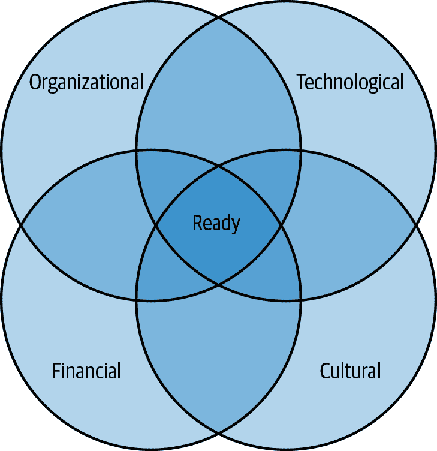
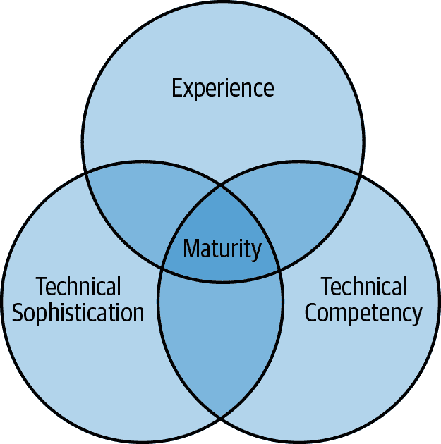
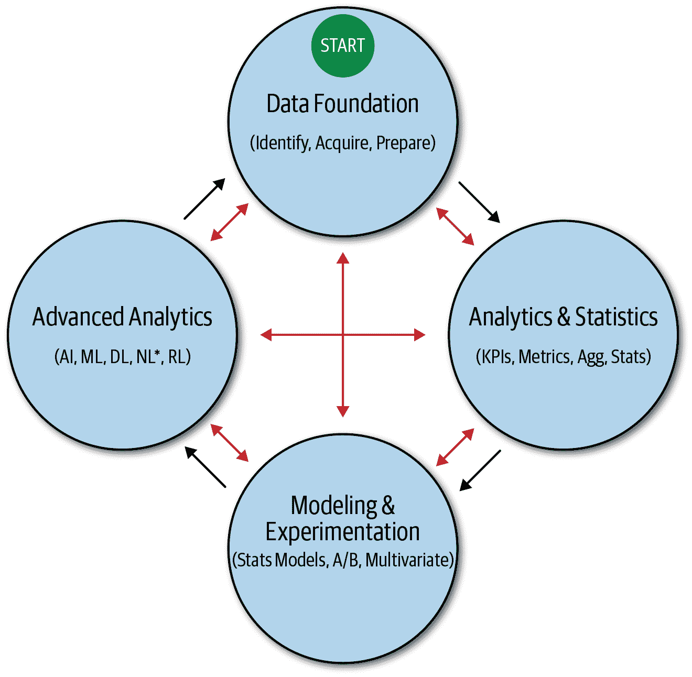
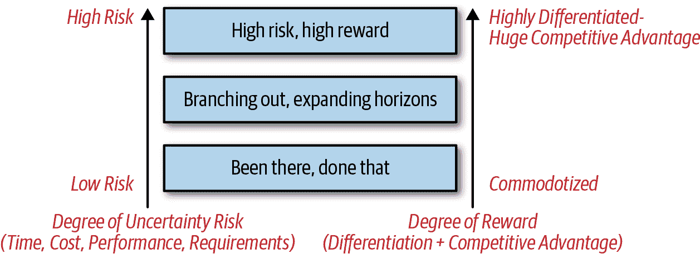

## 第 12 章。AI 就绪性和成熟度

作为制定 AI 战略的一部分，为了成功推进 AI 计划并从中产生真正的价值，公司必须具备一定程度的 AI 就绪性和成熟度。我创建了一个 AI 就绪性模型，将 AI 就绪性分为四个类别，并且我还创建了三个与成熟度相关的模型。

在本章中，我们将详细讨论 AI 就绪性和 AI 成熟度及其各自的模型。回顾一下，AIPB 评估组件定义了三个类别：就绪性、成熟度和关键考虑因素。本章重点关注前两个类别；第 13 章讨论关键考虑因素。

你应在 AIPB 方法论组件的初始评估阶段对全部三个类别进行评估，这应得出一个评估策略。该策略应识别 AI 就绪性和成熟度差距，并制定填补计划，同时解决在推进 AI 计划时应考虑并规划的关键因素。

让我们从 AI 就绪性的概念开始讨论。

## AI 就绪性

图 12-1 显示了我创建的 AI 就绪性模型，其简化版本首次在第 3 章中介绍。

这四个类别——组织、技术、财务和文化——结合起来，是组织就绪性和成功执行 AI 计划能力的主要因素，因此能够把握机会并按预期从计划中受益。AI 就绪性很复杂，正如你将看到的那样，有很多因素需要考虑。

尽管本章所述各方面都“就绪”是理想情况，但公司绝对不应等到实现这一目标后再推进 AI 计划。实际上，许多公司往往无法完成本章 AI 就绪性部分讨论的所有内容，但你能识别并填补的差距越多越好。

让我们逐一讨论每个就绪性类别。

### 组织

我将 AI 就绪性的组织类别分为四个子类别。它们是组织结构和领导力、共同愿景和战略、采用与对齐，以及赞助与支持。

#### 组织结构、领导力和人才

组织结构、领导力和人才是 AI 就绪性的重要组成部分。具体来说，组织应构建为在数据和高级分析方面拥有强大的领导力，最好在最高执行层级。这个人通常拥有首席人工智能官（CAIO）、首席分析官（CAO）、首席数据官（CDO）或类似的头衔。在我看来，这种数据和高级分析领导力至关重要，以至于我认为它是制定和执行任何 AI 愿景和战略的硬性前提；事实上，本章中唯一的硬性前提。然而，我要指出的是，这往往说起来容易做起来难。能够填补此类角色的领导者或管理层人员并不多，而且某些预测表明此类人员在未来将出现日益增长且大规模的短缺。

再次在我看来，AI、机器学习和数据科学在组织上应仅隶属于具有上述所需专业知识的执行领导角色（不需要 C 级头衔）。我个人不推荐将 AI、机器学习和数据科学置于软件工程或其他产品开发学科之下。这些学科的领导者和经理可能不具备必要的专业知识，因此无法做出涉及关键 AI 考虑因素和权衡以及迄今为止讨论的所有其他内容的决策。

# 数据与高级分析领导力

一般而言，大多数非数据科学家并没有相关的背景和经验来理解数据科学和高级分析所需的一切。 正如几乎所有科技公司都有首席技术官（CTO），一家认真利用其数据并采用包括人工智能和机器学习在内的技术手段的公司也应拥有相应的分析领导者。 对于认真致力于变得更以数据驱动或数据为依据的公司而言，这一点的重要性不亚于拥有任何其他 C 级职能领导者，甚至更为重要。

此外，最重要的是，数据与高级分析领导力对于在公司最高层提供正确的人工智能专业知识和战略方向至关重要。 此外，为了制定人工智能愿景和战略，你需要确保每个人对两者都有共同的愿景和理解，期望得到妥善设定和管理（鉴于工作的科学性，这可能非常具有挑战性，如前所述），有效传达项目进展，并确保追求正确的机会。 这包括确定人工智能是否是该工作的正确工具。 当你只需要一个图钉时，人工智能可能就像一把大锤。 具备适当专业知识的分析领导者可以帮助确定人工智能是否能以独特且合理的方式解决特定问题或提供某种用户体验。

如果没有这种组织结构，负担和责任就会落在个人贡献者身上，无论他们是否具备适当的领导或业务技能。 通常，缺乏上述适当组织结构的企业会出现以下情况。 在启动人工智能项目之前，且在从业者尚未先访问和探索可用数据的情况下，首席执行官、首席技术官或任何人会问人工智能或机器学习从业者：“我到底会得到什么？它要花多少钱？需要多长时间？需要哪些确切的数据才能确保风险得到缓解、按时交付并最终成功？”（听起来像上一章的内容吗？）

从业者回应说，他们需要先探索和分析数据，然后尝试多种不同方法以尽可能实现最佳性能。 高管的回应类似：“很好，那么我到底会得到什么？它要花多少钱？需要多长时间？需要哪些确切的数据才能确保风险得到缓解、按时交付并最终成功？” 数据科学家本身已经足够像独角兽了。 让我们不要要求他们还具备他们可能不具备的业务领导和战略技能。 确保你已配备适当的数据与高级分析领导力，并据此组织你的业务。

## 有效的数据与高级分析领导者的特征和职责

这正好引出了有效的数据与高级分析领导者的特征和职责。 大多数数据科学家和机器学习工程师需要指导。 仅仅把数据交给他们并让他们自行发挥，很不可能得到你想要的结果。 最坏的情况下，如果聘请数据科学家却没有精通数据科学和高级分析、能够领导和管理的人，可能从一开始就注定失败。

此人应具备有效沟通、数据科学、高级分析和利益相关者管理方面的强大且可证明的技能。 他们还应具备我们在本书前面讨论过的关键软技能。 人工智能是一个非常动态的领域，每天都在变化并变得更加先进。 拥有能够跟上该领域趋势和最先进技术的人至关重要，并且能够确定如何利用这些信息创建最佳的人工智能愿景和战略，同时保持项目持续成功至关重要。

鉴于人工智能和机器学习的复杂性和科学性，这位领导者必须能够以易于理解的方式，正确地传达和教育具有科学性的复杂主题，并将其置于业务背景以及高管最关心的事项中。 此人必须理解并避免“知识诅咒”，这是一种偏见，会导致人们假设信息较少的人也有同样的背景来理解事物。 目标是不做任何假设，并以孩童般的清晰度呈现复杂信息。

此人还必须擅长提供人工智能项目、项目状态的见解，最重要的是，能够妥善管理期望。 期望管理是一项关键技能，特别是对于与数据科学和高级分析相关的科学项目而言。

除了已涵盖的职责外，此人还应负责数据和分析的损益表（或如果有单独的数据特定组织结构，则仅为分析），执行战略评估（如 AIPB 所定义）并制定相关战略、人才招聘与培养、工具和最佳实践等。 最后，人才也是人工智能准备度的关键组成部分，我们将在第 13 章再次讨论。

## 愿景与战略

创建人工智能愿景和战略是 AIPB 的核心部分，也是本书持续探讨的主题。 我们还讨论了生成共同愿景和理解的概念，以及它在实现成功的人工智能项目方面的重要性。

在这里，我们通过人工智能准备度的视角审视愿景和战略的制定，因为在创建和成功执行方面都需要一定的准备度。 在配备适当的分析领导力的情况下，公司应能够制定以效益为驱动的人工智能愿景和战略。 在高层次上，如前所述，愿景涵盖了特定人工智能项目为人们和业务带来益处的为什么、如何和是什么。 而战略则是将愿景付诸实践的执行计划。

这两者都涉及为关键战略项目创建适当的业务和个人用例。 商业案例是业务层面的*why*，应概述特定项目的愿景、目标和潜在投资回报率。 商业案例还可以包括潜在新商业模式、产品和服务的识别与开发，以及/或获取更大市场份额并拓展新市场。

在建立一个或多个商业案例后，下一步是识别并指定特定人工智能解决方案的个人用例。 这意味着识别将从解决方案（或特定功能）中受益的用户，定义用户为何（利益）和如何（用户流程）与解决方案交互以完成特定任务，以及确定在给定场景中所有潜在用户交互的结果是什么。

在产品管理领域，假设已创建产品愿景，基于技术的解决方案战略体现为优先排序的产品路线图和想法待办清单。 解决方案战略还应考虑任何评估和相应的战略。 对于人工智能解决方案独立存在或将作为另一应用程序的一部分部署的情况（例如，用于自动化流程、增强人类智能或与现有移动或基于网络的应用程序集成），战略将涉及制定产品路线图，初始重点通常是首先构建 MVP 或可比实体（例如，原型、概念验证 \[PoC\] 或试点）以测试最具风险的假设、验证产品市场契合度并验证按预期使用。

对于时间敏感或需要定时协调的需求，以及必须开发、测试并部署到生产环境的 AI 解决方案，你必须牢记数据科学和高级分析任务的科学性、经验性和非确定性，如前所述。这很重要，因为它会影响制定估算和交付时间线的能力。它还导致了一定的预算不确定性，因为无法提前知道实现预期结果所需的确切资源（例如，模型训练和优化的云计算）和时间。这所有的一切都需要共同的愿景和理解，以及关键利益相关者之间的适当期望管理。再次，成熟度的提高，如我们很快将讨论的那样，将有助于降低整体不确定性。

## 采用与对齐

已制定 AI 愿景和战略，从而确立了成功执行关键 AI 计划的目标和计划，下一步是获得全公司范围内的采用和对齐，这意味着它必须成为“共享”的愿景和战略。

新计划，尤其是涉及公司跨部门数据的计划，可能需要高级高管和多个业务部门负责人的认可、参与和资源。例如，业务负责人可能包括首席执行官、市场营销负责人、产品负责人和销售负责人。采用意味着所有相关利益相关者承诺该计划并承担其某个方面及其整体成功的责任。

采用通常源于利益相关者理解愿景、价值（收益）和潜在投资回报率。理解这些事物的利益相关者更有可能对采用计划感兴趣。

采用是不够的，还需要对齐。对齐意味着所有利益相关者不仅共享相同的愿景、理解和战略，而且在执行战略所需的内容、整个过程中应有的预期，以及最终使解决方案及其预期收益成为现实方面也保持一致。这包括在谁负责什么、潜在阶段和里程碑、关键交付成果以及参与时间方面的对齐。

## 赞助与支持

在具备适当的组织结构和领导力，以及拥有全公司采用和对齐的共享愿景和战略的情况下，下一步是建立计划的赞助和支持。

赞助意味着关键利益相关者承诺提供确保计划成功所需的资源（例如，金钱、数据、人员），并在需要时及时提供。支持意味着在帮助定义需求、完成任务（例如，提供数据访问权限）、回答问题、根据需要协作、适当设定期望和传达进展方面提供持续支持。

## 技术

我将 AI 就绪的技术类别分为三个子类别：基础设施和技术、支持与维护，以及数据就绪性和质量（“正确”的数据）。

### 基础设施和技术

AI 就绪的基础设施和技术组件是指拥有适当的技术资源和流程，其中包括云基础设施和服务（例如，AWS 和 GCP）、DevOps 和站点可靠性工程（基础设施即代码；构建、集成和部署工具；可扩展性）、法规和合规监督（例如，欧洲的通用数据保护条例 \[GDPR\]）以及有效的软件开发流程和方法（例如，Agile、Kanban、CI/CD）。该类别还包括设置基础设施组件所需的人员以及能够设计在其上构建的解决方案的人员。请注意，为新的 AI 计划可能需要一些新的基础设施开发。

基础设施还可包括数据仓库和/或数据湖的设置和维护，包括所有数据获取；摄取；集成；提取、转换和加载（ETL）；提取、加载和转换（ELT）；以及与数据管道相关的流程。

在 AI 就绪的背景下，技术是指具备使用任何给定 AI 项目所需技术的核心能力和专业知识。在 AI 应用的背景下，技术类别包括常见的编程语言（例如，Python、R、Java）、软件包和库（例如，Jupyter Notebooks、TensorFlow、scikit-learn、Spark）、版本控制系统（例如，Git）、测试工具（例如，A/B 测试）以及数据库（例如，PostgreSQL、Hadoop、MongoDB）。

该列表并非详尽无遗，而且并不短小，这也是构建软件解决方案困难的原因之一。

### 支持与维护

开发任何 AI 解决方案（以及一般软件解决方案）后，都需要对其进行支持和维护。这些解决方案应定期监控以确保正常运行和健康。

支持软件涉及创建流程以捕获具有适当严重程度的错误报告（例如，严重、高、中、低）、征求和捕获客户反馈和新功能请求，以及处理客户支持请求。当捕获到这些项目中的任何一项时，应建立系统以跟踪进展（如果需要采取行动），并提供可见性，以便向提交支持请求的人员传达进展和状态更新。

此外，通常存在多个层级或级别的支持，表示根据需要解决特定问题而升级的程度。最后，支持可能受服务等级协议（SLA）管辖，因此必须遵守特定的响应和解决时间，否则将面临某些处罚。

维护解决方案意味着处理与支持或增强相关的任何事项，并进行适当的更改或改进并部署到生产环境。此外，编程语言和软件（例如，库、框架）通常会定期更新。因此，代码库也应定期更新，以利用最新的编程语言、软件和框架，这些通常提供诸如错误修复和性能与安全增强等改进。

维护还包括技术债务减少以及改进非功能性需求，如可扩展性、可靠性和可维护性。应始终为软件开发团队分配时间（通常为 20%），以持续进行此类维护。与支持一样，应建立系统和流程以持续有效地执行两者。

### 数据就绪性和质量（“正确”的数据）

数据就绪性和质量在本书前面已进行了详细讨论。拥有“正确”的数据是 AI 就绪技术类别的关键要素。请回顾第 4 章，我使用“数据就绪性和质量”这一短语统指以下内容：

*   充足的数据量
*   充足的数据深度
*   良好平衡的数据
*   高度代表且无偏的数据
*   完整的数据
*   清洁的数据

如果需要复习，请参阅第 4 章。

## 财务

我将 AI 就绪的财务类别分为三个子类别：预算、竞争性投资和优先级排序。

### 预算

人员和技术需要花费金钱和资源。在此背景下，预算是指花费在人员和技术等资源上的资金。

因此，AI 计划也需要花费资金，你需要为这些成本做预算。在 AI 就绪的背景下，这意味着应划拨资金来实现公司的 AI 愿景和战略。一个非常常见的挑战是，某个 AI 计划可能需要来自多个业务负责人的预算，而企业不一定具备轻松应对这种状况的机制。在各业务职能之间获得认同和承诺，共同为同一计划出资，是一项跨职能的工作，可能非常具有挑战性，因此也与 AI 就绪的赞助和支持要素高度相关。部分原因在于各业务线激励机制不同，同时潜在价值和 ROI 可能无法以量化的方式轻易归因于特定的 LoB，这意味着对该 LoB 的 P&L 影响可能并不直接或令人满意，并可能成为进展的障碍。潜在收益和 ROI 应在公司层面进行考量——这适用于任何跨职能的创新和转型形式。

假设市场营销部门正在推动一项新的 AI 计划，因此愿意为其分配预算。可能需要 IT 部门提供一定量的基础设施和人力时间。通常不同业务职能的激励方式不同，因此其优先事项和计划也通常不同。这可能导致协同、优先级和预算方面的挑战。这也是为什么拥有数据和分析领域的强有力领导者至关重要。此人应负责形成我们所讨论的共同愿景和理解，从而帮助各业务职能的人员看到对本部门的价值，更重要的是对整个公司的价值，并最终获得必要的认同和参与（例如资金、时间和资源）。

## Competing investments and prioritization

根据公司规模及其内部部门，通常在每个部门内部都有许多需要优先考虑的潜在计划，除此之外还有需要解决的高优先级公司级计划。所有这些都导致资源竞争；因此，需要就竞争性投资做出财务决策和优先级排序。

没有什么比围绕该计划将产生多少资金的有力论证更能成功地为某个计划筹集资金。在其他方面，提出令人信服的 ROI 估算在可能的情况下非常有力，这包括精心构建一个关于某个计划如何产生所提议 ROI 的有效故事。讲故事往往是这里的关键技能，再次强调，拥有数据和高级分析领导者至关重要。

## Cultural

我将 AI 就绪的文化类别分为四个子类别：scientific innovation and disruption、gut-to-data driven、action ready 和 data democratization。文化就绪很大程度上是关于创造一种文化、心态和既定的流程，使其能够并促进追求与 AI 和机器学习相关的数据驱动计划。

### Scientific innovation and disruption

公司往往没有为创新和颠覆做好准备或提供激励。许多公司主要受短期、按季度计算的收益激励和驱动，例如公司利润和增长。这通常导致渐进式思维和行动，意味着显著的进步和改进可能需要很长时间。

在 AI 就绪方面，创造创新和颠覆的文化对于开发和执行 AI 愿景和战略非常重要。在渐进思维的公司中，创造这种文化可能非常具有挑战性，通常会有许多阻力。创造这种文化始于大局观、长期和高风险与回报的思考。它也始于愿意保持敏捷和实验性的态度。

请记住，你可能拥有从第一天起就优先考虑并拥抱创新和颠覆文化的非常敏捷的竞争对手。固守现状并以小步渐进的方式思考，是落后并失去竞争力的最快方式。

此外，大型企业公司通常有“buy versus build”心态——态度是“Why invest time, money, and resources into customized advanced analytics, for example, when I can just buy a product like a popular CRM right off the shelf, right?” Wrong。

在试图向人们推销数据科学和高级分析的想法时，这一问题一次又一次地出现。我听到类似“但是 XYZ 已经有一个分析仪表盘”之类的话。这可能是真的，但内置分析的第三方工具面向大众，非常通用，并未针对你的业务或需求进行定制。如果你想要浅层的洞察，那这就是适合你的分析解决方案。但如果你想要差异化、非常深入且可操作的洞察，并希望具备预测能力以及让最佳行动自动执行的能力，请另寻他处。事实上，AI 和机器学习代表的机会远远超出了传统分析——甚至是传统分析无法实现的——并且在整个业务中普遍适用。你应该像对待营销和销售一样，将 AI 和机器学习视为一种新的核心业务能力。你越是把公司看作一家数据公司，把数据视为核心优势，你的公司就越会受益。

另一个许多人没有意识到的因素是，通过生成更深入的洞察，你可以更轻松地围绕潜在的新商业模式、服务和产品开发新想法和策略。你还可以找到创新方式来开拓新市场并扩大现有市场。再次强调，这些都是传统分析无法实现的方式。

拥抱科学创新和颠覆的公司最有可能在实现差异化的同时获得竞争优势。AI 在这方面代表着巨大的机遇。创新创造进入壁垒，提供商品化保护，并最终增加你长期成功的机会。截至 2018 年，按市值计算的十大上市公司中有七家是科技公司，它们最近取代了此前曾占据前十名的主要既有企业，包括 ExxonMobil、General Electric、Wells Fargo、和 Wal-Mart.^(1)

### Gut-to-data driven

某些物理定律，如描述重力、运动和电力的定律，往往归结为走阻力最小的路径。人类也不例外，因此决策往往完全由经验和历史先例驱动；例如，过去类似情况下发生了什么、简单的分析和直觉。尽管许多决策使用这种方法取得了成功，但不仅通过将数据纳入决策可以显著提高成功率和结果，而且基于分析的决策还能预测给定决策的潜在影响（例如 ROI）。换句话说，它解锁了更好地理解和提前规划确切结果的能力。

数据驱动和数据赋能的概念在这里高度适用。在某些情况下，决策并非必须或可能完全基于数据（data driven），但我们绝对应该在做出所有重要决策的过程中纳入数据和分析（data informed），只要这些数据和分析可用。结果几乎肯定会更好。

成为数据驱动型组织需要文化和思维方式的转变，同时也需要数据民主化转变。人们如果没有获取“正确”数据的途径，以及正确分析、从中提炼洞察并采取行动的能力，就无法做出数据驱动或数据知情的决策。公司必须为此目的在功能上合适的 talent 上进行大量投资（例如，分析师、数据科学家以及人工智能和机器学习工程师）。这再次是一种文化转变，即认识到对数据和分析的投资价值及其潜在回报并据此优先考虑。

## Action ready

“行动就绪”意味着致力于优先生成可操作的洞察，然后愿意采取必要的行动（例如，做出决策、增强智能、自动化）以实现潜在的价值和效益。这是一种文化因素，不可过分强调。对于任何既定目标，例如增加收入，公司可以创建不同的举措来帮助实现目标，并且通常也有多个可以拉动的杠杆。这包括拥有创建尚未存在的新颖创新杠杆（即产品、功能、服务）的能力。如果没有人愿意拉动这些洞察所建议的任何杠杆，那么生成高度可操作的深度洞察就没有什么意义。

我不会在这里详细讨论可以采取的行动类型，因为该列表会非常庞大，而且在许多情况下非常具体于公司、行业和业务职能。重点是，如果你的公司要变得在文化上准备好追求生成深度可操作洞察，也要变得在文化上准备好采取适当行动。

## Data democratization

如果数据被孤立且无法使用，就不会很有用。许多公司通常会在整个部门周围建立数据孤岛，尤其是每个部门的数据。业务部门负责人往往有“这是我的数据”的心态和方法。让我们明确一点——这是公司的数据，而且当数据与其他数据结合在一起，并且任何可以从中受益的人在不违反数据治理规则、特别是隐私和安全的情况下都可以访问数据时，数据才最有效。

打破数据孤岛并实现数据民主化。这至关重要。我并不是建议你明天就冲出去构建数据仓库或数据湖（我确实见过这也成为高级分析采用的障碍），但要努力确保公司内能够从中受益的每个人都能访问数据。不仅如此，还应考虑在外部（当然要合乎道德，并且不违反上述规定）提供数据访问。

在 *MIT 斯隆管理评论* 文章《“Analytics As a Source of Business Innovation”》中，作者讨论了普利司通如何通过利用共享的第三方数据（例如汽车制造商的数据）来主动销售，通过鼓励并提醒消费者在问题发展之前前来进行轮胎检查、更换新轮胎和其他服务；换句话说，预测性维护。轮胎制造商目前无法知道特定汽车上特定轮胎组行驶了多少英里，因此数据民主化可以改变这一点，而且这个想法适用于许多行业和公司。

像许多事情一样，数据民主化比孤立和受限更好。达到这一点需要文化转变以及前面讨论的从直觉到数据驱动的转变。业务部门负责人和任何试图做出有效且改善公司的决策的员工都应本能地想到访问相关数据以获得洞察并产生成果，并且付诸行动。

现在让我们转换话题，讨论 AIPB 和评估背景下的 AI 成熟度。

# AI Maturity

AI 成熟度与成功制定和执行 AI 愿景和战略高度相关。我创建了多个与成熟度相关的模型，我们将在本节中介绍，其中两个我首次在 第 3 章 中介绍。

我将 AI 成熟度分为 *数据成熟度* 和 *分析成熟度* 两个子类别。这是因为数据特定和分析特定的角色、流程和工具可能不同，对应的成熟度水平也可能不同。

数据成熟度意味着拥有日益先进的数据捕获、收集、处理、集成以及针对分析优化的存储基础（数据管道和基础设施）。分析成熟度是指对现有和新数据应用日益先进的分析，其范围从简单和传统的分析（例如，统计分析、可视化、描述性分析和商业智能）到更复杂的先进分析（例如，人工智能、机器学习、预测分析、规范分析）。为了在本次讨论中保持简单，除非另有说明，我使用术语“AI 成熟度”包括数据成熟度和分析成熟度。

在具体讨论与数据和分析相关的 AI 成熟度之前，让我们先讨论我创建的更通用的技术成熟度模型，如 图 12-2 所示。这提供了用于衡量 AI 成熟度模型 (图 12-3) 中涵盖的每个复杂程度的成熟度程度的衡量标准。

我通常将技术成熟度定义为个人成熟度特征水平（即成熟度衡量标准）的混合。具体而言，我将技术成熟度定义为在特定时间点围绕给定技术领域或技术（在本例中为 AI）的经验水平、技术精 sophistication 和技术能力的集体衡量（混合）；图 12-2 显示了这一点。

经验代表相关团队在所涉及的技术领域或技术方面的集体经验量。技术精 sophistication 是团队利用与给定技术领域或技术相关的先进和最先进的工具和技术（例如，深度学习、强化学习、自然语言理解）的能力的衡量。技术精 sophistication 通常与团队及其个人成员的经验直接相关（例如，也许只有一名团队成员知道如何使用强化学习技术）。最后，技术能力是对成功执行和交付相关举措和项目的能力的衡量。

构成技术成熟度集体衡量（混合）的每个成熟度特征的比例可能有些主观，并且会随着技术的进步而不断变化。以下是我创建的一个公式，用以表明根据该模型技术成熟度的提高会导致确定性和信心（还记得科学创新和 TCPR 模型吗？）的提高，最终带来更好的结果和成功。

* ↑ 成熟度 = ↑ 确定性和信心 = 更好的结果和成功！

在前一个模型中强调的技术成熟度混合的背景下，成熟度可以通过特定领域（本例中为 AI）的预定义数量的复杂程度水平进行逐步衡量。图 12-3 显示了我创建的一个模型，用以说明 AI 成熟度的这一点。

该模型将起点显示为构建数据基础，以推动分析成熟度逐步提升的水平，如绿色箭头所示。构建数据基础意味着识别、获取和准备“正确”的数据，这在本书前面已有讨论。获取数据包括捕获和整合数据，可能来自许多不同的来源和系统。

在数据基础部分或完全构建之后，我们可以将 AI 成熟度衡量为从传统分析和统计，到更复杂的建模和实验，再到高级分析的进展，后者包括最先进的 AI 和机器学习技术。

类似于马斯洛改变了他对自己的层级需要严格有序进展的看法，我认为根据该模型在进入下一级之前，尤其是在开始使用 AI 和机器学习之前，并不强制要求在每个成熟度层级都获得完全的胜任能力。此外，红色箭头表明每个复杂程度层级的输出可以以某种方式影响或驱动一个或多个其他层级。例如，所有三个分析特定层级都可以创建可集成到您数据基础中的数据输出。同样，AI 和机器学习应用产生的成果应使用传统分析和统计来理解，特别是在解决方案对关键成功指标和 KPI 的影响方面。

图 12-4 显示了我创建的最终成熟度模型，即创新不确定性风险与回报模型，该模型与 AI 成熟度高度相关。

该模型显示了基于技术的成熟度（再次，这里是 AI）的关系，作为创新不确定性风险与回报的函数，其中不确定性围绕时间、成本、性能和需求（再次是 TCPR 模型！），而回报是差异化和竞争优势。

时间和成本不确定性应该显而易见，如前所述。性能不确定性指的是 AI 和机器学习应用中的基于错误的性能（例如，准确性，尽管请注意并非所有应用都是基于错误的），例如解决方案可能是一个预测模型。相比之下，更确定性应用（如移动应用）的性能将基于 KPI 或 UX；例如，转化率、客户保留或满意度。最后，需求不确定性围绕着实现目标性能所需的数据、功能和技术。

请注意，我已有意从模型中省略了特定的数据和分析主题领域（例如，ETL、A/B 测试、AI）或任何特定技术。我这样做是因为今天在数据和分析技术方面出现或最先进的东西明天可能会商品化、自动化或过时。此外，成熟度是一个不断变化的目标，并且是技术领域特定的；也就是说，您在商业智能方面的成熟度可能与深度学习等 AI 技术相比有所不同。

在分析成熟度层级的背景下，“been there, done that”代表低不确定性风险，因此对于特定项目估算时间、成本、性能和需求非常容易。这源于拥有必要的经验、复杂性和胜任能力，能够有效消除任何不确定性和由此产生的风险。这也意味着所使用的技术和由此产生的成果可能已被商品化，无法帮助产生显著的差异化和竞争优势（如果有的话，回报极小）。

BI 是一个很好的例子，尽管正如经常出现的情况那样，并不那么简单。某些行业通常在数据和分析文化转变方面进展非常缓慢，这些转变在 AI 就绪的背景下前面已有所涉及。在这些情况下，显著的 BI 胜任能力相对于竞争对手可以创造可观的竞争优势。

“Branching out, expanding horizons”是在现有数据和分析经验、复杂性和胜任能力的基础上进行建设，以提高一个或两个方面的成熟度水平的过程。这通常意味着不确定性风险增加，因为存在新的探索、实验和不可预测结果的领域；换句话说，科学创新。这也意味着产生更大差异化和竞争优势的潜力更大。

最后的类别，“high risk, high reward”，正如其名。它代表着冒险和赌博，冒险进入未知领域，推动边界，以及任何其他关于追求真正的科学创新以获得潜在巨大回报的类似思维方式。这意味着以新兴和最先进的技术进行开拓和引领，而不是跟随。

这也意味着承担大量不确定性风险，但有获得巨大回报的 upside。风险投资家运作的方式就是一个很好的例子。大多数战略投资预计会失败，但成功的通常会以巨大方式成功。然而，对于成功的风险投资公司来说，成功足以在财务上覆盖更多的失败。制药公司的研发项目也是同样的方式运作。

对该模型的一个最后说明。乍一看，该模型似乎表明低不确定性风险总是意味着数据和分析技术和胜任能力的商品化，反之亦然，高不确定性风险。实际上，这并不那么简单，取决于许多因素。例如，一些科技巨头（例如，Google、Amazon）在某些 AI 和机器学习技术方面拥有大量经验、复杂性和胜任能力，因此对他们来说不确定性风险很低，然而这些技术在普通市场中远未被商品化。因此，该模型是相对的，更适用于 AI 领先的科技巨头之外的绝大多数公司。

## 摘要

我们将 AI 就绪分为四个类别——组织、技术、财务和文化——如 AI 就绪模型所示。尽管公司不太可能在所有类别中都完全“就绪”，如所述，您仍应继续推进 AI 计划。我们还从不同概念和多个模型方面定义了 AI 成熟度，特别是技术成熟度混合模型、AI 成熟度模型和创新不确定性风险与回报模型。

过度关注在推进之前对数据和分析成熟度的强制性和渐进性步骤，类似于建立进入壁垒，其中一些壁垒需要很长时间才能打破（例如，构建数据仓库）。现在就开始，并基于需求和期望成果做出决策，而不是基于您的数据和分析成熟度。

关键在于将您的 AI 就绪和 AI 成熟度评估作为 AIPB 方法论组件评估阶段的子阶段，并在过程中识别差距并制定填补计划。这成为您评估策略的一部分。为了帮助完成您的 AIPB 评估并创建评估策略，这是您整体 AI 战略的重要组成部分，我们接下来讨论 AI 关键考虑因素。

^(1) [*https://en.wikipedia.org/wiki/List\_of\_public\_corporations\_by\_market\_capitalization*](https://en.wikipedia.org/wiki/List_of_public_corporations_by_market_capitalization)
