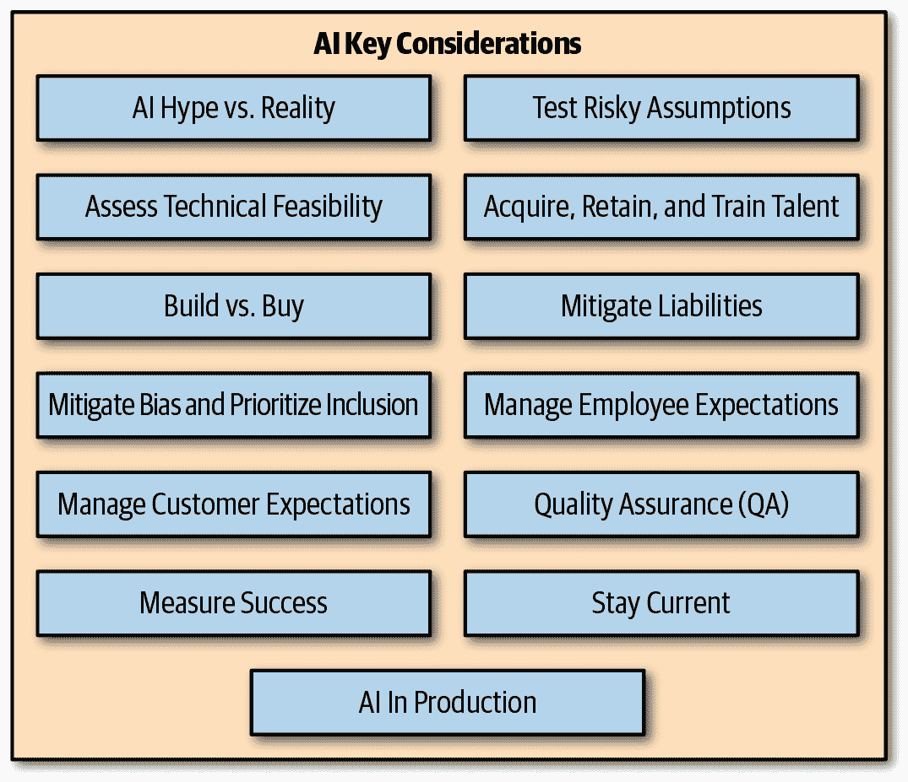

## 第 13 章. AI 关键考虑因素

本章涵盖 AIPB 评估组件的第三个也是最后一个类别：开发 AI 策略时需要考虑并规划的众多关键因素。准备度、成熟度以及关键考虑评估应在评估方法论阶段完成，以创建您的评估策略。图 13-1 显示了本章中我们涵盖的具体关键考虑因素。

其他关键考虑因素，未在 图 13-1 中注明，是伦理和人类价值观。您绝不能忽视这两点。基于 AI 的解决方案应以伦理方式设计和构建，以造福人类。以此作为我们基础的关键考虑因素，让我们讨论其他关键 AI 考虑因素。

## AI Hype versus Reality

许多人认为 AI 已经非常接近 AGI，甚至已经实现了 AGI。这在一定程度上是由于我们在科幻电视节目、电影和漫画书中看到的一些内容。*终结者* 电影系列是一个经典例子，其他很好的例子包括 *机械姬*、*西部世界*，以及来自 *星球大战* 的 C-3PO。

这些错误的印象在很大程度上也源于产品营销、过度承诺，以及许多人和公司倾向于把几乎任何东西都称为 AI——我统称为 *AI 夸大*。在软件产品中，尤其是在 SaaS 中，你经常会看到这种情况。仪表板中只有几个指标并不能算作 AI 驱动，然而许多公司仍然说他们“拥有”或“使用”AI，而其分析技术并没有比这更复杂。“真正的”AI 是机器表现出的智能。如果一台机器不学习、不产生一定程度的理解，然后利用所学知识做某事，那它就不是 AI。

AI 的现实是，正如本书前面所讨论的，目前它只是一招鲜，主要用于解决高度专业化的问题，而且截至本文撰写时，AGI 仍遥不可及。AGI 在我们有生之年可能永远不会成为现实。

作为一个领域，AI 也仍处于起步阶段，现实世界中的用例和应用每天都在增长。AI 正以快速的速度发展，并且正在进行大量重要的研究。围绕 AI 的主要问题之一是，像深度学习这样的当前技术是否最终可以适应多任务处理并实现 AGI，还是我们需要找到并开发一种尚不存在的完全不同的方法。

AGI 还与 AI 用于人类自动化与 AI 用于增强智能的问题有关，目前大多数高管和公司更感兴趣的是增强智能而非自动化。此外，还有一个非常有趣的东西叫做 [*自动化悖论*](http://bit.ly/2xcktsk)。悖论指出，自动化系统越高效，人类操作员的贡献就越关键。

例如，如果自动化系统出现错误（机器永远不完美；存在错误），错误可能会倍增或失控，直到修复或系统关闭。人类需要处理这种情况。想想你看过的所有电影或电视节目，其中自动化流程（例如在宇宙飞船上、在飞机上、在核电站中）出现故障，人类被部署来寻找变通方法并英勇地解决问题。

最后，鉴于所有 AI 夸大和 AI 工具的普及，有些人似乎认为启动 AI 项目应该相对容易，并且可以迅速获得巨大收益。现实是，规划和构建 AI 解决方案很困难，并且存在严重的人才短缺。总的来说，数据科学家和机器学习工程师严重短缺，特别是那些具有 AI 特定专业知识和技能的人。

即使拥有合适的人才，AI 计划的成功执行仍然可能非常困难。话虽如此，通过高度定制且难以构建的 AI 解决方案取得成功很可能会产生显著的差异化和竞争优势。这在 第 12 章 中介绍的创新不确定性风险与回报模型中得到了强调。

此外，构建许多类型的 AI 应用，或访问、移动和准备数据，并没有太多简单自动化的方式。话虽如此，幸运的是，有新的自动化工具、技术如迁移学习，以及共享模型，可以开箱即用提供足够的准确性，或仅需少量修改。

此外，AI 带来的巨大收益可能需要大量时间、精力和成本。其中一些成本可能因不成功的项目而沉没。此外，虽然有很多人致力于简化 AI 以供通用使用，但 AI 研究和技术仍然相当复杂。快速浏览一下康奈尔大学 Arxiv（发音为“archive”）数字图书馆上发布的最新 AI 研究论文即可自行了解。

一个值得提及的概念是 *AI 寒冬*，它指的是 AI 的财务和实际兴趣降低，有时甚至显著降低的时期。自 1970 年代初以来，由于许多因素（我们在此不讨论），已经出现了多轮 AI 寒冬。AI 寒冬概念与技术和产品受制于与其成熟度、采用率和应用相关的炒作周期的事实有关。

这一规律肯定适用于 AI，也是我们截至本文撰写时看到如此多 AI 夸大的原因。最终，AI 有巨大的潜力为人们和公司创造真正的价值，但我们离充分实现所有潜在能力、应用、利益和影响还相去甚远。关于可能由炒作导致期望未满足而引发的另一个 AI 寒冬，著名 AI 专家 [Andrew Ng 认为不会有任何显著的](http://bit.ly/2L7Tkz3)。这仅仅是因为 AI 已经取得了长足的进步，现在正以创新、令人兴奋且不断扩展的方式在现实世界中证明其价值。

## Testing Risky Assumptions

人们在很多事情上经常做出冒险的假设。在构建公司、产品和服务时，假设通常代表潜在风险，其程度取决于其错误程度，包括潜在成本（例如时间和金钱）以及产品市场契合度和采用率不足等。与技术和创新相关的常见假设和风险类型围绕价值、可使用性、可行性和商业可行性。相关问题包括：对于 \[insert any technology-based product or service here\]，是否有人会发现足够的价值来购买或使用它，用户是否能在没有帮助的情况下知道如何使用和理解它，在我们可用的资源和时间内是否可以构建它，该产品是否能实现产品市场契合并盈利，以及我们能否执行成功的上市策略？

Segway 是很好的例子。Dean Kamen 和许多其他人假设该产品将颠覆并改变大量人的交通方式，因此迅速制造了大量单位。Segway 发布时的公众炒作似乎也支持了这一假设。虽然 Segway 车辆仍用于高度专业化的应用，但它们显然没有 Kamen 及其公司希望的那样产生预期的大规模影响和销量。

到确定 Segway 假设错误时，已经花费了大量时间和金钱以及其他资源。据一些估计，[研发成本约为 1 亿美元](http://bit.ly/2X01uvM)。

针对 AI 的具体例子，[2017 年初，一名六岁女孩意外订购了一栋 170 美元的娃娃屋和四磅饼干](https://fxn.ws/2Zzej1M)仅通过与 Alexa 讨论娃娃屋和饼干就发生了。在这种情况下，一个潜在的风险假设是消费者会意识到并为这些设备设置安全设置（例如添加密码或关闭语音激活订购），以防止儿童误下订单。

MVP 概念源于精益制造和软件开发，它提供了一种机制来帮助降低风险并最大限度地减少不必要的时间和成本支出。其核心思想是，应尽快构建最少量的 UX 和软件功能并交付到用户手中，以便正确测试最具风险的假设并验证产品市场契合度和用户愉悦度。随后，来自 MVP 试点的反馈和指标被用来推动迭代改进，直到产品或功能得到“去风险化”。在开发 AI 解决方案时，您应使用此框架或类似的 Agile 和 Lean 方法论。

# 评估技术可行性

本书前面已对个人和商业利益相关者的不同目标进行了深入讨论。讨论保持在适当的高层次上，尽管实际上，推动现实世界 AI 解决方案的高层目标必须分解为更细粒度的目标或举措，这些目标或举措更适合指导所使用的技术方法。

例如，机器学习模型本身并不会增加利润或降低成本作为输出。机器学习模型会根据所选技术以及所利用的数据做出预测、确定分类、分配概率并产生其他输出，而这些数据必须适合且足够用于每种可能的输出类型（即“正确”的数据，我们在本书前面已介绍过）。此外，每种输出类型都可用于实现同一目标，只是角度不同——通常完成工作的方法不止一种。确定使用哪种方法和输出类型才能最好地实现更细粒度的目标（例如个性化播客推荐），进而帮助实现顶层业务目标（客户留存），以及拥有“正确”的数据，这正是技术可行性所关心的全部内容。

假设我们的顶层业务目标是客户留存。进一步假设，我们的跨职能团队——包括业务人员、领域专家和 AI 从业者——决定，与正在考虑的选项相比，基于 AI 的播客应用信息流个性化可能具有最高的潜在投资回报率和留存提升。在这种情况下，每个用户信息流中显示的播客可以基于预测模型按显示和排序，该模型计算特定用户会喜欢它的可能性（概率），也可以基于分类器无特定顺序列出，分类器将每个播客分类为相关或不相关（仅显示被分类为相关的播客），或通过其他方法。

要点是，必须使用由适当组建的跨职能团队进行的 技术可行性评估 来确定哪种方法效果最佳，以及数据是否能够完成给定选择的任务。将技术可行性评估视为机会识别的下一步、更细粒度的步骤。这可能需要准备数据并测试许多可能的选项（记住这就是科学创新！）。

# 获取、保留和培养人才

一个极其重要的考虑因素是获取和保留人才。AI、机器学习和数据科学都很困难。人们和组织正在做大量工作来尝试简化并自动化这些领域的某些方面，但它们仍然具有挑战性，需要非常专业的专业知识和经验。

理想的数据科学家是精通编程的专家，同时也是统计学家和数学家，有效的沟通者，以及具备 MBA 级别商业素养的人。要在一人身上找到这种独特的组合非常困难（姑且称之为独角兽）。现实是，人们在某些方面擅长，在其他方面则较弱。此外，尽管大多数大学都提供计算机科学学位，但教育尚未跟上对数据科学和高级分析人才的需求，因此高质量的学位项目并不多。

最终结果是高度胜任且经验丰富的人才严重短缺。这包括领导者、管理人员和从业人员。LinkedIn 于 2018 年 8 月报告称，全国约有 152,000 名具备数据科学技能的人才短缺，并且数据科学人才短缺的增长速度（加速）快于软件开发人才短缺。^(1) 在执行 AI 战略时缺乏必要的内部专业知识、技能和领导力，可能导致举措失败、沉没成本和时间浪费。

作为花费大量时间招聘数据科学家和机器学习工程师的人，我可以诚实地说，这并不容易。我见过的绝大多数申请者要么刚毕业，要么正在职业转型。这种类型的申请者通常很适合拥有培养和培训非常初级人才所需基础设施的大型组织。对于中小型数据科学团队和初创公司而言，这可能更困难。小型公司还需要与大型成熟科技公司激烈竞争 AI 人才。

对于许多中小型公司而言，好消息是许多数据科学家非常有兴趣与一家具有良好价值主张和文化的潜力公司合作。此外，人们通常受直接影响公司成功的需要驱动，因此会被小型公司和数据科学团队所吸引。符合此描述的公司应相应调整其信息传递，以便更好地吸引和留住顶尖人才。

另一个考虑因素是数据科学和高级分析人才成本高昂，公司可能需要根据自身需求和当时的市场状况花费大量资金。确保拥有最佳人才从而获得成功的最大机会和投入资金的最佳回报非常重要。因此公司应相应准备和预算。AI 人才并不便宜。*纽约时报* 等媒体已发表多篇关于 AI 人才相对高成本的知名文章。^(2)

鉴于上述所述的人才短缺、竞争以及相对高昂的成本，公司必须制定强大的招聘、雇佣和/或人员补充策略。在寻找和招聘人才方面，有多种选择需要考虑。其中许多包括典型的商业考量，例如聘请合同工与全职员工、使用专业公司进行人员补充，以及在岸招聘与离岸招聘。

值得注意的是，对于在组织和国家之外招聘的人才，存在将知识产权和数据暴露并在组织外共享的非同小可的风险，尤其是在法律不同的国家，您无法很好地监控一切。鉴于当今对数据隐私和安全的日益关注，包括需要遵守欧洲 GDPR 等法规的规定，这一点变得尤为重要。

# 人才获取与内部培训

部分法规和标准对谁可以访问敏感数据、如何以及在何处访问有非常具体的规定。与离岸公司合作时，监控和控制这些问题会呈指数级变得更具挑战性，因此必须格外谨慎以确保信任、合规和问责。不论你如何寻找和招聘人才，都应妥善审查候选人及潜在合作伙伴公司，并评估和降低任何潜在风险。强大的领导力和数据与高级分析方面的专业知识在此至关重要。

另一个值得考虑的选项是 *收购人才*；即主要为了获取其数据科学和高级分析人才而收购一家公司。收购人才可能需要大量资金并带来独特的一系列挑战，但可能是迅速获取人才的可行选择，并且已被许多公司采用。

最后一个潜在选项是内部培养人才，这对于克服人才短缺挑战而言可能是一个极佳选择。从许多方面来看，这一选项是理想的，但可能需要在前期投入大量培训基础设施的搭建和开发、人才、成本和时间，特别是开发有效且结构化的课程时。

创建内部高级分析培训项目可使公司针对所需的具体技能进行培训，无论是专业知识还是工具。它应包括编程、数学、统计学、数据科学原理、机器学习算法等培训。

作为曾教授并培训过数千人、并从零开始开发课程的人，我可以说这说起来容易做起来难，但确实可行。选择这条路也需要做出某些决定。进入培训项目需要何种教育、经验、技能和背景？这些如何评估？最终，你试图评估的更多是潜力而非实际技能和专业知识，因为填补这些差距的是你的公司。

其他需要确定的事项包括如何在培训过程中评估进度和所学知识，这包括评估动手项目、最佳培训时长，以及学员是否应参与实际业务项目。你还必须确定员工在培训后的职业路径以及是否会有持续培训。

开发这样有效且成功的培训项目将是令人惊叹且极具力量的。随着人工智能在工作场所变得愈发主流，人们可能需要被重新分配到需要专门培训的新岗位，因此这也变得日益必要。

一种替代方案，或课程增强的选项，是利用现有的众多在线培训工具和课程（例如，慕课）。

最后一点需要注意。除了招聘和/或人员补充外，还应高度重视员工入职、培训、参与度、指导、发展和留存。鉴于人才相对短缺和竞争激烈，应努力提供最好的工作环境（例如，安全、多元、包容）、文化和机会，以便长期留住最优秀的人才。

# 自建还是购买

在产品、服务和运营中使用技术时，公司通常需要确定是自建还是购买。这是一个非常合理的问题。

要得出“正确”的答案并做出相应决策，可以使用常见的商业和财务分析技术，如成本效益分析（CBA）、总拥有成本（TCO）、投资回报率（ROI）和机会成本估算。这些技术可能需要财务估算和预测，而这些估算可能不精确且难以获得。我认为在大多数情况下，你可以用更简单的方式回答自建还是购买的问题。

首先，是否有购买选项可用？如果没有，答案很简单：你必须自建。其次，你是否希望将特定技术作为业务的核心部分进行开发，或利用技术进行创新、差异化并产生竞争优势？如果是，你必须自建全部或部分解决方案。然而，确定是否有现成可用且无需重复造轮子的东西绝对值得。在构建技术解决方案时，使用开源软件和其他工具如 API 通常是最好的选择，尤其是在可用且成本合理时，更是在免费时。

如果创新不是你的目标，而你主要只想应用技术来帮助改善业务 KPI，或促进业务运营和流程，那么可能有现成的解决方案更适合购买。在这种情况下，你需要非常认真地权衡购买的好处与潜在的缺点，如供应商锁定、成本高昂、数据所有权、数据可移植性和供应商稳定性。我几乎不会推荐任何你不拥有数据或无法随意移动数据的技术解决方案。

总体而言，我发现购买通常会导致产品质量较差，成本远高于自建，且无法定制以满足你的特定业务或需求。这也意味着你购买的是商品化产品，你的所有竞争对手也都能获得，这意味着你除了配置更好或更擅长使用外，几乎没有任何优势。

我总是惊讶于有多少公司高管会说他们必须增加销售额和利润、削减成本，并真正与竞争对手区分开来，却同时想要购买现成解决方案并避免追求创新。每天越来越多，你无法两者兼得。他们还会意识到自己对某个特定产品或供应商的某些方面感到不满，因而迁移到另一个。我见过这种情况反复发生。在许多情况下，这些高管迁移到的产品或供应商带来了与之前相同的问题，因此循环重复。这往往很快变得相当昂贵，并且还会产生大量非财务成本。尘埃落定后，他们本应自建更好。

最终，这取决于你是否想要引领、差异化并真正加强你的独特价值主张，还是仅仅跟随并做大家都在做的事情。这与熟悉的人所说的 *红海* 和 *蓝海战略* 的理念类似。红海的特点是竞争激烈、密集和商品化。而蓝海则代表着新颖且未受争议的市场，免于竞争，且需求是被创造出来而不是被争夺的。

从这个角度来看，这与其说是自建还是购买的问题，不如说是引领还是跟随的问题。领导者几乎总是自建，而追随者则购买。同样，领导者通过创新和差异化成功找到新的利润和增长机会，而追随者则为维持现状而苦苦挣扎。我认为在当今技术时代，已经非常清楚的是，创新者和领导者不断颠覆和取代那些行动迟缓、未能创新和拥抱新兴技术的既有企业。

最后一点说明。我们已经详细讨论了科学创新，以及人工智能和机器学习的科学、经验性和非确定性本质。如果这些对你的公司而言是不可逾越的挑战，那么推进人工智能计划将非常困难。在这种情况下，使用数据仍然至关重要，应更多地集中在商品化的商业智能和描述性分析上，直到你能够创新并选择自建而非购买。

# 降低责任风险

# 数据与分析中的潜在责任和风险

数据和分析涉及许多潜在的责任和风险，包括与法规和合规、数据安全和隐私、消费者信任、算法不透明、缺乏可解释性或可说明性等相关的问题。

## 法规与合规

从法规和合规开始，大多数新举措主要集中在提高数据安全和隐私方面。发布隐私政策是标准做法，但很少有人阅读这些政策，而且由于法律术语的存在，他们也无法理解所有细节。

欧盟的 [GDPR](https://eugdpr.org/) 是数据隐私法规的一项重大变化，于 2018 年 5 月 25 日生效。GDPR 目前仅适用于欧盟，但许多美国科技公司在全球运营，因此需要在欧盟遵守相关规定。根据官方 GDPR 网站，更严格的数据保护规则意味着人们对个人数据有更多控制权，企业也能受益于公平竞争环境。

目前尚不清楚 GDPR 是否会被美国采纳，或者美国是否会有其自身可比的数据隐私法规。2018 年，加州通过了 [加州消费者隐私法案（AB 375）](http://bit.ly/2FtAKhb)。这无疑是美国在总体上采纳更严格的消费者隐私法规迈出的一步。

## 消费者信任与透明度

此外，信任对大多数消费者来说非常重要。就数据而言，消费者信任意味着消费者不希望自己的数据被以他们不知道或不认可的方式使用。示例包括以仅使企业受益而非消费者受益的方式使用人们的数据，以及在数据转移后不进行监督也不考虑其使用情况就将数据出售给第三方。

当人们觉得自己的数据未得到妥善保护或使用时，可能会出现客户咨询和投诉。缺乏消费者信任可能是一种责任形式。在尊重消费者隐私、安全和信任的同时，以合乎道德的方式使用数据至关重要。再次强调，目标始终应该是造福人们和企业，而不仅仅是企业。

我们可以通过透明度和披露来建立信任。客户的潜在透明度领域包括对企业整体的透明度——某些商业决策是如何以及为何做出——以及对使用消费者数据的技术、算法和第三方合作伙伴的透明度。这在保险、金融服务和医疗保健等高度监管行业尤其重要。

## 可说明性、算法透明度和可解释性

除了迄今为止讨论的考虑因素外，在某些情况下，可说明性、算法透明度和可解释性可能至关重要。这些并不是同一回事，了解它们之间的差异很重要。

### 可说明性

可说明性是指以几乎任何人都能理解的简单术语描述非常复杂概念的能力，例如人工智能中非常常见的概念。这意味着放弃复杂的统计、数学和计算机科学术语，换取易于理解的描述和类比。

### 算法透明度

算法透明度意味着所使用的任何算法，连同其意图、底层结构和输出（例如决策、预测）应根据需要向任何利益相关者（例如企业、用户、监管机构）公开。这有助于建立信任并提供问责。

### 可解释性

可解释性是指人们能够准确解释某些算法和机器学习模型如何进行预测、分类和决策的能力。一些算法和模型非常难以解释，甚至无法解释，通常被称为“黑盒”。这可能会导致问题；例如，有人根据算法执行所做出的决定或采取的行动决定起诉一家公司。

## 黑盒算法与法律风险

例如，在法庭上，如果决定是使用高度可解释的基于决策树的算法做出的，那么解释某人为何被算法拒绝获得财务贷款就很容易。另一方面，如果贷款决定是使用神经网络或深度学习方法做出的（在 附录 A 中有更详细的介绍），则一切皆有可能。你可能无法证明并说服法官为什么做出该决定——这种情况对你不利。正因如此，在高度监管的行业中，即使可能存在模型性能损失，高度可解释和可说明的算法也常被优先于其黑盒对应物。

黑盒算法的额外潜在问题是缺乏可验证性和诊断难度，正如 Erik Brynjolfsson 和 Andrew Mcafee 在其 [*哈佛商业评论* 文章](http://bit.ly/2Xv1SGW) 中所述。缺乏可验证性 simply 意味着几乎不可能确保给定的神经网络在所有情况下都能正常工作，包括超出其训练方式的情况。根据应用的不同，这可能带来严重问题（例如在核电站）。

诊断难度是指诊断错误可能出现的问题，其中一些可能源于导致模型漂移的类似因素，随后能够修复它们。这在很大程度上是由于神经网络算法的复杂性和缺乏可解释性，如前所述。

尽管黑盒算法存在上述潜在缺点，神经网络和深度学习技术仍具有许多显著优势，可能超过其缺点。这些优势包括可能具有更好的性能，能够产生其他技术无法实现的结果，以及能够做大多数其他机器学习算法无法做到的事情（例如自动特征提取）。这意味着算法消除了人工机器学习工程师手动选择特征或为模型训练创建新特征的需求。这可能是一个巨大的好处，尽管可能不清楚给定的神经网络自动生成和利用了哪些特征，因此增加了神经网络作为黑盒的程度。无论如何，潜在缺乏可解释性与所讨论的优势之间的权衡提出了必须考虑的关键因素。

## 错误与责任

最后，总体上的错误会带来潜在责任，你必须考虑，在某些情况下，某些错误可能具有生死攸关的后果。让我们更详细地讨论错误类型和潜在后果。如本书前面所述，大多数人工智能和机器学习模型都是基于错误的，这意味着模型使用训练数据集进行训练，直到模型在测试数据集上测试时，所选性能指标（以及相应的错误）在可接受范围内。

根据应用的不同，可接受范围可能意味着 85% 的时间正确预测某事，或者可能意味着在假阳性（type 1 error）率和假阴性率（type 2 error）之间做出选择。让我们看两个例子来解释这些错误类型之间的差异及其潜在影响。第一个例子涉及电子邮件垃圾邮件检测；第二个例子涉及通过医学检查诊断癌症。在垃圾邮件检测案例中，如果电子邮件是垃圾邮件，则被视为阳性；在癌症案例中，当实际诊断出癌症时，测试结果被视为阳性。假阳性（type 1）错误发生在预测模型错误地预测阳性结果时（在我们的例子中为垃圾邮件或癌症），而假阴性（type 2）错误发生在预测模型错误地预测阴性结果时（在我们的例子中为非垃圾邮件或非癌症）。

在电子邮件垃圾邮件检测中，更重要的是确保重要邮件进入收件箱，即使这意味着也会放进一些垃圾邮件。这意味着构建和优化模型的人员会将其调整为更倾向于产生假阴性（type 2）错误而非假阳性（type 2）错误，因此一些邮件可能会被错误地分类为非垃圾邮件并发送到收件箱，而本应发送到垃圾邮件文件夹。

在癌症检测和诊断中，然而，这种权衡和决策的重要性显著提高，并可能带来生死攸关的后果。在这种情况下，错误地诊断某人患有癌症（假阳性—type 1 错误）最终发现是误诊，要比告诉一个人他没有癌症而实际上他患有癌症（假阴性—type 2 错误）好得多。虽然前一种情况可能给患者带来不必要的压力、额外费用和医学检查，但后一种情况可能导致患者离开医生的办公室，在疾病未被发现和未得到治疗的情况下继续生活，直到为时已晚。

在其他应用中，另一种类型的错误权衡被称为精确率与召回率，同样，必须做出决定，优先考虑哪一个更重要。Google 的 Jess Holbrook 建议做出判断，是否“重要的是包含所有正确答案，即使这意味着放进更多错误答案（优化召回率），还是在排除部分正确答案的代价下最小化错误答案的数量（优化精确率）。”^(3)

与机器学习相关的性能指标和错误类型有很多，如果没有正确调整，有时可能带来重大后果。至关重要的是，高管和管理者要了解不同类型的潜在错误及其影响，因为大多数从业者（例如，数据科学家）通常没有能力正确评估、管理或就所涉及的潜在风险做出关键决策。

# 缓解偏见并优先考虑包容性

另一个关键考虑因素——而且正被越来越多地讨论——是人工智能应用可能学习并表现出的潜在偏见。这通常被称为 *algorithmic bias*，可能包括基于种族、民族、性别和人口统计学的偏见和潜在歧视。显然，你需要避免这种情况。

算法偏见在很大程度上是一个数据问题。数据可能由于数据来源的因素和条件而存在偏见（例如，社会经济和低收入社区），因此其本身并不是人工智能问题，而是一个在数据中体现并因此注入到人工智能解决方案（从训练开始）中的现实世界系统性问题。数据可能以一种对某些人群子集反映极差且不准确的方式存在偏见，因此可能无法建模现实。当在没有仔细考虑偏见的情况下使用这些数据时，可能会导致训练出的模型做出非常糟糕且不公平的决策。这些决策会进一步偏向现实和后续数据，从而形成负反馈循环。

包容性，或缺乏包容性，也与算法偏见相关。非常重要的是从项目开始就优先考虑包容性。这意味着要确保尽可能收集和使用广泛多样且包容的数据集。最终目标是确保给定的 AI 解决方案为所有人提供益处，而不仅仅是一两个特定群体。

另一个考虑因素被称为 *confirmation bias*。确认偏见是指人们如果足够努力寻找，就会看到自己想看到的东西。确认偏见的一个例子是当你有兴趣购买一辆新车并考虑特定品牌和型号时。通常，在这种情况下，人们会开始注意到道路上这种确切品牌和型号的车辆比以前多得多，这有助于证实他们做出了正确的决定。尽管事实上该特定品牌和型号的车辆数量并未改变，而且许多其他汽车型号在道路上的代表性可能同样多，甚至更多。

在数据方面，我多次看到过确认偏见。这种偏见可以以不同的方式出现。一种情况是，人们只是认为数据支持他们持有的某个想法或假设，尽管这种支持并不具体且很大程度上取决于解释。另一种可能是数据以某种方式被操纵，只包含支持性数据而丢弃其余部分。

无论确认偏见如何发生，让数据告诉你它想说什么都是至关重要的，前提是你或你的数据科学同事具备从数据中提取关键信息和见解所需的专业知识和技能集。了解某个假设是错误的与了解它是正确的同样重要。理解数据中包含的非操纵性深层洞察是利用数据以有意义、高价值和最优方式的关键步骤。

这里讨论的最后一种偏见是 *selection*（又称 sampling，或样本选择）偏见。选择偏见发生在数据在使用统计、机器学习和预测分析等技术之前未得到适当随机化时。缺乏适当的随机化可能导致不具代表性的数据，无法正确反映完整的数据总体。

# 管理员工期望

人工智能善于让一些人觉得要么杀人机器人将接管世界，要么在不那么戏剧性的情况下，他们将在工作中被人工智能机器人或自动化取代。因此，很可能存在深层的员工担忧和对人工智能举措的抵制，特别是那些可能自动化部分或整个工作的举措。

另一个潜在的员工担忧是人工智能在某些应用中如何以及为何被使用，这最终源于一些人的伦理、道德和价值观。在某些情况下，员工可能强烈反对某种特定的人工智能应用，并因此抗议公司。

这里的主要观点是，应对这些潜在担忧给予同理心和敏感度，并相应地加以解决。再次强调，信任往往源于透明度，因此非常明智的做法是教育员工为何在整体愿景和战略的一部分中推进某些人工智能举措，以及员工因此可以期待什么。强大的内部数据和高级分析领导力在这里至关重要，特别是在信息传递（传达价值和愿景）、影响、推广和时机方面。

# 管理客户期望

如前所述，人工智能的炒作在很大程度上超过了其当前的最先进水平和实际的现实世界应用。因此，许多人对人工智能的期望是不切实际的，这可能导致失望以及对人工智能已存在的众多益处的缺乏欣赏。

炒作对人们对人工智能解决方案的感知和期望的影响在个人助理等应用中尤其明显，例如亚马逊的 Alexa、Google 的 Assistant 和苹果的 Siri。这些技术在最初推出时围绕着大量的炒作和营销，让人们认为这些工具能够执行大量有用的任务，并按需提供准确的信息和答案。人们很快就意识到它们的能力实际上相当有限，而且很大比例的请求无法得到满足或结果 simply 错误。此外，使用这些设备对许多人来说的用户体验（例如对话式）还有待改进，尽管它随着时间的推移正在变得更好。

对于这些个人助理要真正达到炒作的高度并满足人们的期望，它们需要在自然语言理解（NLU）方面取得显著改进，如果你还记得的话，这在人工智能中是一个非常困难的问题。期望应据此设定；个人助理目前提供了非常有用的功能和特性，但目前相对有限，不过新能力正在积极开发中，整体功能和实用性应会随时间显著改善。

人工智能和机器学习能够做很多事情，而且清单还在增长，尽管许多人仍然不确定这些技术具体能做什么或如何在现实应用中使用它们。此外，许多人对人工智能的理解非常狭窄且通常特定于行业或业务职能，这通常是个人在公司中角色的函数。例如，如果你与营销人员谈论人工智能，他们可能知道并关注细分、定位和个性化。然而，人工智能和机器学习在营销中的潜在用途还有很多，这并不总是显而易见的。

此外，人们和企业通常并不知道自己想要什么或软件中可能实现什么，这是我在咨询中尤其遇到的情况。亨利·福特所归因的一句广为人知的名言是^(4)“如果我问人们想要什么，他们会说要更快的马。”这可能是由多种因素造成的，包括缺乏技术背景、缺乏想象力或不知道什么在技术上是可行的。

这意味着大多数非技术人员往往难以影响技术对其体验和生活的影响。因此，人们必须依赖我们这些懂得如何设计和构建技术解决方案的人，包括使用人工智能的解决方案。然后我们有责任确保我们尊重这一点并将人置于解决方案的中心。

由此可能产生的一个结果，以及关于客户期望的另一个考虑是，客户可能会认为现成软件可以完成工作。在这种情况下，你可能会听到诸如“我的 CRM 可以做到这一点”之类的话。在大多数情况下，现实是 CRM 无法做到这一点。为大众构建的软件，例如 SaaS CRM 应用，通常是为迎合大众的平均水平而构建的，尽管这可能包括以插件和模块形式提供的某些特定功能可定制性。

无论如何，大多数内置分析都非常通用且不够可定制。数据在与其他数据结合时也可能变得更有用，而这通常在不进行大量导出和 ETL 流程的情况下，使用现成解决方案是不可能的。构建与购买部分中讨论的一切内容在这里都十分相关。

# 质量保证

所有软件应用程序都必须经过适当的测试以确保质量。行业对此的术语是 *quality assurance*，或 *QA*。这对于基于人工智能的解决方案（例如生成深度可操作的洞察、增强人类智能、自动化）来说也同样如此。特别是，QA 对于确保预期且高性能的结果以及在关键利益相关者和终端用户中建立对结果和交付物的信心至关重要。

你是否曾经收到一份充满指标、数据可视化和数据聚合的报告，而你或同事注意到其中某些值似乎不正确？通常生成报告的人会深入调查，发现一组特征值被重复计算、完全遗漏或类似情况。聚合和数据转换逻辑可能不正确，因此生成报告的软件存在缺陷。无论如何，没有什么比被呈现错误且充满错误的結果更能动摇人们对数据应用的信心。在这些情况下，创建人们依赖数据获取洞察的成功人工智能解决方案可能会变得举步维艰。

在进行复杂的数据查询、摄取、转换和聚合时发现此类错误可能非常困难，并且通常需要大量的 QA 甚至手工计算来复制被自动化的分析，以确保一切计算正确。这是在假设它甚至可以完成的情况下。

之前，我们探讨了黑盒和复杂算法。在这些情况下，几乎不可能进行 QA 并以其他方式重现它们的操作。正确性的唯一衡量标准可能就是模型本身的性能，而该性能会随时间变化，甚至在无监督学习的情况下也不适用。无论如何，确保分析、预测和其他基于数据的交付物的准确性对于维护利益相关者的信心以及促进数据驱动和数据导向的文化转变至关重要；换句话说，让人们依赖数据进行洞察和决策。

# 衡量成功

成为数据驱动或数据知情的目的，正如所讨论的，是从历史先例、简单分析和直觉转变，但也是为了获得更深入的可操作洞察并最大化关键业务举措的结果和收益。在决策中使用数据应贯穿决策过程的两个方面。你应该使用数据来做出更好的决策并建议或自动化行动，你也应该用它来衡量所采取行动的有效性和价值。

鉴于数据在决策过程中的重要性，如果没有衡量影响和成功的方法，追求和部署人工智能解决方案就没有什么意义。换句话说，务必知道你是否实现了目标，以及预期收益是否实现并实现了多少。

在特定的基于人工智能的解决方案被选定、构建并部署到现实世界之后，能够衡量成功非常重要。经常使用各种业务和产品指标（KPI）。让我们先讨论业务指标。业务指标是对企业状态和健康的直接衡量，可以作为快照，也可以随时间跟踪以进行比较、确定趋势并实现预测。这些指标主要基于公司财务和运营，并在特定产品和服务的背景之外进行衡量。

主要示例包括总收入（顶线）、毛利率、净利润率（底线）、息税折旧摊销前利润（EBITDA）、投资回报率、增长（收入和新客户）、利用率（计费时间）、运营生产力（例如每位销售员工的收入）、可变成本百分比、间接成本和复合年增长率（CAGR）。业务指标还包括漏斗和销售后指标；例如合格线索率、客户获取成本（CAC）、月度和年度经常性收入（MRR、ARR）、年度合同价值（ACV）、客户终身价值（LTV）、客户保留率和流失率，以及线索转化率。

产品指标旨在衡量特定产品和服务的效能和价值，通常针对企业和用户。 这些指标非常适合更好地了解客户参与度（产品互动的类型和频率）、客户满意度和推荐意愿、客户忠诚度以及由产品互动驱动的销售（转化）。

Dave McClure 创造了短语 [“海盗创业指标：AARRR!!!”](http://bit.ly/2FtLrQK)。该短语代表了他为推动产品和营销工作而创建的指标框架模型。“AARRR”代表获取、激活、留存、推荐和收入。这是一种漏斗，代表新探索的非付费客户通过转化成为付费客户的旅程。

获取是指首次访问网站或下载应用。激活是用户对产品产生初步积极体验并愿意回访的结果。留存是指重复访问和使用。推荐是指因为非常喜欢某产品而向他人讲述该产品，而收入则是指用户通过产品执行的操作导致花费金钱并产生业务收入。

虽然并非全部源自 AARRR 模型，但具体的产品指标包括净推荐值（NPS）、应用下载量、注册账户数量、每用户平均收入、活跃用户、应用流量和互动（网页和移动端）、转化率（包括产生收入和不产生收入的转化）、可用性测试指标、A/B 测试和多变量测试指标，以及许多与质量和支持相关的指标。

这些指标不仅对衡量成功很重要，你还可以将其中一些用作训练机器学习模型的特征。例如，我们可以使用某些指标（如与用户参与度相关的指标）来预测未来的销售额。这些指标还可用于创建新的 AI 愿景、推动决策并指导 AI 战略的调整，以改善成功指标并最大化预期成果。

值得一提的是，你应避免强调虚荣指标。这些指标看起来很棒，让人感觉良好，但对业务成果的量化影响却非常小。一个很好的例子是你或你的公司在社交媒体平台上的粉丝数量。当然越多越好，但这并不意味着你的公司的营收会与粉丝数量成比例增长。

我想通过简要提及客户愉悦的概念来结束本节。这无疑是最难以衡量的事情，却对产品或服务的成败具有最大潜力。人们会为他们喜欢的产品和服务付费，而避免那些不喜欢的。不仅如此，喜欢某物还不够，尤其是对于高端且相对较贵的产品而言。额外的成本必须得到合理化，尤其是在竞争激烈的情况下，需要从“喜欢”提升到“愉悦”。人们愿意放弃花哨的功能（特性），去换取一个令人愉悦且使用起来很享受的产品。

## 保持最新
在 AI 方面保持时效性至关重要，特别是对于参与制定公司 AI 愿景和战略、做出相关决策以及执行（即从业人员）的人来说。这在深度学习、自然语言、强化学习和迁移学习等具体领域同样适用，所有这些领域都在以非常快的速度积极发展，几乎每天都有进展。AI 相关的硬件、工具和计算资源也是如此。

如何最好地保持时效性？因为我无法谈及你的个人需求和最佳学习方式，我只能告诉你我的偏好和主要信息来源。我关注一些 Twitter 列表和 Reddit 订阅源。我还订阅了许多相关的电子邮件通讯，直接将优质且最新的内容发送到我的邮箱。我也会在有时间时定期阅读书籍并参加在线课程。为了了解非常技术性和学术性的研究和进展，我使用康奈尔大学图书馆的 arXiv.org。我也尝试跟上一般的行业和市场研究。最后，我会根据需要进行老式的、实地调研。

我的建议是找到最适合你的方式并坚持下去。很难跟上所有事情，所以选择一组可管理的主题并过滤掉其他内容，以便让你对感兴趣的内容保持更新。

## 生产环境中的 AI
探索性机器学习和 AI 开发与创建需要实际部署、监控、维护和优化的生产就绪型 AI 解决方案之间存在非常大的差异。这体现在 AIPB 方法论组件的构建、交付和优化阶段。

有许多关键差异和挑战需要你考虑，值得单独一章来讨论。因此，鉴于该主题更具技术性和专业性，关于 AI 在生产和开发中相关的考虑和差异的深入讨论可在 附录 C 中找到。

## 总结
本章涵盖了代表 AIPB 方法论组件评估阶段第三个也是最后一个子阶段以及 AIPB 评估最终类别的关键考虑因素。应完成三个 AIPB 评估以创建你的 AIPB 评估策略，该策略应纳入你的整体 AI 战略。

到目前为止，我们在规划和执行与愿景一致的 AI 战略方面已经涵盖了很多内容。第 14 章 展示了开发 AI 战略的示例及其 resulting 输出：解决方案战略和优先路线图。

^(1) [*https://economicgraph.linkedin.com/resources/linkedin-workforce-report-august-2018*](https://economicgraph.linkedin.com/resources/linkedin-workforce-report-august-2018)

^(2) [*https://www.nytimes.com/2018/04/19/technology/artificial-intelligence-salaries-openai.html*](https://www.nytimes.com/2018/04/19/technology/artificial-intelligence-salaries-openai.html) 和 [*https://www.nytimes.com/2017/10/22/technology/artificial-intelligence-experts-salaries.html*](https://www.nytimes.com/2017/10/22/technology/artificial-intelligence-experts-salaries.html)

^(3) [*https://medium.com/google-design/human-centered-machine-learning-a770d10562cd*](https://medium.com/google-design/human-centered-machine-learning-a770d10562cd)

^(4) 原来并没有实际证据证明他说过这句话，但它提出了一个很好的观点。
