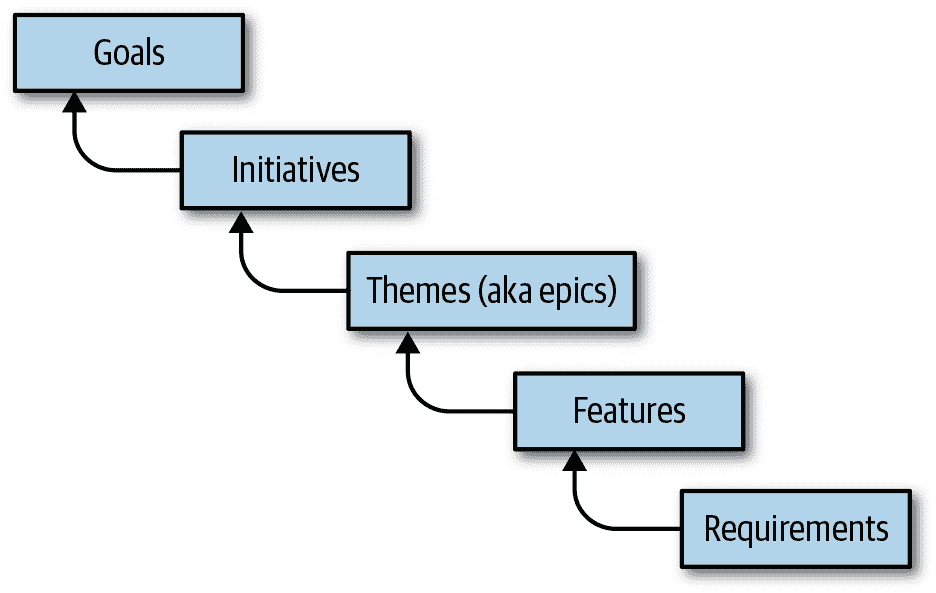
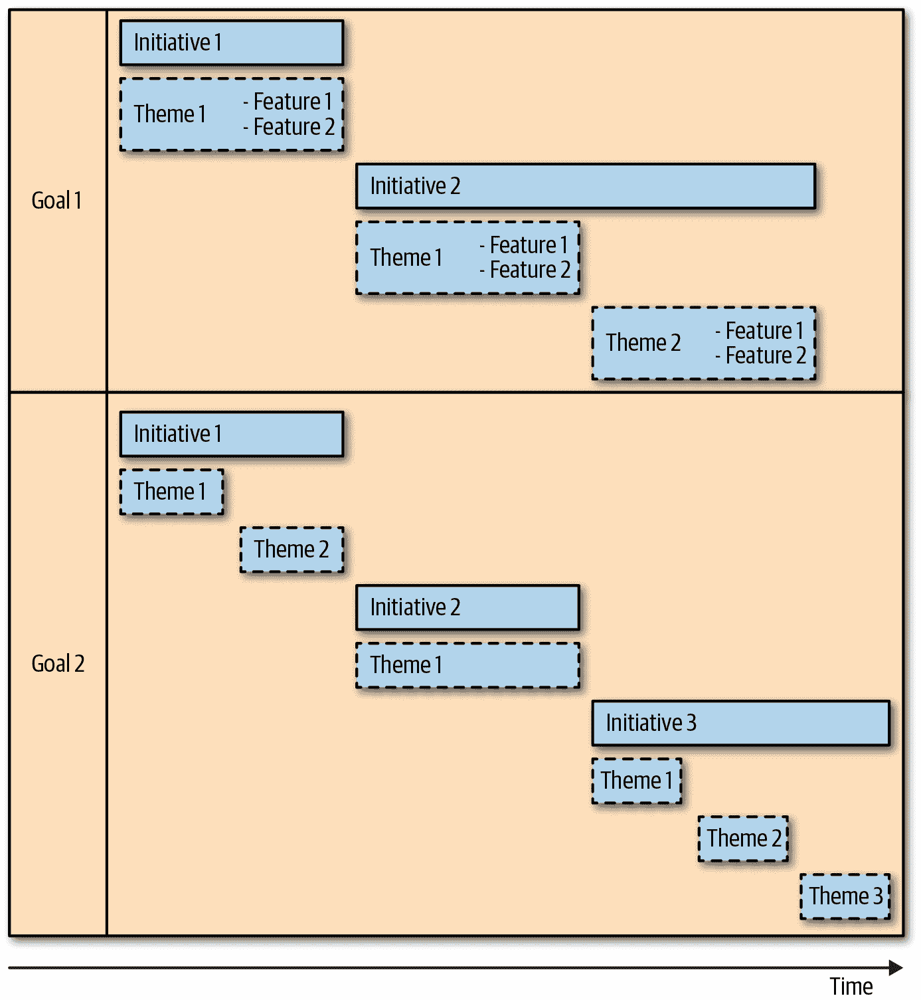

## 第 14 章. AI 战略示例
现在我们已经详细介绍了创建 AI 战略所需的信息和考虑因素，让我们用一个假设的例子来创建一个。请记住，由 AIPB 指导的 AI 战略应采用解决方案战略和优先路线图的形式。

## 播客示例介绍
假设我想构建一个简单的播客收听应用，允许用户根据其偏好和过去的收听历史获得播客推荐。未付费账户的用户会看到广告，而付费账户的用户则不会看到广告。从利益相关者角度来看，我代表企业，因为这是我的公司和应用，用户是使用该应用查找和收听播客的人，而客户则是利用我的应用向未付费用户投放广告的公司。

这三者（企业、用户、客户）对该应用都可能有许多目标，每个目标都可能有多个有助于实现它们的举措。假设存在一个 AI 愿景，该战略基于此愿景，并定义了 *为什么*、*如何* 和 *什么*，如前所述。（我在 附录 B 中更深入地介绍了此示例，因此在本章中我们将愿景方面保持不变，以便专注于 AI 战略开发。）

## AIPB 战略阶段回顾

# AIPB 战略与优先级路线图

在深入讨论并制定我们示例的解决方案战略和优先级路线图之前，请回顾第一部分中提到的，所有专家类别均建议用于制定 AIPB 战略。这是因为从 AIPB 北极星到生产解决方案优化的端到端 AI 创新战略的制定可能需要在企业的多个职能领域具备一定的专业知识。因此，所有专家类别应根据适用情况和需要进行协作参与，而监督和管理则是专家管理组的责任（尤其是产品经理，鉴于优先级路线图输出）。

对于 AIPB 方法论战略阶段，以及在第 2 章中介绍的 AIPB 流程类别，我建议如下：
*   构思与愿景开发（例如，设计思维、头脑风暴、五个 *为什么*）
*   业务与产品战略（例如，优势、劣势、机会和威胁 \[SWOT\]、成本效益分析 \[CBA\]、波特五力、产品市场契合金字塔）
*   路线图优先级排序（例如，延迟成本、CD3、卡诺模型、重要性与满意度）
*   需求获取（例如，设计思维、访谈）
*   产品设计（例如，设计思维、UX 设计、以人为本的设计）

这些推荐的流程类别和具体方法将在我们逐步推进本章和示例时适用于相应的步骤。

正如在 AIPB AI 愿景示例章节中所提到的，HiPPo（最高薪人士的意见）方法和委员会设计是不允许的，而翻转课堂等概念则高度推荐。将所有会议用作高效、有效、实际的工作协作会议，而不是教学和学习会议。提前让每个人都知道如何快速上手，最好以需要最少时间和精力的方式进行，以适应繁忙的日程。

现在让我们讨论创建 AIPB 战略阶段的输出。两者都由 AI 愿景指导，后者再次定义了战略应基于并保持一致的 *为什么*、*如何* 和 *什么*。

## 创建 AIPB 解决方案战略

创建 AIPB 解决方案战略的范围可以从简单到广泛，并涉及许多不同的学科和考虑因素。请记住，解决方案战略应定义所需的人员、流程和资源（即计划）以执行以下操作：
*   使您的 AI 愿景成为成功的现实
*   在执行 AI 战略的同时执行您的评估战略举措
*   迭代执行五大 D

迭代执行五大 D 包括回答 AIPB 方法论战略阶段部分中第 3 章概述的所有问题并解决所有考虑因素。请参考该章节和部分以详细复习。

鉴于可能涉及的解决方案战略交付物的广泛深度和类型，我们的示例解决方案战略将保持在非常高的层面。交付物可以采用一种或多种文档、图表或演示文稿的形式，例如，并且每个的相对性质可以是业务层面、技术（例如，软件架构、数据模型）、产品相关、设计相关、数据和分析相关等等。

为本示例的目的，我们的高层解决方案战略提供了我们的计划，如以下列表所示：
*   开发并执行优先级路线图（代表 MVP），利用五大 D 流程。
*   在播客和我们的应用愿景的背景下进行用户研究，以帮助指导设计和开发。
*   利用一流的设计师和现代设计方法，以确保最佳的 UX。
*   使用适当的现代技术栈和软件架构来构建适用于 iOS 和 Android 设备的移动应用。
*   开发并集成新的推荐引擎，该引擎将作为基于云的 API 端点构建和部署。
*   在应用在 iTunes 和 Google Play 应用商店上架后确保适当的监控和分析。
*   适当评估应用可用性和 UX，并根据我们的发现进行更改。
*   开发成功指标和评估计划，以帮助推动未来的数据驱动决策和改进。
*   开发数据反馈循环，可指导推荐引擎的持续改进和优化。

## 创建 AIPB 优先级路线图

对于创建 AIPB 优先级路线图，我推荐的方法是创建分层路线图，其中每一层都与上层保持一致。我建议使用的层级显示在图 14-1 中，您的优先级路线图最终将看起来像这样。产品经理应该能够帮助此过程。

目标是我们一直在本书中讨论的 *为什么*、利益和成果，并且应为人和业务提供，这是 AIPB 的主要独特方面之一。当在第 10 章中创建我们的示例 AIPB AI 愿景声明时，呈现了此方面的一个示例。

举措是实现一致目标的具体、单独的战略。我们之前将这些称为目标一致的举措。主题（也称为史诗）是可包含许多低层级功能的高层级产品功能。主题和单个功能都应通过发现、构思和创建由此产生的敏捷需求来定义，这些需求将指导设计和开发工作。

在本示例中，我们假设业务方面的主要目标是增加客户获取、参与度和留存率。这些实际上是多个目标，但为简单起见，我们将其合并为一个。我们可以提出多个一致的举措、主题和功能来实现这些目标。

例如，我们可以创建基于偏好的个性化激励和促销活动，以鼓励用户注册账户，而不是匿名使用应用程序。在这种情况下，个性化是举措，而激励和促销是主题，每个主题都可能包含多个具体功能。我们还可以战略性地创建高质量的内容（例如，播客、图像、文案、功能）和个性化给每个用户的推荐。个性化有助于使事物对个人更相关。这些方法应有助于实现我们的客户获取、参与度和留存率目标。

从用户角度来看，用户的一个目标是能够快速找到他们可能喜欢的新播客。这应包括具有与他们已收听的播客相似特征（例如，长度和格式）和主题的播客，同时也向用户介绍新的、不相似的播客。这使用户能够发现他们原本不知道的内容。就举措而言，我们可以通过个性化（如上所述）来实现这一目标，以实现我们的业务目标。这是一个“为人和业务”的绝佳示例，对于此，相同的战略举措和成果对双方都是双赢。

最后，客户的主要目标是在其移动应用广告支出上获得最高的投资回报率。我们可以通过诸如细分和定位等多种方法来实现这一点。图 14-2 显示了目标一致优先级路线图的概括可视化。

这里是一个更具体的带项目符号的优先路线图版本，针对我们的示例进行了定制，并假设这是一个正在进行中的工作。还请假设与细分、个性化和推荐相关的任何内容都旨在由 AI 驱动。请注意，我在描述某些项目（例如目标和举措）时使用了比平时更多的词语以求清晰，并且由于我们将 AI 解决方案集成到具有用户界面和非 AI 驱动功能的应用程序中，因此某些路线图项目也需要设计和非 AI 软件开发工作。

## 对齐的目标、举措、主题和功能

* 业务目标：提高客户获取、参与度和留存率
  * 举措 1：个性化
    * 主题 1 激励
      * 功能 1：激励注册
    * 主题 2：促销
      * 功能 1：基于细分的定向促销
      * 功能 2：基于偏好的定向促销
* 用户目标：快速找到可能喜欢的新播客，这些播客既与我当前收听的播客相似，又能让我接触到不相似的播客，而这些播客在我尝试之前可能不知道自己会喜欢。
  * 举措 1：个性化
    * 主题 1：播客信息流
      * 功能 1：个性化消息
      * 功能 2：个性化图片
      * 功能 3：个性化布局
    * 主题 2：推荐
      * 功能 1：基于相似用户的推荐
      * 功能 2：基于相似播客的推荐
      * 功能 3：基于不相似播客或用户的推荐
* 客户目标：在移动应用广告支出上实现高于平均水平的投资回报率
  * 举措 1：定向（提高广告与每个用户相关的可能性）
    * 主题 1：基于细分的定向广告

请注意，某些主题和功能可能相互对齐；也就是说，可以汇总到多个举措或目标中。这完全没问题。就需求而言，我建议在主题和功能层面定义需求，这将指导设计和开发流程。在软件方面，需求应与敏捷而非瀑布方法论相关联。

最后，优先排序所有层级至关重要，因为你不可能同时完成所有事情（除非你拥有庞大的团队和预算）。我建议从目标层面开始——在人员和业务层面分别对目标进行优先级排序，然后再整体进行（正如我们的示例所示，会有一些重叠）。然后，对与每个目标一致的举措进行优先级排序，其次是对与每个举措一致的主题进行优先级排序，最后是对与每个主题一致的每个功能进行优先级排序。这将产生一个最佳的优先路线图，以推动 AIPB 下游的构建、交付和优化流程。我建议使用延迟成本、CD3、卡诺模型以及重要性与满意度方法来进行优先级排序。

从敏捷的角度来看，根据我的经验，我发现具有不存在（或非常宽松）的时间范围（用于长期规划和/或科学创新）或覆盖最多 90 天（大致估计）工作的路线图是最好的。超过 90 天的任何内容很可能高度不准确，并会不当设定期望（再次强调，这是敏捷，不是瀑布）。

根据我建议的路线图层级，主题和功能是需要在 AIPB 构建阶段进行设计（对于具有用户界面的项目）和构建的路线图项目。目标和举措用于战略、规划和对齐目的。优先路线图将指导产品开发团队以及所有下游 AIPB 方法论阶段，以优先的开发任务顺序进行。
