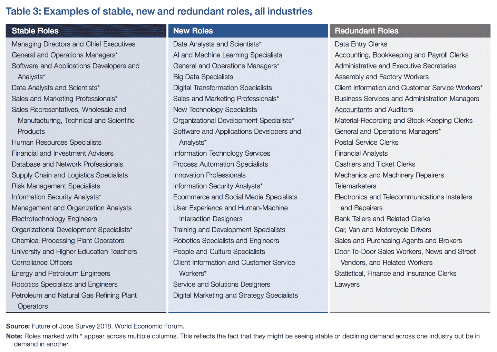

## 第 15 章. AI 对就业的影响

AI 的力量和潜力对于个人和企业来说都巨大，尽管 AI 的应用应考虑到人类的需求、欲望和心理。本章的目标是讨论 AI 的潜在影响，具体与人类需求相关，尤其是与工作相关。

### AI、就业替代与技能差距

我从人们那里听到的关于 AI 的最大担忧之一——除了杀人 AI 机器人接管世界之外——就是害怕失去工作，这是一个绝对值得进一步研究的主题。当人类认为自己满足基本需求的能力受到威胁时，通常会产生战斗或逃跑反应。在 AI 的背景下，逃跑反应可能非常适合终结者或杀人机器人般的场景，但我们离那还很远，甚至可能永远不会达到。因此，战斗反应，通常表现为恐惧或抵制，目前是最常见的。

尽管一些工作现在正被 AI 和/或自动化取代，未来可能会有更多工作被取代，但我们目前离大规模的即时就业替代还相差甚远。绝大多数追求 AI 的个人和公司对其他应用感兴趣，例如增强智能。此外，根据麻省理工学院斯隆管理学院的教授埃里克·布里尼奥夫森（Erik Brynjolfsson）说：“即使在快速发展的情况下，AI 在不久的将来也无法取代大多数工作。但在几乎每个行业，使用 AI 的人开始取代不使用 AI 的人，而且这一趋势只会加速。”^(1)

失业是机器取代就业背景下最令人担忧的问题，它主要分为两种形式：[技术性](http://bit.ly/2Kxd1AO) 和 [结构性](http://bit.ly/2IWcchO) 失业。技术性失业源于 AI 和自动化等技术变革。在这种情况下，某些任务由新技术执行，人类工人不再需要执行这些任务。这意味着任何重新分配或再培训都需要围绕不同的任务和职责进行。另一方面，结构性失业是由于工人技能与可用工作不匹配的结果；换句话说，就是填补可用职位所需的技能和专业知识。

这也被称为 *技能差距*，我们今天在技术相关角色中看到了这一点，例如 AI 研究员、机器学习工程师、数据科学家和软件工程师。考虑到 AI 和数据科学领域的广度，数据科学家和机器学习工程师的情况问题变得更加严重。你可能会找到一位在数据准备、可视化和高级统计分析方面表现出色的数据科学家，但在机器学习建模方面并不擅长，反之亦然。

就 AI 而言，由于缺乏全才，人们每天都在变得更加专业化。我们开始看到专门从事自然语言技术、深度学习、强化学习或其他技术的 AI 和机器学习工程师，但不是同时掌握所有技术。这带来了真正的挑战，因为尽管有填补这些职位的巨大需求，AI 和数据科学却很困难，需要编程、统计学、数学、计算机科学和机器学习专业知识。对于许多人来说，这些都是难以学习的话题，无论市场需求如何，而且根本不适合每个人。

### 技能差距与新工作角色

鉴于专业化需求日益增长，以及人工智能和机器学习在现实世界应用中的普及和数据规模更大、种类更多，我们看到许多新的角色应运而生，具有专门的职责范围。其中包括 DataOps、数据工程师和数据产品经理。我们也看到对引入人类在环以提供人类推理能力越来越感兴趣，而这正是人类的优势，却不是当今人工智能所具备的。随着数据和分析重要性与重视程度的提升，我们也看到软件工程师、DevOps 工程师、站点可靠性工程师和 BI 专家等角色的参与度不断增加和多样化。

另一个需要考虑的是，技术历史上一直创造出新的、不同的工作，人工智能也不应例外。事实上，世界经济论坛在其 2018 年的 *未来就业报告* 中估计，到 2022 年，随着第四次工业革命的展开，“7500 万个工作岗位可能会因人类与机器之间劳动分工的转变而被取代，而 1.33 亿个新角色可能会出现，这些角色更适应人类、机器和算法之间新的劳动分工。”^(2) 这代表净增加 5800 万个工作岗位。

该报告还指出，这一净增长和积极展望需要劳动力进行一系列转变以适应新技术。图 15-1 显示了跨行业按稳定、新兴或冗余分类的角色示例。报告使用“冗余”一词来指代在 2018 年至 2022 年期间最容易受到技术进步和流程自动化的影响的角色。这些工作预计会变得越来越冗余，并被描述为基于常规、中等技能和白领。

许多其他研究来源表明，人工智能实际上将带来经济增长的显著提升，并创造比取代更多的工作，尽管这种影响在不同行业间分布不均。例如，制造业可能会流失大量工作岗位，而医疗保健等其他行业则会增加就业岗位。以下是一些有趣的发现：

*   Gartner 预测，到 2020 年，人工智能将创造 230 万个工作岗位并淘汰 180 万个工作岗位，净增 50 万个工作岗位。^(3)
*   McKinsey 认为，到 2030 年，人工智能有可能将全球经济活动增加 13 万亿美元，使累计 GDP 比今天高出 16%，每年额外增加 1.2% 的 GDP 增长。该机构进一步报告称，到 2030 年，全职等效就业需求可能保持平稳，或出现轻微负增长。^(4)
*   PwC 估计，到 2037 年，人工智能将在英国创造 720 万个工作岗位，同时取代 700 万个工作岗位，净增 20 万个工作岗位^(5) 并且人工智能、机器人和自动化将为中国经济增加 9300 万个工作岗位。^(6,) ^(7)

就目前和可预见的未来而言，人工智能似乎远未接近完全取代工作。人工智能的能力仍然相对狭窄，远不能达到人类理解的水平。人工智能也不具备多任务处理能力，无法在训练之外的单一任务环境中自我学习，也无法应对与其训练条件有任何明显差异的情况。然而，变化在现实世界中不断发生，而人类通常能够无缝且轻松地处理它们。今天大多数婴儿能够做的事情对人工智能来说都是不可能的。

关键在于，对于现在和可预见的未来而言，问题不在于每个人的工作都被取代；而在于哪些工作被取代，哪些新工作将被创造，以及哪些人群将受到最大影响，影响程度如何。

# 明天的技能

今天的工作需要两大要素：硬技能（包括专业知识）和软技能。我认为软技能至少与硬技能一样重要，甚至更重要。软技能通常对员工在工作中取得成功的能力贡献最大。

与硬技能不同，软技能极难教授。即使教授了，也不能保证员工会采纳、掌握并持续展示这些技能。除了对技术技能（如人工智能和数据科学）需求不断增长外，现实世界的工作也越来越需要批判性思维、解决问题能力、灵活性、适应性、协作和应变能力等软技能。

这些技能在当今的教育体系中并未得到显著培养，这意味着对熟练劳动力的需求在很大程度上未得到满足。此外，现代人工智能目前无法执行大多数这些软技能，也可能永远无法做到。

值得重申。人工智能几乎无法展示所列的任何软技能。这意味着因此，人工智能无法取代或自动化大量工作，这意味着对于几乎没有机器竞争的人来说，有大量就业机会。如果没有具备填补这些角色技能的人类，我们将继续看到大规模的人才短缺，就像今天数据科学家和软件工程师等角色所看到的那样。

# 自动化、就业与经济的未来

现在应该很清楚，除了人工智能是否会取代每个人的工作之外，还有很多需要考虑的问题。技术长期以来一直被用来让人们的生活更美好、更轻松，并且将继续如此。人们的主要担忧不应该是人工智能扼杀就业，而应该是政府、社会、企业和教育机构将如何改变，以确保人们在日益技术化的世界中具备最佳的成功条件。这不仅包括政策和教育方面的变化，还包括劳动力岗位重新分配、再培训或技能再提升。现实是，人类需要越来越多地与机器协同工作，而不是机器完全不需要人类。

让我们用两句名言和一个非常简短的讨论来结束这一部分，谈谈工作自动化对经济的影响。

“基本事实是，技术消除了工作岗位，而不是工作。经济政策的持续义务是使生产潜力的增长与购买力和需求的增长相匹配。否则，技术进步创造的潜力将浪费在闲置产能、失业和贫困上。”^(8,)

“生产者只有在自动化有利可图时才会自动化。要实现盈利，生产者首先需要一个市场来销售。考虑到这一点有助于凸显这一论点的关键缺陷：如果机器人取代了所有工人，从而造成大规模失业，生产者将向谁销售？”^(9)。

想一想：企业把一切都自动化的意义何在，以至于每个人都失业且没有经济来源？正如第二句名言所指出的，谁会购买他们的商品和服务？不幸的是，鉴于我们所看到的经济不平等日益加剧，这可能并不那么简单，如果不加以控制，这可能导致极端的“有产者”与“无产者”对立。在这种情况下，有产者会制造和购买东西，而无产者将被排除在外。再次强调，我们必须意识到这些问题并努力避免它们。这不仅仅是人工智能的问题。

最终技术不会停止进步，而且已经取得的技术进步无法逆转。过去如此（例如卢德派时代），未来也将如此。因此，我们必须积极讨论和应对潜在的大规模工作自动化，并采取一切必要措施，确保人们与技术能够和谐共存、互利共赢地迈向未来。

最后，有趣的是，有人认为人工智能取代所有人的工作实际上是一件好事。其想法是，这将使每个人都能自由地过上快乐而有意义的生活，做自己感兴趣的事情，而不是不断工作以满足经济和社会需求，尤其是当这意味着从事不有趣或不愉快的工作时（不幸的是，今天许多人就是这种情况）。

如果全面的人类工作替代真的发生，在没有适当预防措施和基础设施的情况下，它反而可能变得极其糟糕。相关概念是向每个人提供通用基本收入（UBI），以弥补缺乏需要人类工人的工作，并旨在防止人们因贫困而受苦。随着人工智能的发展，这些考虑因素绝对值得牢记，尽管大多数迹象表明我们离这种情况还很远，而且在相当长的时间内也不会实现。

# Summary

人类在受到威胁时自然会产生战斗或逃跑反应，而人工智能带来的感知威胁也不例外。尽管人工智能可能因被视为“工作杀手”而遭到强烈抵制，但来自当前研究的迹象、技术促进就业的历史先例，以及对教育和培训改革的关注，都能在很大程度上帮助我们更好地理解大规模失业和不利经济影响的可能性并加以预防。正如过去一样，技术和人工智能将继续满足人类的需求、欲望和喜好，并最终创造更好的人类体验。这是 AIPB 的核心目标。

我们将在下一章结束本书，分享最终的思考以及人工智能趋势和未来预测的概述。

^(1) [*https://sloanreview.mit.edu/projects/reshaping-business-with-artificial-intelligence/*](https://sloanreview.mit.edu/projects/reshaping-business-with-artificial-intelligence/)

^(2) 世界经济论坛指出，这一估计及其所依据的假设应谨慎对待。

^(3) [*https://www.itpro.co.uk/automation/30463/gartner-by-2020-ai-will-create-more-jobs-than-it-eliminates*](https://www.itpro.co.uk/automation/30463/gartner-by-2020-ai-will-create-more-jobs-than-it-eliminates)

^(4) [*https://www.mckinsey.com/featured-insights/artificial-intelligence/notes-from-the-ai-frontier-modeling-the-impact-of-ai-on-the-world-economy*](https://www.mckinsey.com/featured-insights/artificial-intelligence/notes-from-the-ai-frontier-modeling-the-impact-of-ai-on-the-world-economy)

^(5) [*https://www.theguardian.com/technology/2018/jul/17/artificial-intelligence-will-be-net-uk-jobs-creator-finds-report*](https://www.theguardian.com/technology/2018/jul/17/artificial-intelligence-will-be-net-uk-jobs-creator-finds-report)

^(6) [*https://internetofbusiness.com/robotics-a-i-will-create-jobs-but-decimate-middle-class-careers-wef/*](https://internetofbusiness.com/robotics-a-i-will-create-jobs-but-decimate-middle-class-careers-wef/)

^(7) [*https://www.pwc.com/gx/en/issues/artificial-intelligence/impact-of-ai-on-jobs-in-china.pdf*](https://www.pwc.com/gx/en/issues/artificial-intelligence/impact-of-ai-on-jobs-in-china.pdf)

^(8) 国家技术、自动化与经济进步委员会，《技术与美国经济》，第 1 卷，1966 年 2 月，第 9 页。

^(9) Larry Elliott 引用 Kallum Pickering 在“机器人不会导致工作减少——但会掏空中产阶级”一文中， [*http://bit.ly/2Fr8DiP*](http://bit.ly/2Fr8DiP)
