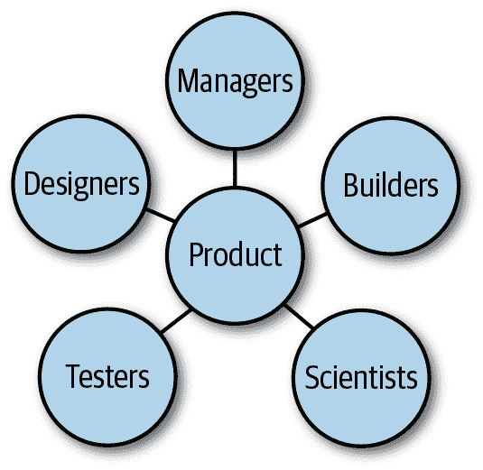

## Chapter 16. The Future of AI

到本书的这个阶段，我希望你已经受到启发，并准备好在 AIPB 的指导下在你的组织中利用人工智能。在本章中，我将分享关于执行领导力重要性的最终思考，随后概述人工智能趋势并展望未来。

## AI and Executive Leadership

如果你是高级管理人员，我想对你阅读本书表示额外的感谢。为什么？有两个原因。首先，执行领导层的理解和支持对于推进人工智能计划以及确保计划成功至关重要。其次，因为许多高级管理人员变得远离他们在业务中监督的领域，并理所当然地更关注战略而非战术和专业知识。出于正当理由，企业需要有人负责战略、损益、运营以及业务和各职能部门的其他高管层责任。然而，这种脱离和仅关注 30,000 英尺（或任何千英尺）高度的视角确实存在明显弊端。这通常表现为对所有事情都需要一份执行摘要。

在我看来，执行领导层在与业务产品和各自业务线核心的领域拥有可观的专业知识非常重要。这在人工智能、机器学习和数据科学的情况下尤其如此。这些领域对人们来说可能难以理解，而当决策者并不理解时，很难推进高级分析计划。

作为反驳，理解这些领域的程度仅限于执行摘要级别是可以的，但这意味着必须将信任和决策权委托给具有更大专业知识的人。原因很简单。我坚信，许多公司尽管知道需要人工智能来实现某些目标、产生某些成果或保持竞争力，但仍对采用人工智能犹豫不决的主要原因之一是关键决策者理解得不够充分。这是可以理解的。我和其他人正在努力使人工智能去神秘化和简化，但仍需要做更多工作。

我还认为，执行领导层拥有可观的产品敏锐度也极其重要。公司围绕产品建立，包括产品是服务时。产品实际上是公司的粘合剂，尤其是在我创建的轮毂和辐条模型中，产品是轮毂，其余一切都是辐条。图 16-1 展示了技术产品轮毂和辐条模型。请注意，AIPB 专家类别是辐条。

总体而言，高管和经理围绕产品或产品组合建立和运营业务，设计师设计产品，建造者建造产品（例如软件工程师），测试者测试产品，科学家帮助构建、理解和优化产品。轮毂和辐条模型也适用于整个业务职能——营销人员营销产品；销售人员销售产品；客户成功人员支持产品；产品开发设计、构建和测试产品；运营围绕产品运营业务；财务和会计跟踪和管理投资于产品或由产品产生的资金；产品经理管理与产品愿景、战略、开发和成功相关的几乎所有事情。

一些最伟大的科技公司是由曾担任产品经理和/或领域专家的首席执行官创立和/或运营的。史蒂夫·乔布斯就是一个明显的例子，但名单还包括 Sundar Pichai（首席执行官，Google）、Satya Nadella（微软首席执行官）、Marissa Mayer（首席执行官，Yahoo）和 Indra Nooyi（首席执行官，PepsiCo）。^(1)

那么，让我们转向关于 AIPB 和基于 AI 的科学创新的最终思考。为了保持相关性、保持竞争力，尤其是领先于竞争对手，企业必须继续创新，尤其是在数据和分析方面。随着数据生成量的爆炸性增长以及存储、处理和分析数据的成本下降，从未有比现在更重要的时候去制定愿景和战略，说明你将如何利用数据来创造更好的用户体验和业务成功。

正如我们所介绍的，先进分析技术如人工智能和机器学习为创新和价值创造提供了令人惊叹的机会。话虽如此，许多人仍然难以理解人工智能和机器学习到底是什么，它们与数据科学有何不同，以及所有这些领域如何推动现实世界的价值。此外，追求人工智能既提供了巨大的成功可能性，也因所讨论的诸多潜在原因而存在失败风险。

关键在于立即开始。不要等待，不要制造进入壁垒，最重要的是，不要被落下。安迪·威尔的一句名言是，“今天的好计划胜过明天的完美计划。” 今天就为将人工智能融入你的业务制定计划。人工智能准备度的某些方面，如领导力、文化转变以及高管层支持是必须的；其余部分可以在过程中逐步完善。确保与准备度相关的差距得到填补，并且必要的转变得到优先考虑并实施。此外，以不断提升的成熟度层级来对待数据和分析，同时考虑成熟度依赖关系以及不确定性、风险与回报之间的权衡。在具备必要的领导力、文化转变和高管支持的情况下，从小处着手，逐步在业务的实际应用中融入机器学习和其他人工智能技术。

同时，请记住价值不仅体现在投资回报率上，也体现在对用户体验和愉悦感的改善上。像关注业务目标和 KPI 一样优化这一点。你的客户和用户的受益最终也会惠及你的业务。

AIPB 以及本书中的指导将帮助高管和经理确保有益且成功的 AI 追求，得益于其独特且专为目的而设计的北极星、优势、结构和方法。打造优秀的 AI 驱动产品、服务和解决方案——就这样！

# 未来展望与关注重点

让我们讨论人工智能的未来，以及在未来几年你应该期待听到更多并关注的事情。

与移动和网络等许多已建立且更稳定的数字技术不同，人工智能是一个极其动态且不断进步的领域，literally 每天都在变化。不仅从技术和能力角度来看，而且现实世界中人工智能用例和应用的爆炸式增长。人工智能正在从提供巨大潜力的事物，显著转变为真正为个人和企业带来实际且重大价值的事物。

随着人工智能的能力和潜在应用在未来不断扩展，这一点肯定会继续下去，同样重要的是，人们和公司更好地理解人工智能是什么、它如何创造价值以及如何成功实现该价值。希望本书和 AIPB 已提供了一个框架来帮助培养这种理解并指导基于人工智能的科学创新过程。正如我在 第 1 章 中所说，如果仅通过理解 AIPB 所呈现的概念和本书内容，高管和经理就能在高级分析方面比今天更进一步，那就算是一次胜利。

有鉴于此，让我们按类别讨论人工智能的未来。此处的覆盖范围是高层次且简要的。鼓励你进一步研究感兴趣的具体领域，如果你不熟悉以下的一些术语也不必担心。我的目标是为你提供人工智能在短期和长期内未来发展的整体概览。

## 人工智能理解、采用与普及度的提升

人工智能仍处于起步阶段，我们现在才开始看到现实世界应用和用例的重大增长。这些新应用很多来自亚马逊、谷歌和奈飞等最知名的科技公司，也来自许多规模更小但更具创新性和颠覆性的公司。

许多大型企业公司拥有招聘人工智能人才和推进人工智能计划的资源，但却无法做到，或更糟的是，由于缺乏数据和分析的准备度、成熟度，以及无法正确理解和应对与人工智能相关的许多关键因素而导致失败。这使这些公司处于危险境地，因为有一些非常小且高度敏捷的初创公司非常乐意追求人工智能并颠覆现有企业和行业。

由于这些挑战的存在，对数据和高级分析领导力的需求日益增加，以帮助促进更好的理解并推动围绕人工智能的愿景和战略的制定，同时也使人工智能对企业和消费者而言更易于理解。这意味着对高管和经理易于理解的人工智能和机器学习培训的需求日益增加，这将有助于阐明高级分析如何在其组织内部使用，并帮助促进机会识别、创意构思以及围绕人工智能的愿景开发。

尽管技术细节可能只有高度专业的人工智能研究人员和机器学习工程师才能很好地理解，但高管和领导者需要达到能够思考如何利用数据实现目标的程度，通过数据创造深度可操作的洞察、增强人类智能、自动化重复性任务和决策、预测结果、量化反馈等等。从成熟度角度来看，这意味着获得如上所述的更好理解，同时也从传统的商业智能和描述性分析毕业到更先进的预测性和规范性分析。这是释放数据真正潜力的唯一途径——如果仅使用更简单、传统的分析，这是不可能完成的任务。

人工智能理解提升的一部分包括认识到数据即黄金，并且你无法过度重视数据准备度和质量。你不能没有砖块建砖房，就像没有高质量数据就无法利用人工智能创造新的价值来源、差异化和竞争优势一样。公司开始更好地理解这一点，下一步是迈向数据民主化。数据孤岛扼杀人工智能创新和进步。成为数据驱动和/或数据知情的组织需要数据并尽可能在数据来源和业务职能之间实现访问。

人工智能和机器学习人才也存在严重短缺。为解决人才短缺问题，许多公司正在开发工具，以帮助实现民主化、简化（通过抽象降低复杂性），甚至自动化数据科学家和机器学习工程师通常执行的部分工作。自动化机器学习（AutoML）就是其中一个积极开发和推进的领域。AutoML 使专业知识有限的人能够训练和优化机器学习模型，示例包括 AWS SageMaker 和 Google 的 AI Hub。Google 还发布了 Kubeflow Pipelines 以帮助简化机器学习工作流。

AutoML 的一些自动化方面确实很有用，尤其是对于具备必要专业知识的人来说，尽管我个人非常担心把一辆手动挡法拉利的钥匙交给一个从未开过车且没有驾照的人。缺乏必要专业知识的人由于不知道在训练模型时应权衡什么、考虑什么以及尝试哪些不同技术，而做出错误决策的可能性很大，这可能导致沉没成本、时间浪费和项目失败。最坏的情况下，这可能意味着承担大量责任风险，可能带来生死攸关的后果。

分析民主化和开放数据也是日益关注的领域。大量可自由获取的数据、机器学习模型和开源代码正在迅速普及。得益于预测建模标记语言（PMML）等工具的出现，模型也变得更具可移植性和可共享性。

最后，当今的先进 AI 技术（如深度学习）需要大量的计算资源、训练成本和时间。很多人正致力于通过算法和硬件的进步来提高效率，如前所述。这将有助于加速模型的学习和训练，从而降低成本和时间。它还能够实现更快的实验和假设检验，以及整体上更敏捷的方法。

本节讨论的所有内容将促进理解的提升，在管理者和实践者层面实现更广泛的采用，并最终推动更多现实世界 AI 用例和应用的蓬勃发展。

# 研究、软件和硬件方面的进步

## 研究

AI 和机器学习是非常热门且活跃的研究领域。最新的研究主要涉及算法和技术的进步。一些最令人兴奋的研究领域包括自然语言（NLP、NLG、NLU、机器翻译）、深度学习、强化学习、迁移学习、个性化、推荐系统、生成式 AI 和信息检索（例如语音和视觉搜索）。请参阅 第 5 章 以复习相关内容。

此外，像深度强化学习这样的技术正在探索创建能够自主引导并随时间自我学习的人工智能的方法，而其他方法则试图使人工智能更好地同时解决多个问题；换句话说，多任务处理。其他技术正在开发中，以帮助解决我们之前讨论过的冷启动问题。此外，传统上使用 A/B 测试和多变量测试进行的因果推断的先进方法正在使用新的 AI 技术进行开发。

此外，研究人员正试图找到使 AI 应用更简单、更高效的方法。所有高级分析技术都需要数据。大量高质量、准备好的数据可能难以获得和/或成本高昂。因此，像 [*少样本学习*](http://bit.ly/2KujNHL) 这样的技术正在开发中，以使 AI 在相对少量数据下工作，且无需相同的数据质量要求。研究人员还试图找到提高算法效率（例如神经网络）的方法，以便更快地训练模型并降低成本。这包括开发更简单的算法和模型，这些模型能够达到与当前使用的最先进算法相同或更好的结果，并且需要的数据更少。

另一个非常有趣的开发领域是机器学习的一般方式。这包括在线学习、增量学习和外核（又称外部内存）学习。所有这些技术都允许在新数据反馈到系统时持续、增量地进行学习，或在数据集太大而无法在一台计算机上训练的情况下进行学习。

## 软件

在大数据时代，随着物联网等技术的普及，今天的海量数据集呈指数级增长，扩展 AI 的重要性比以往任何时候都大。这包括为 AI 算法消费而移动和处理庞大的数据集，以及部署能够在规模上可靠、一致地运行的生产 AI 解决方案方面。目前正在进行软件方面的持续改进来帮助实现这一点。

还有大量用于构建 AI 解决方案的开源、专有和基于云的软件可供使用。这包括软件包、库、平台、框架、API、SDK 和协作工具。它还包括用于高效分析的数据库和数据管理系统（例如数据仓库和数据湖）。

## 硬件

现代、先进的 AI 和机器学习技术（如深度学习），以及在大量数据上训练这些模型，越来越多地需要高度专业化和高性能的硬件，如今被称为 *AI 芯片*。

满足当今 AI 需求的主要近期硬件进步之一是使用 GPU 而非传统 CPU 来处理大量数据和 AI 模型训练。GPU 更适合处理大量数据并执行当今 AI 算法所需的底层数学计算。此类别中的其他专用硬件包括专用集成电路（ASICs）和现场可编程门阵列（FPGAs）。

某些公司为这些应用创建了品牌化和专有的 AI 芯片。例如，NVIDIA 以其 GPU 而闻名。Google 创建了一种名为张量处理单元（TPU）的 ASIC，用于密集的机器学习任务。Intel 拥有自己的芯片，称为 Intel Nervana 神经网络处理器（NNP），并且它正与 Facebook 合作 [创建名为 NNP-I 的新“推理”芯片](http://bit.ly/2Iz9lMC)（I 代表“inference”推理）。

# 计算架构的进步

客户端/服务器和云计算已成为相当长一段时间的主要计算架构。随着互联网和技术的整体规模呈指数级增长，计算也相应地取得了进步以实现扩展。这包括水平和垂直扩展。

随着当今对移动设备和整体性能的日益关注，新的计算架构变得更加相关和流行。这包括对离线计算能力需求的增加；例如，即使离线也能使用并受益于应用程序的能力。

两个与 AI 高度相关的未来发展非常令人兴奋的领域是 *边缘* 和 *雾* 计算。在传统的云计算架构中，数据在客户端（例如移动设备、网页浏览器）和服务器（基于云或本地）之间来回传递。客户端与云服务器之间数据传输和处理所需的时间是开销，在某些情况下可能非常显著且性能不佳。

为了满足在数据来源（例如客户端、传感器）附近实现更高性能和强大实时计算的不断增长的需求，边缘和雾计算正在兴起。边缘指的是设备本身；例如，手机、平板电脑或传感器。雾通常指的是设备与云之间的网关；例如，互联网网关。在这些情况下，计算和数据存储从云端转移到更靠近设备和其他数据生成源的位置。这可以带来重大的速度和性能提升。

# 技术融合、集成和语音主导

随着人工智能在应用中不断进步和演进，它开始与其他技术融合，人们也认识到将人工智能整合到多种技术解决方案中的潜在价值。对我而言，融合最明显的时候是某些应用不再似乎由人工智能驱动，这种现象被称为 *AI 效应*（稍后会进一步讨论）。

个人助理（例如 Alexa、Siri）变得越来越像那样——它们更被视为助理而非人工智能。这些助理代表了人工智能、音频硬件（如麦克风和扬声器）、电子硬件以及互联网连接（物联网）的融合。人工智能也在不断融入已有的技术中。示例包括电子商务和移动商务体验中的推荐引擎和个性化。

人工智能融合和集成的当前和未来领域有很多。示例包括以下内容：
*   自主机器和车辆
*   机器人和机器人流程自动化（RPA）
*   控制系统
*   无需结账和排队的购物（例如 Amazon Go 和传感器融合）
*   物联网和智能系统（例如 智慧城市、智能电网）
*   使用专用摄像头、光探测与测距（LiDar）和其他形式的传感的计算机视觉
*   雾计算和边缘计算（例如 移动设备上的 AI 深度学习模型）
*   区块链
*   量子计算
*   仿真和数字孪生

预测性、规范性和异常检测型人工智能也正被整合到与信息技术、供应链、制造、运输和物流相关的更传统流程中。

最后，语音有望在未来主导人与技术之间的交互。我们已经看到这种趋势，但还未达到我预期在不久的将来会出现的水准。人们越来越多地通过说话与技术和设备互动，并让技术作出回应。这包括我们今天看到的助理，以及对话式和问答式人工智能的其他应用。将来会有一些孩子完全没有概念打字——无论是物理键盘还是数字键盘——是什么感觉。他们成长过程中只是单纯地与一切事物对话。

## 社会影响

人工智能无疑变得越来越公开突出。不仅在每个角落似乎都有关于它的炒作，而且关于人工智能解决方案的电视广告不断 proliferate，人们在日常生活中比以往任何时候都更多地与人工智能互动；包括在移动应用、网页应用、助理、聊天机器人、物联网、机器人技术、增强智能和自动化中遇到人工智能。

由于这种新获得的关注和相关性，人们开始围绕人工智能的伦理和负责任使用提出严肃且合理的问题，人工智能是否以及如何受到监管，人工智能在政治上意味着什么，以及最后人工智能将如何影响社会，这种影响是好是坏还是两者兼有？这些都是好问题，每天都有更多来自个人和组织的人将注意力集中在回答这些问题上。

因为我们在第 15 章中详细讨论了人工智能对就业的影响，让我们把注意力转向人工智能可能以其他方式对社会产生日益增长影响的方面。

正如我们在书中前面讨论的那样，在数据层面，人们的主要关切是数据隐私和安全，这两者是数据治理的关键领域。值得一提的是，数据治理并非新鲜事物，在人工智能进入任何人的视野或以任何可观的方式被使用之前，它就一直是公司和 IT 部门的责任。话虽如此，人们对数据的隐私、安全和信任非常重要，而人工智能和机器学习项目对数据产生了额外需求，因此我们现在在人工智能的背景下看到对此的关注度增加。业务领导层需要与分析、IT 和安全专家协同合作，以便利用数据创造更好的用户体验和业务成功，同时在可能的情况下提供透明度，并确保最大程度的隐私、安全和信任。

此外，国家和地方政府越来越多地围绕隐私和公平使用进行监管，目标是帮助保护消费者。欧洲的 GDPR 于 2018 年 5 月生效，加州消费者隐私法案将于 2020 年出台。政府在此领域的关注、政治和强制性法规可能随时间增长，因此请留意未来的发展。

公平性、偏见和包容性也是人工智能未来的非常重要的考虑因素。人工智能有可能在不知不觉中以不公平、有偏见和不包容的方式被使用。这是一个正在获得突出地位的话题，随着人工智能的进步肯定会得到进一步关注。朝着这一方向迈出的一步是于 2018 年 5 月 16 日在多伦多 RightsCon 上发布的[“多伦多宣言：保护机器学习系统中平等权和非歧视权”](http://bit.ly/2N5IPPz)。

为了更好地衡量和跟踪迄今为止讨论的所有内容，正如第 13 章中深入讨论的那样，对人工智能透明度、可解释性和可说明性给予了高度重视，因此许多人专注于创建可解释的人工智能。预计在该领域将看到更多发展。

为了总结本节，值得提及一些在这些问题和未来考虑方面处于前沿的组织。许多个人和组织希望帮助确保人工智能的伦理、公平、包容、透明和安全使用，使其与人类价值观保持一致并造福全人类。安全使用指的是[人工智能安全这一日益增长的概念](http://bit.ly/2X0xDrL)。其中包括以下几家：
*   [未来生命研究所（FLI）](http://bit.ly/2IyQhy4)—关于人工智能研究问题、伦理和价值观以及长期问题的阿西洛马人工智能原则
*   [为了造福人类和社会的 AI 合作伙伴关系](https://www.partnershiponai.org/)
*   [布鲁金斯人工智能与新兴技术倡议](https://brook.gs/31R2ZjB)
*   [IEEE 标准协会](http://bit.ly/2J5tJnX)—自主和智能系统伦理全球倡议
*   [OpenAI](https://openai.com/)—用于安全通用人工智能的人工智能研究
*   [Google 的负责任人工智能实践](http://bit.ly/2XuPpmu)
*   [微软人工智能公平性、问责制、透明度和伦理（FATE）小组](http://bit.ly/2X2N7vB)

我认为所有这些非常重要，因为我对人工智能的兴趣完全在于其伦理和有益的使用，本书也是如此。它关乎利用人工智能造福个人和企业，创造更好的用户体验和业务成功。通过这种视角来看，人工智能代表着改变游戏规则的机会，可以转变和改善人们的生活，甚至延长和拯救生命。

## AGI、超智能和技术奇点

工作仍在继续，旨在解决 AI 完备（AI 困难）问题取得进展，最终目标是实现强人工智能；即人工通用智能（AGI）。这可能需要结合许多现有技术、创造一种全新的技术，或其他方法。

一个名为 *综合人工智能服务*（CAIS）^(2) 的概念和模型将通用智能的解决方案视为超智能高度专业化的人工智能服务协同工作的整合，类似于软件架构中的面向服务架构（SOA）概念。

解决 AGI 问题被认为“困难”，原因有很多。它意味着人工智能的巨大进步，其能力远远超出我们今天拥有的水平。以下是所需进步的非详尽列表：
*   获得跨不同任务类型多任务处理的能力

* 模仿人类理解、推理和逻辑
* 模仿一般认知功能和过程
* 以婴儿和动物相同的方式从观察和环境中学习
* 成为自主导向的、自我学习的、自我改进的和自我修改的
* 以人类自然的方式模仿因果推理（因果效应预测）

目前这是一个极其艰巨的任务，我们不应该期望在不久的将来在这方面取得大量进展。此外，从历史上看，人们往往非常高估新创新和技术的发展与采用。想想人工智能；尽管采用率确实在增加，但远不及许多人所想的速度。即使令人惊叹的先进技术存在并且可供使用，这也不意味着每个人都会使用它。

正如我们所讨论的，实际上有很多力量阻碍采用。这在克莱顿·克里斯滕森的 *创新者的窘境* 中得到了深入探讨，也在埃弗里特·罗杰斯关于其创新扩散理论的开创性著作中得到了明确说明，在该理论中，他将采用者分为创新者、早期采用者、早期大众、晚期大众或落后者。在我的经验中，关键不在于技术的状态本身，而在于广泛采用的程度。在这种情况下，我认为人工智能在扩散和采用方面仍处于早期阶段。

最终，关于我们何时可以期待接近类 AGI 的东西，各方估计差异巨大，而 AGI 可用后采用率如何现在也无从得知，所以我就说到这里吧。

## The AI Effect
另一个值得讨论的概念是人工智能效应。人工智能效应描述的是在人工智能应用变得 somewhat 主流之后，它不再被许多人视为人工智能的情况。这是因为人们倾向于不再认为该解决方案涉及真正的智能，而只是普通计算的应用。尽管这些应用无论使用是否广泛仍然符合人工智能的定义。关键的收获是，今天的人工智能不一定是明天的人工智能，至少在一些人的眼中如此。

如果你想想，这完全说得通。在某个时间点，当史蒂夫·乔布斯和苹果首次推出 iPhone 时，人们对一部手机可以成为音乐、图片、电话、短信、游戏等的“一站式商店”，同时引入触控交互和手势感应屏幕感到非常惊讶。现在人们只是期望所有这些都是任何手机的一部分，而且大多数人不再多加思考。它已成为基本门槛。对于《星球大战》中的 C-3PO 也是如此。在影片中，协议机器人被描绘为司空见惯，技术或机器智能并没有什么特别之处。因为我是《星球大战》的忠实粉丝并且对这个角色如此熟悉，我几乎看不到如果 C-3PO 是真实机器人会多么令人印象深刻。谁知道呢，也许有一天人类会以同样的方式看待 AGI？

亚马逊和 Netflix 的推荐是另一个很好的例子。人们对这些推荐如此习以为常，以至于他们可能不会认为这是一项值得注意的技术和人工智能应用。这些系统实际上非常了不起，推动了两家公司收入、用户参与度和留存率的很大一部分。一些估计表明，亚马逊 35% 的收入由其推荐产生，而 Netflix 上观看的 75% 的内容都是通过推荐实现的。^(3) 这显然非同小可。

# Summary
正如我在本书中多次所说，人工智能绝对能够造福个人和企业，创造更好的用户体验和商业成功。为了实现这些益处和成果，合适的专家必须协作进行适当的人工智能评估并制定适当的策略，以确保在追求人工智能计划时取得成功。他们还必须共同制定一个极有可能成功的有效人工智能愿景和战略，并能够执行该战略以构建、交付和优化成功的人工智能解决方案。

AIPB 框架及其独特且专为目的而设计的北极星、益处、结构以及对基于人工智能的科学创新的方法，将帮助许多个人和公司驾驭这一过程，更好地进行成功的应用型人工智能转型。如需额外帮助，请记得访问 [`https://aipbbook.com`](https://aipbbook.com) 查看最新的 AIPB 信息、资源并订阅邮件列表。最后，如果你从这本书中获得了乐趣并学到了新的有用知识，请在你购买的地方留下积极评价。

祝你在所有人工智能追求中好运，我迫不及待想看看人工智能的未来会怎样。

^(1) [`https://www.mckinsey.com/industries/high-tech/our-insights/product-managers-for-the-digital-world`](https://www.mckinsey.com/industries/high-tech/our-insights/product-managers-for-the-digital-world)

^(2) Drexler, K.E. (2019): “Reframing Superintelligence: Comprehensive AI Services as General Intelligence,” Technical Report 2019-1, Future of Humanity Institute, University of Oxford.

^(3) [`https://www.mckinsey.com/industries/retail/our-insights/how-retailers-can-keep-up-with-consumers)`](https://www.mckinsey.com/industries/retail/our-insights/how-retailers-can-keep-up-with-consumers\))
