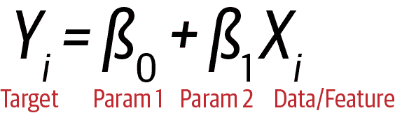
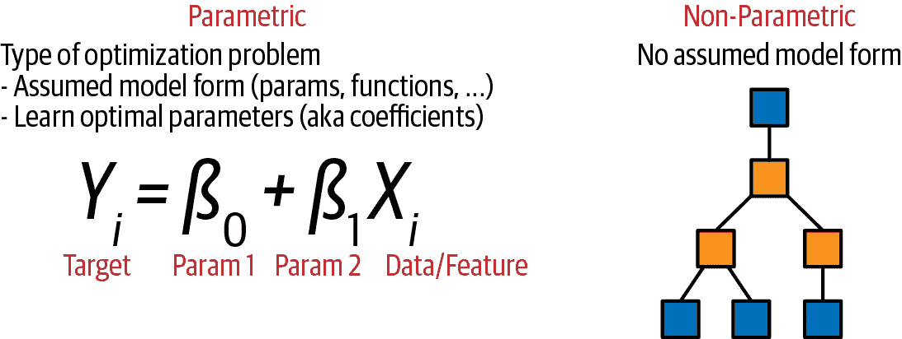
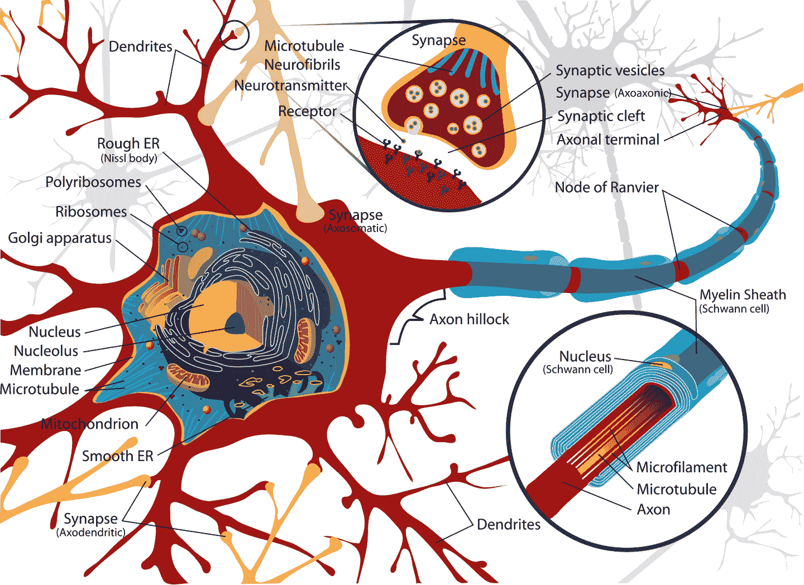
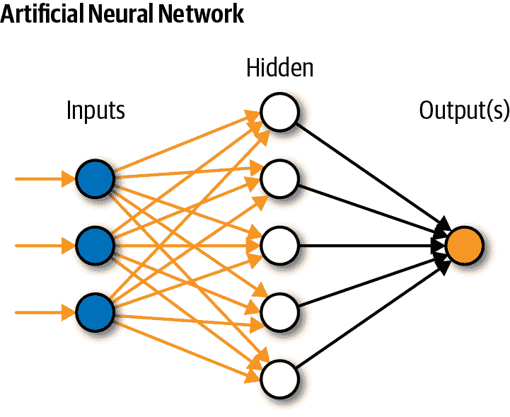

# Appendix A. AI and Machine Learning Algorithms
尽管计算机进行类人演绎推理、推理和决策仍然遥不可及，但在人工智能技术和算法的开发和应用方面已取得了显著进展。我们可以利用这些技术为现实世界问题创建极其强大且令人兴奋的基于人工智能的解决方案。

驱动人工智能和机器学习的算法，加上经过适当选择和准备的训练数据，能够以人类无法以其他方式创建的方式创建这些解决方案。正如本书中所讨论的，人工智能有许多不同的目标，每种目标使用不同的技术。

本附录面向任何有兴趣在高层次上了解人工智能和机器学习的技术细节的人士编写，包括启发并帮助形成人工智能领域的生物神经模型。尽管可能比本书其他内容更技术化，我的目标是以非技术人士能够理解的方式呈现信息。

本章的主要主题是如何机器学习、生物神经元和神经网络、人工神经网络以及深度学习。深度学习是用于构建人工智能解决方案的最令人兴奋和最有前景的算法技术之一；它代表了一种特殊的神经网络架构，我们将在本章中进一步讨论。首先，让我们开始了解更多关于机器如何学习的信息。

## Parametric versus Nonparametric Machine Learning
更技术化的机器学习描述是，它代表基于算法的学习技术，学习目标（或映射）函数，该函数将输入变量（特征数据）映射到一个或多个输出变量（目标）。

学习到的函数可以是参数化的或非参数化的。参数化函数的特点是模型在开始时就有一个假设的形式，其中形式包括项、函数和参数的数量和类型。

以下是我们中有些人在年轻时学过的直线的方程：

`y = mx + b`

该模型是参数化的，因为它具有预定的形式，其中包含两个参数（`m` 和 `b`），其中参数 `m` 在 `x` 的单一线性函数中以项 `mx` 给出。在这种情况下，`y` 被建模为 `x` 的线性函数，其中 `m` 表示直线的斜率（`x` 发生相应变化时 `y` 的变化），而 `b` 为 *y 截距*（`x` 等于零时 `y` 的值）。

图 A-1 以统计学和机器学习中更常见的形式再次展示了直线方程，通常被称为 *简单线性回归*。

该方程表示一个目标函数，其中 `Y[i]` 是目标，`X[i]` 是特征数据。因此，`Y` 的值是依赖的，并被建模为 `X` 的函数。

需要两个参数（`β[0]`、`β[1]`）来正确建模 `X` 与 `Y` 之间的精确关系。这相当于前面直线方程中的 `m` 和 `b`。请注意，我们可以创建其他预定义的参... 包含 `x` 提高到不同指数（例如 `x²`）的参... 和/或其中每个项是相加、相减、相乘或相除，例如。这里是一个复杂度增加的参数模型示例：

`y = θ[0]x - θ[1]x² + θ[2]x³`

非参数模型事先没有假设的形式，因此没有预定义的参...、函数或操作。图 A-2 总结了参数和非参数机器学习模型之间的差异。

让我们从高层次讨论不同类型机器学习技术的学习机制是如何工作的。

# 机器学习模型是如何学习的

在将监督机器学习应用于参数函数的情况下，机器学习算法的目标是找到最佳参数值——例如简单线性回归示例中的 `β[0]` 和 `β[1]`——从而创建性能最佳的模型；也就是说，该模型最好地描述了目标变量与特征变量之间的真实关系。找到最佳参数值是机器学习中的“学习”部分，而学习是可能的，这取决于所使用的机器学习技术（算法）和提供的数据。

非参数监督机器学习函数的特点是没有假设的形式。在某些情况下（例如决策树），机器学习算法实际上会在学习过程中生成模型形式，而在其他情况下，机器学习模型基于数据相似性；例如，根据与现有数据示例的相似性确定输出。`K`-最近邻是一种常用的特定算法，用于基于相似性的非参数机器学习应用。

无监督学习由多种算法方法执行，具体取决于应用类型。聚类应用基于高级数据分组算法，而异常检测则基于专门用于查找异常数据离群点的算法。

迄今为止讨论的所有示例都属于另外两个类别：*基于误差的* 或 *基于相似性的* 学习。基于误差的学习通过选择性能指标来工作，该指标表示机器学习模型的性能如何；也就是说，在预测分析的情况下，它预测正确的频率（例如准确率）。算法通过尝试最小化（通过损失函数）模型产生的误差来工作，在参数学习的情况下是通过找到最佳参数，在非参数学习的情况下是通过找到最佳模型和参数。基于相似性的学习通过确定数据点之间的最大相似性来工作，而不是使用基于误差的模型。

值得注意的是，统计学习这个术语有时与机器学习同义使用，有时则用于区分统计和概率学习技术，如线性回归。我们在此使用机器学习一词作为涵盖任何涉及机器从数据中学习而无需显式编程的应用的统称。

# 生物神经网络概述

人类大脑异常复杂，几乎可以说是已知最强大的计算机器。

人类大脑的内部工作原理通常围绕神经元的概念以及被称为生物神经网络的神经元网络建模。据估计，人类大脑包含大约 1000 亿个神经元，它们沿着这些网络中的通路连接起来。^(1) 图 A-3 显示了完整的生物神经元细胞图。

在非常高的层面上，神经元通过由轴突末端与树突跨越间隙（突触）连接而成的界面相互作用和通信，如图所示。一些估计表明，人类大脑拥有 [100 至 500 万亿个突触](http://bit.ly/2XqYmx1)，足以存储整个一生中学习的所有信息和形成的记忆。

用通俗的说法，如果一个神经元接收到的来自一个或多个神经元的加权输入信号之和（求和）足够大（超过阈值）以引起传输，则该神经元会将消息通过突触传递给另一个神经元。当阈值被超过且消息传递给下一个神经元时，这被称为 *激活*。

求和过程在数学上可能很复杂。每个神经元的输入信号实际上是潜在的许多输入信号的加权组合，并且每个输入的加权意味着该输入可以在任何后续计算中产生不同的影响，最终影响整个网络的最终输出。每个神经元还对加权输入应用线性或非线性变换。

这些输入信号可以以多种方式产生，我们的五种感官是最重要的一些，以及气体（呼吸）、液体（饮水）和固体（进食）的摄入，例如。一个神经元可能同时接收数十万个输入信号，这些信号经过求和过程以确定是否传递消息，从而最终导致大脑产生行动和认知功能。

我们大脑所进行的“思考”或处理以及随后给予肌肉和器官的指令是这些神经网络作用的结果。此外，大脑的神经网络会不断变化和更新自身，其中包括对神经元之间施加的加权量的修改。这直接是学习和经验的结果。

鉴于此，自然的假设是，要使计算机器复制大脑的功能和能力，包括“智能”，它必须成功实现这种神经元网络的计算机化或人工版本。这就是被称为人工神经网络（ANNs）的先进统计技术和术语的起源。

在继续介绍 ANNs 之前，值得重新审视人类如何学习。事实证明，大脑，特别是新皮层，从出生时起就是一个初始化的大规模生物神经网络，但它尚未学习，也没有随后发展出任何重大的理解和记忆。

当孩子开始观察周围环境并通过感知世界来处理刺激时，数十亿个神经元和数万亿个突触协同工作以学习和存储信息。这造就了我们理解和领会信息、识别空间和时间模式、产生思想并进行心理预测、回忆信息和记忆、基于回忆和预测驱动运动行为，以及在整个生命周期中持续学习的能力。这就是使人类智能的原因。^(2)

让我们现在讨论人类如何尝试用机器模仿这一自然现象。

# 人工神经网络简介

人工神经网络（ANNs）是构建人工智能应用的主要工具之一，并且正以许多强大而令人兴奋的方式被使用，本书中涵盖了其中许多方式。

ANNs 是直接受生物神经网络启发并部分建模于其上的统计模型。它们能够并行建模和处理输入与输出之间的非线性关系。相关算法属于更广泛的机器学习领域，我们可以在预测、自然语言处理和模式识别等许多应用中使用它们。

ANNs 的特征是可以通过学习算法（参数学习）进行调优的参数，该算法从观测数据中学习以构建优化模型。其中一些参数包括神经元之间路径上的权重以及称为偏差的值。超参数（可调模型配置值），例如算法的 `learning rate`，也可以进行调优以获得最佳性能。使用 ANN 时，实践者必须选择合适的学习算法以及所知的 `loss`（或 `cost`）`function`。

损失函数用于学习所解决问题的最优参数值。通常通过诸如 `gradient descent` 之类的优化技术来学习最优参数值。这些优化技术基本上试图使 ANN 解决方案尽可能接近最优解，当成功时意味着 ANN 能够以高性能解决预期问题；换句话说，就是预测准确性。

在非常高的层面上，梯度下降通过以算法化、策略性的方式尝试不同的参数值组合来迭代到整体最优参数组合，从而得到模型。尽管有点过于简化，但算法能够判断何时接近了最佳可能的参数组合，并因此停止迭代过程。

从架构上看，ANN 使用人工神经元层进行建模，即能够接收输入并应用激活函数以及阈值来确定是否传递消息的计算单元，与生物神经元和神经网络信息传播机制类似。

在 `shallow` ANN 中，第一层是输入层，其后是一个隐藏层，最后是输出层。每一层可以包含一个或多个神经元。术语“隐藏”用于表示该层位于输入层和输出层之间，并且该层将其自身的输入值转换为下一层的输入值。该术语还指隐藏层输出值相对于网络人类可理解的输入和输出值而言既不易解释也不易说明。

图 A-4 显示了一个简单 ANN 的示例。

例如，可以通过添加隐藏层和/或在任意给定层中添加神经元来修改 ANN 模型架构以解决更广泛、更复杂的问题。请注意，随着模型复杂度的增加，`overfitting` 的可能性也会增加，这意味着模型在训练数据上表现良好，但在新的未见数据（例如测试数据和/或真实世界数据）上表现不佳。

从输入到输出发生的变换链被称为信用分配路径，或 CAP。CAP 值是深度学习模型架构中“深度”这一度量或概念的代理，表示隐藏层数加上输出层数。[深度学习](http://bit.ly/2ICH3kx)通常指的是 CAP 大于二的神经网络架构；即超过两个非线性变换（隐藏）层。

因此，模型架构和调优是 ANN 技术的主要组成部分，除实际学习算法本身之外。ANN 的所有这些特征都可能对模型的性能产生重大影响。

此外，ANNs 的特征在于用于将神经元的加权输入转换为其输出激活的激活函数，并且该函数可调。可以用作激活函数的变换类型有很多种。

值得注意的是，尽管 ANNs 极其强大，但它们也可能非常复杂，被认为是黑盒算法，这意味着其内部工作原理非常难以解释、理解和说明。因此，在决定是否采用 ANNs 和深度学习来解决问题时应考虑到这一点。

# 深度学习简介

深度学习虽然听起来很时髦，实际上只是一个描述具有两个或更多隐藏层的神经网络的术语。深度学习进一步以原始输入数据的消耗以及不同类型的架构和相关算法为特征。这些深度网络通过多层非线性变换处理数据，以便在监督情况下计算目标输出。深度学习能够使用数据完成人类使用其他技术无法完成的事情，并且截至本文撰写时，是人工智能研究和开发的热门领域。

更一般地说，深度学习代表了一组被称为 `feature learning` 或 `representation learning` 的技术。特征学习算法能够从原始数据中学习特征，换句话说，是学会如何学习的算法！深度学习的这一特性在人类极难或不可能为特定应用选择或设计适当特征时非常有用。特征学习算法的好处在从非结构化数据（如图像、视频、音频以及以数字文本形式存在的语言）中学习时体现得最明显。在这些情况下，深度学习算法会自动学习特征并将其用于特定任务，例如图像分类。

对于深度学习神经网络，其层数多于被称为浅层的学习算法。浅层算法往往复杂度较低，需要更多关于应使用哪些最优特征的先验知识，这通常涉及特征选择和工程。相比之下，深度学习算法更依赖于通过模型调优进行最优模型选择和优化。它们更适合解决先验特征知识较少需要或不必要的问题，以及在主要用例中标签数据不可用或不需要的问题。

图像识别是一个很好的例子。让某人编写一个显式编程的算法来测试图像中所有像素、不同大小（区域）和位置的像素分组以及颜色变化以识别和检测猫是非常困难的，甚至是不可能的。原因是算法需要知道如何在图像中寻找猫的许多不同特征；例如胡须、尖耳朵和猫一样的眼睛。这些特征在大小和形状等方面因猫的类型和年龄而异。

实际上，算法首先需要检测更小、更简单的特征，例如线条（垂直、水平、对角线）、曲线、几何形状等等。组合起来，这些简单特征可以表示猫的面部和头部特征，如所述，而当这些特征组合起来时，可以表示猫的图像。与严重依赖特征选择和特征工程的显式编程代码不同，深度学习能够仅通过提供充足的训练数据集，自动学习并创建这些较小特征的表示和组合。最终结果是一个能够识别图像中猫的 ANN，这确实令人惊叹。

更具体地说，可以认为网络的每一层都能学习有助于给定神经网络整体目标的特征和组件。例如，假设你正在训练一个神经网络来识别图像是否为猫。一层可能只是学习不同的低级模式，例如直线和曲线，而下一层可能学习找到不同的特征，例如眼睛和鼻子，下一层是特征组，例如面部或躯干，然后最终将所有内容整合起来以确定图像是否为猫。因此，网络能够按层次从简单到复杂地学习特征，然后将它们组合成整体解决方案。

深度学习算法的另一个重要好处是它们擅长建模输入与目标输出之间非线性且可能非常复杂的关联。物理宇宙中观察到的许多现象实际上最好用非线性变换来建模。几个非常著名的例子包括牛顿万有引力定律和阿尔伯特·爱因斯坦著名的质能等价公式（即 `e = mc²`）。

值得一提的是，深度学习也有一些潜在的缺点。最突出的是，深度学习可能需要非常大量的训练数据、计算资源（成本）和训练时间。此外，深度学习算法被认为是在使用的最黑的黑箱算法之一，这使得可解释性、可说明性、诊断和可验证性在大多数情况下基本不可能。

还值得注意的是，单隐藏层神经网络，即我们之前提到的浅层网络，可以执行与深度网络相同的许多学习任务。也就是说，为了能够执行与深度网络相同的任务，浅层网络可能需要一个极其宽的单隐藏层，包含过量的神经元，这很可能远不如深度替代方案在计算效率上高。

与神经网络和深度学习相关的一种重要学习类型称为 *迁移学习*。迁移学习是一种非常有用的技术，尤其在给定应用所需的标注数据供应不足时特别有效。

我们在书中前面讨论了特征空间的概念，它指的是用于特定问题的的数据集中所包含的所有特征中可能的特征-值组合的数量。不仅每个特征的值跨越一定的值范围（或空间），每个特征的值也可以通过某种类型的分布来表征。

通常在机器学习应用中，训练数据应代表模型在现实世界中可能看到的数据，就特征空间和每个特征的分布而言。有时，很难获取满足这些要求的特定领域数据，而来自另一个相关领域的数据则大量可用，并且在深度学习应用的背景下足够相似。

在这种情况下，深度学习模型可以在广泛可用的数据上进行训练，然后所学知识可以转移到新模型中，该模型基于较少可用的特定领域数据对所学知识进行微调。此外，迁移学习非常适合重用所学知识以加快训练时间。

# 深度学习应用
现在借助深度学习模型架构和算法，已经可以实现许多不同的通用应用。虽然详细讨论超出了本书的范围，但以下是其中一些更有趣的应用列表；更多应用在 *深度学习：实践者指南* 中进行了讨论：^(3)

* 音频到文本转录
* 语音识别
* 音频和文本分析
* 情感分析
* 自然语言翻译
* 生成句子
* 手写识别
* 图像建模和识别
* 合成人工图像、视频和音频
* 视觉问答

深度学习也在许多特定应用中取得了成功，包括：

* [从视频中读唇](http://bit.ly/2IZsOFs)
* [汽车语音识别](https://zd.net/2XBeqwB)
* [从照片和视频中读取文本](https://zd.net/2XBeqwB)
* [在数千只物种中识别个体动物](http://bit.ly/2XlHDLR)

# 摘要
总体而言，机器学习确实非常强大且令人惊叹，特别是考虑到它能够从数据中学习并在无需显式编程的情况下执行任务。也就是说，深度神经网络能够建模非常复杂、非线性的关系，并且能够自动从原始数据中提取特征以有效“学会学习”，这正是深度学习模型区别于其他模型的原因，也是为什么人工智能今天最常与深度学习联系在一起的原因。

尽管神经网络和深度学习作为首屈一指的人工智能算法技术占据主导地位，但它们并不是人工智能工具箱中唯一的先进技术。非神经网络的例子包括与强化学习和自然语言相关的算法，例如。

^(1) [*https://www.ncbi.nlm.nih.gov/pmc/articles/PMC2776484/*](https://www.ncbi.nlm.nih.gov/pmc/articles/PMC2776484/)

^(2) Hawkins, Jeff, and Sandra Blakeslee. *关于智能*. New York: Times Books/Henry Holt. 2008.

^(3) Patterson, Josh and Adam Gibson. *深度学习：实践者指南*. O’Reilly Media, 2017.
