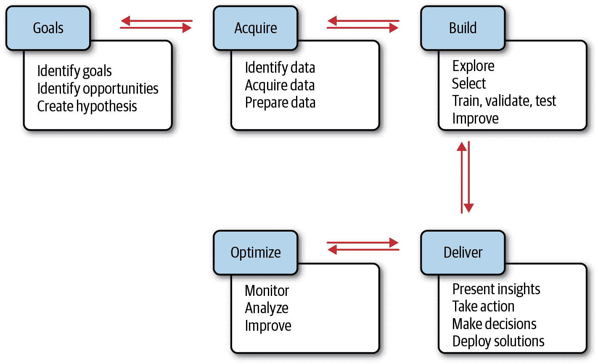

# 附录 B. 人工智能流程
本章介绍我创建的一种人工智能和机器学习流程模型，称为 *GABDO 人工智能流程模型*。GABDO 模拟了实际准备、开发、交付和改进特定人工智能和机器学习任务和项目的端到端流程。

你可能会遇到该流程的其他变体，例如 CRISP-DM 和数据库中的知识发现，即 KDD。现有的流程模型很棒且被广泛使用。也就是说，我发现人工智能、机器学习和数据科学的大多数资源和内容主要面向实践者，例如数据科学家和机器学习工程师。因此，我创建 GABDO 模型的动机不是重新发明轮子，而是以我认为更适合高管和管理人员的方式重新构想流程。

在此，我介绍 GABDO 人工智能流程模型。我在模型名称中仅提及人工智能，因为机器学习可以被视为人工智能的子集，因此这里介绍的所有内容都适用于机器学习和其他人工智能技术。

## GABDO 模型
图 B-1 显示了 GABDO 人工智能流程模型。

# GABDO AI 流程模型

GABDO AI 流程模型由五个迭代阶段组成——目标、获取、构建、交付、优化，因此用缩写 GABDO 表示。每个阶段都是迭代的，因为任何阶段都可以回溯到一个或多个之前的阶段。每个阶段的典型持续时间高度依赖于许多因素，包括 AI 和科学创新的科学性、经验性和非确定性。尽管如此，一些阶段可能只需要几天的时间（例如，识别目标、识别数据），而另一些可能需要数周（例如，识别机会、准备数据、探索数据），还有一些可能需要数月甚至数年（例如，创建和优化机器学习模型以及完整的生产级 AI 解决方案）。

你可能会注意到，与 AIPB 相比，GABDO AI 流程模型具有一些明显的相似性和看似重叠之处。GABDO 流程模型可以在执行模块化 AIPB 方法论组件阶段时使用，尤其是在构建、交付和优化阶段。关键区别在于，AIPB 是一个战略框架，旨在指导宏观的基于 AI 的业务举措，而 GABDO 流程模型是一个战术层面的模型，旨在指导具体的 AI 和机器学习项目或任务。

让我们从高层次讨论每个 GABDO 阶段，包括与其相关的步骤。

## Goals

第一个阶段用于识别高优先级的目标和机会，并围绕特定的 AI 方法以及利用最高优先级机会实现预期目标所需的数据制定假设。

### Identify Goals

此过程的第一步是识别关键目标。这些可以是本书记述的或一般讨论过的任何利益相关者特定目标，其中利益相关者可以是企业、客户和/或用户。识别关键目标通常在执行层面对顶层业务目标进行处理，尽管通常需要创建更细粒度的目标，以便识别和追求特定的机会和相关项目。定义这些目标以及接下来所述的潜在机会，必须由业务人员、领域专家和 AI 从业者协作协助。

### Identify Opportunities

下一步是识别利用数据和 AI 在适当粒度上实现最高优先级目标的潜在机会；也就是说，创造与目标一致的利益和成果。这首先要从提出正确问题开始。以下是一些示例：
* 我们可以追求哪些 AI 机会？
* 这些机会有哪些数据可用或需要？
* 对于每个机会可以尝试哪些模型和技术？
* 每个机会需要多少潜在时间和精力（这可能非常粗略或无法估算，因为它高度依赖于 AI 的科学性质，也取决于我们所讨论的 AI 就绪度和成熟度）？
* 每个机会的潜在价值和投资回报率是多少？

识别相关的业务和个人用例也应是识别机会的一部分。我们在本书前面已经讨论过两者。

### Create Hypothesis

在以适当粒度识别关键目标并列出优先排序的潜在机会后，下一步是创建一个作为项目进行测试的假设。这将有助于验证机会并确保它们是可行、可实现的且值得追求的。

#### Example

下面是一个我们将在整个 GABDO 讨论中使用的示例。播客正变得越来越受欢迎。假设，我还拥有一家围绕播客收听平台建立的公司，该平台具有移动和桌面界面，可用于探索、订阅和收听播客。平台还会通知用户他们订阅的播客发布新集。我希望该平台为播客听众提供最佳体验，以至于他们愿意为此平台支付溢价，而非选择更常见且免费的选项。

假设我注意到，我目前的客户获取和留存（即粘性）水平未能达到满足我公司战略增长目标的要求。在这种情况下，我的关键目标是提高客户获取和留存。实现这些目标当然可以通过打造优秀的产品和高度愉悦的 UX 来实现，从而证明溢价合理。进而，这将最终有助于打造一家成功且盈利的公司。

现在我们已经确定了客户获取和留存的主要目标，关键是如何具体利用 AI 和机器学习技术来实现这些目标——也就是说，如何基于我们可用的数据和高级分析成熟度识别可测试和验证的机会。

假设由于播客在众多不同类别中的爆炸式增长，用户面临选择过载（即分析瘫痪），因为有如此多跨越极其广泛类别、流派和主题的播客可供选择。一个很好的问题是，如果有更好的基于 AI 的方式来创建高度个性化的播客推荐，帮助用户快速找到新的有趣播客来收听，同时提供一流的 UX 和设计会怎样？

一个具体的基于 AI 的想法和潜在机会是通过使平台更个性化、有用且愉悦来吸引新用户并帮助留住现有用户（更具粘性）。如果 Netflix 是一个恰当的例子，这绝对应该是结果。我们现在已经确定了一个非常有前景的机会——通过全新的、设计精良的播客推荐系统提高客户获取和留存。

不过，我们在这里可能做出了一些冒险的假设，即我们计算出该推荐系统在构建完成后将具有期望的用户利益并对我们的目标产生影响。继续我们的思考过程，提供个性化推荐应该能消除用户在寻找自己可能喜欢的新播客时的大量猜测、劳动和搜索摩擦。它还可以节省大量时间，因为用户无需点击每个看起来有趣的播客来阅读更多信息。

鉴于我们的想法、推理和逻辑，以及我们可尝试使用的特定数据和 AI 技术方面的经验和专业知识，我们现在有一个可以测试的假设，以查看我们是否识别出了一个值得追求以帮助实现目标的真正机会。这将是我们基于 AI 的项目。下一步，数据。

## Acquire

下一个阶段是识别、获取和准备构建阶段所需的 AI 就绪数据，并测试我们的假设。

### Identify Data

第一步是识别数据。这意味着识别可用于给定项目的可用且可能有用的数据源。这还包括识别这些数据源的“所有者”（例如，营销、销售）以及与谁合作以获取访问权限，这可能包括获取访问凭证并了解获取数据所需的方法（例如，BI 工具、SQL、API）。这还包括识别任何潜在的外部数据源，这些数据源可以增强和/或单独用于应用程序。最后，这一步可能需要识别生成和收集新数据的方法，如果所需数据尚未可用（例如，物联网）。

### Acquire Data

# 获取数据
下一步就是简单地获取在识别步骤中确定的数据，这包括数据摄取和集成。这是将数据从其来源移动到更适合高效准备和高级分析的另一个数据存储的过程（通过 ETL 和 ELT 流程），并集成（合并）来自不同来源的数据。例如，可以使用查询、数据转储/导出和 API 等方式获取数据。最终的数据存储可以是本地计算机（例如数据科学家的笔记本电脑）、云计算机/数据库、数据仓库或数据湖。

# 准备数据
最后一步是为 AI 项目准备数据，在我们的示例中即创建推荐系统。我们在本书前面关于驱动 AI 的数据讨论中已经讨论了此步骤的许多方面。潜在步骤包括数据清洗、数据整理、特征选择和特征工程。

## 示例继续
以我们的播客示例为例，我们需要为每个平台用户获取并准备与其参与度指标相关的数据，例如播客订阅、收听的类别、播放的剧集以及收听活动的频率。理想情况下，我们还可以获取并准备每个用户偏好的数据（他们自愿且有意为此应用程序提交的），最后，还需要为我们平台分发的全部播客准备特征数据（例如播客长度、类别、评分）。

# 构建
在此阶段，适当的数据已被获取并准备好用于使用 AI 技术测试不同的假设。希望其中一个假设得到验证，并且可以构建出能够利用最高优先级机会并实现预期目标的交付成果。

构建阶段用于探索已获取和准备的数据，选择模型和性能指标，确定初始模型设置，基于相关假设训练/验证/测试模型，并改进 AI 模型和应用。为简单起见，以下讨论中我们将假设使用机器学习技术，但请注意并非所有 AI 技术和应用都是基于机器学习的。

## 探索
下一步是更好地理解用于测试给定 AI 机会假设的数据（请记住 TCPR 模型的数据依赖性？）。此步骤通常被称为探索性数据分析（EDA）。此步骤涉及使用描述性统计、汇总统计和数据可视化等工具。汇总统计是总结特征变量和目标变量信息的数值，例如均值、中位数、标准差、方差、最小值、最大值和范围。

更一般地说，此步骤旨在更好地理解数据的潜在关系、相关性和分布，在监督机器学习的情况下为特征和目标数据，或在无监督机器学习应用的情况下仅为特征数据。这些信息非常有用，可以帮助在流程继续进行时做出关键决策。探索还有助于暴露数据的任何潜在问题，例如异常值（aka anomalies）、错误值和错误。

## 选择
流程的下一步是做出适当的 selections 来测试每个假设。这分为三个步骤：模型选择、性能指标选择和初始模型参数选择。请注意，在此上下文中，算法和模型这两个词经常可以互换使用（例如，选择一个算法），尽管你也可以将算法视为训练和优化特定模型的技巧，而将模型视为用于实际应用的算法驱动学习、训练和改进过程的输出。为简单和一致起见，我们使用模型这一术语。

由于我们的示例涉及建模步骤，我们的第一步是选择合适的模型类型进行尝试。对于推荐系统，选项包括基于协同和基于内容的过滤，但也有其他方法（例如矩阵分解）。值得注意的一点是，所选模型可能不如本书前面讨论的其他因素重要，例如数据质量和特征选择。

通常会选择多个模型进行测试并相互比较，以获得最佳性能。这里非常重要的一点是，如果一个模型不适合表示数据的潜在关系、相关性和分布，无论有多少数据，它可能永远不会成功。例如，尝试用直线模型（例如 `y = mx + b`）拟合具有高度非线性关系的数据。在这些情况下，神经网络和深度学习方法可能更合适，前提是它们适用于特定的机会和应用类型。

选择模型时需要考虑以下几点：
* 透明度、可解释性和可说明性的重要性
* 在可能的情况下，简单性（aka parsimony）优于复杂性的重要性
* 速度（训练、测试和实时处理）、成本和资源需求的重要性
* 可扩展性的重要性

一个好的做法是从简单模型开始，然后根据需要并仅在必要时增加模型复杂度。通常应优先考虑简单性，除非使用日益复杂的模型可以实现重大的性能提升。

模型性能可以以多种方式定义，但一般而言，模型性能是指模型实现给定问题目标（例如预测、分类、异常检测、推荐）的有效程度。由于每个问题的目标可能不同，性能度量也可能不同。一些常见的性能度量包括准确率、精确率和召回率。

此步骤还要求选择一个性能指标，可用于评估给定模型的性能，也可用于与其他模型或甚至调优不同的同一模型进行比较。几乎总是最好使用由单个值表示的性能指标（例如 F-score）。

就像可以通过调整空气动力学尾翼角度、前后弹簧刚度和静态定位设置等来使赛车跑得更快一样，机器学习模型也可以进行调优以提高性能。许多模型包含可调配置参数，通常称为 *hyperparameters*，它们允许从业者调整模型学习和得出解决方案的各种特征。选择初始超参数值集合是选择步骤中必须做出的最后选择。我们在下一节中进一步讨论此问题。

## 训练、验证、测试
下一步是训练、验证和测试模型。通常用于模型训练的数据会被分成两个或三个子集。它们分别是训练、验证和测试数据。从原始完整数据集中各部分的比例可以根据从业者的选择而变化，但一个例子是 60/20/20 分割，其中 60% 的数据用于模型训练，然后剩余数据的 20% 用于模型验证，20% 用于模型测试。

训练数据子集由模型用于学习——在参数机器学习的情况下为预定义参数，或在非参数机器学习的情况下一般学习模型和参数。在此步骤中影响潜在性能的主要因素是数据就绪度和质量、所选建模技术以及初始模型超参数设置。

模型训练完成后，验证数据子集通常用于两个目的：一是验证调整不同超参数对性能的影响，二是确保模型能够在新的、未见过的数据上表现良好（即与模型训练时使用的数据不同）。模型在新的、未见过的数据上表现良好的能力（即泛化能力）至关重要，因为模型旨在泛化到其在现实世界中会遇到的任何数据，而这些数据可能与训练期间使用的数据不同。模型性能的最终估计是通过在分别使用训练数据子集和验证数据子集进行训练和调优后，将模型与测试数据子集进行测试获得的。

当模型在训练数据子集上表现非常好，但在新的、未见过的数据（如验证或测试数据集中使用的数据）上表现不佳时，模型被认为存在 *过拟合* 或 *欠拟合*，在机器学习的更技术性讨论中，有时将其称为 *偏差与方差权衡*。这个主题可以更详细地讨论，但我们简单地说，总体目标是构建一个模型，使其在训练数据和新的、未见过的数据（例如验证、测试和现实世界数据）上表现同样良好。

# 改进
最后一步是改进有前景的模型的性能。这是通过诸如额外的超参数优化技术等流程完成的，也可以通过数据集精炼、特征选择、特征工程和其他技术进行微调。

## 示例继续
在我们的播客示例中，在探索数据并测试许多不同方法之后，我们找到了在现有数据和预期结果下效果最好的技术。在开发过程中评估推荐系统的现实世界结果有点困难，因此我们需要将其部署到生产平台，以便真实用户开始与其交互，我们也能更好地了解其性能。

# 交付
流程的下一个阶段是为特定 AI 项目交付成果。交付内容可能因具体情况而异。GABDO 模型定义了四个步骤，这些步骤特定于结果，因此可能并非所有步骤都适用于某个 AI 项目。

## 呈现见解
对于在构建阶段生成可操作见解的情况，应将见解交付给利益相关者。这可以简单到口头、书面或两者兼顾地传达结果。手动或自动创建的报告也可能是另一种交付物。最后，可操作见解可以以数字格式呈现，例如仪表板或移动应用。

## 采取行动
如果不采取行动，可操作见解就毫无价值。杠杆本应被拉动，而确定拉动哪些杠杆以及拉动多少是高级分析的绝佳应用。采取数据和所生成见解建议的行动；这是变得更加数据驱动和以数据为依据的关键步骤。

## 做出决策
如果见解建议采取行动，而采取行动意味着做出决策，那就去做吧。以数据为依据和以数据驱动的决策制定是游戏规则的改变者，相较于基于历史先例、简单分析和直觉的决策制定而言，有显著改善。

## 部署解决方案
许多使用 AI 的应用涉及创建高性能机器学习模型，这些模型可以作为独立应用程序部署，或集成到生产解决方案中。我们在书中前面已在 AIPB 的背景下详细介绍了将 AI 解决方案部署到生产环境的内容。在 GABDO 流程模型的战术性、项目化背景下，我们简单地将解决方案称为 AI 交付物。

### 示例继续
在我们的播客示例中，我们将采用表现最好的推荐引擎和 UX/UI 设计并将其部署到我们的平台，以便用户开始接收高度个性化的推荐，这些推荐以一流、令人愉悦的 UX 呈现。

# 优化
对于已部署的 AI 交付物而言，最后一步是随着时间的推移进行改进和优化。在 AIPB 中，优化阶段超出了仅优化单个机器学习模型，例如。它适用于整个解决方案及其所有方面（例如，对目标和业务 KPI 的影响、UX 和愉悦感、客户保留和增长）。优化阶段的步骤是监控、分析和改进。

## 监控
需要考虑的一个非常重要的问题是，今天表现良好的模型明天可能就不再表现良好。这是由多种因素造成的。首先，事物会随着时间而变化。变化通常是由于趋势变化（例如，购买行为、流行产品）、技术进步、收集的数据（例如，特征、粒度）、人们的兴趣和行为以及季节性和其他时间相关和事件相关的影响所致。当这种情况发生时，生产模型看到的新数据和不可预见的数据可能与模型训练和测试时使用的数据不同，从而导致模型性能下降。这通常被称为 *模型漂移*。

为了捕捉模型漂移，强烈建议开发并实施性能监控解决方案。理想情况下，该解决方案应能够随时间报告模型性能，并在性能出现显著下降时发出警报。拥有这些信息将使从业者能够训练新模型并更新生产中运行的模型。

另一种方法是以适当选择的节奏或作为自动化流程定期更新生产模型。这也是一个很好的选择。总之，监控应始终到位。

## 分析
如果无法确定是否创造了价值、创造了多少价值以及持续了多久（正如有些人所说，没有什么能永远持续），那么开发能够将数据转化为价值的 AI 交付物就意义不大。这就是制定成功指标或 KPI 来衡量价值、投资回报率和提升幅度至关重要的地方，同时还需要定期分析这些指标以获得见解并推动未来的行动和决策以实现改进和优化。值得一提的是，成功指标可以是定量的，也可以是定性的。

分析和生成的见解也可能表明某个产品或功能应被放弃，这是一个完全合理的结论。时间、金钱等宝贵资源不应被浪费，而应更好地投入到能够帮助实现预期目标和成果的举措和项目中。

## 改进
AI 交付物部署到生产环境后，应持续改进和优化。优化是指改进程度最大化；也就是说，在特定时间点上尽可能地改进某事物。

潜在改进和优化的指导和建议将来自适当的监控和分析，如前所述，也来自与合适的业务人员、领域专家和 AI 从业者持续的合作。

### 示例继续
现在我们已经为播客平台开发并部署了生产推荐系统，并假设我们已实施监控、跟踪和分析机制，以帮助我们真正了解新推荐系统的表现。我们的分析策略包括手动（数据科学）和自动化（预测/规范分析）分析。这些围绕交付物性能的分析将有助于做出以数据为依据和以数据驱动的交付物改进和优化。

具体来说，我们需要了解我们的推荐系统是否已为用户提供了额外价值（收益），并因此帮助我们实现了获取和保留目标。让我们逐一讨论这些内容。

为了客户获取，我们可以使用的一个简单指标是在给定时间段内的新用户注册量。我们将特别关注部署 AI 交付物以来，月度新增注册用户数量的变化，以了解注册用户平均增长情况。这应该能让我们对投资回报率有一个相当不错的了解，但值得注意的是，它更多地显示的是效果而非原因。以提升客户获取为目标，可能需要营销、UX 和 UI 更新以及相关活动来告知潜在用户这一出色的新功能及其优势——特别是让他们在众多平台中选择你的平台。获取用户数量的增长并不完全取决于、或仅仅源于构建一个酷炫、有用的新功能。

另一方面，留存则有更多潜在的指标可供分析。示例包括围绕用户参与度开发指标，例如平台使用频率、每次会话的平台停留时间、查找并订阅新播客（与转化相关的指标）、使用应用时的用户行为和流程，以及流失率降低。

# Summary

我们已涵盖 GABDO AI 流程模型的全部阶段和步骤，并提供了相关示例。该流程的目标是为、开发、交付和优化与高优先级目标和机会相一致的 AI 项目做准备。
