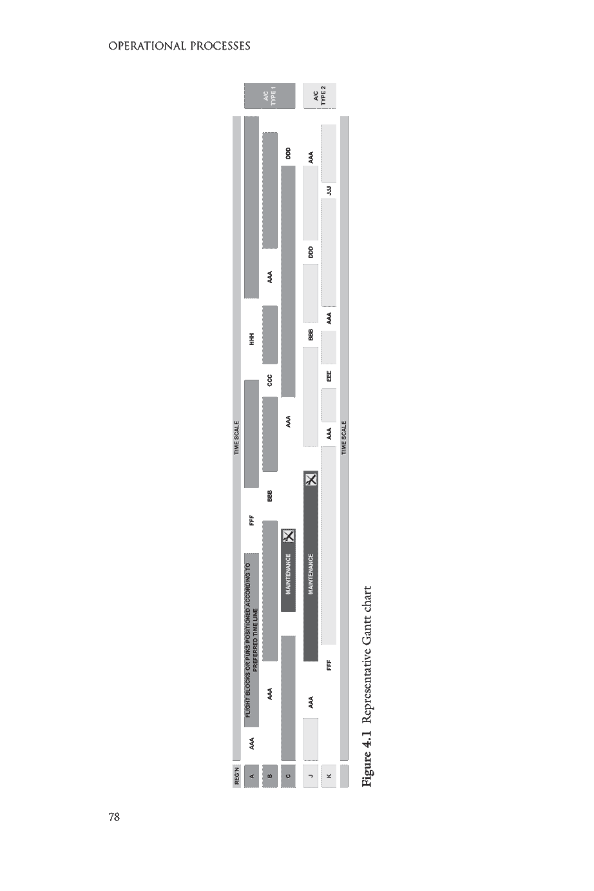
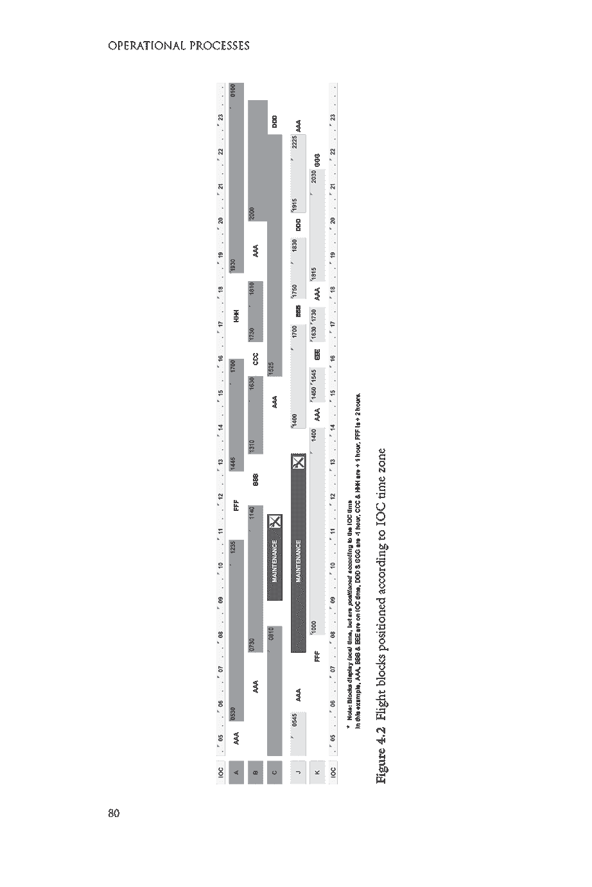
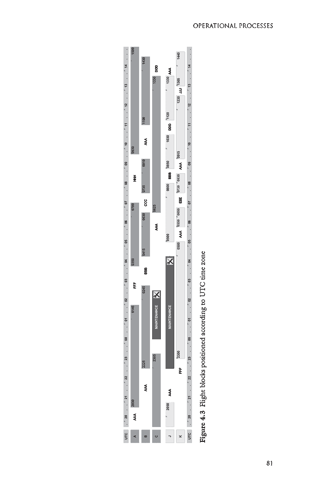
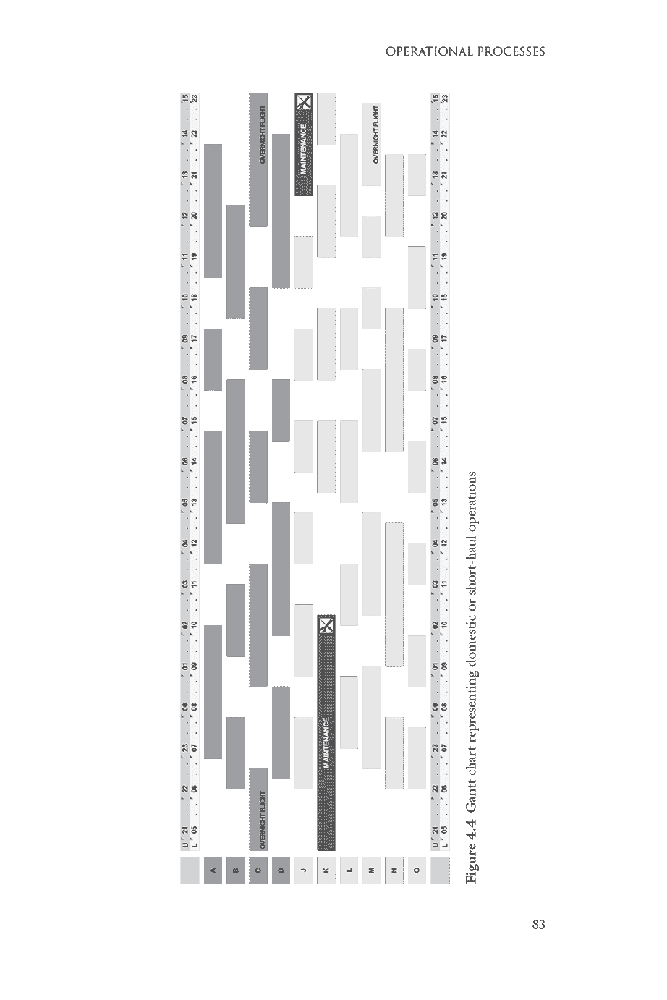
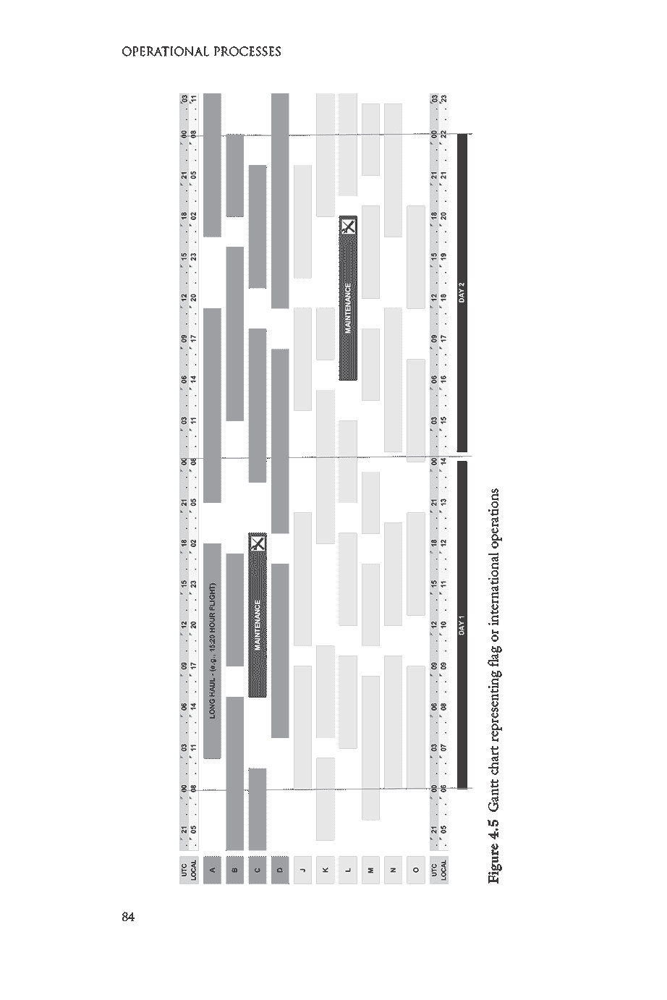
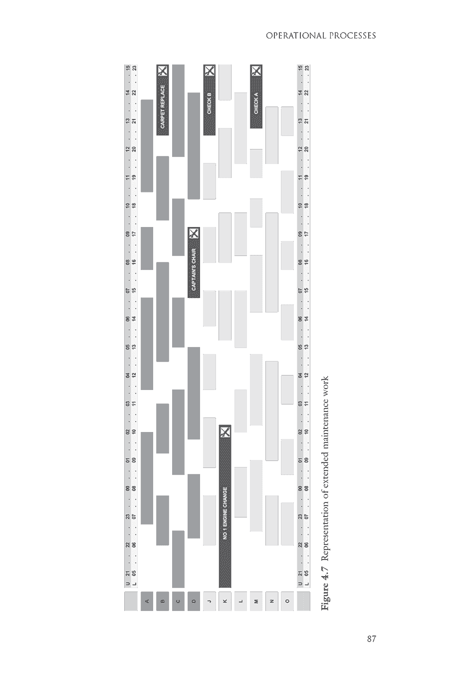
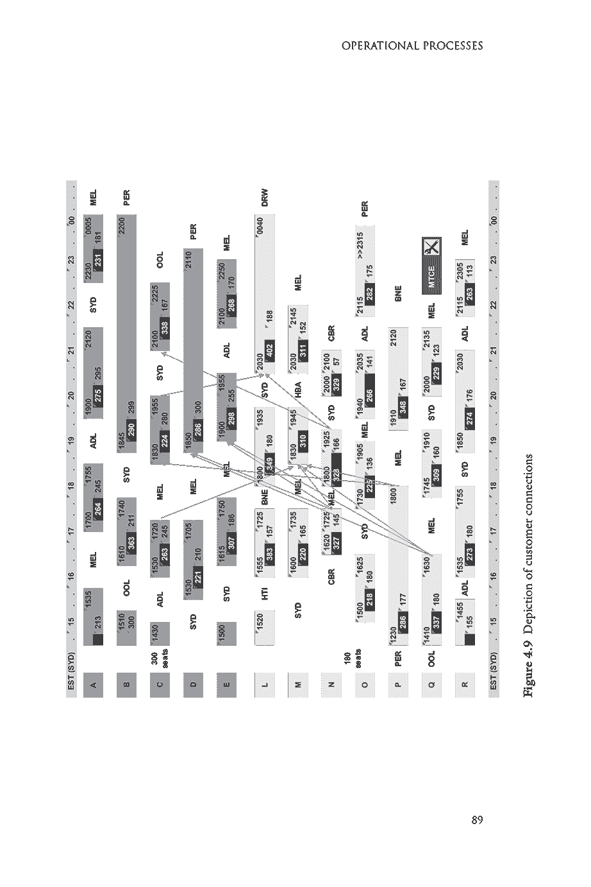
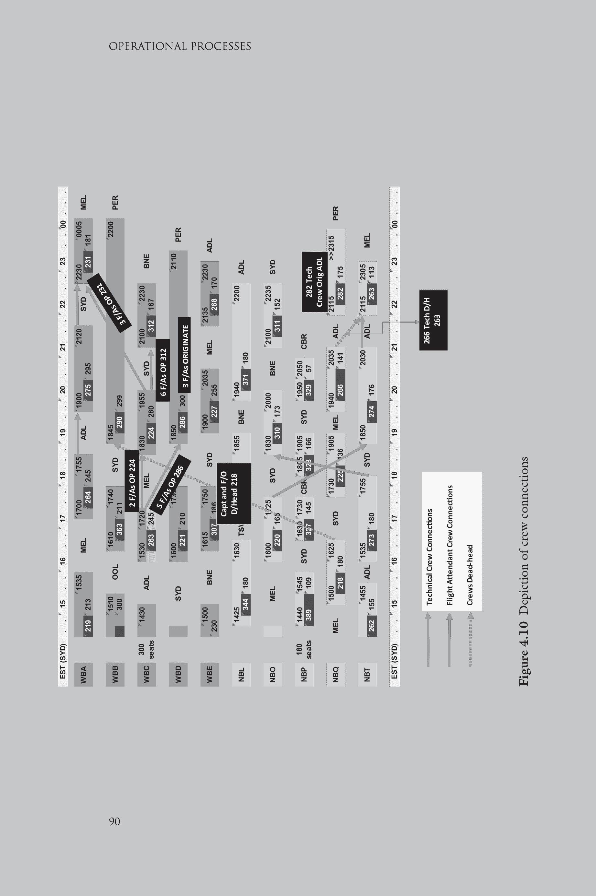
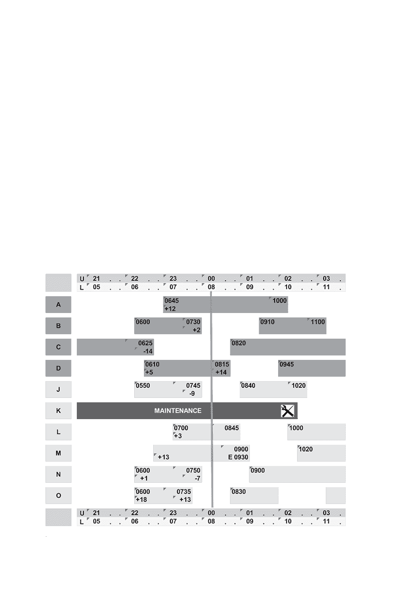

# 75 4 运行流程

## 简介

本章详细描述了 IOC（运行控制中心）日常遵循的流程。正如上一章所见, 为运行日所做的大量准备工作, 实际运行当天所涉及的流程处于微妙的平衡之中。一方面, 工具和系统已就绪, 旨在按计划运行航班, 预期一切将完全按预定方式执行, 所有人为、技术和环境因素都将助力而非干扰计划。这就是理论。然而, 任何从事该行业或乘过飞机的人都会深知, 有太多干扰因素会介入。本章先描述常态运行所涉及的流程, 然后展示可能出错的问题的巨大规模, 以及这些问题对航空公司资产、资源和旅客产生的级联效应。

## 运行授权与自主权

考虑到航空公司已投资建立 IOC 结构, 并承诺为其提供装备、资源和支持, 一个有时被视为理所当然的关键要素是 IOC 所需具备的自主权性质, 以便其做出明智且独立的决策。IOC 是一个拥有实质权力、可管理航空公司航班网络日常各方面的专业中心。高层管理的态度必须是认识到 IOC 需要拥有真正的授权, 可在无需任何干预的情况下自主决策。换句话说, 应让他们专心做好自己的工作。但这并不意味着 IOC 应在真空中运行, 或不受公司政策或其他形式的公司指导影响。事实上, IOC 需要已从一个部门职能转型为完全负责以航空公司为中心决策的关键工具, 其在航空公司结构中的融合性质至关重要。

## 系统与工具

对于这样一个关键职能部门, 可用资源必须充分满足手头任务的需求。因此, IOC 通常配备多套专用系统和工具, 往往由多家软件供应商提供。尽管每个系统都可能针对各职能需求量身定制, 但供应商传统上专注于独特产品, 导致集成这些系统对航空公司而言过于繁琐且成本高昂。结果是这些独立系统无法彼此有效通信。直到近年, 供应商才开始提供更全面的产品套件, 但即使这些套件在范围上仍有限制, 或无法满足某些职能领域的需求。

## 通信

### IOC 与飞机之间

高效快捷的通信是信息感知、处理和传播的关键, 辅助此项工作的工具对于确保效率在运行环境中得到适当转化至关重要。过去, 与飞机的通信通常在有 VHF 或 HF 无线电频率时进行。有时飞机超出 VHF 范围, 而 HF 充其量也有限。如今的机队通常装配有 `ACARS`（飞机通信寻址与报告系统）设备, 和/或 `SATCOM`（卫星电话）。在非 SATCOM 飞机上, 机组也可使用带有 `WIFI` 的便携设备。因此, IOC 与飞机之间的通信可在全球几乎任何地方持续进行, 成为机组需向 IOC 报告飞行相关情况, 或 IOC 需联系机组以预先采取某些行动时的重要工具。若飞行中出现安全事件, 这也是一个有用的工具。

### IOC 内部

过去, 调度员与机务、维修等其他职能部门之间的通信, 往往通过电话, 甚至依赖亲自前往那些区域并携带手写信息或请求——这是一个极其低效、耗时且极易出错的过程。现代技术极大地改进了这一过程, 凭借先进的电信设备, 与所有关键利益相关者的快捷沟通已司空见惯。当然, 如今 IOC 这一实体也意味着关键利益相关者之间的沟通不仅清晰快速, 而且因成员间的近距离办公, 几乎不留误解或误读的空间。各方共享的系统还能实现对当前或新出现活动的共同理解, 这将在后续章节中解释。

## 甘特图

IOC 使用的主要工具一直是且仍是甘特图, 以其创始人亨利·甘特（Henry Gantt，1861–1919）命名, 他创建该工具以协助规划大型基础设施项目。1 众多供应商创建并开发了航空相关的运行工具, 大多基于甘特图, 因其清晰的显示和海量的关键信息, 有利于在动态环境中查看、解读和操控飞行时刻表。其中包含的信息因航空公司规格和供应商能力而异, 通常有一系列用户可修改的参数, 如调整时间刻度以适应偏好、颜色和详细程度、缩放能力、数据筛选等。


# 运营流程：甘特图



**图 4.1** 典型甘特图

## 理解甘特图

该图表用于运营的目的是提供一种综合手段，用于在一段时间内显示航空公司的机队和时刻表。为此，构建了一个描绘航空公司航班时刻表的矩阵结构。时刻表由一系列单独的块（有时称为“PUK”）表示，这些块按照出发和到达时间组织。机队显示在垂直轴上（通常主要按机型排序，然后按飞机注册号或尾号进一步排序）。机队越大，查看所有飞机所需的滚动就越多。一个或多个时间刻度（例如，UTC/祖鲁时间或用户首选的当地时间）沿水平轴排列。

对于某些航空公司，根据 IOC 所在地的时区（例如伦敦、墨尔本、多伦多）显示航班，对 IOC 内部的管制员可能更有用，因为他们可以将网络中任何地方的事件时间与自己的位置和情况联系起来。在这种情况下，航班块显示当地出发和到达时间，但可能根据 IOC 所在地的时区进行定位，如**图 4.2**所示。请注意，为了清晰起见，全文所有甘特图上显示的时间均四舍五入到最近的五分钟。在实践中，计划时间受到（因此显示为）具体分钟（例如 0738）的限制，基于时槽或其他商定的时间。相比之下，旗舰或国际运营商通常按照 UTC 时间显示航班，如**图 4.3**所示。这种标准化方法的一个优势有助于消除整个网络中的任何困惑，或在与世界各地的其他人员沟通时的困惑。一些系统支持同时显示 UTC 时间和当地时间，以便于识别并根据需要在脑海中调整沟通方式。个人设置自己偏好的能力强调了软件设计对灵活性的需求。

所选时间段（例如几天到几周）内的一系列块将构成每架飞机的航班时刻表序列。时刻表将按机型分组，然后根据所需的时间刻度按时间顺序定位。

## 根据 IOC 时区定位的航班块（图 4.2）



**图 4.2** 根据 IOC 时区定位的航班块

*注：块显示当地时间，但根据 IOC 时间定位。在本例中，AAA、BBB 和 EEE 处于 IOC 时间，DDD 和 GGG 为 -1 小时，CCC 和 HHH 为 +1 小时，FFF 为 +2 小时。*

## 根据 UTC 时区定位的航班块（图 4.3）



**图 4.3** 根据 UTC 时区定位的航班块

## 基于时间的定位优势

根据出发和到达时间定位航班的优势在于，它能让管制员了解航班状态，并帮助他们轻松识别共同运营时间、共同地面时间和其他特征，其中任何一项都有助于中断管理。显示器上每个航班块的长度（水平测量）由计划飞行的持续时间决定。例如，两个港口之间为期一小时的短途航班将用一个相对较小的块表示。对于以短途运营为主的运营商，几个这样的块通常会在一天的运营内形成每个飞行模式，或延伸至夜间，用于“红眼航班”（或“倒班航班”）。检查这些模式会发现大量航班位于紧密排列的序列中，反映了国内或短途承运人常见的复杂程度。**图 4.4** 展示了甘特图上短途运营的一个示例。

相比之下，代表（例如）16 小时长途航班的块将广泛跨越显示器。对于以长途运营为主的运营商，几个此类运营将在显示器上跨越数天。**图 4.5** 展示了甘特图上长途运营的一个示例。注意压缩的时间刻度。在大多数甘特显示中，表示飞机注册号/尾号的标识符和代表每架飞机飞行序列的块采用相似的颜色编码，以方便用户识别。因此，例如，一种机型的注册号/尾号和航班块可能是蓝色，另一种是绿色，还有一种可能是灰色（在本文中，阴影区分机型）。

## 航班块信息（PUK）

根据供应商的设计和航空公司的规范，块本身或周围的空间包含足够的详细信息，以向管制员提供关于航班的基本信息。最低信息将包括航班号、计划出发时间、计划到达时间和客座率（航班上的预订乘客数）。系统还将显示航班运营的出发港和到达港。这些信息可能作为附加信息出现在块本身上，或者更常见的是，为了减少杂乱，出现在块之间。这些信息在块上可能看起来是静态的，但随着时间的推移，随着正常和中断运营的推进，会发生变化。一旦航班起飞，会发生多次更新。如果航班按时起飞，实际起飞时间要么

## 短途运营（图 4.4）



**图 4.4** 代表国内或短途运营的甘特图


# 运行流程

## 表示旗舰或国际运营的甘特图（图 4.5）



图 4.5 表示旗舰或国际运营的甘特图

## 航班块信息与显示更新


更新计划时间，或作为附加信息显示在块上，并且（视软件而定）该块或其部分可能变为“绿色”。如果航班延误，例如 15 分钟，块上可能会出现诸如 +15 之类的附加标记。预期延误或缺乏出发信息可能用警示颜色（如“橙色”）表示，而进一步延误超过特定时间可能触发“红色”。此类显示变化因软件和/或航空公司偏好而异，因此可能有所不同。如果航班准时起飞，但预计到达时间超过或以其他方式不同于计划到达时间，该块也可能用颜色或附加信息来表示这种情况。同样，如果飞机返回机位或备降至非计划目的地机场，甘特图将反映这一活动。通常，这些更改会由飞机的通讯系统（如 `ACARS`）或港口生成的消息源自动更新到显示器上，为管制员提供实时信息，并反映受监控航班最准确的状况。然而，管制员也可根据需要手动修改详情。例如，如果管制员因已知维护问题而得知延误，可为该航班设定预计起飞时间，届时相关航班块（以及可能受影响的其他航班块）将被更新。如果出现更重大的变更，例如需要显示航班备降、取消或其他事件，管制员也会修改航班块信息。图 4.6 显示了航班块上包含的标准信息示例。

### 航班块上的信息（图 4.6）

出发港 到达港 0700 0900 航班号 旅客 负载 +41 +27 实际起飞时间 以及 预计到达时间

图 4.6 航班块上的信息 (PUK)

## 甘特图中显性包含的信息

相关信息可获取。其中一些是显性的（即无需搜索即可知晓）。如前所述，航班时刻表构成了关键显示内容，但当然，航班块之间的间隔也很重要，因为这表明了飞机在地面上的时间。地面时间可能从 `Scheduling`（排程）功能为特定港口的特定飞机提供的最短计划周转时间（在某些情况下甚至低至 15 分钟），到长达数小时甚至更久，此时飞机处于未分配状态。管制员极其关注这些地面时间或利用率上的空隙（在甘特图上显示为空白或白色区域），因为未分配的飞机在发生扰乱时可提供宝贵的备用能力。这些空隙可能提供合适的缓冲，利用较长的地面时间恢复晚点运行的时刻表，或者暴露出交换飞机航线的机会，作为控制延误或解决其他问题的一种方法。如果最短周转时间受到影响（例如因延误到达），可能会触发警报，表明需要干预。显示中包含的另一个重要特征是维护信息。此信息可以用多种方式表示。如果需求持续时间较长，例如维护工作（如飞机清洗）、维护服务（如 A 检）或部件更换（如发动机、挡风玻璃、地毯），在甘特图上的表示通常是一个横跨白天或夜晚的长条形彩色标牌，通常采用独特的“红色”或“紫色”，以避免与航班块混淆，如图 4.7 所示。持续时间较短的维护工作可能用较小的标牌表示，同样采用独特颜色，且通常带有小图标标识。警报和违规警告也以维护图标形式出现，表示可能需要执行的检查或时限性检查，如图 4.8 所示。

## 甘特图中隐性包含的信息

除了乍看之下甘特图的静态外观，使用悬停显示部分内容或在选定热点“单击鼠标”等方法，可生成关于某航班或一系列航班的附加信息。在扰乱情况下，高优先级所需信息包括旅客联程（中转）详情，包括入港联程至指定航班，或出港联程自某航班。图 4.9 展示了甘特图上扩展的旅客联程信息示例。值得注意的是，可显示往返特定航班的联程信息。

## 延长维护工作的表示（图 4.7）



```
U....................................15 L....................................23
U....................................15 L....................................23
CHECK A 1406 07 08 09 10 11 1107 10 12 M N O 01 02 03 04 0605 08 09 21 14 2118 08 2219 201716 16 17 18 19 20 21 22 13 14 12 1309 12 13 11 15 05
CHECK B CAPTAIN'S CHAIR 05 06 07 10 22 23 00 NO 1 ENGINE CHANGE 0402 03 1209 21 22 23 00 01 L D J K A B C 14 151310 110805 06 07 CARPET REPLACE
```

图 4.7 延长维护工作的表示


# 运行流程

## 客户恢复与机组信息

此外，还可以显示客户恢复选项，列出多个可供受阻旅客安排的航班。同样，也可以显示机组人员姓名、资质、衔接航班、值勤承诺（可能包含签到/签离时间及最长值勤小时数），这适用于技术机组（驾驶员）和客舱乘务员。进一步查看可获取特定衔接机组成员的姓名、编号及相关信息。图 4.10 展示了甘特图上扩展的机组衔接信息示例。

控制员可获取的其他信息包括：飞机配置、按舱位等级（即 F、J、Y）划分的旅客细分、加油量与油耗，以及预计飞行时间区间（FTI）。如果甘特图上未显示所需信息，运行控制员可访问其他数据源或与相关人员沟通。

## 甘特图的设计特性

大多数甘特图显示都包含缩放功能，使用户能在特定时间范围内详细审视某项运行或其某一部分，这在扰乱管理中非常有用。或者，用户也可“缩小”视图，以获取数天内航班承运情况的更完整概览。

视机队规模而定，另一项重要功能是筛选显示内容以获取特定事件相关信息。例如，若某港口因大雾导致严重扰乱，筛选显示仅该港口在特定时段内的运行情况，将使控制员能确保收集到一套独特的关键信息，且重要的是，不会遗漏任何内容。然而，正如前一章所述，他们需要对全网拥有全面监管，以免无意中排除相关信息的识别。

鉴于某些机队规模庞大，可能需要大量垂直滚动才能随时查看航空公司的所有时刻表。同样，存储数天的时刻表使控制员能向前水平滚动，以观察长期模式承运情况，或探索短期内无法解决的特定问题的应对机会。

## 甘特图中的动态变化

甘特图上通过移动时间线指示时间流逝。这是一条与当前时间关联的垂直线，控制员可据此快速确定航空公司航班网络的当前状态，如图 4.11 所示。

航班状态变化通过时间变更、颜色变化以及出现在航班块上或附近的各种警报功能来指示。这些信息极可能通过飞机的 ACARS 系统或其他如前所述的方式获知。此外，某些系统通知可能直接发送给控制员（例如系统生成的备忘录/电子邮件）。当航班起飞时，航班块上的变化将显示实际起飞时间的指示，预计

## 图表

### 图 4.8：维护图标的表示


### 图 4.9：客户衔接的描述


### 图 4.10：机组衔接的描述


### 图 4.11：包含时间线的甘特图



## Manipulating the Gantt Chart

Of course, the strength of the Gantt chart lies in its ability to display the current status of aircraft flight patterns, making current and future operations clearly discernible. Therefore, changes necessitated by some disruption or request, however minor, must be capable of being updated at any time. For example, a series of diversions caused by weather must be reflected on the Gantt chart in a timely manner, enabling the observer to re-gain insight into the changing environment and consider any implications for their own workplace. Another important function is the ability of the IOC to conduct "what-if" scenario analyses to test the feasibility of decision strategies, and/or to propose solutions to other areas (such as Crewing) to help them anticipate the impact of any changes. The controller can physically manipulate the Gantt chart by selecting, dragging, and dropping flight blocks using a combination of mouse and keyboard selections. Changing the display in this way not only updates the aircraft pattern but can also alert the user to any scheduled commitments for the aircraft (such as maintenance work), for example, when a long ground time or end-of-day base is disrupted.

## Beyond the Gantt Chart — New Developments

While the Gantt chart has provided a useful tool for decades, rapid improvements in digitization and data analytics are driving a shift towards a different, perhaps more valuable platform for executing operational control. [¹] This is a much-favored development actively being considered at the airline level. Criticisms of the Gantt chart include numerous inefficiencies, a lack of appropriately integrated data, a high reliance on manual interpretation and application, and a reliance on outdated or siloed technology. From the detailed sections above, the reader should be fully aware of the importance, significance, and considerable detail of the Gantt chart in the IOC, at least in historical terms. Wherever developing technology takes future platforms and tools, the key objective remains: to provide the human decision-maker with the optimal information at the critical time to make the most appropriate decision. Whether airlines persist with the Gantt chart as the primary tool for economic reasons, system integration, or sheer human preference, or move to an alternative platform, remains to be seen, but the expertise resident in the IOC remains fundamental to the decision-making process.

## Software Relating to Other Functional Areas within the IOC

Just as the Gantt chart provides the primary tool for schedule management of the operational day, a suite of other products is used to facilitate other functions within the IOC. These software packages are specialized and apply to key areas such as Crewing, Maintenance, and perhaps Flow Control. In some airlines, the Operations Controller may have a unique set of information to supplement the display on the Gantt chart, thereby providing all information in one convenient location (albeit separate). Naturally, specific and detailed information comes from the other functional teams, but a summary profile is available at a glance, albeit with varying degrees of integration.

## Supplementary Tools

In addition to the tools mentioned above, several other tools may be used in the IOC to monitor aircraft movements or status, ranging from the simplest, such as a bank of clocks displayed in the IOC showing the current time at all operational ports in the network, or television screens monitoring current affairs or world events to maintain awareness of political hotspots or other events that may disrupt operations. In addition to direct radio or satellite phone communication with aircraft, the IOC may monitor ATC frequencies to gain accurate information on aircraft positions, particularly those holding in the air or even on the ground, and calculate landing times. Many ports have cameras installed on the apron or other movement areas to facilitate a shared view of aircraft arrival, handling, and departure activities. In some cases, cameras are installed along runways or at runway entry points by the airport. This provides multiple stakeholders, including the airline IOC, with the ability to discern ground traffic issues for aircraft, such as congestion or blocked taxiways. Another advantage may be the provision of enhanced meteorological observations, particularly when minimal weather conditions such as fog may affect takeoff and/or landing. Frontline staff now use handheld digital devices for much of their work, particularly when they are "out of the office" on the ramp, enabling instant two-way communication and data transfer. Other commercially available tools exist for monitoring operational flights worldwide. Similarly, the IOC is able to observe in real-time disruptions that may affect its operations, such as aircraft in extensive holding patterns, diverting, or landing at alternates. This information can often be filtered to limit the data to specific operators and fleet types.

## Network Status — OTP

Several airlines have multiple current status performance displays within the IOC. These typically contain summary information on the status of their network operational day, or, where required, key airports — particularly the airline's key hubs. Using a "dashboard" analogy, combined with a series of color-coded "tachometer-style" indicators (e.g., green for on-time, amber for potential delay, and so on, with percentage figures), mobility performance can be easily identified. Thus, a glance at the dashboard can very quickly provide a wealth of information on the airline's punctuality performance, particularly specific arrival and departure performance at specific ports, any ground times, dispatch reliability, and current or historical diversions and cancellations. Furthermore, modern systems can often drill down further into the data to provide information more meaningful to IOC management, by separating metrics into, for example, International, Domestic, or Subsidiary operations.

## Weather Status — Current or Developing

Several weather events have the potential to affect operations, including current or developing weather systems (such as typhoons/hurricanes/cyclones, tornadoes, volcanic ash clouds, fronts, and tropical thunderstorm activity, as well as areas of turbulence and icing conditions). To monitor such events, weather displays covering parts of the country, focusing on specific areas or affected airports, can provide vital information. For example, a weather watch may be in progress monitoring the development and track of an approaching hurricane; hence, the importance of having a qualified meteorologist stationed within the IOC (see Chapter 2). As part of the daily (or more frequent) briefing...


# 运行流程

## 应对中断

流程方面，IOC 将在可能发生中断的前几天考虑这些信息，作为评估对时刻表潜在影响的一种手段。如果发生重大事件，如洪水、野火（或丛林大火）、逼近的大型冬季风暴、火山活动或其他情况，则可采取行动取消航班，并可能调动可能受影响的飞机、机组人员和地面人员。在严重情况下，评估还可能规定将 IOC 职能连同其人员一起迁移到备用场所。因此，系统冗余是 IOC 管理的一个重要设计方面。

## 维修状态

当前维修不适航项目或对飞机施加的限制摘要可显示在维修状态板上。例如，可能会列出各机场可用且适航的维修设备。如果某港口唯一的 GPU（地面电源装置）不可用，则只有 APU（辅助动力装置）适航的飞机才应运营至该港口。与飞机相关的维修项目也将被标示，特别是如果它们影响当天或未来一段时间内特定飞机的计划运行。可能会有要求特定飞机注册号飞往过夜基地进行维修或保养工作的请求或要求。受 MEL（最低设备清单）涵盖的飞机不适航项目，或受 CDL（构型偏差清单）涵盖的构型偏差，可能会限制飞机性能，例如限制其速度或巡航高度，或限制其可运营的航线和/或机场。其中一些项目将在甘特图上标注，但状态板的优势在于其作为快速参考资源的能力。

# 日常运行

航空公司的每一天都不同。即使表面上一切平静，没有或仅有极少的中断，时刻表、天气、维修要求、空中交通流、港口资源、机组、飞机、载荷、运行限制，当然还有客户，每个运行日都不同。因此，没有哪两天会以完全相同的方式呈现。此外，人们的心理状态、情绪和行为每天都在变化，所以他们准备、应对和开展工作的方式当然也各不相同。即使网络运行平稳（即航班按时刻表运行或非常接近时刻表），日常运行仍然需要关注。在航空公司中，日常运行的发生通常意味着按呈现的时刻表进行处理，但始终抱有“事情会出错”的心态。也就是说，值班时的预期是：非正常运行才是常态。然而，假设目前没有明显的中断，以下章节揭示了应该正在进行的活动层级。

# 主动应对方法

在完成从上一班次的交接后（交接可能在一天中的任何时间结束），一整组新人员将开始简报运行状态；检查公司政策、指示任何维修或天气状况问题、航线或机场限制的当前状态板，以及根据需要从多个适当来源收集任何其他信息。状态指标还可能反映航空公司当前的绩效，如延误、取消、拥堵、客座率或类似项目。控制员只需一瞥，就能了解航空公司的整体状况。

如果交接包含即将到来的运行的历史日志和警报的屏幕（或纸质记录），这些将被优先评估。作为当前的主要工具，甘特图的状态和其他关键资源将成为这一阶段的重点，控制员寻求建立对当前时刻表的初步认知。如果运行良好，利用率上应该没有异常情况。通常，先前执行的航班可能在甘特图上显示为变暗或灰显，除非交接流程提请注意任何重大问题，否则在简报过程中不太可能予以关注。

对于国内、短途或以日间运行为主的航空公司，为早班（可能从例如 0500 到 0700 开始）做准备的交接，需要一定程度的审查和对特定方面的重视，这可能略有不同。例如，由于网络运营的大部分在 0600-0700 左右开始（因为这是需求——尤其是商务出行——通常保证且宵禁允许的时间范围），因此非常重视确保这“第一波”航班顺利启动。因此，IOC 中的控制员和职能专家都将特别关注可能影响起飞的天气、飞机适航性、机组“签到时间”、机场航站楼活动、ATC 问题等因素。不过总体而言，新班次的熟悉阶段要求采取主动方法，这意味着对甘特图进行相当严格的检查，并考虑多个因素。以下几点都很重要，但其检查顺序或优先级实际上取决于控制员。


# 97 运行流程

## a) 浏览甘特图上的利用率将提供一个总体概览。调度员评估每一条飞机飞行模式的航线，寻找潜在延误或任何可能导致问题的异常前兆。除了关注航班时段块本身外，航班之间间隙的大小也应引起重视。这些是周转（或称周转）时间。如果它们非常短；即飞机在航班之间仅在地面停留最短时间，这将向调度员表明：除非能采取某些变更措施，否则首班航班的延误很可能会导致后续航班的连带延误。另一方面，如果间隙较长，这提供了通过吸收部分过剩地面时间来恢复晚点航班的机会，或因各种原因更改飞机模式的机会。

## b) 运行延误的模式也可能在特定宵禁港口的一天结束时面临违反宵禁的风险（注：大多数宵禁始于 2300 终于 0600 —— 详见第 3 章）。在某些地区，塔台可能会关闭，而不是实施宵禁限制。效果是一样的——运行通常在关闭时间停止。将对这些模式给予应有的关注，并全天监控其中的航班，以防止任何宵禁/塔台关闭违规。在某些模式上，更换飞机若不造成延误是不可能的，因为多条飞机模式在白天可能永不重合，但在这种情况下可能需要采取此项或更重大的行动，例如接受大幅延误，或在极端情况下取消航班。

## c) 调度员还需要了解飞机上计划进行的任何维修工作。对于国际（旗航）承运人，由于时刻表昼夜运行，且周转时间有时可能很长（例如 15 小时），一些维修工作将在白天进行。相比之下，国内承运人的时刻表倾向于在一天内完成，通常极少安排过夜航班。加上许多港口可能受宵禁限制，导致大比例的维修工作（例如服务检查、发动机及其他部件更换）在夜间进行。这些工作将在甘特图上以图标或其他符号显示，以便在干扰影响特定飞机时提醒调度员。调度员还需考虑飞往执行维修工作港口的末班航班到达时间，以确保有足够的过夜时间，且不影响第二天的起飞。自然，维修监控人员也将知晓计划工作，因此会在其值班期间监控航班。

# 98 运行流程

## d) 轻载航班（即预订客人数较少）在发生未来干扰时可能被确定为潜在的延误或取消候选航班。这是因为客座量通常可安排至其他航班，而飞机在替代航班上的需求更大。

## e) 相反，重载航班可能被视为优于其他航班，因为将这些旅客安排到替代航班上更为困难。当然，选择延误或取消哪个航班并不只依赖客座率。可能还有其他几个考量因素，例如飞机的下一个任务、机组模式或维修问题等。

## f) 特殊运行（见第 3 章）可能包含包机（如南极）、搜索、翻机航班（无乘客的定位飞行）、交付航班（新飞机交付）等。调度员将知晓每项特殊运行涉及的众多组织因素和人员，并给予应有的关注。尽管司空见惯，超长航程航班因其运行的关键性，仍会引起调度员和派遣员的共同关注。这些运行的监控是持续且严格的，因为干扰恢复带来重大挑战。对飞往政治敏感或危险“热点”地区的运行保持认知，也需要审慎考量。通常给调度员的简报包括来自相关当局的更新信息，以及当前的航空公司管理政策。尽管如此，飞往或飞越这些地区的运行仍需慎重考量。

## g) 商务或 CJM 部门可能因以往干扰的频率或影响，对干扰特定航线或航班比较敏感，因此调度员在发生干扰时可能会给予这些航班一定的保护。该团队部分工作是识别和监控 VIP/CIP 名单，在适当情况下通知调度员。虽然搭载此类重要旅客不一定会预先决定特定决策，但肯定会产生一定影响。

## h) 上文引言部分提出了影响首波起飞的天气状况问题。简报部分内容包括对未来期间可能影响运行的任何天气形势的全面评估。显然，例如暴风雪或台风（或同类名称）的预报，将在运行日之前就已众所周知，如前所述。但对日常运行更常见的关注点是雾、雷暴活动、大风和高温等状况。


# 运行流程

## 受季节影响

早晚也可能因季节不同而产生截然不同的天气现象。潜在问题区域可能包括一个携带雷暴和暴雨的天气锋面，预计将经过一个主要港口，这将引发对可能影响的预先评估。另一个例子可能是计划从高海拔或高温机场执行长途航班的客货卸载情况，距离起飞还有几个小时。这很可能会引发控制员与飞行计划/载荷控制或调度部门之间的讨论。当他们探究手头信息的不确定性时，控制员会主动利用这个机会在脑海中构建图景，获得对航空公司的“直觉”，判断是否存在任何威胁，或可能被利用的弱点，并推演“如果……会怎样”的情景，以防发生扰乱。富有直觉且经验丰富的控制员会充分利用这份努力，当扰乱最终发生时，这份努力会带来丰厚回报，因为他们已经“蓄势待发”。这是宝贵的时间。在这种不同寻常的平静时期，主动工作持续得越久，一旦发生扰乱，所有控制员的准备就越充分。一旦获得对运行状态的可靠感知，控制员就能稍微放松下来，并对最初获得的控制权充满信心，至少直到事件发生为止。当然，在动荡中开始值班可能截然不同，这也是本书第二部分的重点。

## 闲置时间

值班期间也可能出现正在进行或正在出现的扰乱微不足道或相对无害的时刻，此时任务主要变为监控（以及观望）模式。IOC 内的活动水平下降，内部通讯也随之安静下来。这种闲置时间使得常规任务能在一个没有扰乱期间常有的紧张强度的安静环境中得以完成。这些是宝贵的机会，确实可以作为疲劳或精力耗尽员工的短暂恢复期。因此，重要的是控制员不应被分散注意力或牵扯到其他任务中去。这种情况相当罕见，这段喘息时间需要受到一定程度的保护。另一个考量因素是，即使时刻表按计划或接近准点运行，也不意味着 IOC 内的人员在闲置。即使当前没有扰乱，仍在执行大量其他工作。例如，乘务职能可能正忙于弥补乘务员生病或其他缺编，维修部门可能因其他因素正在重组工作包或更改维修计划承诺。

## 非正常运行 (IROPS)

尽管在运行日之前进行了严格的计划，但仍有无数因素挑战着时刻表的完整性。有些扰乱本身非常轻微，可以轻易吸收且通常易于隔离，对整体时刻表几乎没有或完全没有持续影响。但更多时候，扰乱并不那么简单明了。很多时候，看似微不足道的问题（如：文件丢失、飞机手电筒没电、缺乏乘务餐）每天都在导致每家航空公司延误，这让控制员感到沮丧。但通常问题往往变得相当复杂，且经常产生深远影响，既涉及运行当天，往往也会产生滚动影响，延伸至次日及后续几天。例如，执行长途任务的国际机队出现重大问题，可能需要四到五天才能使时刻表完全恢复，飞机回到计划航线上。可能会立即出现延误、备降、宵禁威胁、旅客滞留、飞机调离位置、乘务员调离位置且超出执勤时限等迹象，也可能出现一系列新兴后果，大多未被预见（如这个真实案例场景所示）。看似开始只是一个简单问题（如：驾驶舱窗密封需要高速胶带——一个相当直接的维修问题），可能转化为几个后续行动。在本例中，该程序需要飞机制造商签署放行批准飞机运行。由于飞机周转紧凑（即众多航班、地面停留或周转时间短），为在组织批准期间最大限度减少可能的延误，进行了后续换机以保护时刻表（使用同机型），但导致一架重油飞机（原计划执行长途航班）被安排执行短途航段。该短途航段的机长建议，由于换机，该飞机现在超重无法着陆，这需要卸油（涉及召回加油车——视可用性而定，然后是漫长的卸油过程）或卸载旅客和行李（涉及根据舱位等级、忠诚度等级或其他方法选择卸载旅客）。无论哪种方式，都导致了进一步延误。孤立的扰乱不仅可能传播到多个航班，具有讽刺意味的是，多个扰乱往往倾向于同时发生，导致范围大得多的全网络影响。此时 IOC 变得忙碌异常，需要调动专业知识来应对局面。IOC 管理扰乱的方法取决于问题的时机，以及它们作为时刻表威胁出现的可能性。这些因素可按风险分类：是否有发生可能？如果有，预期会发生什么、何时发生？现在正在发生什么？已经发生了什么需要 IOC 关注？现在和未来需要什么资源？这些及其他问题将在下文进一步探讨。

## 运行行动与策略

既然知道扰乱不可避免，IOC 能采取的应对战术也是有限的。正如之前所强调的，当代关注点确实完全集中在**客户旅程管理**上——减少或消除打断客户行程的威胁，或在问题发生后恢复运行。因此，任何响应都会考虑这一点，即使它们似乎对时刻表的某些部分影响相当严厉。IOC 的一项主要任务是平衡网络需求，这有时可能导致特定航班或区域遭受重大扰乱。确实，IOC 的主要价值之一在于这种对整个系统的监督和控制把握。在量化扰乱成本方面，大多数成本是可量化的——住宿、交通、电话费、餐券、客户改签等易于追踪。但航空公司一直难以核算“客户成本”。在这里，客户忠诚度的问题最难判断。正如第一章所述，历史做法很可能是先恢复飞机航线，然后将旅客动荡和后果作为结果来解决。现在，随着在扰乱时期对客户满意度和安抚的持续关注，比如说，将飞机从 A 调往 B 以恢复计划运行的成本可能


# 运营流程

## 航班延误、取消和备降

### 准点表现

最常见的情况，也是乘客熟知的，就是航班延误。根据国际标准，延误少于 15 分钟的航班视为准点，延误情况会上报给多个组织和/或政府机构。因此，航空公司的表现部分是根据其准点率（OTP）来衡量（和报告）的，包括出港和进港表现两方面。虽然 IOC 会力求准点放行，但延误不可避免，且通常是由多种因素共同导致的。重点在于寻找机会，将延误控制在最少数量的航班上，以防止其在航线网络中进一步蔓延。

### 延误管理

严重延误或有大范围蔓延趋势的航班，可能需要采取更果断的措施，如取消一个或多个航班。取消航班可能给乘客带来更大的不便，前提是有替代运输方案可用，但总体上可能是简化或最小化影响的最高效方法。取消一个航班也意味着需要采取某种形式的平衡行动来恢复时刻表常态。这可能意味着在同一方向增加一个航班，或取消反方向的一个航班，或采取其他某项行动或一组行动。

### 加班机

某些中断确实需要安排加班机，既可以是营收航班（可承运旅客/货物，因此需要完整的客舱乘务组），也可以是摆渡航班（非营收），仅由飞行员执飞。一些 IOC 致力于减少摆渡飞行，因为这不仅成本高昂，而且不给航空公司带来收入。然而，抵消这一因素的是，需要将飞机适当调配到位，以执行其他原本可能无法执行的营收航班。

### 备降

最后，备降可能因多种原因发生。“简单”的备降（例如，因逆风导致燃油不足而备降——有时称为技术经停）影响相对较小，除带来不便外，通常只需重新派放航班即可。必须记住，随着超长航线飞行的近期增加，途中因燃油或其他原因备降，很可能导致机组超时（即总飞行时间将超过其执勤时间（ToD）限制）。这将迫使安排机组休息并导致随后的长时间延误，或调派替补机组（无论以何种方式）前往备降机场，继续执飞飞机后续航段。另一方面，例如因重大天气情况导致的多架次备降，则需要运用此类运营策略进行更具战略性的应对。

## 潜在中断

在绝大多数情况下，问题可以被识别并评估其对网络的潜在影响。IOC 的一项重要且极具前瞻性的职责是向前审视，探寻航空公司潜在的风险领域。潜在中断可能因各种原因发生，例如：三天后可能发生的劳资纠纷行动（如航空公司运营或过境国家之一即将发生的空管员罢工）、逼近的重大天气系统如台风（视世界地区不同称为气旋或飓风），正在距海岸 200 公里处形成；逼近航空公司枢纽的大范围暴风雪；火山爆发；又或是制造商或监管机构发出的早期预警，要求在特定日期前执行某项适航指令（AD）进行飞机整改。每一起此类事件都需要给予应有的关注，就其发生的可能性及对运行的或然影响进行评估。因此，IOC 将调动多方资源并进行风险分析，旨在减轻影响，如果可能，最好能完全规避其发生。


## IOC 应对模式（通用）

在下文对潜在和迫在眉睫的中断的描述中，IOC 的应对仅涉及中断的类别。这是为了避免内容过于重复。不过，首先需要明确的是，发生的任何中断都会（或至少应该）引导管制员考虑一组基本问题。这些问题如下：

### 管制员的基本问题

a) 如果航班延误，对旅客有何影响？（这现在是首要考量——其他问题可能取决于此问题的答案）。这包括旅客联程运输（将旅客转至其他航班）的问题。如果延误似乎威胁到联程航班，旅客改乘的下一个可用选项是什么——无论是本公司还是其他航空公司？

b) 此延误将对其他航班造成什么后果，能否以某种方式加以控制或限制？

c) 该飞机的下一个任务是什么？如有必要，能否更改？

d) 技术机组（飞行员）的下一个任务及其执勤时间限制是什么？有替补机组吗？

e) 客舱乘务组的下一个任务及其执勤时间限制是什么？有替补乘务组吗？

f) 是否面临宵禁限制？如果是，有哪些规避该风险的选项？

g) 哪些计划维修任务可能受影响？这些任务能否补回？

还有许多其他方面需要考量，但这些主要问题构成了适用于任何中断情况的基本问题集的基础。基于这些回答，针对特定事件管理的额外行动将更具针对性。在某些情况下，应对措施可能是通用的，但在其他情况下，则可能是独特的。

## 天气

天气情况可能是对 IOC 挑战最大的。多种天气状况会影响运行，包括雾、云、风、温度、雷暴、龙卷风、航路结冰条件、台风/气旋/飓风、冰和雪。


# 运行流程

航空公司网络内的各种情况每天都在发生。IOC（运行控制中心）要么在为这种环境做计划，要么已经在这样的环境中运行。天气状况可能略有波动，也可能发生重大变化；无论哪种情况都会对运行产生影响。

例如，一架飞机准备起飞，或者更糟的是已经起飞，目的地天气恶化至接近或低于最低着陆条件。视起飞时携带的燃油量而定，飞机可能不得不返回登机口，或者如果已经在空中，考虑返回出发港，或备降至航路备降机场。

天气也可能产生复合影响。例如，多架飞机到达待机区（在该区域上空）时，某港口的天气可能处于或高于最低条件，但由于需要仪表进近，加上因管制等待导致的空中交通积压，这意味着它们可能甚至不尝试进近就必须备降。飞机可能已携带足够燃油以应对天气情况，但不足以应对额外施加的大量管制等待。

上述任何一种选择都会造成干扰，这正是 IOC 内的气象员、调度员和管制员，以及执行机组和机场工作人员，需要了解这些状况并希望掌握任何恶化趋势的关键原因。

尽管进行了大量计划以避免此类情况，但航空公司偶尔仍会陷入困境（如图所示）。一架飞机从某港口起飞时符合规定（即按现行及预报的目的地天气携带含储备油在内的足够燃油，但未携带备降油）。然而航路中，目的地天气（雾）显著恶化，认定该飞机燃油不足以在目的地盘旋、返回出发港或到达任何其他主要机场。因此，飞机备降至航程范围内的一座较小支线机场。然而，该备降机场天气也恶化了（雾），且机场没有适合该机型执行必要精密仪表（如 ILS）进近的导航设备。复飞一次后，飞机宣告紧急状态并最终安全着陆。

对于执行长途航班的旗航或国际运营人而言，情况可能更为关键，目的地恶劣天气会增加备降可能性。一些运营人会以牺牲载荷为代价，携带覆盖行程和备降要求所需的所有燃油，而另一些则采用决策备降政策。在这种情况下，他们不太可能返回起点或在航程早期备降，而是倾向于在运行可行的范围内飞得尽可能远。

天气变化多端（恶化或好转），在某些情况下，如果条件充分好转，航班甚至可能无需备降。但如果它们确实在航路中备降，通常会从飞行计划阶段指定的若干可能的列出（即公司规定）的备降机场中选择，在条件均等时选择其中之一。

不过，有时在极端情况下，可能必须备降至非列出甚至非航空公司服务的机场。后者会带来一系列新问题，如地面保障担忧、旅客安置，以及飞机和机组的恢复以尽快复飞。如果备降至平时不服务的国家的机场，或存在特定安保或其他顾虑的机场，另一个问题是需要履行的批准流程，以便离开该机场并穿越外国领空；有时需要政府干预。

## 常见天气因素

以下标题涉及影响航空公司运行的最常见天气状况。每个类别考虑天气状况类型、对运行的影响以及 IOC 可能采取的应对措施。

### 雾

雾是航空公司运行面临的最具挑战性的天气状况之一。对于起飞航班，机组必须能够滑行，然后看清跑道前方一定距离（通过计算跑道灯光数量），或由 ATC 告知测得的 RVR（跑道视程）。对于进港飞机，在大多数机场和绝大多数仪表进近中，它们必须能在特定（决断）高度看清跑道，才能继续进近着陆，否则必须执行复飞。

精准预报雾的状况和趋势极其困难，但 IOC、调度和执行机组都高度依赖准确性和预测，以便制定精准的飞行计划、携带足够燃油并及时起飞。雾可能迅速形成或消散，显著改变形势，使运行难以预判。有时，雾被云层覆盖，遮挡阳光，�缓了雾气消散的过程。

#### IOC 应对

虽然浓雾且无风吹散时会扰乱机场起飞，但主要问题在于进近和着陆。因此，拟飞往有雾风险或雾锁机场的航班需要审慎考虑。

就 IOC 参与而言，风险评估需要几项信息。其中一些将向站点或港口询问，因为当地知识通常极其宝贵。IOC 内的气象员起关键作用，机长的意见也是如此。

a) 目前及计划到达时间的条件如何？（确定天气趋势可能表明条件是好转还是恶化。）

b) 其他飞机是否已着陆，或目前是否有飞机在场？

c) 目前是否有飞机在盘旋等待？（如果其他飞机（或 ATC）预期短期内着陆，这可能促使 IOC 放行航班。）

d) 是否有其他进港航班预计在该航班同时到达？（其他飞机的着陆或复飞/备降可能有助于适当地为 IOC 和执行机组的决策提供参考。）

e) 雾的预报持续期是多久？（如果预报浓雾将持续数小时且变化不大，将决定在出发港等待以延误运行，甚至考虑该航班是否值得执行。）

f) 飞机携带多少燃油？（如果管制员认为雾将在接近到达时间消散，或在特定情况下更愿意盘旋一段时间而非备降，他们可能要求携带额外燃油——这当然会延误航班，因为加油车可能需要被召回飞机。）

g) 规划了哪些备降机场？（如果多个航班飞往雾锁港口，且机组指定同一备降机场，一旦发生多架次备降，可能导致备降机场拥堵。）

h) 飞机能盘旋多久才须备降？

i) 使用不同备降机场能否增加盘旋时间？

j) 过去几天该港口是否有类似历史？如果有，雾何时消散，情况是否与当前事件相似？


# 运行流程

## 雾天条件

在收集到此类信息后，IOC（运行控制中心）有以下备选方案可供考量：

a) 如果有较大把握能在无需过度盘旋的情况下着陆，飞机可按时或延迟起飞。

b) 如果其他航空公司（其他公司）的飞机决定按相似时刻表起飞，这可能会影响 IOC 的决策。（其他公司可能掌握更及时的信息，或者更糟——他们可能依据的是过时建议，因此信息处理流程必须既全面又严谨。）

c) 如果起飞，是否应在目的地附近盘旋一段有限时间（考虑到燃油昂贵！）并期望 ATC（空管）允许其执行一两次进近？

d) 如果预报显示雾将在计划到达时间后的某个估计时间消散，航班是否应延误以配合该较晚时间？

e) 如果预计雾在到达时间前后数小时内甚至更久不会好转，航班是否应大幅延误或取消？（取消可能仅导致简单的“去程返程”取消，但如果飞机承诺继续飞往第三港口，是否应考虑其他方案？）

f) 一旦雾散去，如果机场随后涌入大量到达航班，IOC 能否开始调度航班？如果可以，到达航班是否应错峰安排以均衡交通流（并将延误降至最低）？

## 云层条件

云层形成本身通常不构成进出机场运行的担忧，视云层类型而定（注意积雨云或 CB 云常伴随雷暴——航路和机场均可能，下文均有论述）。进近路径上的低云可能成为满足目视或仪表进近最低标准的担忧。IOC 通过其气象职能将获悉预报低云等状况，执行机组也会知晓。

### IOC 对云层条件的应对

情况虽与雾天类似，但挑战性不如雾天大。雾可能相当难以预测，而云层形成和消散则相对可预测。云底高度常在机场上空波动，通常的想法是考虑调度航班并携带足够燃油，以便在目的地机场或其附近盘旋，直到条件允许进近着陆。若低云遮蔽了跑道一端的某一进近路径，视风况和空管情况，可能有机会从另一端进近。有时 ATC 会主动发起，或由执行机组请求，但这也可能是敏锐的 IOC 调度员抓住的机会。

此情况下所需信息如下：

a) 在 IOC（涉及气象部门）、机长及可能的港口人员之间，对按时运行的风险感知如何？即，飞机是否有望在没有太大困难（即大量盘旋或复飞）的情况下着陆？

b) 飞机携带多少燃油？

c) 规划了哪些备降机场？

d) 飞机在改航前最多能盘旋多久？

备选方案也类似：

a) 如果云底高度正在降低，风况如何？是否有机会从另一端执行进近（视仪表程序和 ATC 要求而定）？

b) 如果没有，航班是否应按时起飞？

c) 如果云底高度在波动，航班是否应按时起飞？

思考过程将参考气象和 ATC 建议，并考虑机组对条件的评估及当地机场知识。近期或当前着陆尝试的成败也有助于判断形势。

## 风况条件

风以多种方式影响运行。飞行中，强逆风可能大幅增加计划飞行时间。如果飞行计划已考虑预报逆风，则将携带足够燃油（含所有必要储备），航班可正常运行。然而，若实际风力远超预报，已在飞行中的飞机很可能不得不改航至航路途中港口加注燃油。反之，强顺风缩短飞行时间，节省时间从而省油（甚至可能节省机组值勤时间），但带来不同考量。例如，若航班计划在宵禁结束时到达港口（如夜间航班计划 0600 到达），大幅缩短的飞行时间可能意味着航班必须大幅减速（导致效率低下和额外油耗），或如常做的那样，在出发港延误起飞以避免在宵禁期间到达。

更显著的是机场周围存在强劲、多变的风，特别是风切变，使进近更具挑战性，甚至危险。在跑道配置（和 ATC 程序）允许的情况下，飞机通常迎着主导风向起降。飞机侧风起降的限制依飞机制造商认证规定。因此，遭遇强侧风的单跑道机场可能无法运行。即使在大型枢纽机场，尽管常规 ATC 程序在大多数情况下允许使用多向跑道，但来自特定方向的强风可能减少部分跑道可用性，从而严重限制机场交通流量，导致交通积压、拥堵和进港航班延误。

### IOC 对风况条件的应对

侧风条件是 IOC 特别关注的问题。若预期特定机场的恶劣风况将因上述原因扰乱航班，IOC 将与机长共同考虑若干方案，每个方案均有多项考量：

a) 如果强风条件可能在到达前消散，应按时起飞。

b) 如果条件预计持续至到达时间左右，能否加注额外燃油以支持一段盘旋时间？

c) 指定了哪些备降机场？

d) 考虑到所需备降机场，必须额外携带多少燃油？

e) 这额外燃油会导致减载载荷吗？

f) 如果条件预计持续到远超到达时间，考虑到极低的着陆概率，飞机是否根本不应调度？在原目的地附近是否有另一座（未受影响）机场，使得旅客可通过陆路运输在两地间转运？


# 运行流程：天气影响

## 风向变化影响

由于大风导致跑道不可用也是 IOC 关注的重大问题，因为飞机起降架次可能会大幅减少。除了更可预测的风及其影响外，锋面系统的移动也会对跑道使用产生重大影响，从而影响交通流模式。

在一座拥有两条相互垂直跑道的主要机场，在微风和风向多变的条件下可多方向运行，起降架次水平被指定为每小时 100 架次。然而，锋面系统通过后，主导风显著增强，导致只能进行单跑道运行。由于仅有一条跑道在使用，起降率下降了约 30–40%。由于进近端的低云要求全仪表进近程序，交通流进一步减少。

这导致飞机不得不在前往机场的航路各点进入等待航线，随着交通拥堵加剧，大量等待延误开始发生。虽然飞机离开出发地时携带的燃油足以应对天气状况，但管制对等待航线的额外要求远超其燃油储备能力，导致多架飞机备降。因此，为了缓解长时间延误和备降的影响，IOC 开始从时刻表中移除若干航班，从而提供缓冲以吸收众多干扰。

## 雷暴

在世界许多地区（如热带），雷暴全年均可发生。在其他地区，雷暴更具季节性（如美国夏季），但当然在任何时间只要条件具备也可能发生。雷暴的性质对飞行中的飞机和停机坪上的工作人员都极具危险性。从运行角度来看，它们会给航空公司带来混乱。

主要的飞行干扰包括严重颠簸、破坏性冰雹、结冰、雷击（可能造成轻微损伤或设备故障，且通常要求飞机着陆后进行维护检查）和大雨。但在机场及其周围，雷暴还可能产生龙卷风、风切变和危险的下击暴流，这些都可能影响飞机起降。因此，机组人员会努力避开这些现象最严重的影响，以确保飞机安全和乘客舒适。

因此，如果是进港，管制通常会在距离机场一定距离处让飞机等待，直到雷暴过去或条件被判定安全可继续运行。一个后果是，这会造成进港空中交通显著增加，如前面的例子所述。此外，起飞飞机可能被管制要求在地面等待，或者机组可能自行决定延迟起飞，直到起飞航路相对清晰。

机场条况也可能很危险。当在机场 5 海里范围内观测到闪电时，标准做法是将所有人员从停机坪撤离。在闪电实际击中地面的情况下，所有活动停止，以至于管制会命令飞机停在原地（即使在推出或滑行过程中），且不允许任何移动（起飞或降落）。

随着雷暴移过机场，地面条件可能剧烈波动。风向和风速可能突变，这会影响跑道使用，进而影响进近方向和程序。在某些情况下，恶劣天气导致地面风达到特定强度和方向，但在紧邻上空（如 1000 英尺），风向可能相反且力度大得多。这给进近和着陆造成极大困扰，常导致复飞，加剧等待着陆（和起飞）的飞机排队，并导致不可避免的备降。

### IOC 应对

雷暴持续时间通常为 20 分钟至 1.5 小时（单体雷暴）或数小时（多单体、稳定雷暴）。大多数情况下，大多数航班会按计划运行，预期在目的地附近经过包含等待航线的某些延误后，仍有可能着陆。因此，IOC 的首要应对是收集一些信息：

-   a) 机场预计何时出现雷暴？
-   b) 预计持续多久？（这会影响延误起飞的决定。）
-   c) 有多少飞机计划到达？（如果数量大，空中等待和拥堵可能进一步影响时刻表。）
-   d) 指定了哪些备降机场？
-   e) 飞机能等待多久才必须备降至备降场？（雷暴移过机场时，预期可能经过短暂等待后，有很大概率着陆。）

选项包括：

-   a) 最可能的行动是按时刻表放行飞机，携带足够燃油按预报进行预期时长的等待，以指定备降场应对备降情况。这可能需要卸载载荷以容纳所需燃油。
-   b) 有时，如果雷暴活动剧烈且持续时间长，可选择让飞机停留在始发港地面。在极短航程运行中，当受可用时槽限制，或已知受影响机场的交通积压可能大幅延长等待时间时，这是一个可行的选项。

## 寒冷条件——雪和冰

大雪和结冰等恶劣天气要求在机场性能和飞机准备方面采取特定行动。位于易发区域的机场通常配备有扫雪车和其他重型机械，旨在快速清除活动区的污染物。但有时，大雪等条件会造成重大干扰，因为设备能力被超越。

除完全关闭机场外，这些事件中破坏性最大的是因飞机除冰需求造成的延误程度。这项工作要么在机场周围的若干除冰站位（最常见是除冰停机位）进行，要么在登机口使用移动设备进行。然而，除冰停机位数量有限，设备和人员也有限。喷雾或其他处理的有效时间也有限，因此除冰必须尽可能接近预计起飞时间进行。结果，在繁忙时段需求通常很高，随着需要服务的飞机排队增加，延误不可避免。


# 114 运行流程

## IOC 响应

`IOC` 通常需要权衡多项考量因素，以应对出港航班：

a) 暴风雪的持续时间、范围和严重程度。
b) 积压在地面等待除冰处理的航班数量。
c) 现有各类除冰系统的能力和资源（以及由此计算出的等待时间）。
d) 如果暴风雪特别严重，`IOC` 将向驻站经理或港口协调员询问市区与机场之间基础设施的通行能力，以便安排旅客（及机组人员）往返航站区的交通。

可选方案包括：

a) 如果除冰设施需求旺盛且多个航班即将受阻，`IOC` 可能会挑选特定航班予以优先保障，而将其他航班延误或取消，以维护整体航线网络。
b) 如果暴风雪特别严重且预计持续时间较长，`IOC` 可能会决定暂停飞往该机场的所有运营一段时间。

# 高温条件

位于沙漠、赤道附近或极端天气多发地区的某些机场，环境温度可能极高。由于空气密度降低，飞机起飞和爬升性能可能大幅受损，从而限制飞机的载荷和/或航程。

## IOC 响应

在一定程度上，提前数天进行运行规划往往能揭示此类运行问题，从而可提前采取措施将载荷分流至其他航班，或更改航线以便中途进行“技术性”经停加油。在某些涉及从已知高温机场起飞的长途航班的情况下，市场部可能会通过封锁飞机上一定数量的座位来限制可售载荷。这人为地限制了飞机的最大重量，避免了卸载载荷的情况发生。


然而，在运行当天，实际气温可能超过预报，导致重量或性能问题直到编制飞行计划时，甚至机组签到并综合考虑所有现有信息后才被发现。此时，处理该问题的决策权落在 `IOC` 手中。

# 潮汐变化

一种非常特殊的情况是执行 `RPT`（定期公共运输）航班飞往利用沙滩作为起降跑道的机场。这当然只能在退潮时发生，此时沙滩相对干燥坚实，且总体天气条件允许航班运行。从排班角度来看，时刻表上的到达和出发时间必须根据潮汐变化提前规划。

## IOC 响应

对于 `IOC` 而言，航班预期在已知的潮汐条件下运行。如果机场天气条件或跑道状况不利于运行，或因其他原因（如维修、机组调度）导致无法准时运行，`IOC` 将寻求延误或取消航班，直到上述条件适宜为止，这可能意味着推迟到第二天同一时间或相近时间。此类情况下决策相对直接明了，很大程度上依赖于机长、合格气象人员以及驻扎在该特定机场工作人员的建议。

# 台风/气旋/飓风

台风（气旋或飓风，术语视世界地区而定）的发生对航空公司影响重大，会导致受影响港口及周边地区大规模航班中断。为充分重视此类事件，本章末尾将提供一个详细的案例分析。

# 工程/维修中断

因维修（或技术）问题导致的中断是航空运营中的常态。原因多种多样——从损坏的小桌板到更换发动机，但无论何种问题，都有可能扰乱航班。最常见的是，中断发生在执行任务期间；即飞机从事计划活动时。在航班周转期间的地面检查中可能发现不适航项目，或部件可能在飞行的任何阶段失效。飞机可能被停飞，需工程师和备件介入后方可继续执飞，或在带有性能限制或其他限制条件下被放行飞行。飞机也可能因夜间维修工作而在上线（到达登机口）时延误，或在装卸、地面服务过程中受损，因旅客原因（机上物品损坏），或因天气原因（如冰雹损坏、雷击）等受损。

## IOC 响应

维修中断可能是 `IOC` 面临的另一个重大挑战领域。及时且恰当的工程建议对于识别和评估问题，进而确定最高效的复飞方案至关重要。`IOC` 的难点在于：一方面要采纳专家建议，另一方面要确定如何最好地为旅客恢复时刻表。视维修问题的所有具体情况（及其他变数）而定，`IOC` 将需要部分或全部以下信息：

a) 飞机究竟出了什么问题？（最初若无专家介入，可能难以判断。）
b) 初步建议来源何处？（这是极重要的澄清，因为早期建议往往由好心但不懂行的第三方传达，其几乎没有工程知识。）
c) 是否有合适的持证工程师可进行评估？
d) 他们能修好飞机吗？
e) 他们有必要修飞机吗（即能否按 `MEL` 最低设备清单 放行？例如在速度或高度限制下可能可行——工程部门的建议将主导此讨论。）
f) `ETS`（预计恢复适航时间）是多少？（这为 `IOC` 开始评估影响并启动恢复方案提供了首个参考依据，尽管早期可能较粗略。）
g) 该港口是否有备件可用？
h) 其他航空公司是否有可用的备件？


# 运行流程

## 飞机不适航评估

### 初始运行问题
- i) 是否需要从另一个港口调配零件和工程师？(在这种情况下，飞机成为 AOG（飞机停飞），即停飞直到修复完毕。)
- j) 天气是否适合在机坪上修理飞机，还是需要将其拖入机库？

### 时间相关考量
- a) 乘客是否已登机？(如果收到的建议是乘客不登机，或正在下机，则预计极有可能会发生长时间延误。)
- b) 机组人员（包括飞行员和乘务员）何时签到？
- c) 这些机组人员的最晚签退时间是什么时候？
- d) 如果延误变得相当漫长，是否有替补机组可用？

### 客户相关考量
- a) 与 CJM 团队合作，机上是否有 VIP/CIP？(CJM 团队随后可承担管理此事的责任。)
- b) 乘客滞留飞机上适用哪些时间限制（通常由政府立法规定）？(超过一定时间后，法规可能要求航空公司让乘客下机。)
- c) 如果需要让乘客下机，是否有海关和移民设施可供办理手续？(如果飞机因维修问题备降至某港口，可能会出现这种情况。)
- d) 机场基础设施若乘客下机是否能应对？(是否有住宿、交通、餐饮网点？)
- e) 是否有需要特殊关照的特殊需求旅客？
- f) 机上是否有无成人陪伴儿童（需要安排专职工作人员监护/陪同）？
- g) 是否有特定的货物装运要求（例如需要特殊容器、搬运或存储）？

### 方案评估
收集到这些信息后（并牢记情况会变化、信息会更新、新建议可能随之改变问题状态），IOC 可以开始考虑方案：
- a) 如果零件可用且工程师能修复飞机，可为该航班设定初始 ETD（预计起飞时间）。

## 工程延误管理


如今，数字通讯会更新各个机场及其他显示屏以及乘客手持设备，因此承诺此类时间必须反映切合实际的估计。一大难点在于，如果设定了 ETD，但飞机比预期更早恢复适航，可能存在机会成本。要么必须将时间修改为更早的起飏时间，这可能极难实现；要么必须遵守较晚的 ETD，导致资源浪费。这就是为什么在任何建议发布给客户之前，工程部门提供准确的 ETS（预计服务恢复时间）至关重要。这也是设定保守 ETD 的原因，且如果修复耗时越来越长，ETD 可能会变成滚动延误。结合工程部门的情况，关于工程延误，理想的目标是达到公布的 ETS。时机把控至关重要，以避免误导客户。低估时间和不断修改会导致滚动延误，而高估时间则会浪费将干扰降至最低的机会。

### 附加运行选项
- b) 问题是否可隔离仅影响这一个航班，或至少仅影响少数航班？
- c) 换飞机或其他替代行动能否保护其他航班？
- d) 是否存在宵禁风险，如果有，能否通过类似的保护策略消除？
- e) 重新协商新的时隙时间是否存在问题？
- f) 如果没有零件（或持证工程师）可用且飞机成为 AOG，航班应延误还是取消（如果取消，将乘客安排至备选航班（无论是本航空公司还是其他航空公司）的最佳方案是什么）？

## 空管延误

空管延误通常是其他问题的后果，例如天气或地面及空中的拥堵。地面停飞计划或在未实施时隙的情况下启用时隙时间，通过提供有序的进出港交通流（尽管伴有延误）来缓解部分拥堵。也可能存在其他问题，如系统故障、导航台故障或停用状况、断电或通讯问题，但这些大多不常见。在某些机场，例如因施工导致高速滑行道（使飞机能迅速离开跑道）失效，可能会导致跑道占用时间变长，因为飞机必须减速在合适的出口处离开跑道，进而导致进近率下降。如果飞机在跑道上失效（例如爆胎或转向失效），跑道可能会关闭，直到飞机被拖离。在单跑道机场，漫长的拖离过程很可能导致备降，因为进港飞机通常不会携带额外燃油长时间盘旋（除强制储备燃油外）。日益令人担忧的是因工业行动、人员配备、军事需求，或因政治紧张和冲突地区导致的空域关闭。

## IOC 应对程序

IOC 的应对将取决于因果因素和 ATC 延误的程度。通常，由天气和拥堵引起的问题会很快显现，因为延误开始出现并通知修订后的时隙时间。IOC 的应对最初可能遵循一个略可预测的信息获取模式：

### 天气/拥堵延误的信息收集
- a) 哪些进港航班延误了，延误多久？
- b) 每架飞机携带多少燃油？
- c) 它们各自指定了哪些备降机场？
- d) 备降机场如何协调，以防止交通拥堵和/或压垮某个特定备降机场的资源？
- e) 每架飞机能盘旋多久才必须备降？
- f) 哪些飞机被滞留在地面？
- g) 这些飞机机上燃油是否充足，还是鉴于当前情况需要加油以便盘旋？

关于上述信息，IOC 的行动可能与应对天气情况的响应类似，因此此处不再重复。然而，在跑道关闭的情况下，IOC 将需要具体信息：

### 跑道关闭的信息收集
- a) 失效飞机的情况如何？
- b) 跑道预计关闭多久？
- c) 目前有哪些飞机在盘旋？
- d) 还有哪些飞机即将到达？
- e) 这些飞机的燃油和盘旋能力如何？
- f) 哪些飞机即将起飞？
- g) 它们会受到影响吗，如果会，影响程度如何？


# 运行流程

视这些答案、时间以及其他情况而定，进一步的考量因素（如临近宵禁、机组人员工时限制、联程航班等）也可能具有相关性。基于此流程获取的信息，IOC 随后可制定行动方案。

## 一般考量

a) 若失事/瘫痪飞机占用了唯一可用跑道，且预计清理需耗费大量时间，只要存在较大着陆可能性，IOC 通常希望进港飞机尽可能长时间盘旋等待。

b) 然而，除非这些航班携带足够燃油以长时间盘旋（若仅携带标准储备燃油则不太可能），否则它们极有可能立即备降，除非问题极短期。一旦确认可以着陆，IOC 随后可能会决定让飞机加油并尽快返回。

## 机组人员扰乱

因机组人员相关问题导致的扰乱可能由达到值勤工时限制、机组人员生病或疲劳、机组休息要求或特殊情况（如下例所示）引起：

在某目的地机场，一名技术机组某晚按计划执飞某型号飞机的较小版本，随后按计划休息。（前一天的机组将飞机飞离。）第二天该机组签到准备执飞返回枢纽的航班时，发现航空公司已将飞机升级为同型号的较大机型。尽管他们持有驾驶较大机型的执照，但未获批准在该特定机场的跑道一端滑行和掉头较大飞机，导致机组无法执行该航班，航空公司不得不调派另一机组前往该港口，造成长时间延误。

### 机组基地的机组人员生病

机组基地的机组人员生病通常不构成扰乱，原因在于 (a) 可能有备用机组在机场值班并可立即执飞，或 (b) 其他不在机场但处于“待命”状态的备用机组。

### 外站的机组人员生病

然而，在无常驻备用机组的“外站”发生机组人员生病，情况更棘手，需要采取替代行动。IOC 将寻求确定以下事项：

a) 该港口是否有替代机组？（有时可能有机组正进行为期数天的休息，可召集其执飞比计划更早的航班）。考量因素包括他们是否已完成法定休息期，以及在值勤期前法定允许时间内是否饮酒。有时，更快捷的解决方案可能是等待原机组成员恢复并达到适航状态（当然，这取决于问题的性质）。

b) 若该港口无机组，附近港口是否有机组可调派（空勤调动）执飞？若总值勤时间（含调动时间）在限制内，则有可能实现原定航班计划。若替代机组需额外休息，收效甚微。不过，或许可通过飞往航路中途港口来实现部分计划，从而缩短值勤时间。当然，需派遣替代机组前往该港口继续执飞。

## IOC 应对

IOC 策略有时颇具创新性，以从机组相关扰乱中恢复。针对长途运行中飞行员的值勤时间 (ToD) 限制，有若干可选方案可供采用。

### 飞行员值勤时间限制

a) 若双飞行员值勤时间为限制因素，能否通过增加一名飞行员来延长该航班的 ToD，或通过经停中途港口并更换原机组成员来缩短 ToD？

b) 若机长（或某些航空公司中的机长/机师指挥）生病，无另一机长则航班无法执行；但若副驾驶报病，会考虑能否由另一机长替代副驾驶（即双机长执飞，但仅有一名被指定为机师指挥）。若可行，该“替补”机长必须持有右座资质。当然，任何提前调用资源的计划都需随后覆盖这些缺口，因此会产生连锁效应。

### 增编机组的长途运行

对于重型或增编机组（即三至四名飞行机组成员）的长途运行，还有其他可选方案：

c) 若飞行计划可缩短（即更直接的航线），ToD 时间可能缩减到可用三人机组替代排定的四人机组的程度。

d) 缩短飞行时间的一种方式是以略高速度巡航，这可能满足 ToD 限制，但可能需要增加加油量，且必定会增加航班成本因素。

## 客舱乘务组

法律规定了最低客舱乘务员人数，以满足机上安全需求，特别是在紧急情况下操作出口门和疏散乘客。航空公司常搭乘超出法定要求的额外乘务员。这虽增加成本，但旨在提供更高水平服务，尤其是为高端舱位旅客。

若客舱乘务员短缺（如因生病），可采用多种策略弥补短缺。

### 客舱乘务员短缺应对策略

a) 批准减员运行（这可能需要工会（如适用）和客服经理/总监——即机上高级乘务长——双方同意），但仍须满足监管要求。（所有门位必须有人值守以备疏散考量，但服务水平可能略有下降。）

b) 限制客座率（乘务员与旅客比例因航司而异，但仍须满足监管要求）。

c) 若增编技术机组（即三或四名飞行员）执飞该航班，资历最浅的飞行员（如二副）可仅在起飞和着陆时驻守其中一扇门。

## 机场扰乱

尽管运行当天前已进行周密规划和准备，机场仍可能成为扰乱源。就整体运行而言，机场对 IOC 起着过滤作用。


# 运营流程

## 机场中断

机场有其自身的问题，并在自己的管辖范围内处理这些问题。只有当系统故障或事件超出机场控制范围并影响时刻表时，IOC 才可能介入。

一些机场中断是由于设备不可用或无法使用造成的，包括但不限于以下情况：

- **跑道、滑行道**（因施工或损坏）或停机坪停放区域。
- **导航台、场面灯光、气象监测设备**（在机场周边及附近区域）。
- **空管通讯和设备**（如雷达）。
- **航空救援和消防（ARFF）**。该服务的分类系统解释超出了本文范围，但简而言之，设备数量、可用性水平和服务能力都可能影响通过机场的飞机运行。
- **登机廊桥、机头引导系统**。
- **燃油问题**（输油管系统或加油车可用性）、不合格燃油、燃油供应短缺。
- **航站楼值机系统、行李传送带系统**。
- **停电**（影响上述系统，以及机场的燃油泵送能力）。
- **因火灾或风暴活动造成的损坏**（如屋顶漏水或坍塌、洪水）。

其他较少见的机场相关中断可能由程序问题、服务提供中的人为错误或其他因素引起：

- **机场在或附近的空域关闭或限制**，因航展或类似活动引起（航展通常在活动议程内安排计划到达和起飞，但也可能发生其他限制）。
- **机位或登机口可用性及规划问题**。机位规划可能很棘手，特别是在可用登机口数量有限且需适应飞机尺寸的情况下。某些登机口可能专供宽体飞机使用，或供翼展、长度或重量超过特定标准的飞机使用，且相邻登机口可能因翼展原因不适合同时停放两架宽体飞机。机位规划需考虑常见的计划动作（例如同时两架起飞），以避免在相邻或附近机位进行多次推出。此外，将联程航班安排在相邻位置可加快


旅客在航站楼内的流动，并协助在停机坪上转运行李和货物。

- **人为错误**可能以多种方式表现出来，例如：
  - 加错油的飞机（通常需要召回加油员，导致后续延误）
  - 餐食装上错误飞机（可能导致两个航班均延误）
  - 飞机装载错误或不完整（如遗留行李未装载）
  - 文书错误或不完整。
- **第三方地服问题**（如未达到合同约定水平）。
- **登机廊桥操作或地面服务设备车辆**造成飞机损坏。
- **航站楼安检、海关或值机区域拥堵**。
- **示威、抗议**。

## IOC 对机场发起中断的响应

机场发起的中断通过航空公司的机场站长或港口协调员通知 IOC。该职位身处当地，通常掌握关于具体问题最清晰、最新的信息。因此，关于中断持续时间或范围的建议将由此发起。IOC 像处理大多数其他问题一样处理这些问题，寻求关于对进出港或对航空公司其他潜在影响（如影响品牌）的信息，并评估对即时和后续航班的影响。

## 旅客

旅客自身若未能值机、迟到登机口候机区，或未在指定时间登机，可能造成重大运营中断。他们也可能以不适宜状态出现在登机口（如醉酒）。如果被登机口工作人员或机上乘务组发现，旅客通常会被拒绝承运，且由于安全要求规定旅客与行李必须同行，这往往导致必须识别、定位并从货舱卸下行李，通常造成相当大的延误。

随着在线值机普及，机场工作人员很大程度上无法掌握旅客的实际位置。而在过去，机场柜台值机保证旅客至少在登机口附近一小段距离内、在广播听得见的范围内，但现在情况不同了。智能设备和机场商业区访问记录可能在一定程度上协助追踪航站楼内的旅客，但已值机却因途中交通问题而迟到或未到的旅客可能是未知数。

## IOC 对旅客问题的响应

由旅客问题在航站楼引起的延误通常由机场工作人员管理，定期或应要求向 IOC 提供更新。只有当延误预计会变得显著时，才会向 IOC 寻求决策。在值机信息不实的情况下，即不知道实际有多少旅客及时在航站楼内赶航班（可能因交通或通道问题），IOC 将依赖航空公司机场站长或港口协调员再次提供的信息。

需向他们询问的问题包括以下内容：

- 发生了何种交通（或其他）问题？
- 情况预计持续多久？
- 哪些航班受影响？
- 目前实际有多少旅客在机场？

凭借这些信息，可考虑的选项包括以下内容：

- 如果事故阻塞了通往机场的主要通道，导致极少旅客到达机场，将对出港航班进行评估，以确定哪些航班可以挂起以及挂起多久，而不影响后续时刻表。
- 如果认为绝大多数旅客已在机场，航班可能会正常放行，迟到旅客安排改乘后续航班。这随后成为 CJM 团队的职责。
- 如果利用率极高，初始航班几乎没有延误余地，它们可能只装载部分旅客放行，以保护航线网络。


# 运营流程

## 工业延误

因工业性质引起的工业延误形式多样，包括黑名单禁令、按章工作运动、停工会议、短期罢工行动或大规模罢工行动。对于已知的工业问题，航空公司会提前获悉即将采取的行动（例如由空管、加油人员、行李搬运工等发起），因此很大程度上可以提前规划。结果，运营当天通常反映为缩减的时刻表，因为为绕开问题而对航班进行的商业调整通常已在事前完成。因此，IOC（运营控制中心）像管理正常运营日一样管理这个缩减后的时刻表。然而，当突然采取工业行动时，例如即时停工或罢工，由此造成的中断将变得显著。

### IOC 应对

对工业活动的应对差异巨大，因为工业形势可能从微不足道波动到高度动荡，这需要采取截然不同的行动。已知的工业行动计划，例如未来某天 1000–1400 的停工会议，会在当前运营日之前就已获准。也就是说，时刻表调整已经围绕该中断做出了适应性安排。然而，运营当天的工业行动（例如罢工）可能造成严重干扰。IOC 的应对受工业机构设定的“规则”管辖。视公司与工业组织之间先前或正在进行的谈判情况而定，可能会找到解决方案，从而将延误和取消降至最低。在其他情况下，行动持续时间长，缺乏即时补救措施，导致采取更为复杂的补救办法。

## 商业

在运营日中，可能会因商业原因提出临时请求（例如增加运力，或包机需求）。这可能需要增加飞行（如果增班能满足需求），或通过升级/降级机型来提供额外的座位或货运运力。例如，如果需要增加运力服务 A 和 B 港口，而执行 A-C-A 航线的航班仅能证明使用小型飞机合理，IOC 可能会考虑在 A-B-A 航线用宽体机替代窄体机（升级），在 A-C-A 航线用窄体机替代宽体机（降级）。

### IOC 应对

IOC 内部的此类请求通常来自其商业职能部门。如果请求是在运营日增加航班，流程将包括寻找可用飞机（尺寸合适）、技术机组和客舱机组，并确保机场地面服务和时隙可用性可被满足。在现有时刻表内替换飞机的情况下，在不影响其他航班的前提下调整飞机循环可能是最困难的环节，特别是当飞机循环过夜后仍处于离位状态时。此外，航班升级和降级通常会对技术机组和客舱机组安排产生影响。

## 安全

因安全引起的中断范围很广，从航站楼内部的担忧（例如安检流程）到机上事件，以及针对航空公司及/或其客户或员工的其他威胁。在许多情况下，确实是最严重的事件中，航空公司安全部门会与国家当局（如政府）共同管理流程，并将状态和进展告知 IOC。通过监控当前世界事件，IOC 内的安全职能也可能成为关于越境飞行问题、当前或潜在军事活动，或针对机场或航空公司本身的具体威胁等建议的信息渠道。更常见的事件涉及航站楼安检流程。如果认为安全受到威胁（例如需要澄清或重新确认旅客安检合规性），在极少数情况下，不仅旅客，航站楼隔离区内的所有人员可能都需要被完全疏散出航站楼并重新接受安检。这可能迅速演变成一个戏剧性且略显混乱的过程，需要疏散航站楼（即建筑群）内的所有人员，以及那些已经登机且原本准备起飞的人员。正如可以想象的，造成的骚乱程度迅速影响数小时内的所有离港航班，从而导致使用该部分（或全部）航站楼的所有受影响航空公司面临大范围中断。

### IOC 应对

在航站楼疏散和随后所有人员重新安检的情况下，IOC 将由机场方面引导，了解预计持续时间、受影响航班和延误规模。此信息将有助于判断可能的网络影响，在此基础上还可加上对机队利用率、机组和中转货物/旅客的影响，当然，考虑到一天中的时间，也可能影响宵禁或其他限制因素。因此，IOC 可能需要选择可能延误的即时和持续航班，并确定潜在取消航班的位置，以尽可能恢复时刻表。

## 杂项

当然，还有许多可能发生的杂项事件，很大程度上超出航空公司的控制范围，例如地震、海啸和突发火山爆发等。每个事件都根据其具体情况处理。然而，正如世界各地所观察到的，火山扰动的影响可能波及极广，如果火山灰云范围广泛，后果将极其严重。

### IOC 应对

在此类事件中，世界组织、各国政府和航空公司高层管理人员会介入。相应地，IOC 将按这些机构的决定做出响应。

## 实例分析

以下实例描述了一次重大天气现象的发起、发展、应对和影响，并概述了支撑所采取程序和策略的一些思维过程。


# 事件前后 IOC 内部的运行流程

在此场景中，发予 IOC 的建议适用于值班经理或管制员（或调度员），但为表述简便，文中统称“IOC”。

## 示例场景 — 台风生成期（运行日前 4 天）

隶属于 IOC 的气象员获悉，东京区域专业气象中心（RSMC）监测到日本东南海岸外约 150 公里处有一热带风暴正在生成。目前风暴正缓慢向西北方向移动，暂时仅需知晓并持续监控即可。气象员将继续扫描各类信息来源，包括政府网站和世界新闻台的天气频道，也可能会与美国联合台风警报中心（JTWC）或其他机构保持联系。

### 对 IOC 的第 1 次建议

对 IOC 的建议可能仅具提醒性质，旨在让员工知晓潜在天气形势的存在。

### IOC 判断依据

IOC 知悉此类热带风暴在该区域很常见，尤其是在特定季节（如台风季）。在事态发展之前，此时投入资源意义不大。热带风暴可能增强、向多个方向移动，并最终造成运行影响，但也可能减弱消散。

### IOC 行动

此阶段无需采取行动。仅需知晓情况即可。若 IOC 内设有状态看板，可添加简要标记作为对相关员工的初步通报。尚无需担心航班时刻表问题。

## 形势更新 — 台风生成期（运行日前 3 天）

过去 24 小时内，热带风暴已加深增强，风速现已超过 60 节，因此已被归类为强热带风暴。该系统继续向西北移动，预计将在 12 至 15 小时内增强为台风。气象员已开始使用软件绘制移动轨迹，并预测未来 24 小时左右的路径。

### 对 IOC 的第 2 次建议

随着强风暴预计将发展为台风，气象员现向 IOC 预警天气模式的变化。任何信息（如带有路径预测和可能登陆点的地图）都可能有价值。

### IOC 判断依据

根据初步简报，这种高度关注状态启动了一个流程，IOC 开始考虑该形势是否可能影响运行。很大程度上，思考过程将受管制员以往处理重大恶劣天气经验的影响。由于 IOC 很可能掌控未来 5 至 7 天的飞行模式，关注点现可转向负责审查时刻表潜在运行或商业威胁的 IOC 规划职能。尽管台风远离海岸，但将考虑靠近风暴的航线轨迹，如有必要，将计算替代计划航线以避开该区域。

### IOC 行动

规划员将与气象员协商，从飞机和机组安排、以及所有可能受影响航班的已订座旅客载客率等方面，考虑未来几天的时刻表。简报将扩展至高层管理人员，以预警区域潜在影响，以及 IOC 内部关键职能领域。考虑到旅客始终是思考的首要焦点，客户旅程管理（CJM）人员在此早期阶段的介入至关重要，以评估延误和可能取消受影响港口航班对旅客造成的影响。

## 形势更新 — 台风生成期（运行日前 2 天）

强热带风暴再次增强，持续风速超过 80 节。这现已成为一个强大的系统，因此被重新归类为台风。其已开始沿转向路径移动，预计将以更快速度直接朝东京方向前进。随着其从太平洋汲取水汽进一步增强，除非发生不可预见的变化，否则有高度把握它将在 30 至 36 小时内登陆。一旦登陆，预计将产生显著的持续影响，包括大风、暴雨和洪水。

### 对 IOC 的第 3 次建议

气象员现已能提供充分知情的意见，对即将来临系统的路径和可能影响做出准确评估。发予 IOC 的简报性质从预警信息转变为供 IOC 考量的运行风险状态。

### IOC 判断依据

当前思路是对事件进行全面风险评估。为此，将考虑台风造成干扰时可用的选项，而对风暴路径的监控将很大程度上决定最可能的行动方案。IOC 团队将制定多个可相应实施的场景。这些可能包括以下内容：

#### 方案一：按正常时刻表运行进港东京

方案一可能是按正常时刻表运行进港东京，前提是运行被认定为安全。为考虑此方案，将征求一系列关键人员的意见。该小组可由高级机长、IOC 经理、IOC 气象员和调度经理等组成，任务是对形势进行风险评估，决定是否安全运行。飞行规划/调度部门将已指定备降机场，以便在任何阶段决定不继续飞往东京时使用。考量因素包括飞机运行安全（潜在损伤）、可能的机场损伤及设施可达性、机上旅客及地面人员、前往机场途中人员、以及已在机场人员（针对出港航班）的安全与舒适。

#### 方案二：运行至附近未受影响机场

方案二可能是运行至日本境内未受影响或位于台风路径之外的附近机场。考量因素包括运行至非自有航线机场，需安排飞机地面保障。当然，旅客需由公路/铁路双向运输，前提是交通系统可用。此外，在相同条件下，将新机组送达飞机也必须有相应途径。也很可能没有工程技术支持，除非与外包人员有约定安排。

#### 方案三：延迟运行直至台风过境

方案三可能是延迟进港东京区域运行，直至台风过境且机场恢复起降能力（即损毁修复完毕、设施可用包括跑道、停机坪、航站楼、空管和导航设备等，以及进场道路开放）。

#### 方案四：彻底取消运行

方案四可能是彻底取消运行。此种情况下，下一个计划运行将成为关注焦点。若时刻表为每日一班，则风险评估将延伸至数天。但若时刻表班次较少，取消航班将将中断范围限定在当次，未来航班将另行评估。


# 运营流程

## 第 132 页：运营流程

### 考量因素

考量因素将综合哪种计划在飞机利用率、相关飞行员和客舱乘务组以及任何其他运营因素方面行之有效，当然还有什么是对客户最佳的恢复策略。只有在确保安全的前提下，才会部署运营。进一步的考量必须包括机场工作人员自身的健康与安全。

### IOC 行动

鉴于所提供的信息来源，以及对中断预期的增加，IOC 的主要任务将是制定并权衡每一个应急预案以应对可能的场景，并与企业管理、乘务管理、工程、机场、飞行运营、商务和 CJM 团队等关键利益相关方讨论每一个预案。

值得注意的是，可根据航空公司的特点采取不同的方法。对于拥有多条进港枢纽航线的国家航空公司来说，取消或改航服务可能完全可以接受，因为知道有充足的恢复选项可用。然而，对于外籍航空公司来说，取消航班的决定可能就没那么简单了。

采用协作方法，将根据更新的信息和时间表商定并执行推荐方案。但同样，IOC 内部的运营自主权对于提供清晰且积极的指导至关重要。委员会方式达成的共识会干扰流程，且未必能支持 IOC 所需且已提供的监督职能。因此，审议过程可能最终变得较少咨询性，而更具决断力。一旦确定，该应急预案将传达给所有相关方，以确保连续性和各方的完全理解。这样，IOC 就做好了充分准备。

### 迫在眉睫的中断

在较短的时间范围内，但仍允许采取预防性行动的，是更为迫在眉睫的扰乱事件，例如：当前可能导致大面积延误、改航和取消的天气活动，或机上医疗事件可能需要改航以立即处理，或侵占机组休息时间导致次日时刻表延误。无论是潜在还是迫在眉睫的中断，IOC 都将投入大量精力，力求克服此类事件的扰乱影响。

## 第 133 页：运营流程

### 示例场景——迫在眉睫的台风（运营日前 1 天）

台风再次增强，预计将在 24 至 30 小时内在东京以南登陆，并向西北方向移动。预期与之前的更新基本一致，由于预测破坏性大风、暴雨和严重洪水将影响该地区，当然也包括机场，警报现已公开发布。

### 给 IOC 的第 4 次建议

现在给 IOC 的建议属于迫在眉睫的风险，告知对该地区的可能影响及台风预计持续时间。

### IOC 判断依据

随着这一发展（大多在预料之中），以及利益相关方的意见，IOC 处于有利位置以选择策略。这些选项可能会被再次审视，但很可能最优策略已经选定，且利弊已充分辩论。

### IOC 行动

鉴于最新信息，IOC 可能会决定推迟进东京的整个运营，直到台风过去并完成损害评估。这不会让客户感到震惊，因为他们会提前收到通知。对后续时刻表的连锁影响将得到缓解，中断将被控制在直接受影响的地区和事件范围内。

## 衡量 IOC 的有效性

鉴于航空运营的性质及其影响数千名客户、员工和外部利益相关方的产出，以及资源使用的广泛性和昂贵性，必须建立系统来衡量运营绩效的有效性。各种衡量指标可能涉及与运营相关的职能，如旅客值机效率、机场登机口表现、旅客和行李处理差错、飞机周转时间、地面服务效率和飞机放行可靠性。但 IOC 内部的绩效也可以通过多种方式来衡量。航空公司政策可能会规定需要达到特定目标的程度。例如，OTP（虽指出港，但实际也包含进港）是航空公司运营绩效的主要衡量指标，IOC 通过其决策流程为这一职能做出贡献。

重要的是要指出，虽然 100% 的 OTP 可能是理想目标，但在大量取消、改航和延误的高度扰乱日子里，50% 的 OTP 结果实际上可能对 IOC 来说是令人满意的。OTP 数据通常由政府机构和/或商业及研究型组织收集，且通常公开可用，这使得承运人之间可以进行比较，从而可能影响客户偏好。该信息可能包含全网络航班延误数量、按城市对或其他方式划分的指标，以航班数量和延误时间表示。国际标准允许 15 分钟的宽限期，超过该时间航班才被视为延误。另一种衡量形式可能是航班取消率。这通常是天气、机械故障、空管等扰乱因素的函数关系。这些数据中将包含相关成本，无论是货币还是忠诚度因素，但当然，取消率高的航空公司往往成为媒体关注的目标。

## 注释

1. Van Vliet, V. 2012. Henry Gantt. Retrieved 17/09/19 from ToolsHero: www.toolshero.com/toolsheroes/henry-Gantt/
2. Stecher, D. 2018. IBS Corporate Blog: Airline Operations: What should replace the legacy systems? Retrieved 13/10/19. https://blog.ibsplc.com/airline-operations/airline-operations-what-should-replace-the-legacy-systems
3. For a more complete description of disruption strategies, see Bruce, P. 2018. Operational disruptions: causes, strategies, and consequences, in P.J. Bruce, Y. Gao and J.M.C. King (eds) Airline Operations: A practical guide, Abingdon, Routledge, pp. 335–339.


