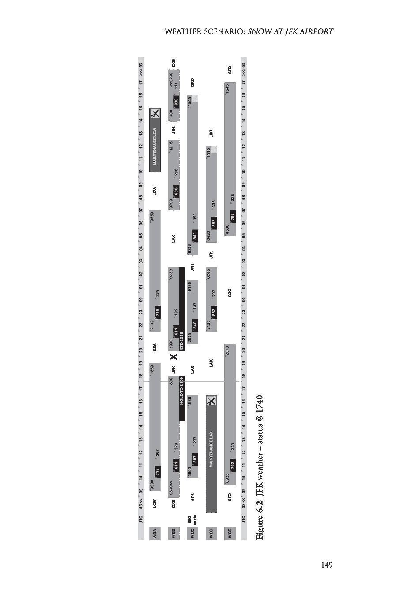
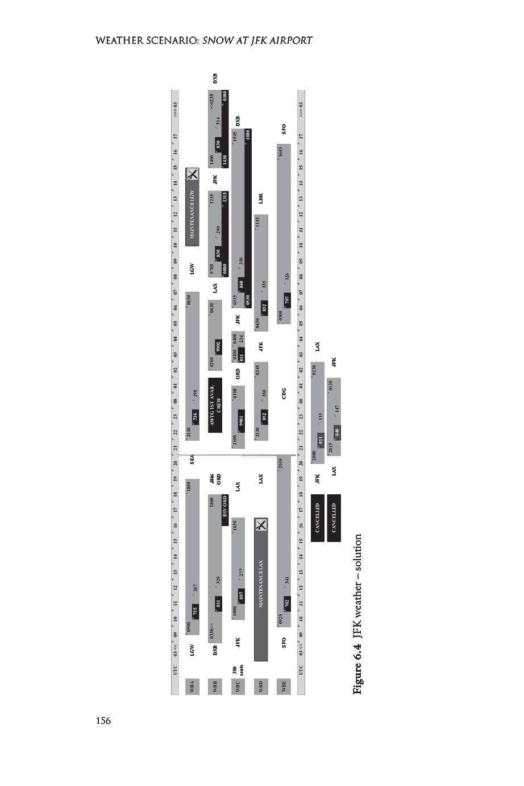

## 6 Weather Scenario: Snowfall at JFK Airport

### Introduction

The airline operates international services using five twin-engine wide-body long-range aircraft (registration/tail numbers `WBA`–`WBE`). Seating capacity is 350 seats. The minimum turnaround time between passenger flights is 90 minutes. Please refer to **Figure 6.1** on the facing page.

### Scenario Description

The current time is 1700 UTC. A blizzard is hitting New York JFK Airport in the USA; conditions have been critical since early morning. However, the airport remains open, and flights are still operating, although some domestic and regional carriers have suspended several flights into and out of JFK. Due to high regional traffic and the requirement for instrument approaches, several aircraft have been instructed to hold around JFK.

`WBB` is operating **Flight 811 (DXB–JFK)**, scheduled to arrive at JFK at 1800. Flight 811 departed DXB with sufficient fuel to hold over JFK for **3 hours**, with an alternate airport of **CLE (Cleveland, located 370 NM west of JFK)**. ATC has just advised the crew that a further **3 hours** of holding at JFK is anticipated, and that they will enter the holding pattern 80 NM east of JFK at 17:40.


### IOC Interaction

The JFK Station Manager has notified the IOC: Flight 811 is cleared to hold east of JFK for a maximum of 3 hours. No further information has been passed at this time.

The IOC now needs to confirm the following:

**a)** What is the cause of the unexpected extended holding time? (The flight plan already allowed for and planned weather holding; the focus is on the underlying reason for the *additional* holding.)

**b)** How are air and ground conditions expected to evolve? (Overall improvement or deterioration? Is the revised arrival time certain or merely possible?)

**c)** How much maximum holding time remains for the aircraft at JFK? (Given the additional holding, the aircraft's endurance is expected to be exceeded, immediately raising diversion concerns.)

**d)** If holding for 3 hours, which alternate airports are available? (Selecting a different alternate may allow the aircraft to continue holding over JFK longer while retaining the possibility of receiving an approach clearance.)

**e)** Are other aircraft being cleared for approach? (If conditions are not deteriorating, this serves as a good predictive indicator of a possible landing.)

**f)** Crew duty hours may also become an issue; a proactive inquiry to Crew Scheduling will determine the location of the nearest reserve crew should a diversion occur.

**g)** Should the aircraft divert immediately with the expectation of returning to JFK later, rather than waiting for the 3-hour hold to expire, then diverting and facing crew duty exhaustion?

**h)** Should the Flight 811 (JFK–LAX) crew remain at the hotel (delayed report) until it is confirmed the aircraft will indeed land? Please refer to **Figure 6.2** on the facing page.

**i)**



### Figure 6.2 JFK Weather – Status @ 1740

```
UTC >>> 03 UTC >>> 03
350 seats
16 17 1215 JFK 1400 12 13 1645
707 13 14 1508 >>0230 DXB 0315 1545
840 09 10 11 12 2130 0900 LGW 2130 0650
715 716267 298 0925 CDG 2010 0500
811 329 MAINTENANCE LAX LAX
341 09 10 11 350 21 01 04 05 06
0822 23 00 01 02 07 14 15 16 17
1309 10 11 121509 1411 19 20 19 20
16 17 18 14 15 10 16 17 18
1000 1630 807 277 JFK 03 <<
WBD WBA WBB WBC WBE 03 <<
702 03 DXB 1800 2000 0230 2015
LAX 203 12 LAX 811 135 840 147
0245 2113 02 03 04 05 1850
LHR JFK 0130 JFK 22 23 06 07
00 0430 ETD 2230 JFK X
SFO SFO SEA LGW 335
MAINTENANCE LGW 314 DXB 0700
326 1115 852 852 830 290 830 0330
<< HOLD TO 2100
```


# 天气场景：JFK 机场降雪

## 第 150 页：初步评估

一旦收到这些问题的答案并完成评估，便开始考虑采取任何行动。不过，在此阶段，`IOC`（运行控制中心）几乎无法采取实质行动，除非开始研究飞机若需备降时的备选方案。`IOC` 的一项关键任务是与利益相关方沟通，因此将向 `IOC` 职能部门（如 `Crewing`（乘务调度）、`CJM`（客户旅程管理）、`Media`（媒体））提供情况更新。`CJM` 人员当前最关心的是**后续运输**——即现在可能面临风险的联程航班数量。与 `JFK` 港口的对话与更新，以及如果可能的话，通过 `SATCOM`（卫星通信）直接与机长联系，将有助于全面掌握情况。在此阶段，预计 `811 JFK-LAX` 航班将延误（如 `图 6.2` 所示），但 `IOC` 将不愿设定三小时的延误时间，因为这是基于 `ATC`（空管）告知 `WBB` 的等待时间。通常，天气和空中交通状况等环境可能会变化，导致等待时间大幅缩短，或者相反，进一步延长。因此，`IOC` 在设定延误时间（以便通知客户、安排人员和资源匹配较晚的时刻表）时将保持审慎。不过，`IOC` 将开始研究假设场景。如果 `WBB` 等待，比如说 1-2 小时，然后降落，那么 `811` 只是晚点飞往 `LAX`，对航线网络没有进一步影响。但如果飞机备降，客户和飞机的恢复将变得更加复杂。在此阶段，更新的信息将决定下一步流程。

## 第 151 页：更新 @ 1915 UTC

`JFK` 的天气未见好转，目前仍有多架飞机在盘旋等待，尽管一些国内承运人已备降。`WBB 811` 已在纽约以东巡航高度盘旋等待约 90 分钟（以尽量减少燃油消耗）。克利夫兰港口管制部（`DPC`；负责管理和运营 `CLE` 机场）建议，尽管 `CLE` 的天气仍适合运行，但机场已陷入**瘫痪**。这是由于早先几架备降飞机导致地面严重拥堵，不再有可用登机口。因此，`DPC` 建议 `CLE` 现在不适合作为 `JFK` 的备降机场。此建议由 `JFK` 站长接收并传递给 `IOC`，站长从当地港务局收集信息并获取更新。`811` 机组随即获悉此情况。结果，`WBB` 通知立即备降至 `ORD`（位于 `JFK` 西侧 643 海里），�计到达时间（`ETA`）为 2120。请参阅对页 `图 6.3`。圆圈中的 `i` 警报（在此示例中仅作为高亮显示）指示了备降情况，以及因此导致 `JFK` 无飞机执行 `811 JFK-LAX`，进而影响 `WBB` 后续的飞行模式。

### 图 6.3：JFK 天气 – 1915 状态

```
UTC >>> 03 ? UTC >>> 03
350 座位
16 17 1215 JFK 1400
12 13 1645 707
13 14 1508 >>0230 DXB 0315
1545 840 09 10 11 12
2130 0900 LGW 2130
0650 715 716267 298
0925 CDG 2010 0500
811 329 维护 LAX LAX
341 09 10 11 350
21 ETA 2120 04 05 06
0822 23 00 01 02 07
14 15 16 171309 10
11 1213 1509 1411
19 20 19 2016 17
18 14 15 10 16 17
18 1000 1630 807 277
JFK 03 << WBD WBA WBB WBC WBE
03 << 702 03 DXB JFK ORD
1800 2000 0230 2015 LAX
203 12 LAX 811 135
840 147 0245 21 01
02 03 04 05 1850 LHRJFK
0130 JFK 22 23 06 0700
0430 SFOSFO SEA LGW 335
维护 LGW 314
DXB 0700 326 x 1115
852 852 830 290 830
0330<< 转 ORD
```

## 第 152 页：备降影响分析

`IOC` 现在有若干问题需要考虑。首先涉及备降飞机。

a) 飞机抵达 `ORD` 后，加油并尝试飞回 `JFK` 是否值得？很可能会面临类似的 `ATC` 等待时间（甚至更糟，因交通积压），前提是 `ATC` 根本提供时隙。即使可行，机组是否有足够执勤时间飞行这一额外航段？

b) 就机上总客源而言，`IOC` 还需确定有多少客户是 `DXB-JFK`，多少是 `DXB-LAX`。（如果航空公司拥有美国境内运输权，另一考量将是任何预订 `JFK-LAX` 的客户。）在当前场景中，194 名客户目的地为 `JFK`，135 名为 `LAX`。无人预订 `JFK-LAX`。

c) 若飞机滞留 `ORD`，是否有住宿安置这 329 名客户？即使住宿随时可用，这些客户如何及何时从 `ORD` 转运回 `JFK`？站长连同 `CJM` 团队，将在确定恢复方案后处理此类情况。

d) 机组在 `ORD` 可能超时，无法驾驶飞机返回 `JFK`，飞机也无法继续执行 `811` 飞往 `LAX`（因为 `JFK-LAX` 航班的机组在 `JFK`）。`Crewing`（乘务调度）将知晓备降 `ORD` 及飞机不太可能立即返回 `JFK`，以便（1）他们知道入港机组现在将在 `ORD` 结束任务，超时且脱离岗位，无法履行下一次执勤任务，（2）他们可以阻止新的 `811 JFK-LAX` 机组报到，至少直到确定恢复计划。

e) 备降导致三个进一步问题：首先，`DXB-JFK` 和 `DXB-LAX` 客户目前无法按计划抵达目的地。其次，329 名本不应滞留 `ORD` 的客户被困在那里。第三，飞机在 `ORD` 终止，导致 `LAX` 无飞机执行 0700 的 `830 LAX-JFK`。

f) `IOC` 需确定附近是否有可用飞机，并向两个 `Crewing` 职能部门确认附近是否有可用机组或可调配机组


# 天气场景：JFK 机场降雪

## 第 153 页

### 更新 @ 1930 UTC

查看甘特图（图 6.3）可发现相关问题。

a) 当前时间约为 1930，航班 840 LAX-JFK (WBC) 即将起飞（计划 2015 起飞）。鉴于 811 航班已备降，需要提出的问题是 840 是否应准点起飞、延误，甚至是否应执飞。

b) 840 需携带数小时的 JFK 盘旋燃油，预期能够着陆。飞行时长为 5 小时 15 分钟，因此 0130 的预期天气将决定那时着陆的可能性。鉴于当前状况和预报，将规划一个或多个备降场，执行该航班当然能确保有一架飞机供 840 航班继续飞往 DXB（前提是它能先在 JFK 着陆）。

c) 进一步检查图表发现，紧随 840 之后还有一个 LAX-JFK 航班，计划于 2130 从 LAX 起飞。这是 852 (WBD)。

d) 这两个航班能否合并（即总客票量是否适合一架飞机？），因为一种想法可能是考虑只派一架飞机去 JFK，另一架去 ORD 救援 WBB？

e) 合并后的客票量为 350（FLT840 上 147 人 + FLT852 上 203 人），均可容纳于该机型。因此，一个选项是取消其中一个航班。倾向于取消 840 LAX-JFK 而非 852 LAX-JFK，因为 840 的旅客已在登机口（起飞前 45 分钟），而 852 的旅客仍在航站楼办理登机手续，无法及时赶上两个航班中较早的那个。此外，也有保持 852 按时运行的最佳机会。

f) 合并航班意味着立即停止 840 的放行流程，直到制定出完整计划。由于涉及众多 IOC 职能，以及航站楼的机场员工和正在准备飞机的停机坪员工，这可能需要相当长的时间。在 1930 时，840 即将开始登机，仍在装载货物、行李和餐食，也可能正在加油。

## 第 154 页

g) 另一个考量因素是飞机重量。例如，合并载荷，加上 LAX-JFK 所需的高燃油量（含盘旋时间和备降备用燃油）可能导致飞机超重，尤其是着陆超重，因此需与载荷控制/调度（视航空公司而定）联络以确认此事及任何必要措施。携带该燃油量对于满足运行条件至关重要，因此唯一的灵活性在于调整载荷。在这种情况下，旅客和行李将优先于货物，还必须考虑 JFK 停机坪的实际状况；明智的做法是限制任何地面处理流程，以尽量减少对人员和设备的风险。载荷控制/调度关于飞机究竟有多重、哪些限制可能被超越的回复，可能进一步影响 IOC 决策。当然，840 机长已在机上或靠近飞机，因此可就最终重量和任何限制进行咨询。

h) 最后，执行救援计划所需的机组将导致一些机组脱离原计划排班，这可能影响他们返回基地或造成其他下游变动。这属于乘务职能解决的范畴，但如果机组能在当时协助恢复流程，这仍可能成为最优解决方案的一部分。

i) 这只是解决方案的一部分，因为还需考虑如何处理 ORD 的飞机，以找到再次“匹配”排班的方法。如果 WBD 852 按时运行，该飞机直接继续飞往 LHR。然而，由于 JFK 无飞机执行 840 JFK-DXB，还需进一步变动。

j) 扫描图表将快速识别可能在国内运行/跨国运行的任何其他飞机（如 WBA 和 WBE）。在这种情况下，牺牲它们的运行会被迅速否决，因为没有收益，实际上只会造成进一步混乱。尽管如此，经验丰富的管制员非常了解其整个网络运行——这就是班前简报后熟悉阶段的价值，这种方法正是资深管制员区别于他人的地方。

## 第 155 页

### 更新 @ 1945 UTC

综合考虑各项输入，权衡最优旅客恢复流程，并确保在维护时刻表完整性方面取得最佳结果，IOC 现可制定计划付诸行动以解决问题并恢复运行（基于已知信息且假设无进一步变动）。该计划可能包含以下内容（如图 6.4 所示）：

a) 取消 840 LAX-JFK，所有 147 名旅客安排乘坐 852 LAX-JFK（这些旅客延误 75 分钟）。此项行动需高度优先，以确保 WBC 卸载，合并载荷尽可能高效地装上 WBD。理想情况下 852 本身不延误。

b) 取消 811 JFK-LAX。（当然，现在 JFK 无飞机执行该航班，且该航班无始发旅客。）

c) 随 840 LAX-JFK 取消，WBC 可用于执行摆渡或定位飞行，航班号 9901 LAX-ORD（航空公司为此备有备用航班号），使用 840 全体机组（驾驶舱机组和乘务员），起飞时间可能在 2100。该飞机随后执行备降的 811 航班（作为该航班的延续段）飞行 ORD-JFK 段（显然——视该飞机到达时 JFK 天气而定），从而将所有 DXB-JFK 旅客送达目的地。这也提供了一架飞机执行 840 JFK-DXB，尽管延误约 135 分钟（如图 6.4 所示）。

d) 对于仍滞留 ORD 的 135 名 DXB-LAX 旅客，选项将归结为 CJM 团队与 ORD 地面代理之间的决定（因这非航空公司标准港口）。他们可被分流至其他国内航班，但需注意，对部分旅客而言 LAX 可能非最终目的地，故将为其制定专门的行程恢复方案。或者，视下一点而定，若乘务员可执飞该航班，他们可搭乘 9902 ORD-LAX。

e) 将尝试安排首个可用机组乘坐商业航班死头（定位）至 ORD，以执行 9902 ORD-LAX。这可能是原 811 JFK-LAX 机组，前提是有合适航班运行且能在当前天气下从 JFK 起飞。或者，LAX 可能有机组可死头


# 天气场景：JFK 机场降雪



## 图 6.4：JFK 天气 – 解决方案

```text
156 WEATHER SCENARIO: SNOW AT JFK AIRPORT UTC 811 UTC 2015 811 CAN CELLED CAN CELLED LAX 9902 135 840 147 0130 JFK LAX LAX 2000 DIV ORD 234 JFK 2100 0100 9901 0200 0630 0230 0800 1315 1430 0530 ORD 0430 07 AWTG 1ST AVAIL CREW 00 01 02 03 04 05 LHR 0200 13 14 1508 >>0230 SFO 0300 17 1800 314 1545 DXB 840 09 10 11 12 16 1215 JFK 1400 15 16 19 2014 15 16 17 18 1630 23 06 2130 0650 716 298 CDG 2010 0500 MAINTENANCELAX 341 13 1645 0807 09 10 11 350 21 22 17 1810 06 0400 JFK 707 0315 2130 13 1509 1411 19 2016 JFK SEA 1000 807 277 JFK 03 << 0900 LGW 715 267 0925 811 329 SFO 0330<< 12 WBD WBA WBB WBC WBE 03 << 702 03 DXB JFK ORD 1800 LAX 350 12 LAX 0245 21 22 23 00 01 02 1850 350 seats >>> 03 >>> 03 LGW 335 MAINTENANCELGW DXB 0700 326 1115 852 852 830 290 830 171309 10 11 1204 05 14 Figure 6.4 JFK weather – solution
```

## 场景描述

`WEATHER SCENARIO: SNOW AT JFK AIRPORT` 发生在 `9901 LAX-ORD`（用于执行 `9902 ORD-LAX`）上。其缺点是，如果 `LAX` 有可用机组，召集机组可能需要数小时，从而大幅延误 `9901`（并随之导致 `811 ORD-JFK`、`840 JFK-DXB` 和 `9902 ORD-LAX` 延误）。最坏的情况下，将改道飞机飞入 `ORD` 的技术机组在休息后（可能 `12 hours`，视值勤和休息规定而定）可被使用。这将实现 `9902 ORD-LAX` 但不载客。如果机组包含乘务员，则 `9902` 可搭载 `135 DXB-LAX` 客户。

f) 总之，两个航班（`840 LAX-JFK`，`811 JFK-LAX`）被取消，并新增两个航班（`9901 LAX-ORD`，`9902 ORD-LAX`），实现了 `811` 客户（`ORD-JFK`）的行程衔接，并确保飞机适当定位。一些延误不可避免，但在这种情况下无法避免。

g) `CJM` 团队（连同当地管理层）将负责在可用航班上安排客户。

## 最终评论

`图 6.4` 显示了解决后的情况在 `甘特图` 上可能的样子。该场景中的解决方案在给定情况下实现了最佳客户满意度，公平高效地恢复了飞机和机组模式，并将对该网络部分的影响降至最低。当然，该解决方案依赖于天气条件允许后续运营继续通过 `JFK`。
