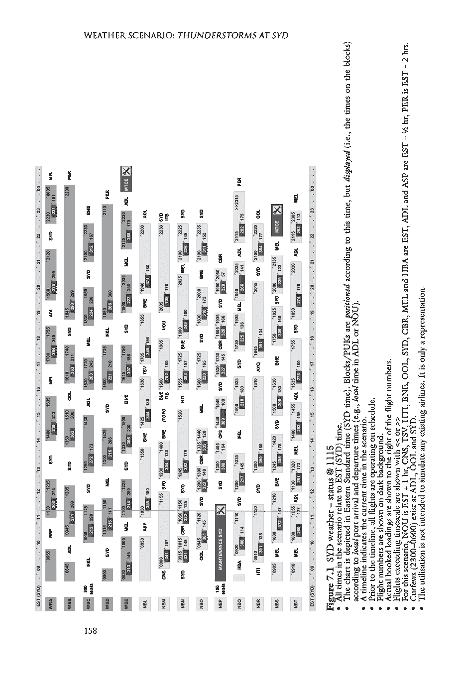
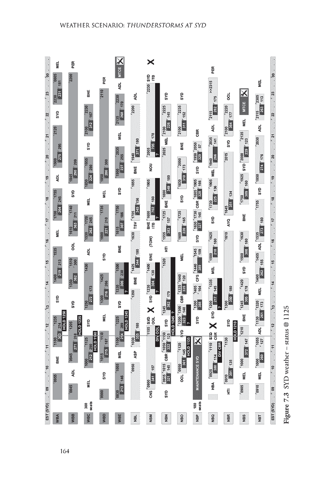
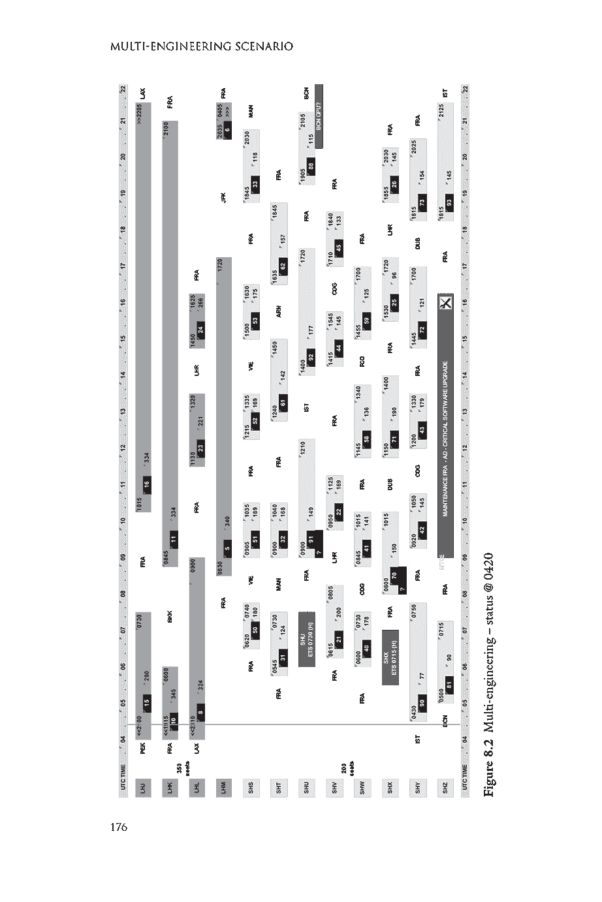
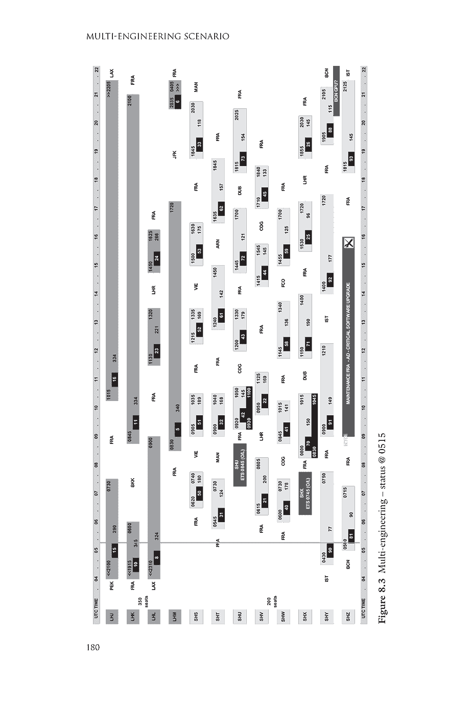
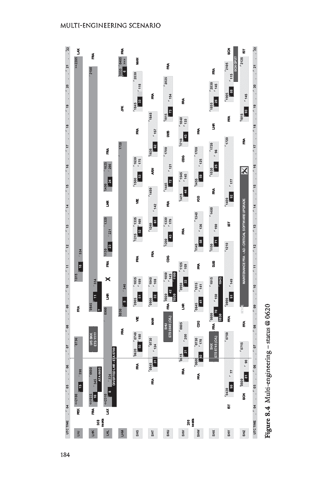

# 天气场景：SYD 机场雷暴



## 图 7.1：SYD 天气 – 1115 状态

```text
158 WEATHER SCENARIO: THUNDERSTORMS AT SYD .. .. .. ..13... .. .. .. .. .. .. .. .. .. ..00... 156 1405 1545 >>2315 . .. .. .. ..13... .. .. .. .. .. .. .. .. .. ..00... SYD 282 ADL BNE MELSYD SYD 2115 2305 263 113 MTCE BNE CBR 327 SYD SYD SYD 145109164 166 ADLMEL 310 311 1755 SYD 1730 AYQ 1750 309 1630 134 1645 1925 136 266 141 SYDBNE 2120 SYD MEL 1855 2200 1750 307 186 1900 227 255 263 2100 312 1530 MEL MTCE 2030 2135 2230 ADL 268 170 MEL 371 705 2025 NOU 1905 1940 364 2100 57 2000 1805 1905 328 160 2230 EST (SYD) EST (SYD) NBL 1425 1630 344 180 1705 345 1350 MEL SYD 1600 1725 165 135 1030 355 180 MEL 702 1520 1555 1725 OOL 180 CNS 0900 1400 130 SYD 1245 SYD 1155 145 1200 323 SYD 220 MEL WBA WBB WBC WBD NBM NBN WBE 230 272 304 382 179 0845 0945 300 seats 15001225 1250 SYD 321 341 145 157 SYD NBS 1730 1830 1955 224 280 0920 380 SYD 1110 180 seats 127 0915 114 322 1050 125 1015 0910 MEL NBT 372 147 1210 MEL 11 12 14 15 16 18 19 20 SYD SYD PER PER 2220 177 22 0005 17 264 275 245 1205 1430 1425 14 1400 1300 1230 10 2100 226 NBO NBP NBQ NBR MEL 1420 1120 1015 09 1735 1335 1200 1335 221216 306 09 231918 21 21 23 2225 145 OOL 22 300286 1905 274 2110 1900 1850 2135 MEL 229 123 MEL 2230 2050 10 11 12 213 146 212 215 BNE 303 271 274 1125 1150 1005 1100 1000 11000830 0955 0900 187 1235 214 289 273 1615 1350 SYD 300 OOL SYD 1535 SYD 1455 1300 335148 145 218 MEL ADL SYD 16301500 1625 180 17 219 CBR 305 15 16 20 1950 329 1245 178 1830 2000 173 1600 2005 1535 1740 1940 ADL 1300 210 213 1700 181 176 211288 290 173 180 299 ADL 1845 231 290 245 295 1850 1610 ADL MEL 1600 2035 1755 1510 2230 BNE 1000 260 1130 173 0905 1000 155262 14001055 261 BNE PER 0910 391 SYD ITB CBR 1150 120 1440 HBA SYD HTI 1610 2015 351 383 0945 361 1300 388 2115 1130 350 180 389 2200 HTI MAINTENANCE SYD CBR TSV SYD 180 ADL BNE BNE ITB (TOW) 1330 BNEASP BNE 349 1800 266 363362 SYD 0950 175 CFS 1440 2035 MEL 167 1320 1720 217 225 180308 1500 BNE 157 180 178 ADL SYD MEL SYD 152 2100 2235 Figure 7.1 SYD weather – status @ 1115
```

### 图 7.1 说明

- 场景中的所有时间均为 `EST (SYD)` 时间。
- 图表以东部标准时间（`SYD` 时间）显示。块/PUKs 按此时间定位，但显示（即块上的时间）根据当地港口的到达和出发时间（例如 `ADL` 或 `NOU` 的当地时间）。
- 时间线指示场景中的当前时间。
- 时间线之前，所有航班按时刻表运行。
- 航班号显示在深色背景上。
- 实际预订客座率显示在航班号右侧。
- 超出时间刻度的航班用 `<<` 或 `>>` 显示。
- 对于此场景，`NOU` 为 `EST + 1 小时`，`CNS`、`TSV`、`HTI`、`BNE`、`OOL`、`SYD`、`CBR`、`MEL` 和 `HBA` 为 `EST`，`ADL` 和 `ASP` 为 `EST – ½ 小时`，`PER` 为 `EST – 2 小时`。
- `ADL`、`OOL` 和 `SYD` 存在宵禁（`2300–0600`）。
- 该利用率不旨在模拟任何现有航空公司。它仅是一种表示。


## 简报

该航空公司是澳大利亚的国内承运人。机队由五架双发宽体飞机（注册/尾号指定为 `WBA-WBE`）和九架双发窄体（单通道）飞机（注册指定为 `NBL-NBT`）组成。宽体飞机容量为 `300 座`，窄体飞机为 `180 座`。宽体飞机客运航班间的最小周转时间为 `60 分钟`，窄体飞机为 `35 分钟`。请参阅对面的 `图 7.1`。


# 天气场景：悉尼机场雷暴

## 场景描述

时间为 1115 EST（悉尼时间）。几条强雷暴线正在逼近悉尼机场。IOC 的气象部门上午已知悉迫在眉睫的雷暴，并预警了最可能的影响时间。先前发布的航路终点预报（TAF）显示，随着锋面系统移过，1130–1230 期间悉尼机场将出现来自西方的持续风，风速超过 40 节。此外，预计将出现低云、大雨、机场及周边闪电，以及 5000 英尺以下的严重湍流。当前的 METAR 显示风向多变，偏北风，风速 15–20 节。因此，两条平行跑道 `34L` 和 `34R` 目前正在使用中。前往悉尼机场且预计 1030 起到达的航班，已被要求携带足够燃油以备降备选机场（备选燃油）。

## IOC 互动

该航空公司的悉尼港口协调员建议，未来 15 分钟悉尼周边地区预计将出现雷暴。她确认 `NBQ 380 HBA-SYD` 和 `WBC 212 MEL-SYD` 目前在悉尼以南盘旋，`NBO 361 OOL-SYD` 在北侧盘旋，但暂无更多信息。此外，她建议管制员预计风向将变，飞机在锋面通过期间可能会被进一步要求盘旋。目前，飞机正无延误地从悉尼起飞，并已在两条平行跑道上降落。

IOC 当前的直接关注点是即将抵达悉尼的航班，其次是已在航路但尚未抵达附近的其他航班。对利用情况的全面扫描显示，有大量飞机靠近悉尼（参见图 7.1）。扫描不仅关注即将到达的航班，还延伸至每个运行模式，以评估若受干扰可能产生的后续影响。关键信息将包括地面时间（延误可在此吸收）、通向宵禁的模式（例如 `WBA (SYD)`、`WBE (ADL)`、`NBM (SYD)`、`NBN (SYD)`、`NBO (SYD)` 和 `NBR (OOL)`），以及任何非正班航班（例如包机、摆渡飞行或国际运营），因为这些可能需要特别关注（例如执飞 `BNE-NOU-SYD` 的 `NBM`）。

## 信息需求

需要从两个角度确定每架进港飞机的信息。第一是确定管制员可能的进近顺序，这将协助 IOC 判断哪架飞机可能优先降落，从而对起飞进行优先级排序。第二是识别可能无法长时间盘旋的长航程进港飞机。问题可能包括以下内容：

- **a)** 每架飞机在哪里（即下降中、进近中或已在盘旋模式中）？
- **b)** 每架飞机携带多少燃油？
- **c)** 每架飞机能盘旋多久？
- **d)** 每架飞机指定的备选机场是什么？

收到的信息可能揭示许多飞机的状态，但信息往往断断续续，甚至完全没有（此时大家都很忙——尤其是管制员），在这种情况下，必须向相关区域寻求信息。

## 1120 时的飞机状态

在此场景中，港口协调员已于 1120 确定并通知 IOC 以下信息（按计划到达时间顺序）：

- **a)** `NBQ 380 HBA-SYD`（计划 1110 到达）已获指令在场区南侧盘旋 20 分钟。`NBQ` 拥有 20 分钟盘旋燃油，之后必须使用 `CBR` 作为备选机场备降。
- **b)** `NBO 361 OOL-SYD`（计划 1120 到达）已获指令在场区北侧盘旋 15 分钟，拥有 30 分钟盘旋燃油，之后必须使用 `OOL` 作为备选机场备降。
- **c)** `WBC 212 MEL-SYD`（计划 1125 到达）已获指令在场区南侧盘旋 15 分钟，拥有 40 分钟盘旋燃油，之后必须使用 `MEL` 作为备选机场备降。
- **d)** `NBR 391 HTI-SYD`（计划 1130 到达）已获指令在场区北侧盘旋 30 分钟，拥有 45 分钟盘旋燃油，之后必须使用 `OOL` 作为备选机场备降。
- **e)** `NBN 322 CBR-SYD`（计划 1150 到达）已获指令在场区西南侧盘旋 35 分钟，拥有 60 分钟盘旋燃油，之后必须使用 `CBR` 作为备选机场备降。
- **f)** `NBM 341 CNS-SYD`（计划 1155 到达）已获指令在场区北侧盘旋 40 分钟，拥有 35 分钟盘旋燃油，之后必须使用 `OOL` 作为备选机场备降。
- **g)** `WBB 271 ADL-SYD`（计划 1205 到达）已获指令在场区西侧盘旋 30 分钟，拥有 60 分钟盘旋燃油，之后必须使用 `BNE` 作为备选机场备降。

## 图 7.2：悉尼天气 – 1120 状态

```
.. .. .. ..13... .. .. .. .. .. .. .. .. .. ..00... ? 156 ? ? ? 1405 1545 >>2315
.. .. .. ..13... .. .. .. .. .. .. .. .. .. ..00... 180355 180 1335 180
HOLD 1130 HOLD 1135 HOLD 1225 HOLD 1235
1110 322 1050 125 1155 344 SYD 1830 371 2025 CFS 388 SYD 1230
SYD 178 308 180 309 160 229 123 BNE MEL SYD 1300 BNE SYD 1730 2035
145217 EST (SYD) EST (SYD) NBL 1730 ADL 135 147 289 CNS 0900 1700 0905
MEL 1000 1210 1245 1420 SYD 272 304 130 0925 155 1500 380 1015
372 305 114 HOLD 1200 350 MEL WBA WBB WBC WBD NBM NBN WBE NBS
1205 HOLD 1250 MEL HOLD 1140 HOLD 1235 NBO NBP SYD NBQ NBR NBT HBA HTI
1300 1130 ADL 1955 1030 1350 275 1740 702 1830 MEL 1500 1625 SYD 1905
1735 (TOW) BNE ITB 1905 SYD 216 MEL 11 12 14 15 16 18 19 20 PER PER
2115 22 0005 17 264 1250 213219 SYD 261 ASP 14 1400 1300 300 OOL 1715
16 363 1535 ADL SYD 1530 1720 SYD 221 1430 1425 1510 263 1600 180
16101350 362 230 186 MEL OOL 0950 1120 SYD 1245 1520 345 BNE MEL
1200 1015 HOLD 1245 09 1200 0910 CBR 1150 300 seats SYD 321 341
145 157 SYD 180 seats 0915 0950 MEL 1000 10 1055 ADL 260 127
231918 21 21 23 2230 22 300286 2110 1900 1850 MEL 2230 20 1755
1925 2135 2120 SYD 2100 SYD 167 09 10 11 12 146 212 215 BNE 303
271 274 1125 1150 1100 1000 0955 0900 187 1235 0845 0945 ADL 2200
MEL SYD 0910 391 1455 1130 15351400 MAINTENANCE SYD 181 211288
290 173 245 299 1845 231 290 245 295 226 145 MTCE 210266 1600
1855 BNE 1940 2200 ADL 2035 BNE 1425 1630 TSV 1705 NOU 2005 SYD ITB
705 178 306 307 227 255 349 180 180 1320 1630 262 273 120 218
14401300 CBR 1335 MEL 1725 SYD HTI 1555 1725 BNE 1800 1905 173
1440 2230 BNE 224 312 0830 1005 MEL 1100 1225 SYD 1330 1500 BNE
1615 1750 SYD 1900 MEL 2135 2230 ADL 280 213 214 268 170 2235
SYD 382 179 383 157 BNE 2000 PER 180 225 136 266 141 282 175
1940 1755 SYD 1850 2030 ADL 2115 2305 MEL 274 176 263 113 109
327 145 328 166 57389 329 MTCE 1750 2000 MEL ADL SYD 1630 2100 MEL
2100 1400 OOL 180 351 134 364 177 1610 AYQ 1645 2015 SYD 2100
2220 CBR 1805 SYD 1950 2050 CBR 164
```


# 163 天气场景：悉尼雷暴


## h) WBE 214 MEL-SYD
WBE 214 MEL-SYD（预计 1225 到达）被 ATC 告知预计在机场西侧盘旋 20 分钟。WBE 刚从 MEL 起飞，有 50 分钟的盘旋燃油，之后必须备降，备降机场为 MEL。

## i) WBA 303 BNE-SYD
WBA 303 BNE-SYD（预计 1235 到达）被 ATC 告知预计盘旋 15 分钟。WBA 刚从 BNE 起飞，有 65 分钟的盘旋燃油，之后必须备降，备降机场为 BNE。

有了这些信息，IOC 可以开始处理可能影响网络的潜在延误。**图 7.2** 反映了上述盘旋时间。当前最令人担忧的是首批进港 SYD 的航班，NBQ（ETA 1130）、NBO（ETA 1135）和 WBC（ETA 1140）被给予了较短的盘旋时间。然而，收到的关于 NBM 状态的信息令人立即担忧，因为该航班被给予 40 分钟盘旋，超过了其 35 分钟储备燃油。因此，IOC 需要核实该信息，如果属实，需要确定机组意图。这将通过港口协调员、直接与 ATC 联系，或通过无线电直接与机组联系来实现（在机组工作量大时联系可能比较困难，因此有时需要通过 ATC 中转）。另一个考虑因素是该航班是否能通过使用不同的备降机场延长盘旋时间。换句话说，该航班能否使用更近的备降港口以增加盘旋时间？同样令人担忧的是那些被给予盘旋指令的航班的下一趟任务。特别是，WBE 306 SYD-BNE、NBM 304 SYD-BNE、NBN 382 SYD-HTI 和 NBO 323 SYD-CBR 在目前的利用率下（即未进行飞机调换）可能会延误。

## 更新 @ 1122 EST
SYD 港口协调员通报以下更新。

### a) NBM 因盘旋要求备降 OOL（ETA OOL 为 1205）。
### b) NBQ、NBO 和 WBC 按顺序均已获准进近（使用 RWY34L）。
### c) NBQ 机组报告燃油仅够一次进近，若不成功将备降 CBR。

---

# 164 天气场景：悉尼雷暴



## 图 7.3 SYD 天气 – 1125 状态

```
.. .. .. ..13... .. .. .. .. .. .. .. .. .. ..00... ? 156 ??? ? ? 1405 1545 >>2315 ? . .. .. ..13... .. .. .. .. .. .. .. .. .. ..00... X DIV CBR HOLD 1135 HOLD 1140 HOLD 1210 HOLD 1245 DIV OOL HOLD 1235 HOLD 1245 1110 322 1050 125 1155 SYD MEL SYD SYD OOL SYD CBR X 114 ASP 355 180 372 305 178 308 180 309 160 229 123 BNE BNE 1335 1905 371 1030 1350 SYD HTI 1555 1725 BNE 1800 1230 SYD MEL 57389 329 1015 EST (SYD) EST (SYD) NBL 1730 ADL 135 147 289 CNS 0900 1700 0905 MEL 1000 1210 1245 1420 SYD 272 304 WBA WBB 0925 WBC WBD NBM NBN WBE NBS NBT NBQ NBR MEL 11 12 14 15 16 18 19 20 PER PER 2115 22 0005 17 264 1250 213219 SYD 1350 362 MEL 275 14 1400 1300 300 OOL 1715 16 363 1535 ADL SYD 1530 1720 SYD 1610 216 1430 1425 221 1740 1730 1830 10 1510 702 263 1600 1830 1500 1625 SYD 1905 1735 1055 ADL 260 127 (TOW) BNE ITB 1905 180 261 380 ADL 186 NBO NBP 2025 SYD CFS 1440 SYD 1630 MEL OOL 0950 1120 SYD 1245 1520 345 BNE MEL 1200 1015 349 180 09 1200 0910 CBR 1150 300 seats SYD 321 341 145 157 SYD 180 seats 0915 0950 MEL 1000 HBA HTI 1130 217 X 231918 21 21 23 2230 22 300286 2110 1900 1850 MEL 2230 20 1755 1925 2135 2120 SYD 2100 SYD 167 09 10 11 12 146 212 215 BNE 303 271 274 1125 1150 1100 1000 0955 0900 187 1235 0845 0945 ADL 1205 HOLD 1250 2200 MEL SYD 0910 391 1455 1130 15351400 MAINTENANCE SYD 181 211288 290 173 245 299 1845 231 290 245 295 226 145 MTCE 210266 1600 1855 BNE 1940 2200 ADL 2035 BNE 1425 1630 TSV 1705 NOU 2005 SYD ITB 705 178 306 307 227 255 1320 1630 262 273 120 218 14401300 CBR 1335 MEL 173 350 164 109 327 1300 388 1300 SYD 1500 145 155 180 2230 BNE 224 312 0830 1005 MEL 1100 1225 SYD 1330 1500 BNE 1615 1750 SYD 1900 MEL 2135 2230 ADL 280 213 214 268 170 2235 SYD 361 145 323 148 335 220 165 310 173 311 152 1600 2225 SYD 382 179 383 157 BNE 2000 PER 180 225 136 266 141 282 175 1940 MEL ADL 2035 MEL 274 176 263 113 1750 SYD 2000 MEL MTCE 1755 SYD 1850 2030 ADL 2115 2305 1955 SYD 2100 MEL 2100 1400 CBR 1805 SYD 1950 2050 130 CBR 328 166 180344 1725 145 230 180 OOL 180 351 134 364 177 1610 AYQ 1645 2015 SYD 2100 2220
```

---

# 165 天气场景：悉尼雷暴


## d) 地面天气条件仍有利于 RWY 34L/R，机场对所有运行开放，尽管已开始降大雨，风速增加。考虑到收到的关于其燃油储备和 ATC 盘旋要求的信息，NBM 备降并不令人意外。根本考量是飞机的下一趟任务，而乘务组考虑机组任务，CJM 团队考虑 SYD 以外的中转联运。CJM 团队还将开始研究如果 IOC 需要将飞机调往他处，如何将 CNS-SYD 旅客送达 SYD。该飞机目前承担 304 SYD-BNE 任务（**图 7.3** 中用“x”标示），随后执行国际航线 702/705 BNE-NOU-SYD，随后受 SYD 宵禁限制。

## 更新 @ 1125 EST
SYD 港口协调员传达下一更新。

### a) NBQ 刚因终端风切变复飞，已备降 CBR（ETA CBR 为 1220）。
### b) NBO 即将进近。
### c) 不确定 WBC 位置；正试图从 ATC 获知。
### d) NBR 获准额外盘旋 10 分钟（盘旋至 1210）。
### e) NBN 获准额外盘旋 20 分钟（盘旋至 1245）。

在 IOC 中，CJM 团队通报 NBN 322 CBR-SYD 搭载 45 名澳大利亚和努美阿政府高级部长及其部门工作人员组成的联合代表团，经 322 CBR-SYD/304 SYD-BNE/702 BNE-NOU 前往努美阿。有了这一最新信息——特别是备降航班和政府要员出行，IOC 需考虑直接影响，特别是 NBN 在 SYD 落地的可能性。甘特图可能会按**图 7.3** 所示更新。

NBQ 备降 CBR 导致 SYD 又一架飞机短缺，这次是执行 217 SYD-MEL（在**图 7.3** 中用“x”标示）。随着 SYD 地区损失两架飞机，IOC 将开始考虑取消航班以重新平衡航班。问题的有序考量可能如下：i


# 天气场景：SYD 雷暴

## 场景分析

### a) NBQ 备降 CBR

`NBQ` 备降 `CBR` 后，该飞机要么只需加油即可执飞返回 `SYD`，要么取消一个 `SYD-CBR` 航班。让 `NBQ` 返回 `SYD` 的问题因 `SYD` 天气状况恶化及随之而来的盘旋积压而加剧，因此极有可能需要数小时。因此，考虑的方案可能是取消 `323 SYD-CBR`（当前由 `NBO` 执飞），通过调换飞机循环，安排 `NBQ` 执飞 `335 CBR-MEL`，这将是一个现成的解决方案，也有助于保留该飞机当前飞行循环的后续时刻表。如果 `NBQ` 不加油飞回 `SYD`，将搜索订座系统以确定 `CBR-SYD` 是否有可用座位接运 `HBA-SYD` 旅客，最好是安排在下一个 `CBR-SYD` 航班上（或必要时安排在竞争对手的航班上），同样也要想办法接运 `323` 航班的 `SYD-CBR` 旅客。`SYD-CBR` 旅客实际上可以全部安排在 `1630` 起飞的 `327` 航班（`35` 个座位）和 `1950` 起飞的 `329` 航班（`123` 个座位）上。然而，`CBR-SYD` 方向（`328` 航班，`1805` 从 `CBR` 起飞）仅有 `14` 个座位可用。由于 `CBR-SYD` 公路行程约四小时，可行的旅客恢复方案可能包括使用大巴车 `CBR-SYD` 接运许多备降的 `380 HBA-SYD` 旅客。

### b) NBM 备降 OOL

`NBM` 备降 `OOL` 导致 `SYD` 缺乏飞机执飞 `304 SYD-BNE`，扫视飞机利用率表可知，这是一个关键航班，因为其在 `BNE` 的地面时间（`2` 小时）内，飞机需要卸货、从国内航站楼拖拽至国际航站楼，并为国际航班（`702 BNE-NOU`）做准备，这比国内航班需要更多的准备工作。延误该航班在 `SYD` 也有宵禁影响。

### c) NBM 调机考量

`NBM` 的主要考量是：是否将该飞机调机 `OOL-BNE`，以便其能按时刻表执飞 `702/705 BNE-NOU-SYD`；还是应加油立即飞往 `SYD`，这能保证 `CNS-SYD` 旅客无需进一步中断即可抵达 `SYD`，同时也弥补 `SYD` 地区日益增长的飞机短缺。此外，若其他飞机从 `SYD` 备降，这也可作为一种保险。雷暴通常持续时间和影响有限，如果 `NBM` 于 `1230` 从 `OOL` 起飞，飞机要直到 `1400` 才能到达 `SYD` 地区，那时雷暴早已过去。由于该航段比 `CNS-SYD` 短得多，可搭载更多燃油，从而拥有更长的盘旋时间（如有必要）。

### d) NBN 状态考量

`NBN` 的状态现在也起作用了，因为（i）它已获指令进一步盘旋，现在已非常接近备降 `CBR` 的最晚时间；（ii）机上搭载前往 `Noumea` 的政府代表团。`IOC` 内部的多个思路可考虑以下选项范围。

#### i. 选项 1：NBN 备降 BNE

首先可能请求 `NBN 322` 机组计算能否使用 `BNE` 作为备降机场而非 `CBR`，如果可以（考虑到 `BNE` 比 `CBR` 距离更远），那么他们的最晚备降时间会是何时？`NBN` 备降 `BNE` 有其优点——既能保证 `702 BNE-NOU` 按时刻表有飞机执飞，更重要的是便于政府代表团衔接。权衡之处在于，会对该航班上其他 `CBR-SYD` 旅客造成影响，他们将经由 `BNE` 旅行，然后需安排在下一个可用的 `BNE-SYD` 航班上（即 `307 WBE`，有 `114` 个空座），将于 `1750` 抵达 `SYD`。

#### ii. 选项 2：NBN 备降 CBR 后返回 SYD

如果 `NBN` 无法使用 `BNE` 作为备降，第二个选项是飞机备降 `CBR`，加油，然后天气允许的情况下飞回 `SYD`。然而，此选项重演了上述 (c) 所述情况，要求 `NBM` 调机 `OOL-BNE` 执飞 `702/705 BNE-NOU-SYD`，导致 `CNS-SYD` 旅客要么滞留 `OOL`，要么被送至 `BNE` 等待下一个可用航班前往 `SYD`。

#### iii. 选项 3：NBN 备降 CBR 后飞 CBR-BNE

如果 `NBN` 备降 `CBR`，第三个选项是取消 `322 CBR-SYD` 并让飞机直飞 `CBR-BNE`。`NBN` 正在 `SYD` 南部盘旋，若立即备降，约 `1215` 到达 `CBR`，约 `1245` 再起飞，`1425` 到达 `BNE`。这可能导致 `702 BNE-NOU` 小幅延误，但能提供飞机并便于政府代表团衔接，如前所述。`322 CBR-SYD` 旅客则按上述要点 (a) 所述方式安排。

## 更新 @ 1128 EST

`SYD` 港口协调员通报以下更新。

### a) NBN 机组回复

`NBN` 机组已回复请求。他们确认可指定 `BNE` 为备降机场，但必须在 `2` 分钟内决定备降。

### b) NBO 复飞

`NBO` 刚因强侧风复飞。`NBO` 燃油仅够再进近一次，之后必须备降 `OOL`。

### c) WBC 盘旋

`WBC` 现又在场区南侧盘旋。预计 `30` 分钟内不会进近。

## 图 7.4：SYD 天气 – 状态 @ 1130

```
.. .. .. ..13... .. .. .. .. .. .. .. .. .. ..00... 156 1405 1545 >>2315
.. .. .. ..13... .. .. .. .. .. .. .. .. .. ..00... PER ADL 1515 1640 BNE MEL 1940
349 180 136 266 141 282 175 2000 MEL 308 180 309 160 SYD OOL 351 134 SYD 341 157
1230 1400 304 130 173 323 148 1130 1230 1300 1400 350 178 180 1155 180 ADL 372
305 260 127 1200 HOLD 1135 1000 SYD CANCELLED SYD OOL MEL 214 1120 SYD 1245 SYD
CBR MEL MEL HOLD 1220 1055 CBR 1335 ASP 1030 SYD CBR BNE 388 1425 1435 145 355
EST (SYD) EST (SYD) NBL 1730 ADL 135 147 289 CNS 0900 1700 0905 MEL 1000 1210
1245 1420 SYD 272 0925 155 1500 MEL 261 WBA WBB WBC WBD NBM NBN WBE NBS NBT
NBO NBP NBQ NBR MEL 11 12 14 15 16 18 19 20 PER PER 2115 22 0005 17 264 1250
213219 SYD 1350 362 1205 1430 14 1400 221 230 344 280 1520 HTI 1555 1725 300
OOL 1715 16 363 1535 17201530 ADL 224 1725 220 1600 HOLD 1250 ADL SYD 275 1905
17401510 702 263 1600 1830 1735 371 1610 1300 1335 CFS 1440 1645 SYD HOLD 1200
HOLD 1235 HOLD 1245 180 300 seats SYD 321 341 145 157 SYD 180 seats 0915 0950
HBA HTI 213 OOL 0950 MEL 380 0830 1005 231918 21 21 23 2230 22 300286 2110
1900 1850 MEL 2230 20 1755 1925 2135 2120 SYD 2100 SYD 167 09 10 11 12 146
212 215 BNE 303 271 274 1125 1150 1100 1000 0955 0900 187 1235 0845 0945 ADL
MEL 1015 2200 MEL SYD 0910 391 1455 1130 15351400 MAINTENANCE SYD 181 211288
290 173 245 299 1845 231 290 245 295 226 145 MTCE 210266 1600 1855 BNE 1940
2200 ADL 2035 BNE 1425 1630 TSV 1705 NOU 2005 705 178 306 307 227 345 2230
2230 ADL 2115 MTCE 1755 SYD 1850 2030 186 2025 MEL BNE 1800 2305 BNE 310 173
1730 1830 1905 180 1630 229 123 1900 MEL 2135 09 1200 0910 383 157 2035 1610
(TOW) 10 1500 1625 335 1440 DIV CBR 1110 114 218 1320 1630 262 273 MEL 1100
1225 SYD 1330 1500 BNE 1300 2235 179 MEL 2100 180 BNE ITB 1905 180 1810 274
176 263 225 120 217 SYD ADL SYD 2100 216 1300 361 145 SYD 1350 1015 SYD ITB
DIV OOL DIV BNE 322 1050 125 MEL 113 268 170 312 1615 2225 382 SYD CBR 1805
SYD 1950 2050 CBR 164 109 327 145 328 166 57389 329 1955 1300 1345 165 180
255 1750 SYD CANCELLED 311 152 1750 2000 SYDBNE SYD CBR SYD BNE 364 177 1610
AYQ 1645 2015 SYD 2100 2220 1150 SYD SYD BNE
```


# 天气场景：悉尼机场雷暴

## 第 169 页：初始情况与行动


关于 `NBN` 的决定权在于 IOC。让飞机备降 `BNE` 的优势超过了返回 `CBR` 的便利性。随着 `NBO` 现已复飞，`SYD` 的飞机短缺问题再次显现。因此，需要考虑削减更多航班以缓解执行压力，优先考虑保留有替代运力供旅客选择的航线。由于 `SYD-CFS-SYD` 每天仅运行一班，而 `SYD-HTI-BNE` 和 `SYD-AYQ-SYD` 均为长航线航班，应予以商业保护，因此频次较高的 `SYD-MEL-SYD` 或 `SYD-BNE-SYD` 航线提供了解决方案的一部分。因此，从（至少）这两条航线中削减航班将释放飞机利用率。航班 `304 SYD-BNE` 目前因无飞机执飞（因 `NBM` 备降 `OOL`），且 `NBN` 也涉及 `BNE` 航线，这使得 `304` 成为取消的首选航班。IOC 立即启动了一系列行动。此时延迟决策将导致某些选项不可用，因为在国内运行中断中，决策窗口可能极短。现在执行了大量换机（均在同机型内）（参见对页图 7.4），以保护长航线航段和宵禁，同时将整体延误降至最低。针对受影响旅客，CJM 团队采取适当行动与其联系，安排改签其他航班，并视情况安排地面交通。

a) 指示（通过港口协调员/ATC）`NBN 322 CBR-SYD` 立即备降 `BNE`。该飞机随后按时刻表执行 `702 BNE-NOU`、`705 NOU-SYD`。  
b) 取消 `323 SYD-CBR`（见图 7.4 底部取消航班栏）。  
c) 取消 `304 SYD-BNE`（见图 7.4 底部取消航班栏）。  
d) `NBM` 在 `OOL` 加油并继续执行 `341 OOL-SYD`。随后的考量是决定如何优先安排 `SYD` 出港航班。如上所述，`388/389 SYD-CFS-SYD` 和 `382/383 SYD-HTI-BNE` 航班不太可能受影响。同样，出于商业考虑，将优先保证 `350/351 SYD-AYQ-SYD` 按时运行。因此，决定延误 `217 SYD-MEL/218 MEL-SYD`。然而，由于 `NBQ` 将在 `MEL` 且能比 `NBM` 更早执行 `218`，`NBM` 改执行 `220 MEL-SYD`，随后执行 `274 SYD-ADL` 和 `263 ADL-MEL`。随后进行其他调整，以在保护所有宵禁的前提下使大多数航班按时运行。  
e) `NBO`（基于飞机进港 `SYD` 而非备降）执行 `382 SYD-HTI`、`383 HTI-BNE`、`349 BNE-MEL` 和 `226 MEL-SYD`。

## 第 170 页：后续行动


f) `NBQ` 执行 `335 CBR-MEL` 后，仅小幅延误执行 `218 MEL-SYD`，随后按时刻表执行 `225 SYD-MEL`、`266 MEL-ADL` 和 `282 ADL-PER`。  
g) `NBT` 执行 `273 ADL-SYD` 后，执行 `310/311 SYD-BNE-SYD`。  
h) 注意：为使 `NBQ` 执行 `335 CBR-MEL`，运行控制员需与机组排班部门（飞行员和乘务员）联络，以确定 `CBR` 有哪些可用机组。一个（或许显而易见的）解决方案是使用将飞机飞抵 `CBR` 的 `380 HBA-SYD` 机组，但可能存在排班限制而无法实施。`CBR` 当地也可能有机组可执行 `335`。若有除 `NBQ` 外的其他飞机被调整过夜停放 `PER`（维修设施极少），则需与维修监控联络，确保飞机有足够的维修放行小时数（即过夜无需检查服务）且无其他关键维修工作待办。然而，尽管利用率发生变化，本场景中极少执行过夜基地变更。反映这些行动的变更如图 7.4 所示。

### 更新 @ 1132 EST

`SYD` 港口协调员通报如下更新。

a) 锋面正在通过。风向转为西风，从 240–280 度吹来，风速 20–30 节，阵风 45 节。  
b) 因此，使用跑道现已变更为 `RWY25`。（双向南北跑道的丧失及减少至单跑道运行将加剧拥堵和等待时间，因为起降率大幅降低）。  
c) 随着雷暴抵达机场，闪电现位于 5 海里范围内。因此，所有人员被命令离开停机坪。飞机仍可起降，但在这种情况下，可能必须在机位外等待，直到 5 海里警报解除。  
d) `NBO` 在机场东侧盘旋，如前所述，其燃油仅够再进近一次，无论如何最多只能盘旋至 1150 便须备降 `OOL`。  
e) `WBC` 获准再盘旋 20 分钟（在机场南侧）。

## 第 171 页：进一步更新


维修监控通报，因机场有闪电，机库工程师无法将 `NBP` 从机库拖至航站楼。该飞机要到 1245 才能投入运行。

### 更新 @ 1145 EST

`SYD` 港口协调员通报如下更新。

a) 闪电活动已过，恢复正常运行。  
b) 来自 ATC 消息，`NBO` 将为首架进近飞机。  
c) `WBC`（通过无线电）通报必须在 1150 前进近，否则备降 `MEL`。在其他调整进行中且已有合理方案覆盖目前的中断情况，关注点转向 `NBO` 和 `WBC`。若 `NBO` 备降，下一个可能的“牺牲品”将是 `388/389 SYD-CFS-SYD`，商业上优先保护长航线 `HTI` 和 `AYQ` 航班。若 `WBC` 备降，宽体机的紧张利用率可能意味着必须取消一班 `SYD-MEL` 以恢复平衡。`NBP` 投入运行的延迟不被视为问题，因为可能仅造成轻微延误。此时，持续与机组排班、CJM、工程部门以及港口协调员联络，将使 IOC 做好最佳准备，暂时无法采取进一步行动。

### 更新 @ 1150 EST

`SYD` 港口协调员通报如下更新。

a) `NBO` 已着陆。  
b) `WBC` 现获准再盘旋 10 分钟，因燃油储备不足，机组选择立即备降 `MEL`（预计到达 `MEL` 1255）。  
c) 随着机场条件持续好转，预计 `NBR`、`WBB`、`WBE` 和 `WBA` 均将按其当前预计等待时间着陆。随着机场缓慢恢复正常，且 `NBO` 已着陆，现在的想法是平衡 `WBC` 离场造成的 `SYD` 运力损失。要么 `WBC` 在 `MEL` 加油返回 `SYD`（若 `MEL` 预计到达 1255，最早再起飞约 1340，预计到达 `SYD` 1505）。


# 天气场景：悉尼雷暴

## 图 7.5：悉尼天气 – 解决方案

```text
172 WEATHER SCENARIO: THUNDERSTORMS AT SYD . .. .. ..13... .. .. .. .. .. .. .. .. .. ..00... ? 156 \- 1405 1545 \>\>2315 . .. .. .. ..13... .. .. .. .. .. .. .. .. .. ..00... SYD SYD 1515 1600 1750 MEL OOL 180 351 134 364 177 1610 AYQ 1645 2015 SYD 2100 2220 164 109 327 PER 175 226 145 57 180 136 266 SYD MEL CBR 1805 SYD 1950 2050 CBR MEL ADL 2115 MTCE 2025 SYD SYD ITB 255 268 170 1610 1955 MEL 274 176 263 113 312 1615 1750 SYD 1900 MEL 2135 2230 2030 186 311 152 1600 2225 MEL 2100 371 2000 2305 2235 SYD ADL 282 145 328 166 SYDBNE SYD 329 BNE MEL 1940 349 09 1200 0910 383 157 2035 0830 1005 MEL 1100 1225 SYD 1330 1500 BNE 361 145 1350 380 SYD CBR 1015 1755 SYD 389 MTCE 210266 1600 1855 BNE 1940 2200 ADL 2035 BNE 1425 1630 TSV 1705 NOU 2005 705 178 306 ADL SYD 2100 2230 1130 15351400 MAINTENANCE SYD 181 211 288 290 173 245 299 231 290 245 MEL BNE 1800 (TOW) 1500 1625 218 1440 BNE 224 09 10 11 12 146 212 215 BNE 303 271 274 1125 1150 1100 1000 0955 0900 187 1235 0845 0945 MEL 1015 ATA 1250 ADL CBR MEL 214 231918 21 21 23 2230 22 300286 2110 1900 1850 2230 20 1755 1925 2135 2120 SYD DIV MEL 1430 355 \- 180 702 ATA 1235 300 seats SYD 321 341 145 157 SYD 180 seats 0915 0950 HBA HTI 213 OOL 0950 14 1400 221 230 344 280 1520 HTI 1555 1725 300 OOL 1715 16 363 1535 17201530 1335 1425 1740 1335 165 213219 1350 362 1630 180 1630 273 1725 220 BNE ITB 1905 180 1510 14 15 16 18 225 217 180 ADL SYD 263 SYD MEL 310 173 DIV BNE 1110 322 1205 ASP 1030 BNE 275 1905 1850 114 1600 18301735 ADL MEL 1645 1810 SYD 307 227 PER PER 2115 22 0005 17 264 1250 180 MEL 19 20 1610 SYD 345180 2100 295 167 1905 2200 MEL 1455 1845 10 ADL 260 127 SYD CFS 1440 1320 262 ATA 1220 MEL 1000 1055 1335 335 120 MEL 350 11 12 DIV CBR 372 0910 391 WBA WBB WBC WBD NBM NBN WBE NBS NBT NBO NBP NBQ NBR EST (SYD) EST (SYD) NBL 1730 ADL 135 147 289 CNS 0900 1700 0905 MEL 1000 1210 1245 1420 SYD 272 0925 155 1515 305 1300 1120 SYD 1245 1345 1320 1420 216 ATA 1145 DIV OOL 382 179 11501050 125 1300 388 ATA 1245 1230 1400 ON LINE 1245 308 180 309 160 229 123 1500 178 20001750 141 1730 1830 1155 CANCELLED CANCELLED CANCELLED SYD BNE SYD SYD CBR SYD BNE 304 130 173 323 148 1130 1230 1300 1400 261 1200 1515 CBR 1640 SYD 1300 1435 145 1455 1600 MEL SYD OOL SYD 341 157 Figure 7.5 SYD weather– solution
```

## 最终更新

当晚从 `SYD` 出发的任何航班（以及因此产生的航线）均出现大面积延误，这表明现在取消更多航班将减少整体干扰。因此，`IOC` 将实施以下变更：

a) 取消 `219 SYD-MEL`。（CJM 团队将考虑安排所有 213 名乘客的方式，将他们安排在多个航班上（例如，`217` 上有 35 个座位——延误，`221` 上有 90 个座位，`225` 上有 46 个座位，`227` 上有 45 个座位））。

b) 然后需要调整宽体飞机的航线。通常，最优解决方案是使用第一架可用飞机来恢复运行。在这种情况下，`WBB` 是预计最先抵达 `SYD` 的飞机，该飞机被选定执行 `272 SYD-ADL`（该航班将实现最小延误），`263 ADL-MEL`（此时设定保守延误，以防延误时间改善），然后不是延误 `224 MEL-SYD`，而是在 `MEL` 与 `WBD` 进行调换，使 `WBB` 执行 `286 MEL-PER`。

c) `WBA` 将执行 `362 SYD-OOL`、`363 OOL-SYD`、`290 SYD-PER`。（将与维修监控联络，确认 `WBA` 是否可过夜飞往 `PER`（即无维修限制阻止此事）。`WBB` 一直计划在 `PER` 过夜，因此该飞机无基地变更。

d) `WBC` 返回 `MEL` 后，留在地面执行 `264 MEL-ADL`。这些变更显示在对面的 `图 7.5` 中。

**最终更新**

其余飞机降落在 `SYD`，实际上此次中断已结束。所有飞机问题均已处理，已实施三次取消，并发生了四次备降。当然，对客户造成的干扰令人遗憾，但 `IOC` 负责整个网络的运行，为维持网络时刻表完整性，某些牺牲变得必要。总之，在此场景中，干扰并未过度。

# 多工程场景

## 图 8.1：多工程 – 0415 状态

```text
174 MULTI-ENGINEERING SCENARIO ..................................... 22 MTCE .....................................22 1015 BKK 118 14 15 16 17 18 19 20 1215 1130 FRA 334 1320 LHR 1450 1625 FRA 24 266 21 LAX 16 17 18 125 FRA FRA 96 1840 1720 19 20 21 FRA 1855 2030 \>>2205 73 MAN 1815 2025 145 154 2030 2105 2100 FRA 0500 0715 DUB 1700 1815 FRA FRA 1530 1720 LHR 1400 CDG 0920 1050 1200 1330 121 0750 FRA 7790 08 09 0800 1015 DUB 81 90 MAINTENANCE FRA \- AD - CRITICAL SOFTWARE UPGRADE 1445 14 70 71 179145 150 190 FRA 15 42 43 72 LHL SHZ 0730 04 05 06 07 SHS SHT SHU SHV SHW PEK LAX FRA 124 178 IST BCN 0430 <<2100 15 0600 FRA UTC TIME UTC TIME 04 05 06 07 08 09 10 11 12 13 SHX SHY 350 seats 200 seats LHM LHJ 10 11 12 13 LHK <<1915 0905 345 0620 0740 50 180 FRA 10 0900<<2310 FRA 0830 8 0600 0845 11 88 FRAIST FRA 0545 MAN 0900 1040 1240 1450 FRA 1635 18450730 157 0615 0805 LHR 0950 1415 31 21 FRA 0900 1210 1400 142168 149 1125 IST \>>> 2035 0405 32 61 62 22 25 26 91 93 92 JFK FRA 1630 FRA 1845 BCN 177 115 1905 ARN FRA FRA 0730 0845 290 324 340 189 175 VIE 15001335 334 221 16 5 23 1035 200 FRA 41 FRA 59 44 45 FRA 136141 13401145 169 FRA CDG 1150 40 145 1545 133145 1720 VIE 6 51 53 33 FRA 2125 1015 FCO 169 FRA 52 CDG FRA 1455 1710 1700 58 Figure 8.1 Multi-engineering– status @ 0415
```

### 图 8.1 说明

- 场景中的所有时间均为 UTC 时间。
- 时间轴指示场景中的当前时间。
- 时间轴之前，所有航班均按时刻表运行。
- 航班号显示在深色背景上。
- 实际预订客座率显示在航班号右侧。
- 超出时间范围的航班用 `<<` 或 `>>` 显示。
- 在此场景中，`DUB`、`LHR` 和 `MAN` 为 UTC 时间，`ARN`、`BCN`、`CDG`、`FC1z` 和 `FRA` 为 UTC+1 小时，`IST` 为 UTC+3 小时，`BKK` 为 UTC+7 小时，`PEK` 为 UTC+8 小时，`JFK` 为 UTC-5 小时，`LAX` 为 UTC-8 小时。
- 利用率不旨在模拟任何现有航空公司。这仅是一种表示。

## 场景描述

**简介**

该航空公司在 `FRA` 设有国际运营基地。机队由四架双发宽体长途飞机（注册/尾号指定为 `LHJ-LHM`）和八架双发窄体（单通道）飞机（注册指定为 `SHS-SHZ`）组成。宽体飞机容量为 350 座，窄体飞机为 200 座。宽体飞机客运航班间的最小周转时间为 90 分钟，窄体飞机为 60 分钟。

**场景描述**

请参阅对面的 `图 8.1`。时间为 `0415`。维修监控刚刚完成编制维修状态报告，该报告提供了当天网络内所有飞机和维修设备的工程状态，并将其交付给负责欧洲和长途国际网络的运行控制员。


# 多工程场景 (第 176 页)

## 图 8.2：多工程 - 状态 @ 0420

```
176 MULTI-ENGINEERING SCENARIO ..................................... 22 ? ? MTCE .....................................22 1320 23 221 LHR BCN GPU? 14 15 16 17 18 19 20 21 LAX 92 FRA BCN 177 115 118 2035 1450 1625 FRA 24 266 20 21 FRA 1855 FRA 61 1415 1210 142 16 17 18 125 FRA FRA 96 1840 1720 1635 JFK 1630 1845 1905 ARN 62 26 19 2030 >>2205 73 MAN 1815 2025 145 154 2030 2105 2100 FRA 88 FRA FRA 1845 IST >>> 93 0405 0500 0715 DUB 1700 1815 FRA FRA 1530 1720 LHR 1400 CDG 0920 1050 1200 1330 121 0750 FRA 7790 SHX ETS 0715 (H) 25 08 09 0800 1015 DUB 1150 MAINTENANCE FRA - AD - CRITICAL SOFTWARE UPGRADE 1445 14 70 71 179145 150 190 FRA 15 81 FRA 90 LHL SHZ 0730 04 05 06 07 SHS SHT SHU SHV SHW PEK LAX FRA 124 178 IST BCN 0430 <<2100 15 0600 FRA UTC TIME UTC TIME 04 05 06 07 08 09 10 11 12 13 SHX SHY 350 seats 200 seats LHM LHJ 10 11 12 13 LHK <<1915 0905 345 0620 0740 50 180 FRA 10 <<2310 FRA 0830 8 0600 BKK 0900 157 CDG FRA FRA 0730 0845 290 324 340 189 175 VIE 15001335 33416 5 1035 200 45 136 0615 0805 LHR 31 21 FRA 0900 1015 SHU ETS 0730 (H) 0545 22 0950 168 149 MAN 0900 10400730 FRA FRA FRA 42 43 58 59 44 72 0845 11 334 32 91 141 13401145 1125 169 FRA IST FRA 1240 1450 1215 1400 1130 40 145 1545 133145 1720 VIE 6 51 53 33 FRA 2125 1015 FCO 169 FRA 52 CDG FRA 1455 1710 1700 41 Figure 8.2 Multi-engineering – status @ 0420
```

# 多工程场景 (第 177 页)

## IOC 交互

维护状态报告涵盖以下内容：

- a) `SHU` 在 `FRA` 经过了一夜的挡风玻璃更换，但密封剂最初未能正确粘合，导致固化时间延长。目前的 `ETS` 是机库内的 `0730`。
- b) `SHX` 在 `FRA` 存在襟翼分歧问题。工程师正在重新调整襟翼，预计 `ETS` 为机库内的 `0715`。
- c) `SHZ` 计划在 `FRA` 进行维护（`0900`–`1600`）。这是一个强制性的软件升级（飞机处于制造商的 `AD` 之下）。
- d) `BCN` 的 `GPU` 目前 `U/S`，正等待来自 `FRA` 的零件进行修复。航空公司已从当地航空公司借用一个 `GPU`，以备 `SHZ` 在 `0500` 起飞时使用。工程师已检查 `SHZ` 的 `APU` 状态，预计发动机启动和起飞不会有任何问题。
- e) 他们要求今晚将 `FRA` 的 `SHU` 调度到位，以便明天进行 `Work Package 6A` – 客舱配置改装。

工程报告根据对面的图 8.2 在 `Gantt chart` 上更新。随着来自 `FRA` 的四个早班航班（`SHS`、`SHT`、`SHV` 和 `SHW`）构成了第一波起飞的大部分，`IOC` 会欣慰地发现这些航班均无维护问题。`BCN` 的 `GPU` 问题不会影响 `0500` 起飞的 `Flight 81` `SHZ`，且直到稍晚才有航班计划飞往 `BCN`，因此目前无需进一步考虑，但需记录在案，以便稍后检查 `GPU` 状态。同样，在这个早期阶段，过夜调度飞机的请求并非高优先级，特别是考虑到正在进行的维护问题。因此，`IOC` 的注意力被不可用的飞机吸引，鉴于利用率相当紧张，如果问题得不到解决，这些飞机可能会对当前和后续航班产生不利影响。这两个工程问题可能都很简单，但也都可能演变成更棘手的问题。控制员很可能会进一步询问 `Maintenance Watch` 关于他们对这两个 `ETS` 信心的直觉判断。组成 `IOC` 内维护团队的资深工程师与资深控制员并无二致。他们准确知道从谁那里提取什么关键信息的直觉是一项宝贵的技能，同样宝贵的还有‘言外之意’的解读能力、适当解读沟通内容并做出明智判断的能力。

`IOC` 提出的第一个问题是确定是否有另一架飞机可以替代一架或两架不可用飞机。`Gantt chart` 显示如下。`SHY` `90` `IST-FRA` 于 `0750` 到达，在地面停留 `90` 分钟后执行 `42` 航班飞往 `CDG`。值得注意的是，`SHZ` 于 `0715` 到达，未安排执飞，而是进行维护。因此，控制员有几个问题要问工程部。首先，控制员将与工程部探讨使用 `SHZ` 执行早间运营的事宜。其次，是了解 `Maintenance Watch` 对这两架不可用飞机的信心程度。如果其中一架在满足其 `ETS` 方面更有把握，则可能优先安排该飞机执行两个出港航班中的第一个（`Flights 70 and 91`）。

# 多工程场景 (第 178 页)

## 更新 @ 0515 EST

`Maintenance Watch` 已与 `Engineering Director` 确认，由于 `AD` 要求，`SHZ` 绝对不能用于执飞任务。此外，维修部门确信 `SHX` 将在 `0700` 前恢复适航，并于 `0745` 投入运行。他们对 `SHU` 不太有把握，因为挡风玻璃密封剂是一种新产品，以前未使用过。他们预计 `SHU` 的 `ETS` 更可能是机库内的 `0815` 左右。`Maintenance Watch` 的最新信息确认，`SHZ` 至少目前不能成为任何解决方案的一部分。`IOC` 会扫描全机队的载荷，以确定是否有航班可以取消。然而，`Gantt chart` 显示大多数航班载荷很高。`SHX` 于 `0745` 投入运行可能只会导致 `Flight 70` `FRA-DUB` 略微延误，而且它是执行该航班的第一架可用飞机。

由于对 `SHU` 的 `ETS` 信心较低，`IOC` 必须考虑安排该飞机的最佳方式。这里的选项包括调整飞行模式，以便在可能的情况下将 `U/S` 飞机安排在较晚的出港时刻。有时，看似显而易见的调整未必是最佳方案，因为某些航班、航线或模式可能因商业或运营需求而需要优先安排。重要的是要彻底探索和评估所有可行的选项。即使在当前利用率的限制下，仍然存在缓解维护问题的机会。


# 多工程场景

## 初步评估

考虑到这些情况，IOC 可以启动以下变更：

**a)** 在 `70 FRA-DUB` 航班上保留 `SHX`。理由是飞机进一步延误的概率似乎相当低，且提供 `0745` 是一个确定的上线时间，文书工作完成、拖牵（从机库到登机口）以及机组飞行前检查的组合，应该只会导致 `70 FRA-DUB` 航班轻微延误，考虑到飞机在 `DUB` 有漫长的周转时间，延误极有可能仅限于一到两个航班。若 `ETS` 推迟，可能不得不接受 `70/71` 航班更长的延误。

**b)** `SHU` 在机库的 `ETS` 为 `0815`，预计飞机可于 `0845` 左右上线。因此行动是在 `SHY` 于 `0750` 到达后，在 `FRA` 互换 `SHU` 和 `SHY`（即互换当天剩余时间的飞行模式）。这赢得了 `20` 分钟以弥补 `SHU` 较晚的 `ETS`，同时优先保障较长的 `91/92 FRA-IST-FRA` 航班，而非 `42/43 FRA-CDG-FRA` 航班。若时间有任何推迟，别无选择，只能相应延误 `42/43` 航班。

这些变更如图 8.3 所示。


## 更新 @ 0520 EST

IOC（维护监控）刚收到执行 `10` 航班 `FRA-BKK` 段的 `LHK` 发来的 `ECAM`（电子集中飞机监视）报文。飞机接近 `BKK` 顶降点，但机组也通过 `ECAM` 系统收到警告，存在液压问题——飞机绿系统液压压力下降。维护监控已通知运控。同时，他们开始通过飞机的 `ACARS` 设施查询 `ECAM` 系统。IOC、维护监控和 `LHK` 执行机组之间已建立三方会议。

当前的首要考量是飞机安全，需考虑剩余飞行过程，特别是 `BKK` 的着陆是正常还是非正常。首先，IOC 需要从维护监控处确认该不服役项目的确切性质。（若机组判定着陆为非正常或紧急，IOC 需采取更多应对措施。）就目前而言，IOC 此时提前预警社交媒体团队可能是明智之举，即使处于早期阶段。

IOC、维护监控和执行机组之间的会议将确定问题情况，以及任何由此产生的安全和/或运行异常，随后 IOC 的关注点可转向飞机的下一个任务。甘特图显示地面周转时间不足三小时，且附近无其他飞机可纳入解决方案。飞机的下一个任务是 `11` 航班，计划于 `0845` 从 `BKK` 起飞，且客座率极高。旅客即将开始办理登机手续。同时也需澄清关于 `11` 航班的机组安排。



### 所需信息——工程

**a)** 此液压问题在本航班背景下意味着什么？会导致飞行中或着陆时出现问题吗？

**b)** 绿系统液压损失可能影响哪些飞机系统？

**c)** 飞机抵达 `BKK` 时会 `U/S`（不服役）吗？如果是，持续多久？

**d)** 需要备件的可能性有多大？从哪里调拨？

**e)** 是否有合格工程师（且人力充足）可用于检查和修理飞机？

### 所需信息——乘务部门

**a)** `BKK` 机组的报到时间是什么？最大 `ToD`（执勤时间）是多少？（这决定了可容忍多少延误或其他干扰）。

**b)** 若问题导致 `11` 航班延误，机组能否留在酒店（即推迟报到时间以防止消耗执勤工时）？


### 所需信息——BKK 机场经理

**a)** 预计到达时天气如何？（若预计有雨或大风，机组可能选择备降至条件较好的机场。）

**b)** 现场是否有媒体或预期会有媒体到场？（理由是为媒体得知“飞机事故”后可能出现的评论或提问做准备。）

**c)** 若飞机着陆后因液压系统失效而在跑道上瘫痪，是否需通知 `ATC` 可能需关闭跑道一段时间？

若问题有简单修复方案，如更换实体管路或接头，或针对 `ECAM` 系统进行某种调整，则无需 IOC 采取任何行动，预期飞机可在当前计划地面时间内恢复适航。然而，若发展为液压泵更换和/或其他重要部件更换，`11` 航班极可能延误。目前的主要考量涉及机组执勤和 `FRA` 的宵禁。`11` 航班 `STA` 为 `2100 UTC`，即 `FRA` 当地时间 `2200`，宵禁于 `2300` 开始，仅有一小时宽限期。


## 更新 @ 0530 EST

维护监控已查询飞机的 `ECAM` 系统，并查阅了各维护数据库。`LHK` 似乎无液压问题历史记录。`ECAM` 系统显示正常，无错误读数。他们也刚与 `BKK` 的签约首席工程师通话完毕。

建议称若需更换液压泵，将需要备件且修复耗时可能较长。届时飞机恐无法赶上起飞时间。他们也确认绿系统供应前轮转向液压，因此虽然预期着陆正常，但滑行时可能无前轮转向可用（这意味着飞机需在跑道上关闭所有发动机并被拖牵至登机口）。工程师警告称，直到飞机着陆并有机会进一步检查前，他们不会知晓更多信息。`ETA` 为 `0604`。


# 多工程场景


## 初步考虑

有了这些信息，`IOC` 有许多事项需要考虑：

a) 如果飞机无法按时起飞，机组值勤时间不是主要问题。问题变成了能否在 `FRA` 的宵禁前到达。

b) 维修工作能否在停机位（即登机口）进行，还是必须将飞机拖到机库？（这将是一个相当漫长且更广泛的过程。）

c) 如果工程师预计问题将在到达后几小时内解决，机组应按正常时间签到（0715 - 起飞前 90 分钟）。

d) 然而，如果飞机延误超过一小时，宵禁将阻止航班从 `BKK` 起飞（基于计划块时间）。如果是这种情况，让机组前往机场就没有多大意义了。`FRA` 的宵禁时间为 2300–0500，因此如果航班当天无法执行，就需要重新安排在宵禁结束后立即到达 `FRA`（即 0500 到达）。在这种情况下，11 号航班将于 1645 从 `BKK` 起飞，要求机组于 1515 签到，因此一种选择是让机组在酒店待命直到稍后。

e) 如果发生此类延误，能否为 `FRA` 到达时间协商一个新的时隙？

f) 如果机组前往机场并签到，随后飞机适航性恶化，机组将不得不再休一个完整的休息时段（例如签离后 12 小时左右），从而进一步延误航班。因此，工程评估越早完成，其他所有因素就越早开始落实。

g) 下一个考虑因素涉及在 `BKK` 办理登机手续的旅客。`IOC` 需要与驻站经理协商，确定他们是否希望向公众显示航班延误信息，包括在航班显示屏上和通过电子媒体直接联系旅客。

h) 如果飞机白天无法起飞，`CJM` 需要与其住宿供应商联系。这也将包括交通和餐券。

## 图 8.4：多工程 – 0620 状态



```text
184 MULTI-ENGINEERING SCENARIO .....................................22 MTCE .....................................22
118 FRA MAN FRAIST FRA FRA FRA 1125 169 141 136 2105 96 2025 145 154 169 FRA 1415 1545 CDG 1710 1840 90 145 1720 VIE SHX ETS 0745 (O/L) SHU ETS 0845 (O/L) DUB FRA FRA 200 44 145 45 133 07300545 MAN LHR 25 1450 1635 31 FRA 81 290 324 340 189 52 0930 1100 21 CDG X FRA 0845 LHR 334 5 1035 0500 0715 DUB 1700 1040 12400900 FRA 0615 61 62 0920 90 92 13401145 1530 77 0750 157 0730 0845 ARN 40 1335 1630 FRA 51 53 0805 LHR 0950 FRA 42 43 72 22 1050 BCN 0900 1210 1400 142168 149 177 115 1905 1720 1015 FCO 121 FRA 1455 FRA 41 58 59 1700 >>> 2035 0405 32 <<1915 0600 0905 345 0620 0740 50 180 FRA 10 0900<<2310 FRA 0830 8 U/S BKK ETS ???? ? ATA 0605 DIVERTED LHR - ETA 0700 11 UTC TIME UTC TIME 04 05 06 07 08 09 10 11 12 13 SHX SHY 350 seats 200 seats LHM LHJ 10 11 12 13 LHK LHL SHZ 0730 04 05 06 07 SHS SHT SHU SHV SHW PEK LAX FRA 124 178 IST BCN 0430 <<2100 15 0600 FRA 70 71 179145 150 190 91 FRA 0830 1045 CDG 19 266 1815 08 09 0800 1015 1150 MAINTENANCE FRA - AD - CRITICAL SOFTWARE UPGRADE 14451200 1330 FRA 1015 1625 1215 FRA 1720 1130 1320 16 334 22123 1845 FRA 73 1815 93 VIE 1500 JFK 1450 24 175 LHR 14 15 16 17 18 15 16 17 18 125 FRA FRA 14 1400 20 21 19 20 21 FRA 1855 2030 BCN GPU? LAX FRA FRA 1845 2030 IST >>2205 88 26 6 33 FRA 2100 2125 Figure 8.4 Multi-engineering – status @ 0620
```

# 多工程场景更新


## 更新 @ 0610 EST

机场驻站经理通报 `LHK` 已安全着陆。未宣布紧急状态，因此没有消防车或其他车辆出动。然而，正如预期的那样，飞机没有前轮转向，目前停在跑道上无法移动。目前，一辆拖车正靠近飞机将其拖入机位。一旦停稳，工程师将开始检查。

## 更新 @ 0620 EST

在 `IOC` 中，值班控制员收到了执行 `LAX`-`FRA` 航线的 8 号航班 `LHL` 机组通过 `SATCOM` 打来的电话。该航班机组为“重型机组”，由一名机长、一名高级副驾驶和两名二副组成。副驾驶来电通报，机长在飞行中遭遇医疗事件，已丧失行为能力。因此，他已被转移至机组休息设施，直至飞行结束。结果，副驾驶留在驾驶舱左侧座位，并接管了航班指挥权（即承担了机长职责）。由于他们目前正飞越英国领空，距 `FRA` 仍有 150 分钟飞行时间，他决定将飞机备降至 `LHR`，并相应通过发出 `PAN-PAN` 警报通知 `ATC`，同时请求优先着陆。`ATC` 建议该飞机到达 `LHR` 的预计时间为 0700。这些变更显示在对面的图 8.4 中。备降 `LHR` 是最高优先级。由于技术机组人员减少，飞机的安全和运行至关重要。因此，`IOC` 需要了解 `LHR` 地面为着陆做了哪些安排，以及将组织何种医疗援助协助机长。机组排班部门将处理这方面事宜，但 `IOC` 值班经理需要全面了解正在进行的所有安排。同样，由于非计划备降，`IOC` 中的社交媒体信息将极其宝贵，无论机上旅客可能已被执勤飞行员和高级乘务长告知何种信息。同样，公司内部将有大量通讯需要传播，不仅针对机队管理，也针对公司高层管理。虽然 `LHR` 是该航空公司的运营港口，但它不是所运营任一机型的机组基地。因此，考虑的方案是通过确定首个可用的（宽体执照）


# 多工程场景

## 场景概览

进入`/path/to/xxx`目录，找到`xxx.json`。

在表达式`cvar = avar + bvar`中，加法运算符（`+`）将`avar`与`bvar`相加，得到它们的和`cvar`

在`List.of(arg0, arg1, arg2)`中，`List`接口的工厂方法`of()`接受一系列的元素，返回包含它们的只读列表。

之后我们这样调用`cmd`命令：`cmd arg0 arg1 arg2`。

```
if (condVar > someVal) {console.log("xxx")}
```

该航班有 324 名乘客，IOC 不希望飞机滞留在 LHR（伦敦希思罗机场）。显然，机长无法继续执勤，但会向两个乘务调度职能部门询问——如果有另一位机长可用来接管飞机，其余机组人员能否在执勤时间限制内继续执勤？首先，LHR 有另一位机长吗？如果没有，最近的机长在哪里？如果附近完全没有，最近的机长很可能在 FRA（法兰克福机场）。然而，寻找并安排一名机长从 FRA 空勤调动过来需要相当长的时间，无法赶上其他机组成员继续执勤的时间，因此需要一整套机组（技术机组和乘务员）。显然，这将使 8 号航班的继续执行延误更久。

乘务调度建议 LHR 有一位机长一直在 LHR 进行模拟机训练，并安排在今天下午 1450 作为乘务员（dead-head）搭乘 24 号航班（LHL）。她符合飞行资格（例如，有可用执勤时间，且至少 8 小时未饮酒），并且因为 8 号航班配备了重型机组（即增配机组），只要原来的三名技术机组成员不超过其执勤时间（ToD）限制，她就可以加入现有机组。乘务调度已联系她，预计她将在 1000 签到。

到目前为止，飞行员乘务调度和客舱乘务调度部门都已与各自的入港机组进行了沟通，并确认所有机组成员均可继续飞往 FRA。随着替补机长于 1000 在 LHR 签到，飞机一旦落地，即可进行预装、加油并做好起飞准备，只需新机长最终批准即可。因此，IOC 可按 1030 从 LHR 起飞来安排。

控制人员随后需协调该飞机当天剩余的飞行计划。该航班继续执行将于 1205 到达 FRA，但该飞机目前已承诺执行 23/24 号航班 FRA-LHR-FRA（使用 LHL）。此时 FRA 没有其他宽体飞机可用，但扫描甘特图显示有一些窄体飞机可用。这两个航班的客座率均超过了窄体飞机的容量，但坚持使用 LHL 意味着总共 487 名乘客将延误约两小时，而通过调换飞行模式，实际上可以使用多架窄体飞机准时执行 23/24 号航班。

在与乘务调度、商务部（CJM）以及 FRA 和 LHR 的值班站长协商后，可以提出一项宽体和窄体飞机互换的计划，使所有航班按时或非常接近计划时间运行。

## 解决方案

解决延误的计划如下：

a) 23/24 号航班 FRA-LHR-FRA 降级为窄体飞机。超售旅客（超过窄体飞机 200 个座位的部分）将安排在 25/26 号航班上（见下文 b 项）。

b) 25/26 号航班 FRA-LHR-FRA 升级为宽体飞机（使用 LHL）。

c) 调换多个窄体飞机模式以利用地面时间。基本上，通过让最先到达的飞机在 1130-1240 左右执行首个出港航班，所有航班都能按时运行。

d) 唯一的缺点是，23 号航班的超售旅客（21 人）现在改乘 25 号航班，延误四小时；原订 24 号航班的 66 名旅客现在改乘 26 号航班，也延误四小时。

纳入这些变更后的情况见下页图 8.5。

## 图 8.5 分析

然而，该计划尚不完整。在图 8.5 底部，有两个航班未分配飞机。它们是 44/45 号航班 FRA-CDG-FRA。值得注意的是，旅客对此细节完全不知情。预订 44/45 号航班的旅客仍会按预订期望出行，因为不会向他们做出或通知任何其他安排。飞机未分配是航空公司内部情况，IOC 成员和其他利益相关者（如机场工作人员）将完全知晓后续还需进一步变更。此外，此时登机口也不一定已知。

以下是这些航班的几个选项：

a) SHX 于 1400 到达 FRA，可执行 44/45 号航班，每个航班延误约 45 分钟。

b) 再次调换模式，SHU 可执行 44/45 号航班，每个延误约 15 分钟；SHX 可执行 72/73 号航班（仅 72 号航班小幅延误，因 DUB 停场时间长）。

c) 可全天监控维修情况，以确定 SHZ（正在进行 AD 检查）是否可能比预期更早放行飞行。这或许可通过增加维修人力，或确定部分工作是否可推迟至当晚或其他合适时间来实现。如果 SHZ 执行 44/45 号航班，该飞机可在 FRA 过夜进行维修工作（由 SHS、SHW 或 SHY 中任意一架执行 93 号航班飞往 IST）。

关键在于存在多种选项，IOC 有责任探索一切可能的方式以维护时刻表完整性。

```
.....................................22 MTCE ...................................22 UNALLOCATED 2125 1015 FCO FRA 0615 0805 LHR 0950 13401145 1815 2105 1455 77 169 141 136 1415 1545 CDG 1710 1840 FRA 23 1450 24 1050 FRA 07300545 72 2221 CDG FRA 145 290 324 340 189 175 16 5 1035 1335 334 1630 FRA 51 5352 169 VIE U/S BKK ETS ???? ATA 0604 58 31 96 >>> 2035 0405 32 61 62 0920 92 MAN 2025 154 FRA 121 118 6 VIE 1720 DUB JFK DUB 1700 59 1700 221 BCN 0900 1210 1400 142 168 149 177 115 1905 FRAFRA 70 1200 1330 FRA 33 157 0845 ARN 41 42 43 44 145 45 133 FRAIST FRA 1125 0930 1100 1240 11 12 13 1150 MAINTENANCE FRA - AD - CRITICAL SOFTWARE UPGRADE 1445 14 71 179145 150 190 91 1004 05 06 07 BCN 0430 <<2100 15 0600 FRA 08 09 0800 1015 <<1915 0905 345 0620 0740 50 180 FRA 0500 08 09 10 <<2310 FRA 0830 8 0600 0845 ? DIVERTED LHR - ATA 07 10 LHR AWTG 1ST AVAIL CAPT 0730 10 PEK LAX FRA 124 178 IST UTC TIME UTC TIME 04 05 06 07 81 0730 40 0715 90 90 SHX ETS 0745 (O/L) SHU ETS 0845 (O/L) FRA 0750 200 FRA SHX SHY 350 seats 200 seats LHM LHJ LHK LHL SHZ SHS SHT SHU SHV SHW 15 FRA 1015 1625 1215 FRA 1720 1130 1320 LHR 1450 1635 0830 1045 FRA 1400 CDG MAN 0900 1040 16 17 1500 FRA 14 15 16 17 18 19 1030 1205 8 324 1530 1720 FRA 11 12 13 LHR 25 26 18 125 FRA FRA 1845 FRA 73 1815 93 266 FRA 145 2100 FRA 11 334 20 21 19 20 21 FRA 1855 2030 BCN GPU? LAX FRA FRA 1845 2030 IST >>2205 88 Figure 8.5 Multi-engineering – solution
```

## 最终考量

d) 无论如何，不会对 44/45 号航班设定延误，无论是出于此原因，还是因为后续干扰可能使现在的延误变得毫无意义。

该场景的关键要素至此基本完备。关于 LHK 是否能在计划起飞时间一小时内恢复适航、或不得不延后执行的方案已拟定，因此局势进入“观望”状态。SHU 和 SHX 的调整方案也已确定。除非上述任何方面发生重大变化，否则航班将大体按对页图 8.5 所示运行。


