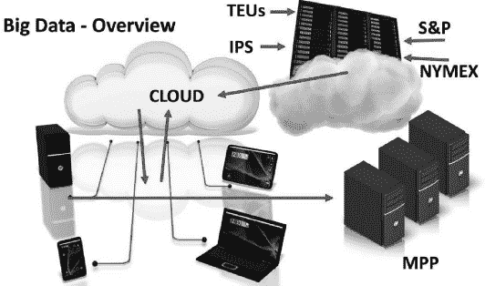
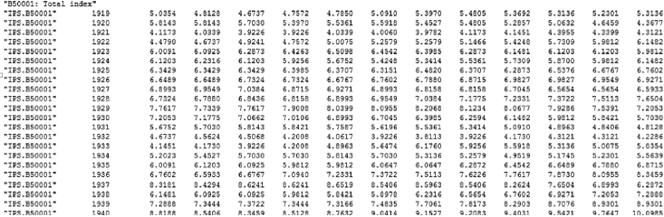
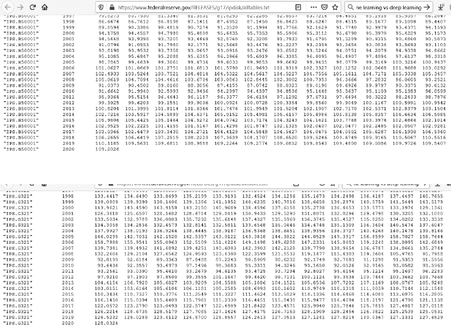
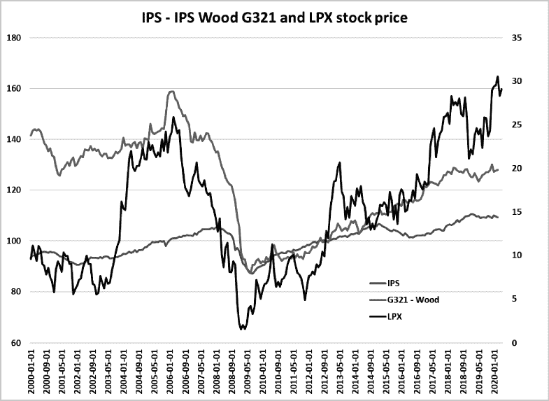
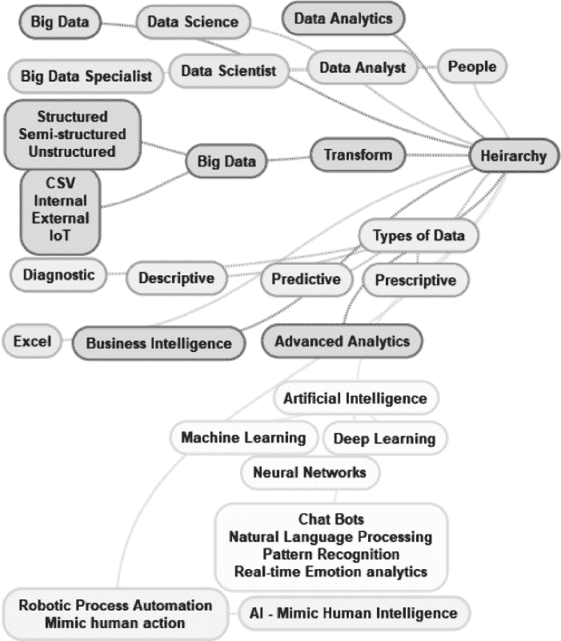

# 会计师的分析与大数据 第2版 (AICPA)

## 特别说明：COVID-19 资源

该协会是美国注册会计师协会和特许管理会计师公会的全球代言人，高度重视冠状病毒（COVID-19）疫情。

我们持续监测病毒对会员和行业的影响。有关该主题的最新信息，请访问 AICPA 的冠状病毒资源中心：[`http://www.aicpa.org/news/aicpa-coronavirus-resource-center.html`](http://www.aicpa.org/news/aicpa-coronavirus-resource-center.html)。

针对特定主题的更新，请访问以下资源中心。

| COVID-19 资源中心 | 网站 |
| --- | --- |
| 审计与会计 | [`http://www.aicpa.org/interestareas/frc/covid19.html`](http://www.aicpa.org/interestareas/frc/covid19.html) |
| 法务与估值服务 | [`http://www.aicpa.org/interestareas/forensicandvaluation/covid-19.html`](http://www.aicpa.org/interestareas/forensicandvaluation/covid-19.html) |
| 管理会计 | [`http://www.aicpa.org/interestareas/businessindustryandgovernment/management-accounting-covid-19.html`](http://www.aicpa.org/interestareas/businessindustryandgovernment/management-accounting-covid-19.html) |
| 个人财务规划 | [`http://www.aicpa.org/interestareas/personalfinancialplanning/covid19.html`](http://www.aicpa.org/interestareas/personalfinancialplanning/covid19.html) |
| 小型事务所 | [`http://www.aicpa.org/membership/small-firms.html`](http://www.aicpa.org/membership/small-firms.html) |
| 税务 | [`http://www.aicpa.org/interestareas/tax/covid19.html`](http://www.aicpa.org/interestareas/tax/covid19.html) |

# 概述

## 欢迎来到会计师的分析与大数据

传统会计正让位于会计与分析的混合模式，而分析一直是驱动力。工具已被创建用于衡量项目效果和投资回报、可视化数据和业务流程，以及发掘关键绩效指标之间的关系——许多工具利用了前所未有的大量数据涌入组织。在本课程中，您将讨论分析与金融领域的前沿主题，课程内容充满实用技巧和实操指导，您可即刻应用。

## 引言

会计师的角色将继续从数据创建者、操纵者和归档者向数据科学家和讲故事者转变。当今会计师必须跟上技术变革的步伐，认识到从历史分析转向预测性变革，最终转向规范性变革的必要性。

正是在这一背景下，大数据和分析的出现已经影响了许多组织，并在未来将发挥更为重要的作用。

## 讨论主题

* 用于查找或生成数据、选择关键绩效指标、分离项目效果的循证技术
* 将数据与投资回报、财务价值和高管决策相关联
* 数据来源，包括调查、访谈、客户满意度、敬业度和运营数据
* 可视化和呈现复杂结果

## 本课程章节

* 第 1 章：什么是大数据和分析？
* 第 2 章：大数据历史——大数据来源和特征
* 第 3 章：大数据有哪些趋势？
* 第 4 章：大数据的战略和业务应用是什么？
* 第 5 章：大数据平台和操作工具
* 第 6 章：大数据最终用户和会计工具
* 第 7 章：大数据示例
* 第 8 章：会计部门的大数据
* 第 9 章：大数据的伦理与隐私

## 开篇讨论

随着您在课程中的进展，请思考以下挑战：

* 您的组织目前可以访问哪些已在系统中且可供使用的信息？
* 您的组织中存在但未被采集的信息有哪些，您可以获取吗？
* 互联网上存在哪些行业数据库或政府数据库信息，您可以访问？

* 通过传感器和机器可以获取哪些信息，从而深入了解贵企业的运营和战略动态？

## 练习

花几分钟记下贵组织目前拥有的信息类型将大有裨益。当您考虑分析和大数据的不同应用时，此分析将很有帮助。请使用表 0-1 来收集您的信息。

表 0-1： 贵组织有哪些可用信息？

| 您拥有哪些信息？ |
| --- |
|   | 客户 |   | 供应商 |   | 员工 |   | 战略 |   | 运营 |   | 其他 |
|   | 1 |   | 1 |   | 1 |   | 1 |   | 1 |   | 1 |
|   | 2 |   | 2 |   | 2 |   | 2 |   | 2 |   | 2 |
|   | 3 |   | 3 |   | 3 |   | 3 |   | 3 |   | 3 |
|   | 4 |   | 4 |   | 4 |   | 4 |   | 4 |   | 4 |
|   | 5 |   | 5 |   | 5 |   | 5 |   | 5 |   | 5 |
|   | 6 |   | 6 |   | 6 |   | 6 |   | 6 |   | 6 |
|   | 7 |   | 7 |   | 7 |   | 7 |   | 7 |   | 7 |
|   | 8 |   | 8 |   | 8 |   | 8 |   | 8 |   | 8 |
|   | 9 |   | 9 |   | 9 |   | 9 |   | 9 |   | 9 |
|   | 10 |   | 10 |   | 10 |   | 10 |   | 10 |   | 10 |

在深入探讨整个主题之前，概述大数据的全貌可能会有所帮助，以便所有参与者建立初步认识。请参考图示 0-1：

图示 0-1

TEUs — 20 英尺标准箱

IPS — 工业生产统计

S&P — 标准普尔

NYMEX — 纽约商品交易所

MPP — 大规模并行处理

数据源自各种场所，形式也多种多样。来自个别公司、组织、流数据等的数据汇聚在云端，如图示 0-1 所示。组织通过内部服务器、笔记本电脑、平板电脑和其他移动设备访问信息。组织可能需要外部数据库和内部数据库的独特组合，包括计算、预测等。这些信息被发送到配备独立处理器的多台计算机上，以分析海量数据。这些连同其处理器的多台计算机被称为大规模并行处理 (MPP)。

## 示例

接下来，我们将通过一个简单示例，探讨如何处理大量数据以帮助您创建叙述性报告，从而补充会计流程。假设我们公司处于木材行业或受木材价格影响。工业生产统计数据可在 `http://www.federalreserve.gov/RELEASES/g17/ipdisk/alltables.txt` 获取。美联储的月度工业生产率指数涵盖制造业、采矿业、电力和燃气公用事业。生产指数衡量实际产出，并以实际产出的百分比表示。

该网站上的初始数据如表 0-2 所示。这些原始数据庞杂繁多，以目前的形式难以解读。

表 0-2

我们选取了 NAICS 代码 `B500001`（所有工业生产总指数统计）和 `G321`（木制品行业统计）的 IPS 数据开始分析，如表 0-3 所示：

表 0-3

接下来，从 `http://Finance.Yahoo.com` 获取了路易斯安那-太平洋公司 (`LPX`) 的月度数据，然后利用 Excel 将这三个数据系列合并。建立数据系列后，生成了图示 0-2 中的图表。

图示 0-2

显而易见，以图表形式呈现，这些数据以一种全新的方式“活”了过来。当我们用讲故事和数据科学来补充会计技能时，能否从这个例子的数据中得出一些总结性结论？一种解读是：

1. 木制品生产统计数据似乎遵循与 `LPX` 股价相似的趋势线。
2. 主要 IPS 也似乎遵循类似趋势。
3. 可以推测木材生产下降先于整体经济下降（注意对应大萧条的急剧下降）。
4. 可以推测房地产泡沫期间的木材生产统计数据得益于 `LPX` 股价上涨的支撑。

仅通过处理这个小示例中的可用数据，我们就能发现可用于商业预测的趋势。然而，现实生活中的大多数大数据示例比这复杂得多。大多数使用的数据库比 Excel 大得多，技术工具也复杂得多。此示例旨在演示大数据的基本概念，以便您了解其威力并建立感性认识。

在大数据和分析领域，也存在大量令人困惑的定义。请参考下图，它试图为今天的讨论梳理各个主题。

随着课程深入，我们将探索规模大得多、种类多得多的数据。用于解读大数据的软件程序比 Excel 复杂，尽管微软推出了 Power BI 产品，鉴于大多数会计师对 Excel 的熟悉程度，这极有可能成为会计师的首选工具。

课程结束时，您应熟悉大数据的来源、类型和趋势，以及可用于处理和解读这些信息的各种工具。我们将再看几个示例，并学习如何在您自己的实务中应用这些技术。
