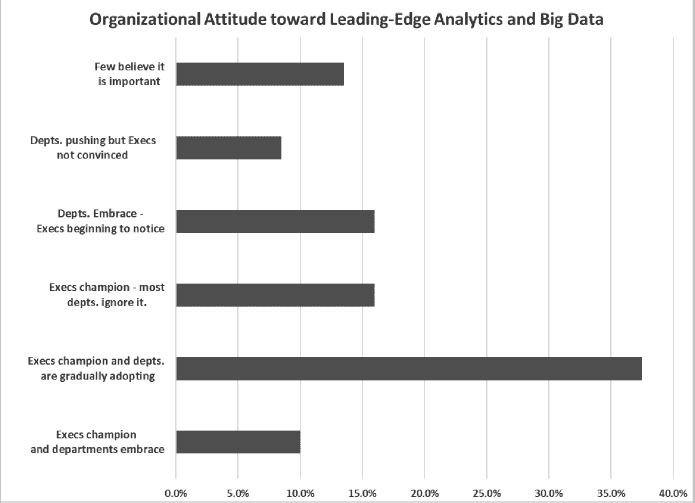
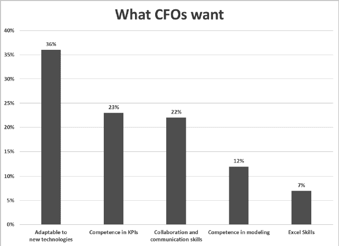

# 第 1 章

什么是大数据和分析？

## 学习目标

* 识别三种不同类型的数据。
* 回忆大数据代表哪种类型的数据量。
* 识别大数据术语。

## 简介

20 世纪初，企业使用纸笔记录财务和运营结果。仅记录交易日期就已颇具挑战，更别提用财务报表汇总信息了。有助于提高会计文员效率的主要自动化形式仅限于复写纸、油印机、复印机等方面的创新。当计算机最终可用于运营和财务用途时，系统基于交易的批量记录。同样，重点在于获取内部数据，以帮助组织了解其财务和运营结果。随着计算机的进步和性能的增强，由于算力增强、数据增加和工具更易用，重点逐渐转向获取更多内部生成的运营和财务信息，以及分析海量信息。

在互联网出现之前，组织主要处理内部数据。随着 20 世纪下半叶和 21 世纪初互联网使用的进步，外部信息变得可获取，并可与内部数据整合。公司从生产批量信息转变为员工生成信息（企业和个人层面），再到传感器生成关于我们生活方方面面的数据。这一点可能令人恐惧，因为电器、传感器和各种设备在更短的时间内生成的数据比以往任何时候都多。这导致了信息洪流，催生了大数据和预测分析的概念。

## 定义 — 什么是大数据？

大数据是一组大容量、高速度和多样化的信息，它需要具有成本效益的创新形式的信息处理方式，以获得增强的洞察力并支持决策制定。^(1)

大数据的最终目标应当是利用信息，从而为客户和组织带来更高的价值。

## “大”到底有多大？大数据中的容量层级

除了交易数据和用户创建的数据外，互联网的出现为新数据库、新形式的数据以及不再需要人工干预即可创建的数据打开了大门。

DOMO.com 对互联网上每分钟处理或创建的数据量进行了分析。^(2,3,4)

请参考以下每分钟的数据量：

*   Netflix 视频流媒体播放时长 — 694,444 小时 (2019)；97,222 小时 (2018)
*   Skype 通话次数 — 231,840 次 (2019)；176,220 次 (2018)
*   Instagram 上传照片数 — 55,140 张 (2019)；49,380 张 (2018)；46,740 张 (2017)
*   Amazon 每分钟产生的销售额 — $533,713.85 (2019)；$270,015.22 (2018)
*   互联网数据使用量 — 4,416,720 GB (2019)；3,183,420 GB (2018)；2,657,700 GB (2017)
*   YouTube 视频观看次数 — 450 万次 (2019)；433.3 万次 (2018)

Internet World Stats Live 估计 2019 年有 45.74 亿用户，较 2018 年的 42 亿全球用户有所增加。

数据量持续呈指数级增长。没有任何迹象表明这种信息增长不会继续。会面临的挑战在于如何管理信息的扩张，包括收集、归档、访问和解读。结构化数据、非结构化数据、流数据等的增长只会持续下去。

## 知识检验

1.  如何最好地描述大数据？

    1.  跨国公司中的大型系统。
    2.  结构化数据、非结构化数据和流数据。
    3.  包含组织中所有软件应用程序的企业资源规划系统。
    4.  使用串行处理处理的数据。

2.  据估计，Instagram 用户每天每分钟大约分享多少张照片？

    1.  约 25,000 张。
    2.  约 55,000 张。
    3.  约 75,000 张。
    4.  约 100,000 张。

## 容量示例

大数据涉及哪种类型的数据量？

## 兆字节、千兆字节、兆兆字节……它们是什么？

前面提到的度量单位能容纳多少数据？我们参考了 [WhatsAByte.com](http://WhatsAByte.com) 来寻找答案。^(5)

*   **字节**：100 字节相当于一个像这样的普通句子。
*   **千字节**：100 千字节等于一页像您现在正在阅读的这样的文字。
*   **兆字节**：100 兆字节等于几卷百科全书。600 兆字节大约是一张 CD-ROM 光盘能容纳的数据量。
*   **千兆字节**：100 千兆字节可容纳整整一层楼的学术期刊。
*   **兆兆字节**：1 兆兆字节可容纳 1,000 套《大英百科全书》。10 兆兆字节可容纳国会图书馆的印刷藏书。
*   **拍字节**：1 拍字节可容纳约 2000 万个装满文本的四抽屉文件柜。它可包含 5000 亿页标准印刷文本。
*   **艾字节**：据估计，5 艾字节将等于人类有史以来所说的所有词语总和。
*   **泽字节**：1 ZB 约相当于 1.52 亿年的高清视频。^(6)

## 知识检验

3.  一个拍字节可包含多少十亿页标准文本？

    1.  100。
    2.  500。
    3.  900。
    4.  750。

## 会计师与大数据

尽管许多组织已寻求利用大数据应用和资源，但它们没有时间或资源去完全实现这一愿景。美国生产力与质量中心和 Grant Thornton 于 2015 年对大数据、财务规划与分析进行了一项研究。受访者表示，如果有更多可用时间，以下领域将获得更多关注。

*   风险敞口和损失的简单汇总 60%
*   基本因果分析 57%
*   为识别可能结果而进行的情景和“假设”分析 36%
*   用于预测可能结果的预测分析技术 24%

管理会计师协会对组织对前沿分析和大数据的态度进行了一项研究。^(7)

## 财务和会计专业人士面临提供更多洞察的压力。^(8)

Robert Hernandez 讨论了会计师未来将需要的七项数据科学技能。

*   **高级 Excel** — Excel 仍将结合其他大数据工具使用。然而，他们将需要掌握更高级的技能，包括复杂数据表、统计函数、报表自动化和自我纠错模型的使用。目标应是学习工具，以便访问、操作和报告大量原始数据文件。
*   **数据挖掘/SQL 编程**。SQL 仍然是查询事务数据库的主导工具。数据科学将围绕数据和分析功能展开，主要在 SQL 数据库中。会计师应了解基础知识，以查询大型内部和外部数据库。
*   **高级收入分析**。组织将始终留住能够增加收入的人才。利用数据寻找更有效的定价、折扣、交叉销售机会、新形式的收入将提升会计师的价值。
*   **数学优化**。优化机会无处不在。有助于提高成本和收入效率的分析工具是强制性的。会计师处于识别和规定行动以增加公司盈利能力的位置。
*   **分析性细分**。传统的财务报表方法需要细化到颗粒级别。按部门、事业部或公司确定盈利能力仍然必要，但新方法将是在客户层面理解盈利能力。
*   **可视化**。图表可以立即传达内部和外部趋势以及需要采取行动的领域。不同的图表可能更适合不同的职能。会计师必须知道如何用图表有意义地呈现数据，并成为更好的沟通者。
*   **实时模型**。世界已转向 7×24 小时和数据的即时性。今天的企业也不例外。企业不仅需要对运营的即时反馈，还需要预测和预测来设想未来将发生什么。流数据将可用于帮助当前和未来状态的运营结果。

Adaptive Insights 对会计师的招聘要求和 Excel 专业知识的重要性提供了相反的观点。请参考下图，它说明了首席财务官在员工身上期望的这一特质和其他特质。

^(9)

Excel 会消失吗？有可能，但不会太快。Power BI 是更好的可视化和分析工具。然而，让我们提出一个假设场景。您的公司一直在学习 Power BI，您绝不是专家。您处于新手水平。您有一个早上 8 点的截止日期，但您在让 Power BI 按您的要求工作方面遇到了困难。现在是晚上 11 点。您很累。您是继续尝试让 Power BI 为您工作，还是尝试使用 Excel？

另一个促进 Excel 长盛不衰的关键特性是会计师的经验。从 Lotus 到 Excel 的过渡有一些缺点。软件中一些最成功的变革是那些允许个人在新旧两种模式下操作的变革。过渡时间可能会更长，但生产力和挫败感水平表现更好。

在雇佣员工方面，还有一个非常重要的概念。Excel 是一个标准。当求职者从一家将财务分析工具放在不同商业智能平台的公司跳槽时，他或她实际上是倒退了一步。一个人也可能因为财务规划与分析限制了其专业知识而限制了自己的流动性。当程序员专精于某种编程语言时，也面临着同样的问题。

## 会计的大数据问题 [¹⁰]

根据 [CFO.com](http://CFO.com) 的报道，除非会计师和财务高管为提供或交付数据产品和服务的公司工作，否则他们可能不会成为大数据趋势的参与者，因为他们中的大多数人几乎只接受过结构化数据（适合放入表格、Excel 电子表格、数据库等的数据）的培训，而非非结构化数据。

请记住，非结构化数据代表了现有数据中最大的部分，并且很可能产生最大的效益。

非结构化数据的一个例子来自 Trax —— 一家总部位于新加坡的公司，提供图像识别应用程序，从零售店货架照片中收集数据。这些照片使组织能够更好地管理库存。

> 在最近接受 PYMNTS 采访时，Trax 全球零售业务总经理 David Gottlieb 讨论了该公司对数字化实体零售商的愿景，包括如何利用图像识别和人工智能 (AI) 来简化货架管理。
>
> Gottlieb 解释说，在 Trax 和其他同类公司提供解决方案之前，货架管理无法频繁进行，主要是因为它需要人工且劳动密集型的流程。
>
> “在一天中的某个时刻，你会让一名店员穿梭于店内寻找空缺，然后可能用扫描枪扫描它们，”他解释道。这通常会消耗大量时间，特别是对于拥有大型门店或广泛库存的零售商而言。
>
> Trax 的系统旨在通过使用摄像头进行实时货架监控，减少执行货架管理任务所需的时间。
>
> 它依靠基于 AI 的图像识别来识别库存变化，帮助确保零售商准确掌握有哪些产品可供销售或需要补货。[¹¹]
>
> 然而，这些图像的用途不仅限于货架库存信息。Gottlieb 解释说，这些图片还被存储下来，提供大量的客户和产品信息，随后可用于分析目的。
>
> “我们提供的不仅仅是图像识别技术，”他说。“我们在多个层面存储数据——从图像生成的原始数据、关键绩效指标数据，再到元数据、主数据。”

非结构化数据的另一个例子可以在企业发布的以下文本来源中找到：

*   10-K 和 10-Q 文件中的管理层讨论与分析
*   新闻稿
*   企业高管访谈

## 大数据术语

与任何新领域一样，大数据有一些必须掌握的术语。以下列表并非旨在面面俱到，但它列出了许多与大数据、分析和商业智能相关的常用术语。

**人工智能 (AI)。** 指在机器中模拟人类智能，使其被编程为像人类一样思考并模仿人类行为。该术语也可应用于表现出与人类思维相关特征的任何机器，例如学习和解决问题。[¹²]

**商业智能 (BI)。** 数据、技术、分析和人类知识的整合，以优化商业决策并最终推动企业的成功。BI 项目通常将企业数据仓库与 BI 平台或工具集相结合，将数据转化为可用、可操作的商业信息。[¹³]

**数据分析 (DA)。** 以从中得出结论为目的检查原始数据的科学。DA 被广泛应用于许多行业，使公司和组织能够做出更好的商业决策，在科学领域用于验证或反驳现有的模型或理论。[¹⁴]

**云计算。** 一种提供信息技术服务的模型，其中资源通过基于 Web 的工具和应用程序从互联网检索，而不是直接连接到服务器。数据和软件包存储在服务器中。然而，云计算允许只要电子设备能访问网络就能访问信息。这种系统允许员工远程工作。[¹⁵]

**仪表板。** 一种 BI 软件界面，提供预配置或客户自定义的指标、统计数据、洞察和当前数据的可视化。它允许 BI 软件的最终用户和高级用户即时查看业务或 DA 的实时性能状态。[¹⁶]

**数据湖。** 一个集中式存储库，允许您按任何规模存储所有结构化和非结构化数据。您可以按原样存储数据，无需先对数据进行结构化，即可运行不同类型的分析——从仪表板和可视化到大数据处理、实时分析和机器学习，以指导更好的决策。[¹⁷]

**数据挖掘。** 在大量计算机化数据中搜索以发现有用模式或趋势的做法。[¹⁸]

**数据科学家。** 擅长分析数据（特别是大量数据）的员工或 BI 顾问，帮助企业获得竞争优势。[¹⁹]

**数据可视化。** 以图表或图形格式呈现数据。

**深度学习 (DL)。** 一种 AI 功能，模仿人脑处理数据和创建模式以用于决策的工作方式。DL 是 AI 中机器学习的一个子集，拥有能够从非结构化或未标记数据中无监督学习的网络。也称为*深度神经学习*或*深度神经网络*。[²⁰]

**Hadoop。** 一个免费的、基于 Java 的编程框架，支持在分布式计算环境中处理大型数据集。它是 Apache 项目的一部分，由 Apache 软件基金会赞助。[²¹]

**OLAP。** (联机分析处理)。一种用于数据发现的强大技术，包括无限制报表查看、复杂分析计算和预测性“假设”场景（预算、预测）规划功能。[²²]

**机器学习。** 一种自动化分析模型构建的数据分析方法。它是 AI 的一个分支，基于这样的理念：系统可以从数据中学习、识别模式，并在极少人工干预的情况下做出决策。[²³]

**预测分析。** 从现有数据集中提取信息以确定模式并预测未来结果和趋势的做法。预测分析不会告诉你未来会发生什么。它以可接受的可靠性水平预测未来可能发生的事情，并包括假设场景和风险评估。[²⁴]

### 规范分析

一种专注于为特定情况寻找最佳行动方案的商业分析类型，属于包含描述性分析和预测性分析在内的分析能力组合的一部分。^(25)

### 机器人流程自动化 (RPA)

一种可以轻松编程以跨应用程序执行基本任务的软件，就像人类工作者所做的那样。可以教会软件机器人一个包含多个步骤和应用程序的工作流，例如接收表单、发送回执消息、检查表单完整性、将表单归档到文件夹，以及用表单名称、归档日期等更新电子表格。RPA 软件旨在减轻重复性简单任务给员工带来的负担。^(26)

### 半结构化数据

尚未组织进专用存储库（如数据库）的数据，但具有相关信息（如元数据），这使其比原始或非结构化数据更易于处理。例如，Word 文档包含允许关键字搜索的元数据或标记，但它不像数据库中的信息那样具有那么多的关系结构或效用。^(27)

### 结构化数据

驻留在记录或文件中固定字段内的数据。这包括包含在关系数据库和电子表格中的数据。^(28)

### 非结构化数据

不驻留在传统行列数据库中的信息。它通常包括文本和多媒体。示例包括电子邮件、文字处理文档、视频、照片、音频文件、演示文稿、网页以及许多其他类型的商业文档。尽管这些文件可能具有内部结构，但它们被视为“非结构化”数据，因为数据不包含在数据库中。专家估计，任何组织中 80% 到 90% 的数据都是非结构化的。^(29)

## 四种数据分析类型

在了解了大数据的示例和来源之后，让我们看看刚才学到的一些定义和相关术语如何融入用于检查数据的过程中。不同类型的分析可用于出于不同目的分析大数据。

### 描述性分析

描述性分析是关于过去发生的信息。从会计角度来看，这代表传统的历史财务信息。请考虑以下示例：

*   可以根据公司过去的财务表现预测客户信用风险评估。
*   可以根据客户的产品偏好和销售周期创建销售结果预测。
*   当前的产品评论可用于预测未来销售。
*   员工评估可用于预测人员流动率。

### 诊断性分析

诊断性分析描述历史结果的原因。它试图回答“为什么会发生这种情况？”这个问题，如以下示例所示：

*   在传统财务中，差异分析揭示预算结果与实际结果之间差异的根本原因。
*   因果分析可用于描述某些结果发生的原因。
*   分析仪表板可用于描述为什么会发生某事。例如，在非洲埃博拉疫情爆发期间，可以查看病毒在不同地理区域发生时的每日传播情况。
*   跟踪因在 Facebook 上购买额外浏览量以增加特定帖子、视频或图片曝光度而带来的浏览量、帖子、粉丝、关注者等的增长。

### 发现性分析（洞察）

虽然从技术上讲不是四种 DA 类型之一，但发现性分析步骤可以插在诊断性分析和预测性分析之间。在发现性分析或洞察阶段，可以进行研究和分析，以确定历史信息与另一个数据库之间是否存在关系。

### 预测性分析

预测性分析通过分析历史数据和趋势来尝试确定将会发生什么。请考虑以下预测性分析的示例：

*   会计部门编制现金流量预测报告。
*   编制存货水平估算。
*   基于变更的假设预测结果。如果在营销预算上额外花费 5%，收入将增加特定百分比。
*   零售机构发放额外优惠券或促销活动预计将导致收入增长 10%。
*   基于历史结果，黑色星期五当周发布的广告预计将为黑色星期五假日购物季带来高于正常水平的销售额。

这里是来自体育界的另一个著名预测性分析示例：

> 2000 年代初，纽约洋基队是美国职业棒球大联盟中最受赞誉的球队。但在大陆的另一侧，奥克兰运动家队却以少得多的关注度——和少得多的资金——接连取得成功。
>
> 虽然洋基队给明星球员支付数千万薪水，但运动家队却以低薪资总额取得了成功。他们是怎么做到的？签约球员时，他们不仅仅关注 RBI（打点）、全垒打和自责分率等基本生产力数值。相反，他们分析来自每个球员和每场比赛的数百个详细统计数据，试图预测未来的表现和产出。有些统计数据甚至是通过视频识别技术从比赛视频中获得的。这使得球队能够签下那些可能不太出名，但在场上同样高产的优秀球员。运动家队开启了一种趋势，预测性分析轰动一时地渗透进体育界，模仿者纷纷采用类似技术。^(30)

也许预测性分析总有一天能帮助让大联盟薪资回归合理水平。

还有工具可用作预测分析的一部分。稍后章节将介绍的一个此类示例是净推荐值。净推荐值表明客户在 1 到 10 分的范围内推广或推荐您产品的意愿程度。公司希望每位客户都能给出 9 分或 10 分。在这个级别，客户会向其他潜在客户“推广”您的产品。

### 规范分析

规范分析利用描述性、诊断性和预测性分析的信息，建议具体的决策或业务策略的方法变更。也可以将其描述为为实现预期结果而采取的最佳场景。以下是规范性 DA 的示例：

*   航空公司座位价格以及随着出发日期临近，每个座位的成本定期上涨的方式。该决策的一个相关组成部分是航空公司决定超售机票，并向受影响的乘客提供补偿以安抚他们。
*   Facebook 等应用程序会向用户建议他们可能想要联系的其他好友。这种“连接建议”基于对双方个人资料中共同好友的分析。因此，新朋友和潜在朋友会被建议为联系人。
*   最常见的规范性分析是已知可缓解特定医疗问题的药物（他汀类药物、糖尿病药物、降压药等）。由于潜在的相互作用问题，这些药物也可能有负面预测。

## 大数据的益处

现在您已经了解什么是大数据，您可能想知道它将如何帮助您的实践。组织从大数据中可以获得哪些益处？IBM 的一项研究^(31)表明，以分析为竞争手段的组织在以下方面优于竞争对手：

*   1.6 倍的收入增长
*   2.5 倍的股价增值

### 大数据有哪些益处？

*   2.0 × EBITDA（息税折旧摊销前利润）增长。

此外，世界经济论坛在 2012 年指出，数据收集是一种新型经济资产，如同货币和黄金。

## 战略益处

大数据为企业提供战略益处，包括以下内容：

*   更好的战略决策
*   新产品和服务更快上市
*   增加创新
*   更深入地洞察业务
*   更深入地洞察竞争
*   对现有产品、服务或报价进行实时更改
*   环境扫描以识别威胁或机会

## 决策能力增强

大数据还有助于增强决策能力，具体如下：

*   增加保留和分析的数据量
*   提高数据分析速度
*   产出更准确的结果
*   改进决策流程
*   改进预测
*   更准确地识别根因分析
*   更明智的决策——利用新数据源提高决策质量
*   更快的决策——支持更多实时数据捕获和分析，以在影响点支持决策，例如当客户浏览我们的网站或与客服代表通话时
*   有影响力的决策——将大数据工作重点放在能提供真正差异化的领域
*   基于完整数据集而非样本集的分析
*   增强数据透明度

## 效率改进

企业还将体验到效率改进，包括以下内容：

*   减少或消除人工流程
*   成本节约
*   提高生产力
*   自动化常规决策
*   提高制造生产力和维护水平
*   整合先前相关的数据库
*   改进可扩展性

## 客户关系与销售

客户关系和销售也能从利用大数据中受益。这些领域的益处包括以下内容：

*   提高客户满意度
*   更好的客户服务
*   增加客户投入/反馈
*   通过交叉销售和向上销售改善销售业绩
*   增加客户吸引力和留存率
*   通过社交媒体增加精准营销

## 治理与合规

最后，大数据可以通过以下方式增强企业的治理和合规工作：

*   改进欺诈检测
*   改进风险评估和管理
*   可扫描和访问企业数据以防止未经授权的数据泄露的工具

## 知识检查

4. 描述大数据框架内的决策制定。

    1. 更明智、更快速、更准确。
    2. 更慢、更详细、更结构化。
    3. 更慢、更准确、更透明。
    4. 速度相同、更准确、更结构化。

## 练习题

1. 大数据的组成部分有哪些？
2. 分析的四个阶段是什么？
3. 什么是 Hadoop？
4. 描述数据科学家的工作内容。

## 注释

1. 1 IT 词汇表，Gartner，<http://www.gartner.com/it-glossary/big-data>。
2. 2 “Data Never Sleeps 5.0 | Domo”，访问于 2020 年 4 月 9 日，<https://www.domo.com/learn/data-never-sleeps-5>。
3. 3 James, Josh. “Data Never Sleeps 6.0 | Domo”，访问于 2020 年 4 月 9 日，<https://www.domo.com/blog/data-neversleeps-6/>。
4. 4 “Domo Resource — Data Never Sleeps 7.0.” Connecting Your Data, Systems & People. 访问于 2020 年 3 月 4 日。<https://www.domo.com/learn/data-never-sleeps-7>。
5. 5 “Megabytes, Gigabytes, Terabytes…What Are They?” What's a Byte?，访问于 2020 年 4 月 9 日，<http://www.whatsabyte.com/>。
6. 6 “The road to surfdom?” *经济学人*，2016 年 9 月 24 日，<http://www.economist.com/news/leaders/21707538-internet-not-american-whatever-ted-cruz-thinks-road-surfdom>。访问于 2020/4/9。
7. 7 Lawson, Raef, Toby Hatch, and Denis Desroches. “The Impact of Big Data on Finance Now and in the Future.” *imanet.org*。访问于 2020 年 3 月 5 日。<https://www.imanet.org/insights-and-trends/technology-enablement/theimpact-of-big-data-on-finance-now-and-in-the-future?ssopc=1>。
8. 8 Hernandez, Robert. “The 7 Data Science Skills That Will Change the Accounting Career.” Origin World Labs，2019 年 9 月 27 日。<https://www.originworld.com/2019/09/27/7-data-science-skills-that-will-change-accounting-career/>。
9. 9 What Skills do CFOs want in accountants? <https://arizent.brightspotcdn.com/ff/77/8307b9bc444690aaa59932d77e31/at022818-cfo-excel-skills-chart-1.png>。
10. 10 Katz, David M., “Accounting's Big Data Problem,” *CFO*，2014 年 3 月 4 日，<http://ww2.cfo.com/managementaccounting/2014/03/accountings-big-data-problem/>，访问于 2020 年 4 月 9 日。
11. 11 Krishna, Manu. “How Trax Uses AI to Manage Inventory: Blog: Trax.” Trax Retail，2018 年 9 月 24 日。<https://traxretail.com/blog/trax-uses-ai-manage-inventory/>，访问于 2020 年 4 月 9 日。
12. 12 Frankenfield, Jake. “How Artificial Intelligence Works.” *Investopedia*. Investopedia，2020 年 1 月 29 日。<https://www.investopedia.com/terms/a/artificial-intelligence-ai.asp>。
13. 13 “Featured Education, Research and Resources,” *TDWI*，访问于 2020 年 4 月 9 日，<https://tdwi.org>。
14. 14 “Data analytics,” *TechTarget*，访问于 2020 年 4 月 9 日，<searchdatamanagement.techtarget.com/definition/data-analytics>。
15. 15 “Cloud computing,” *Investopedia*，访问于 2020 年 4 月 9 日，<http://www.investopedia.com/terms/c/cloud-computing.asp>。
16. 16 “Dashboards,” *Techopedia*，访问于 2020 年 4 月 9 日，<http://www.techopedia.com/definition/13773/business-intelligence-dashboard-bi-dashboard>。
17. 17 Schmarzo, Bill. “Big Data.” *Amazon*. Wiley-Blackwell，2013。<https://aws.amazon.com/big-data/datalakes-and-analytics/what-is-a-data-lake/> 访问于 2020 年 4 月 9 日。
18. 18 “Data mining,” *Merriam-Webster's Collegiate Dictionary,* 第 11 版，马萨诸塞州斯普林菲尔德，Merriam Webster，2003。也可在 <https://www.merriam-webster.com/> 查阅。
19. 19 “Data scientist,” *Tech Target,* 访问于 2020 年 4 月 9 日 <searchbusinessanalytics.techtarget.com/definition/Data-scientist>。
20. 20 Hargrave, Marshall. “How Deep Learning Can Help Prevent Financial Fraud.” *Investopedia*. Investopedia，2020 年 2 月 6 日。<https://www.investopedia.com/terms/d/deep-learning.asp>。
21. 21 同上，“Hadoop,” *Tech Target,* <searchcloudcomputing.techtarget.com/definition/Hadoop>。

