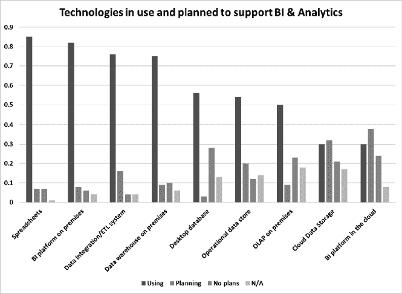
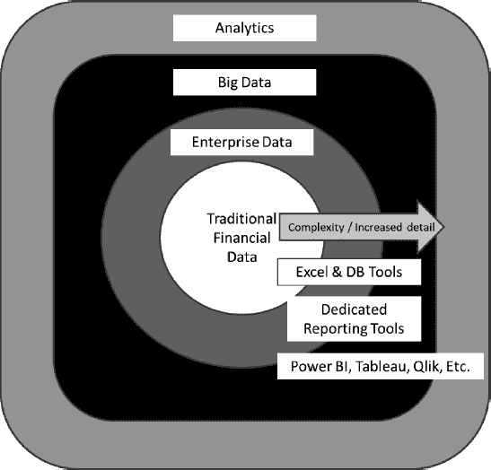
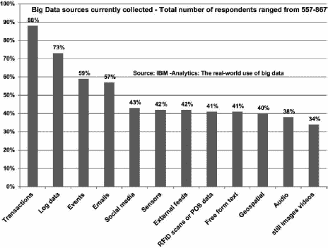
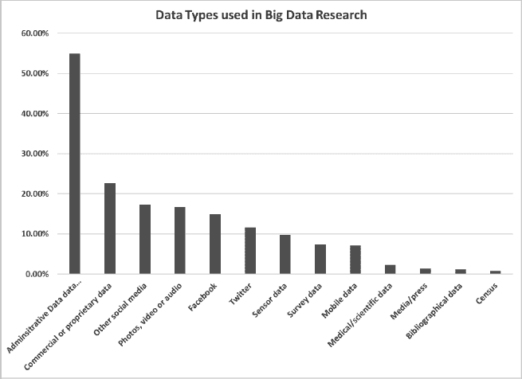
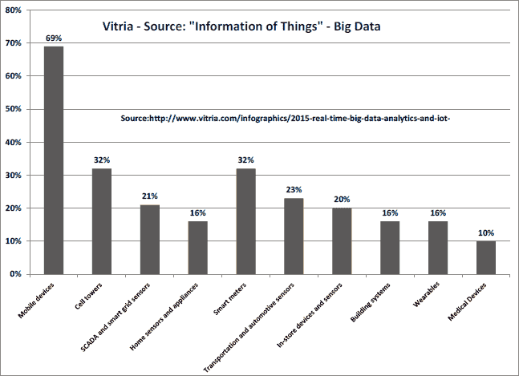
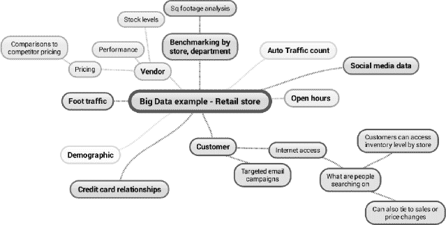

# 第 2 章：大数据历史 — 大数据来源与特征

## 参考文献

22. 22 "OLAP," *OLAP.com,* 访问于 2020 年 4 月 9 日, <http://olap.com/olap-definition/>.

23. 23 "Machine Learning: What It Is and Why It Matters." SAS. 访问于 2020 年 3 月 5 日. <https://www.sas.com/en_us/insights/analytics/machine-learning.html>.

24. 24 "Predictive analytics," *Webopedia,* 访问于 2020 年 4 月 9 日, <http://www.webopedia.com/TERM/P/predictive_analytics.html>.

25. 25 "Prescriptive analytics," *Tech Target,* 访问于 2020 年 4 月 9 日, <http://searchcio.techtarget.com/definition/Prescriptive-analytics>.

26. 26 Frankenfield, Jake. "Robotic Process Automation-RPA." Investopedia. Investopedia, 2020 年 1 月 29 日. <https://www.investopedia.com/terms/r/robotic-process-automation-rpa.asp>.

27. 27 同上, "Semi-structured data," <http://whatis.techtarget.com/definition/semi-structured-data>.

28. 28 "Structured data," Webopedia, 访问于 2020 年 4 月 9 日, <http://www.webopedia.com/TERM/S/structured_data.html>.

29. 29 同上, "Unstructured data," <http://www.webopedia.com/TERM/U/unstructured_data.html>.

30. 30 "Predictive Analytics: A Primer," *Amberoon,* 最后修改于 2012 年 10 月 25 日, <http://www.amberoon.com/CarpeDatumRx/bid/236799/Predictive-Analytics-A-Primer>.

31. 31 "Analytics: The Real-World Use of Big Data," IBM, 访问于 2020 年 4 月 9 日, <https://www.ibmbigdatahub.com/whitepaper/analytics-real-world-use-big-data>.

## 学习目标

- 识别计算历史的独特节点及其对当今大数据演变的影响。
- 识别大数据来源。
- 从小企业和会计师的角度回顾大数据。

## 导言

本章探讨大数据的历史以及来源和特征。对会计师而言，大数据的概念涉及使用电子表格等工具访问、操作、分析和报告数据的能力。了解计算历史以及从泥板到现代计算机系统的演变至关重要。为了最好地利用大数据，我们必须认识到大数据对我们的组织以及职业在过去、现在和未来的影响。

大数据可以通过多种方式创建，并通过多种途径转化为知识，前提是组织具备相应的技能和资源。同样重要的是认识到，数据可以通过多种特征来识别。

## 会计师的视角 — 大数据 = 电子表格

在 1978 年之前，会计师的工作取决于底层的会计系统。会计师记录、处理和分析交易，并报告财务结果。此外，会计师还通过基于比率和差异分析以及行业比较来评估结果，创造了额外价值。

1978 年，世界上第一个电子表格 VisiCalc 诞生。因此，会计师开始将交易数据输入电子表格并创建新的分析。电子表格产生了定制化报告，并增加了数据的总体量。在过去的三十年里，电子表格的使用不断增加。数据库应用和大型企业系统变得更加易得、用户友好、易访问且功能强大。

如今，1978 年前还因数据匮乏而受困的会计师，现在却被海量数据淹没，感到不堪重负。会计师在数据中溺水，却缺乏隐藏在数据流中的知识。

现在的问题是：“电子表格还将作为会计师的主要工具多久？”

根据 Adaptive Insights 进行的调查，两年前，78% 的首席财务官将 Excel 熟练度评为其财务团队最重要的技能，而这一比例今年已大幅下降至 5%。在新员工招聘中，Excel 技能排名依然靠后，仅有 7% 的首席财务官认为这是理想技能。

这种急剧下降表明，用于自动化的技术选项正在多快地增长。尽管 Excel 是一个高度自动化的程序，但利用自动化、机器学习或人工智能 (AI) 的新技术正迅速成为焦点。^1

^2

## 会计师视角下的大数据

会计师倾向于从其传统的数据视角来看待数据，即获取、收集、分类、汇总、分析和报告信息。更大型的系统促进了集成和更复杂的分析。大数据的可用性使得复杂性增加，并增强了执行深度数据分析的能力，而这在以前是不可能的。

**图 2-1**

## 知识检验

1. 1978 年开发的第一个电子表格是什么？
   1. Lotus
   2. Excel
   3. VisiCalc
   4. Multi-mate

## 历史

当通过会计的视角来看待大数据历史时，可以按七个不同领域的相互作用进行分类：

- 记账
- 会计
- 计算机器
- 计算机
- 互联网
- 云计算
- 物联网

这些领域中的每一个都是建立在其他类别之上或与之相互作用，从而形成了当前对大数据的访问和应用。考虑一下每个类别中一些重要的事件，因为它们为大数据铺平了道路。前三个类别提醒我们从何而来。当你考虑第四到第五个类别时，记下其中任何一项对你或你的公司产生的影响。

### 记账

记账自有历史记载以来就是人类文明的一部分。迦勒底-巴比伦文明被认为拥有最早的正式记账或记录保存活动。汉谟拉比法典（巴比伦领袖，公元前 2285-2242 年）的考古证据包括以下内容：

> 104. 如果商人给代理人谷物、羊毛、油或任何其他货物进行运输，代理人应给予收据注明数量，并补偿商人。然后，他应从商人处获得收据，注明给商人的钱款。
>
> 105. 如果代理人粗心大意，没有为给商人的钱款取得收据，他不能将未取得收据的钱款视为自己的。
>
> 106. 如果代理人接受了商人的钱但与商人发生争执（否认收据），则商人应在上帝和证人面前发誓已将这笔钱给了代理人，代理人应支付三倍的金额。^3

在最早的文明中，交易记录在泥板上。在埃及时代，交易记录在纸莎草纸上。系统通过希腊、罗马和以色列文明继续演变。最终，为了促进官员的问责制，公共账目被刻在石头上。记录被用于促进交易、税收评估和支付。

## 知识检验

2. 最早的历史证据表明交易记录的必要性源于
   1. 罗马税法
   2. 汉谟拉比法典
   3. 希腊商人记录
   4. 中国贸易记录

### 会计

#### 会计与技术的历史

1494 年，弗拉·卢卡·帕乔利（他在数学、神学、建筑学、博弈论、军事战略和商业等领域著书立说）出版了*《算术、几何、比例与比例性大全》*（*Summa de Arithmetica, Geometria, Proportioni et Proportionalita*，即《算术、几何、比例与比例性汇编*）。书中有一节包含复式记账论述，这一节使帕乔利在历史上确立了“会计之父”的地位，尽管他并未发明会计实务——而是描述了复式记账流程，即威尼斯记账法。^(4)

他的系统包含了我们今天所知会计循环的大部分内容。他发表了关于日记账和总账用法的信息，并描述了借方和贷方的记录过程，包括借方必须等于贷方这一事实。“正如帕乔利所言，这是威尼斯记账法中最重要的注意事项：‘所有债权人必须出现在总账的右侧，所有债务人出现在左侧。总账中的所有分录必须是复式分录——即如果你记录一个债权人，就必须记录一个债务人。’”^(5)

他的总账包括资产（包含应收账款）、存货、负债、资本、收入和费用账户。《大全》最终被翻译成德语、俄语、荷兰语和英语。

帕乔利的系统是当今仍在使用的会计系统的基础。从根本上说，尽管经历了工业革命和公司制的兴起，但变化不大。然而，美国会计史上的一个关键事件发生在 1913 年，当时第 16 条修正案获得批准。该修正案要求所有在美国工作的个人缴纳联邦所得税。在起步阶段，所得税和公司税鲜为人知且遭到强烈抵制。结果，大多数公司和个人干脆不申报，或申报错误。

几年后的 1917 年，美联储发布了*《统一会计》*，该文件试图为财务报表的组织方式设定行业标准，既用于报税也用于财务报告。

## 计算机器

计算机器的历史几乎与记账历史一样悠久。第一台计算机器——算盘，早在公元前 2400 年就已投入使用。

17 世纪的早期计算器为几个世纪后发生的计算革命奠定了基础。制表机自 19 世纪以来一直被会计行业使用。以下是 Gizmodo 图片时间线上的几个关键日期：^(6)

*   1642 年：帕斯卡林或帕斯卡计算器，由布莱兹·帕斯卡发明。它能对两个数进行加、减、乘、除运算。
*   1820 年：算术机，第一台批量生产的机械计算器，由查尔斯·泽维尔·托马斯·德·科尔马发明。
*   19 世纪：差分机，第一台机械计算机，由查尔斯·巴贝奇在 19 世纪初发明。
*   1948 年：手摇计算器 Curta，由库尔特·赫兹施塔克发明。Type II 型于 1954 年推出，生产至 1972 年。
*   1971 年：夏普公司发明了袖珍计算器。

## 计算机

现代计算机出现于 20 世纪。它通过提高速度、实现自动化和引入电子表格，彻底改变了会计行业。虽然我们大多数人亲历了这一演变过程，但以下列出了关键日期的时间线：

*   1911 年：IBM 成立。
*   1938 年：Z1 计算机诞生，发明者康拉德·楚泽。它是一台使用穿孔带的二进制数字计算机。
*   1947 年：威廉·肖克利在贝尔实验室发明了晶体管。
*   1958 年：高级研究计划局和 NASA 成立。杰克·基尔比和罗伯特·诺伊斯制造出第一块集成电路，即硅芯片。
*   1971 年：雷·汤姆林森发明了电子邮件。詹姆斯·费加森开发了液晶显示器（LCD）。大卫·诺布尔与 IBM 共同创造了软盘。因其柔韧性而昵称为“floppy”（软盘）。
*   1973 年：罗伯特·梅特卡夫和大卫·博格斯开发了以太网，一种局域网（LAN）协议。微型计算机施乐 Alto 是个人计算机发展史上的里程碑。
*   1977 年：苹果公司的 Apple II（首台具有彩色图形的个人电脑）发布。沃德·克里斯滕森编写了“MODEM”程序，允许两台微型计算机通过电话线交换文件。
*   1980 年：IBM 聘请保罗·艾伦和比尔·盖茨为新 PC 开发操作系统。他们购买了西雅图电脑产品公司开发的一个简单操作系统的版权，并以此为模板开发了 DOS。

## 互联网

鉴于互联网已成为日常生活不可或缺的一部分，很难相信它的历史不足 50 年。1969 年，美国国防部建立了高级研究计划局网络（ARPANET），旨在创建一个能抵御任何灾难的计算机网络。它成为了当今互联网的第一块基石。

1990 年，蒂姆·伯纳斯-李和罗伯特·卡约为互联网和万维网提出了 HTML 超文本协议。同年，第一家商业互联网拨号接入服务商上线。第二年，万维网向公众开放。

互联网发展史上的几个更多关键日期：

*   1994 年：万维网联盟由蒂姆·伯纳斯-李创立，旨在协助万维网通用协议的发展。雅虎成立。
*   1995 年：Java 推出。杰夫·贝佐斯推出[Amazon.com](http://Amazon.com)。皮埃尔·奥米迪亚尔创立 eBay。杰克·史密斯和萨比尔·巴蒂亚创建 Hotmail。
*   1998 年：谢尔盖·布林和拉里·佩奇创立谷歌。彼得·蒂尔和马克斯·列夫钦创立 PayPal。苹果 PowerBook G3 发布。
*   2001 年：比尔·盖茨推出 Xbox。Windows XP 发布。
*   2005 年：蓝光光盘推出。YouTube 上线。
*   2009 年：Windows 7 发布。
*   2012 年：微软 Windows 8 和微软 Surface 发布。电子商务销售额突破 1 万亿美元。
*   2015 年：微软 Windows 10 发布。

## 云计算

云计算是互联网应用最新的发展之一。数据和程序不再维护在单个计算机或本地服务器上，现在可以在“云端”访问。“云”一词创于 1997 年，指代共享数据服务和第三方访问的概念。云计算的其他近期发展包括 2002 年 Amazon Web Services 的成立、2005 年应用服务提供商（ASP）的出现以及 2006 年 Hadoop 的诞生。

2018/2019 年值得关注的主要趋势如下：

*   IT 基础设施持续向云托管服务迁移。
*   混合云的兴起。
*   强调集成和工作流。
*   基于云的商业智能。^(7)
*   边缘计算。

## 物联网

物联网（IoT）指的是“能够收集和交换数据的互联网连接对象网络。”^(8) 每个对象都有唯一标识符，并具备机器间通信能力，无需任何人工干预。例如，当门锁被破坏时，家庭入侵报警系统会自动发送信号。以下是“物联网”的简要时间线：^(9,10,11)

*   1832 年：俄罗斯的施林男爵发明了电磁电报。一年后，德国人卡尔·弗里德里希·高斯和威廉·韦伯发明了一种编码，可在 1200 米距离上通信。
*   1961 年：通用汽车在新泽西工厂引入首台工业机器人——Unimate。
*   1969 年：ARPANET 连接了 UCLA 和斯坦福大学。

### 物联网及相关技术的历史

*   **1970：** 斯坦福手推车问世，成为首辆“智能汽车”。它专为月球探索而建，可远程控制，并配备无线摄像头。
*   首款手持移动电话上市。重量达 4.4 磅。
*   **1973：** 马里奥·卡杜洛申请了首个读写射频识别 (RFID) 标签专利。RFID 标签最终将催生无线传感器，这对企业、工业和制造业物联网技术至关重要。
*   **1993：** 首个网络摄像头被创造出来，用于监控一台咖啡壶。
*   **1994：** 蓝牙技术被发明，作为连接键盘、手机与电脑的数据线替代方案。
*   **1999：** 麻省理工学院自动识别中心执行主任凯文·阿什顿创造了“物联网”这一术语。
*   **2000：** 全球定位系统 (GPS) 开始被公众广泛使用。
*   **2001：** 自动识别中心提出电子产品代码，以唯一标识世界上的每一个物体。
*   **2005：** Arduino 简化了设备互联。
*   **2006：** Hadoop 开发完成。
*   **2010：** 低功耗蓝牙推出，使健身、医疗、安防和家庭娱乐行业的应用成为可能。
*   **2011：** Nest Labs 推出基于传感器、支持 Wi-Fi、自学习、可编程的恒温器和烟雾探测器。
*   **2011：** 互联网协议第 6 版 (IPv6) 通过引入 340 亿亿亿 (340 undecillion) 个 IP 地址，极大地扩展了可连接互联网的物体数量。^(12)
*   **2014：** 苹果公司发布 HealthKit 和 HomeKit，这是两项健康和家庭自动化开发成果。该公司的 iBeacon 推动了情境感知和地理位置服务的发展。^(13)

## Gartner 2020 年十大战略技术趋势

在 2019 年 10 月的 Gartner 研讨会/ITExpo 上，Gartner 发布了关于 2020 年十大战略技术趋势的报告，内容包括以下各项：^(14)

1.  **超自动化** — 包括机器学习和机器人流程自动化
2.  **多重体验** — 对话式平台、虚拟现实、增强现实和混合现实
3.  **专业知识民主化** — 让所有人都能获取技术专长
4.  **人类增强** — 对人类的认知和身体改进
5.  **透明度与可追溯性** — 个人数据、伦理、所有权
6.  **赋能边缘** — 数据更贴近用户
7.  **分布式云** — 云的去中心化
8.  **自主事物** — 机器人、无人机、船舶、家电
9.  **实用区块链** — 仍不成熟但潜力巨大
10. **AI 安全**

## 数据的类别与特征

既然您已熟悉历史及某些技术领域的快速发展，让我们来看看我们刚了解的七个类别，以及它们在数据量、信息准备和数据分析类型方面的关键特征。当会计师考虑对未来会计职业的影响时，这些类别和特征尤为有趣。会计岗位的很大一部分工作是为决策目的准备和处理数字。由于大数据使数字的准备和处理变得不再必要，可能会取消许多初级会计职位。

## 知识检验

**3. 谁被公认为创造了当今互联网的第一块基石？**

1.  加州大学洛杉矶分校 (UCLA)。
2.  美国国防部。
3.  斯坦福大学。
4.  哈佛大学。

## 透过小企业的视角审视大数据

接下来，我们将以一家园林绿化企业为例。它有哪些方式可以利用大数据源，深入洞察运营、财务运营和客户情况？

设想您是一家员工少于 50 人的园林绿化企业的老板。在对会计或管理理论缺乏深入了解的情况下，您仅凭一些设备和一辆卡车创办了业务。您的设备仅限于卡车、拖车和商用割草机。您采用固定收费方式获取客户，费用基于您对客户支付意愿的最佳猜测。您从早干到晚，将割草机装上拖车，开往客户处，卸下割草机，提供修剪服务，第二天再重复。在任何一周、一个月或一个园林季结束时，您根据账户剩余现金判断业务成败。业务很简单。您是唯一员工。您的支出包括汽油、维修保养、极少的广告费和极少的专业帮助费。随着园林业务增长，您雇佣了员工，购买了更多设备，并希望在员工和设备上的额外投资能带来更大的现金利润增长。

作为老板，您最终实施了财务和运营系统，使业务稍微复杂一些。虽然仍关注现金流，但您现在定期从会计师事务所收到财务报表。您作为典型的有雇员的小企业在运营 — 努力寻找客户、经营业务、履行财务义务并给自己发工资。

下图描述了小企业在正常业务过程中的运营情况。园林维护业务如何利用大数据概念来改善业务？

小企业在追求大数据机会方面可能受限。然而，费用通常不高，且信息（若使用得当）能使公司更高效、富有成效和盈利。

此外，基于前面的例子，园林企业主还可以分析许多大数据机会以及客户行为，包括付款、付款及时性、续约日期、社交媒体评论和净推荐值。

## 大数据源

组织可以访问多种大数据信息源。请参考 表 2-3，该表将数据源细分为五大类：

请注意，前面表格中的数据源细分为五大类：

1.  公司拥有的结构化数据
2.  公司拥有但未开发的结构化数据
3.  组织拥有的非结构化数据
4.  组织不拥有的结构化数据
5.  组织不拥有的非结构化数据

会计师对上述提到的第一和第四类非常熟悉。这些类别通常由传统会计和财务应用程序表示。此外，这些类别用于执行比率分析和解释性分析，以提供对这些系统内结构化数据的洞察或理解。一些公司可能已经探索过使用第二类项目（他们拥有的未使用结构化数据），特别是如果他们开发了关键绩效指标等重点领域。真正的挑战在于组织如何利用第三和第五类（非结构化数据）。

在 表 2-4 中，访问各类别所需的工具概述如下：

*   **第一类：** 报告和处理涉及传统会计累积、报告、预测和分析。
*   **第二类：** 要求组织确定哪些信息能为组织提供洞察。一旦确定，公司必须对信息进行编目以允许访问。策展过程会筛选必要信息并丢弃不需要的信息。最后，将信息与其他财务信息关联，以确定其是否可用于推断对组织财务绩效的某些影响。

## 大数据工具的类别

*   第三类工具可用于评估组织以前未曾考虑但目前可访问的非结构化数据。通常，组织会运行分析以确定这些数据是否值得进一步分析。如果是，组织将遵循与第二类相同的模式。

*   在第四类中，工具必须识别组织外部可用但未被收集的结构化数据。一旦识别，必须对其进行收集、转换，或将其与其他现有数据关联并分析以获取洞察。一个例子是按月获取工业生产统计数据，并将该信息与月度销售数据进行比较，以确定是否存在任何相关性。月度工业生产统计数据也将可用于组织活动的常规分析（例如销售）。

*   第五类代表组织不拥有且不知道其价值的非结构化数据。在此类别中，组织必须首先获取非结构化数据，获取后，通过分析进行评估，以确定数据中是否存在可用于预测对组织财务影响的价值。

## 大数据来源

大数据来源无处不在。您可能知道其中一些来源，例如 Facebook、LinkedIn 以及许多其他人们每天使用的大型社交媒体网站。然而，您可能没有意识到，像 Facebook 和 LinkedIn 这样的网站会利用网站的每一项功能，包括您的帖子、消息、照片和搜索，来收集数据。其他大数据来源包括：

*   Google 搜索
*   电子邮件数据库
*   零售客户关系管理 (CRM)
*   健康记录，包括保险、医院、心理健康、监狱
*   论坛
*   社交媒体
*   Twitter
*   RFID 标签
*   支持 GPS 的设备
*   智能电表
*   YouTube
*   政府数据库
*   Amazon.com
*   交叉销售

您知道最大的大数据来源是什么吗？根据 IBM 的一项调查，目前正在追踪的主要大数据来源是交易。其余调查结果如 表 2-515 所示。

表 2-5

SAGE Publishing 对全球的社会科学家进行了一项调查，以了解更多从事大数据研究的研究人员及其面临的挑战，以及未来希望从事此类研究的人员的准入障碍。

16

另一个主要的大数据来源来自从物体、动物和人身上收集的万物信息。利用 Vitria 调查收集的信息，生成大数据的活动或工具如 表 2-6 所示17。

表 2-6

## 大数据的特征

### 大数据的四个维度

分析师将大数据分解为四个维度，以帮助组织理解：大数据管理的挑战源于这四个属性的扩展，而不仅仅是容量单独扩展。这些维度将大数据与包含在历史系统或企业级系统中的传统信息来源区分开来。

1.  **容量**：每秒、每分钟、每小时和每天生成的数据量。每天创建的数据规模正从千兆字节增加到兆兆字节，再到拍字节。到 2020 年，IBM 估计将创建 40 泽字节的信息18。
2.  **速度**：数据生成和处理的速度。能够利用流数据在几秒钟内进行预测。IBM 估计到 2016 年，将有 189 亿个网络连接，代表全球每人近 2.5 个连接19。截至 2019 年 3 月，Statista 报告称有 266.6 亿个连接设备20。
3.  **多样性**：广泛可用的不同数据类型。数据可以是结构化、非结构化、文本和多媒体。2019 年 3 月，Statista 报告称，全球连接的可穿戴医疗设备数量预计将从 2016 年的 5.26 亿跃升至 2022 年的 11 亿以上21。
4.  **真实性**：数据的可靠性或准确性如何。目前存在不确定性和可靠性层级。管理不精确数据的可靠性和不确定性将至关重要。

## 知识检验

4.  2022 年预计的可穿戴无线健康监测仪数量估计是多少？

    1.  5 亿。
    2.  7 亿。
    3.  11 亿。
    4.  15 亿。

### 大数据的更多特征

大数据的范围很大，目标是尽可能多地捕获总体数据，而不是小数据集。理想情况下，数据具有以下特征：详细、关联和灵活。数据应具有极高的详细度，并能够为数据的重要子部分建立索引，这些索引可用于发现和预测目的。数据应具有关联性，允许连接来自不同数据集的字段。数据应具有灵活性，以便添加额外字段或额外数据（增加容量）不会太困难。

## 示例：零售调查

假设我们经营一家拥有多个分店的零售店。该店销售各种宠物产品，包括用品、食品和玩具。考虑以下商店可能希望从客户或供应商处获取或捕获的数据示例：

1.  **客户**：组织的客户通过多种方式进行互动。对大数据感兴趣的组织将通过多种不同的方法和阶段从客户那里收集数据。
    1.  *互联网访问*：假设客户通过互联网门户访问商店。商店将尝试通过以下任一方式识别客户：
        1.  登录身份
        2.  常去门店
    2.  *关键产品和/或销售数据*
        1.  人们在搜索什么？
            1.  特定产品、价格或价格变动
            2.  门店位置以及库存水平
            3.  客户希望购买多少数量？
            4.  他们是否希望到店自提商品？
            5.  还在考虑哪些配件或相关商品？
    3.  *定向电子邮件营销活动*：基于客户分享的偏好，可以通过电子邮件或短信进行额外联系，以诱导客户进行购买。

2.  **供应商**：组织的供应商也应希望获得对系统中驻留数据的重要访问权限。
    1.  绩效：产品在库存中周转有多快？采购需求是否正确履行？
    2.  库存水平：库存水平如何？此外，基于提前期，何时需要补充库存？如果有大量退货，产品退货的原因是什么？
    3.  定价
        1.  与竞争对手定价的比较。
        2.  基于零售价格的变动，动量和趋势是否有任何变化？

3.  **人口统计学特征**
    1.  客户来自哪里——或者他们的住所位置在哪里？
    2.  客户是否愿意完成调查？
    3.  客户是否是客户忠诚度群体的成员？

4.  **客流量统计**
    1.  有多少人通过前门进入？
    2.  他们是什么时间通过前门进入的？

5.  **营业时间**
    1.  哪些营业时间段占据了最大销售额？
    2.  哪些营业时间段的退货量最高？

