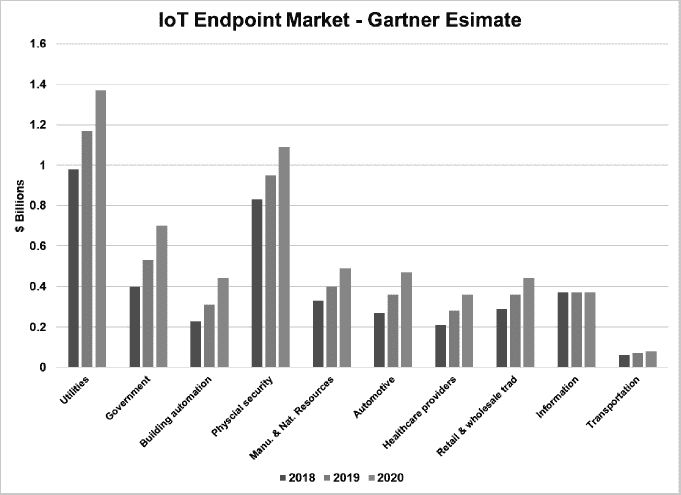

# 第 3 章：大数据趋势有哪些？

## 学习目标

- 区分不同的大数据趋势。

## 简介

## 分析关键问题

### 3. 哪些营业时段销售的附加服务最多，例如小型食品店（内部快餐站）？

### 6. 信用卡关系

#### 6.1 人们如何支付交易款项？

1. 现金
2. 支票
3. 信用卡
   1. 关联方
   2. 卡类型
   3. 卡片是否被拒付？

### 7. 按门店、部门进行基准测试

每笔销售交易均可按门店内的部门或柜台进行汇总。

1. 面积分析
2. 销售与特定部门每周营销手册、电子邮件等的关系

### 8. 社交媒体信息

1. 用户是否就任何产品或服务发表过评论？
2. 用户是否尝试在线获取产品优惠券？
3. 如果用户的常去门店缺货，用户是否评价过备选门店？

## 练习题

1. 基于记账、会计、计算机器与大数据的相互关系，论述大数据的历史演变。
2. 描述大数据的来源。
3. 什么是四个 V？
4. 列举小型零售企业任意三个大数据来源，或结构化/非结构化数据的用途。

## 注释

1. 1 Arrowsmith, Ranica. "Excel on the Way out?" *Accounting Today*, February 28, 2018. <https://www.accountingtoday.com/news/cfos-no-longer-see-excel-skills-as-vital-for-new-hires>, accessed April 10, 2020.

2. 2 Stodder, David. "Best Practices Report: BI and Analytics in the Age of AI and Big Data." *Transforming Data with Intelligence*, accessed March 22, 2020. <https://tdwi.org/research/2018/12/adv-all-best-practies-report-bi-analytics-age-of-ai-and-big-data.aspx>.

3. 3 "The Code of Hammurabi," translation by L.W. King, Yale Law School website, <http://avalon.law.yale.edu/ancient/hamframe.asp>, accessed March 27, 2019.

4. 4 Jane Gleeson-White, "Luca Pacioli's double entry and the birth of financial management," November 11, 2012, *Financial Management*, <http://www.unf.edu/~djaeger/Italy17_files/LPDoubleEntry.pdf>, accessed March 27, 2019.

5. 5 Ibid.

6. 6 Vincze Miklós, "The History of Early Computing Machines, from Ancient Times to 1981," *iO9/Gizmodo*, June 23, 2013, <io9.gizmodo.com/the-history-of-early-computing-machines-from-ancient-t-549202742>.

7. 7 Jon Witty, "Four Cloud Computing Trends to Track in 2018," *Tech Trends*, December 19, 2017, <http://enewsletters.constructionexec.com/techtrends/2017/12/four-cloud-computing-trends-to-track-in-2018/>.

8. 8 "The Internet of Things" infographic, *Business Insider*, April 13, 2016, <www.businessinsider.com/iot-ecosystem-internet-of-things-forecasts-and-business-opportunities-2016-2?utm_source=feedly&utm_medium=webfeeds>.

9. 9 Jennifer Duval, "Timeline of The Internet of Things," *HSTRY*, <edu.hstry.co/timeline/timeline-of-the-internet-of-things>, accessed March 29, 2017.

10. 10 Gil Press, "A Very Short History of the Internet of Things." *Forbes*, June 18, 2014, <https://www.forbes.com/sites/gilpress/2014/06/18/a-very-short-history-of-the-internet-of-things/#9eede0510dee>.

11. 11 Michael Kanellos, "Can Apple Alums Make a Thermostat Hip?" *Forbes*, October 25, 2011, <www.forbes.com/sites/michaelkanellos/2011/10/25/nest-labs-can-apple-alums-make-a-thermostat-hip/#1e52e94271e2>.

12. 12 Hansi Lo Wang, "IPv6: A New Internet Expands the Web by Trillions of Addresses," June 6, 2012, *NPR*, <www.npr.org/sections/alltechconsidered/2012/06/06/154430791/ipv6-a-new-internet-expands-the-web-by-trillions-of-addresses>.

13. 13 "Internet of Things: Patent Landscape Analysis," LexInnova report, 2015, WIPO, <www.wipo.int/edocs/plrdocs/en/internet_of_things.pdf>, accessed March 29, 2017.

14. 14 "Gartner Identifies the Top 10 Strategic Technology Trends for 2020." Gartner. Accessed March 5, 2020. <https://www.gartner.com/en/newsroom/press-releases/2019-10-21-gartner-identifies-the-top-10-strategic-technology-trends-for-2020>.

15. 15 "Analytics: The Real-World Use of Big Data," IBM, accessed March 16, 2019, <https://www.ibmbigdatahub.com/whitepaper/analytics-real-world-use-big-data>.

16. 16 Metzler, K., Kim, D.A., Allum, N., & Denman, A. (2016). Who is doing computational social science? Trends in big data research (Whitepaper). London, UK: SAGE Publishing. doi: 10.4135/wp160926. Retrieved from <https://us.sagepub.com/sites/default/files/compsocsci.pdf>.

17. 17 "Real-Time Big Data Analytics + Internet of Things = Value Creation," Vitria, January 2015, <www.vitria.com/infographics/2015-real-time-big-data-analytics-and-iot-infographic>, accessed April 10, 2020.

18. 18 "The Four Vs of Big Data" infographic, IBM, accessed April 10, 2020, <http://www.ibmbigdatahub.com/infographic/four-vs-big-data>.

19. 19 Ibid.

20. 20 "Internet of Things (IoT) connected devices installed base worldwide from 2015 to 2025 (in billions)," Statista, accessed April 10, 2020, <https://www.statista.com/statistics/471264/iot-number-of-connected-devices-worldwide/>.

21. 21 "Wearable technology - Statistics & Facts," Statista, accessed April 110, 2020, <https://www.statista.com/topics/1556/wearable-technology/>.

## 大数据有哪些趋势？

企业如何反应并规划在未来几年使用大数据？如果组织知道如何访问和使用大数据，就能获得显著的竞争优势。本章的趋势应与贵组织的大数据方法进行对比，并用作公司战略规划会议的基准。

## 2020 年大数据和分析的主要趋势

让我们讨论一些影响 2020 年及未来的趋势。然后我们将考虑课程上一版中强调的趋势。

围绕大数据的活动持续增加，并在许多组织中变得司空见惯。在以下章节中，我们将尝试确定 2020 年的一些当前趋势，以及识别过去几年盛行的趋势。专业人士将把以下内容视为了解和利用的可能性。选择忽视大数据潜力的企业有落后于竞争对手的风险，甚至可能失去追赶的能力。

### 以下商业智能 (BI) 趋势是 2020 年的新趋势^(1)

1.  成为实时企业不再是可选项。
2.  大数据只是数据。下一个是什么？宽数据。
3.  图分析和关联技术超越 SQL。
4.  DataOps 加自助服务是新的敏捷。
5.  活跃的元数据目录是数据和分析的连接纽带。
6.  数据素养即服务的出现。
7.  多方面的交互将带我们超越搜索。
8.  道德和负责任的计算现在至关重要。
9.  数据的“Shazam”：什么成为可能。
10. 独立与技术栈：续集。

### 以下 BI 趋势是 2019 年的新趋势^(2)

*   **可解释人工智能 (AI) 的兴起** — 除了结论和建议外，AI 还将提供解释，以帮助用户更清楚地了解建议的依据。
*   **自然语言让数据更人性化** — 系统将能够理解用户查询背后的意图。这将使数据访问和操作更加容易。
*   **可执行分析将数据置于情境中** — BI 平台将允许用户分析并采取行动，而不必等待他人审查和建议行动。
*   **数据协作放大社会公益影响** — 公共和私营部门组织致力于在“数据向善”运动中使用技术。
*   **道德准则赶上数据步伐** — 道德政策必须升级（以符合 GDPR 等法规），以纳入快速变化的技术和数据实践。
*   **数据管理与现代 BI 平台融合** — 组织必须确定如何捕获、清洗、定义和对齐不同的数据。
*   **数据叙事成为企业的新语言** — 领导者必须创建一种文化，让团队负责识别和传达数据洞察。
*   **企业在分析采用方面变得更聪明** — 除非员工将工具/系统采纳到日常业务运营中，否则分析项目不会成功。
*   **数据民主化提升数据科学家地位** — 数据科学家开发软技能，以简单、可执行的方式传达发现。
*   **加速云数据迁移推动现代 BI 采用** — 组织必须重新思考其数据战略，从本地存储转向云存储。

### 以下章节的趋势是通过以下领先咨询公司进行的调查和研究确定的：

*   Gartner 公司
*   New Vantage Partners

## 大数据调查

Gartner 公司是一家专注于信息技术的领先咨询公司。

Gartner 公司强调了组织在 2020 年需要探索的顶级战略技术趋势。^(3)

Gartner 将战略技术趋势定义为具有重大颠覆潜力、开始从新兴状态突围进入更广泛影响和使用，或在未来五年内以高度波动性快速增长并达到临界点的趋势。

2020 年十大战略技术趋势如下：

1.  **超自动化** — 包括机器学习 (ML) 和机器人流程自动化 (RPA)
2.  **多重体验** — 对话平台、VR、增强现实 (AR) 和混合现实 (MR)
3.  **专业知识普及** — 所有人都能获得技术专长
4.  **人类增强** — 对人类的认知和身体改善
5.  **透明度与可追溯性** — 个人数据、道德、所有权
6.  **赋能边缘** — 数据更贴近用户
7.  **分布式云** — 云的去中心化
8.  **自主事物** — 机器人、无人机、船舶、设备
9.  **实用区块链** — 仍不成熟但有潜力
10. **AI 安全**

根据 Gartner 的说法，还有一些其他有趣的大数据和信息收集类别。

### 无人机使用增加

Gartner 预测，由于无人机提供了显著的生产力提升，无人机市场将在 2018 年至 2028 年间以 40% 的复合年增长率增长。安装基数将从 324,000 增长到全球 900 多万。^(4)

### 物联网 — 连接性^(5)

Gartner 公司预测，企业和汽车物联网 (IoT) 市场将在 2020 年增长到 58 亿个端点，比 2019 年增长 21%。预计到 2019 年底，将有 48 亿个端点在使用，比 2018 年增长 21.5%。

公用事业将成为 IoT 端点的最大用户，2019 年总计 11.7 亿个端点，2020 年增长 17% 达到 13.7 亿个端点。“无论是居民还是商业用电智能计量，都将促进公用事业对 IoT 的采用，”Gartner 高级研究总监 Peter Middleton 表示。“物理安全方面，建筑入侵检测和室内监控用例将驱动量增长，将成为 2020 年第二大 IoT 端点用户。”

由连接照明设备驱动的楼宇自动化将成为 2020 年增长率最大的细分市场 (42%)，其次是汽车和医疗保健，预计 2020 年分别增长 31% 和 29%（见下表）。在医疗保健领域，慢性病监测将驱动最多的 IoT 端点，而在汽车领域，具有嵌入式 IoT 连接的汽车将通过一系列附加设备来完成特定任务，例如车队管理。

来源：Gartner (2019 年 8 月)^(6)

## 埃森哲趋势和调查

2020 年 2 月，埃森哲发布了其《埃森哲技术展望 2020》^(7)，这是对未来三年技术趋势的年度预测。五大关键主题是：

### 体验中的“我”

领先企业正与客户合作创造数字化体验。人们仍然想要定制化的诸多好处，但他们对公司用来提供这些好处的不透明方法持怀疑态度。5G 和 AR 的兴起给领导者带来了更大压力，使其成为现实。

### AI 与我

AI 的全部潜力已超越单纯的简单任务自动化，成为人类员工与机器之间强大的协作工具。成功的企业将理解情境在人机交互中的重要性，并利用进步在更大规模上进行协作。

### 智能事物的困境

产品所有权的概念正在根本性地改变。当人们购买产品时，在许多情况下，他们不再购买实体成品，而是购买不断演进体验的载体。公司必须认识到这一点，并努力设计其产品和生态系统以适应持续的变化。

### 走出实验室的机器人

机器人正在走出仓库和工厂，这得益于硬件成本的下降和 5G 网络的兴起。随着机器人能力延伸至受控环境之外，公司将面临人才、人机交互问题，以及一个由整个世界组成的测试平台等挑战。

## 创新 DNA

企业可以通过专注于其公司创新 DNA 的三个关键构建模块来转变创新方式。成熟的数字技术、科学进步，以及 DARQ（或分布式账本技术）、AI、扩展现实（XR）和量子计算等新兴技术，可以不断为组织注入新技能和新理念。领导者们正将这些技术构建模块编织在一起，为公司的未来设定航向。

## “炒作曲线”

Gartner 还发布了“炒作曲线”，该曲线展示了其 29 项必看技术，并包含这些技术成为主流的时间预估。他们建议：“技术创新领导者应利用炒作周期中突出的创新概况，来评估新兴技术的潜在商业机会。”

⁸

## NewVantage Partners 2020 年度大数据高管调查^(9)

根据 NewVantage Partners 最新的年度大数据高管调查，主流企业正大力推动从大数据和 AI 中实现业务成果。

2020 年报告有以下主要发现：

*   尽管投资速度趋于平稳，但 98.8%的企业正在投资大数据和 AI 项目。
*   只有 14.6%的企业部署了 AI 能力。
*   AI 作为最具颠覆性技术的比例从 2019 年的 80.0%下降至 2020 年的 69.5%。
*   73.4%的受访者表示，大数据的业务采纳仍是一场挣扎。
*   37.8%已建立数据驱动型组织。
*   26.8%已形成数据驱动型文化。
*   人员和流程挑战是成为数据驱动型组织的最大障碍（90.9%）。
*   大多数难以在组织中确定数据的单一问责点。
*   追求大数据和 AI 投资的原因主要是进攻性原因（89%）。
*   区块链投资似乎正在减弱。
*   超过 70%表示组织正在获得可衡量的结果。

影响最大的颠覆性技术是 AI 和机器学习。

### 业务采纳面临的最大挑战

## 知识检查

1.  根据 NewVantage Partners 的调查，变革的最大障碍是什么？

    1.  预算限制。
    2.  技术限制。
    3.  人员、业务流程、文化。
    4.  行政政策。

2.  以下哪项最能描述 NewVantage 关于区块链的发现？

    1.  兴趣已趋于平稳。
    2.  兴趣以加速速度增长。
    3.  兴趣正在减弱。
    4.  兴趣保持不变。

## 练习题

列出明年几项技术趋势。

## 注释

1.  1   “2020 数据与 BI 趋势：仅靠分析已不再足够。” QLIK. 访问于 2020 年 3 月 5 日. [`www.qlik.com/us/-/media/files/resource-library/global-us/register/ebooks/eb-2020-data-and-bi-trends-en.pdf`](https://www.qlik.com/us/-/media/files/resource-library/global-us/register/ebooks/eb-2020-data-and-bi-trends-en.pdf).
2.  2   “商业智能趋势，” Tableau Software, 访问于 2020 年 4 月 12 日, [`www.tableau.com/reports/business-intelligence-trends`](https://www.tableau.com/reports/business-intelligence-trends).
3.  3   Gartner, “Gartner 确定 2020 年十大战略技术趋势,” [`www.gartner.com/en/newsroom/press-releases/2019-10-21-gartner-identifies-the-top-10-strategic-technology-trends-for-2020`](https://www.gartner.com/en/newsroom/press-releases/2019-10-21-gartner-identifies-the-top-10-strategic-technology-trends-for-2020), 访问于 2020 年 4 月 13 日.
4.  4   Gartner, “预测：按用例划分的全球物联网企业无人机，2018-2028.” [`www.gartner.com/en/documents/3956346/forecast-iot-enterprise-drones-by-use-case-worldwide-201`](https://www.gartner.com/en/documents/3956346/forecast-iot-enterprise-drones-by-use-case-worldwide-201), 访问于 2020 年 4 月 13 日.
5.  5   “Gartner 称 2020 年将有 58 亿企业和汽车物联网终端投入使用.” Gartner. 访问于 2020 年 3 月 23 日. [`www.gartner.com/en/newsroom/press-releases/2019-08-29-gartner-says-5-8-billion-enterprise-and-automotive-io`](https://www.gartner.com/en/newsroom/press-releases/2019-08-29-gartner-says-5-8-billion-enterprise-and-automotive-io).
6.  6   “Gartner 称 2020 年将有 58 亿企业和汽车物联网终端投入使用.” Gartner, 2019 年 8 月 29 日. [`www.gartner.com/en/newsroom/press-releases/2019-08-29-gartner-says-5-8-billion-enterprise-and-automotive-io`](https://www.gartner.com/en/newsroom/press-releases/2019-08-29-gartner-says-5-8-billion-enterprise-and-automotive-io), 访问于 2020 年 4 月 13 日.
7.  7   Carrel-Billiard, Marc, Paul Daugherty, and Michael Blitz. “2020 技术愿景.” Accenture. Accenture, 2020 年 2 月 11 日. [`www.accenture.com/us-en/insights/technology/technology-trends-2020`](https://www.accenture.com/us-en/insights/technology/technology-trends-2020).
8.  8   “Gartner 确定五大具有变革性影响的新兴技术趋势.” Gartner. 访问于 2020 年 3 月 22 日. [`www.gartner.com/en/newsroom/press-releases/2019-29-08-gartner-identifies-five-emerging-technology-trends-with-transformational-impact`](https://www.gartner.com/en/newsroom/press-releases/2019-29-08-gartner-identifies-five-emerging-technology-trends-with-transformational-impact).
9.  9   NewVantage Partners LLC, “2020 年大数据和 AI 高管调查,” 2020, [`newvantage.com/wp-content/uploads/2020/01/NewVantage-Partners-Big-Data-and-AI-Executive-Survey-2020-1.pdf`](http://newvantage.com/wp-content/uploads/2020/01/NewVantage-Partners-Big-Data-and-AI-Executive-Survey-2020-1.pdf) 访问于 4 月 13 日.
