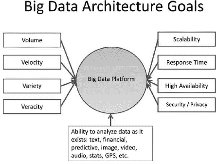
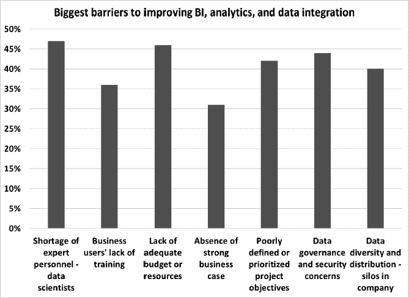
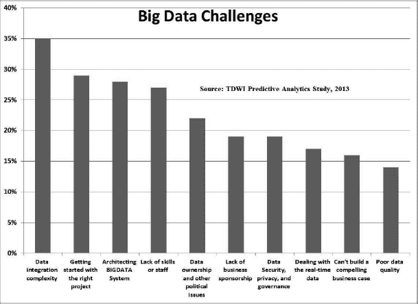

# 第 4 章

## 大数据的战略和业务应用是什么？

## 学习目标

*   区分大数据战略的根本原因。
*   回顾大数据的目标。
*   识别大数据的战略意义。

## 简介

图 4-1: 大数据目标

所有商业活动都必须为股东或利益相关者增加价值。在本章中，我们将探讨大数据对组织的战略意义。组织在大数据方面应有哪些目标？应制定何种战略以实现这些目标？组织如何开始大数据实施之旅？所有这些问题的第一步是确定组织的总体目标，以及大数据将如何帮助实现该目标。

营利性组织将增加企业价值作为其主要目标或宗旨。非营利组织的主要目标或宗旨必须是提升客户或利益相关者的生活、服务和机会。在图 4-1 中,请注意，核心目的是金钱、时间或价值。

金钱、时间或价值外侧的第一个圆圈代表商业洞察。为了提升企业或利益相关者的价值，组织必须考虑影响客户、运营或未来结果预测的商业洞察。当这些洞察付诸行动时，应能带来组织价值的增加。

## 大数据架构、来源与商业洞察

## 第二圈：大数据架构

第二圈代表大数据架构。该架构表明，为了实现商业洞察，组织极有可能需要投资大数据架构。大数据架构拥有无数的硬件、软件和顾问选项。它还涉及 `Hadoop`、`R` 和 `MapReduce` 等软件程序。可以稳妥地假设，如果不投资大数据架构，将难以产生能带来增值的与大数据相关的商业洞察。

## 最后一圈：大数据来源

最后一圈代表大数据来源。这一层级涵盖了前文提到的所有结构化和非结构化大数据来源。如果组织不愿或无法访问和分析大数据来源，则无法生成能带来企业或利益相关者价值提升的洞察。

## 知识检验

### 1. 大数据要求所有业务活动将其根本目标设定为

1.  增加股东或利益相关者的价值。
2.  增加可扩展架构。
3.  增加大数据容量。
4.  数据聚合。

## 大数据的目标

大数据分析的总体目标是为业务提供洞察。通过分析数据和趋势，企业可以获得可应用于几乎所有运营领域的宝贵洞察。大数据有助于实现为业务提供洞察这一目标的具体方式包括：

*   将数据货币化，或解读数据以实现可变现的竞争优势。
*   分析运营效率 —— 机器传感器、产品故障和流量模式。
*   创建可靠、可扩展且强大的基础设施，以辅助数据收集、分析和推断。
*   访问和使用内部及外部的结构化、非结构化和流式数据。
*   预测商业、社会、政治、经济、技术和环境趋势。
*   基于预设场景采取行动。

### 组织如何规划使用机器学习、商业智能、分析？^1

| 举措 | 百分比 |
| --- | --- |
| 自动发现可操作的数据洞察 | 54% |
| 提高信息的准确性和质量 | 47% |
| 通过提供建议增强用户决策 | 42% |
| 帮助用户查找、选择和使用数据进行分析 | 38% |
| 为政府和安全自动分类数据 | 35% |
| 改进/自动化数据目录或元数据存储库 | 34% |

## 与大数据相关的商业洞察

以下列表旨在传达大数据应用的广泛多样性。许多数据组件涉及多个行业。

### 1. 客户分析

正如前一章所述，大数据的主要来源之一来自交易。来自客户的此类信息可用于深入了解客户行为的许多方面，包括：

1.  放弃产品或服务
2.  分析客户在公司网站上的行为
3.  监控客户对产品的使用情况，以检测制造或设计问题
4.  识别高价值客户
5.  识别交叉销售机会以及向上销售机会
6.  确定不应接触的客户
7.  识别、定位和留住客户
8.  将点击流数据与交易数据相结合以改进客户画像
9.  将产品供给限制在客户感兴趣的范围内
10. 确定客户行为或产品偏好的任何方面
11. 识别客户细分
12. 记录和分析客户服务及支持问题
13. 吸纳品牌拥护者并改变品牌反对者的看法
14. 赋能客户销售您的产品
15. 让客户更快地找到商品
16. 提高忠诚度或净推荐值
17. 分析智能手机或移动数据 —— 称为详单处理、社交分析、流失预测、地理映射
18. 分析销售点数据
19. 创建论坛 —— 群众创意、群众解决方案

### 2. 制造

制造商现在可以从各种流程活动中获取实时数据，从而深入了解许多因素，包括：

1.  产品质量或缺陷的追踪
2.  供应链管理与规划
3.  优化机器
4.  工程分析
5.  预测性维护
6.  流程与质量分析
7.  保修索赔潜力（基于社交媒体评论或投诉）
8.  企业资源规划 —— 运营、服务交付、供应链管理和常规决策自动化
9.  对流程和程序的持续改进

### 3. 研发

最近，联邦政府认识到大数据在研发中的潜在价值。一项新计划启动，旨在从数字数据集合中提取知识，以帮助解决国家层面的挑战。在业务层面，大数据可助力于：

1.  监控产品质量
2.  识别潜在新产品的客户需求
3.  征求客户对产品的意见
4.  基于呼叫中心数据改进产品

### 4. 分销

随着仓库和分销中心日益高科技化，它们现在生成的信息可用于监控和追踪劳动力、库存和设备，包括：

1.  监控产品发货
2.  识别物流成本差异
3.  确定库存水平
4.  使用如 `GPS` 的位置数据
5.  使用射频识别
6.  使用分销优化

### 5. 物流

“物信息”是物流领域巨大的新数据来源。它可用于追踪货物并提供以下方面的洞察：

1.  需求预测
2.  供应链分析
3.  跟踪
4.  交付预测
5.  旅游业 —— 搜索者、定价、捆绑销售（航空、酒店、汽车、轮船、娱乐）

### 6. 营销

营销部门利用数据确定客户习惯并不陌生。凭借对海量数据的访问权，他们可将洞察应用于：

1.  确定营销活动效果
2.  确定渠道效果
3.  监控并改善客户体验
4.  基于位置和人口统计数据定制营销活动
5.  提供广告和公关活动 —— 需求信号、定向广告、情感分析、客户获取、促销及其他广告媒介
6.  提供品牌情感分析
7.  提供产品植入优化
8.  提供响应建模
9.  提供留存建模
10. 提供基于市场的分析
11. 提供净推荐值
12. 提供客户细分

### 7. 预测

大数据可能使除商业以外领域的预测成为可能。其中包括：

1.  犯罪、威胁分析
2.  天气
3.  投资
4.  矿产定位
5.  天体物理学
6.  健康
7.  人际关系

### 8. 运营分析

运营分析利用来自机器传感器的信息，从多方面改进运营，包括：

1.  更准确及时的决策
2.  日志和运营数据的偏差分析
3.  设施布局 —— 无论是制造业还是零售业
4.  供应链优化
5.  动态定价

### 9. 人力资源

某些零售公司使用可穿戴技术来追踪员工在店内的通信和移动情况。虽然这是利用大数据进行人力资源管理的一个极端例子，但许多公司可以利用员工信息做以下一些事情：

1.  识别有离职风险的员工
2.  监控招聘活动
3.  识别招聘的外部候选人
4.  简历数据
5.  员工搜索
6.  员工未来团队

### 10. 会计

我们将在本课程的其他章节中讨论以下一些应用：

1.  风险衡量
    1.  信用风险
    2.  市场风险
    3.  运营风险
2.  预算、预测、规划
3.  欺诈检测
    1.  检测多人共谋欺诈
    2.  实时欺诈预防
4.  算法交易
5.  客户分析
6.  重复付款
7.  定价、商业智能和数据挖掘

### 11. 竞争

1.  追踪竞争对手的价格
2.  追踪竞争对手的销售
3.  追踪竞争对手的营销举措
4.  描绘竞争格局

### 12. 媒体和电信

网络优化、客户评分、担保与预防、欺诈预防

### 13. 能源

智能电网分析、勘探、运营建模、电力线传感器

### 14. 医疗保健和生命科学

生物信息学、制药研究、临床结果研究、药物基因组学、新生儿、ICU 监护、疫情预警系统、远程医疗监护、可能再次入院。

1.  药物发现
2.  健康治愈
3.  健康诊断

### 15. 政府

1.  法规遵从
2.  威胁分析
3.  执法、国防和网络安全（例如，实时监控、态势感知、网络安全检测、车牌追踪、GPS 追踪）
4.  自然系统——野火管理、水资源管理、野生动物管理
5.  交通——智能交通管理
6.  逃税、社保欺诈、洗钱、恐怖分子检测、通信监控、市场监管、武器系统和反恐、计量经济学、健康信息学

### 16. 非结构化数据

与前面许多章节相关

1.  传感器数据——汽车、家电、机器、温度、安防、自动售货机
2.  社交网络——来自用户在评分、评论和博客上生成的评论的情感数据
3.  短信软件——应用日志
4.  互联网搜索——文本和文档、挖掘
5.  数字图像和视频
6.  语音数据
7.  Web——Web 分析、社交媒体分析、多变量测试 (2)  
    多变量测试是一种通过修改多个变量来测试假设的技术。多变量测试的目标是确定在所有可能的组合中，哪种变体组合表现最佳。网站和移动应用由可变元素的组合构成。
8.  其他——文本分析、业务流程分析
9.  点击流——用户在浏览互联网时留下的虚拟轨迹。点击流是用户在互联网上活动的记录，包括用户访问的每个网站和每个网站的每个页面、用户在页面或网站上停留的时间、页面访问的顺序、用户参与的任何新闻组，甚至用户发送和接收的邮件的电子邮件地址。互联网服务提供商和个别网站都能够追踪用户的点击流。3

### 17. 股市分析

例如，天气对证券价格的影响或市场数据延迟分析

## 知识检查

2.  以下哪项未被提及为与研发相关的大数据洞察？

    1.  监控产品质量。
    2.  识别客户需求。
    3.  创建第三代和第四代产品。
    4.  征求客户意见。

## 大数据架构

**图 4-2**

来源：改编自 [`http://bigdataandanalysis.blogspot.com/`](http://bigdataandanalysis.blogspot.com/) 上的信息

为了提供企业所需的所有洞察，大数据平台需要实现许多目标。大数据架构的设计必须使数据在自然环境中得到分析，而不是在海量数据表中重新创建数据。该架构必须允许读取和访问各种来源，如电子邮件、财务、音频、图像、GPS 等。架构的创建应实现四个 V（容量、速度、多样性和真实性），如第 2 章所述。该架构还必须具有经济可扩展性、足够的响应时间、多种硬件选项（由于硬件故障），并具有内置安全性以防止未经授权访问机密详细数据。

## 大数据的战略意义——挑战

要将大数据作为组织的工具，必须首先解决一些关键的战略问题。如果在流程开始时忽视了战略问题，可能难以成功实施大数据。以下列表可作为思考实施大数据平台的起点：

### 战略挑战

-   确立目的适用性
-   提供整体系统架构规划

### 技术挑战

-   获取数据访问权
-   获取相关方法论和元数据的访问权
-   确立数据集的来源和血缘
-   就城市（准确性、保真度）、不确定性、误差、偏差、可靠性和校准来确立数据集质量
-   解决安全顾虑
-   技术可行性
-   现有数据仓库架构
-   不成熟的新系统或所选数据的可靠性
-   缺乏大数据的元数据和模式
-   缺乏工具
-   企业级产品和工具的可用性
-   高延迟
-   在集群内运行

### 资源或能力挑战

-   实施大规模大数据计划的能力
-   离散数据的整合
-   收集数据的质量和成本
-   预算限制
-   成本过高

### 人员挑战

-   大数据分析的实验和试验测试
-   网络传输的完整性
-   数据质量差
-   处理实时数据的能力

### 项目管理挑战

-   依赖多个可能无法协同工作的顾问
-   从正确的项目开始

### 变更管理挑战

-   制度变更管理
-   确保跨司法管辖区协作和通用标准
-   阻碍大数据收集和组织的不同部门系统
-   获取技术胜任的员工
-   陡峭的技术学习曲线
-   招聘合格人员
-   本质上是文化性的部门间障碍
-   不被接受或不被信任的数据
-   数据所有权，特别是与组织文化相关的方面
-   缺乏业务赞助
-   缺乏对商业案例的信心

### 合作伙伴挑战

-   与大数据生产者建立战略联盟

### 法律和监管问题

表 4-1：注意 2018 年的障碍，然后将其与 表 4-2 以及 TDWI 截至 2013 年的障碍分析进行对比。你能从这两个图表的对比中得出什么结论吗？

表 4-1

⁴

表 4.2.

来源：改编自 [www.business2community.com/big-data/drive-real-time-revenue-world-big-data-01109279](http://www.business2community.com/big-data/drive-real-time-revenue-world-big-data-01109279)

## 知识检验

3. 根据 TDWI 的说法，大数据面临的最大挑战是什么？

    1. 缺乏业务赞助。
    2. IT 员工缺乏技能。
    3. 数据集成复杂性。
    4. 数据质量差。

## 错误数据的危害

除了使用大数据的战略挑战之外，组织也有很大可能错误地使用大数据。在许多情况下，如果组织在不充分了解统计陷阱的情况下使用大数据，可能会危及决策过程的完整性。少量数据的任何问题在大量数据中都会被放大。抽样误差或偏差可能会产生不能代表实际情况的数据，这是民意调查中常见的不准确性。错误的假设可能从数据收集之初就存在。例如，一家公司可能假设某个变量是客户留存的强预测指标，但实际上该变量仅与留存率相关。

组织面临着一个主要危险：沉迷于汇聚海量数据，却对这些数据得出不当的结论。这对于制造环境尤为重要，因为它们可能基于指导性分析做出关键的生产决策。

### 错误数据

让我们考虑一个 Ari Zoldan 在 *Wired* 杂志上撰写的例子，该例讨论了从飓风“桑迪”期间收集的 Twitter 数据中得出结论的情况。^(5)

> 在罗格斯大学的一项引人入胜的研究中，科学家们试图了解人们与飓风“桑迪”相关的决策过程。从 10 月 27 日至 11 月 1 日，记录了超过 2000 万条与该超级风暴相关的推文。关于防范准备的推文在风暴来临前一晚达到高峰，而关于聚会的推文在风暴平息后达到高峰。
>
> 大多数推文源自曼哈顿，主要是因为那里智能手机和 Twitter 使用率高度集中。由于大面积停电和手机电量耗尽，受灾最严重的地区（如 Seaside Heights 和 Midland Beach）发出的推文非常少。从数据中，人们可能会推断曼哈顿区承受了风暴的主要冲击；然而，我们知道事实并非如此。那些外围地区实际上发生了很多情况。鉴于数据呈现的方式，来自 Twitter 圈子中未被代表的社区存在巨大的数据空白。

这个例子说明了几个观点。首先，它驳斥了“更多数据会产生更深入洞察”的迷思。它证明了不被数据量或统计数字过度影响的重要性。在审视数据时，要保持客观、批判性，并独立于任何结果。

统计数据不等于事实。大数据可能看起来像事实，但实际上只是数据量更大而已。在原始状态下，大数据庞大且无序，为分析组织数据非常困难。

你还应该警惕偏见和缺失的背景。确认偏误是指人们在数据中寻找证据以确认其预先存在的观点。此外，当数据与潜在假设相冲突时，人们倾向于忽略它。仅仅因为数据可以被绘制成图表或由算法分析，并不意味着其解释就是有效的。更快、更强大的系统意味着我们也能比以往更快地做出错误的解释和处方。

在评估数据时，请记住以下三点警示：

1. 人们倾向于找到他们想找的东西。更多的数据和速度并不一定意味着结果会得到改善。
2. 数据分为两类——定量和定性。定性分析对于解释定量分析是必要的。以公开财报发布为例。数字被公布出来，然后通过解释或“口头”调整收益以最佳方式呈现，从而置于特定背景中。
3. 请记住数据的背景很重要。考虑一下全球变暖是如何被解读、重新解读、再重新解读的。对于每一个数据集，了解分析师的偏见都很重要，例如呈现的数据、修改的数据和排除的数据。例如，2015 年第一季度国内生产总值 (GDP) 不如预期那么高。过去几年第一季度均低于预期。分析师最初将这一表现归因于严冬。遗憾的是，天气仍无法解释所有令人失望的结果，因此分析师称存在“第一季度残留季节性”及其他变量的疲软读数。应当指出，美联储的经济学家并未发现此类扭曲对汇总 GDP 有显著统计证据。^(6)

## 五大 IT 大数据错误

大数据问题对 IT 经理来说有多大？根据 Infochimps 的数据：

> 55% 的大数据项目无法完成，许多其他项目也未能达到其目标。
>
> 虽然原因可能有很多，但毫无疑问，最大的因素之一是高层管理者（提供整体项目愿景）与负责实施的人员之间缺乏沟通。负责大数据项目繁重开发工作的 IT 员工的意见，往往被作为事后诸葛亮，只有在项目偏离航向时才会被考虑。^(7)

根据这段引述，近一半的大数据项目从未完成。在剩下的项目中，很大一部分不会为组织或利益相关者增加价值。除了数据选择和处理的潜在错误外，IT 还可能增加复杂性。Oracle 的 Subramanian Iyer 撰文谈到了 IT 犯下的五大大数据错误：^(8)

1. 过分强调所需技术而非业务需求。
2. IT 管理层往往关注错误的业务案例，假设投资回报率将与行业内其他公司相同。
3. 管理层可能作为大爆发式实施大数据方法的一部分，并行启动多个计划。这种方法可能会降低大数据项目成功的几率。
4. IT 管理层经常不进行适当的成本效益分析，以确定大数据项目的回报。
5. 将大数据应用置于与传统应用相同的流程要求（认证机制、访问控制、数据隔离和环境管理）之下，可能会危及项目。

## 知识检验

4. 以下哪项**不是**大数据错误？

    1. 使用迭代实施策略。
    2. 关注技术而非业务需求。
    3. 未执行成本效益分析。
    4. 作为“大爆发”方法或试点实施的一部分，并行执行多个计划。

## 练习题

1. 开发大数据的根本原因是什么？
2. 大数据实施面临哪些变更管理问题？
3. 一个关于大数据和推文的警示故事与飓风“桑迪”有关。如果脱离上下文，相关推文发生了什么可能会产生错误结论？

## 注释

## 参考文献

1.  1 斯托德，大卫。“人工智能与大数据时代的商业智能与分析。” <https://www.oracle.com/a/ocom/docs/middleware/application-integration/tdwi-bp-report.pdf?elqTrackId=915e6e26e9e64493b61cb60977243b58&elqid=79756&elqt=2>

2.  2 “什么是多变量测试？” Optipedia，访问于 2017 年 3 月 30 日，<http://www.optimizely.com/resources/multivariate-testing/>

3.  3 “点击流，” Webopedia，访问于 2017 年 3 月 30 日，<https://www.webopedia.com/TERM/C/clickstream.html>

4.  4 斯托德，大卫。TDWI - “人工智能与大数据时代的商业智能与分析。” <https://www.oracle.com/a/ocom/docs/middleware/application-integration/tdwi-bp-report.pdf?elqTrackId=915e6e26e9e64493b61cb60977243b58&elqaid=79756&elqat=2>

5.  5 阿里·佐尔丹，“数据越多，问题越多：大数据总是对的吗？” Wired，访问于 2016 年 3 月 17 日，<http://www.wired.com/2013/05/more-data-more-problems-is-big-data-always-right/>

6.  6 “GDP 中的残留季节性，” FEDS Notes，美联储，访问于 2016 年 3 月 17 日，<http://www.federalreserve.gov/econresdata/notes/feds-notes/2015/residual-seasonality-in-gdp-20150514.html>

7.  7 “调查：IT 团队希望其 CIO 了解的企业大数据知识，” Infochimps，访问于 2019 年 3 月 13 日，<https://www.prnewswire.com/news-releases/survey-what-it-teams-want-their-cios-to-know-about-enterprise-big-data-188190311.html>

8.  8 苏布拉马尼安·艾耶，“五大大数据错误，” Oracle，访问于 2015 年 6 月 8 日，<http://www.oracle.com/us/corporate/profit/big-ideas/031214-siyer-2166578.html>
