# 第 5 章：大数据平台与操作工具

## 学习目标

*   识别可用的大数据软件工具。
*   识别名为 Hadoop 的开源软件。
*   回顾 MapReduce 和 R 软件的作用。

## 简介

本章介绍各种大数据平台以及可在这些平台上使用的操作工具。其中最主要的工具是被称为 Hadoop 的操作系统。Hadoop 是一个开源框架，许多组织选择它来支持其大数据工作。本章将重点介绍会计师在大数据应用中建立基础理解所需的信息技术术语。

## 大数据能力

所有大数据工作的第一步是了解组织希望达成的目标。应进行两次讨论。

首先，组织应举行战略规划会议。应提出的主要问题是：就大数据而言，公司的长期愿景是什么？

接下来，组织应举行信息规划会议。此次讨论应侧重于组织如何利用现有资源（硬件、软件、人员和未来预算）实现第一步的战略。

这两次对话都是必要的，应在两次不同的规划会议中进行。了解组织需求的一种方法是考察大数据的一些能力，然后确定其中是否有任何能力契合企业或 IT 战略。

利用大数据和分析可以发挥哪些能力？

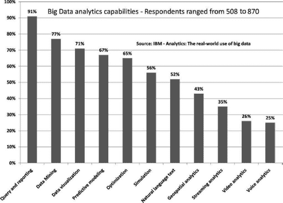

**表 5-1**

来源：改编自“The Real-World Use of big data,” IBM Institute for Business Value, accessed April 14, 2019, <https://www.ibmbigdatahub.com/blog/big-data-requires-strong-analytics-capabilities>。

数据分析（DA）是分析原始信息以推断该数据结论的研究。DA 被用作众多商业项目的一部分，帮助组织做出更好的商业决策，并验证或反驳现有模型或推测。DA 与“数据挖掘”不同，因为它包含数据挖掘不一定具备的评估过程。数据挖掘涉及搜索大量信息集以发现模式和关系。DA 侧重于根据分析师已知的信息推导答案。

哪些业务分析示例可用于组织内的特定部门？

### 营销分析

*   竞争对手分析
*   定价分析
*   品牌分析
*   市场趋势
*   市场规模

### 客户分析

*   终身价值
*   销售渠道
*   细分
*   满意度
*   参与度
*   流失率/情感分析

### 财务分析

*   现金流
*   预测销售
*   股东价值
*   产品盈利能力
*   客户盈利能力

### 员工分析

*   产能
*   能力
*   领导力
*   招聘渠道
*   员工绩效
*   员工流失率/情感分析

### 运营分析

*   供应链
*   欺诈检测
*   项目绩效
*   环境影响
*   企业责任

### 核心分析

*   数据挖掘
*   预测
*   可视化分析
*   相关性分析
*   回归分析

数据分析涉及检查、清洗、修订和建模，目的是发现有价值的数据、提出结论并支持明智决策。数据分析具有不同的特征和方法论，在商业、科学和社会学领域有许多技术和应用。

数据挖掘是一种侧重于建模和发现以用于预测目的的技术。商业智能侧重于汇总企业数据。在统计应用中，有描述性统计和以下主要类型的数据分析：

*   **探索性**：在数据中发现新特征。
*   **确证性**：确认或否定现有观点。
*   **预测性**：专注于用于预测目的的统计模型。
*   **文本**：使用统计、结构和语言技术从非结构化数据（如电子邮件）中提取和分类信息。

预测分析侧重于基于从现有数据集中提取的数据预测未来结果或模式。它不保证预测结果，只表明以某种可靠性可能发生的情况，并包含“假设”场景以及风险或敏感性分析。预测分析可包括数据挖掘、统计建模和机器学习等实践。过去 10 年来，预测分析应用的重点已发生变化。下面两张来自 TDWI 的图表说明了这一点。对比 2007 年行业现状与 2018 年现状。注意重点的变化。

下图描绘了与预测分析最契合的业务应用。

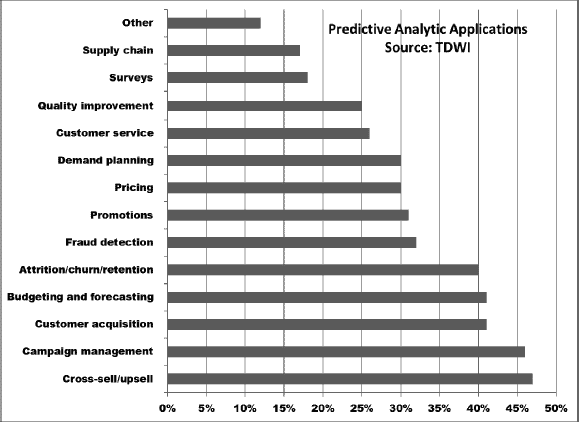

**表 5-2：2007**

来源：改编自 <http://tdwi.org/articles/2007/05/10/predictive-analytics.aspx>（访问于 2020 年 4 月 7 日）。

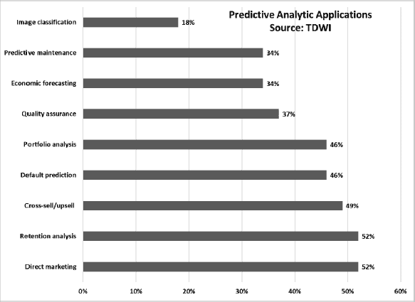

**表 5-3：2018**

来源：改编自 [`https://www.tellius.com/wp-content/uploads/2018/06/TDWI_BPReport_Q218_web.pdf`](https://www.tellius.com/wp-content/uploads/2018/06/TDWI_BPReport_Q218_web.pdf) （访问日期：2020 年 4 月 7 日）。

## 这些先前的各种概念如何与商业智能相关联？

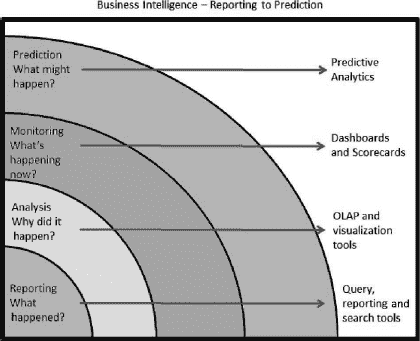

**图 5-1**

请注意，“预测”区域之外的白色外部区域，是规范性分析或“我们如何让这成为现实？”发生的区域。

## 知识检查 1

1.  什么是探索性数据分析？

    1.  使用统计模型进行预测。
    2.  确认现有观点。
    3.  发现数据中的新特征。
    4.  规定采取的行动。

## 哪些平台可用于大数据？

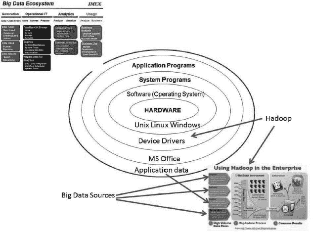

图 5-2： 大数据架构

让我们从回顾大数据系统的整体架构开始。本节将概述一般概念，以便读者能将其组织系统与通用大数据模型联系起来。

尽管 图 5-2 并非从战略开始，但战略处于所有 IT 愿景、目标、硬件和应用的最前沿。在不解决公司与信息技术相关的战略目标的情况下，购置硬件或软件或讨论大数据是愚蠢的。因此，战略是大数据系统的一个基本组成部分。

## 硬件与操作系统选择

硬件选择是大数据系统的核心。大多数组织将拥有成熟的 IT 架构。大数据将解决现有资源、公司期望达到的目标，然后制定获取必要硬件的计划。大数据的主要原则之一是使用通用计算机（会定期故障），将它们连接起来以创建分布式文件和分布式应用程序。根据组织的大数据方法，硬件将包含许多通用类型的计算机。这些计算机将与 Hadoop（或选定的系统软件）协同工作。

选定硬件后，必须选择将在硬件上运行的操作系统。操作系统是支持计算机基本功能的主要软件。操作系统的例子包括 Windows、Linux、Unix 和 iOS。

## 软件选择

下一步涉及选择在操作系统上运行的软件程序。系统程序直接控制计算机并执行 I/O 内存操作。系统程序的例子包括设备驱动程序、BIOS 软件、硬盘扇区引导软件、汇编器和编译器软件。实现大数据的程序 Hadoop 将在下一节中描述。

应用程序是传统的会计应用程序，如会计软件包、CRM、ERP、MS Office、iTunes、Adobe Photoshop 等。与 Hadoop 协同运行的大数据程序（以及用于归约、整理、保存、分析、预测、报告的程序）：

在下一节中，我们将探讨来自多个程序的应用数据。应用数据可以是结构化、半结构化或非结构化的。来自传统程序的数据通常是结构化的。来自外部来源（政府、行业、科学）或其他媒体来源（图片、影像、视频、音频）的数据通常是半结构化的。来自社交媒体或流式来源（如机器、设备或传感器）的数据通常是非结构化的。更令人困惑的是，某些软件可以充当上述多种应用程序中的一种以上。图 5-3 试图将软件应用程序与大数据的各个细分领域对齐。此图并非旨在面面俱到，而是为了表明软件的选择将取决于组织希望执行的应用程序。

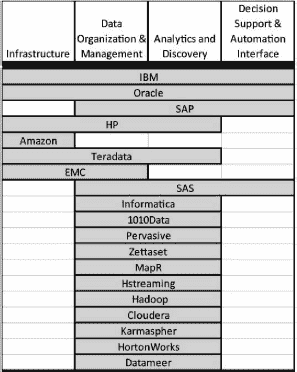

图 5-3： 软件供应商能力

企业面临着不断增长的数据量和日益提高的分析期望。作为回应，供应商提供高度分布式架构以及新级别的内存和处理能力。新进入市场的参与者正利用开源许可模式，该模式正成为大数据软件或架构的基本组成部分。

Apache Hadoop 是一个成熟的开源数据处理平台，最早于 2006 年被 Yahoo 和 Facebook 等互联网巨头采用。Cloudera 于 2008 年为企业引入了商业支持，MapR 和 Hortonworks 分别于 2009 年和 2011 年进入市场。在数据管理老牌厂商中，IBM 和 EMC-Pivotal 推出了各自的 Hadoop 发行版。Microsoft 和 Teradata 为 Hortonworks 平台提供互补软件和支持。Oracle 转售并支持 Cloudera，而 HP、SAP 和其他厂商则与多家 Hadoop 供应商合作。

由于带宽、内存和处理能力的进步，实时流处理和流分析通过 Hadoop 变得更加可行。然而，这项技术尚未得到广泛采用。多家供应商拥有复杂事件处理（复杂事件处理，简称 CEP，并不像其名称暗示的那么复杂；从根本上说，CEP 是将业务规则应用于流式事件数据）¹，但在金融交易、国家情报和安全社区之外，极少安装。随着大数据的更广泛采用，广告投放、内容个性化、物流和其他领域的应用可能会有所变化。²

大数据、分析和人工智能 (AI) 的种类繁多。Matt Turck 是 AI 行业的风险投资家。他汇编了下图，描绘了可用服务、供应商和工具的广泛范围。Matt 还授权将其包含在本课程中。第一张图展示全貌，后续图片将放大各个部分。

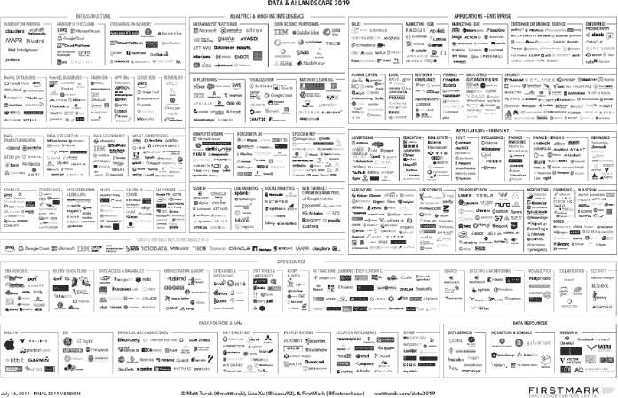 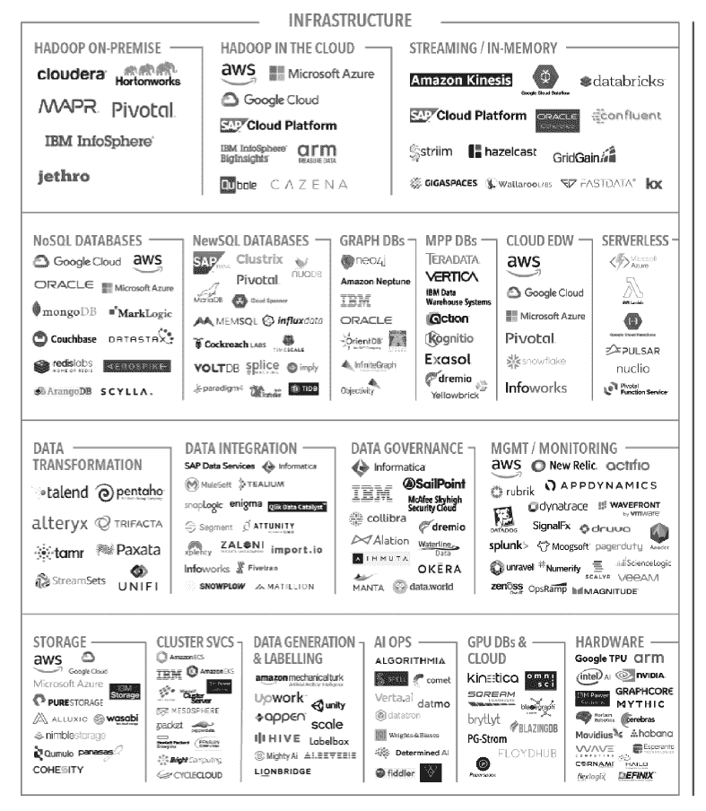 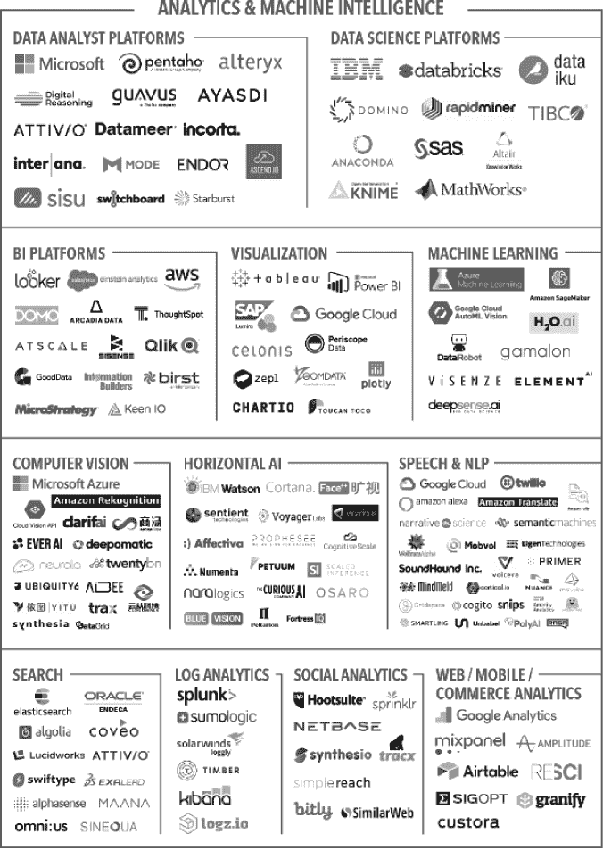 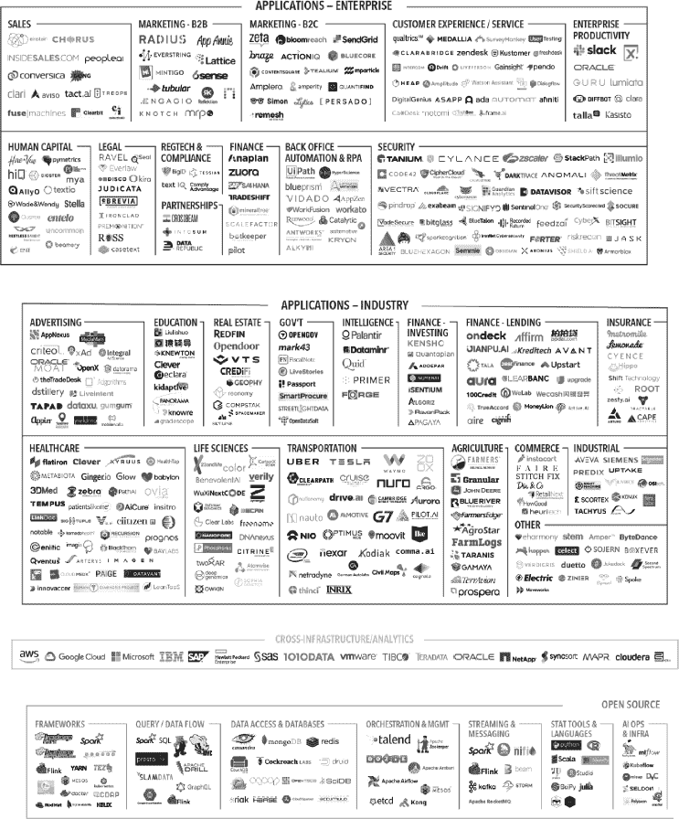 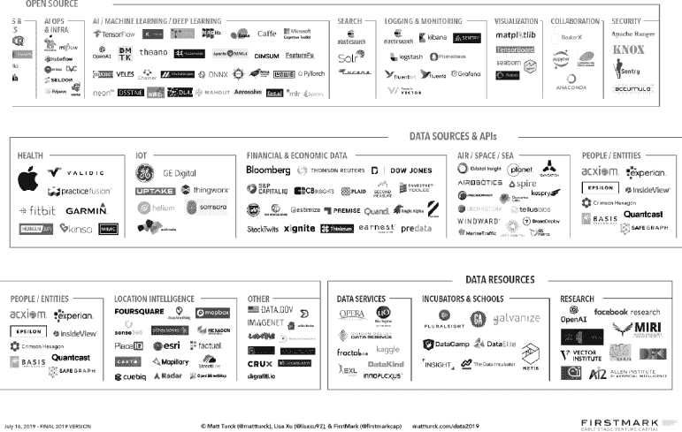

## 知识检查 2

2.  以下哪项**未**被列为大数据的基础设施资源？

    1.  SAP。
    2.  Oracle。
    3.  IBM。
    4.  HP。

## 供应商选择

接下来，让我们看看一些知名的大数据软件供应商选择，并简要介绍其软件。

1.  Actian Vector 提供从 Hadoop 实现商业价值的能力。³ 其顶级的数据准备和最广泛的分析支持以下功能：

    1.  弹性数据准备：利用最快的分析引擎、数据摄取技术和 Konstanz Information Miner (KNIME) 用户界面，快速引入所有数据
    2.  SQL 分析：将 SQL 技能、应用程序和工具与 Hadoop 结合使用，提供完全工业化的 SQL 支持。
    3.  预测分析：利用由 KNIME 驱动的高度并行化 Hadoop 分析算子，发掘趋势和模式。

2.  Amazon Web Services (AWS) 于 2006 年开始通过云计算向企业提供 IT 基础设施服务。⁴ 云计算使企业能够用更低且更灵活的成本取代前期基础设施费用（无需提前数周或数月订购服务器和其他基础设施），这些成本可在几分钟内随业务扩展。

    > 例如，AWS 是一种可扩展且低成本的云服务。全球 190 个国家有数十万家企业在使用 AWS。他们在美国、欧洲、巴西、新加坡、日本和澳大利亚设有数据中心，为客户提供低成本、敏捷性、灵活性和安全性等优势：

### 3. Cloudera

Cloudera 提供了一个用于大数据的统一平台——企业数据中心。企业现在拥有一个存储、处理和分析所有数据的场所，这使他们能够延伸现有投资的价值，同时实现从数据中获取价值的全新基本方式。Cloudera 和 Hortonworks 于 2018 年底宣布平等合并。（参见第 5 项。）

> Cloudera 成立于 2008 年，是第一家也是目前为企业提供和支持 Apache Hadoop 的领先供应商。Cloudera 还提供软件来应对业务关键数据挑战，包括存储、访问、管理、分析、安全和搜索。⁵

### 4. HP 大数据服务

HP 大数据服务可帮助 IT 基础设施处理不断增长的字节量——来自电子邮件、社交媒体和网站下载——并将它们转化为有益信息。HP 大数据解决方案涵盖战略、设计、实施、保护和合规，具体如下：

1.  **大数据架构战略**：定义使 IT 与大数据计划保持一致所需的功能和能力。通过转型研讨会和路线图服务，学习如何捕获、整合、管理和保护与业务对齐的信息，包括结构化、半结构化和非结构化数据。
2.  **大数据系统基础设施**：HP 将设计并实施一个高性能、集成的平台，以支持大数据的战略架构。服务包括设计和实施、参考架构实施和集成。灵活、可扩展的基础设施将支持 HP 平台上的大数据多样性、整合、分析、共享和搜索。
3.  **大数据保护**：确保大数据系统的可用性、安全性和合规性。HP 可帮助保护数据、实现法规遵从性和大数据领域的全生命周期保护，以及改进备份和连续性措施。

### 5. Hortonworks

Hortonworks Hadoop 数据平台 (HDP) 是唯一完全开放的 HDP。⁶ HDP 中的所有解决方案均作为项目通过 Apache 软件基金会 (ASF) 开发。HDP 中没有专有扩展。HDP 提供跨广泛访问方法的线性扩展存储和计算，从批处理到交互式，再到实时搜索和流式处理。它包含一套跨治理、集成、安全和运营的综合能力。HDP 可与现有应用程序和系统集成，仅需对现有数据架构和技能组合进行最少量的更改，即可利用 Hadoop。可在云端、本地或通过设备跨 Linux 和 Windows 部署 HDP。Hortonworks 和 Cloudera 于 2018 年底宣布平等合并。（参见第 3 项。）

### 6. IBM

IBM 包括以下类型的信息管理数据和分析能力：⁷

1.  **数据管理和数据仓库**：以更低的管理、存储、开发和服务器成本，跨多种工作负载提供有效的数据库性能；利用针对分析工作负载（如深度分析）优化的能力实现极致速度；并受益于可在数小时内启动运行的针对工作负载优化的系统。
2.  **Hadoop 系统**：通过应用加速器、分析、可视化、开发工具、性能和安全功能，将 Apache Hadoop 的强大功能引入企业。
3.  **流计算**：高效地对不断变化的动态数据提供实时分析处理，并支持描述性和预测性分析以辅助实时决策。随时捕获并分析所有数据，恰逢其时；通过流计算，存储更少、分析更多、更快地做出更好的决策。
4.  **内容管理**：支持全面的内容生命周期和文档管理，以具有规模、安全性和稳定性的成本效益方式控制现有和新类型的内容。
5.  **信息集成和治理**：通过跨生命周期适当地集成、理解、管理和治理数据的能力，建立对大数据的信心。

### 7. Infobright

Infobright（现归 IGNITE Technologies 所有）是一个用于存储和分析机器生成数据的分析型数据库平台。⁸

1.  数据压缩比为 20:1 至 40:1
2.  即使数据量急剧增加，也能保持快速、一致的查询性能。
3.  可扩展至容纳长期分析所需的 TB 级和 PB 级历史数据。
4.  每小时 TB 级的加载速度，以支持实时查询处理或告警。

### 8. Kognitio

Kognitio 软件可与现有的业务集成和分析报告工具⁹、“数据湖”（基于对象的大型存储库，以原生格式保存数据，直到需要时为止）¹⁰ 以及 Hadoop 存储无缝互操作。它补充了预先存在的技术栈，弥合了通往新的大容量数据存储的可用性鸿沟，帮助从大数据中实现及时价值。Kognitio 分析平台是一种横向扩展的内存海量并行处理 (MPP)、不仅限于 SQL 的软件技术，针对低延迟、大容量数据加载和高吞吐量复杂分析工作负载进行了优化。

### 9. MapR

MapR 是唯一一个从零开始为业务关键型生产应用程序构建的分发系统。¹¹

MapR 是一个完整的 Apache Hadoop 发行版，包含来自 Hadoop 生态系统的十多个项目，提供广泛的大数据能力。MapR 平台包括高可用性、灾难恢复、安全性和全方位数据保护。此外，MapR 允许 Hadoop 作为传统的网络附属存储被轻松访问，并具备读写能力。

### 10. Microsoft

Microsoft 的愿景是让所有用户能够从几乎任何数据中获得可操作的见解，包括以前隐藏在非结构化数据中的见解。^(12) 为此，Microsoft 提供了一个全面的大数据解决方案。

1.  **现代数据管理层**，支持所有数据类型——结构化、半结构化和非结构化数据。它更易于集成、管理和呈现实时数据流，提供更全面的业务视图并促进快速决策。
2.  **软件还具有丰富层**，可增强数据发现，将世界行业数据与高级分析相结合。软件可连接和导入数据、创建可视化，并定期随时随地运行报表。
3.  **软件具有洞察层**，使用 MS Office 等工具，其 Excel 程序内置丰富的 3D 可视化和讲故事功能，使可视化多个数据源并即时修改它们变得更加容易，同时可在 PowerPoint 中演示。
4.  **HD Insight** 是 Microsoft 基于 Hortonworks 数据平台构建的新 Hadoop 服务，提供与 Apache Hadoop 100% 的兼容性。

### 11. Oracle

Oracle 是一套完整的基础设施和软件工具，旨在满足组织的大数据需求。

### 12. Pivotal

Pivotal 大数据套件为敏捷数据提供了广泛的基础。¹³ 它可以作为 Pivotal Cloud Foundry 的一部分部署，或作为 PaaS（平台即服务）技术部署，支持本地部署和公有云、虚拟化环境、商用硬件，或作为设备交付。（注：Pivotal 于 2019 年 12 月 30 日被 VMware Tanzu 收购。）该套件提供以下功能：

1.  基于 ODP 核心的 SQL 分析优化 Hadoop
2.  领先的分析型 MPP 数据库
3.  MPP、符合 ANSI 标准的 SQL on Hadoop 查询引擎

### 13. SAP HANA

像 SAP HANA 这样的软件可以简化 IT 架构。¹⁴ 它将内存处理与企业数据仓库和 Hadoop 相结合，帮助驾驭大数据。据称它可以实现以下功能：

## 业务分析工具与平台概述

## 核心优势与平台特性

1.  业务流程运行速度提升 10,000 至 100,000 倍。

2.  结合 SAP IQ 这一数据仓库解决方案，使用大数据分析。

3.  跨逻辑大数据仓库虚拟化数据，无需移动数据即可获取洞察。

14. Teradata Aster 拥有一个分析引擎，该引擎是用于跨大数据集进行图分析的原生图处理引擎。利用这一新一代分析引擎，组织可以解决复杂的业务问题，例如社交网络或影响力分析、欺诈检测、供应链管理、网络分析和威胁检测以及洗钱检测。¹⁵

15. 新一代数据分析师使 R 成为当今市场上最流行的分析软件。Teradata Aster R 通过预构建的并行 R 函数、并行构造函数，以及在 Aster SNAP Framework 中集成开源 R，消除了开源 R 的局限性。

> **什么是 R？**
>
> R 是一种用于统计计算和绘图的语言和环境。它是一个 GNU 项目，类似于贝尔实验室（前身为 AT&T，现为朗讯科技）开发的 S 语言和环境。R 可以被视为 S 的另一种实现。两者有一些重要差别，但为 S 编写的大量代码在 R 下无需修改即可运行。
>
> R 提供了多种统计技术（线性和非线性建模、经典统计检验、时间序列分析、分类、聚类……）和绘图技术，且具有高度可扩展性。S 语言通常是统计方法学研究的首选工具，而 R 为参与该活动提供了开源途径。
>
> R 的优势之一是可以轻松生成设计精良、出版质量的图表，包括在需要时的数学符号和公式。图形中的细微设计选择的默认值经过了精心考量，但用户仍保留完全控制权。
>
> R 以源代码形式根据自由软件基金会的 GNU 通用公共许可条款作为免费软件提供。它可在多种 Unix 平台及类似系统（包括 FreeBSD 和 Linux）、Windows 和 MacOS 上编译运行。¹⁶

Aster Discovery Platform 还提供 SQL 和 SQL-MapReduce 分析引擎，支持适合这些引擎的多种分析，如 SQL 分析、路径或模式分析、统计分析和文本分析。

## 知识检验

### 3. 什么是 MapR？

1.  一种减小被分析大数据规模的程序。
2.  Apache Hadoop 的不完整发行版。
3.  **Apache Hadoop 的完整发行版，打包了十多个项目。**
4.  一种用于大数据的关系型数据库。

### 4. 什么是 Teradata？

1.  大数据的农业应用。
2.  DA 软件。
3.  用于图分析的原生图处理引擎。
4.  **关系型数据库。**

## 企业级顶尖数据分析工具

以下企业级顶尖数据分析工具列表基于 KDNuggets（一个商业分析网站）的 Alex Jones 制定的指南。他根据工具的“免费可用性（个人使用）、易用性（无需编码且设计直观）、强大功能（超越基础 Excel）和文档资源完善度”（如简单的 Google 搜索即可支持业务需求）来推荐工具。¹⁷

16. **Tableau** 是一款数据可视化软件，旨在将大量原始数据转换为更易于解读的格式，以支持决策。Tableau 软件允许用户查询关系型数据库、联机分析处理（OLAP）立方体、云数据库和电子表格，以生成图形化数据可视化。

**OpenRefine**（前身为 Google Refine），根据其网站介绍，“清理混乱的数据并将其从一种格式转换为另一种格式；通过 Web 服务进行扩展；并将其链接到像 Freebase 这样的数据库。”使用该软件，用户可以执行以下操作：¹⁸

1.  导入各种数据格式。
2.  在几秒钟内探索数据集。
3.  应用基础和高级单元格转换。
4.  处理包含多个值的单元格。
5.  在数据集之间创建即时链接。
6.  使用正则表达式轻松筛选和分区数据。
7.  对全文字段使用命名实体提取以自动识别主题。
8.  使用通用精炼表达语言执行高级数据操作。

17. **KNIME** 可通过可视化编程操作、分析和建模数据。用户通过拖拽活动之间的连接点来操作，而非编写代码块。该软件可扩展以运行 R、Python、文本挖掘、化学数据等，提供了进行更高级代码驱动分析的选项。

18. **RapidMiner** 是一个数据科学平台，集数据准备、机器学习和预测模型部署于一体。为数据科学家提供深度，为其他人提供简化操作。它通过可视化编程运行，可操作、分析和建模数据。

19. **Google Fusion Tables** 已停止服务，但您仍可使用 Excel 的后续版本结合 Google Maps 执行相同的分析。Google 拥有领先的地图软件。（详见后文“Google Maps”部分。）表 5-3 展示了来自 FBI 的 2013 年犯罪统计数据。¹⁹

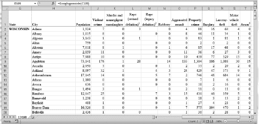

**表 5-3**

使用 Excel 上传数据后，创建了按城市划分的暴力犯罪地图。

随后可点击地图查看 2013 年 Green Bay 市的暴力犯罪情况。使用 Excel 2016 或 2019 及其 3D Maps 工具也可达到相同效果。首先将数据准备为表格。创建一个包含五列的表格。

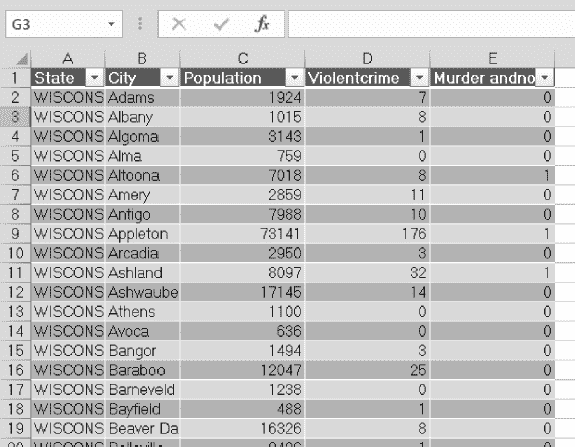

从“插入”选项卡最右侧调用 3D Maps。

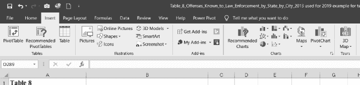

3D Maps 会自动将信息放置在美国地图上。在下图中，地图已缩小至威斯康星州。图标的颜色和大小均已更改。

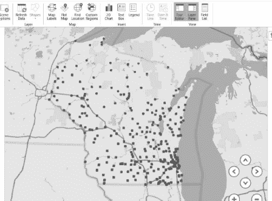

1.  **NodeXL** 是一款用于网络和关系的可视化与分析软件。第 6 章 演示了一个概念相似的 LinkedIn 连接示例。NodeXL 更进一步，提供精确计算。

2.  **Import.io** 提供快速访问 Web 数据的功能。该软件高亮显示相关数据，并在“几分钟内”“学习”用户所需内容。随后，Import.io 将为用户提取数据以供分析或导出。

3.  **Google 搜索运算符** 往往是一个未被充分利用的研究工具。运算符允许快速筛选 Google 结果，以获取最有用和相关的信息。例如，可以通过访问主要 CPA 事务所的网站来获取 CFO 调查信息，如下所示：

    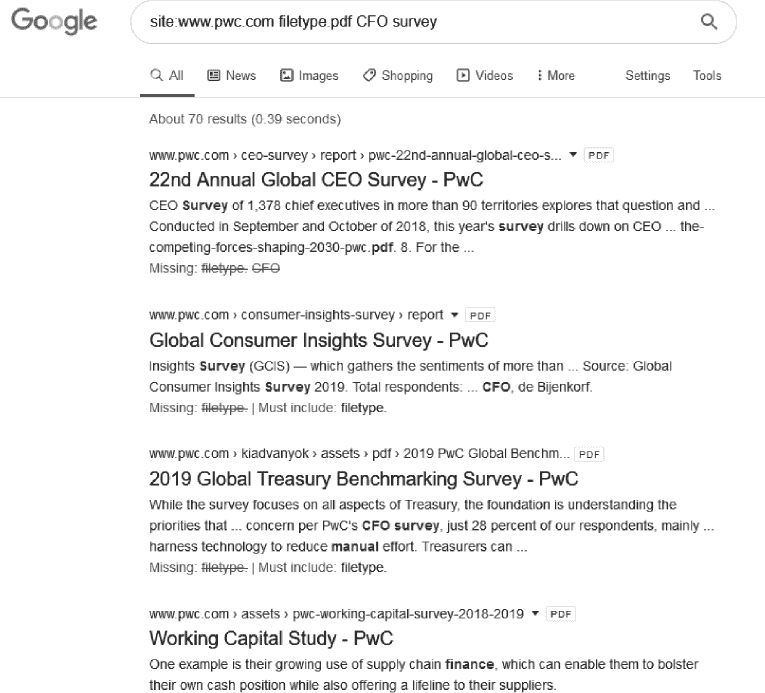

    不要忘记利用搜索的强大功能，使用时间搜索等附加工具。

4.  **Solver** 是 Excel 中的一个优化和线性规划工具，允许用户设置约束条件。它不是最强大的优化包，但如果公司从未探索过优化分析，它将非常有帮助。对于高级优化，可考虑使用 R 的 `optim` 包等程序。

### 5. WolframAlpha 和 Google Maps

WolframAlpha 的搜索引擎是网络上的隐藏宝石之一，并为苹果的 Siri 提供支持。WolframAlpha 为技术搜索提供详细响应，并能轻松搞定微积分作业。对于商务用户而言，WolframAlpha 被称为“极客版 Google”，因为它展示信息图表和图形，非常适合查看高层级的价格历史、商品信息和主题概览。²⁰ 在下图中，输入了道琼斯工业平均指数图表，从而获得了一些非常有趣的信息。

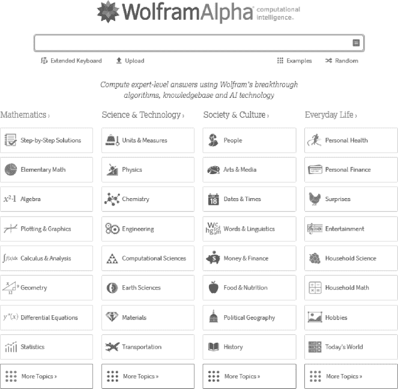

可通过 `https://www.google.com/maps/d/` 访问 Google Maps，用户需选择“创建新地图”并点击“导入”。

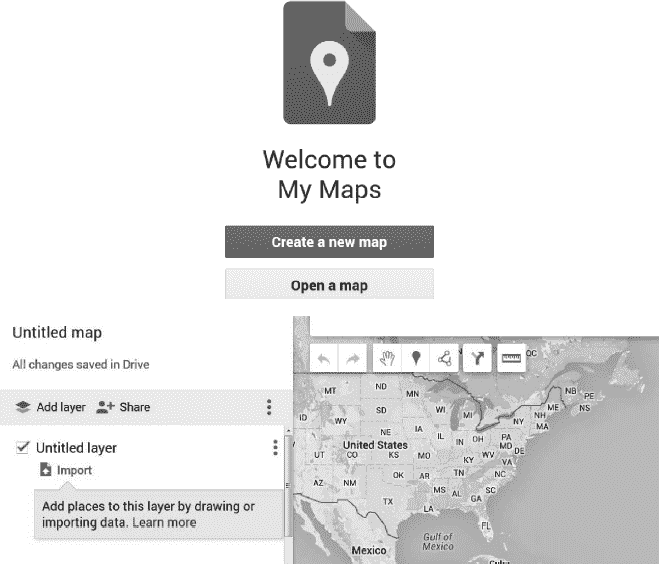

将出现一个选项，允许从 Google Drive 或计算机中选择文件。作者选择了一个最近的 `csv` 文件，该文件显示了他过去五年演讲活动的城市。Google Maps 要求作者确定哪些列应被选为图表中的地标列。

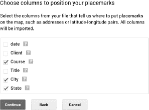

接下来，应用程序要求用户确定一列作为地标标题，并勾选了“Course（课程）”。导出的 PDF 如下所示：

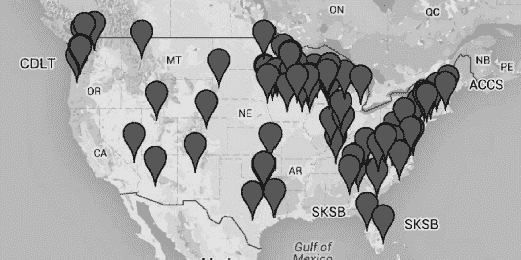

有一个自定义标签的选项，以便根据前面列出的任何列以不同方式高亮显示。在下图中，客户用不同颜色的地标进行标记。

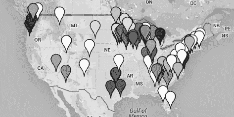

在下图中，中西部地区被放大显示。

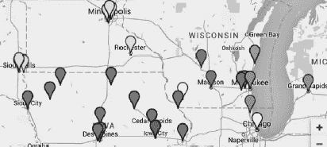

在下图中，激活了另一个选项。该选项用所授课程的首字母缩写覆盖地标。由于特定城市有多个日期和多门课程，部分信息难以阅读。

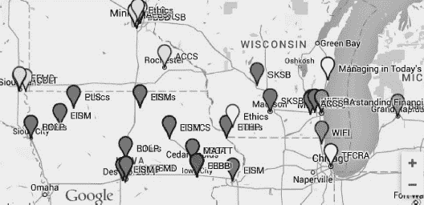

该工具拥有许多选项，包括驾车路径、添加地标、添加更多图层、与他人共享、公开发布等。

### Power BI — 桌面版

下一节演示的工具建立在会计师现有的 Excel 和 PowerPivot 知识基础之上。会计师必须能够分析数据，从历史角度理解数据含义，从发现角度寻找数据和新含义，预测传统“假设分析”之外将发生的情况，最后规定应采取的行动。如今可用的工具让我们远远超越了传统电子表格。如果不学习和掌握这些工具，会计师将对其职业生涯和当前雇主造成巨大损害。

首先，Power BI 可免费使用。下载软件并开始试验。接下来，寻找一些你可能感兴趣的数据集。如果你已经对数据有所了解，这将有助于你将预期结果与新软件上的试验联系起来。有许多免费数据集可供试验。在 Google 上搜索大型免费数据集并开始过程。首先寻找现有的 `xlsx` 文件、`csv` 文件或 `txt` 文件。它们不是复杂的数据集，但我们是在增加难度之前建立熟悉度。

下载数据集。在本例中，选择了涵盖数年时期的沃尔玛门店数据。信息包含门店、部门、周销售额、日期、降价、假期、一些经济数据等。信息以包含 `csv` 文件的 `zip` 文件形式下载。`CSV` 文件可以轻松导入 Excel 和 Power BI。

Power BI 加载时，将出现以下屏幕：

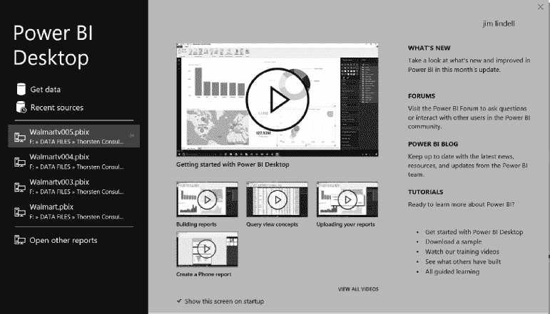

点击“获取数据”，将出现以下屏幕：

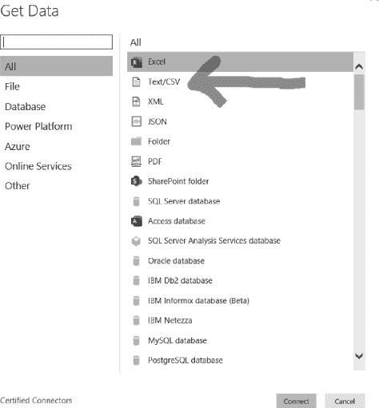

打开包含 `csv` 文件（共四个）的 `zip` 文件，并在 Excel 中逐个打开。这是周销售文件的一个示例。文件打开后，数据被转换为表格格式。如果先将信息转换为表格再处理信息，Power BI 效果会更好。利用你现有的 Excel 和 PowerPivot 知识可能会缩短学习曲线。

接下来，将文件另存为 `xlsx` 文件（其他文件同理），然后你就可以开始 Power BI 之旅了。

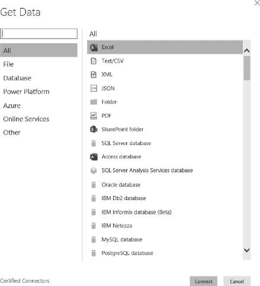

你可以在此屏幕上将 `xlsx` 文件连接到 Power BI。

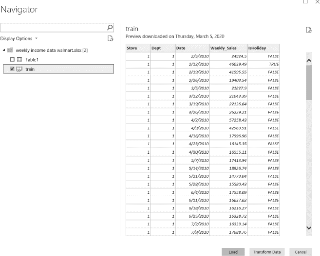

点击“转换数据”，将转到以下屏幕。

这将启动 Power Query 工具。

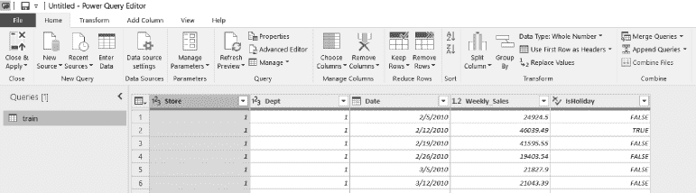

点击“关闭并应用”

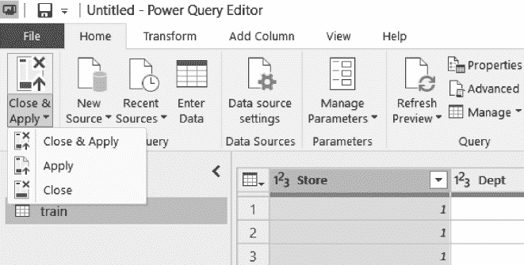

现在数据可供你拖放使用，就像使用 Power Pivot 一样。你可以将字段拖到空白画布上，或点击“新建可视化”来建立工作区。如果将周销售额拖到画布上，将出现以下图像：

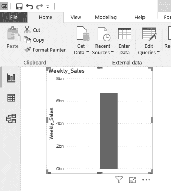

在可用字段旁边有许多可视化效果，可用于显示数据。这是用户开发优秀仪表板的地方。

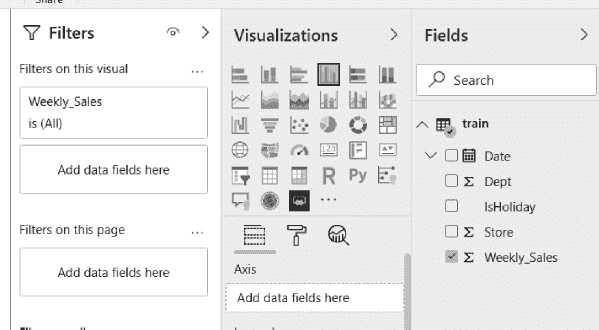

在可视化效果下，向下五行，向右一列。该图像看起来像电子表格中的表格。如果你先高亮显示简单条形图可视化效果，然后点击这个“表格图像”，条形图将变成一个小表格并显示周销售额总计。如果在可视化效果中移除“不汇总”，所有部门、所有门店的所有单独周数都将显示出来。

以下是在加载所有文件并通过连接各个上传文件创建关系后的图像。这是必要的，以便表格能够访问相关 Excel 表格中的列和数据。最终 Power BI 中的关系如下。

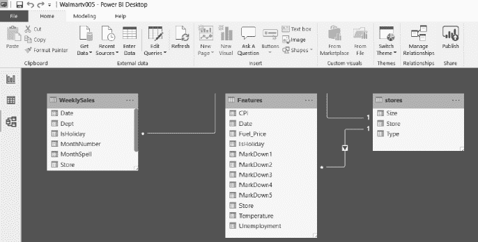

这使得以多种方式聚合显示周销售额成为可能。在下图中，当用户点击季度、门店类型、部门、年份或门店时，所有图表都会自动更新。

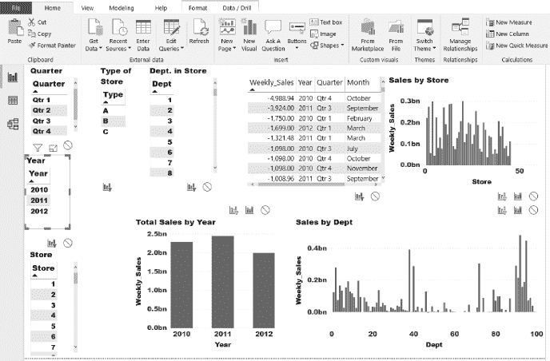

有工具可以快速查找信息中的差异。数据分析的速度令人惊叹。这个 Power BI 简介不过是一个引人入胜的概览。无论使用何种工具，员工中必须有人精通此类或类似产品的功能。

“提问”是 Power BI 的一项引人入胜的功能。

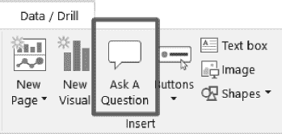

数据进入 Power BI 后，用户（注意，不一定是熟练会计师）可以输入问题并获得难以置信的大量数据。这个例子是会计岗位整体性质将发生变化的原因之一。之前，我们查看了基于数据和工具创建的屏幕。以下图像是通过在 Power BI 的“提问”功能中使用自然语言输入问题而创建的，并提供了以下分析。具备扎实运营技能的人员将能够提出他们需要答案的问题，可能无需会计人员的帮助或资源。

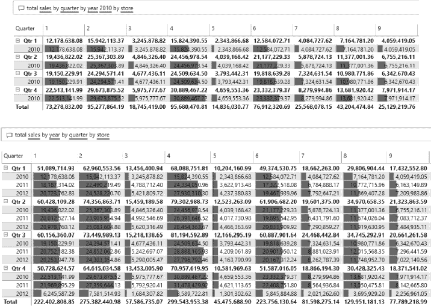 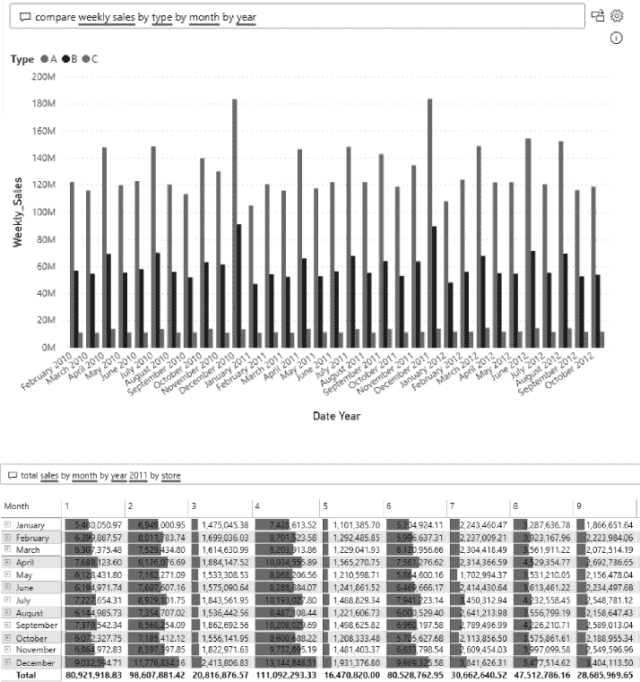

## 知识检验

1.  什么是 Wolfram Alpha？
    1.  DA 软件。
    2.  极客版 Google。
    3.  预测分析软件。
    4.  MapR 框架中的一个子程序。

2.  Google Maps 使用什么进行演示？
    1.  咨询业务。
    2.  犯罪统计。
    3.  供应商分布。
    4.  美国各地的邮局。

## Hadoop — 究竟是什么？

## Apache Hadoop 概述

Apache Hadoop 项目开发用于可靠、可扩展、分布式计算的开源软件。Hadoop 是一个具有存储大型数据集能力的框架。数据集通过简单的编程模型分布在计算机集群上，并使用 Java 编写，可在单台计算机或大型商用硬件计算机集群上运行。该软件源自 Google 发布的论文，并融合了 Google 文件系统和 `MapReduce` 范式的特性，这体现在 Hadoop 分布式文件系统和 Hadoop `MapReduce` 的名称中。

Hadoop 技术旨在消除企业中的大数据处理问题，并取得了巨大成功。它可以快速处理来自 Facebook、Twitter 等各类网站以及自动化传感器的海量数据。

## Hadoop 术语

*   **`Open-source software`**：在创建和管理程序的开发者开放网络上工作。
*   **`Framework`**：使用户能够开发和运行软件应用程序的一切，通过程序、工具集、连接等来实现。
*   **`Distributed data`**：分布在多台计算机上存储，计算可在多台连接的机器上同时运行。
*   **`Massive storage`**：Hadoop 框架可将海量数据以块的形式存储在低成本商用硬件集群上。
*   **`Faster processing`**：在紧密连接的低成本计算机集群上并行处理大量数据，以快速获得结果。

## 知识检验：Hadoop 描述

7. 以下哪项描述了 Hadoop？

    1. 它是专有的。
    2. 它是开源的。
    3. 它是专有的，但可向非营利组织以优惠价格提供。
    4. 它是专有的，且必须在 Unix 环境中运行。

## Hadoop 历史

更大的数据需求导致用户希望获得更快的搜索和更快的处理时间。Doug Cutting 和 Mike Caferella 通过一个名为 `Nutch` 的开源网络搜索引擎项目来解决这些问题。他们利用低成本计算机上的分布式数据和计算来同时完成多项任务。在同一时期，Google 正在开展一个类似的项目，以分布式方式实现数据存储和数据处理，从而返回更快、更相关的搜索结果。2006 年，Cutting 加入 Yahoo，继续 `Nutch` 项目，该项目被分为两部分——网络爬虫部分和分布式处理部分（后者被称为 Hadoop）。

Hadoop 于 2008 年作为一个开源项目发布，由非营利组织 `ASF` 管理和维护。该项目由全球软件开发人员和贡献者社区开发。

## Hadoop 核心组件

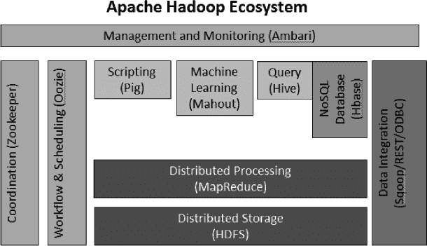

来源：“Big Data Basics,” MSSQLTIPS, [www.mssqltips.com/sqlservertip/3262/big-data-basics--part-6--related-apache-projects-in-hadoop-ecosystem/](http://www.mssqltips.com/sqlservertip/3262/big-data-basics--part-6--related-apache-projects-in-hadoop-ecosystem/)

这些是 `ASF` 的核心组件。

*   **`HDFS`**：基于 Java 的分布式文件系统，可存储结构化、非结构化等数据，无需预先组织。
*   **`MapReduce`**：允许并行处理大量数据集的软件模型。
*   **`YARN`**：用于调度和处理分布式应用资源请求的资源管理框架。
*   **`Pig`**：用于操作存储在 `HDFS` 中数据的平台。所有这些都是通过一个名为 `Pig Latin` 的编译器完成的，用于 `MapReduce` 程序和高级语言。用户可以避免编写 `MapReduce` 程序来执行数据提取、转换、加载和基本分析。
*   **`Hive`**：类似于数据库编程，它以表的形式创建数据。`Hive` 是数据仓库和查询语言。
*   **`HBase`**：运行在 Hadoop 之上，作为 `MapReduce` 作业的输入和输出。它是一个非关系型分布式数据库。
*   **`Zookeeper`**：用于协调分布式进程的应用程序。
*   **`Ambari`**：用于在 Hadoop 环境中进行管理、配置和测试的 Web 界面。
*   **`Flume`**：收集、聚合并将数据流式传输到 `HDFS` 的软件。
*   **`Sqoop`**：在 Hadoop 及其关系型数据库之间移动数据的传输机制。
*   **`Oozie`**：Hadoop 作业调度器。

## 知识检验：Hive

8. 什么是 `Hive`？

    1. 数据清洗程序。
    2. DA 工具。
    3. 数据仓库和查询语言。
    4. 用于协调分布式进程的应用程序。

## 练习题

1. 根据 IBM 调查，列出大数据的几项能力。
2. Hadoop 的目的是什么？
3. `MapReduce` 的目的是什么？
4. 什么是 “R”？

## 注释

1.  1 Mathieu Dumolin, “使用基于微服务的流式架构大规模进行更好的复杂事件处理（第 1 部分）| MapR,” 2017 年 1 月 9 日, [`mapr.com/blog/better-complex-event-processing-scale-usingmicroservices-based-streaming-architecture-part-1/`](https://mapr.com/blog/better-complex-event-processing-scale-usingmicroservices-based-streaming-architecture-part-1/)。
2.  2 Wayne Eckerson, “预测分析,” TDWI, 2007 年 5 月 10 日, [`tdwi.org/articles/2007/05/10/predictiveanalytics.aspx`](https://tdwi.org/articles/2007/05/10/predictiveanalytics.aspx), 访问于 2020 年 4 月 7 日。
3.  3 “Hadoop 长盛不衰,” Actian, 访问于 2020 年 4 月 7 日, [www.actian.com/products/analytics-platform/vortex-sqlhadoop-analytics/.](http://www.actian.com/products/analytics-platform/vortex-sqlhadoop-analytics/)
4.  4 “关于 AWS,” Amazon Web Services, 访问于 2020 年 4 月 7 日, [`aws.amazon.com/about-aws`](http://aws.amazon.com/about-aws)。
5.  5 “关于 Cloudera 的常见问题,” Cloudera, 访问于 2020 年 4 月 7 日, [www.cloudera.com/content/cloudera/en/about/faqs.html#one](http://www.cloudera.com/content/cloudera/en/about/faqs.html#one)。
6.  6 “最大化静止数据的价值,” Hortonworks, [`hortonworks.com/products/data-platforms/hdp/`](https://hortonworks.com/products/data-platforms/hdp/). 访问于 2020 年 4 月 7 日。
7.  7 “商业速度下的大数据,” IBM, [www-01.ibm.com/software/data/bigdata/](http://www-01.ibm.com/software/data/bigdata/), 访问于 2020 年 4 月 7 日。
8.  8 “Ignite 的 Infobright DB–架构概览,” 访问于 2020 年 4 月 7 日, [`cdn2.hubspot.net/hubfs/4281917/Ignite_Technologies`](https://cdn2.hubspot.net/hubfs/4281917/Ignite_Technologies) March2018 Theme/Docs/Ignite l White Paper l Infobright DB-Architecture Overview-1.pdf?t=1528843828245。
9.  9 “Kognitio 分析平台,” Kognitio, 访问于 2016 年 3 月 18 日, [kognitio.com/analyticalplatform/](http://kognitio.com/analyticalplatform/)。
10. 10 “数据湖,” TechTarget, 访问于 2020 年 4 月 7 日, [`searchaws.techtarget.com/definition/data-lake`](http://searchaws.techtarget.com/definition/data-lake)。
11. 11 “什么是 Apache Hadoop?” MapR, 访问于 2020 年 4 月 7 日, [www.mapr.com/products/apache-hadoop](http://www.mapr.com/products/apache-hadoop)。
12. 12 “了解 Microsoft 大数据解决方案,” 访问于 2020 年 4 月 7 日, [`msdn.microsoft.com/enus/library/dn749804.aspx`](https://msdn.microsoft.com/enus/library/dn749804.aspx)。
13. 13 Pivotal Software, “Pivotal 云原生平台,” Text/html, 2017 年 1 月 17 日, [`pivotal.io/`](https://pivotal.io/)。
14. 14 “SAP 软件解决方案 | 业务应用和技术,” SAP, 访问于 2020 年 4 月 7 日, [`www.sap.com/products/hana.html`](https://www.sap.com/products/hana.html)

## 参考文献

15. 15 “Business Analytics, Hybrid Cloud & Consulting | Teradata,” accessed April 7, 2020, [`https://www.teradata.com/Press-Releases/2018/Teradata-Vantage-the-Platform-for-Pervasive`](https://www.teradata.com/Press-Releases/2018/Teradata-Vantage-the-Platform-for-Pervasive)

16. 16 “R: The R Project for Statistical Computing,” accessed April 7, 2020, [`https://www.r-project.org/`](https://www.r-project.org/)。

17. 17 Alex Jones, “Top 10 Data Analysis Tools for Business,” KDNuggets, June 2014, [`www.kdnuggets.com/2014/06/top-10-data-analysis-tools-business.html`](http://www.kdnuggets.com/2014/06/top-10-data-analysis-tools-business.html)。

18. 18 OpenRefine.org

19. 19 “Crime in the U.S., 2013,” Federal Bureau of Investigation website, [`www.fbi.gov/about-us/cjis/ucr/crime-in-the-u.s/2013/crime-in-the-u.s.-2013`](http://www.fbi.gov/about-us/cjis/ucr/crime-in-the-u.s/2013/crime-in-the-u.s.-2013)。

20. 20 “Machine Learning, Data Science, Big Data, Analytics, AI,” accessed April 7, 2020, [`https://www.kdnuggets.com/`](https://www.kdnuggets.com/)。
