# 第 6 章：大数据最终用户与会计工具

## 学习目标

* 认识优化如何用于大数据。
* 回顾电子零售业务中大数据的实际案例。
* 识别其他大数据资源。

## 简介

本章探讨可用于大数据分析的会计工具。读者可能熟悉其中一些工具，但可能未曾考虑将这些工具作为分析大数据的资源。其中一种工具在分析销售生成和推荐方面非常有用。我们将通过一个真实案例来开始讨论大数据的应用，该案例使用了从全国性零售商提取的数据。该案例将说明如何访问、剖析和评估大数据，既包括数据中包含的信息，也包括从大数据中得出的推论。

## 大数据实际案例

在本节中，参与者将接触一个真实的大数据案例。在查看案例时，请记住以下几点：

* 注意真实大数据的“外观”。
* 判断是否能在大数据中识别出任何趋势。
* 推测趋势是如何变化的。
* 根据数据确定管理层可采取的行动。

## 访问实际企业数据的案例 — 百思买

百思买允许公众访问其部分大数据。您可以通过访问 [`https://developer.bestbuy.com/`](https://developer.bestbuy.com/) 来获取数据。

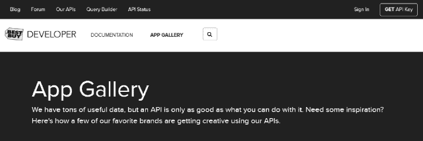
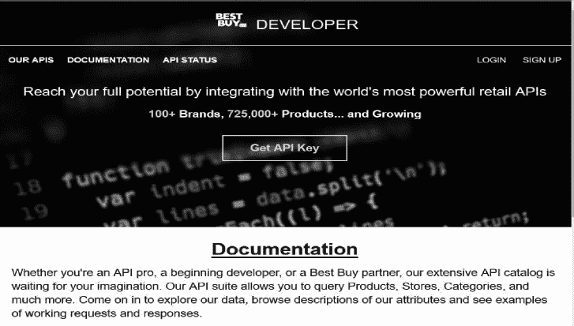

有必要获取 `API key`，因此请点击图像中间显示“Get API Key”的框。访问相关应用程序时将分配并使用一个密钥。

在本章中，我们将演示百思买的开发者计划。

### `Query Builder`（查询构建器）

`Query Builder` 通过创建自定义查询，帮助用户充分利用百思买 API。您可以为自己的自定义查询创建基础，或使用 `Query Builder` 访问百思买 API 数据。您甚至可以自定义响应以更好地满足您的目的。

访问百思买开发者工具的百思买及其他公司应用程序示例及其功能包括以下内容：

### `IFTTT`

`IFTTT` 通过一个简单的语句帮助您建立强大的连接：“If This, Then That”（如果这样，那么那样）。`IFTTT` 已经与 Facebook、Evernote、LinkedIn、电子邮件等渠道集成，现在也包括百思买。通过百思买渠道，您可以创建包含产品价格、趋势和可用性变化的 `IFTTT` 配方。请查看 `IFTTT` 上百思买的示例配方。

### `Factual`

`Factual` 的 Global Places 是一个权威数据库，包含 50 个国家中超过 6500 万家本地企业和兴趣点的名录。Global Places 利用商店 API 整合了 1000 多家百思买门店位置的数据，为全球开发者提供可靠信息。

### `Listia`

`Listia` 是一个流行的在线市场，允许用户发布不再需要的物品以赚取积分，积分可兑换其他用户发布的物品或百思买及其他零售商发布的新商品。通过与 `Listia` 合作，百思买正在帮助客户减少杂物，将仍可使用的电子产品从垃圾填埋场中拯救出来，并为新科技装备寻找好归宿。

### `TrackIf`

`TrackIf` 是一个创新的购物聚合器，可搜索网络以精确找到您正在寻找的产品。`TrackIf` 将搜寻其合作伙伴网站以找到当天的最佳优惠，以及价格下跌和供货通知。

### `ShopSavvy`

百思买与 `ShopSavvy` 的合作使客户即使在实体店购物也能找到低价在线价格。购物者可以使用 `ShopSavvy` 应用程序扫描店内商品，以比较竞争对手价格、寻找促销活动、进行在线购买等。

### `CitiBank`（花旗银行）

`CitiBank` 的 ThankYou Rewards 允许客户通过使用参与活动的信用卡或支票账户赚取积分。这些积分可兑换各种产品，包括来自百思买的平板电脑、游戏机和其他电子产品。客户可以在最近的百思买门店自提，或选择商品配送，这为各行各业的购物者提供了便利典范，也是百思买客户的绝佳发现工具。

### `Jifiti`

`Jifiti` 是一个巧妙的应用程序，适合任何厌倦了为即将到来的生日或其他活动暗示却无果的人。建议礼物清单会呈现给您的活动客人，他们的礼物将作为虚拟礼品卡落入您的电子邮箱。这是一份贴心的礼物，让送礼者和收礼者都能灵活选择心仪的物品。

### `Best Buy App`（百思买应用）

`Best Buy App` 将一家百思买商店装进您的口袋。浏览完整目录、阅读评论、比较规格、追踪 My Best Buy 奖励积分等。您甚至可以直接通过手机购买商品，选择送货上门或到店自提。

### `RedLaser`

`RedLaser` 应用程序允许用户在大多数主要零售店扫描 `UPC` 和 `QR` 代码，并接收即时价格比较，引导您找到最低可用价格，以及任何适用的优惠券或特别优惠。您甚至可以通过在应用程序内购买来减少网页浏览时间，My Best Buy 客户甚至可以扫描他们的卡片以即时访问忠诚度福利。

### `FindTheBest`

`FindTheBest` 是一个在线研究引擎，提供关于 2000 多个主题的详细信息，使人们能够自信地进行研究。`FindTheBest` 利用我们的 `Products API` 包含百思买产品的及时定价和产品详情。

作者收到访问数据的密钥（通过电子邮件）后，返回到前面提到的图库页面并点击了 `Query Builder`。

下图描述了访问百思买目录的过程。

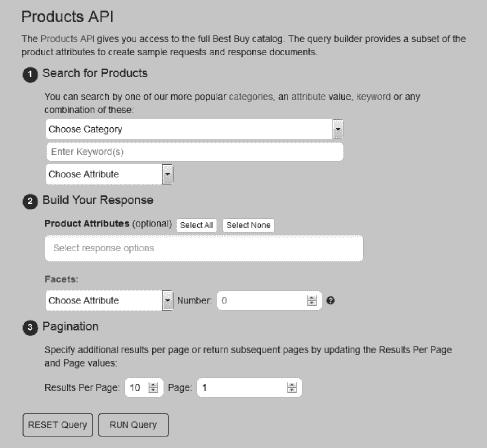

来源：百思买网站，[`http://bestbuyapis.github.io/bby-query-builder/#/productSearch`](http://bestbuyapis.github.io/bby-query-builder/#/productSearch)。

请注意，查询中可以包含许多选项，例如 `category` 和 `attribute`。（请参阅以下图片。）

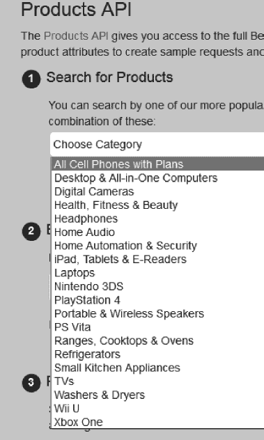
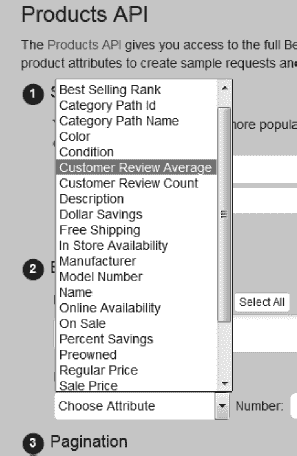

作者输入了 `data key` 并运行了 `most viewed products` 的查询。下图显示了 `query detail`。

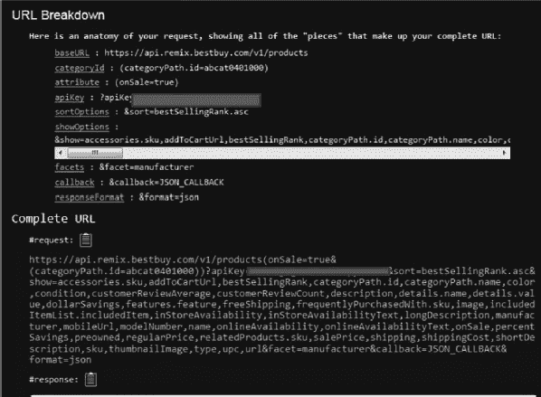

## 知识检查

1. `Query Builder` 允许用户做什么？
    1. 执行“假设”分析。
    2. 处理不再需要的电子物品。
    3. 为百思买产品编写自定义查询。
    4. 使用软件创建用于数据分析的“如果这样，那么那样”语句。

### 2. Best Buy 属性中**没有**哪个字段？

1.  销售价格。
2.  原价。
3.  折扣。
4.  节省百分比。

### 3. 为了允许 Best Buy 查询运行，用户必须做什么？

1.  拥有数据挖掘软件的访问权限。
2.  获取 API 密钥。
3.  能够阅读 HTML。
4.  获取 Best Buy 字段转换程序。

### 练习

以下页面旨在按以下格式包含。除非你有 IT 背景，或者你有一个可以自动解读图像的程序，否则很难阅读。因此，读者应该独自或与搭档一起花费几分钟来消化这些信息。你在细节中注意到了什么？

### Best Buy 浏览量最高产品 API 响应

## 元数据

- **结果集数量**: `10`
- **规范 URL**: `http://api.bestbuy.com/beta/products/mostViewed?apiKey=count`

## 产品

### 排名 1：Microsoft - Surface 3 - 10.8" - Intel Atom - 64GB - 银色

- **SKU**: `4967017`
- **标题**: `Microsoft - Surface 3 - 10.8" - Intel Atom - 64GB - Silver`
- **价格**: 当前 `$499.99` / 原价 `$499.99`
- **客户评价**: 平均分 `N/A`，数量 `N/A`
- **简短描述**: 10.8" LCD 触摸屏，分辨率 1920 x 1280 Windows 8.1 操作系统 64GB 存储容量 四核处理器 Wi-Fi 蓝牙接口
- **标准图片**: `http://img.bbystatic.com/BestBuy_US/images/products/4967/4967017_sc.jpg`
- **链接**:
  - 产品 API: `http://api.remix.bestbuy.com/v1/products/4967017.json?apiKey=56fgbf8desj1h7af8dfghjk6`
  - 网页: `http://www.bestbuy.com/site/microsoft-surface-3-10-8-intel-atom-64gb-silver/4967017.p?id=1219645630549&skuId=4967017&cmp=RMX&ky=28eiIkWRnU6kpSRaThWcSIdBYJmvGGbrI`
  - 加入购物车: `http://www.bestbuy.com/site/olspage.jsp?id=pcmcat152200050035&type=category&cmp=RMX&ky=28eiIkWRnU6kpSRaThWcSIdBYJmvGGbrI&qvsids=4967017`

### 排名 2：Apple® - Apple TV® - 黑色

- **SKU**: `4854433`
- **标题**: `Apple® - Apple TV® - Black`
- **价格**: 当前 `$69.99` / 原价 `$69.99`
- **客户评价**: 平均分 `4.7`，数量 `13308`
- **简短描述**: 第 3 代；兼容大多数带 HDMI 接口的高清电视；允许将电影、电视节目、照片和音乐从电脑流式传输到高清电视或家庭影院系统；802.11a/b/g/n 无线局域网。了解更多关于智能产品的信息。
- **标准图片**: `http://img.bbystatic.com/BestBuy_US/images/products/4854/4854433_sc.jpg`
- **链接**:
  - 产品 API: `http://api.remix.bestbuy.com/v1/products/4854433.json?apiKey=56fgbf8desj1h7af8dfghjk6`
  - 网页: `http://www.bestbuy.com/site/apple-apple-tv-black/4854433.p?id=1218552476525&skuId=4854433&cmp=RMX&ky=28eiIkWRnU6kpSRaThWcSIdBYJmvGGbrI`
  - 加入购物车: `http://www.bestbuy.com/site/olspage.jsp?id=pcmcat152200050035&type=category&cmp=RMX&ky=28eiIkWRnU6kpSRaThWcSIdBYJmvGGbrI&qvsids=4854433`

### 排名 3：Microsoft - Surface 3 - 10.8" - Intel Atom - 128GB - 银色

- **SKU**: `4968016`
- **标题**: `Microsoft - Surface 3 - 10.8" - Intel Atom - 128GB - Silver`
- **价格**: 当前 `$599.99` / 原价 `$599.99`
- **客户评价**: 平均分 `N/A`，数量 `N/A`
- **简短描述**: 10.8" LCD 触摸屏，分辨率 1920 x 1280 Windows 8.1 操作系统 128GB 存储容量 四核处理器 Wi-Fi 蓝牙接口
- **标准图片**: `http://img.bbystatic.com/BestBuy_US/images/products/4968/4968016_sc.jpg`
- **链接**:
  - 产品 API: `http://api.remix.bestbuy.com/v1/products/4968016.json?apiKey=56fgbf8desj1h7af8dfghjk6`
  - 网页: `http://www.bestbuy.com/site/microsoft-surface-3-10-8-intel-atom-128gb-silver/4968016.p?id=1219645631904&skuId=4968016&cmp=RMX&ky=28eiIkWRnU6kpSRaThWcSIdBYJmvGGbrI`
  - 加入购物车: `http://www.bestbuy.com/site/olspage.jsp?id=pcmcat152200050035&type=category&cmp=RMX&ky=28eiIkWRnU6kpSRaThWcSIdBYJmvGGbrI&qvsids=4968016`

### 排名 4：RCA - 室内无线 HDTV 天线

- **SKU**: `8280834`
- **标题**: `RCA - Indoor Off-Air HDTV Antenna`
- **价格**: 当前 `$3.99` / 原价 `$9.99`
- **客户评价**: 平均分 `4.0`，数量 `805`
- **简短描述**: 兼容无线 HDTV 广播；可伸缩 VHF 偶极子；UHF 环路天线
- **标准图片**: `http://img.bbystatic.com/BestBuy_US/images/products/8280/8280834_sc.jpg`
- **链接**:
  - 产品 API: `http://api.remix.bestbuy.com/v1/products/8280834.json?apiKey=56fgbf8desj1h7af8dfghjk6`
  - 网页: `http://www.bestbuy.com/site/rca-indoor-off-air-hdtv-antenna/8280834.p?id=1171058630499&skuId=8280834&cmp=RMX&ky=28eiIkWRnU6kpSRaThWcSIdBYJmvGGbrI`
  - 加入购物车: `http://www.bestbuy.com/site/olspage.jsp?id=pcmcat152200050035&type=category&cmp=RMX&ky=28eiIkWRnU6kpSRaThWcSIdBYJmvGGbrI&qvsids=8280834`

### 排名 5：ZTE - SPro DLP 无线智能投影仪 - 黑色

- **SKU**: `5036011`
- **标题**: `ZTE - SPro DLP Wireless Smart Projector - Black`
- **价格**: 当前 `$399.99` / 原价 `$449.99`
- **客户评价**: 平均分 `N/A`，数量 `N/A`
- **简短描述**: DLP 480p 不支持 3D，100 流明白亮度，100 流明彩色亮度 内置扬声器
- **标准图片**: `http://img.bbystatic.com/BestBuy_US/images/products/5036/5036011_sc.jpg`
- **链接**:
  - 产品 API: `http://api.remix.bestbuy.com/v1/products/5036011.json?apiKey=56fgbf8desj1h7af8dfghjk6`
  - 网页: `http://www.bestbuy.com/site/zte-spro-dlp-wireless-smart-projector-black/5036011.p?id=1219645630545&skuId=5036011&cmp=RMX&ky=28eiIkWRnU6kpSRaThWcSIdBYJmvGGbrI`
  - 加入购物车: `http://www.bestbuy.com/site/olspage.jsp?id=pcmcat152200050035&type=category&cmp=RMX&ky=28eiIkWRnU6kpSRaThWcSIdBYJmvGGbrI&qvsids=5036011`

### 排名 6：Samsung - 40 英寸级 (40 英寸对角线) - LED - 1080p - 智能 - HDTV - 黑色

- **SKU**: `5674002`
- **标题**: `Samsung - 40" Class (40" Diag.) - LED - 1080p - Smart - HDTV - Black`
- **价格**: 当前 `$379.99` / 原价 `$479.99`
- **客户评价**: 平均分 `4.6`，数量 `1466`
- **简短描述**: 1080p 分辨率 动态清晰度 120 智能电视 通过 ENERGY STAR 认证
- **标准图片**: `http://img.bbystatic.com/BestBuy_US/images/products/5674/5674002_sc.jpg`
- **链接**:
  - 产品 API: `http://api.remix.bestbuy.com/v1/products/5674002.json?apiKey=56fgbf8desj1h7af8dfghjk6`
  - 网页: `http://www.bestbuy.com/site/samsung-40-class-40-diag--led-1080p-smart-hdtv-black/5674002.p?id=1219146763131&skuId=5674002&cmp=RMX&ky=28eiIkWRnU6kpSRaThWcSIdBYJmvGGbrI`
  - 加入购物车: `http://www.bestbuy.com/site/olspage.jsp?id=pcmcat152200050035&type=category&cmp=RMX&ky=28eiIkWRnU6kpSRaThWcSIdBYJmvGGbrI&qvsids=5674002`

### 排名 7：Fitbit - Charge HR 心率与活动追踪器 + 睡眠腕带 (小号) - 黑色

- **SKU**: `8681533`
- **标题**: `Fitbit - Charge HR Heart Rate and Activity Tracker + Sleep Wristband (Small) - Black`
- **价格**: 当前 `$149.99` / 原价 `$149.99`
- **客户评价**: 平均分 `4.4`，数量 `475`
- **简短描述**: 记录步数、行进距离、消耗卡路里、爬楼层数、用时和睡眠指标；腕式心率监测；来电通知；背光显示屏
- **标准图片**: `http://img.bbystatic.com/BestBuy_US/images/products/8681/8681533_sc.jpg`
- **链接**:
  - 产品 API: `http://api.remix.bestbuy.com/v1/products/8681533.json?apiKey=56fgbf8desj1h7af8dfghjk6`
  - 网页: `http://www.bestbuy.com/site/fitbit-charge-hr-heart-rate-and-activity-tracker-sleep-wristband-small-black/8681533.p?id=1219357512977&skuId=8681533&cmp=RMX&ky=28eiIkWRnU6kpSRaThWcSIdBYJmvGGbrI`
  - 加入购物车: `http://www.bestbuy.com/site/olspage.jsp?id=pcmcat152200050035&type=category&cmp=RMX&ky=28eiIkWRnU6kpSRaThWcSIdBYJmvGGbrI&qvsids=8681533`

### 排名 8：Microsoft - Surface Pro 3 - 12" - Intel Core i5 - 128GB - 银色

- **SKU**: `6243045`
- **标题**: `Microsoft - Surface Pro 3 - 12" - Intel Core i5 - 128GB - Silver`
- **价格**: 当前 `$999.99` / 原价 `$999.99`
- **客户评价**: 平均分 `4.6`，数量 `2081`
- **简短描述**: 12" 触摸屏，分辨率 2160 x 1440 Windows 8.1 Pro 操作系统 128GB 存储容量 第 4 代 Intel® Core™ i5 处理器 多角度支架
- **标准图片**: `http://img.bbystatic.com/BestBuy_US/images/products/6243/6243045_sc.jpg`
- **链接**:
  - 产品 API: `http://api.remix.bestbuy.com/v1/products/6243045.json?apiKey=56fgbf8desj1h7af8dfghjk6`
  - 网页: `http://www.bestbuy.com/site/microsoft-surface-pro-3-12-intel-core-i5-128gb-silver/6243045.p?id=1219198824874&skuId=6243045&cmp=RMX&ky=28eiIkWRnU6kpSRaThWcSIdBYJmvGGbrI`
  - 加入购物车: `http://www.bestbuy.com/site/olspage.jsp?id=pcmcat152200050035&type=category&cmp=RMX&ky=28eiIkWRnU6kpSRaThWcSIdBYJmvGGbrI&qvsids=6243045`

### 排名 9：Samsung - 60 英寸级 (60 英寸对角线) - LED - 1080p - 智能 - HDTV - 黑色

- **SKU**: `6594118`
- **标题**: `Samsung - 60" Class (60" Diag.) - LED - 1080p - Smart - HDTV - Black`
- **价格**: 当前 `$849.99` / 原价 `$1199.99`
- **客户评价**: 平均分 `4.6`，数量 `733`
- **简短描述**: 1080p 分辨率 动态清晰度 240 智能电视，包含 Samsung Smart Hub、网页浏览器 通过 ENERGY STAR 认证
- **标准图片**: `http://img.bbystatic.com/BestBuy_US/images/products/6594/6594118_sc.jpg`
- **链接**:
  - 产品 API: `http://api.remix.bestbuy.com/v1/products/6594118.json?apiKey=56fgbf8desj1h7af8dfghjk6`
  - 网页: `http://www.bestbuy.com/site/samsung-60-class-60-diag--led-1080p-smart-hdtv-black/6594118.p?id=1219226753264&skuId=6594118&cmp=RMX&ky=28eiIkWRnU6kpSRaThWcSIdBYJmvGGbrI`
  - 加入购物车: `http://www.bestbuy.com/site/olspage.jsp?id=pcmcat152200050035&type=category&cmp=RMX&ky=28eiIkWRnU6kpSRaThWcSIdBYJmvGGbrI&qvsids=6594118`

### 排名 10：Lenovo - 15.6" 笔记本电脑 - AMD A8 系列 - 6GB 内存 - 500GB 硬盘 - 黑色

- **SKU**: `2996026`
- **标题**: `Lenovo - 15.6" Laptop - AMD A8-Series - 6GB Memory - 500GB Hard Drive - Black`
- **价格**: 当前 `$329.99` / 原价 `$329.99`
- **客户评价**: 平均分 `4.1`，数量 `75`
- **简短描述**: Windows 8.1 技术详情：AMD A8 系列处理器；15.6" 显示屏；6GB 内存；500GB 硬盘 特色功能：蓝牙；HDMI 输出
- **标准图片**: `http://img.bbystatic.com/BestBuy_US/images/products/2996/2996026_sc.jpg`
- **链接**:
  - 产品 API: `http://api.remix.bestbuy.com/v1/products/2996026.json?apiKey=56fgbf8desj1h7af8dfghjk6`
  - 网页: `http://www.bestbuy.com/site/lenovo-15-6-laptop-amd-a8-series-6gb-memory-500gb-hard-drive-black/2996026.p?id=1219567191659&skuId=2996026&cmp=RMX&ky=28eiIkWRnU6kpSRaThWcSIdBYJmvGGbrI`
  - 加入购物车: `http://www.bestbuy.com/site/olspage.jsp?id=pcmcat152200050035&type=category&cmp=RMX&ky=28eiIkWRnU6kpSRaThWcSIdBYJmvGGbrI&qvsids=2996026`

## 练习：结构化数据分析

本练习旨在展示以结构化术语收集的信息类型，这些信息通常是我们无法直接访问的。接下来的内容更有趣。前述数据来自 2015 年 5 月 5 日。数据被采集并导入 Excel，经过解析，提取了所需信息以使其更加用户友好。随后，两天后（5 月 7 日）运行了相同的报告并放入同一个 Excel 工作表。以下图片代表一张大图——数据的最左端和最右端。

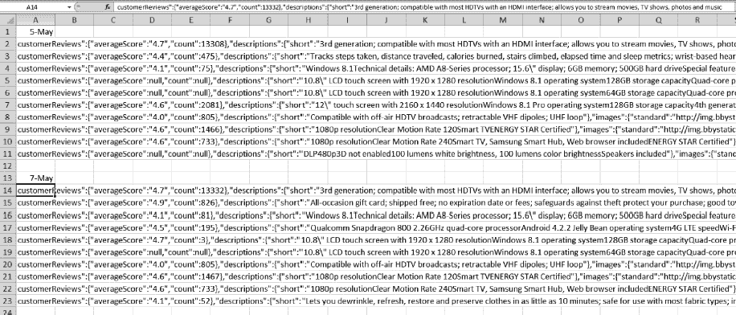 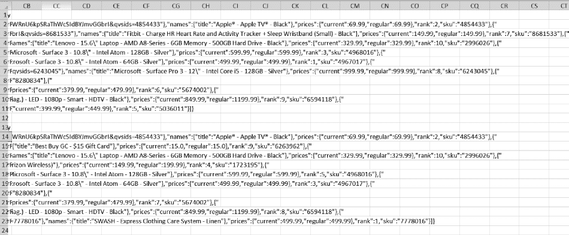

## 对比 5 月 5 日与 5 月 7 日

你能发现什么特别有趣的地方？

______________________________________________________________________________

______________________________________________________________________________

______________________________________________________________________________

______________________________________________________________________________

______________________________________________________________________________

______________________________________________________________________________

______________________________________________________________________________

______________________________________________________________________________

______________________________________________________________________________

______________________________________________________________________________

______________________________________________________________________________

## 我们从这次搜索中学到了什么？

*   前 10 名产品。
*   产品如何排名。
*   当前价格。
*   原始销售价格。
*   该报告可在不同销售周期内进行评估。

## 我们可以如何利用这些数据？

*   可与消费者在其他商店的搜索行为进行比较。
*   可在不同时间进行评估（节前和节后）。
*   可用于识别即时价格变动。
*   也可用于展示消费者对产品的即时兴趣变化。
*   可与未来的实际销售相关联（预测性）。
*   可与发传单相关联。
*   可与网站上的产品定位相关联。
*   可与网站上的特别优惠相关联。
*   特别有趣的是礼品卡和洗衣电器的上升趋势。5 月 5 日没有迹象表明礼品卡或洗衣电器是热门浏览产品。然而，5 月 7 日这两类商品都跻身顶级类别。这信息是否反映了母亲节潜在礼物？（**注：** 在获得使用 Best Buy 数据的许可时，作者与 Best Buy 代表讨论了这一见解。作者正引导到这一点时，Best Buy 代表说出了“母亲节”。）

从数据中可以得出许多其他结论和推断；然而，显而易见的是，可以从以前未被追踪的数据中获得洞察。未来几周的实际销售结果将会很有趣，看看热门浏览产品与实际销售之间是否存在相关性。此外，从竞争对手的角度考虑：竞争对手甚至不需要派遣“神秘顾客”，数据可用于比较目的。

## 优化

统一定价很少（如果有的话）适合所有客户。定价有许多不同的决定因素，包括以下内容：

*   商品与非商品地位
*   产品可用性
*   替代产品可用性
*   购买量
*   季节性
*   相关产品购买情况
*   特别折扣
*   定制要求
*   提前期
*   产品过期
*   产品质量
*   品牌认知
*   竞争对手的定价策略
*   政府法律法规
*   原材料价格变化
*   必须通过产品定价转嫁的其他成本变化
*   产品版本
*   产品销售渠道和方式（折扣零售商与高端精品店）

无论特性如何，卖家必须了解这些项目如何相互作用以及产品定价的影响。如果产品定价过高，可能获得利润率；但总量可能下降到导致总收入和盈利能力受损的程度。如果产品定价过低，利润率可能受损；但总量可能增加到提高总收入和盈利能力的程度。每个特性也会影响其他特性。例如，想要名贵产品的客户会期望高价格以限制客户数量。如果每个人都能买得起，一些客户将不再视其为名贵，因此不会购买。因此，定价的艺术在于选择与销售产品的预期策略相辅相成的定价方法。

## 航运公司利用大数据优化价格¹

如果理解了特性，大数据如何补充定价过程以优化组织收入？让我们看看 Carnival Cruise Lines 是如何做到的。

Carnival Cruises 希望细分客户群以更好地了解其消费模式。Carnival 的目标是了解以下内容：

*   如何吸引新客户
*   如何重新定价船票以填满更多客舱
*   了解客户在纪念品、岸上游览和额外服务上的消费习惯

为获取这些信息，Carnival 实施了一个开创性流程。公司决定雇佣数据科学家分析过往客户和一般度假者的数据、经济趋势和社会趋势。目标之一是将客户与其 100 艘船队中最合适的邮轮匹配——从经济型家庭游到豪华游的九个品牌。在服务和相关价格范围方面的客户差异化可能非常显著。

由于邮轮的整体盈利能力取决于整个航程，公司必须能够监控和调整每日产生影响的策略。价格可能不会动态变化，但每日结果可能改变策略和促销。

邮轮业务的主要指标是可用乘客邮轮天数（客户在船上的天数）。据 CEO 称，全船队每年总可用天数为 8000 万。简单来说，如果每位乘客每天多花 1 美元，Carnival 一年将增加 8000 万美元收入。

Carnival 的数据科学团队每天工作，分析乘客行为、度假趋势、旅行社咨询和客户查询等数据。分析在夜间运行，为全球船票价格变动生成数千条建议。例如，基于预测需求，公司可以更改分配给不同港口的预订数量。此外，分析还可能导致将船舶运力从一个国家转移到跨洋的另一个国家。

Carnival 理解分析并不意味着他们做出了正确决策——只是做出了更明智的决策。管理层仍依赖人类经验结合分析。

Carnival 的方法有效吗？公司业绩表明是有效的。Carnival 在 2015 年第三季度报告了创纪录的收益，并计划在 2016 年增加更多船只。

## 知识检查

4. Carnival Cruises 强调使用分析影响定价将做什么？

    1.  确保做出最佳决策。
    2.  导致收取尽可能高的价格。

3. 保证做出更明智的决策。

4. 保证评估所有选项。

## 预测工具

有许多工具可用于预测未来结果。例如，如果我们能预测以下情况，会有什么优势？

1. 客户推荐其他潜在客户的概率。
2. 客户购买其他产品的概率。
3. 员工推荐其他潜在员工的可能性。
4. 员工离职的可能性。

基本上，这些问题中的每一个都可以利用我们已有的数据或容易获取的数据进行评估。例如，我们可以通过客户调查来评估第 1 和第 2 项的可能性。我们可以通过员工调查，甚至可能通过员工邮件来评估第 3 和第 4 项。

首先，考虑一种可以预测企业增长的工具。用于预测该信息的数据可能已经存在于公司系统中，或者以书面形式（调查表）存在，或者可能通过另一种反馈方式确定，例如客户回访电话。该工具称为*净推荐值*（NSP）。

贝恩咨询公司的 Frederick Reichheld 于 2003 年开发了 NSP。与传统的客户调查相比，NSP 方法的简洁性源于企业租车公司的两个问题客户调查。Reichheld 的研究表明，公司的增长率与作为“推荐者”的客户百分比之间存在很强的相关性。

## 知识检查

1. 谁创建了净推荐值？
    1. Lencione。
    2. Reichheld。
    3. Collins。
    4. Champy。

## 企业预测分析工具 — 2019²

有各种软件工具可用于生成预测分析。本节不作为推荐，仅提供一些主要工具的示例。

1. Sisense
2. Microsoft R Open
3. Microsoft Azure Machine Learning Studio
4. Oracle Crystal Ball
5. IBM SPSS Predictive Analytics Enterprise
6. Minitab
7. Wolfram Mathematica
8. SAS Advanced Analytics
9. Anaconda Enterprise
10. TIBCO Statistica
11. TIBCO Spotfire
12. RapidMiner Studio
13. KNIME Analytics Platform
14. DataRobot
15. Dataiku DSS
16. FICO Predictive Analytics
17. GoodData
18. Buxton Analytics Platform
19. Funnel Science
20. Salford Systems SPM

## 访问大数据源的其他简单工具

参加 AICPA（美国注册会计师协会）财务主管年度更新会议的与会者收到了 G17，这是支持工业生产统计的极佳数据来源。它由美联储每月发布。下图显示了总指数按年份划分的实际月度生产统计数据。网址参考为 `http://www.federalreserve.gov/RELEASES/g17/ipdisk/alltables.txt`。

该信息可用于确定您所在行业及其他行业的商业周期，这也应决定您的管理策略。它还可用于将贵公司的销售额与行业趋势进行比较。如果您的销售趋势仅仅是反映行业趋势，那么您的销售团队属于平均水平。如果您的销售趋势超过行业，则您的销售团队高于平均水平；如果您的销售趋势低于行业趋势，则您的销售团队低于平均水平。

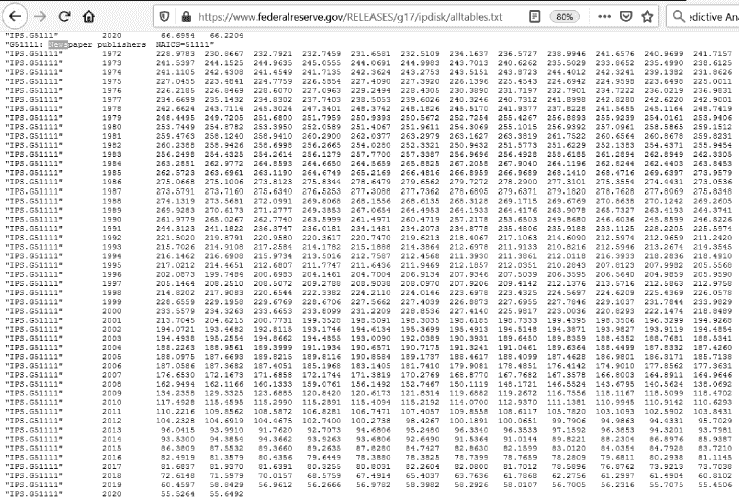

那么，报业如何利用大数据快速识别其下行（且持续下行）的趋势？这些本应说服管理团队多年前就进行重组、多元化经营或退出报业。下一次分析是使用报纸出版商的 IPS 数据并复制到 Excel 中完成的。然后，创建了一个图表来整体观察该行业。

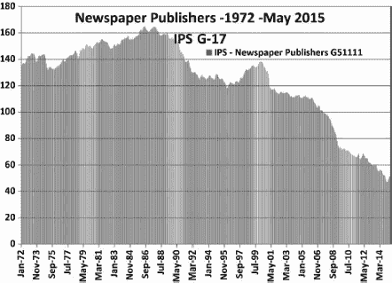 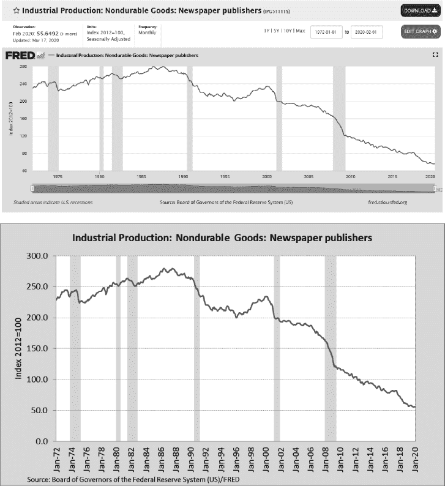

注意 1986-87 年左右的峰值。这是个人电脑变得更加普及的时期。用户开始在线获取新闻信息的趋势即将到来。

我们如何利用这些信息来了解商业周期和销售收入趋势？Excel 数据被用来创建 3 个月和 12 个月的移动平均值。

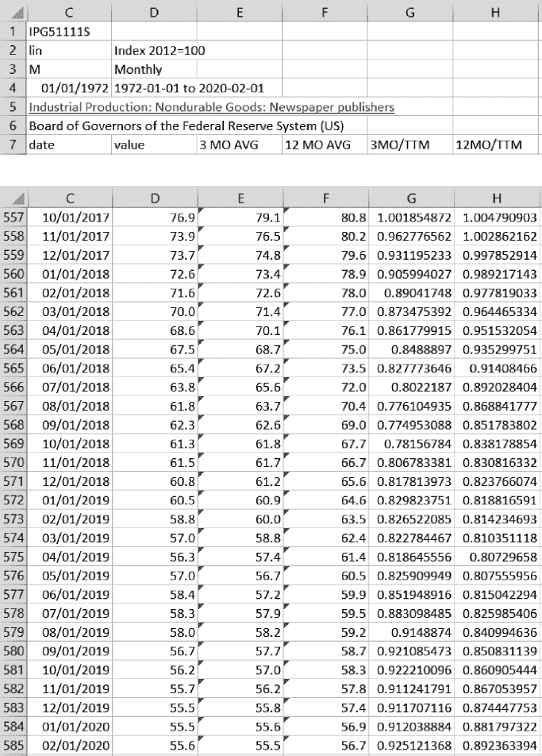

绘制 IPS、3 个月和 12 个月移动平均值的图表会产生下图。注意持续下降，几乎始终低于 12 个月移动平均线。自 21 世纪初以来，报业一直在持续下滑。

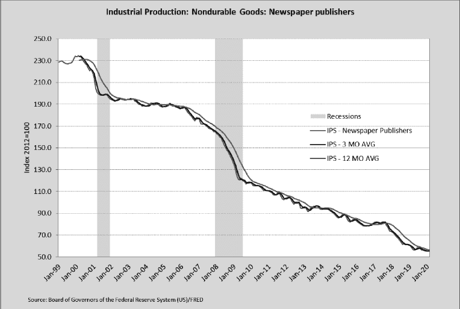

绘制滞后平均值。很容易看出数据何时低于 1.0。任何时候数据低于 1.0，行业就在衰退。审慎的管理团队应采取应对衰退的措施。当数据升至 1.0 以上时，行业在增长，管理团队应关注扩张性行动。不幸的是，通过回顾带有计算的数据和前面的图表，很明显报业一直处于持续衰退中。

## 知识检查

1. 工业生产统计数据来自哪里？
    1. 美国人口普查局。
    2. 劳工统计局。
    3. 美联储。
    4. 美国小企业管理局。

2. 报纸出版商的行业代码是什么？
    1. 51111。
    2. 50001。
    3. 54111。
    4. 44111。

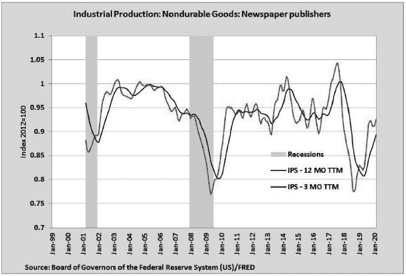

### 人口普查数据

还有哪些其他大数据来源值得组织考虑使用？

美国人口普查局编制了从 1992 年至今的月度零售销售额估算。网址为 `http://www.census.gov/retail/index.html`。

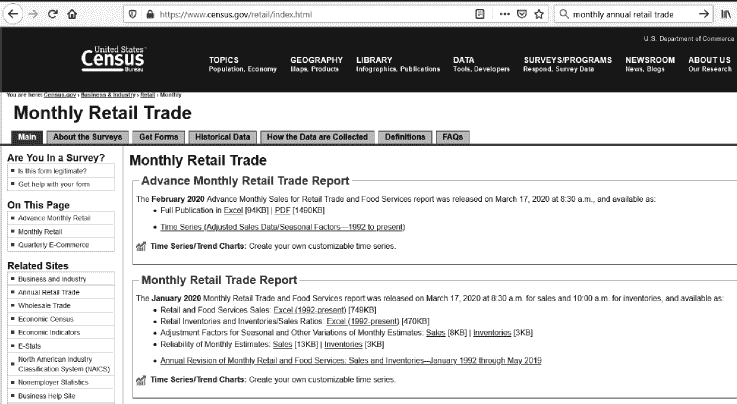

以下是美国人口普查局提供的数据示例。该电子表格包含回溯至 1992 年的月度数据，还将行业与北美行业分类系统代码相关联。可以将这些数据与前一个示例中的 IPS 数据关联起来。

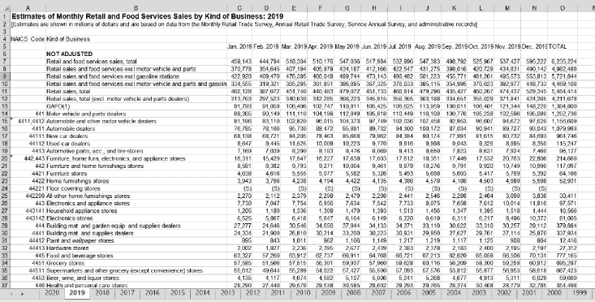

## 数据库工具

如果您不使用优秀的预测软件，您的数据或分析将受到限制。为了补充您的电子表格分析，请考虑购买 Crystal Ball（`http://www.oracle.com/technetwork/middleware/crystalball/overview/index.html`）或 @RISK（`http://www.palisade.com/risk/`），它们是执行蒙特卡洛模拟分析的 Excel 加载项。此外，Domo（`http://www.domo.com`）是一个新的商业管理平台，它将所有商业平台整合在一起，结合了商业智能、预测分析和大数据。

第一个加载项 @RISK（读作“at risk”，意为“面临风险”）使用蒙特卡洛模拟执行风险分析，以显示电子表格模型中许多可能的结果——并告诉您它们发生的可能性有多大。它以数学和客观的方式计算并跟踪许多不同的可能未来场景，然后确定与每个不同场景相关的概率和风险。这意味着用户可以判断该承担哪些风险、该避免哪些风险，从而在不确定性下做出最佳决策。

@RISK 还通过集成 RISKOptimizer 帮助规划最佳风险管理策略，RISKOptimizer 将蒙特卡洛模拟与最新的求解技术相结合，以优化任何包含不确定值的电子表格。结合 @RISK 函数，使用遗传算法³ 或 OptQuest，RISKOptimizer 可以确定最佳资源分配、最优资产配置、最高效的进度安排等。⁴

## 大数据分析工具与可视化

## Oracle Crystal Ball

Oracle Crystal Ball 是用于预测建模、预测、仿真和优化的领先基于电子表格的应用程序。它能让用户无与伦比地洞察影响风险的关键因素。借助 Crystal Ball，用户能做出正确的战术决策以达成目标，甚至在最不确定的市场条件下也能获得竞争优势。⁵

## Domo

根据 Domo 网站的介绍，“要把工作做好，用户需要在正确的时间获得正确的信息。遗憾的是，这些信息散落在日益增多的脱节电子表格、系统、数据库和应用程序中。”⁶

Domo 通过将企业及其数据汇聚在一个直观的平台上来解决这一问题。借助 Domo，用户可以创建仪表板，将所有信息集中在一处，并利用这些信息做出更快、更明智的决策。

## 知识检验

1. 月度零售销售数据可从以下渠道获得
    1. 美国人口普查局。
    2. 劳工统计局。
    3. 美联储。
    4. 美国小企业管理局。

## 大数据可视化

什么是大数据可视化？根据 SAS 的说法：⁷

> 数据可视化是以图表或图形格式呈现数据。几个世纪以来，人们一直依赖图表和地图等可视化表现形式，以更轻松、更快速地理解信息。
>
> 随着收集和分析的数据越来越多，各级决策者都欢迎数据可视化软件，它使他们能够以可视化方式查看分析结果，在数百万个变量中找到相关性，向他人传达概念和假设，甚至预测未来。
>
> 由于人脑处理信息的方式，当数据点以图表形式显示时，人们比翻阅堆积如山的电子表格或阅读大量报告更快地掌握其含义。

## 文本分析⁸

文本分析是从文本中提取高质量信息的过程。通过统计模式学习来理解模式和趋势，从而获得洞见。文本挖掘要求对输入文本进行结构化，识别结构化数据中的模式，最后解释输出结果。文本挖掘包括文本分类、文本聚类、概念或实体提取、细粒度分类体系生成、情感分析、文档摘要和实体关系建模（即学习命名实体之间的关系）。文本挖掘的目标是利用自然语言处理和分析方法将文本转化为数据。一个例子是扫描一组用自然语言编写的文档以进行预测性分类，或用提取的信息填充数据库。

- **命名实体提取**：有助于回答“谁、什么、哪里？”的问题。
- **文档摘要**：由计算机程序创建文本的缩短版本。
- **主题提取**：回答“使用了哪些重要词汇？”的问题。
- **概念提取**：回答“重要的高层概念是什么？”的问题。
- **情感分析**：回答“所说内容是‘积极’还是‘消极’？”的问题。

## 练习题

1. 列举一些定价决定因素。
2. 描述从百思买获取的大数据。
3. 列举几个可与贵组织进行比较的大数据来源。
4. 描述什么是文本分析。

## 注释

1. 1 Kim Nash, “嘉年华战略总监押注大数据将优化价格,” *The CIO Report*, *The Wall Street Journal*, 2015 年 4 月 30 日, <http://blogs.wsj.com/cio/2015/04/30/carnival-strategy-chief-bets-that-big-data-willoptimize-prices/>.
2. 2 FinancesOnline, “2020 年 20 大最佳预测分析软件,” 访问于 2020 年 3 月 18 日, <https://financesonline.com/predictive-analysis/>.
3. 3 注：遗传算法（GA）是一种基于模仿生物进化的自然选择过程，用于求解约束和无约束优化问题的方法。该算法反复修改个体解群。在每一步中，遗传算法从当前种群中随机选择个体作为父代，生成下一代的子代。经过连续几代，种群会“进化”向最优解。 <https://www.mathworks.com/discovery/geneticalgorithm.html>
4. 4 “@Risk,” *Statistics.com*, 访问于 2017 年 3 月 30 日, <http://www.statistics.com/software-directory/risk-spreadsheet-add-in/>.
5. 5 “Oracle Crystal Ball,” 访问于 2017 年 3 月 30 日, <http://www.oracle.com/technetwork/middleware/crystalball/overview/index.html.>
6. 6 “Domo 平台,” 访问于 2017 年 3 月 30 日, <https://www.domo.com/company/what-is-domo>.
7. 7 “数据可视化：它是什么及为什么重要,” SAS, <http://www.sas.com/en_us/insights/big-data/datavisualization.html>
8. 8 Rao, Venky, “文本分析简介,” 访问于 2016 年 3 月 21 日, Data Science Central, <http://www.datasciencecentral.com/>
