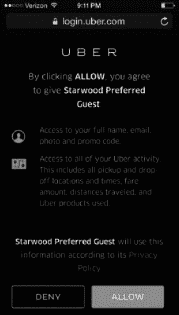

# 第 7 章：大数据案例

## 学习目标

- 识别公司目前如何使用大数据。
- 区分组织如何将本章的大数据案例应用到自己的组织中。

## 简介

2018 年的首要大数据趋势是，大数据不再是一种趋势——它是任何组织的必备要素。许多公司正将大数据进一步融入其业务实践中。在人工智能和自然语言处理的帮助下，聊天机器人正在取代人工客服。随着组织转向多渠道数字体验，IBM 在数字体验平台领域持续领先，Gartner 最近将其评为执行能力和愿景完整性两方面的领导者。^(1)

公司一直在扩大预算以增加 IT 部门投入，这与本课程早期版本的预测一致。根据 2020 年 IT 现状报告，44%的组织计划增加 2020 年的技术预算。此外，47%的公司预计将招聘更多 IT 专业人员。^(2)

重点将继续放在将大数据精细调整为更易管理的信息，如“快数据”和“可行动数据”，以减少数据过剩产生的额外噪音。将暗数据转化为可用数据也是 2018 年的一大亮点，包括使用算法和 AI 辅助来筛选非结构化信息。^(3)

本章包含企业创建和使用大数据的案例。本章的目标是理解（通过提供的案例）组织拥有或可以获取许多类型的数据，这些数据能带来对其业务更深入的洞察。读者应将每个案例视为其组织的潜在应用。

目的不是让人不知所措，而是回顾无数案例，以增强读者对大数据众多不同应用的认知，并激发关于大数据如何在贵公司应用的思考。

## 大数据案例

### 达美乐披萨^(4)

数据从短信、Twitter、Pebble、Android、Amazon Echo 等渠道获取，并汇入达美乐信息管理框架。此外，这些数据还与来自第三方来源的数据（USPS、地理编码信息、人口统计数据和竞争对手数据）相结合，以创建深度客户细分（每天录入 85,000 个结构化和非结构化数据源）。

达美乐 55% 到 58% 的订单通过在线处理。电话或现场订单占其余部分。

达美乐可以评估个人购买模式、同一家庭中的多个消费者、主要购买者、对优惠券的依赖程度以及访问达美乐的渠道。这使达美乐能够根据客户画像定制优惠券和产品推荐。

### 罪犯与家谱学

执法机构面临许多涉及凶恶罪行的未破案件。遗憾的是，其中一些案件悬而未决数十年。然而近年来，一种新的打击犯罪工具出现了——家谱数据库。这些数据库最初并非设计用于寻找罪犯，但已成为这一用途的资源。数据库运营方起初不愿因该目的而为人知，因为隐私和道德使用对他们至关重要。在某些情况下，警方会上传包含案发现场 DNA 的虚假档案以寻找关联。关联的对象不是罪犯本人，而是罪犯的亲属。执法机构随后会追踪家谱信息，看是否有任何人在案发时出现在案发区域。这就是目前“金州杀手”案的情况，该案审判原定于 2020 年初进行。

### 冰球与大数据

自动化数据追踪技术是 2019-20 赛季的一部分。冰球和运动员的护肩将内置追踪芯片。传感器将布置在冰场周围。每时每刻都将收集位置、速度、方向、距离和其他关键指标的大数据。

传感器芯片将以每秒 200 次的频率为每队五名滑冰运动员和一名守门员提供数据点。一场 60 分钟的比赛将在每个类别中产生约 9,360,000 个记录事件^(5)。

### 约翰迪尔

约翰迪尔是大数据行业的先驱之一。它在物联网框架内开发了一套系统，让农民机器的数据能与其设施中的专家交互，以预测机器何时会故障。约翰迪尔随后将必要的维修零件发送给用户，从而将机器停机时间降至最低，因为获取正确零件没有延迟。在满足世界不断增长的粮食需求方面，约翰迪尔还致力于将个别农民的田间读数与天气及其他宏观信息相连接，以最大化农作物产量和资源分配^(6)。在尊重农民隐私方面，如果农民不愿让其数据被其他方访问，约翰迪尔允许农民选择退出这种信息保留。

### 罗伊斯顿柴油动力

罗伊斯顿柴油动力是主要用于航运业的发动机燃油管理系统开发商，利用大数据推动航运业的效率提升。实时传感器数据允许在异地持续监控船舶系统。额外的传感器使规划航线变得容易，该航线综合考虑了船舶性能、气象数据和其他因素。这种整体方法提高了到达时间准确性和资源使用效率。港口当局也能查看船舶数据，以监控港口潜在拥堵并改善货物装卸。运营管理和能源管理在大数据方面日益普遍，这些领域将继续增长，预测性维护和性能优化亦是如此^(7)。

### 911 呼叫中心

美国紧急响应呼叫中心一直在向云端存储信息转型，并将重点放在如何记录多媒体通信上。单次 911 交互产生的大数据量巨大，因为有最初拨打或发送短信给 911，然后有呼叫中心创建的记录，接着是发送给警察或紧急响应小组的调度信息，随后跟进的数据也会被记录。一家公司 NICE 可以接收发送给 911 的短信录音，以及短信流中的元数据（来电者、位置、日期和时间等），并允许机构通过额外的平台 AGENT511 记录这些信息。将所有这些信息集中在一个可访问的地方，使质量保证评估所需时间减半，并改善了紧急响应时间^(8)。

### 美国国防部

国防部花费创纪录的 74 亿美元用于现代技术，以更新系统和提升能力，使现有技术不至于过时。据前国防部副部长罗伯特·沃克称：“美军要么引领即将到来的革命，要么成为其牺牲品。”^(9) 他还表示：“人工智能的快速进步——以及它们将带来的自主系统和操作的巨大改进——正指向涉及人机协作和协同作战的新颖作战应用。” 74 亿美元比 2012 年的支出水平增长了 32%，其中人工智能专项获得的支出增幅最大。

### 苏格兰皇家银行

苏格兰皇家银行通过文本分析使用自然语言处理。自然语言处理是将口语转化为计算机可执行项的活动。该机构收集客户投诉产生的所有数据，然后分析这些邮件、调查回复和录音客户通话，以了解客户投诉的原因。然后利用这些知识实施调整，改善未来的客户体验^(10)。

### 尊严健康

尊严健康是加利福尼亚州最大的医院服务提供商，利用大数据扫描患者那些难以发现的危及生命的疾病。例如，脓毒症是主要死因之一，也是导致患者再入院的主要原因。脓毒症的体征和症状往往难以与其他健康问题区分，例如发烧很容易被归因于最初的病因。为了减少误诊并缩短从患者发病到接受治疗的时间，尊严健康使用脓毒症生物监测项目，该项目监测所有患者的生命体征和可能指向脓毒症开端的关键指标。如果项目发现存在足够多的预警信号，系统会通过患者病历提醒护士。随后护士将患者转入 ICU，采取全面措施控制病情。该系统已将尊严健康旗下医院的脓毒症死亡率降低了 5%，并带来了显著的成本节约，因为早期干预使患者在重症监护室的时间缩短^(11)。

### 优步

#### Uber 利用大数据洞悉客户的一举一动

他们住在哪里、在哪里吃饭、在哪里工作、去哪里旅行，以及这些活动的时间。Uber 与“嘉木莱优客会”合作，这是一个精英俱乐部，每当你使用 Uber 时都能让你赚取积分。条件是你允许 Uber 和嘉木莱以他们认为合适的任何方式使用你的数据。^(12)

图片上写着“点击允即表示你同意授予嘉木莱优客会：访问你的全名、电子邮件、照片和促销代码的权限。访问你所有的 Uber 活动。这包括所有上下车地点和时间、车费金额、行驶距离以及使用的 Uber 产品。嘉木莱优客会将根据其隐私政策使用此信息。”

### Halo Top

这个轻食冰淇淋品牌正以势不可挡之势席卷冷冻甜点行业，而此时大多数品牌都在努力维持市场份额。他们完全无视传统营销渠道，而是利用 Facebook、Twitter 和 Instagram 提供的大数据投放特定广告，并密切监控这些数字广告的投资回报率。^(13)

### Electronic Arts

全球有超过 20 亿视频游戏玩家，这个 200 亿美元的行业在许多领域处于领先地位。Electronic Arts 拥有最大的市场份额之一，他们利用大数据确保客户在整个游戏体验过程中保持粘性。例如，初级关卡过难或高级关卡过易会导致玩家退出游戏，这会阻碍电子游戏的成功。Electronic Arts 会查看玩家在游戏过程中哪个环节流失，看是否存在导致玩家退出的瓶颈，并利用这些信息来定制未来的新游戏。^(14)

### NFL

NFL 正利用大数据追踪场上球员的数据，用于多种目的——特别是自由球员市场。通过在每个护肩中各放置一个传感器，以及在球场两层看台上部署精密的类 GPS 追踪系统，NFL 现在可以追踪球员的跑动里程。一些总经理将其视为审视自由球员市场的一种方式——用以评估老将的身体损耗程度，如伤病、跑动里程、加速、减速等。^(15)

### Ford

Ford 正利用大数据延伸其对产品的影响力。过去产品生命周期在车辆出厂时就结束了，现在 Ford 可以监控车辆在当地 Ford 经销商处保养时哪些项目需要维修或更换，并了解哪些部件最容易损坏。Ford 还可以利用这些信息重新设计易损部件，使其更耐用。^(16)

### Heineken

Heineken 利用大数据将销售数据与天气报告相对应，以了解在不同季节、天气模式等条件下，哪些地区销量最好，从而确保他们的啤酒总能在正确的时间出现在正确的地点。他们还在测试一个名为 Shopperception 的项目，该项目基于 Xbox Kinect 传感器，旨在了解顾客到底何时购买啤酒、在货架前的行为如何，并获取实时购买信息。这让他们能够准确了解啤酒是如何被购买的、在商店的哪个位置被购买的以及何时被购买。^(17)

### Marist College

Marist College 开发了一个分析模型，能根据前两周的课业表现，以 75% 的准确率预测哪些学生会成功、哪些会失败。Marist College 利用该模型提高了学位完成率。该模型的使用引发了许多伦理问题，但迄今为止它一直被用于积极目的。^(18)

### Taco Bell

Taco Bell 利用大数据紧跟客户体验。Taco Bell 有一个被他们昵称为“鱼缸”的部门，该部门监听并收集关于公司在 Facebook、Instagram、Twitter 等平台上的所有信息。公司各部门高管每天早上聚在一起 15 分钟，听取“鱼缸”的汇报，实时了解公司运营状况。例如，当 Taco Bell 推出早餐时，东海岸门店误判了需求，导致排起长龙，这在社交媒体上广为传播。到了当天中西部和西海岸门店开门营业时，问题已经解决，不再有等待时间。^(19)

### 传感器——消费者健康与安全

嵌入或附着在设备中的传感器的出现，正在改变我们体验许多活动的方式，从运动到健康监测。例如，Fitbit 是一种佩戴在手腕上的追踪器，可记录步数、距离、消耗的卡路里和活跃分钟数。Fitbit 与佩戴者的计算机系统有无线连接。

在拉斯维加斯消费电子展上，制造商展示了用于改善个人体态的芯片，以及嵌入运动器材（包括篮球、高尔夫球杆和网球）中的传感器，以帮助人们更科学地训练。甚至还有传感器用于处理寻找丢失钥匙等琐碎但重要的任务。

这项技术的另一个应用是包含传感器的特种地毯，通过识别正常步态模式，能让老年人活得更久、更独立。这些地毯能察觉一个人的步态何时开始发生变化，从而可能预测跌倒。跌倒是导致老年人从自家住所搬入养老中心的主要事件之一。此外，跌倒导致的髋部骨折可能是一个人生命走向终结的开端。健身设备也被用于识别地震等自然灾害的影响区域。个人健身追踪器 Jawbone 报告称，在地震震中附近区域——纳帕、索诺玛和瓦列霍——用户在震后立即被惊醒。在较远的地区，如莫德斯托和圣克鲁兹，被惊醒的用户较少。这有力地展示了大数据如何让从紧急救援人员到政府的任何人都能衡量灾害的影响。^(20)

## 知识检验

1. 以下哪项被列为传感器？

    1. 当宠物想进屋时提醒主人的传感器。
    2. 当邮件送达信箱时通知你的传感器。
    3. 寻找钥匙的传感器。
    4. 检测前门有人的传感器。

### 呼叫中心——不满的客户

United Healthcare Services Inc. 通过调查数据呼叫中心中的客户语音模式，从大数据中获得洞察，以判断是否能识别出客户的不满情绪。通过留意客户互动中的模式，UHS 可以找出导致客户流失的情境。^(21)

语音分析系统可以分析语气、情感、讲话或停顿模式，以评估情绪和满意度，并将用户定义短语的检测与特定坐席动作关联起来——简而言之，识别并确定需要修复内容的优先级，然后为解决问题做出贡献。^(22)

### 机器传感器——通用电气

另一个公司利用大数据的绝佳例子是通用电气（GE）。GE 在一切“会旋转”的设备中安装装置，以找出哪些机器需要维护、哪些流程可以缩减、哪些机器的磨损率更高。因为 GE 近一半的收入来自这些机器的维护服务，所以它从所有这些数据中在服务业务上获得了巨大优势。结果是一台燃气轮机的传感器一天产生的信息量超过 Twitter 一周产生的总量。^(23)

### 天气与航班信息——连锁酒店

## 商业中的大数据应用

### Red Roof Inn：天气数据与航班取消

恶劣天气会导致人们减少出行，从而减少过夜住宿的购买。然而，一些连锁酒店正利用恶劣天气为己所用。Red Roof Inn 发现了恶劣天气、航班取消和滞留乘客之间的联系。当航班因恶劣天气取消时，乘客就变成了潜在且急需住宿的客户。Red Roof Inn 获取现成的航班取消和天气信息，并利用这些信息增加预订量。公司构建了一个算法，按酒店和航空航站楼区域进行排序。该算法可用于向乘客推送酒店优惠信息。考虑到旅客会通过手机搜索酒店，Red Roof Inn 利用多个移动平台专门针对搜索住宿的旅客，并使他们预订酒店变得尽可能简单。

考虑大数据的影响。请注意，每天有 1% 到 3% 的航班被取消，这意味着每天有 150 到 500 个航班（换句话说，25,000 到 90,000 名滞留乘客）。通过使用大数据定位这些乘客，Red Roof Inn 成功将其业务从 2013 年到 2014 年增长了 10%。^(24)

## 知识检查 2

**2. 平均每天有多少百分比的航班被取消？**

1.  **1% 到 3%。**
2.  2% 到 4%。
3.  3% 到 5%。
4.  4% 到 6%。

### 披萨连锁店：天气与停电

披萨连锁店也利用天气来定位潜在客户。一家披萨连锁店根据恶劣天气和停电情况发放优惠券。该企业了解到停电时人们无法做饭，因此通过移动广告活动针对这些人群，吸引他们购买披萨。该定向营销活动的响应率为 20%，高于全国平均水平。^(25)

### John Deere：田间传感器

农业先驱 John Deere 正利用大数据在行业中掀起波澜。John Deere Field Connect 系统监测湿度水平，并通过无线连接将信息发送给农民查看。这些天然传感器还测量“空气和土壤温度、风速、湿度、太阳辐射、降水量和叶面湿度”。

这些信息将帮助农民了解作物何时接近理想的水分水平。有了这些数据，农场主可以做出灌溉系统决策。模式数据还可以显示季节如何影响水分保持。^(26)

### EMI：社交网络

唱片公司 EMI 利用大数据预测未来的音乐趋势。EMI 密切关注音乐购买者消费新发行音乐的方式。例如，EMI 查看音乐在社交媒体网络上被引用的情况，以及在流媒体服务上被播放的情况。公司随后分析数据，按位置、人口统计特征和亚文化进行细分，协助音乐分销商投放精准广告，并以高置信度预测产品需求。这一概念也适用于其他零售商，他们也可以聚合来自社交网络的信息流，以建立对新产品将如何被新市场或现有市场接受的理解，甚至了解他们的产品和公司声誉在公众中的认知度。^(27)

## 知识检查 3

**3. EMI 部分从以下渠道获取音乐趋势**

1.  YouTube。
2.  Google。
3.  **社交媒体网络。**
4.  Instagram。

### Target：婴儿礼物清单与怀孕预测

一个值得特别关注的零售大数据案例是 Target 的怀孕预测。Target 将婴儿礼物清单信息与其 Guest ID 计划相关联，以辨别顾客何时可能怀孕。Target 的 Guest ID 是一个唯一的客户 ID，用于追踪购买历史、信用卡使用情况、调查回复、客户支持互动、邮件点击率和网站访问记录。该组织用人口统计信息补充购物者活动，如年龄、种族、教育程度、婚姻状况、子女数量、估计薪资、工作经历和生活事件（如离婚、申请破产或搬家）。

通过查看在婴儿礼物清单上登记的顾客及其 Guest ID 的购买历史，零售商可以跟踪顾客在整个怀孕期间购物倾向的变化。例如，在最初的 20 周内，孕妇开始购买钙、镁和锌等补充剂。在第二孕期，她们开始购买大码裤子和更多的洗手液、无香润肤露、无香清洁剂和大包装棉球。总的来说，零售商可以精准定位出孕妇在整个怀孕期间购买的约 25 种商品。

通过将这些购买习惯应用于所有顾客，Target 能够在顾客未直接通知 Target 或任何其他人的情况下，识别出哪些顾客怀孕了。Target 随后利用怀孕预测模型预测每位购物者怀孕的可能性。有了这个模型，Target 为顾客分配了一个评分，以评估其怀孕的可能性。这些数字被用来识别特定的孕妇群体，然后针对怀孕的每个阶段向她们发送有针对性的促销活动。这些顾客不仅购买婴儿用品，她们的整体购买行为都有所提升。通过使用大数据，Target 的收入从 2002 年的 440 亿美元增加到 2010 年的 670 亿美元。尽管该零售商未公开评论该计划，但 Target 的 CEO 曾向金融专家表示，公司“加大对吸引特定客户群体（如妈妈和婴儿）的商品和品类的关注”极大地促进了零售商的成功。^(28)

尽管必须审视客户安全和广告方面的考量，但这对零售商来说是一个重要的教训。

## 知识检查 4

**4. Target 以一个大数据趋势识别器而闻名。Target 认为它可以预测什么趋势？**

1.  婚姻。
2.  **怀孕。**
3.  疾病。
4.  离婚。

### Morgan Stanley：投资组合分析

Morgan Stanley 从 Target 的经验中吸取教训，并试图效仿。“我们倾倒了我们能获取的每一个日志，包括网络日志和所有不同的数据库日志，将它们放入 Hadoop 并运行基于时间的相关性分析，”企业信息管理执行总监 Gary Bhattacharjee 说道。^(29) 该公司随后能够看到市场活动，以及它如何与网络问题和数据库读写问题相对应。

当 Morgan 尝试进行一些投资组合分析时，发现传统数据库和网格计算无法扩展以应对其数据科学家所需的海量信息。IT 部门使用 Hadoop 连接了 15 台旧服务器。与处理较小的数据集不同，Hadoop 允许银行从多个角度处理海量信息。它允许 Morgan Stanley 将廉价基础设施引入框架，安装 Hadoop 并让它运行。公司现在拥有一个用于投资组合分析的高度可扩展的解决方案。

### Ford Fusion：汽车数据生成

Ford 拥有一个庞大、碎片化的环境来获取大数据。此外，Ford 在创造更多联网机器（包括汽车）方面投入巨资。例如，Ford 目前的混合动力 Fusion 车型每小时产生高达 25 GB 的数据。只要他们能从信息中提取知识，这些信息就是 Ford 的潜在金矿。

## 各行业的大数据用例

福特公司一直在推动采用大数据技术约一年时间。该公司的 IT 部门已能够对所有数据源以及贯穿整个组织的复杂分析难题获得高层视角。这一努力以及以新方式处理信息的需求，是 IT 部门选择 `Hadoop` 的驱动力。^(30)

### 互联网 — 维珍大西洋航空

维珍大西洋航空通过互联网连接了众多波音 787 飞机和货运设备。每架飞机都有许多连接部件，产生大量信息。

每个关联航班可提供超过半 TB 的数据。该信息可用于预测维护问题，或提高飞行和燃油效率。不幸的是，维珍大西洋航空报告称，未能充分利用所有这些数据。`Hadoop` 试验未能产生所需的洞察；因此，该公司不得不寻找其他软件供应商。^(31)

### 工业互联网 — 通用电气 (GE)

正如前文机器服务示例所示，GE 在大数据上投入巨资——从利用火车和飞机为互联网提供动力到更广泛的领域。通用电气以制造机器闻名，但它也开始将自己推销为一家主要的信息组织，推行其“工业互联网”愿景——即机器应连接到网络以提高生产力并减少停机时间。2012 年，它推出软件帮助航空公司和铁路将数据迁移到云端，并与埃森哲合资成立 Taleris，这是一家将帮助航空业预测机械故障、减少航班延误或取消的初创公司。^(32)

### 制造设备 — TempuTech

TempuTech 的大数据框架正影响着农业业务。该组织提供连接系统，监控理想的谷物库存并识别系统中的潜在危险（即谷物提升机）。

可观测到断带或轴承损坏等危险。谷物管理系统可跟踪谷仓的湿度和温度，允许手动调整空气流通和风扇设置以应对变化。该信息还会发送给农场操作员，他们可利用它预测考虑天气变化后的湿度和温度变化。^(33)

### 自动化食品生产 — King's Hawaiian

King's Hawaiian 面包加工厂与罗克韦尔自动化合作，利用专用机器建立了一个高度自动化的面包烘焙设施。员工拥有额外工具来监控面包生产，并可通过互联网随时随地监控运营。收集的信息使该组织能够减少机器潜在停机时间并降低维护成本。^(34)

## 知识检查 5

**5. TempuTech 用于农业大数据的哪个方面？**

1. 谷物提升机。
2. 联合收割机。
3. 约翰迪尔拖拉机。
4. 施肥机。

### 物流传感器 — UPS

UPS 利用传感器信息和大数据分析来节省资金、提高效率并减少环境影响。车辆传感器监控速度、每加仑英里数、里程、停靠次数和发动机健康状况。传感器每天为 80,000 辆车队中的每辆车捕获 200 多个数据点。基于这些数据，怠速时间、燃油消耗和有害排放均有所减少。

UPS 还使用道路集成优化与导航 (`ORION`) 来优化配送路线。`ORION` 利用数亿个位置数据点优化路线。^(35)

### 数据分析 — 大型卖场

沃尔玛正在对来自 10 个站点的客户和交易信息进行数据分析。西尔斯和 Kmart 试图利用大数据增强促销活动、优惠券和优惠的个性化，以更好地与沃尔玛、塔吉特和亚马逊竞争。作为该领域的先驱，亚马逊使用 100 万个 `Hadoop` 集群来支持其联盟网络、风险管理、机器学习和网站更新。^(36)

### 数据分析 — 视频游戏

视频游戏行业正利用大数据跟踪游戏玩法、预测分发模式，并每天分析超过 500GB 的结构化信息和 4TB 的运营日志。

行业增长的一个副作用是视频游戏生成的数据量增加。视频游戏数据来自多个来源：游戏玩法数据、微交易、时间戳、社交媒体、价格点、支付系统、游戏内广告、虚拟商品、多人互动、实时事件和内容更新等。

为分析近 20 亿视频游戏用户每天生成的海量结构化和非结构化数据，公司正使用各种工具，如 `Hadoop`。大数据使视频游戏发行商能够跟踪玩家的进度和活动，以识别游戏中的任何瓶颈或难点。该信息可用于改善玩家体验的许多方面，包括重新评估游戏的某些方面，以免沮丧的玩家弃游。

### 超级计算机和基因组数据库 — 西奈山伊坎医学院

西奈山医院因拥抱数据科学家和超级计算机以构建未来医院，在大数据领域也举足轻重。这家纽约市医疗中心正在招募硅谷顶尖人才，建设一家基于患者基因组预测疾病的设施。这将使医院能够预判疾病、减少常规医院就诊次数，并简化电子病历。西奈山努力的核心是一台名为 `Minerva` 的 300 万美元超级计算机，它能快速处理数 GB 的健康信息，以及 `BioMe`，一个包含 25,000 多名患者基因组样本的数据库。^(37)

### 客户数据库 — 银行业

银行业也在追求大数据。摩根大通创建了大量信用卡信息和其他关于美国购物者的价值型信息。最终，该银行将包含 15 亿条数据的数据库与美国政府公开可获取的经济统计数据进行了整合。大通利用新分析了解客户购买模式和洞察，并将这些报告提供给银行客户。这一创新使银行能在短时间内将其 Visa 信用卡客户细分为更小的群体。随后可调查这些群体内的客户留存模式。

花旗银行是另一家探索不同途径的银行，旨在向企业客户提供从其全球客户群收集的价值型信息，客户可利用这些信息识别新的贸易模式。^(38)

## 知识检查 6

**6. 大通将信用卡数据与什么整合？**

1. 行业经济统计数据。
2. 美国政府经济统计数据。
3. 协会经济统计数据。
4. 驾照记录。

### 共享信息 — 金融服务

组织不仅自己使用信息；他们还欢迎他人探索和使用他们的信息。

Intuit 已为开发人员推出一项计划，提供以下访问权限：

- 目前支持超过 6500 万条记录和 1100 万用户。
- 来自美国和加拿大 19,000 多家金融服务机构的财务信息。
- 汇总的消费者和企业财务账户数据，以及自动分类的交易。

* 用于经济高效、自助式数据访问的安全应用程序编程接口。
* 适用于 .NET 和 Java 的软件开发工具包，以加快应用程序开发。

另一个金融服务机构利用开放客户数据访问权限来改进服务的例子是法国农业信贷银行。这家法国银行创建了一个口号为“为您开发，由您开发”的开发者计划。CA 应用商店是一个共同创建平台，它将银行客户及其应用需求与独立开发者联合起来，并让开发者能够访问匿名化的银行信息。^(39)

### Kaggle — 大数据竞赛

Kaggle 是一个大数据竞赛托管平台。公司和研究人员在 Kaggle 上发布其原始数据，以便来自世界各地的专业和业余统计学家对其进行分析。谁想出了最好的预测模型或脚本，谁就能赢得现金奖励，有时还能获得托管公司的工作。这种分析大数据的众包方法吸引了沃尔玛、州立农场保险公司和通用电气等知名公司，以及数据科学领域最聪明的人才。^(40)

### Gnip 社交网络接口 — 国会图书馆

Gnip 是一个应用程序编程接口 (API)，允许其客户访问每一个在线社交媒体网络流，包括 Twitter、Facebook 和 Disqus。Gnip 的服务让客户能够按关键词、模式、趋势和地理位置等特征筛选和解析社交网络流。除了被 Twitter 收购并提供对 Twitter 完整真实推文流的访问（国会图书馆即在使用该流）之外，该机构还提供交钥匙解决方案，可从多达六个不同来源收集社交数据。^(41)

### 大数据 — 欺诈漏洞

索赔或交易欺诈被识别得越早，就能越早被制止和纠正。大数据可能掩盖欺诈，但它也可能成为更快识别欺诈模式的途径。很多时候，欺诈是在发生很久后才被发现，此时损害已造成，剩下的只能是将损失降到最低并调整流程以防止欺诈再次发生。大数据平台可利用分析来搜索指示欺诈的模式，确定哪些地区或地点的欺诈率较高，甚至测试网络漏洞。^(42)

### MongoDB — 芝加哥市

芝加哥市正在使用 MongoDB，通过实时收集和分析来自 30 多个不同部门的地理空间信息，以最大限度地减少犯罪并增强市政服务。例如，在某个特定区域，该市可能会评估 911 报警电话和投诉的数量、损坏的路灯、被盗的垃圾桶、酒类许可证和废弃建筑，以验证犯罪激增的可能性是否高于正常水平。该市需要融合结构化和非结构化数据，大规模地进行融合，并在内部进行分析。最终，该市希望以预测的方式使用这些数据，在犯罪或安全问题发生之前进行预防。芝加哥已向公众开放其数据，允许其他人创建新服务，例如当扫地车即将到达居民所在区域时提醒居民的应用程序。^(43)

### Microsoft Azure — 巴塞罗那市

巴塞罗那是世界移动通信大会的年度主办城市，自身也正成为一个创新中心。

该市提供运行在全市 Wi-Fi 网络上的智能停车计费器，为居民提供关于停车位置的实时报告，并允许他们使用电话支付。智能公交站通过触摸屏面板为旅客提供持续更新，全市范围的传感器系统向居民通报温度、空气质量、噪音水平和行人活动情况。

巴塞罗那在 Microsoft Azure 上构建了一个大数据系统，以处理和分析其获取的众多数据点。借助框架生成的信息，该市可以提供更好的服务，例如公共交通，更有效地规划像 La Merce 节日这样的活动，并更好地评估旅游业的影响。^(44)

### 知识检查

**7. 巴塞罗那为其客人和市民提供什么？**

1. 关于停车位置的实时报告。
2. 关于汽车租赁的实时信息。
3. 关于餐饮地点和营业时间的实时信息。
4. 关于酒店住宿的实时信息。

### RFID 传感器 — 迪士尼世界的 MagicBand

迪士尼世界正在其 MagicBand 项目中使用大数据。MagicBand 是一项 10 亿美元的投资，用于一种可穿戴的、装满传感器的腕带，游客可用它做从登记客房、购买午餐到预订特定景点排队位置等一切事情。

佩戴者通过将腕带轻触接收器，在特定站点“签到”，它通过 RFID 追踪他们的路径，因此迪士尼收集了游客在整个游乐园内的移动信息。利用这些信息，迪士尼可以接待更多游客，高效地为游乐设施和景点配备人员，并更好地管理高流量商店和餐馆的库存。^(45)

### 蓝牙传感器 — Alex and Ani

Alex and Ani 是一家珠宝连锁店。它在店内安装了蓝牙传感器，可追踪活动并在顾客进入时向其手机推送更多定制优惠。

该公司还与技术创新公司 Swirl 合作。该应用程序追踪顾客在店内的行走习惯，就像热力图一样，以便该机构能够更好地整理和陈列商品以呈现给顾客。^(46)

### MongoDB — 大都会人寿客户服务

大都会人寿拥有超过 1 亿客户和 100 多种产品。其后台系统涉及一个庞大的孤岛应用网络，使得客户和代理人难以获取正确数据。使用 MongoDB，大都会人寿创建了一个应用程序，提供客户的单一视图，汇总来自 70 多个现有系统的客户和产品数据，并使其可供客户和代理人访问。此外，它仅用三个月就构建了该应用程序。因此，供应商缩短了解决客户问题的时间，提高了客户满意度，让代表们有机会利用实时分析进行交叉销售和向上销售。^(47)

### 知识检查

**8. 大都会人寿如何使用大数据？**

1. 评估个别客户的风险。
2. 交叉销售产品。
3. 通过按地理区域汇总客户数据来评估风险。
4. 检测欺诈交易。

### IBM 预测性交通管理 — 法国里昂

去过大城市的人都知道交通拥堵是个真问题。它影响着不得不忍受令人愤怒的延误的居民的健康和福祉，也影响城市的经济健康。法国的一座城市决定使用 IBM 的预测性交通管理软件主动管理交通拥堵。

法国里昂的交通部门官员将实时交通数据与高级分析相结合，以帮助主动管理交通拥堵。这意味着司机在交通拥堵中花费的时间更少，因为可以快速实施绕行措施，并提供替代路线建议。

他们是如何做到的？

* 向城市提供如何重新规划交通路线以避免拥堵的信息。
* 安排送货卡车在不那么拥堵的时间行驶。

交通管理人员评估事故、预测后果，并快速决定如何恢复交通流量。解决方案可能是调整交通信号以允许车辆快速绕行，或发布信息提醒驾驶员注意事故。^(48)

### Evolv — 施乐人力资源

Evolv 也是挖掘员工绩效以帮助降低离职率和最小化 HR 成本的大数据的重要组成部分。大数据同样正在改变组织雇佣和管理员工队伍的方式。与其他 HR 程序一样，Evolv 通过查看能力、工作经验和身份特征，帮助高管更好地了解员工和求职者。然而，Evolv 将其推向了更深层次，处理超过 5 亿个关于燃气成本、失业率和在线社交网络使用情况的数据点，以帮助像施乐这样的客户——后者已将人员流失率降低了 20%——预测例如员工何时注定要离职。Evolv 的信息还提供了大数据研究人员发现的其他见解：拥有两个社交网络账号的人表现比拥有更多或更少账号的人高得多，并且在许多职业中——例如呼叫中心工作——有犯罪记录的员工表现比记录良好的人更好。^(49)

## 练习题

1. 消费电子展上重点介绍了哪些传感器？
2. 据估计，福特 Fusion 每小时产生多少 GB 的信息？
3. 迪士尼世界正在使用什么产品来改善客户体验以及游乐园的人流？
4. 描述法国里昂与 IBM 合作开发的大数据应用。

## 注释

1. 1 Jim Murphy, Gene Phifer, Gavin Tay, and Mike Lowndes. “数字体验平台魔力象限”，2018 年 1 月 17 日。<https://www.gartner.com/en/documents/3846170/magic-quadrant-for-digital-experience-platforms0>，访问于 2020 年 4 月 16 日
2. 2 “2020 年 IT 现状：趋势、预算与采购驱动因素”，20 <https://www.spiceworks.com/marketing/state-of-it/report/>。访问于 2020 年 4 月 16 日
3. 3 Tony Shan，“大数据真的死了”，2015 年 4 月 5 日，<http://www.smartdatacollective.com/tonyshan/309691/big-data-really-dead>。
4. 4 Marr, Bernard.“多米诺披萨：全球最大披萨外送连锁店的数据驱动决策。”Bernard Marr。访问于 2020 年 3 月 19 日。<https://www.bernardmarr.com/default.asp?contentID=1264>。
5. 5 Chen, Michael.“冰球如何拥抱大数据与分析。”Oracle Big Data Blog。访问于 2020 年 3 月 19 日。<https://blogs.oracle.com/bigdata/how-hockey-is-embracing-big-data-and-analytics>。
6. 6 “约翰迪尔利用大数据革新农业”，Datafloq，访问于 2018 年 3 月 20 日，<https://datafloq.com/read/john-deere-revolutionizing-farming-big-data/511>。
7. 7 “海事期刊 | 海事领域的大数据”，访问于 2018 年 3 月 20 日，<http://www.maritimejournal.com/news101/onboard-systems/monitoring-and-control/big-data-in-the-marine-sector>。
8. 8 iHLS News Desk，“911 呼叫中心转向云计算”，IHLS（博客），2018 年 3 月 20 日，<https://i-hls.com/archives/82081>。
9. 9 Amber Corrin，“国防部去年在大数据、AI 和云上花费 74 亿美元。这足够吗？”C4ISRNET，2017 年 12 月 6 日，<https://www.c4isrnet.com/it-networks/2017/12/06/dods-leaning-in-on-artificial-intelligence-will-it-be-enough/>。
10. 10 “什么是自然语言处理？”，访问于 2018 年 3 月 21 日，<https://www.sas.com/en_us/insights/analytics/what-is-natural-language-processing-nlp.html>。
11. 11 “利用分析预防致命感染”，访问于 2018 年 3 月 21 日，<https://www.sas.com/en_us/insights/articles/analytics/using-analytics-to-prevent-sepsis.html>。
12. 12 Ron Hirson，“Uber：大数据公司”，Forbes，2015 年 3 月 23 日，<https://www.forbes.com/sites/ronhirson/2015/03/23/uber-the-big-data-company/#bde68b018c7f>。
13. 13 Jessica Wohl，“Halo Top 如何在不打广告的情况下征服冰淇淋业务”，AdAge，2017 年 3 月 6 日，<http://adage.com/article/print-edition/halo-top-conquering-ice-cream-biz-ads/308177/>。
14. 14 “游戏行业转向大数据以改善游戏体验”，访问于 2017 年 3 月 30 日，<https://datafloq.com/read/gaming-industry-turns-big-data-improve-gaming-expe/137>。
15. 15 Joe Lindsey，“NFL 终于开始利用数据的力量”，Wired，2016 年 1 月 13 日，<https://www.wired.com/2016/01/the-nfls-impending-data-revolution/>。
16. 16 Joan Muller，“福特如何利用大数据改变我们用车的方式”，Forbes，2015 年 10 月 22 日，<https://www.forbes.com/sites/joannmuller/2015/10/22/how-ford-is-using-big-data-to-change-the-way-we-use-our-cars/#557df6d83d2d>。
17. 17 “喜力如何利用大数据与客户互动”，访问于 2017 年 3 月 30 日，<https://datafloq.com/read/how-heineken-interacts-with-customers-using-big-da/384>。
18. 18 Caroline Simon，“大学现在可以弄清哪些学生会成功——甚至在开学前”，《Business Insider》，2016 年 6 月 28 日，<http://www.businessinsider.com/how-colleges-use-big-data-2016-6>。
19. 19 Venga，“餐厅经营者让大数据变小”，2015 年 5 月 14 日，<https://www.getvenga.com/blog/2015/05/14/2016523restaurant-operators-make-big-data-small>。
20. 20 Caitlin Dewey，“像 Jawbone 这样的个人健身追踪器告诉我们关于地震、公共卫生——以及几乎所有其他事情的信息”，《The Washington Post》，2014 年 8 月 25 日，<http://www.washingtonpost.com/news/the-intersect/wp/2014/08/25/what-personal-fitness-trackers-like-jawbone-tell-us-about-earthquakes-public-health-andjust-about-any-thing-else/>。

