# 第 9 章：大数据伦理与隐私

## 学习目标

- 识别大数据如何在无意造成伤害的情况下被滥用。
- 认识到每个人如何在大数据系统中被追踪和记录。
- 回顾大规模视频监控工具以及在全国范围内追踪个人能力的影响。

## 简介

大数据最大的弊端之一是可能侵犯个人隐私。在本章中，我们将探讨大数据被用于可能伤害个人或从隐私角度构成侵扰的方式的示例。每个组织评估大数据如何影响其伦理政策非常重要。

## 伦理问题

贯穿全文，我们考虑了许多不同的大数据示例。不幸的是，关于数据的使用、积累或共享的伦理影响，并未跟上大数据量剧增的步伐。请考虑以下情况：

- 数据所有者将数据推送给提供商（即使已获得访问权限），但数据所有者并不知情。
- 用户知晓数据但未授权访问，如个人照片。
- 用户知晓数据但从未想过会用于此类目的，例如：
  - 保险和健康信息，或
  - 短信状态（尤其是在发生事故时）。
- 从互联网冲浪模式中收集的数据。
- 嵌入其他对象（如视频、音频或照片）中的数据。
- 个人生成的大数据所有权，这些数据成为更大数据库的一部分。
- 你或你的公司对员工或应聘者做出的假设和结论是否得当？
- 你的组织拥有哪些未使用的非结构化大数据，但如果其他人获得访问权限，他们却可以加以利用？（想想电子邮件。）

## 知识检验

1. 伦理政策在涉及大数据方面的现状如何？
   1. 伦理政策现状良好。
   2. 伦理政策未跟上大数据爆发式增长的步伐。
   3. 伦理政策只需微调即可纳入大数据内容。
   4. 大数据政策已由 IT 政策涵盖。

## 伦理影响¹

致力于欧洲数字未来的欧盟委员会于 2019 年 4 月收到了人工智能高级别专家组提交的报告，该报告提出了可信赖人工智能的伦理准则。以下准则列出了可信赖 AI 的三大主题：

1. **合法** — 遵守所有适用的法律法规
2. **合乎伦理** — 尊重伦理原则和价值观
3. **稳健** — 既从技术视角出发，又考虑其社会环境

此外，准则还强调了 AI 系统被视为可信赖所需满足的七项关键要求。

1. **人类能动性与监督**：AI 系统应赋能人类，使其能够做出知情决策并维护其基本权利。同时，必须确保适当的监督机制，这可通过人在回路中、人在回路上、人在指挥中的方法来实现。
2. **技术稳健性与安全性**：AI 系统需要具有弹性和安全性。它们需要安全（确保在出现问题时有备选方案），并需要准确、可靠、可复现。这也是确保将非故意伤害最小化和预防的唯一途径。
3. **隐私与数据治理**：除了确保充分尊重隐私和数据保护外，还必须确保适当的数据治理机制，兼顾数据质量与完整性，并确保合法的数据访问。
4. **透明度**：数据、系统和 AI 商业模式应保持透明。可追溯机制有助于实现这一点。此外，AI 系统及其决策应以适应相关利益相关者的方式进行解释。人类需知晓自己正在与 AI 系统交互，并必须被告知系统的能力与局限性。
5. **多样性、非歧视与公平性**：必须避免不公平的偏见，因为这可能产生多重负面影响——从弱势群体的边缘化，到偏见与歧视的加剧。促进多样性，AI 系统应面向所有人可及，无论是否有残疾，并在其整个生命周期中让相关利益相关者参与。
6. **社会与环境福祉**：AI 系统应造福全人类，包括后代。因此，必须确保其可持续且环保。此外，它们应考虑环境（包括其他生物），并仔细考量其社会影响。
7. **问责制**：应建立机制，确保对 AI 系统及其结果负责且可被问责。可审计性（即对算法、数据和设计过程进行评估的能力）在此发挥关键作用，尤其是在关键应用中。此外，必须确保充分且可获得的补救措施。

## 大数据伦理失范案例

让我们简要分析四起大数据伦理失范的重大事件：

- 塔吉特公司与客户信息
- Google Maps 位置历史记录
- 爱德华·斯诺登

### 朱利安·阿桑奇和维基解密

## Target 与预测分析的危险²

正如第七章所述，Target 能够利用大数据获取客户信息，然后使用预测分析来预测怀孕的可能性。Target 是如何在不监视客户的情况下获取客户信息的？又该如何利用这些信息？

据《纽约时报》报道，Target 于 2002 年聘请安德鲁·波尔担任统计学家。波尔拥有统计学硕士学位和经济学硕士学位。Target 市场部的员工找到波尔，询问他是否能判断顾客是否怀孕。如果能实现这一点，Target 就可以在分娩前向该顾客进行营销，并希望能获得更大份额的与婴儿需求相关的“未来支出”。

Target 会获取顾客的哪类数据？当机会出现时，Target 会为每位购物者分配一个唯一代码——内部称为“访客 ID 号”——用于记录购买的所有商品。

以下信息与访客 ID 相关联：

*   信用卡使用情况
*   优惠券使用情况
*   问卷填写情况
*   邮寄退款情况
*   客服热线来电情况
*   邮件打开情况
*   访问 Target 网站情况

以下额外的人口统计信息也与访客 ID 相关联：年龄、婚姻状况、子女情况、地址、前往商店的车程时间、预估薪资、近期搬迁记录、信用卡信息、访问过的网站。

此外，Target 还可以购买额外数据，如种族、工作经历、阅读的杂志、破产记录、婚姻（离婚）记录、购房（或失去房产）年份、大学、参与的在线话题、偏好的咖啡品牌、纸巾/谷物/苹果酱的类型、政治观点、阅读习惯、慈善捐赠情况以及拥有的车辆。

为了理解预测分析与购买习惯之间的关系，《纽约时报》文章作者查尔斯·杜希格强调了 20 世纪 80 年代由加州大学洛杉矶分校教授艾伦·安德烈森领导的研究团队进行的一项基础研究。该研究考察了肥皂、牙膏、垃圾袋和卫生纸等商品的购买情况。大多数购物者很少关注他们是如何购买这些产品的。这些是习惯性购买，不涉及任何复杂的决策过程。

研究人员发现，当某些顾客经历重大生活事件（如毕业、新工作、搬家等）时，购物习惯会变得灵活且可预测。如果习惯是可预测的，零售商就可以利用这一知识。他们还发现，新婚夫妇会更换咖啡品牌。购买新房会导致早餐谷物品牌的改变，而离婚则会导致购买不同品牌的啤酒。因此，准妈妈的购物习惯也会随之改变。

Target 拥有传统的母性指标，如婴儿洗礼登记表，这成为了波尔的数据来源。波尔的研究确定了大约 25 种产品，当它们被一起分析时，能够为每位购物者分配一个“怀孕预测”评分。他还能预估预产期，以便 Target 能在怀孕的特定阶段发送优惠券。

波尔将“怀孕预测”评分应用到 Target 全国数据库中的每一位常客女性身上，列出了数万名最有可能怀孕的女性名单。这些购物者现在可以成为特定营销计划的目标。

据称，在怀孕预测模型创建约一年后，一名愤怒的男子走进明尼阿波利斯的一家 Target 商店找经理。他很生气，因为女儿收到了准妈妈才会收到的优惠券，并质疑商店是否在鼓励青少年怀孕（他的女儿还在上高中）。

经理道了歉，又过几天打电话再次道歉。然而，在电话里，这位父亲显得有些尴尬。“我跟女儿谈过了，”他说。“原来我家里发生了一些我并不完全知情的事。她八月份预产期。我得向你们道歉。”³

公司收集客户数据、进行预测分析，然后根据营销数据发送广告材料，这意味着什么？

## 知识检查

1.  Target 为每位购物者分配一个称为以下哪项的唯一代码
    1.  访客 ID。
    2.  购物者 ID。
    3.  客户 ID。
    4.  Target 合作伙伴 ID。

2.  Target 的研究团队发现，作为一个整体来看，大约多少种产品可以作为良好的怀孕指标？
    1.  25。
    2.  30。
    3.  35。
    4.  37。

## Google Maps 位置历史记录正在记录

如果你使用 Android 设备，Google 可能正在跟踪并记录你的位置和移动轨迹。

这种追踪源于 Android 中一个被忽视的组件，称为 Google Maps 位置历史记录。该应用程序本身并不令人惊讶。它利用基站和 Wi-Fi 来查找你的设备和你本人。Apple 和 Microsoft 也在其设备中使用类似的应用程序。

关于 Google Maps 位置历史记录管理的问题是，虽然标准的 Android 设置流程会询问你是否要激活它，但它并未提及你可以将其关闭。

Google Maps 位置历史记录本身是另一回事。

请看 Google 在位置选项下方的说明：

> “Google 的定位程序利用 Wi-Fi 和其他信号来确定您的位置。该程序可能会在您的设备上存储部分此类信息，并可能同时从您的设备收集其他信息。”

并不总是需要 GPS，因为设备可以访问基站和 Wi-Fi 信号。这可以降低电池消耗，因此更受青睐。然而，这一过程表明信号将既“匿名”又被“收集”。这并非匿名，因为信息与您的账户绑定，且活动正在被记录。

要检查是否启用了 Google Maps 位置历史记录，请访问 Google Maps 位置历史记录页面（`https://maps.google.com/locationhistory/`）。使用齿轮图标按钮访问历史记录设置，然后选择“已停用”或“已启用”。

请注意，停用 Google Maps 位置历史记录并不会删除历史记录。可以从 Google Maps 位置历史记录页面擦除过去 30 天的信息。默认时间显示当天的 Google Maps 位置历史记录，因此您可能在地图上看不到任何轨迹点。

科技评论网站 c|net 列出了在手机上查找此信息的方法。使用左侧的日历显示长达 30 天的历史记录。如果在此时间范围内您曾被追踪，具体的点将出现在地图上。日历下方有选项，可删除您所选时间段的历史记录或删除所有历史记录。⁴ 可以关闭此追踪或删除部分历史记录。

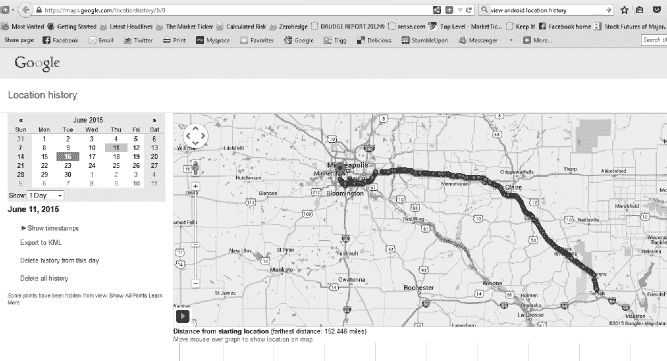
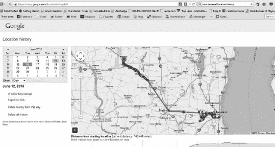
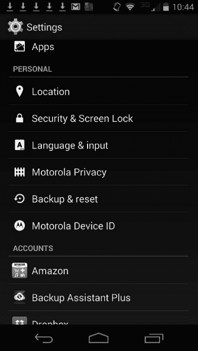

可以放大查看您的移动设备在特定一天连接的所有点。

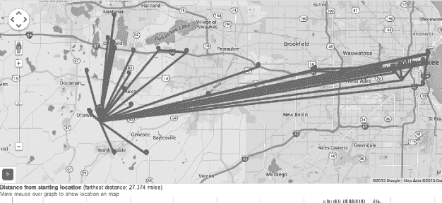

地图上的每个点都是 Google 使用 Wi-Fi 定位系统 (WPS) 定位该手机的位置。每当手机连接到一个 Wi-Fi 接入点，MAC 地址和 SSID 就会被发送到 Google 的服务器。这些信息连同 GPS 和小区 ID 数据一起被收集和存储。这构成了 Google Maps 位置历史记录地图的来源。⁵

使用这项服务有一些好处。例如，为了让航空旅行更轻松，当手机识别到您到达机场时，您的登机牌可以自动显示在手机上。

### Google Maps 位置历史记录

保留历史记录也有助于您的日常通勤，以便在您开始驾驶前获取天气和交通信息。

最后，截至 2019 年 5 月，Google 允许用户控制他们的时间轴。在此之前，几乎无法控制定制 Google 保留的信息。这是一种“全有或全无”式的数据存储。以下项目不可控：

*   无法限制位置数据的保留时长。
*   数据不会自动过期。
*   无法仅保留一天、一周或一个月的历史记录（注：任何时段的历史记录，从一天到 30 天，都可以被擦除）。

然而现在，有一个删除所有数据的选项。这是公司认识到用户应对某些数据拥有控制权的一个例子。

以下图片展示了 Google Maps 位置历史记录现有的功能、详细程度以及删除选项。

第一张图片显示了 2013 年一次行程的追踪记录，从科罗拉多州阿斯彭的橄榄球锦标赛到威斯康星州日内瓦湖的静修地——包含从丹佛国际机场飞往密尔沃基米切尔国际机场的航班。

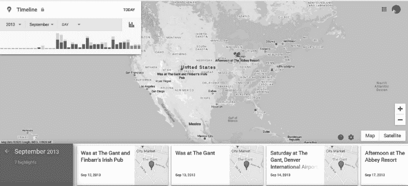

这是来自 Google Maps 位置历史记录的最新图片：

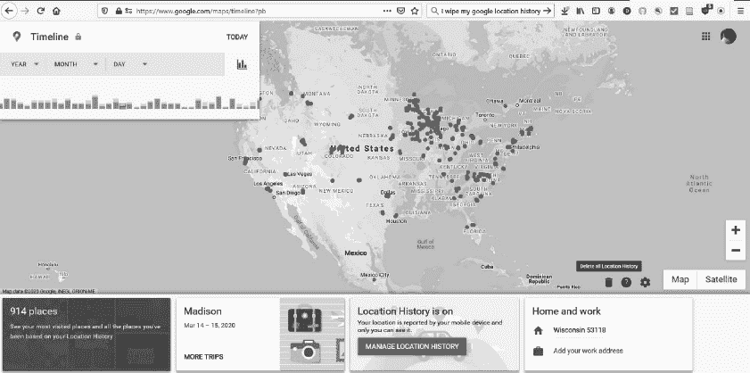

请注意左上角可以追踪特定日期。在地图底部，3 月 14-15 日被高亮显示。点击麦迪逊的日期显示了以下信息：

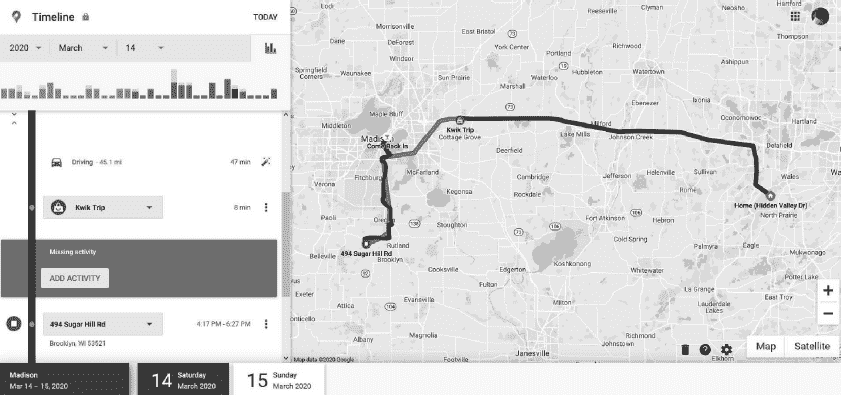

这显示了路线从家里开始，停下来加油，拜访朋友家，最后在“Comeback In”停留。它甚至记录了在每个地点停留的确切小时数。

所有这些信息都可以通过点击右下角的垃圾桶图标来移除。

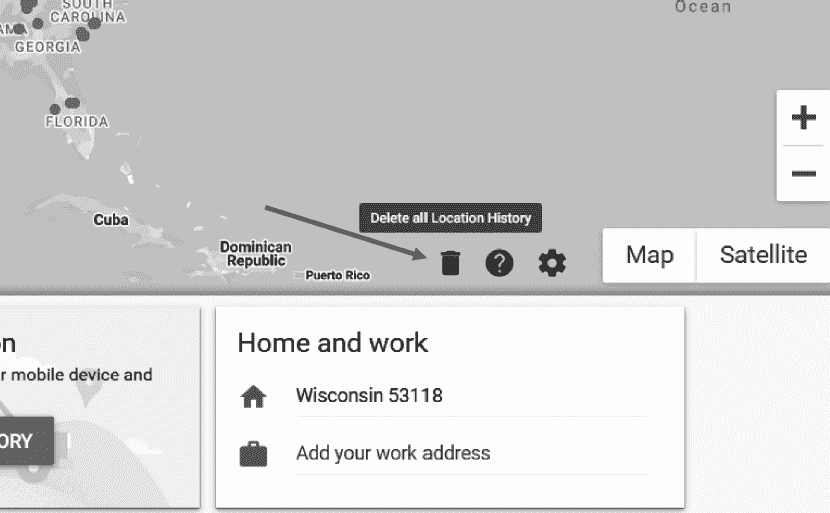

使用 Android 设备，位置服务设置很容易更改。第一步是打开位置设置。

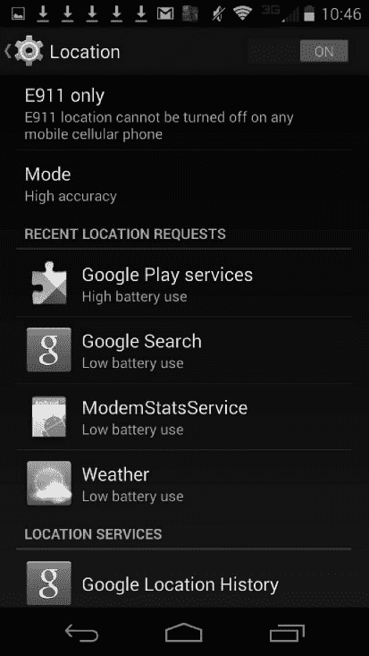

可以简单地关闭设备上报告您位置的任何功能的位置设置。然而，对于某些应用，关闭位置将使其无法使用。

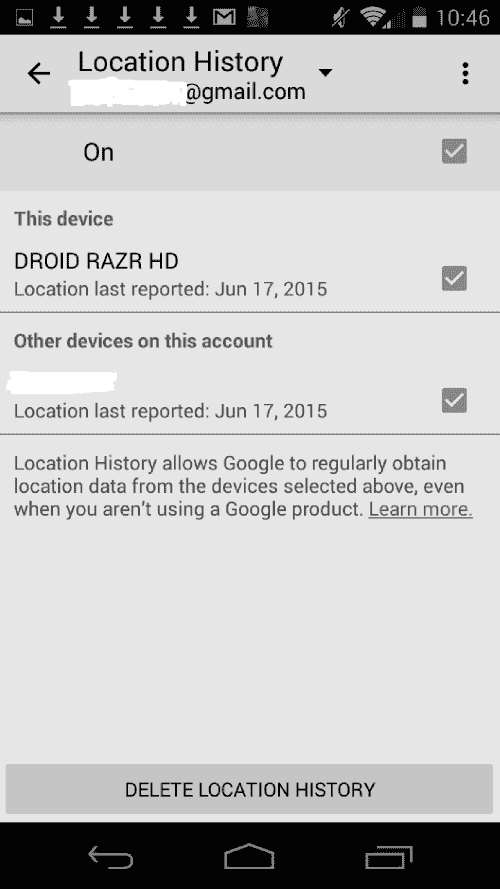

也可以选择完全关闭位置上报，或者保持位置上报启用但关闭 Google Maps 位置历史记录。

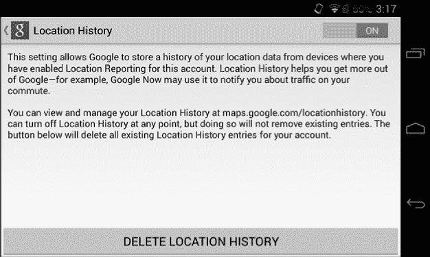

可以通过点击“删除位置历史记录”按钮来清除您的整个 Google Maps 位置历史记录。

Apple 设备用户可以关闭 Google 的位置上报，但无法从移动设备上清除历史记录。有必要访问前面提到的 Google Maps 位置历史记录页面。请记住，其他 Android 设备也可能在记录历史记录（请参阅前面的图片了解其他已连接设备。）

Google Maps 位置历史记录具有实际用途，例如追踪和监护家庭成员、追踪您的工作里程，或跟踪从一个地点到另一个地点的行程进度。

问题在于，Google 没有以简单的形式让用户知道他们正在被追踪。因此，机密信息可能在用户未意识到被收集的情况下被共享。Google 应考虑在设置过程中添加一个选项，让用户了解 Google Maps 位置历史记录的影响，并能轻松选择退出。

一个不道德的人如果能接触到移动设备，可以添加另一个账户，关闭该账户的同步过程或指示，然后追踪设备的真实所有者。如果这是在原设备所有者不知情的情况下进行的，其后果可能令人不安。

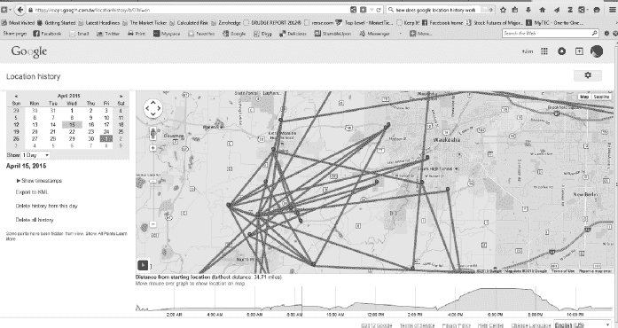

## 知识检查

1.  如果您禁用 Google Maps 位置历史记录，会发生什么？
    1.  所有过去的历史记录被移除。
    2.  过去 30 天的所有历史记录保留。
    3.  所有过去的历史记录不受影响。
    4.  Google Maps 位置历史记录将不允许您使用地图功能。

2.  以下哪项被列为 Google Maps 位置历史记录处于激活状态的益处？
    1.  当您抵达机场时获取登机牌。
    2.  寻找丢失的设备。
    3.  识别可能在附近的网络关联人。
    4.  确定销售人员是否正在拜访客户。

3.  之前概述的 Google Maps 位置历史记录的危险是哪一项？
    1.  不道德的人可能会找到方法追踪您的行踪。
    2.  您的老板可能会要求查看您的手机以核实您的行踪。
    3.  基于您历史记录的位置可能成为法律调查的一部分。
    4.  您的位置历史记录可能提供关于并购的线索。

这种地图功能如何用于造福您的公司？如何被滥用以损害您的业务？对我们的私人生活有何影响？

## 隐私的丧失 — 大数据安全泄露

过去几年，电子邮件系统中的机密信息被盗并相应地公之于众，这简直令人震惊。作为一个国家，我们经历了震惊、好奇、恐惧、忧虑，并且对于 Eric Snowden 或 Julian Assange 通过 WikiLeaks 将揭露什么信息，仍处于不确定状态。

### Julian Assange 和 WikiLeaks

Julian Assange 是 WikiLeaks 网站的主编。他拥有计算机编程和黑客背景。WikiLeaks 从未透露来源处分发敏感数据、新闻泄密和举报人信息。2010 年，WikiLeaks 分发了来自陆军情报分析师 Pfc. Bradley Manning 的美国军事和政治报告，从而声名大噪。Bradley Manning 能够获取美国国务院电报。2011 年 9 月，WikiLeaks 未经删减地发布了所有电报。这导致超过 100,000 份或更多秘密的美国外交电报出现在互联网上。

根据“Democracy Now!”，WikiLeaks 最近发布了秘密的《跨太平洋伙伴关系协定》（TPP）泄露章节——这是美国与其他 11 个国家之间的全球贸易协定。TPP 将覆盖全球经济的 40%，但细节一直对公众保密。最近披露的“投资章节”凸显了美国主导的谈判者意图建立一个法庭，企业可以在其中起诉政府，如果其法律干扰了公司声称的未来利润。Assange 警告该计划可能会阻碍健康和环境法规的采纳。⁶

DNC 泄密——在 2016 年总统大选期间，WikiLeaks 发布了来自民主党全国委员会的文件。这些文件披露了令参加民主党总统提名初选的候选人愤慨的观点和立场。

CIA “Vault 7”（另一位举报人）——CIA 似乎被另一个人黑客入侵，机密文件目前正泄露到互联网上。

以不道德方式获取信息不是本练习的核心问题。公司系统中以文档和电子邮件形式包含的详细信息有何影响？这些数据今天如何被用来对付公司？

## 知识检查

1.  Assange 团体最近泄露的信息是哪一项？
    1.  《平价医疗法案》（ACA）。
    2.  《跨太平洋伙伴关系协定》（TPP）章节。
    3.  班加西文件。
    4.  彼得雷乌斯丑闻。

### Snowden

Snowden 因从国家安全局窃取绝密电子文件而广为人知。当时，Snowden 在夏威夷为 Booz Allen Hamilton 担任情报承包商。

这是一个“源源不断”的泄密事件，因为记者们已经发布了 Snowden 托付给他们的 7,000 多份绝密文件，一些人认为这还不到整个档案的 1%。

根据国家情报官员的说法，斯诺登在从夏威夷飞往香港与记者格伦·格林沃尔德和劳拉·波伊特拉斯会面之前，下载了多达 150 万份文件。在移交非法获取的文件后，他从香港飞出，后来滞留莫斯科。他的前途仍未卜，因为他信任的记者开始揭露他的秘密。⁷

## 您的公司

对贵组织有何影响？贵公司可能拥有大量秘密无形资产（想想可口可乐的配方）。此外，公司文件和电子邮件中包含大量披露战略、并购和雇佣问题的信息。

下次贵公司应对风险或威胁时，请考虑以下问题：

1.  公司保存了哪些信息，一旦发布可能会造成损害？
    1.  电子邮件
    2.  电子文件
    3.  安全摄像头
    4.  差旅信息
    5.  智能手机信息
    6.  知情或不知情情况下被录音的对话
    7.  无形资产
    8.  合同、定价信息等。
    9.  客户名单
    10. 持有电子公司信息
2.  有哪些政策专门针对上述项目？
3.  为整个公司、个人员工、IT 员工和承包商制定了哪些安全流程？
4.  何时由受信任的外部承包商检查 IT 系统的漏洞？

## 知识检验

1.  据称斯诺登发布了 7000 多份文件，估计占他窃取的文件总数的百分之几？
    1.  6%
    2.  8%
    3.  1%
    4.  12%
2.  根据文本，维基解密发布了约多少份未经编辑的美国国务院文件？
    1.  100,000
    2.  50,000
    3.  200,000
    4.  250,000

## 伦理政策考量⁸

组织应在其现有的道德准则和行为规范中添加哪类政策，以应对大数据的需求？Datafloq 的 Mark van Rijmenam 提出了以下建议：

### 彻底透明

实时告知客户正在收集哪些信息。赋予用户删除任何可追溯到他们的数据的选项。如果您提供免费服务，请让用户知晓他们为换取“免费信息”而共享的任何信息将如何被使用。作为替代方案，可考虑为不收集任何数据的服务或产品选项收取费用。

### 简洁设计

为用户提供简单的选项以调整隐私设置，以及确定他们想要共享何种类型信息的选项。

### 准备与安全至关重要

确定业务所需的必要信息。理解数据有价值，罪犯可能有兴趣窃取它。制定包含应急计划的危机策略，以防公司被黑客攻击。提醒员工注意曼宁和斯诺登事件及其造成的损害。

### 将隐私融入基因

考虑聘请一名首席隐私官或首席数据官，负责数据隐私和伦理。该人员将对收集、归档、共享或出售的数据负责。在组织的最高层面讨论大数据的隐私和伦理问题。

## 练习题

1.  请提供一些将在“隐私规则”主题下讨论的领域示例。
2.  Target 的怀孕预测评分有哪些伦理影响？
3.  有人如何能秘密追踪你的行踪（或员工、家庭成员等）？
4.  本章末尾提到的大数据伦理的四个政策考量是什么？

## 注释

1.  1 机器人技术与人工智能（A.1 单元）——单元负责人 Juha Heikkilä “可信赖 AI 伦理准则。”塑造欧洲数字未来——欧盟委员会，2019 年 11 月 4 日。[`ec.europa.eu/digital-singlemarket/en/news/ethics-guidelines-trustworthy-ai`](https://ec.europa.eu/digital-singlemarket/en/news/ethics-guidelines-trustworthy-ai)。
2.  2 Charles Duhigg，“公司如何获知你的秘密”，《纽约时报》，2012 年 2 月 16 日，[www.nytimes.com/2012/02/19/magazine/shopping-habits.html?pagewanted=all&_r=0Accessed3/31/17](http://www.nytimes.com/2012/02/19/magazine/shopping-habits.html?pagewanted=all&_r=0Accessed3/31/17)。
3.  3 Gus Lubin，“Target 曝光少女怀孕的不可思议故事”，《商业内幕》，2012 年 2 月 16 日，[www.businessinsider.com/the-incredible-story-of-how-target-exposed-a-teen-girls-pregnancy-2012-2](http://www.businessinsider.com/the-incredible-story-of-how-target-exposed-a-teen-girls-pregnancy-2012-2)。
4.  4 Matt Elliott，“在哪里找到显示 Google 正在追踪您位置的地图”，c|net，2015 年 11 月 5 日，[www.cnet.com/how-to/how-to-delete-and-disable-your-google-location-history/](http://www.cnet.com/how-to/how-to-delete-and-disable-your-google-location-history/)。
5.  5 “Google 的位置历史记录仍在记录您的每一个举动”，How-To Geek，访问于 2016 年 3 月 22 日，[www.howtogeek.com/195647/googles-location-history-is-still-recording-your-every-move/](http://www.howtogeek.com/195647/googles-location-history-is-still-recording-your-every-move/)。
6.  6 Amy Goodman，“朱利安·阿桑奇谈跨太平洋伙伴关系协定：秘密协议关乎企业控制而非贸易”，《*Democracy Now!*》2015 年 5 月 27 日，[www.democracynow.org/2015/5/27/julian_assange_on_the_trans_pacific](http://www.democracynow.org/2015/5/27/julian_assange_on_the_trans_pacific)，访问于 2020 年 4 月 17 日。
7.  7 Paul Szoldra.“爱德华·斯诺登泄密事件时间线”，《商业内幕》，2016 年 9 月 16 日，[`www.businessinsider.com/snowden-leaks-timeline-2016-9`](https://www.businessinsider.com/snowden-leaks-timeline-2016-9)，访问于 2020 年 4 月 17 日。
8.  8 Mark Van Rijmenam，“大数据伦理：组织应遵循的 4 项准则”，Datafloq，访问于 2020 年 4 月 17 日，[datafloq.com/read/big-data-ethics-4-principles-follow-organisations/221](http://datafloq.com/read/big-data-ethics-4-principles-follow-organisations/221)
