# 1 创建我们的第一个 Angular 应用
在 Angular 中创建你的第一个 Web 应用程序

**Angular** 是一个流行且现代的 **JavaScript** 框架，除了 Web 之外，它还可以在不同的平台上运行，例如桌面和移动端。Angular 应用程序使用 **TypeScript** 编写，TypeScript 是 JavaScript 的一个超集，提供了诸如强类型和面向对象技术等语法糖。

Angular 应用程序是使用 Angular 团队制作的一个名为 **Angular CLI** 的命令行工具创建和开发的。它自动化了许多开发任务，例如搭建脚手架、测试和部署 Angular 应用程序，这些任务如果手动配置将花费大量时间。

Angular 框架的流行在很大程度上反映在其对工具生态的广泛支持上。**Visual Studio Code（VSCode）** 编辑器包含各种扩展，可增强使用 Angular 时的开发体验。

在本章中，我们将涵盖以下主题：

- Angular 简介
- Angular CLI 简介
- 探索 VSCode 中丰富的 Angular 工具生态系统
- 如何创建我们的第一个 Angular 应用程序
- 如何使用 Nx Console 自动化 Angular CLI 命令

## 基本背景理论和上下文

Angular 框架是一个跨平台的 JavaScript 框架，可以在包括 Web、服务器、移动端和桌面在内的广泛环境中运行。它由一组 JavaScript 库组成，我们可以用它们来构建高性能、可扩展的 Web 应用程序。Angular 应用程序的架构基于组件的分层表示。组件是 Angular 应用程序的基本构建块。它们表示并控制网页的特定部分，称为*视图*。组件的一些示例如下：

- 博客文章列表
- 问题报告表单
- 天气显示小部件

Angular 应用程序的组件可以在逻辑上组织为一棵树：

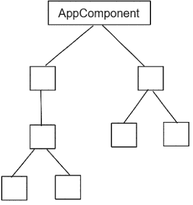

按照惯例，Angular 应用程序通常有一个主组件，称为 **AppComponent**。树中的每个组件都可以使用由各自定义的应用程序编程接口与其兄弟组件进行通信和交互。

Angular 应用程序可以具有许多被称为模块的功能。每个模块提供一块单一功能，对应于特定的应用领域或工作流。Angular 模块用于对具有相似功能的 Angular 组件进行分组：

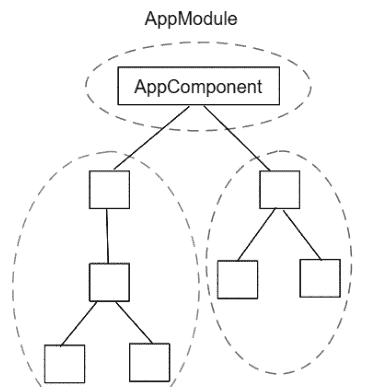

在上图中，虚线圆圈代表 Angular 模块。按照惯例，Angular 应用程序通常有一个主模块，称为 **AppModule**。如果某个模块希望使用 Angular 应用程序中其他模块的部分功能，则它可以导入这些模块。

模块的功能可以进一步划分为功能的表示逻辑和业务逻辑。Angular 组件只应负责处理表示逻辑，并将业务逻辑任务委托给服务。Angular 框架使用内置的**依赖注入（DI）**机制向组件提供 Angular 服务。

Angular DI 框架使用称为注入器的专用对象，来隐藏为 Angular 应用程序提供依赖关系的大部分复杂性。组件不需要知道 Angular 服务的任何实际实现。它们只需要向注入器请求即可。

Angular 服务应遵循单一职责原则，并且不应跨越不同 Angular 模块之间的边界。服务的一些示例如下：

- 使用 HTTP 协议从后端 API 访问数据。
- 与浏览器的本地存储进行交互。
- 错误日志记录。
- 数据转换。

在构建 Angular 应用程序时，Angular 开发人员不需要死记硬背如何创建组件、模块和服务。幸运的是，Angular CLI 可以通过提供命令行界面来帮助我们完成这些任务。

## Angular CLI 简介

Angular CLI 是由 Angular 团队创建的一个工具，它改善了构建 Angular 应用程序时的开发体验。它隐藏了搭建和配置 Angular 应用程序的许多复杂性，同时让开发人员能够专注于他们最擅长的事情——编码！在开始使用 Angular CLI 之前，我们需要在系统中设置以下先决条件：

- **Node.js：** 一个基于 Chrome 的 v8 引擎构建的 JavaScript 运行时。你可以从 https://nodejs.org/en 下载任何**长期支持（LTS）**版本。
- **npm：** Node.js 运行时的包管理器。

然后我们可以使用 npm 从命令行安装 Angular CLI：

```bash
npm install -g @angular/cli
```

我们可以使用 `-g` 选项全局安装 Angular CLI，因为我们想从操作系统的任何路径创建 Angular 应用程序。

> **重要说明**
> 在某些操作系统中，安装 Angular CLI 可能需要管理员权限。


前面的列表并非详尽无遗，其中一些扩展已包含在 **Angular Essentials** 套件中。不过，你可以在 `https://marketplace.visualstudio.com/search?term=angular&target=VSCode` 浏览更多适用于 VSCode 的 Angular 扩展。

## Nx Console

Nx Console 是由 Nrwl 团队开发的 VSCode 扩展，它为 Angular CLI 提供了图形用户界面。它包含了大部分 Angular CLI 命令，并在内部使用 Angular CLI 来执行每一条命令。我们将在 *使用 Nx Console 构建我们的应用程序* 部分更深入地学习该扩展。

## Angular Language Service

Angular Language Service 扩展在编辑 Angular 应用中的 HTML 模板时提供了各种增强功能，包括以下内容：

- 代码自动补全
- 编译错误信息
- 转到定义技术

代码自动补全是一项功能，可在输入时帮助我们找到要使用的正确属性或方法。它通过在我们开始在 HTML 内容中输入时显示建议列表来实现：

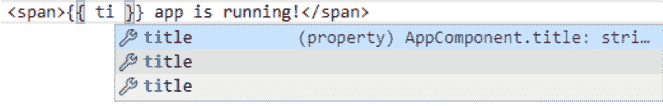

图 1.3 – 代码补全

在之前的截图中，当我们开始输入单词 `ti` 时，Angular Language Service 会建议 `title` 组件属性。请注意，代码补全仅适用于组件中的公共属性和方法。

在开发 Web 应用时最常见的问题之一是在应用进入生产环境之前检测错误。此问题可部分通过 Angular 编译器解决，该编译器在为生产环境构建 Angular 应用时启动。此外，Angular Language Service 可以更进一步，在我们的应用进入编译过程之前就显示编译错误信息：

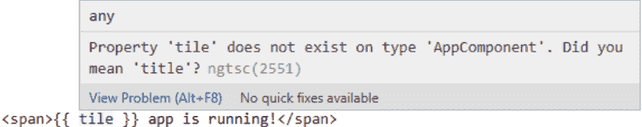

例如，如果我们不小心拼错了组件的属性或方法名称，Angular Language Service 将显示相应的错误信息。

## Angular Snippets

Angular Snippets 扩展包含用于 TypeScript 和 HTML 的 Angular 代码片段集合。在 TypeScript 中，我们可以在空白 TypeScript 文件中使用它来创建组件、模块或服务：

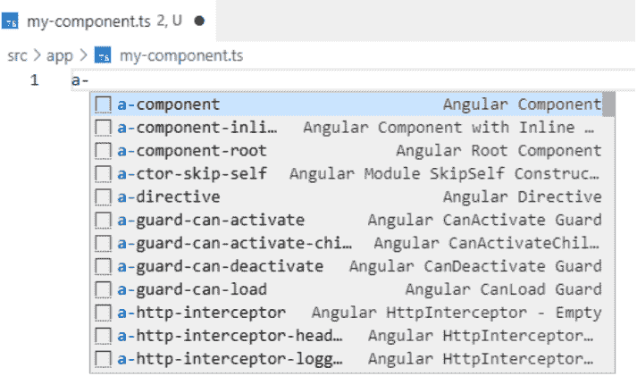

在 HTML 模板中，我们可以使用该扩展创建有用的 Angular 工件，例如 *ngFor 指令，以在 HTML 中循环遍历列表：

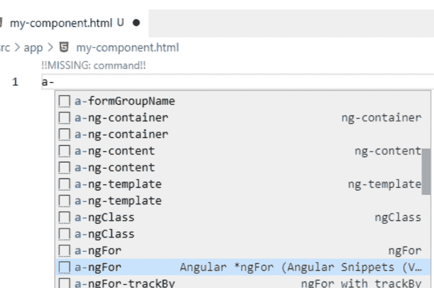

图 1.6 – *ngFor 片段

由于 Angular CLI 的广泛流行和功能，使用它来在 TypeScript 中生成 Angular 工件似乎更方便。然而，Angular Snippets 在 HTML 部分做得非常出色，因为在 HTML 部分有更多需要死记硬背的内容。

## Angular Evergreen

Angular 框架如此稳定的主要因素之一是它遵循基于语义化版本控制的定期发布周期。如果我们希望我们的 Angular 应用配备最新功能和修复程序，就必须定期更新它们。但我们如何以最高效的方式保持最新？我们可以使用 Angular Evergreen 扩展来实现！

它将 Angular CLI 项目的 Angular 和 Angular CLI 版本与最新版本进行比较，并提醒你是否需要更新：

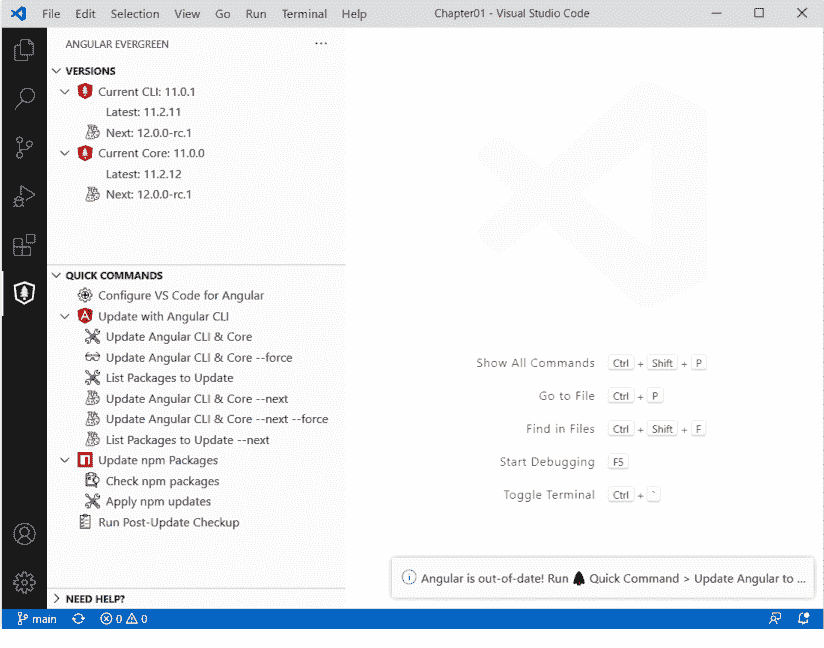

它提供了一个易于使用的用户界面来执行以下命令：

- 将 Angular 依赖项升级到 *latest* 版本
- 将 Angular 依赖项升级到 *next* 版本
- 升级所有 npm 依赖项

Angular Evergreen 是确保你的 Angular 项目永不落伍的完美扩展。

## Material Icon Theme

列表中最后一个扩展并不会在很大程度上增加开发者的生产力。相反，它专注于可发现性和美观性，通过修改 VSCode 的图标主题来实现。

- **VSCode**：可从 https://code.visualstudio.com/Download 下载的代码编辑器。
- **Angular CLI**：我们在 *基本背景理论和上下文* 部分介绍的 Angular 命令行界面。
- **GitHub material**：本章的相关代码可在 https://github.com/PacktPublishing/Angular-Projects-Second-Edition 的 Chapter01 文件夹中找到。

## 创建我们的第一个 Angular 应用

要创建一个全新的 Angular 应用，我们必须执行 Angular CLI 的 `ng new` 命令，并将应用名称作为选项传递：

```
ng new my-angular
```

new 命令用于创建新的 Angular 应用或新的 Angular 工作区。Angular 工作区是包含一个或多个 Angular 应用的 Angular CLI 项目，其中一些可以是 Angular 库。因此，当我们执行 `ng new` 命令时，默认情况下会创建一个包含 Angular 应用的 Angular 工作区。

在之前的命令中，我们的 Angular 应用名称为 `my-angular`。执行命令后，Angular CLI 会提出一些问题，以尽可能多地收集有关我们想要创建的应用性质的信息。让我们看一下：

1. 首先，它会询问我们是否要在 Angular 应用中启用路由：

```
? Would you like to add Angular routing? (y/N)
```

图 1.9 – Angular 路由

Angular 中的路由就是使用 URL 在 Angular 应用的组件之间导航。在本项目中，我们不关心路由，因此按 *Enter* 接受默认值。

2. 然后，Angular CLI 会提示我们选择要在整个 Angular 应用中使用的样式表格式：

```
? Which stylesheet format would you like to use? (Use arrow keys)
> CSS
  SCSS   [ https://sass-lang.com/documentation/syntax#scss                ]
  Sass   [ https://sass-lang.com/documentation/syntax#the-indented-syntax ]
  Less   [ http://lesscss.org                                             ]
```

图 1.10 – 样式表格式

3. 从可用样式表列表中选择一种格式并按 *Enter*。

> **提示**
> 
> 你可以使用键盘上的方向键在可用的样式表选项之间导航。

Angular CLI 启动你的 Angular 应用的创建过程，该过程包括以下内容：

- 搭建典型 Angular CLI 项目所需的必要文件夹结构
- 安装所需 npm 依赖项和 Angular 包
- 在 Angular CLI 项目中初始化 Git

此过程可能需要一些时间，具体取决于网络速度。完成后，你应该在运行 `ng new` Angular CLI 命令的路径下拥有一个名为 `my-angular` 的新文件夹。

现在，是时候运行我们的 Angular 应用并亲眼看看它了：

1. 打开一个终端窗口并导航到 my-angular 文件夹。
2. 运行以下 Angular CLI 命令：

```
ng serve
```

这将构建 Angular 应用并启动一个内置 Web 服务器，我们可以用它来预览应用。Web 服务器以监视模式启动；也就是说，每当我们在代码中进行更改时，它都会自动重建 Angular 应用。Angular 应用首次构建时需要相当长的时间才能完成，因此我们必须耐心等待。当你在终端窗口中看到以下消息时，你就知道该过程已成功完成且无错误：

```
** Angular Live Development Server is listening on localhost:4200, open your browser on http://localhost:4200/ **

✔ Compiled successfully.
```

图 1.11 – Angular 构建输出

3. 启动你喜欢的浏览器并导航到 `http://localhost:4200` 以预览你全新的 Angular 应用：

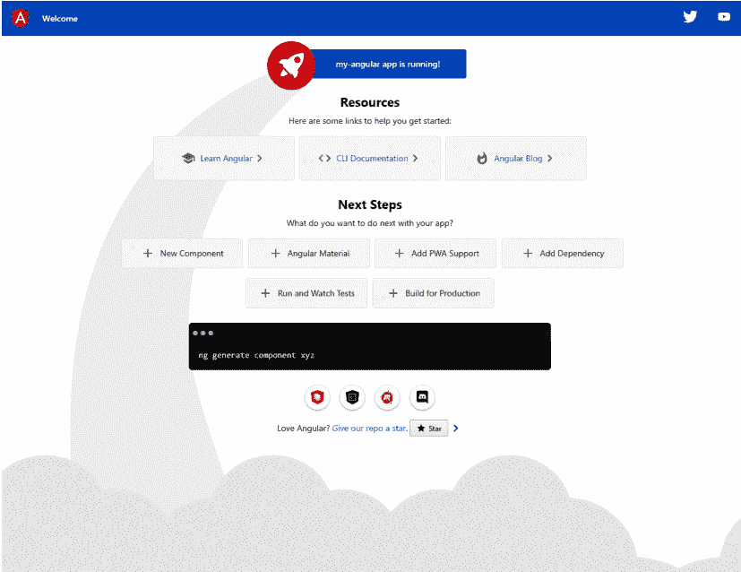

图 1.12 – 最小 Angular 应用

Angular CLI 默认创建一个最小的 Angular 应用，为我们的 Angular 项目提供起点。它包含一些现成的 CSS 样式和 HTML 内容，我们将在下一节学习如何根据我们的规范对其进行更改。


## 与 Angular 框架交互

在与 Angular 协作时，当我们开始深入接触框架本身时，真正的乐趣才开始。理解 Angular 的工作原理并编写应用程序代码才是关键。

应用程序源代码位于 Angular CLI 项目根目录下的 `src\app` 文件夹内。它包含构建和测试 Angular 应用程序所需的所有文件，包括一个组件和一个模块。组件是 Angular 应用程序的主组件：

**app.component.ts**

```
```typescript
import { Component } from '@angular/core';

@Component({
  selector: 'app-root',
  templateUrl: './app.component.html',
  styleUrls: ['./app.component.css']
})
export class AppComponent {
  title = 'my-angular';
}
```
```

以下属性描述了 Angular 组件的特征：

- * `selector`: 一个唯一名称，用于在 HTML 内容中标识并声明组件。它用作 HTML 标签，就像任何原生 HTML 元素一样，例如 `<app-root></app-root>`。

> > **提示**
> > Angular CLI 默认在组件选择器中提供 app 前缀。我们可以在从头创建新的 Angular CLI 应用程序时使用 `--prefix` 选项使用自定义前缀。自定义前缀可以基于组织名称或特定产品名称，有助于避免与其他库或模块发生冲突。

- * `templateUrl`: 指向包含组件 HTML 内容的 HTML 文件的路径，该文件称为组件的模板。
- * `styleUrls`: 一组路径列表，其中每个路径指向包含组件 CSS 样式的样式表文件。

上述属性是使用 `@Component` 装饰器定义的。它是一个装饰 TypeScript 组件类的函数，并将其识别为 Angular 组件。AppComponent 类的 `title` 属性是一个公共属性，包含字符串值，可在组件模板中使用。

我们 Angular 应用程序的主模块使用类似的装饰器 `@NgModule` 来定义其属性：

### app.module.ts

```
```typescript
import { NgModule } from '@angular/core';
import { BrowserModule } from '@angular/platform-browser';

import { AppComponent } from './app.component';

@NgModule({
  declarations: [
    AppComponent
  ],
  imports: [
    BrowserModule
  ],
  providers: [],
  bootstrap: [AppComponent]
})
export class AppModule { }
```
```

Angular 模块的装饰器定义了一组可用于配置模块的属性。其中最常见的是：

- - `declarations`: 定义属于 Angular 模块的 Angular 组件。Angular 模块中存在的每个组件 *必须* 添加到 declarations 数组中。
- - `imports`: 定义包含 Angular 模块所需功能的其它 Angular 模块。

现在让我们通过修改 Angular 应用程序的代码来开始实践。我们将更改以下在应用程序启动时显示的问候消息，使其更有意义：


图 1.13 – 问候消息

首先，我们需要找到上一个截图中消息声明的位置。Angular 应用程序的主组件是默认在应用程序启动时加载的组件。

> **提示**
> 
> 在 Angular 应用程序引导时显示的组件由应用程序主模块的 `bootstrap` 属性指示。我们很少需要更改此属性。该组件的选择器默认在 `index.html` 文件中使用。

因此，消息应该在 `app.component.ts` 文件中声明。让我们看一下：

- 1. 打开 VSCode 编辑器，并在 **Welcome** 屏幕的 **Start** 部分中选择 **Open folder…**。
- 2. 找到我们创建的 Angular 应用程序的 `my-angular` 文件夹并选择它。
- 3. 从 **EXPLORER** 面板导航到 `src\app` 文件夹并选择 `app.component.ts` 文件。
- 4. 在 AppComponent 类中定位 `title` 属性并将其值更改为 `Angular Projects:`
- 5. 如果应用程序未运行，从 Terminal 窗口运行 `ng serve`，并使用浏览器导航到 `http://localhost:4200`。我们的 Angular 应用程序现在应显示以下问候消息：

```
```typescript
title = 'Angular Projects';
```
```


图 1.14 – 问候消息

title 属性绑定到主组件的模板。如果我们打开 app.component.html 文件并转到第 346 行，我们将看到以下 HTML 代码：

```
```html
<span>{{ title }} app is running!</span>
```
```

包围 `title` 属性的 `{{}}` 语法称为 **插值**。在插值期间，Angular 框架读取封闭的组件属性值，将其转换为文本并打印到屏幕上。

Angular CLI 提供了丰富的命令集合，可在日常开发过程中协助我们。从 Terminal 窗口运行这些命令看起来很简单，但很快就会变成噩梦。

### 使用 Nx Console 构建我们的应用程序

Angular CLI 是一种命令行工具，具有多种命令。每个命令都可以根据我们想要完成的任务接受各种选项和参数。记住这些命令及其选项的过程令人望而生畏且耗时。在这种情况下，Angular 工具生态系统可以派上用场。VSCode Marketplace 包含许多有用的扩展，我们可以安装它们来帮助我们在 Angular 开发过程中。其中一个扩展是 Nx Console，它在 Angular CLI 之上提供用户界面。要在环境中安装 Nx Console，请按照以下步骤操作：

- 1. 打开 VSCode 并单击侧边栏中的 **Extensions** 菜单：

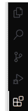

图 1.15 – VSCode Extensions

- 2. 在出现的 **EXTENSIONS** 面板中，输入 `Nx Console`。
- 3. 单击第一个项目的 **Install** 按钮以安装 Nx Console 扩展。

Nx Console 扩展现在已全局安装在我们的环境中，这意味着我们可以在任何 Angular 项目中使用它。它是 Angular CLI 最常见命令的图形表示。目前，它支持以下命令（括号中显示相关的 Angular CLI 命令）：

- - **Generate**: 生成新的 Angular 工件，例如组件和模块（`ng generate`）。
- - **Run**: 运行在 Angular CLI 工作区的 `angular.json` 配置文件中定义的 architect 目标（`ng run`）。
- - **Build**: 构建 Angular 应用程序（`ng build`）。
- - **Serve**: 构建并提供 Angular 应用程序（`ng serve`）。
- - **Test**: 运行 Angular 应用程序的单元测试（`ng test`）。
- - **E2E**: 运行 Angular 应用程序的端到端或集成测试（`ng e2e`）。
- - **Lint**: 根据一组 linting 规则检查 Angular 应用程序（`ng lint`）。
- - **Change workspace**: 在 VSCode 中加载不同的 Angular CLI 工作区。

我们可以用 Angular CLI 做的事情几乎都可以用 Nx Console 实现。真正的优势在于，开发人员无需记住所有 Angular CLI 命令选项，因为它们都以图形界面表示。让我们看看如何操作：

- 1. 使用 VSCode 打开 `my-angular` 文件夹并单击侧边栏中的 **Nx Console** 菜单：


图 1.16 – Nx Console

- 2. 从 **NX CONSOLE** 面板中单击 **Serve** 命令：

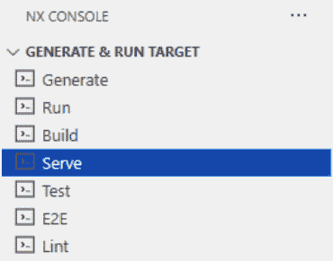

图 1.17 – Serve 命令

- 3. 在出现的对话框中选择 **my-angular** 项目：

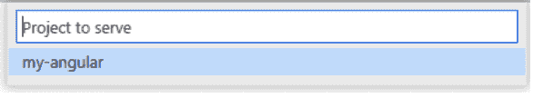

图 1.18 – 选择项目

Nx Console 将打开 **Serve** 选项卡，您可以在其中可选地设置 Angular CLI 的 serve 命令支持的额外选项。每个选项都包含一个标题和简短说明，解释其作用。

> **重要说明**
> 
> 某些选项的标题中可能包含 **(deprecated)** 字样。这表示该选项已在当前版本的 Angular CLI 中弃用，并将在以后的版本中最终移除。

- 4. 单击 **Run** 按钮启动 Angular 应用程序：

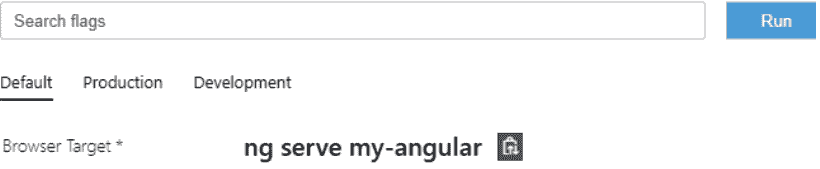

图 1.19 – Serve 选项卡


VSCode 在编辑器底部打开一个集成终端并执行 `ng serve` 命令：

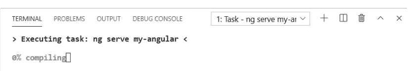

图 1.20 – VSCode 集成终端

这与我们从终端窗口使用 Angular CLI 时执行的命令相同。

Nx Console 在内部使用任务来运行 Angular CLI 命令。任务是 VSCode 的内置机制，允许我们在不直接与命令行交互的情况下运行脚本或启动外部进程。

Nx Console 扩展在消除死记硬背 Angular CLI 命令的负担方面做得非常出色。VSCode Marketplace 包含许多更多适用于 Angular 开发人员的扩展，可补充 Nx Console 的工作。

## Summary

在本章中，我们学习了 Angular 框架的基本原理，并对 Angular 架构进行了简要概述。我们看到了一些流行的 VSCode 扩展，我们可以在使用 Angular 时使用它们来增强我们的开发体验。

然后，我们学习了如何使用 Angular CLI，这是一个强大的 Angular 生态系统工具，从头开始脚手架化并构建新的 Angular 应用程序。我们还通过修改典型 Angular CLI 应用程序的 Angular 组件进行了第一次与 Angular 代码的交互。最后，我们安装了 Nx Console 扩展并学习了如何使用它来构建我们的应用程序。

在下一章中，我们将研究 Angular Router，并学习如何使用它通过 Scully 静态网站生成器创建一个个人博客。

## Practice questions

让我们看几个练习题：

- 1. Angular 应用程序的基本构建块是什么？
- 2. 我们如何对功能相似的组件进行分组？
- 3. 谁负责处理 Angular 应用程序中的业务逻辑任务？
- 4. 我们可以使用哪个 Angular CLI 命令来创建一个新的 Angular 应用程序？
- 5. 我们可以使用哪个 Angular CLI 命令来提供 Angular 应用程序？
- 6. 我们如何在 HTML 中声明 Angular 组件？
- 7. 我们如何在模块中声明 Angular 组件？
- 8. 我们在 HTML 模板上使用什么语法进行文本绑定？
- 9. 使用 Nx Console 的好处是什么？
- 10. 我们使用哪个扩展在 Angular 代码中执行静态分析？

## Further reading

以下是一些用于扩展本章所学内容的链接：

- Introduction to Basic Concepts: https://angular.io/guide/architecture
- Interpolation: https://angular.io/guide/interpolation
- Nx Console: https://nx.dev/latest/angular/cli/console
- Angular Essentials: https://marketplace.visualstudio.com/items?itemName=johnpapa.angular-essentials
- Angular Evergreen: https://expertlysimple.io/get-evergreen
