## 2 使用 Scully 构建博客应用
Building an
SPA Application
with Scully and
Angular Router

Angular 应用程序遵循 **Single Page Application (SPA)** 架构，其中网页的不同视图可以根据浏览器 URL 进行激活。对该 URL 的任何更改都可被 Angular 路由器拦截并转换为可激活特定 Angular 组件的路由。

**Scully** 是一个流行的静态网站生成器，基于 **Jamstack** 架构。它可以很好地与 Angular 路由器配合使用，根据每个路由预渲染 Angular 应用程序的内容。

在本章中，我们将结合 Angular 和 Scully 创建一个个人博客。以下主题将被涵盖：

- 在 Angular 应用程序中设置路由
- 创建我们博客的基本布局
- 为我们的应用程序配置路由
- 使用 Scully 添加博客功能
- 在主页上显示博客文章

## Essential background theory and context

在 Web 开发的旧时代，客户端应用程序与底层服务器基础设施高度耦合。当我们想要使用 URL 访问网站的页面时，需要涉及大量机械。浏览器会将请求的 URL 发送到服务器，服务器应为该 URL 响应匹配的 HTML 文件。这是一个复杂的过程，会导致延迟和不同的往返时间。

现代 Web 应用程序使用 SPA 架构消除了这些问题。客户端只需从服务器请求一次 HTML 文件。浏览器 URL 的任何后续更改都由客户端基础设施内部处理。在 Angular 中，路由器负责拦截应用程序内的 URL 请求并根据定义的路由配置处理它们。

Jamstack 是一项热门的新兴技术，允许我们创建快速且安全的 Web 应用程序。它可用于任何类型的应用程序，从电子商务网站到 **Software as a Service (SaaS)** Web 应用程序，甚至是个人博客。Jamstack 的架构基于以下支柱：

- **Performance:** 页面在生产期间生成并预渲染，消除了等待内容加载的需求。
- **Scaling:** 内容是静态文件，可以从任何地方提供，甚至可以从 **Content Delivery Network (CDN)** 提供商提供，从而提高应用程序的性能。
- **Security:** 服务器端进程的无服务器性质以及内容已经是静态的事实消除了针对服务器基础设施的潜在攻击。

Scully 是第一个拥抱 Jamstack 方法的 Angular 静态网站生成器。它本质上在构建时生成 Angular 应用程序的页面，以便在请求时立即可用。

## Project overview

在这个项目中，我们将使用 Angular 框架构建一个个人博客，并使用 Scully 网站生成器增强其 Jamstack 特性。最初，我们将脚手架化一个新的 Angular 应用程序并为其启用路由。然后，我们将通过添加一些基本组件来创建应用程序的基本布局。一旦我们拥有一个可工作的 Angular 应用程序，我们将使用 Scully 为其添加博客支持。然后，我们将使用 Markdown 文件创建一些博客文章并在应用程序的主页上显示它们。

构建时间：1 小时。

### Getting started

完成本项目需要以下软件工具：

- Angular CLI：Angular 的命令行界面，您可以在 `https://angular.io/cli` 找到
- GitHub material：本章的相关代码，您可以在 `https://github.com/PacktPublishing/Angular-Projects-Second-Edition` 的 `Chapter02` 文件夹中找到。

### Setting up routing in an Angular application

我们将通过从头开始创建一个新的 Angular 应用程序来启动我们的项目。在终端窗口中执行以下 Angular CLI 命令以创建一个新的 Angular 应用程序：

```
```bash
ng new my-blog --routing --style=scss
```
```

我们使用 `ng new` 命令创建新的 Angular 应用程序，并传递以下选项：

- `my-blog`：我们想要创建的 Angular 应用程序的名称。Angular CLI 将在我们执行命令的路径中创建一个 `my-blog` 文件夹。
- `--routing`：在 Angular 应用程序中启用路由。
- `--style=scss`：配置 Angular 应用程序在处理 CSS 样式时使用 SCSS 样式表格式。

> **Important Note**
> 
> 我们在终端窗口中运行的每个命令都应在该文件夹内运行。

当我们在 Angular 应用程序中启用路由时，Angular CLI 会从 @angular/router npm 包导入多个工件到我们的应用程序中：

- 它创建 `app-routing.module.ts` 文件，这是我们应用程序的主要路由模块：

```
import { NgModule } from '@angular/core';
import { RouterModule, Routes } from '@angular/router';

const routes: Routes = [];

@NgModule({
  imports: [RouterModule.forRoot(routes)],
  exports: [RouterModule]
})
export class AppRoutingModule { }
```

- 它将 `AppRoutingModule` 导入到我们应用程序的主模块 `app.module.ts` 中：

```
import { NgModule } from '@angular/core';
import { BrowserModule } from '@angular/platform-browser';

import { AppRoutingModule } from './app-routing.module';
import { AppComponent } from './app.component';

@NgModule({
  declarations: [
    AppComponent
  ],
  imports: [
    BrowserModule,
    AppRoutingModule
  ],
  providers: [],
  bootstrap: [AppComponent]
})
export class AppModule { }
```


我们将应用程序配置为使用 SCSS 样式表格式。我们不会手动创建应用程序的样式，而是使用 **Bootstrap CSS** 库：

1. 在终端窗口中执行以下命令来安装 Bootstrap：

   ```
   npm install bootstrap
   ```

2. 在 Angular 应用程序 `src` 文件夹中的 `styles.scss` 文件顶部添加以下导入语句：

   ```
   @import "~bootstrap/scss/bootstrap";
   ```

`styles.scss` 文件包含全局应用于我们应用程序的 CSS 样式。在前面的代码片段中，我们将 Bootstrap 库中的所有样式导入到应用程序中。`@import` CSS 规则接受 `bootstrap.scss` 文件的绝对路径作为选项，无需添加 `.scss` 扩展名。`~` 字符代表 Angular 应用程序的 `node_modules` 文件夹。

> **重要提示**
> `node_modules` 文件夹包含我们的应用程序在开发或运行时所需的所有 npm 包和库。

在接下来的部分中，我们将学习如何通过创建组件（如头部和页脚）来创建博客的基本布局。

## 创建博客的基本布局

博客通常有一个包含所有主要网站链接的头部，以及一个包含版权信息和其他有用链接的页脚。在 Angular 世界中，这两者都可以表示为独立的组件。

头部组件只使用一次，因为它在应用程序启动时添加，并且始终渲染为网站的主菜单。在 Angular 中，我们通常会按照约定创建一个名为 **core** 的模块，以将这些组件或服务作为应用程序的核心。要创建该模块，我们使用 Angular CLI 的 `generate` 命令：

```
ng generate module core
```

上述命令将在应用程序的 `src\app\core` 文件夹中创建该模块。要创建头部组件，我们将使用相同的命令，并传递一组不同的选项：

```
ng generate component header --path=src/app/core --module=core --export
```

上一个命令将在 `src\app\core\header` 文件夹内创建所有必要的组件文件：

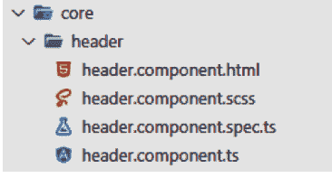

图 2.1 - 头部组件

它还会在核心模块中声明 `HeaderComponent`，并将其添加到 `exports` 属性中，以便其他模块可以使用它：

### core.module.ts

```typescript
import { NgModule } from '@angular/core';
import { CommonModule } from '@angular/common';
import { HeaderComponent } from './header/header.component';

@NgModule({
    declarations: [
        HeaderComponent
    ],
    imports: [
        CommonModule
    ],
    exports: [
        HeaderComponent
    ]
})
export class CoreModule { }
```

头部组件应显示我们博客的主要链接。打开头部组件的 `header.component.html` 模板文件，并将其内容替换为以下代码片段：

### header.component.html

```html
<nav class="navbar navbar-expand navbar-light bg-light">
  <div class="container-fluid">
    <a class="navbar-brand">Angular Projects</a>
    <ul class="navbar-nav me-auto">
      <li class="nav-item">
        <a class="nav-link">Articles</a>
      </li>
      <li class="nav-item">
        <a class="nav-link">Contact</a>
      </li>
    </ul>
  </div>
</nav>
```

页脚组件可以在 Angular 应用程序中多次使用。目前，我们希望将其显示在应用程序的主页上。将来，我们可能还希望将其显示在博客访客可用的登录页面上。在这种情况下，页脚组件应该是可复用的。当我们想要把将在整个应用程序中复用的组件组织在一起时，通常会按照约定创建一个名为 **shared** 的模块。使用 Angular CLI 的 generate 命令创建 shared 模块：

```bash
ng generate module shared
```

上述命令将在应用程序的 `src\app\shared` 文件夹中创建 shared 模块。现在可以使用以下命令创建页脚组件：

```bash
ng generate component footer --path=src/app/shared --module=shared --export
```

上一个命令将在 `src\app\shared\footer` 文件夹内创建页脚组件的所有必要文件。它还会将 FooterComponent 添加到共享模块的 declarations 和 exports 属性中：

### shared.module.ts

```typescript
import { NgModule } from '@angular/core';
import { CommonModule } from '@angular/common';
import { FooterComponent } from './footer/footer.component';

@NgModule({
  declarations: [
    FooterComponent
  ],
  imports: [
    CommonModule
  ],
  exports: [
    FooterComponent
  ]
})
export class SharedModule { }
```

页脚组件的内容应包含我们博客的版权信息。让我们看看如何将这些信息添加到组件中：

1. 打开页脚组件的 `footer.component.ts` TypeScript 类文件。在 `FooterComponent` 类中添加一个 `currentDate` 属性，并将其初始化为新的 Date 对象：

   ```typescript
   export class FooterComponent implements OnInit {

     currentDate = new Date();

     constructor() { }

     ngOnInit(): void {
     }

   }
   ```

2. 打开页脚组件的 `footer.component.html` 模板文件，并将其内容替换为以下内容：

   ```html
   <nav class="navbar fixed-bottom navbar-light bg-light">
     <div class="container-fluid">
       <p>Copyright @{{currentDate | date: 'y'}}. All Rights Reserved</p>
     </div>
   </nav>
   ```

前面的代码使用插值在屏幕上显示 `currentDate` 属性的值。它还使用内置的日期管道，仅显示当前日期的年份。

> **重要提示**
> 管道是 Angular 框架的内置功能，可对组件属性的视图表示进行转换。属性的底层值保持不变。

我们已经创建了博客的基本组件。现在该将它们显示在屏幕上了：

1. 打开应用程序的主模块 `app.module.ts` 文件，并将 CoreModule 和 SharedModule 添加到 @NgModule 装饰器的 imports 属性中：

   ```typescript
   @NgModule({
     declarations: [
       AppComponent
     ],
     imports: [
       BrowserModule,
       AppRoutingModule,
       CoreModule,
       SharedModule
     ],
     providers: [],
     bootstrap: [AppComponent]
   })
   ```

2. 在文件顶部为每个模块添加相应的 `import` 语句：

   ```typescript
   import { NgModule } from '@angular/core';
   import { BrowserModule } from '@angular/platform-browser';

   import { AppRoutingModule } from './app-routing.module';
   import { AppComponent } from './app.component';
   import { CoreModule } from './core/core.module';
   import { SharedModule } from './shared/shared.module';
   ```

3. 打开主组件的 `app.component.html` 模板文件，并将其内容替换为以下 HTML 片段：

   ```html
   <app-header></app-header>
   <app-footer></app-footer>
   ```

在前面的代码片段中，我们通过使用它们的 CSS 选择器添加了头部和页脚组件。

如果我们运行 Angular CLI 的 `serve` 命令来预览应用程序，我们应该会得到以下结果：

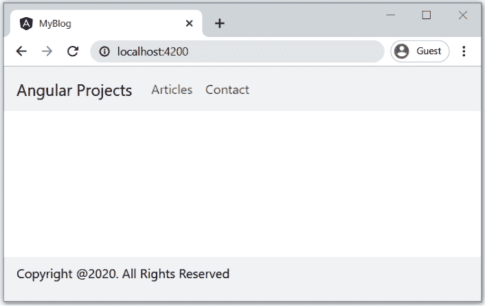

图 2.2 – 基本布局

我们已经完成了博客应用程序的基本布局，看起来很棒！但头部还包含两个我们尚未涉及的额外链接。我们将在下一节学习如何使用路由来激活这些链接。

## 为我们的应用程序配置路由

我们在上一节创建的头部组件包含两个链接：

- **文章**：显示博客文章列表
- **联系**：显示博客所有者的个人信息

这些链接也将成为我们应用程序的主要功能。因此，我们需要为每个链接创建一个 Angular 模块。

> **提示**
> 在设计网站并需要决定要使用的 Angular 模块时，请查看网站的主菜单。菜单中的每个链接都应是一个不同的功能，因此对应一个不同的 Angular 模块。

按照约定，为特定功能提供实现的 Angular 模块称为**功能模块**。

## 创建联系页面

让我们首先创建联系功能：

1. 创建一个作为联系功能载体的模块：

   ```
   ng generate module contact
   ```

2. 创建一个将成为联系模块主组件的组件：

   ```
   ng generate component contact --path=src/app/contact --module=contact --export --flat
   ```

我们将 `--flat` 选项传递给 `generate` 命令，这样 Angular CLI 就不会像之前那样为我们的组件创建单独的文件夹。联系组件将是我们模块中唯一的组件，因此没有理由单独为它创建文件夹。


+   3. 打开 `contact.component.html` 文件，并添加以下 HTML 内容：

```
```html
<div class="card mx-auto text-center border-light"
     style="width: 18rem;">
  
  <div class="card-body">
    <h5 class="card-title">Angular Projects</h5>
    <p class="card-text">
      A personal blog created with the Angular
      framework and the Scully static site generator
    </p>
    <a href="https://angular.io/" target="_blank"
       class="card-link">Angular</a>
    <a href="https://scully.io/" target="_blank"
       class="card-link">Scully</a>
  </div>
</div>
```
```

在前面的代码中，我们使用了 `angular.png` 图像。你可以在随附 GitHub 仓库项目的 `src\assets` 文件夹中找到该图像。

> **提示**
> 
> Angular CLI 项目中的 assets 文件夹用于存放图像、字体或 JSON 文件等静态内容。

我们已经创建了 contact 功能。下一步是将其添加到 Angular 应用程序的主页中：

+   1. 打开 `app-routing.module.ts` 文件，并在 `routes` 属性中添加一个新的路由配置对象：

```
```typescript
import { ContactComponent } from './contact/contact.component';

const routes: Routes = [
  { path: 'contact', component: ContactComponent }
];
```
```

前面的代码表示，当浏览器的 URL 指向 contact 路径时，应用程序将激活 `ContactComponent`，并在屏幕上显示它。路由模块的 routes 属性包含相应功能模块的路由配置。它是一个路由配置对象数组，每个对象都会定义激活该路由的组件类和 URL 路径。

+   2. 将 ContactModule 添加到 AppModule 的 @NgModule 装饰器的 imports 数组中，以便使用它：

```
```typescript
@NgModule({
  declarations: [
    AppComponent
  ],
  imports: [
    BrowserModule,
    AppRoutingModule,
    CoreModule,
    SharedModule,
    ContactModule
  ],
  providers: [],
  bootstrap: [AppComponent]
})
```
```

不要忘记在文件顶部添加 ContactModule 相应的导入语句。

+   3. 路由组件和 ContactComponent 一样，需要一个可以加载它们的位置。打开 app.component.html 文件，并添加 router-outlet 指令：

```
```html
<app-header></app-header>
<div class="container">
  <router-outlet></router-outlet>
</div>
<app-footer></app-footer>
```
```

## 使用 Scully 和 Angular Router 构建 SPA 应用程序

现在，我们需要将创建的路由配置与 header 组件中的实际链接连接起来：

+   1. 打开 `header.component.html` 文件，并将 `routerLink` 指令添加到相应的锚点 HTML 元素：

```
```html
<li class="nav-item">
  <a routerLink="/contact" routerLinkActive="active"
     class="nav-link">Contact</a>
</li>
```
```

在前面的代码片段中，`routerLink` 指令指向路由配置对象的 path 属性。我们还添加了 `routerLinkActive` 指令，当特定路由被激活时，它会为锚点元素设置 active 类。

> **重要提示**
> 
> 请注意，`routerLink` 指令的值包含一个前导 `/`，而我们定义的路由配置对象的 path 属性并不包含。根据具体情况，省略 `/` 会赋予该路由不同的含义。

+   2. `routerLink` 和 `routerLinkActive` 指令属于 Angular router 软件包。要使用它们，我们需要在核心模块中导入 `RouterModule`：

```
```typescript
import { NgModule } from '@angular/core';
import { CommonModule } from '@angular/common';
import { HeaderComponent } from './header/header.component';
import { RouterModule } from '@angular/router';

@NgModule({
  declarations: [
    HeaderComponent
  ],
  imports: [
    CommonModule,
    RouterModule
  ],
  exports: [
```
```
```
HeaderComponent
]
})
export class CoreModule { }
```

现在，我们已经准备好预览新的 contact 页面了！如果使用 `ng serve` 运行应用程序，然后点击 **Contact** 链接，应该会看到以下输出：

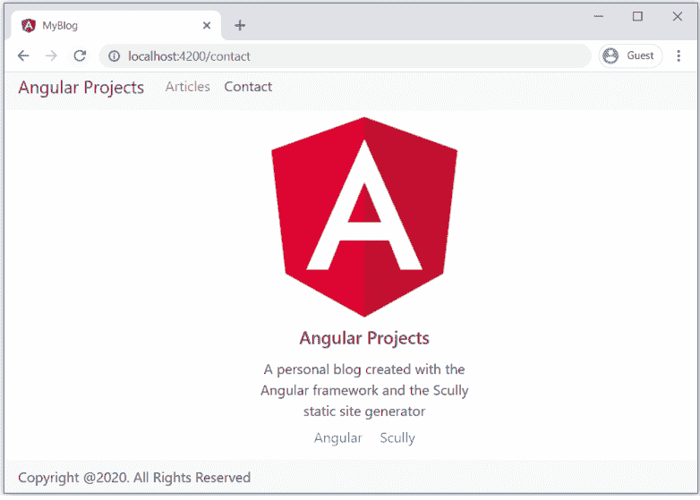

*图 2.3 – Contact 页面*

在下一节中，我们将为博客页眉中的 **Articles** 链接构建相应功能。

## 添加 articles 页面

负责在博客中显示文章的功能将由 articles 模块实现。它还将负责连接 Angular 和 Scully。我们将使用 Angular CLI 的 generate 命令创建该模块：

```
ng generate module articles --route=articles --module=app-routing
```

在前面的命令中，我们传入了一些额外的路由选项：

+   - `--route`：定义功能的 URL 路径
+   - `--module`：指定将定义用于激活该功能的路由配置对象的路由模块

执行该命令时，Angular CLI 除了创建模块之外，还会执行以下操作：

+   - 在 `src\\app\\articles` 文件夹中创建一个路由组件，该组件默认会由路由导航对象激活。它是该功能的着陆页，并将显示博客文章列表，具体内容将在 *在主页上显示博客数据* 一节中介绍。
+   - 创建一个名为 `articles-routing.module.ts` 的路由模块，其中包含 articles 模块的路由配置。
+   - 在主应用程序模块的路由配置中添加一个新的路由配置对象，用于激活 articles 模块。

`articles-routing.module.ts` 文件包含 articles 模块的路由配置：

### articles-routing.module.ts

```
import { NgModule } from '@angular/core';
import { RouterModule, Routes } from '@angular/router';
import { ArticlesComponent } from './articles.component';

const routes: Routes = [{ path: '', component: ArticlesComponent }];

@NgModule({
  imports: [RouterModule.forChild(routes)],
  exports: [RouterModule]
})
export class ArticlesRoutingModule { }
```

前面介绍的方法称为**懒加载**，可以改善 Angular 应用程序的启动速度和整体性能。它会为每个懒加载模块创建一个单独的软件包，并在需要时加载，从而减小最终软件包的大小并降低应用程序的内存消耗。现在，让我们将新路由连接到 header 组件：

+   1. 打开 `header.component.html` 文件，并将以下 `routerLink` 和 `routerLinkActive` 指令添加到 Articles 锚点 HTML 元素中：
+   
+   ```html
+   <li class="nav-item">
+       <a routerLink="/articles" routerLinkActive="active"
+          class="nav-link">Articles</a>
+   </li>
+   ```
+   
+   2. 运行 `ng serve`，并使用你喜欢的浏览器预览应用程序。
+   3. 打开浏览器的开发者工具，点击 **Articles** 链接，然后检查 **Network** 选项卡：

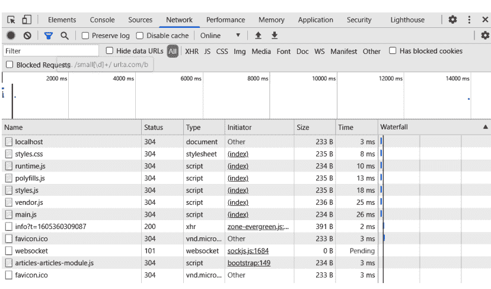

在其他请求中，你应该会看到一个名为 **articles-articles-module.js** 的请求。它就是在点击 **Articles** 链接时加载的懒加载 articles 模块的软件包。

现在，我们已经准备好将这个出色的 Angular 应用程序转换为专业的博客网站了。在继续之前，让我们向 `app-routing.module.ts` 文件添加一些其他路由：

```
```typescript
const routes: Routes = [
  { path: 'contact', component: ContactComponent },
  { path: 'articles', loadChildren: () =>
      import('./articles/articles.module').then(m =>
      m.ArticlesModule) },
  { path: '', pathMatch: 'full', redirectTo: 'articles' },
  { path: '**', redirectTo: 'articles' }
];
```
```

我们添加了一个默认路由，以便博客用户访问博客时自动重定向到 `articles` 路径。此外，我们还创建了一个新的路由配置对象，并将其 path 设置为 `**`，该路由同样会导航到 `articles` 路径。`**` 语法称为**通配符路由**，当路由器无法将请求的 URL 与已定义的路由匹配时，就会触发该路由。

> **提示**
> 
> 先定义最具体的路由，然后再添加默认路由和通配符路由等通用路由。Angular 路由器会按照我们定义的顺序解析路由配置，并遵循 *第一个匹配项获胜* 的策略来选择路由。

我们已经在 Angular 应用程序中启用并配置了路由。在下一节中，我们将建立向应用程序添加博客功能所需的基础设施。

## 使用 Scully 添加博客功能

目前，我们的应用程序还没有任何与博客文章相关的特定逻辑。它只是一个使用路由的典型 Angular 应用程序。不过，通过添加路由配置，我们已经为使用 Scully 添加博客支持奠定了基础。

> **重要提示**
> 
> Scully 至少需要在 Angular 应用程序中定义一个路由，才能正常工作。

首先，我们需要在应用程序中安装 Scully。


## 安装 Scully 库

我们将使用 Angular CLI 的 add 命令在 Angular 应用中安装 Scully：

```
ng add @scullyio/init
```

上述命令会下载并安装所有必要的 npm 包，使 Scully 能够在我们的 Angular 应用中正常工作。它还会修改 Angular 项目的结构，以满足其特定需求。

它会在我们的主应用模块中导入 `ScullyLibModule`：

### app.module.ts

```typescript
import { NgModule } from '@angular/core';
import { BrowserModule } from '@angular/platform-browser';

import { AppRoutingModule } from './app-routing.module';
import { AppComponent } from './app.component';
import { ContactModule } from './contact/contact.module';
import { CoreModule } from './core/core.module';
import { SharedModule } from './shared/shared.module';
import { ScullyLibModule } from '@scullyio/ng-lib';

@NgModule({
  declarations: [
    AppComponent
  ],
  imports: [
    BrowserModule,
    AppRoutingModule,
    CoreModule,
    SharedModule,
    ContactModule,
    ScullyLibModule
  ],
  providers: [],
  bootstrap: [AppComponent]
})
export class AppModule { }
```

ScullyLibModule 是 Scully 库的主模块，其中包含 Scully 所需的各种 Angular 服务和指令。

它还会在 Angular CLI 工作区的根文件夹中为 Scully 库创建一个配置文件：

### scully.my-blog.config.ts

```typescript
import { ScullyConfig } from '@scullyio/scully';
export const config: ScullyConfig = {
  projectRoot: "./src",
  projectName: "my-blog",
  outDir: './dist/static',
  routes: {
  }
};
```

配置文件包含关于我们 Angular 应用的信息，Scully 在后续过程中会用到这些信息：

- projectRoot：包含 Angular 应用源代码的路径
- projectName：Angular 应用的名称
- outDir：Scully 生成文件的输出路径

> **重要提示**
>
> Scully 的输出路径必须与 Angular CLI 输出 Angular 应用包的路径不同。后者可以在 `angular.json` 文件中配置。

- routes：它包含用于访问我们博客文章的路由配置。Scully 会自动填充它，我们将在下一节中看到。

既然我们已经在 Angular 应用中成功安装了 Scully，现在可以配置它来初始化我们的博客了。

## 初始化我们的博客页面

Scully 提供了一个特定的 Angular CLI 原理图（schematic），用于通过 Markdown（`.md`）文件初始化 Angular 应用（如博客）：

```
ng generate @scullyio/init:markdown
```

上述命令将通过一系列问题来启动我们博客的配置过程（括号内显示的是默认值）：

1. 输入 `posts` 作为博客模块的名称：

   ```
   ? What name do you want to use for the module? (blog)
   ```

   *图 2.5 – 博客模块名称*

   这将创建一个名为 `posts` 的新 Angular 模块。

2. 将 slug 选项留空，然后按 Enter 接受默认值：

   ```
   ? What slug do you want for the markdown file? (id)
   ```

   *图 2.6 – Markdown slug*

   slug 是每篇文章的唯一标识符，它定义在模块的路由配置对象中。

3. 输入 `mdfiles` 作为 Scully 用来存储我们实际博客文章文件的路径：

   ```
   ? Where do you want to store your markdown files?
   ```

   *图 2.7 – Markdown 文件路径*

   这将在我们 Angular CLI 项目的根路径下创建一个 `mdfiles` 文件夹。默认情况下，它还会为我们创建一个博客文章。我们将在“在主页上显示博客数据”一节中学习如何创建我们自己的博客文章。

4. 输入 `posts` 作为访问我们博客文章的路由名称：

   ```
   ? Under which route do you want your files to be requested?
   ```

   *图 2.8 – 博客路由名称*

   路由名称是即将创建的路由配置对象的 `path` 属性。

在执行上述命令时，Scully 会执行多种操作，包括创建 posts 模块的路由配置：

### posts-routing.module.ts

```typescript
import {NgModule} from '@angular/core';
import {Routes, RouterModule} from '@angular/router';

import {PostsComponent} from './posts.component';

const routes: Routes = [
  {
    path: ':id',
    component: PostsComponent,
  },
  {
    path: '**',
    component: PostsComponent,
  }
];

@NgModule({
  imports: [RouterModule.forChild(routes)],
  exports: [RouterModule],
})
export class PostsRoutingModule {}
```

第一条路由的路径设置为 `:id`，并激活 `PostsComponent`。冒号字符表示 `id` 是一个路由参数。`id` 参数与前面在 Scully 配置中定义的 slug 属性相关。Scully 的工作方式是为我们创建的每篇博客文章生成一条路由。它使用 posts 模块和主应用模块的路由配置来构建 Scully 配置文件中的 `routes` 属性：

```javascript
routes: {
  '/posts/:id': {
    type: 'contentFolder',
    id: {
      folder: "./mdfiles"
    }
  }
}
```

PostsComponent 是用于渲染每篇博客文章详细信息的 Angular 组件。该组件的模板文件可以根据你的需求进一步自定义：

### posts.component.html

```html
<h3>ScullyIo content</h3>
<hr>

<!-- This is where Scully will inject the static HTML -->
<scully-content></scully-content>
<hr>
<h4>End of content</h4>
```

你可以自定义上述模板文件中的所有内容，除了 `<scully-content></scully-content>` 这一行，该行由 Scully 内部使用。

至此，我们已经在 Angular 应用中完成了 Scully 的安装和配置。现在是时候进行项目的最后一部分了！在下一节中，我们将让 Angular 与 Scully 协作，在 Angular 应用中显示博客文章。

## 在主页上显示博客文章

我们希望用户在进入我们的博客网站后，立即看到可用博客文章的列表。根据我们定义的默认路由路径，`ArticlesComponent` 是我们博客的着陆页。Scully 提供了 `ScullyRoutesService`，这是一个 Angular 服务，我们可以在组件中使用它来获取 Scully 将根据博客文章创建的路由信息。让我们在着陆页上使用这个服务：

1. 导航到 `articles.component.ts` TypeScript 类文件。
2. 从 `@scullyio/ng-lib` 包中导入 `ScullyRoute` 和 `ScullyRoutesService`：

   ```typescript
   import { ScullyRoute, ScullyRoutesService } from '@scullyio/ng-lib';
   ```

3. 在 `ArticlesComponent` 类的构造函数中注入 `ScullyRoutesService`：

   ```typescript
   constructor(private scullyService: ScullyRoutesService) {
   }
   ```

4. 创建一个 `ScullyRoute` 数组类型的组件属性：

   ```typescript
   posts: ScullyRoute[] = [];
   ```

5. 编辑组件的 `ngOnInit` 方法并添加以下代码：

   ```typescript
   ngOnInit(): void {
       this.scullyService.available$.subscribe(posts => {
           this.posts = posts.filter(post => post.title);
       });
   }
   ```

6. 打开 `articles.component.html` 文件并添加以下 HTML 代码：

   ```html
   <div class="list-group mt-3">
       <a *ngFor="let post of posts"
           [routerLink]="post.route" class="list-group-item
           list-group-item-action">
           <div class="d-flex w-100 justify-content-between">
               <h5 class="mb-1">{{post.title}}</h5>
           </div>
           <p class="mb-1">{{post.description}}</p>
       </a>
   </div>
   ```

前面的步骤涉及许多 Angular 技术，让我们逐一拆解。

当我们在组件中需要使用 Angular 服务时，只需向 Angular 框架请求它即可。怎么做？通过将它作为组件构造函数中的一个属性添加进去。组件不需要了解该服务是如何实现的。

`ngOnInit` 方法是 `OnInit` 接口的一部分，我们的组件实现了该接口。当组件被初始化时，Angular 框架会调用它，并为我们提供了一个钩子，用于添加要执行的自定义逻辑。


> **提示**
> 
> 为组件提供初始化逻辑的 Angular 服务应在 `ngOnInit` 方法中调用，*而不是*在构造函数中调用，因为在对组件进行单元测试时，更容易为这些服务提供模拟对象。

`ScullyRoutesService` 的 `available$` 属性被称为**可观察对象**。要获取它的值，我们需要订阅它。返回的 `posts` 变量将包含 Scully 生成的所有可用路由。Scully 会针对我们 Angular 应用程序的所有路由运行。为了避免显示与博客文章无关的路由（例如联系页面路由），我们会从 `available$` 属性的结果中过滤掉这些内容。

当我们订阅一个可观察对象时，需要在组件不再存在时取消订阅。否则，我们的 Angular 应用程序可能会出现内存泄漏。让我们看看如何使用组件的另一个生命周期钩子 `ngOnDestroy` 来完成这项任务：

- 1. 在 `ArticlesComponent` 类中声明一个 `Subscription` 类型的私有 `routeSub` 属性。`Subscription` 可以从 `rxjs` npm 包中导入。
- 2. 将 `available$` 可观察对象返回的值赋给 `routeSub` 属性。
- 3. 将 `OnDestroy` 接口添加到组件实现的接口列表中。`OnDestroy` 可以从 `@angular/core` npm 包中导入。它在组件被销毁时执行，此时组件不再渲染在屏幕上。
- 4. 实现 `ngOnDestroy` 方法，并在方法体中调用 `routeSub` 属性的 `unsubscribe` 方法。

组件的最终 TypeScript 文件应如下所示：

### articles.component.ts

```typescript
import { Component, OnInit, OnDestroy } from '@angular/core';
import { ScullyRoute, ScullyRoutesService } from '@scullyio/ng-lib';
import { Subscription } from 'rxjs';

@Component({
  selector: 'app-articles',
  templateUrl: './articles.component.html',
```

- 2. 执行以下 npm 命令来构建 Scully 并生成我们的博客路由：

```
npm run scully
```

上述命令将在 src\assets 文件夹中创建一个 scully-routes.json 文件。它包含我们 Angular 应用程序的路由，是 Scully 运行时所需要的。

> **提示**
> 首次运行 Scully 可执行文件时，它会提示你收集匿名错误以改进其服务。

- 3. 运行以下 npm 命令来为我们的博客提供服务：

```
npm run scully:serve
```

上述命令将启动两个 Web 服务器：一个包含使用 Scully 构建的我们网站的静态预渲染版本，另一个是我们应用程序的 Angular 实时版本：

```
using plugins from folder "./scully"
* starting static server
Angular distribution server started on "http://localhost:1864/"
Scully static server started on "http://localhost:1668/"
```

图 2.9 —— 为我们的应用程序提供服务

如果我们打开浏览器并导航到 http://localhost:1668，我们将看不到任何博客文章。这是为什么呢？

使用 Scully 创建的博客文章*除非*我们发布它，否则不会在 `ScullyRoutesService` 的 `available$` 属性中返回。要发布博客文章，我们需要执行以下操作：

- 1. 导航到 Scully 创建的 mdfiles 文件夹，打开你唯一能找到的 .md 文件。文件名和内容可能与你的文件不同，因为它基于 Scully 的创建日期：

```
---
title: 2020-11-15-posts
description: 'blog description'
published: false
```

```
slugs:
  - ___UNPUBLISHED___ khm71wkh_hIzSmrBDHceuWrDrqgTnY8qCwvurkxdT
---

# 2020-11-15-posts
```

Scully 在文件顶部闭合和结束的 --- 行之间定义了一组属性，代表博客文章的元数据。你也可以以键值对的形式添加自己的属性。

2. 删除 slugs 属性，并将 published 属性设置为 true：

```
---
title: 2020-11-15-posts
description: 'blog description'
published: true
---

# 2020-11-15-posts
```

> 提示
> 如果你不想手动发布文章，Scully 支持自动发布博客文章。你可以在元数据中使用保留的 publishDate 属性来定义你希望发布博客文章的日期，Scully 会完成其余工作。

3. 运行以下命令，强制 Scully 重新生成我们应用程序的路由：

```
npm run scully
```

每次我们对博客相关文件进行更改时，都需要执行上述命令。

4. 执行 npm run scully:serve 命令并导航到预览生成的网站。

现在我们可以看到一篇博客文章，即我们安装 Scully 时创建的默认文章。让我们再创建一篇：

- 1. 运行 Angular CLI 的以下生成命令：

```
ng generate @scullyio/init:post --name="Angular and Scully"
```

在上述命令中，我们使用 @scullyio/init:post 原理图，并将要创建的文章名称作为选项传入。

- 2. 将新博客文章的目标文件夹设置为 mdfiles：

? What's the target folder for this post? (blog)

图 2.10 —— 新博客文章的目标文件夹

- 3. Scully 将在指定文件夹中创建一个名为 angular-and-scully.md 的 Markdown 文件。打开该文件并将其内容更新为以下内容：

```
---
title: 'Angular and Scully'
description: 'How to build a blog with Angular and Scully'
published: true
---

# Angular and Scully
Angular is a robust JavaScript framework that we can use to build excellent and performant web applications.
Scully is a popular static website generator that empowers the Angular framework with Jamstack characteristics.
You can find more about them in the following links:

- https://angular.io
- https://scully.io
- https://www.jamstack.org
```

- 4. 运行 npm run scully 为新创建的博客文章创建路由。Scully 还会用新路由更新 scully-routes.json 文件。

如果我们现在预览应用程序，它应如下所示：

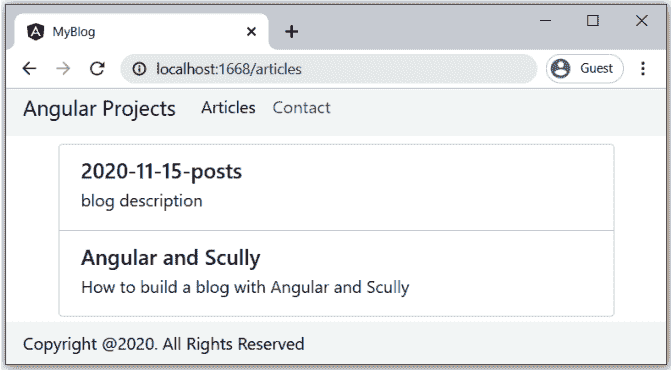

如果我们点击其中一篇博客文章，将导航到选中的博客文章。当前屏幕上显示的内容是博客文章路由的预渲染版本：

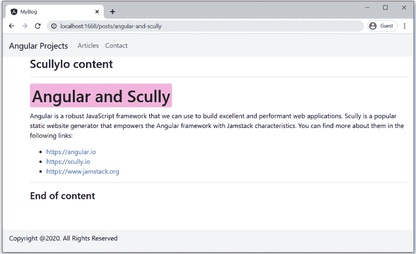

要验证这一点，请导航到 Angular 项目的 `dist` 文件夹，你会在其中找到两个文件夹：

- - `my-blog`：这包含我们应用程序的 Angular 实时版本。当我们执行 `ng build` Angular CLI 命令时，它会构建我们的应用程序并将打包文件输出到此文件夹中。
- - `static`：这包含我们运行 `npm run scully` 命令时由 Scully 生成的 Angular 应用程序的预渲染版本。

如果我们导航到 `static` 文件夹，会看到 Scully 为我们 Angular 应用程序的每个路由创建了一个文件夹。每个文件夹包含一个 `index.html` 文件，它代表从该路由激活的组件。`index.html` 文件的内容由 Scully 自动生成，其结果相当于我们实时运行应用程序并导航到该组件。

现在你可以获取你的 Angular 应用程序，将其上传到你选择的 CDN 或 Web 服务器，你很快就能拥有自己的博客了！届时你只需发挥你的写作技巧，创作出色的博客内容即可。

## 总结

在本章中，我们学习了如何将 Angular 框架与 Scully 库结合使用来创建个人博客。

我们了解了 Angular 如何使用内置的路由包为 Web 应用程序增强应用内导航。我们还学习了如何将 Angular 应用程序组织成模块，以及如何在这些模块之间导航。

我们使用 Scully 库将 Jamstack 引入到我们的 Angular 应用程序中，并看到了将应用程序转换为预渲染博客是多么容易。我们使用 Scully 界面创建了一些博客文章并将其显示在屏幕上。

在下一章中，我们将研究 Angular 框架的另一个令人兴奋的特性——表单。我们将学习如何使用它们并构建一个问题跟踪系统。


## 使用响应式表单构建问题跟踪系统

Web 应用程序使用 HTML 表单从用户收集数据并对其进行验证，例如登录应用程序、执行搜索或完成在线支付时。Angular 框架提供了两种类型的表单，即响应式表单和模板驱动表单，我们可以在 Angular 应用程序中使用它们。

在本章中，我们将构建一个用于管理和跟踪问题的系统。我们将使用 Angular 响应式表单来报告新问题。我们还将使用 VMware 的 **Clarity Design System** 来设计我们的表单并显示问题。

我们将涵盖以下主题：
- 向 Angular 应用程序安装 Clarity Design System
- 显示问题的概览
- 报告新问题
- 将问题标记为已解决
- 为新问题开启建议

## 基本背景理论和上下文

Angular 框架提供了两种可用的表单类型：
- **模板驱动：** 它们在 Angular 应用程序中设置起来简单直接。模板驱动表单扩展性不佳，并且难以测试，因为它们在组件模板中定义。
- **响应式：** 它们基于响应式编程方法。响应式表单在组件的 TypeScript 类中运行，并且比模板驱动表单更容易测试且扩展性更好。

在本章中，我们将亲手实践响应式表单方法，这是 Angular 社区中最流行的方法。

Angular 组件可以从外部源（如 HTTP）或从其他 Angular 组件获取数据。在后一种情况下，它们通过公共 API 与具有数据的组件交互：
- `@Input()`：用于将数据传递到组件。
- `@Output()`：用于获取有关更改的通知或从组件获取数据。

Clarity 是一个设计系统，其中包含构建 Web 应用程序的 UX 和 UI 指南的集合。它还包含一个包含这些指南的专有 HTML 和 CSS 框架。幸运的是，我们不必使用此框架，因为 Clarity 已经提供了各种基于 Angular 的 UI 组件，我们可以在 Angular 应用程序中使用它们。

## 项目概览

在该项目中，我们将使用响应式表单和 Clarity 构建一个用于管理和跟踪问题的 Angular 应用程序。最初，我们将在表中显示可排序和过滤的问题列表。然后，我们将创建一个表单以允许用户报告新问题。最后，我们将创建一个用于解决问题的模态对话框。我们还将更进一步，在报告问题时开启建议，以帮助用户避免重复条目。

构建时间：1 小时

## 开始

完成本项目需要以下软件工具：
- **Angular CLI**：Angular 的命令行界面，可在 https://angular.io/cli 找到
- **GitHub 材料**：本章的相关代码，可在 https://github.com/PacktPublishing/Angular-Projects-Second-Edition 的 Chapter03 文件夹中找到。

### 向 Angular 应用程序安装 Clarity

让我们开始创建问题跟踪系统，通过脚手架创建一个新的 Angular 应用程序：

```
ng new issue-tracker --defaults
```

我们使用 Angular CLI 的 ng new 命令创建具有以下特征的新 Angular 应用程序：
- issue-tracker：Angular 应用程序的名称。
- --defaults：这会禁用应用程序的 Angular 路由并将样式表格式设置为 CSS。

我们现在需要在 Angular 应用程序中安装 Clarity 库。VMware 团队创建了一个 Angular CLI schematic，我们可以使用它。导航到使用前一个命令创建的 issue-tracker 文件夹并运行以下 Angular CLI 的 add 命令：

```
ng add @clr/angular
```

前一个命令将在我们的 Angular CLI 工作区中执行以下修改：
- 1. 它会将 Clarity 库的所有必要 npm 包添加到 package.json 文件的 dependencies 部分。
- 2. 它会在 Angular CLI 工作区的配置文件 angular.json 中添加必要的样式：

```json
"styles": [
  "node_modules/@clr/ui/clr-ui.min.css",
  "src/styles.css"
]
```

3. 最后，它将在主应用程序模块 `app.module.ts` 中导入 `ClarityModule`：

```typescript
import { NgModule } from '@angular/core';
import { BrowserModule } from '@angular/platform-browser';

import { AppComponent } from './app.component';
import { ClarityModule } from '@clr/angular';
import { BrowserAnimationsModule } from '@angular/platform-browser/animations';

@NgModule({
  declarations: [
    AppComponent
  ],
  imports: [
    BrowserModule,
    ClarityModule,
    BrowserAnimationsModule
  ],
  providers: [],
  bootstrap: [AppComponent]
})
export class AppModule { }
```

它还将从 `@angular/platform-browser/animations` npm 包导入 `BrowserAnimationsModule`。`BrowserAnimationsModule` 用于在应用程序中发生特定操作时显示动画，例如单击按钮。

现在我们已完成在应用程序中安装 Clarity，我们可以开始使用它构建精美的设计。在下一节中，我们将首先创建一个用于显示问题的列表。

## 显示问题的概览

我们的 Angular 应用程序将负责管理和跟踪问题。当应用程序启动时，我们应该显示系统中所有待处理问题的列表。待处理问题定义为尚未解决的问题。我们将遵循的流程可以进一步分析为以下内容：
- 获取待处理问题
- 使用数据网格可视化问题

### 获取待处理问题

首先，我们需要创建一个用于获取所有待处理问题的机制：
- 1. 使用 Angular CLI 的 `generate` 命令创建一个名为 `issues` 的 Angular 服务：

```bash
ng generate service issues
```

前一个命令将在 Angular CLI 项目的 `src\app` 文件夹中创建 `issues.service.ts` 文件。
- 2. 每个问题都将具有特定类型的特定属性。我们需要为其创建一个 TypeScript 接口，使用以下 Angular CLI 命令：

```bash
ng generate interface issue
```

前一个命令将在项目的 `src\app` 文件夹中创建 `issue.ts` 文件。
- 3. 打开 `issue.ts` 文件并在 `Issue` 接口中添加以下属性：

```typescript
export interface Issue {
  issueNo: number;
  title: string;
  description: string;
  priority: 'low' | 'high';
  type: 'Feature' | 'Bug' | 'Documentation';
  completed?: Date;
}
```

completed 属性是问题被解决的日期。我们将其定义为可选，因为新问题不会设置此属性。

4. 打开我们在步骤 1 中创建的 Angular 服务并添加一个 `issues` 属性来保存我们的问题数据。还创建一个 `getPendingIssues` 方法，该方法将返回所有未完成的问题：

```typescript
import { Injectable } from '@angular/core';
import { Issue } from './issue';

@Injectable({
  providedIn: 'root'
})
export class IssuesService {

  private issues: Issue[] = [];

  constructor() { }

  getPendingIssues(): Issue[] {
    return this.issues.filter(issue =>
      !issue.completed;
  }

}
```

5. 我们将 `issues` 属性初始化为空数组。如果您想使用示例数据开始，可以使用本章 GitHub 材料中 `src\assets` 文件夹中存在的 `mock-issues.ts` 文件并按如下方式导入它：

```typescript
import { issues } from '../assets/mock-issues';
```

在下一节中，我们将创建一个用于显示这些问题的组件。

### 在数据网格中可视化问题

我们将使用 Clarity 库的 **数据网格** UI 组件以表格格式显示数据。数据网格还开箱即用地提供了过滤和排序机制。让我们首先创建将托管数据网格的 Angular 组件：
- 1. 使用 `generate` 命令的 Angular CLI 创建组件：

```bash
ng generate component issue-list
```


4. 创建一个名为 `getIssues` 的方法，它将调用注入服务的 `getPendingIssues` 方法并将其返回值保存在 `issues` 组件属性中：

```typescript
import { Component, OnInit } from '@angular/core';
import { Issue } from '../issue';
import { IssuesService } from '../issues.service';

@Component({
  selector: 'app-issue-list',
  templateUrl: './issue-list.component.html',
  styleUrls: ['./issue-list.component.css']
})
export class IssueListComponent implements OnInit {

  issues: Issue[] = [];

  constructor(private issueService: IssuesService) { }

  ngOnInit(): void {
  }

  private getIssues() {
    this.issues =
      this.issueService.getPendingIssues();
  }
}
```

5. 最后，在 `ngOnInit` 组件方法中调用 `getIssues` 方法，以便在组件初始化时获取所有待处理的 issues：

```typescript
ngOnInit(): void {
  this.getIssues();
}
```

我们已经在组件中实现了获取 issue 数据的过程。现在要做的就是在模板中显示它。打开 `issue-list.component.html` 文件并用以下 HTML 代码替换其内容：

### `issue-list.component.html`

```html
<clr-datagrid>
  <clr-dg-column [clrDgField]="'issueNo'"
    [clrDgColType]="'number'">Issue No</clr-dg-column>
  <clr-dg-column [clrDgField]="'type'">Type</clr-dg-column>
  <clr-dg-column [clrDgField]="'title'">Title</clr-dg-column>
  <clr-dg-column [clrDgField]="'description'">Description
    </clr-dg-column>
  <clr-dg-column [clrDgField]="'priority'">Priority
    </clr-dg-column>

  <clr-dg-row *clrDgItems="let issue of issues">
    <clr-dg-cell>{{issue.issueNo}}</clr-dg-cell>
    <clr-dg-cell>{{issue.type}}</clr-dg-cell>
    <clr-dg-cell>{{issue.title}}</clr-dg-cell>
    <clr-dg-cell>{{issue.description}}</clr-dg-cell>
    <clr-dg-cell>
      <span class="label" [class.label-danger]="issue.priority === 'high'">{{issue.priority}}</span>
    </clr-dg-cell>
  </clr-dg-row>

  <clr-dg-footer>{{issues.length}} issues</clr-dg-footer>
</clr-datagrid>
```

在前面的代码片段中，我们使用了 Clarity 库的多个 Angular 组件：

- `clr-datagrid`：定义一个表格。
- `clr-dg-column`：定义表格的一列。每个列都使用 `clrDgField` 指令绑定到该列所代表的 issue 的属性名。`clrDgField` 指令为我们提供了排序和过滤功能，而无需在 TypeScript 类文件中编写哪怕一行代码。排序仅对基于字符串的内容自动生效。如果我们想按其他原始类型排序，则必须使用 `clrDgColType` 指令并指定特定类型。
- `clr-dg-row`：定义表格的一行。它使用 `clrDgItems` 指令遍历 issues 并为每个 issue 创建一行。
- `clr-dg-cell`：每一行都包含一组 `clr-dg-cell` 组件，用于通过插值显示每个列的值。在最后一个单元格中，当 issue 的优先级为高时，我们添加 `label-danger` 类以表明其重要性。
- `clr-dg-footer`：定义表格的页脚。在此情况下，它显示 issues 的总数。

如果我们使用 `ng serve` 运行 Angular 应用程序，输出将如下所示：

| Issue No | Type | Title | Description | Priority |
|---|---|---|---|---|
| 1 | Feature | Add email validation in registration form | Validate the email entered in the user registration form | high |
| 2 | Feature | Display the address details of a customer | Add a column to display the details of the customer address in the customer list | low |
| 3 | Bug | Export to CSV is not working | The export process of a report into CSV format throws an error | high |
| 4 | Feature | Locale settings per user | Add settings to configure the locale of the current user | low |
| 5 | Documentation | Add new customer tutorial | Create a tutorial on how to add a new customer into the application | high |
|  |  |  |  | 5 issues |

图 3.1 – 待处理 issues 概览

> **重要说明**
>
> 在之前的截图中，应用程序使用了来自 `mock-issues.ts` 文件的示例数据。

Clarity 库的数据网格组件具有丰富的可用功能，可在我们的 Angular 应用程序中使用。在下一节中，我们将学习如何使用响应式表单来报告新的 issue。

## 报告新 issues

我们 issue 跟踪系统的核心功能之一是能够报告新的 issues。我们将使用 Angular 响应式表单来创建添加新 issues 的表单。该功能可进一步细分为以下任务：

- 在 Angular 应用程序中设置响应式表单
- 创建报告 issue 表单
- 在列表中显示新的 issue
- 验证 issue 的详细信息

让我们开始在 Angular 应用程序中引入响应式表单。

### 在 Angular 应用程序中设置响应式表单

响应式表单定义在 Angular 框架的 `@angular/forms` npm 包中：

1. 打开 `app.module.ts` 文件并导入 `ReactiveFormsModule`：

```typescript
import { ReactiveFormsModule } from '@angular/forms';
```

2. 将 `ReactiveFormsModule` 添加到 `@NgModule` 装饰器的 `imports` 数组中：

```typescript
@NgModule({
  declarations: [
    AppComponent,
    IssueListComponent
  ],
  imports: [
    BrowserModule,
    ClarityModule,
    BrowserAnimationsModule,
    ReactiveFormsModule
  ],
  providers: [],
  bootstrap: [AppComponent]
})
```

ReactiveFormsModule 包含我们与表单交互所需的所有 Angular 指令和服务，如下一节所述。

### 创建报告 issue 表单

现在我们已在 Angular 应用程序中引入了响应式表单，可以开始构建表单了：

1. 创建一个名为 `issue-report` 的新 Angular 组件：

```
ng generate component issue-report
```

2. 打开 `issue-report.component.ts` 文件并在 `IssueReportComponent` 类的构造函数中注入 `FormBuilder`：

```typescript
import { Component, OnInit } from '@angular/core';
import { FormBuilder } from '@angular/forms';

@Component({
  selector: 'app-issue-report',
  templateUrl: './issue-report.component.html',
  styleUrls: ['./issue-report.component.css']
})
export class IssueReportComponent implements OnInit {

  constructor(private builder: FormBuilder) { }

  ngOnInit(): void {
  }

}
```

FormBuilder 是一个 Angular 服务，我们用它以简便的方式构建响应式表单。

3. 声明一个 `issueForm` 属性，其类型为 `FormGroup`，并在 `ngOnInit` 方法中初始化它：

```typescript
import { Component, OnInit } from '@angular/core';
import { FormBuilder, FormGroup } from '@angular/forms';

@Component({
  selector: 'app-issue-report',
  templateUrl: './issue-report.component.html',
  styleUrls: ['./issue-report.component.css']
})
export class IssueReportComponent implements OnInit {

  issueForm: FormGroup | undefined;

  constructor(private builder: FormBuilder) { }

  ngOnInit(): void {
    this.issueForm = this.builder.group({
      title: [''],
      description: [''],
      priority: [''],
      type: ['']
    });
  }

}
```

FormGroup 用于将单个控件组合成表单的逻辑表示。`FormBuilder` 类的 `group` 方法用于构建表单。它接受一个对象作为参数，其中每个键是表单控件的唯一名称，每个值是一个包含其默认值 的数组。在此情况下，我们将所有控件初始化为空字符串，因为表单将用于从头创建新的 issue。

4. 现在我们需要将创建的 `FormGroup` 对象与相应的 HTML 元素关联。打开 `issue-report.component.html` 文件并用以下 HTML 代码替换其内容：

```html
<h3>Report an issue</h3>
<form clrForm *ngIf="issueForm" [formGroup]="issueForm">
  <clr-input-container>
    <label>Title</label>
```


```html
<input clrInput formControlName="title" />
</clr-input-container>
<clr-textarea-container>
  <label>描述</label>
  <textarea clrTextarea
            formControlName="description"></textarea>
</clr-textarea-container>
<clr-radio-container clrInline>
  <label>优先级</label>
  <clr-radio-wrapper>
    <input type="radio" value="low" clrRadio
           formControlName="priority" />
    <label>低</label>
  </clr-radio-wrapper>
  <clr-radio-wrapper>
    <input type="radio" value="high" clrRadio
           formControlName="priority" />
    <label>高</label>
  </clr-radio-wrapper>
</clr-radio-container>
<clr-select-container>
  <label>类型</label>
  <select clrSelect formControlName="type">
    <option value="Feature">功能</option>
    <option value="Bug">缺陷</option>
    <option value="Documentation">文档
    </option>
  </select>
</clr-select-container>
</form>
```

`formGroup` 和 `clrForm` 指令用于将 HTML 表单元素与 `issueForm` 属性关联，并将其标识为 Clarity 表单。

`formControlName` 指令用于通过名称将 HTML 元素与表单控件关联。每个控件还使用 Clarity 容器元素进行定义。例如，标题输入控件是一个 `clr-input-container` 组件，其中包含一个 input HTML 元素。

每个原生 HTML 元素都根据其类型附加了相应的 Clarity 指令。例如，`input` HTML 元素包含一个 `clrInput` 指令。

5. 最后，为 `issue-report.component.css` 文件添加一些样式：

```css
.clr-input, .clr-textarea {
  width: 30%;
}

button {
  margin-top: 25px;
}
```

现在我们已经创建了表单的基础部分，接下来我们将学习如何提交其详细信息：

1. 在 HTML 表单元素的结束标签*之前*添加一个 HTML button 元素：

```html
<button class="btn btn-primary" type="submit">创建</button>
```

我们将其类型设置为 submit，以便在点击按钮时触发表单提交。

2. 打开 `issues.service.ts` 文件，添加一个 `createIssue` 方法，将新问题插入到 `issues` 数组中：

```typescript
createIssue(issue: Issue) {
  issue.issueNo = this.issues.length + 1;
  this.issues.push(issue);
}
```

在将问题添加到 `issues` 数组之前，我们会自动为其分配一个新的 `issueNo`。

> **提示**
>
> `issueNo` 属性目前是根据 `issues` 数组的长度计算的。更好的做法是实现一个生成器机制，用于创建唯一且随机的 `issueNo` 值。

3. 返回 `issue-report.component.ts` 文件，导入 `IssuesService`，并将其注入到 TypeScript 类的构造函数中：

```typescript
constructor(private builder: FormBuilder, private issueService: IssuesService) { }
```

4. 添加一个新的组件方法，用于调用注入服务的 `createIssue` 方法：

```typescript
addIssue() {
  this.issueService.createIssue(this.issueForm?.value);
}
```

我们通过 `issueForm` 对象的 `value` 属性传递每个表单控件的值。

> **重要说明**
>
> `FormGroup` 对象的 `value` 属性包含表单的模型。该模型的键与 `Issue` 接口的属性名称相匹配，而 `Issue` 接口是 `createIssue` 方法作为参数接受的类型。如果两者不同，我们应在将表单模型传递给该方法之前对其进行转换。

5. 打开 `issue-report.component.html` 文件，将表单的 `ngSubmit` 事件绑定到 `addIssue` 组件方法：

```html
<form clrForm *ngIf="issueForm" [formGroup]="issueForm" (ngSubmit)="addIssue()">
```

当我们点击表单的“创建”按钮时，将触发 `ngSubmit` 事件。

现在我们已经完成了向系统添加新问题所涉及的所有流程。在下一节中，我们将学习如何在待处理问题表格中显示新创建的问题。

## 在列表中显示新问题

显示问题和创建新问题是委托给不同 Angular 组件的两项任务。当我们使用 `IssueReportComponent` 创建新问题时，需要通知 `IssueListComponent` 在表格中反映该更改。首先，让我们看看如何配置 `IssueReportComponent` 来传达该更改：

1. 打开 `issue-report.component.ts` 文件，使用 `@Output()` 装饰器添加一个 `EventEmitter` 属性：

```typescript
@Output() formClose = new EventEmitter();
```

`Output` 和 `EventEmitter` 符号可以从 `@angular/core` npm 包中导入。

2. 在 addIssue 组件方法中，创建问题之后立即调用 formClose 输出属性的 emit 方法：

```typescript
addIssue() {
  this.issueService.createIssue(this.issueForm?.value);
  this.formClose.emit();
}
```

3. 在组件模板中添加第二个 HTML button 元素，并在其点击事件上调用 emit 方法：

```html
<button class="btn btn-primary" type="submit">创建</button>
<button class="btn" type="button" (click)="formClose.emit()">取消</button>
```

现在，IssueListComponent 可以绑定到 IssueReportComponent 的 formClose 事件，并在点击任一按钮时收到通知。让我们来了解具体方法：

1. 打开 `issue-list.component.ts` 文件，在 `IssueListComponent` 类中添加以下属性：

```typescript
showReportIssue = false;
```

showReportIssue 属性将切换报告问题表单的显示状态。

2. 添加以下组件方法，当报告问题表单发出 formClose 事件时将调用该方法：

```typescript
onCloseReport() {
  this.showReportIssue = false;
  this.getIssues();
}
```

onCloseReport 方法会将 showReportIssue 属性设置为 false，以便报告问题表单不再可见，并改为显示待处理问题表格。它还会再次获取问题以刷新表格中的数据。

3. 打开 `issue-list.component.html` 文件，在模板顶部添加一个 HTML button 元素。点击该按钮时将显示报告问题表单：

```html
<button class="btn btn-primary" (click)="showReportIssue = true">添加新问题</button>
```

4. 将按钮和数据网格组合在一个 `ng-container` 元素内。如 `*ngIf` Angular 指令所示，当报告问题表单不可见时，将显示 `ng-container` 元素的内容：

```html
<ng-container *ngIf="showReportIssue === false">
  <button class="btn btn-primary" (click)="showReportIssue = true">添加新问题</button>
  <clr-datagrid>
    <clr-dg-column [clrDgField]="'issueNo'" [clrDgColType]="'number'">问题编号</clr-dg-column>
    <clr-dg-column [clrDgField]="'type'">类型</clr-dg-column>
    <clr-dg-column [clrDgField]="'title'">标题</clr-dg-column>
    <clr-dg-column [clrDgField]="'description'">描述</clr-dg-column>
    <clr-dg-column [clrDgField]="'priority'">优先级</clr-dg-column>

    <clr-dg-row *clrDgItems="let issue of issues">
      <clr-dg-cell>{{issue.issueNo}}</clr-dg-cell>
      <clr-dg-cell>{{issue.type}}</clr-dg-cell>
      <clr-dg-cell>{{issue.title}}</clr-dg-cell>
      <clr-dg-cell>{{issue.description}}</clr-dg-cell>
      <clr-dg-cell>
        <span class="label" [class.label-danger]="issue.priority === 'high'">
          {{issue.priority}}</span>
      </clr-dg-cell>
    </clr-dg-row>

    <clr-dg-footer>{{issues.length}} 个问题</clr-dg-footer>
  </clr-datagrid>
</ng-container>
```

ng-container 元素是一个不会在屏幕上渲染的 Angular 组件，用于对 HTML 元素进行分组。

5. 在模板末尾添加 app-issue-report 组件，并使用 `*ngIf` 指令在 showReportIssue 属性为 true 时显示它。同时将其 formClose 事件绑定到 onCloseReport 组件方法：

```html
<app-issue-report *ngIf="showReportIssue == true" (formClose)="onCloseReport()"></app-issue-report>
```

我们已经成功地将所有环节连接起来，并完成了报告问题表单与显示问题表格之间的交互。现在是时候让它们发挥作用了：

1. 使用 `ng serve` 运行 Angular 应用程序。
2. 点击 **ADD NEW ISSUE** 按钮并输入新问题的详细信息：

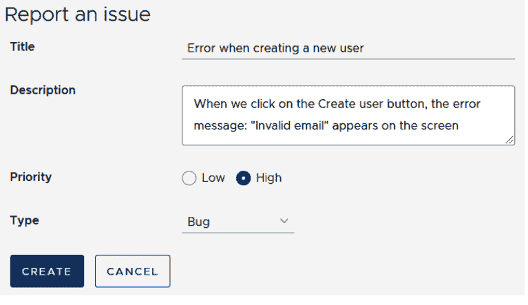

图 3.2 – 报告问题表单


## 校验问题详情

当我们使用问题报告表单创建问题时，由于尚未添加任何校验规则，表单控件的值可以为空。要在表单控件中添加校验，我们使用 `@angular/forms` npm 包中的 `Validators` 类。校验器会被添加在使用 `FormBuilder` 服务构建的每个表单控件实例中。在本例中，我们将使用 `required` 校验器来指示某个表单控件必须有值：

- 1. 打开 `issue-report.component.ts` 文件，并从 `@angular/forms` npm 包中导入 `Validators`：

```
import { FormBuilder, FormGroup, Validators } from
'@angular/forms';
```

- 2. 在除问题描述之外的所有控件中设置 `Validators.required` 静态属性：

```
ngOnInit(): void {
  this.issueForm = this.builder.group({
    title: ['', Validators.required],
    description: [''],
    priority: ['', Validators.required],
    type: ['', Validators.required]
  });
}
```

我们可以为表单控件使用各种校验器，例如 `min`、`max` 和 `email`。如果想在一个表单控件中设置多个校验器，可以将它们放在一个数组中。

- 3. 在表单中使用校验器时，我们需要为用户提供视觉提示。打开 `issue-report.component.html` 文件，并为每个必填的表单控件添加一个 `clr-control-error` 组件：

```html
<clr-input-container>
  <label>Title</label>
  <input clrInput formControlName="title" />
  <clr-control-error>Title is required
  </clr-control-error>
</clr-input-container>
<clr-textarea-container>
  <label>Description</label>
  <textarea clrTextarea formControlName="description">
  </textarea>
</clr-textarea-container>
<clr-radio-container clrInline>
  <label>Priority</label>
  <clr-radio-wrapper>
    <input type="radio" value="low" clrRadio
      formControlName="priority" />
    <label>Low</label>
  </clr-radio-wrapper>
  <clr-radio-wrapper>
    <input type="radio" value="high" clrRadio
      formControlName="priority" />
    <label>High</label>
  </clr-radio-wrapper>
  <clr-control-error>Priority is required
  </clr-control-error>
</clr-radio-container>
<clr-select-container>
  <label>Type</label>
  <select clrSelect formControlName="type">
    <option value="Feature">Feature</option>
    <option value="Bug">Bug</option>
```

**标题**输入框下方应出现一条消息，提示我们尚未输入任何值。Clarity 库中的校验消息以文本和红色感叹号图标的形式显示在被校验的表单控件中。

- 6. 现在，点击**创建**按钮：

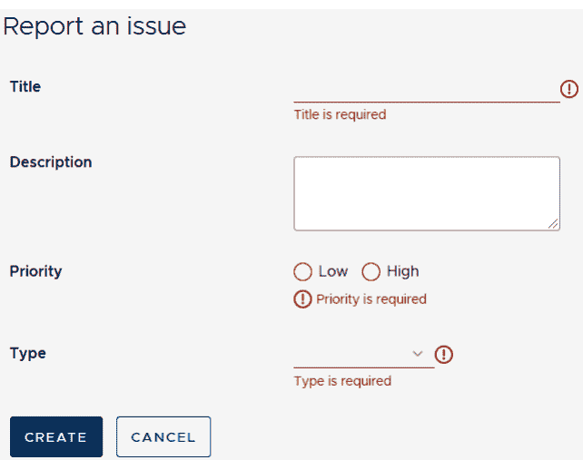

图 3.5 – 表单校验消息

所有校验消息将同时显示在屏幕上，并且表单不会被提交。响应式表单中的校验是确保我们的 Angular 应用具有流畅用户体验的重要组成部分。在下一节中，我们将学习如何使用 Clarity 创建模态对话框，并用它来解决列表中的问题。

## 解决问题

问题跟踪系统的主要思想是问题应该在某个时刻得到解决。我们将在应用中创建一个用户工作流来完成此任务。我们将能够直接从待处理问题列表中解决问题。应用将通过模态对话框在解决前请求用户确认：

- 1. 创建一个 Angular 组件来承载对话框：

```
ng generate component confirm-dialog
```

- 2. 打开 `confirm-dialog.component.ts` 文件，并在 `ConfirmDialogComponent` 类中创建以下输入和输出属性：

```
import { Component, EventEmitter, Input, Output } from '@angular/core';

@Component({
  selector: 'app-confirm-dialog',
  templateUrl: './confirm-dialog.component.html',
  styleUrls: ['./confirm-dialog.component.css']
})
export class ConfirmDialogComponent {
  @Input() issueNo: number | null = null;
  @Output() confirm = new EventEmitter<boolean>();
}
```

我们将使用 `@Input()` 装饰器获取问题编号，并将其显示在组件的模板上。`confirm` 的 `EventEmitter` 属性将发出一个布尔值，以指示用户是否确认解决问题。

- 3. 创建两个方法，它们将以 `true` 或 `false` 调用 `confirm` 输出属性的 `emit` 方法：

```
agree() {
  this.confirm.emit(true);
  this.issueNo = null;
}

disagree() {
  this.confirm.emit(false);
  this.issueNo = null;
}
```

这两个方法都会将 `issueNo` 属性设置为 `null`，因为该属性还将控制模态对话框是否打开。因此，当用户同意或不同意解决问题时，我们都要关闭对话框。

我们已经设置了对话框组件的 TypeScript 类。现在让我们将其与模板连接起来。打开 `confirm-dialog.component.html` 文件并将其内容替换为以下内容：

### confirm-dialog.component.html

```html
<clr-modal [clrModalOpen]="issueNo !== null"
           [clrModalClosable]="false">
  <h3 class="modal-title">
    Resolve Issue #
    {{issueNo}}
  </h3>
  <div class="modal-body">
    <p>Are you sure you want to close the issue?</p>
  </div>
  <div class="modal-footer">
    <button type="button" class="btn btn-outline"
            (click)="disagree()">Cancel</button>
    <button type="button" class="btn btn-danger"
            (click)="agree()">Yes, continue</button>
  </div>
</clr-modal>
```

Clarity 模态对话框由一个 `clr-modal` 组件和一组带有特定类的 HTML 元素组成：

- `modal-title`：对话框的标题，显示当前的问题编号。
- `modal-body`：对话框的主要内容。
- `modal-footer`：对话框的页脚，通常用于为该对话框添加操作。我们目前添加了两个 HTML 按钮元素，并将其点击事件分别绑定到组件的 `agree` 和 `disagree` 方法上。

```
}

onCloseReport() {
  this.showReportIssue = false;
  this.getIssues();
}

onConfirm(confirmed: boolean) {
  if (confirmed && this.selectedIssue) {
    this.issueService.completeIssue(this.selectedIssue);
    this.getIssues();
  }
  this.selectedIssue = null;
}

private getIssues() {
  this.issues = this.issueService.getPendingIssues();
}
}
```

只有在 `confirmed` 参数为 `true` 时，`onConfirm` 方法才会调用 `issueService` 属性的 `completeIssue` 方法。在这种情况下，它还会调用 `getIssues` 方法来刷新表格数据。`selectedIssue` 属性保存我们想要解决的问题对象，并且在调用 `onConfirm` 方法时会被重置。

- 3. 打开 `issue-list.component.html` 文件，并在 `clr-dg-row` 组件内添加一个操作溢出组件：

```
<clr-dg-row *clrDgItems="let issue of issues">
  <clr-dg-action-overflow>
    <button class="action-item" (click)="selectedIssue = issue">Resolve</button>
  </clr-dg-action-overflow>
  <clr-dg-cell>{{issue.issueNo}}</clr-dg-cell>
  <clr-dg-cell>{{issue.type}}</clr-dg-cell>
  <clr-dg-cell>{{issue.title}}</clr-dg-cell>
  <clr-dg-cell>{{issue.description}}</clr-dg-cell>
  <clr-dg-cell>
    <span class="label" [class.label-danger]="issue.priority === 'high'">{{issue.priority}}</span>
  </clr-dg-cell>
</clr-dg-row>
```

Clarity 的 `clr-dg-action-overflow` 组件会在表格的每一行中添加一个下拉菜单。该菜单包含一个按钮，点击后会将该行的当前问题设置为 `selectedIssue` 属性。

- 4. 最后，在模板末尾添加 `app-confirm-dialog` 组件：

```
<app-confirm-dialog *ngIf="selectedIssue"
[issueNo]="selectedIssue.issueNo"
(confirm)="onConfirm($event)"></app-confirm-dialog>
```

我们将 `selectedIssue` 属性的 `issueNo` 传递给对话框组件的输入绑定。我们使用 `?` 安全导航运算符来避免应用中出现错误，因为最初未选择任何问题，`issueNo` 属性不可用。

我们还将 `onConfirm` 组件方法绑定到 `confirm` 事件，以便在用户同意或不同意时收到通知。`$event` 参数是 Angular 中的保留关键字，包含事件绑定的结果，该结果取决于 HTML 元素的类型。在本例中，它包含确认的布尔结果。

我们已经将所有部分都整合到位来解决问题。让我们试一试：

- 1. 运行 `ng serve` 并在 http://localhost:4200 打开应用。
- 2. 如果没有任何问题，请使用“添加新问题”按钮创建一个。
- 3. 点击某一行的操作菜单并选择“解决”。该菜单是“问题编号”列旁边的三个垂直点图标：


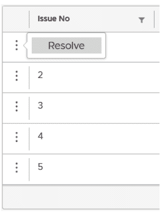

图 3.6 – 操作菜单

- 4. 在弹出的 **解决问题** 对话框中，点击 **是，继续** 按钮：


图 3.7 – 解决问题对话框

点击按钮后，对话框会关闭，该问题将不再显示在列表中。

我们为应用程序的用户提供了一种解决问题的方式。我们的问题跟踪系统现在已经完整，可以投入使用了！有时候，用户可能很匆忙，会报告一个已经报告过的问题。在下一节中，我们将学习如何利用高级响应式表单技术来帮助他们。

## 开启新问题建议

响应式表单 API 提供了一种机制，可以在某个表单控件的值发生变化时得到通知。我们将在应用程序中使用它，在报告新问题时查找相关问题。更具体地说，当用户开始在标题表单控件中键入内容时，我们将显示建议问题列表：

- 1. 打开 `issues.service.ts` 文件并添加以下方法：

```typescript
getSuggestions(title: string): Issue[] {
  if (title.length > 3) {
    return this.issues.filter(issue =>
      issue.title.indexOf(title) !== -1);
  }
  return [];
}
```

getSuggestions 方法将问题的标题作为参数，并搜索包含相同标题的任何问题。当 title 参数超过三个字符时，搜索机制会触发，以便将结果限制在合理的数量内。

- 2. 打开 `issue-report.component.ts` 文件并添加以下导入语句：

```typescript
import { Issue } from '../issue';
```

- 3. 创建一个新的组件属性来保存建议的问题：

```typescript
suggestions: Issue[] = [];
```

- 4. FormGroup 对象的 controls 属性包含所有表单控件，以键值对形式存储。键是控件的名称，值是对应的 AbstractControl 类型的实际表单控件对象。我们可以通过访问其名称（此处为 title）来获取表单控件值变化的通知，方式如下：

```typescript
ngOnInit(): void {
  this.issueForm = this.builder.group({
    title: ['', Validators.required],
    description: [''],
    priority: ['', Validators.required],
    type: ['', Validators.required]
  });
  this.issueForm.controls.title.valueChanges.subscribe((
    title: string) => {
      this.suggestions =
        this.issueservice.getSuggestions(title);
    });
  }
```

每个控件都暴露了一个 valueChanges 可观察对象，我们可以订阅它并持续获取值流。当用户开始在该表单的 title 控件中键入内容时，valueChanges 可观察对象会立即发出新值。此时，我们便将 getSuggestions 方法的返回值赋给 suggestions 组件属性。

- 5. 要在组件模板上显示建议的问题，打开 `issue-report.component.html` 文件，并在 `clr-input-container` 元素之后立即添加以下 HTML 代码：

```html
<div class="clr-row" *ngIf="suggestions.length">
  <div class="clr-col-lg-2"></div>
  <div class="clr-col-lg-6">
    <clr-stack-view>
      <clr-stack-header>Similar issues
      </clr-stack-header>
      <clr-stack-block *ngFor="let issue of
        suggestions">
        <clr-stack-label>#{{issue.issueNo}}:
          {{issue.title}}</clr-stack-label>
        <clr-stack-content>{{issue.description}}
        </clr-stack-content>
      </clr-stack-block>
    </clr-stack-view>
  </div>
</div>
```

我们使用 Clarity 库中的 `clr-stack-view` 组件来以键值对表示形式显示建议的问题。键由 `clr-stack-header` 组件表示，显示问题的标题和编号。值由 `clr-stack-content` 组件表示，显示问题的描述。

> **重要提示**
> 
> 我们仅在存在可用的建议问题时才显示类似问题。

运行 `ng serve`，打开报告问题表单以创建新问题。当你在 **标题** 输入框中开始键入时，应用程序会建议与你尝试创建的问题相关的任何问题：

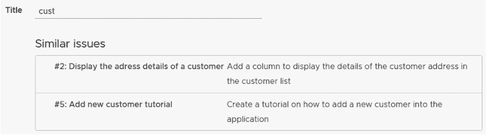

*图 3.8 – 类似问题*

现在，用户可以看到是否存在类似问题，从而避免报告重复问题。

## 总结

在本章中，我们使用响应式表单和 Clarity 设计系统构建了一个用于管理和跟踪问题的 Angular 应用程序。

首先，我们为 Angular 应用程序安装了 Clarity，并使用数据网格组件显示待处理问题列表。然后，我们介绍了响应式表单，并使用它们构建了一个用于报告新问题的表单。我们在表单中添加了验证，以让用户直观地看到必填字段，并防止不需要的行为。

如果用户无法解决问题，问题跟踪系统的效率就不高。我们使用 Clarity 构建了一个模态对话框来解决选定的问题。最后，我们通过在报告新问题时建议相关问题，改善了应用程序的用户体验。

在下一章中，我们将使用 Angular Service Worker 构建一个用于天气的渐进式 Web 应用程序。

我们将详细介绍以下主题：

- 设置 OpenWeather API
- 显示天气数据
- 使用 Service Worker 启用离线模式
- 通过应用内通知保持最新状态
- 使用 **Firebase** 托管部署应用

## 必要的背景理论和上下文

传统 Web 应用程序通常托管在 Web 服务器上，任何用户在任何给定时间都可以立即访问。原生应用程序安装在用户设备上，可以访问其原生资源，并且可以在任何网络下无缝工作。PWA 应用程序介于 Web 和原生应用两个世界之间，兼具两者的特征。一个 PWA 应用程序是一种 Web 应用程序，基于以下支柱转变为原生应用：

- **功能强大：** 它可以访问本地保存的数据，并与连接到用户设备的外围硬件交互。
- **可靠：** 它可以在任何网络连接中保持相同的性能和体验，即使在连接覆盖较差的区域也是如此。
- **可安装：** 它可以安装在用户设备上，可以直接从主屏幕启动，并与其他已安装的原生应用程序交互。

将 Web 应用程序转换为 PWA 涉及多个步骤和技术。最核心的一步是配置 Service Worker。Service Worker 是在 Web 浏览器中运行的一种机制，充当应用程序与外部 HTTP 端点或其他应用内资源（如 JavaScript 和 CSS 文件）之间的代理。Service Worker 的主要工作是拦截对这些资源的请求，并通过提供缓存响应或实时响应来处理它们。

> **重要提示**
> 
> 浏览器标签页关闭后，Service Worker 仍然存在。

Angular 框架提供了一个 Service Worker 实现，我们可以用它来将 Angular 应用程序转换为 PWA。

我们需要先获取 API 密钥，然后才能开始使用 OpenWeather API：

- 1. 访问 OpenWeather API 网站：https://openweathermap.org/api。
  
  你会看到 OpenWeather 团队提供的所有可用 API 列表。
- 2. 找到标题为 **当前天气数据** 的部分，点击 **订阅** 按钮。
  
  你将被重定向到包含该服务可用定价方案的页面。每种方案都支持每分钟和每月不同组合的 API 调用次数。对于这个项目，我们将使用 **免费** 层级。
- 3. 点击 **获取 API 密钥** 按钮。
  
  你将被重定向到该服务的注册页面。
- 4. 填写所有必需的详细信息，然后点击 **创建账户** 按钮。
  
  一条确认消息将发送到你创建账户时使用的电子邮件地址。
- 5. 查找确认邮件，点击 **验证你的电子邮件** 按钮以完成注册。
  
  你很快会收到来自 OpenWeather 的另一封邮件，其中包含当前订阅的详细信息，包括你的 API 密钥以及我们将用于与 API 通信的 HTTP 端点。

> **重要提示**
> 
> API 密钥可能需要一段时间才能激活，通常要几个小时，之后你才能使用它。

API 密钥激活后，我们就可以在 Angular 应用程序中使用它了。我们将在下一节中学习如何做到这一点。


## 显示天气数据

在本节中，我们将创建一个 Angular 应用程序来显示某个城市的天气信息。用户将在输入框中输入城市名称，应用程序将使用 OpenWeather API 获取指定城市的天气数据。我们将更详细地介绍以下主题：

- 搭建 Angular 应用程序
- 与 OpenWeather API 通信
- 显示某个城市的天气信息

让我们先在下一节中创建 Angular 应用程序。

## 搭建 Angular 应用程序

我们将使用 Angular CLI 的 `ng new` 命令从头创建一个新的 Angular 应用程序：

```
ng new weather-app --style=scss --routing=false
```

上述命令将创建一个具有以下属性的新 Angular CLI 应用程序：

- `weather-app`：Angular 应用程序的名称
- `--style=scss`：表示我们的 Angular 应用程序将使用 SCSS 样式表格式
- `--routing=false`：在应用程序中禁用 Angular 路由

用户应该能够在输入框中输入城市名称，并且该城市的天气信息应以卡片布局可视化展示。**Angular Material** 库提供了一组 Angular UI 组件，包括输入框和卡片，可供我们使用。

Angular Material 组件遵循 Material Design 原则，并由 Angular 的组件团队维护。我们可以使用 Angular CLI 的以下命令安装 Angular Material：

```
ng add @angular/material --theme=indigo-pink --typography=true
--animations=true
```

上述代码使用了 Angular CLI 的 `ng add` 命令，并传递了额外的配置选项：

- `@angular/material`：Angular Material 库的 npm 包名称。它还会安装 `@angular/cdk` 包，这是一组用于构建 Angular Material 的行为和交互。这两个包都会被添加到应用程序 `package.json` 文件的依赖项部分。
- `--theme=indigo-pink`：我们想要使用的 Angular Material 主题名称。添加主题涉及修改 Angular CLI 工作区的多个文件。它会将 CSS 主题文件的条目添加到 `angular.json` 配置文件中：

```
./node_modules/@angular/material/prebuilt-themes/indigo-
pink.css
```

它还会在 `index.html` 文件中包含 Material Design 图标：

```
<link href="https://fonts.googleapis.com/
icon?family=Material+Icons" rel="stylesheet">
```

Angular Material 附带了一组我们可以使用的预定义主题。或者，我们可以构建一个适合我们特定需求的自定义主题。

- `--typography=true`：在我们的应用程序中全局启用 Angular Material 排版。排版定义了文本内容的显示方式，默认使用 **Roboto** Google 字体，该字体包含在 `index.html` 文件中：

```
<link href="https://fonts.googleapis.com/
css2?family=Roboto:wght@300;400;500&display=swap"
rel="stylesheet">
```

它会将以下类添加到 HTML 文件的 body 中：

```
<body class="mat-typography">
  <app-root></app-root>
</body>
```

它还会向我们的应用程序全局 `styles.scss` 文件添加一些 CSS 样式：

```
html, body { height: 100%; }
body { margin: 0; font-family: Roboto, "Helvetica Neue", sans-serif; }
```

- `--animations=true`：通过将 `BrowserAnimationsModule` 导入主应用程序模块 `app.module.ts`，在我们的应用程序中启用浏览器动画：

```typescript
import { NgModule } from '@angular/core';
import { BrowserModule } from '@angular/platform-browser';

import { AppComponent } from './app.component';
import { BrowserAnimationsModule } from '@angular/platform-browser/animations';

@NgModule({
  declarations: [
    AppComponent
  ],
  imports: [
    BrowserModule,
    BrowserAnimationsModule
  ],
  providers: [],
  bootstrap: [AppComponent]
})
export class AppModule { }
```

我们几乎完成了 Angular 应用程序的设置和配置。最后一步是添加我们在*设置 OpenWeather API*一节中创建的 API 密钥。

Angular CLI 工作区包含 `src\environments` 文件夹，我们可以使用它来定义应用程序设置，例如 API 密钥和端点。它为我们想要在应用程序中支持的每个环境包含一个 TypeScript 文件。Angular CLI 默认创建两个文件：

- `environment.ts`：开发环境的 TypeScript 文件。当我们使用 `ng serve` 启动 Angular 应用程序时会使用它。
- `environment.prod.ts`：生产环境的 TypeScript 文件。当我们使用 `ng build` 构建应用程序时会使用它。

每个环境文件都会导出一个 `environment` 对象。在开发和生产文件中，向该对象添加以下属性：

```
apiUrl: 'https://api.openweathermap.org/data/2.5/',
apiKey: '<Your API key>'
```

在上述代码片段中，`apiUrl` 属性是我们将用于调用 OpenWeather API 的端点 URL，`apiKey` 是我们的 API 密钥。将 `<Your API key>` 值替换为你拥有的 API 密钥。

现在我们已经准备好构建 Angular 应用程序所需的所有组件。在下一节中，我们将创建一种与 OpenWeather API 交互的机制。

## 与 OpenWeather API 通信

应用程序应通过 HTTP 与 OpenWeather API 交互以获取天气数据。让我们看看如何在应用程序中设置这种类型的通信：

1. 首先，我们需要创建一个接口，用于描述我们将从 API 获取的数据类型。使用 Angular CLI 的以下 `generate` 命令创建一个：

   ```
   ng generate interface weather
   ```

   上述命令将在我们的 Angular CLI 项目的 `src\app` 文件夹中创建 `weather.ts` 文件。

2. 打开 `weather.ts` 文件并按如下方式修改它：

   ```typescript
   export interface Weather {
     weather: WeatherInfo[],
     main: {
       temp: number;
       pressure: number;
       humidity: number;
     };
     wind: {
       speed: number;
     };
     sys: {
       country: string
     };
     name: string;
   }

   interface WeatherInfo {
     main: string;
     icon: string;
   }
   ```

每个属性对应 OpenWeather API 响应中的一个天气字段。你可以在 https://openweathermap.org/current#parameter 找到每个字段的描述。

然后，我们需要设置 Angular 框架提供的内置 HTTP 客户端。

3. 打开 `app.module.ts` 文件，并将 `HttpClientModule` 添加到 `@NgModule` 装饰器的 imports 数组中：

   ```typescript
   import { HttpClientModule } from '@angular/common/http';
   import { NgModule } from '@angular/core';
   import { BrowserModule } from '@angular/platform-browser';

   import { AppComponent } from './app.component';
   import { BrowserAnimationsModule } from '@angular/platform-browser/animations';

   @NgModule({
     declarations: [
       AppComponent
     ],
     imports: [
       BrowserModule,
       BrowserAnimationsModule,
       HttpClientModule
     ],
     providers: [],
     bootstrap: [AppComponent]
   })
   export class AppModule { }
   ```

4. 使用 Angular CLI 的 `generate` 命令创建一个新的 Angular 服务：

   ```bash
   ng generate service weather
   ```

   上述命令将在我们的 Angular CLI 项目的 `src\app` 文件夹中创建 `weather.service.ts` 文件。

5. 打开 `weather.service.ts` 文件，并将 `HttpClient` 服务注入到其构造函数中：

   ```typescript
   import { HttpClient } from '@angular/common/http';
   import { Injectable } from '@angular/core';

   @Injectable({
     providedIn: 'root'
   })
   export class WeatherService {
     constructor(private http: HttpClient) { }
   }
   ```

6. 在服务中添加一个方法，该方法接受城市名称作为单个参数，并查询该城市的 OpenWeather API：

   ```typescript
   getWeather(city: string): Observable<Weather> {
     const options = new HttpParams()
       .set('units', 'metric')
       .set('q', city)
       .set('appId', environment.apiKey);

     return this.http.get<Weather>(environment.apiUrl +
       'weather', { params: options });
   }
   ```

getWeather 方法使用 HttpClient 服务的 get 方法，该方法接受两个参数。第一个是 OpenWeather API 的 URL 端点，可从 environment 对象的 apiUrl 属性获取。


**重要提示**

`environment` 对象从默认的 `environment.ts` 文件导入。当我们构建应用程序时，Angular CLI 负责将其替换为 `environment.prod.ts` 文件。

第二个参数是一个 `options` 对象，用于向请求传递额外的配置，例如通过 `params` 属性传递 URL 查询参数。我们使用 `HttpParams` 对象的构造函数，并对其 `set` 方法进行调用，以添加我们想要添加到 URL 的每个查询参数。在我们的例子中，我们传递城市名称的 `q` 参数、从 `environment` 对象获取的 API 密钥 `appId`，以及我们想要使用的 `units` 类型。你可以在 https://openweathermap.org/current#data 了解更多关于支持的单位的信息。

**提示**

我们使用 `set` 方法来创建查询参数，因为 `HttpParams` 对象是不可变的。为你想要传递的每个参数调用构造函数将抛出错误。

我们还在 `get` 方法中将响应数据的类型设置为 `Weather`。请注意，`getWeather` 方法不返回 `Weather` 数据，而是返回此类型的 `Observable`。

7. 在文件顶部添加以下导入语句：

```typescript
import { HttpClient, HttpParams } from '@angular/common/http';
import { Injectable } from '@angular/core';
import { Observable } from 'rxjs';
import { environment } from '../environments/environment';
import { Weather } from './weather';
```

我们创建的 Angular 服务包含与 OpenWeather API 交互所需的所有工件。在下一节中，我们将创建一个 Angular 组件，用于发起请求并显示来自该 API 的数据。

## 显示城市的天气信息

用户应该能够使用我们应用程序的 UI，并输入他们想要查看天气详情的城市名称。应用程序将使用该信息查询 OpenWeather API，请求的结果将使用卡片布局显示在 UI 上。让我们开始构建一个 Angular 组件来创建所有这些类型的交互：

1. 使用 Angular CLI 的 generate 命令创建一个 Angular 组件：

```
ng generate component weather
```

2. 打开主组件的模板 `app.component.html`，将其内容替换为新组件的选择器 `app-weather`：

```
<app-weather></app-weather>
```

3. 打开 `app.module.ts` 文件，并将 Angular Material 库中的以下模块添加到 `@NgModule` 装饰器的 `imports` 数组中：

```typescript
@NgModule({
  declarations: [
    AppComponent,
    WeatherComponent
  ],
  imports: [
    BrowserModule,
    BrowserAnimationsModule,
    HttpClientModule,
    MatIconModule,
    MatInputModule,
    MatCardModule
  ],
  providers: [],
  bootstrap: [AppComponent]
})
```

同时，在文件顶部添加必要的导入语句：

```typescript
import { MatCardModule } from '@angular/material/card';
import { MatIconModule } from '@angular/material/icon';
import { MatInputModule } from '@angular/material/input';
```

4. 打开 `weather.component.ts` 文件，创建一个 `Weather` 类型的 `weather` 属性，并将 `WeatherService` 注入到 `WeatherComponent` 类的构造函数中：

```typescript
import { Component, OnInit } from '@angular/core';

import { Weather } from '../weather';
import { WeatherService } from '../weather.service';

@Component({
  selector: 'app-weather',
  templateUrl: './weather.component.html',
  styleUrls: ['./weather.component.scss']
})
export class WeatherComponent implements OnInit {

  weather: Weather | undefined;

  constructor(private weatherService: WeatherService)
  { }

  ngOnInit(): void {
  }
}
```

5. 创建一个组件方法，订阅 `WeatherService` 的 `getWeather` 方法，并将结果赋值给 `weather` 组件属性：

```typescript
search(city: string) {
  this.weatherService.getWeather(city).subscribe(weather
    => this.weather = weather);
}
```

我们已经完成了组件 TypeScript 类文件的工作。让我们将其与模板连接起来。打开 `weather.component.html` 文件，并将其内容替换为以下 HTML 代码：

### weather.component.html

```html
<mat-form-field>
  <input matInput placeholder="Enter city" #cityCtrl
    (keydown.enter)="search(cityCtrl.value)">
  <mat-icon matSuffix
    (click)="search(cityCtrl.value)">search</mat-icon>
</mat-form-field>
<mat-card *ngIf="weather">
  <mat-card-header>
    <mat-card-title>{{weather.name}},
      {{weather.sys.country}}</mat-card-title>
    <mat-card-subtitle>{{weather.weather[0].main}}
    </mat-card-subtitle>
  </mat-card-header>
  
  <mat-card-content>
    <h1>{{weather.main.temp | number:'1.0-0'}} &#8451;</h1>
    <p>Pressure: {{weather.main.pressure}} hPa</p>
    <p>Humidity: {{weather.main.humidity}} %</p>
    <p>Wind: {{weather.wind.speed}} m/s</p>
  </mat-card-content>
</mat-card>
```

前面的模板由 Angular Material 库中的几个组件组成，包括一个 `mat-form-field` 组件，它包含以下子元素：

- 一个用于输入城市名称的 input HTML 元素。当用户完成编辑并按下 *Enter* 键时，它调用 `search` 组件方法，并将 `cityCtrl` 变量的 `value` 属性作为参数传递。`cityCtrl` 变量是一个**模板引用变量**，表示原生 HTML `input` 元素的实际对象。
- 一个 `mat-icon` 组件显示一个*放大镜*图标，并由 `matSuffix` 指令指示位于输入元素的末尾。它还在被点击时调用 `search` 组件方法。

> > **重要提示**
> > `cityCtrl` 模板引用变量由 # 表示，并且可以在组件的模板内的任何位置访问。

一个 `mat-card` 组件以卡片布局呈现信息，并且仅在 `weather` 组件属性有值时显示。它由以下子元素组成：

- `mat-card-header`：卡片的头部。它由一个显示城市名称和国家代码的 `mat-card-title` 组件，以及一个显示当前天气状况的 `mat-card-subtitle` 组件组成。
- `mat-card-image`：卡片的图像，显示天气状况的图标，并带有描述作为替代文本。
- `mat-card-content`：卡片的主要内容。它显示当前天气的温度、气压、湿度和风速。温度不显示任何小数点，如 `number` 管道所示。

现在让我们通过向组件添加一些样式来增添一些趣味：

### **weather.component.scss**

```scss
:host {
  display: flex;
  align-items: center;
  justify-content: center;
  flex-direction: column;
  padding-top: 25px;
}

mat-form-field {
  width: 20%;
}

mat-icon {
  cursor: pointer;
}

mat-card {
  margin-top: 30px;
  width: 250px;
}

h1 {
  text-align: center;
  font-size: 2.5em;
}
```

`:host` 选择器是一个 Angular 独有的 CSS 选择器，它针对承载我们组件的 HTML 元素，在我们的例子中，是 `app-weather` HTML 元素。

如果我们使用 `ng serve` 运行我们的应用程序，导航到 `http://localhost:4200`，并搜索 **Athens** 的天气信息，我们应该在屏幕上得到以下输出：

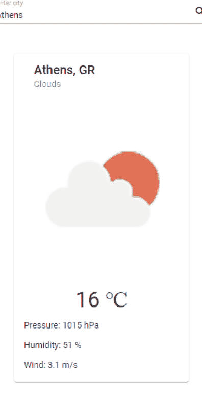

恭喜！此时，你已经拥有一个完全可用的 Angular 应用程序，可以显示特定城市的天气信息。该应用程序由一个 Angular 组件组成，该组件通过 HTTP 使用 Angular 服务与 OpenWeather API 通信。我们学习了如何使用 Angular Material 为我们的组件设置样式，并为我们的用户提供愉快的应用体验。但是当我们离线时会发生什么？应用程序是否按预期工作？用户体验是否保持不变？让我们在下一节中一探究竟。

## 使用 Service Worker 启用离线模式

来自任何地方的用户现在都可以访问我们的 Angular 应用程序，以获取他们感兴趣的任何城市的天气信息。当我们说*任何地方*时，我们指的是任何网络类型，例如宽带、蜂窝（3G/4G/5G）和 Wi-Fi。考虑用户处于覆盖范围低或网络频繁中断的地方的情况。我们的应用程序将如何表现？让我们通过进行一个实验来一探究竟：

1. 使用 Angular CLI 的 serve 命令运行 Angular 应用程序：

   ```
   ng serve
   ```

2. 打开你最喜欢的浏览器并导航到 `http://localhost:4200`，这是 Angular CLI 项目的默认地址和端口号。你应该看到用于输入城市名称的输入字段：

   
   图 4.2 – 输入城市名称

3. 打开浏览器的开发者工具，并导航到 **Network** 选项卡。将 **Throttling** 下拉框的值设置为 **Offline**：

   
   图 4.3 – 离线网络模式


4. 尝试刷新浏览器。您会看到一条表明您已断开互联网连接的提示，如以下截图所示：

    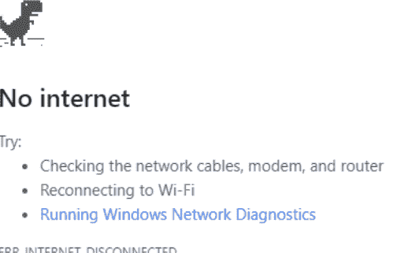

    图4.4 – 无互联网连接 (Google Chrome)

以上情况在互联网连接质量较差的地区相当普遍。那么，我们能为这些地区的用户做些什么呢？幸运的是，Angular 框架包含一个 Service Worker 的实现，它可以显著改善我们的应用在离线模式下的用户体验。它可以缓存应用的某些部分，并在无需发出真实请求的情况下提供相应内容。

> **提示**
> Angular Service Worker 也可以用于网络延迟较大的环境。在这种网络中考虑使用 Service Worker 也能改善用户的体验。

运行以下 Angular CLI 命令，在我们的 Angular 应用中启用 Service Worker：

```
ng add @angular/pwa
```

上述命令将相应地改造 Angular CLI 工作区以支持 PWA：

- 它将 `@angular/service-worker` npm 包添加到应用的 `package.json` 文件的 `dependencies` 部分。
- 它在应用的 `src` 文件夹中创建 `manifest.webmanifest` 文件。该清单文件包含将应用作为原生应用安装和运行所需的信息。它还会将该文件添加到 `angular.json` 文件中 `build` 选项的 `assets` 数组中。
- 它在项目根目录创建 `ngsw-config.json` 文件，即 Service Worker 配置文件。我们使用它来定义配置相关的产物，例如哪些资源被缓存以及如何缓存。您可以在以下链接找到有关 Service Worker 配置的更多详细信息：https://angular.io/guide/service-worker-config#service-worker-configuration。

    该配置文件还会在 `angular.json` 文件的 `build` 配置的 `ngswConfigPath` 属性中进行设置。

- 它将 `angular.json` 文件的 `build` 配置中的 `serviceWorker` 属性设置为 `true`。
- 它在 `app.module.ts` 文件中注册 Service Worker：

    ```typescript
    import { ServiceWorkerModule } from '@angular/service-worker';
    import { environment } from '../environments/environment';

    @NgModule({
      declarations: [
        AppComponent,
        WeatherComponent
      ],
      imports: [
        BrowserModule,
        BrowserAnimationsModule,
        HttpClientModule,
        MatIconModule,
        MatInputModule,
        MatCardModule,
        ServiceWorkerModule.register('ngsw-worker.js', {
          enabled: environment.production,
          // Register the ServiceWorker as soon as the app is
          // stable
          // or after 30 seconds (whichever comes first).
          registrationStrategy: 'registerWhenStable:30000'
        })
      ],
      providers: [],
      bootstrap: [AppComponent]
    })
    ```

`ngsw-worker.js` 文件是包含 Service Worker 实际实现的 JavaScript 文件。当我们以生产模式构建应用时，它会自动为我们创建。Angular 使用 `ServiceWorkerModule` 类的 `register` 方法在我们的应用中注册它。

- 它创建了几个图标，供应用作为原生应用安装到用户设备时使用。
- 它在 `index.html` 文件的头部包含了清单文件和一个用于主题颜色的 meta 标签：

    ```
    <link rel="manifest" href="manifest.webmanifest">
    <meta name="theme-color" content="#1976d2">
    ```

现在我们已经完成了 Service Worker 的安装，是时候测试它了！在继续之前，我们应该安装一个外部 web 服务器，因为 Angular CLI 的内置功能无法与 Service Worker 一起工作。一个不错的选择是 http-server：

1. 运行 npm 客户端的安装命令来安装 http-server：

    ```
    npm install -D http-server
    ```

    上述命令将 http-server 作为我们 Angular CLI 项目的开发依赖安装。

2. 使用 Angular CLI 的构建命令构建 Angular 应用：

    ```
    ng build
    ```

3. 打开 Angular CLI 工作区的 `package.json` 文件，并将以下条目添加到 `scripts` 属性中：

    ```json
    "scripts": {
        "ng": "ng",
        "start": "ng serve",
        "build": "ng build",
        "watch": "ng build --watch --configuration development",
        "test": "ng test",
        "server": "http-server -p 8080 -c-1 dist/weather-app"
    }
    ```

4. 使用以下命令启动 HTTP web 服务器：

    ```bash
    npm run server
    ```

    上述命令将在 8080 端口启动 `http-server`，并禁用缓存。

5. 打开浏览器并导航到 `http://localhost:8080`。

    > **提示**
    >
    > 最好在隐私或隐身模式下打开页面，以避免 Service Worker 的意外行为。

6. 重复我们在本节开头采取的切换到离线模式的过程。

7. 如果现在刷新页面，您会注意到应用运行正常。

Service Worker 为我们完成了所有工作，这个过程非常透明，我们甚至无法分辨自己是在线还是离线。您可以通过检查**网络**选项卡来验证这一点：

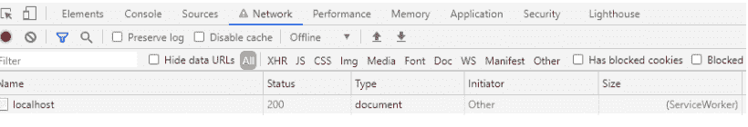

图4.5 – Service Worker（离线模式）

**大小**列中的（**ServiceWorker**）值表明 Service Worker 提供了我们应用的缓存版本。

现在我们已经成功安装了 Service Worker，并朝着将应用转换为 PWA 的目标又迈进了一步。在下一节中，我们将学习如何通知应用用户潜在更新。

## 通过应用内通知保持最新

当我们想要对 Web 应用进行更改时，我们会做出更改并构建应用的新版本。然后应用被部署到 Web 服务器上，每个用户都可以立即访问新版本。但 PWA 应用并非如此。

当我们部署 PWA 应用的新版本时，Service Worker 必须相应地执行特定的更新策略。它应该要么通知用户有新版本，要么立即安装新版本。我们采用哪种更新策略取决于我们的需求。在本项目中，我们想向用户显示一个提示，让他们决定是否要更新。让我们看看如何在我们的应用中实现此功能：

1. 打开 `app.module.ts` 文件，并将 `MatSnackBarModule` 添加到 `@NgModule` 装饰器的 `imports` 数组中：

    ```typescript
    import { MatSnackBarModule } from '@angular/material/snack-bar';

    @NgModule({
      declarations: [
        AppComponent,
        WeatherComponent
      ],
      imports: [
        BrowserModule,
        BrowserAnimationsModule,
        HttpClientModule,
        MatIconModule,
        MatInputModule,
        MatCardModule,
        MatSnackBarModule,
        ServiceWorkerModule.register('ngsw-worker.js', {
          enabled: environment.production,
          // Register the ServiceWorker as soon as the app
          // is stable
          // or after 30 seconds (whichever comes first).
          registrationStrategy: 'registerWhenStable:30000'
        })
      ],
      providers: [],
      bootstrap: [AppComponent]
    })
    ```

    MatSnackBarModule 是一个 Angular Material 模块，允许我们与 Snack Bar 交互。Snack Bar 是一个弹出窗口，通常出现在页面底部，用于通知目的。

2. 打开 `app.component.ts` 文件，并将 `OnInit` 接口添加到 `AppComponent` 类实现的接口中：

    ```typescript
    import { Component, OnInit } from '@angular/core';

    @Component({
      selector: 'app-root',
      templateUrl: './app.component.html',
      styleUrls: ['./app.component.scss']
    })
    export class AppComponent implements OnInit {
      title = 'weather-app';
    }
    ```

3. 在 `AppComponent` 类的构造函数中注入 `MatSnackBar` 和 `SwUpdate` 服务：

    ```typescript
    import { Component, OnInit } from '@angular/core';
    import { MatSnackBar } from '@angular/material/snack-bar';
    import { SwUpdate } from '@angular/service-worker';

    @Component({
      selector: 'app-root',
    ```

```
templateUrl: './app.component.html',
styleUrls: ['./app.component.scss']
})
export class AppComponent implements OnInit {
  title = 'weather-app';

  constructor(private updates: SwUpdate, private
    snackbar: MatSnackBar) {}
}
```

MatSnackBar 服务是一个由 MatSnackBarModule 公开的 Angular 服务。SwUpdate 服务是 service worker 的一部分，它包含一些可观察对象，我们可以用它们来获知应用的更新过程。

+   4. 创建如下 ngOnInit 方法：

```
ngOnInit() {
  this.updates.available.pipe(
    switchMap(() => this.snackbar.open('A new version
      is available!', 'Update now').afterDismissed(),
    filter(result => result.dismissedByAction),
    map(() => this.updates.activateUpdate().then(() =>
      location.reload()))
  ).subscribe();
}
```

ngOnInit 方法是 OnInit 接口的实现方法，在组件初始化时被调用。SwUpdate 服务包含一个 available 可观察属性，当我们的应用有新版本可用时，我们可以通过它获得通知。通常我们会订阅可观察对象，但这里我们没有这样做。相反，我们订阅的是 pipe 方法，它是一个用于组合多个操作符的 RxJS 操作符。

+   5. 在 app.component.ts 文件顶部添加以下 import 语句：

```
import { filter, map, switchMap } from 'rxjs/operators';
```

我们前面定义的 pipe 方法内部发生了很多事情，所以让我们把它拆解开来进一步理解。pipe 操作符组合了三个 RxJS 操作符：

+   - switchMap：当我们的应用有新版本可用时，这个方法会被调用。它使用 snackbar 属性的 open 方法显示一个带有操作按钮的 SnackBar，并订阅其 afterDismissed 可观察对象。当 SnackBar 通过点击操作按钮或使用其 API 方法以编程方式关闭时，afterDismissed 可观察对象会发送值。
+   - filter：当 SnackBar 通过操作按钮关闭时，这个方法会被调用。
+   - map：这个方法调用 updates 属性的 activateUpdate 方法来应用应用的新版本。应用更新完成后，它会重新加载浏览器窗口，使更改生效。

让我们实际看看更新到新版本的整个过程：

+   1. 运行 Angular CLI 的 build 命令来构建 Angular 应用：
+   2. 启动 HTTP 服务器来提供应用服务：
+   3. 打开浏览器的私密或无痕窗口，并导航到 http://localhost:8080。
+   4. 在不关闭浏览器窗口的情况下，让我们在应用中引入一处更改，并添加一个头部组件。运行 Angular CLI 的 generate 命令来创建一个组件：
+   5. 打开 app.module.ts 文件，并导入几个 Angular Material 模块：

```
ng build
```

```
npm run server
```

```
ng generate component header
```

```
import { MatButtonModule } from '@angular/material/button';
```

```
import { MatToolbarModule } from '@angular/material/toolbar';
```

```
@NgModule({
  declarations: [
    AppComponent,
    WeatherComponent,
```

```
HeaderComponent
],
imports: [
  BrowserModule,
  BrowserAnimationsModule,
  HttpClientModule,
  MatIconModule,
  MatInputModule,
  MatCardModule,
  MatSnackBarModule,
  MatButtonModule,
  MatToolbarModule,
  ServiceWorkerModule.register('ngsw-worker.js', {
  enabled: environment.production,
  // Register the ServiceWorker as soon as the app is
  // stable
  // or after 30 seconds (whichever comes first).
  registrationStrategy: 'registerWhenStable:30000'
  })
],
providers: [],
bootstrap: [AppComponent]
}
```

6. 打开 header.component.html 文件，创建一个 mat-toolbar 组件，其中包含两个 HTML button 元素，每个元素内都有一个 mat-icon 组件：

```
<mat-toolbar color="primary">
  <span>Weather App</span>
  <span class="spacer"></span>
  <button mat-icon-button>
    <mat-icon>refresh</mat-icon>
  </button>
  <button mat-icon-button>
    <mat-icon>share</mat-icon>
  </button>
</mat-toolbar>
```

+   7. 将以下 CSS 样式添加到 header.component.scss 文件中，以将按钮定位到页眉的最右端：

```
.spacer {
  flex: 1 1 auto;
}
```

+   8. 打开 app.component.html 文件，并在顶部添加 app-header 组件：

```
<app-header></app-header>
<app-weather></app-weather>
```

+   9. 重复步骤 1 和 2 来构建并启动应用。在已经打开的浏览器窗口中打开一个新标签页，几秒钟后，你会看到页面底部出现以下通知：


图 4.6 – 新版本通知

+   10. 点击“Update now”按钮，等待浏览器窗口重新加载，然后你应该就能看到你的更改了：

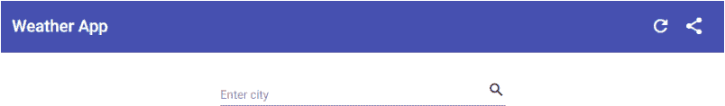

图 4.7 – 应用输出

我们的 Angular 应用已经开始转变为一个 PWA 应用。除了 Angular service worker 提供的缓存机制之外，我们还添加了一种用于安装应用新版本的机制。在下一节中，我们将学习如何部署我们的应用，并将其原生安装到我们的设备上。

## 使用 Firebase 托管部署我们的应用

Firebase 是 Google 提供的一种托管解决方案，我们可以用它来部署 Angular 应用。Firebase 团队投入了大量精力，创建了一个 Angular CLI schematic，以便只用一条命令即可部署 Angular 应用。在深入之前，让我们先学习如何设置 Firebase 托管：

+   1. 使用 Google 账户登录 Firebase，网址为 `https://console.firebase.google.com`。
+   2. 点击 **添加项目** 按钮，以创建新的 Firebase 项目。
+   3. 输入项目名称 `weather-app`，然后点击 **继续** 按钮。

> **重要说明**
> 
> Firebase 会在项目名称下方为你的项目生成一个唯一标识符，例如 **weather-app-b11a2**。该标识符稍后将用于你项目的托管 URL。

+   4. 为你的项目禁用 **Google Analytics**，然后点击 **创建项目** 按钮。
+   5. 项目创建完成后，屏幕上将显示以下内容：

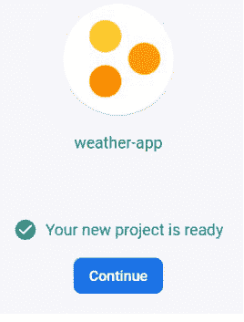

图 4.8 – Firebase 项目创建

+   6. 点击 **继续** 按钮，你将被重定向到新 Firebase 项目的仪表盘。

现在我们已经完成了 Firebase 托管的配置。是时候将它集成到我们的 Angular 应用中了。运行以下 Angular CLI 命令，在 Angular CLI 项目中安装 @angular/fire npm 包：

```
ng add @angular/fire
```

前面的命令还会使用 Firebase 对你进行身份验证，并提示你选择一个 Firebase 项目进行部署。使用方向键选择我们之前创建的 weather-app 项目，然后按 Enter 键。该过程会相应地修改 Angular CLI 工作区，以适应其到 Firebase 的部署：

+   - 它会在项目的 package.json 文件中的 dependencies 和 devDependencies 部分添加几个 npm 包。
+   - 它会在根文件夹中创建一个 .firebaserc 文件，其中包含所选 Firebase 项目的详细信息。
+   - 它会在根文件夹中创建一个 firebase.json 文件，这就是 Firebase 配置文件：

```
{
  "hosting": [
    {
      "target": "weather-app",
      "public": "dist/weather-app",
      "ignore": [
        "**/.*"
      ],
      "headers": [
        {
          "source": "*.[0-9a-f][0-9a-f][0-9a-f][0-9a-f][0-9a-f][0-9a-f][0-9a-f][0-9a-f][0-9a-f][0-9a-f][0-9a-f][0-9a-f][0-9a-f][0-9a-f][0-9a-f][0-9a-f][0-9a-f][0-9a-f][0-9a-f][0-9a-f].+(css|js)",
          "headers": [
            {
              "key": "Cache-Control",
              "value": "public,
```

```
max-age=31536000,immutable"
}
]
}
],
"rewrites": [
{
"source": "**",
"destination": "/index.html"
}
]
}
]
}
```

该配置文件指定了一些设置，例如 public 属性中所述的将要部署到 Firebase 的文件夹，以及通过 rewrites 属性设置的重写规则。

> **重要说明**
> 默认情况下部署的文件夹是当我们运行 ng build 命令时由 Angular CLI 创建的 dist 输出文件夹。

+   - 它会在 angular.json 配置文件的 architect 部分添加一个 deploy 条目：

```
"deploy": {
"builder": "@angular/fire:deploy",
"options": {}
}
```

要部署应用，我们只需运行一条 Angular CLI 命令，其余的工作由 Angular CLI 完成：

```
ng deploy
```


前面的命令将构建应用程序并开始将其部署到选定的 Firebase 项目。部署完成后，Angular CLI 将报告以下信息：

- **项目控制台**：Firebase 项目的仪表板。
- **托管 URL**：已部署应用程序版本的 URL。它由 Firebase 项目的唯一标识符和 Firebase 自动添加的 `.web.app` 后缀组成。

> **重要说明**
> 除用于开发的 **localhost** 外，服务工作线程要求应用程序通过 HTTPS 提供服务才能作为 PWA 正常工作。Firebase 默认使用 HTTPS 托管 Web 应用程序。

现在我们已经部署了应用程序，让我们看看如何将其作为 PWA 安装到我们的设备上：

1. 导航到托管 URL 并点击浏览器地址栏旁边的 **plus** 按钮：

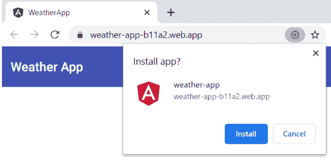

图 4.9 – 安装应用程序（Google Chrome）

> **重要说明**
> 在其他浏览器中，**Install** 按钮可能位于不同的位置。

浏览器将提示我们安装 **weather-app** 应用程序。

## 练习题

让我们看几个练习题：

1. Angular 中环境文件的用途是什么？
2. 我们如何在 HTTP 请求中传递查询参数？
3. 我们如何从 HTTP get 方法获取结果？
4. 我们为什么使用服务工作线程？
5. 用于通知的 Angular Material 组件是什么？
6. 我们如何获知服务工作线程的更新？
7. pipe RxJS 操作符的主要用途是什么？
8. 我们如何更改 PWA 应用程序的主题颜色？
9. 我们在部署到 Firebase 时使用哪个 npm 包？
10. 我们如何更改在 Firebase 中部署的文件夹？

## 进一步阅读

在项目符号前添加此内容：

- PWA: https://web.dev/progressive-web-apps/
- OpenWeather API: https://openweathermap.org/api
- Angular Material: https://material.angular.io/
- Angular HTTP client: https://angular.io/guide/http
- Angular service worker: https://angular.io/guide/service-worker-getting-started
- Communicating with the Angular service worker: https://angular.io/guide/service-worker-communications
- HTTP server: https://www.npmjs.com/package/http-server
- Firebase hosting: https://firebase.google.com/docs/hosting
- Deployment in Angular: https://angular.io/guide/deployment#automatic-deployment-with-the-cli
