# 5 使用 Electron 为桌面构建 WYSIWYG 编辑器

Web 应用程序传统上使用 HTML、CSS 和 JavaScript 构建。它们的使用也已广泛扩展到使用 Node.js 的服务器开发。近年来出现了各种工具和框架，它们使用 HTML、CSS 和 JavaScript 为桌面和移动设备创建应用程序。在本章中，我们将研究如何使用 Angular 和 Electron 创建桌面应用程序。

Electron 是一个 JavaScript 框架，用于使用 Web 技术构建原生桌面应用程序。如果我们将其与 Angular 框架结合使用，我们可以创建快速且高性能的 Web 应用程序。在本章中，我们将构建一个桌面 WYSIWYG 编辑器并涵盖以下主题：

- 为 Angular 添加 WYSIWYG 编辑器库
- 在工作区中集成 Electron
- Angular 与 Electron 之间的通信
- 打包桌面应用程序

## 基本背景理论和上下文

Electron 是一个跨平台框架，用于为 Windows、Linux 和 Mac 构建桌面应用程序。许多流行应用程序都是使用 Electron 构建的，例如 **Visual Studio Code**、**Skype** 和 **Slack**。Electron 框架建立在 Node.js 和 **Chromium** 之上。Web 开发人员可以利用现有的 HTML、CSS 和 JavaScript 技能来创建桌面应用程序，而无需学习 C++ 或 C# 等新语言。

> **提示**
> Electron 应用程序与 PWA 应用程序有许多相似之处。考虑在需要高级文件系统操作或需要为应用程序提供更原生的外观和感觉的情况下构建 Electron 应用程序。另一个用例是当你为主要桌面产品构建补充工具并且希望将它们一起发布时。

Electron 应用程序由两个进程组成：

- **Main**：使用 Node.js API 与本地原生资源交互。
- **Renderer**：负责管理应用程序的用户界面。

Electron 应用程序只能有一个主进程，该主进程可以与一个或多个渲染进程通信。每个渲染进程彼此完全隔离。

Electron 框架提供了 `ipcMain` 和 `ipcRenderer` 接口，我们可以使用它们与这些进程交互。交互是通过 **进程间通信（IPC）** 实现的，这是一种通过基于 Promise 的 API 在公共通道上安全且异步地交换消息的机制。

## 项目概述

在这个项目中，我们将构建一个桌面 WYSIWYG 编辑器，其内容保存在文件系统中。最初，我们将使用 **ngx-wig**，一个流行的 WYSIWYG Angular 库，将其构建为独立的 Angular 应用程序。我们将然后使用 Electron 将其转换为桌面应用程序，并学习如何在 Angular 和 Electron 之间同步内容。我们还将了解如何将编辑器的内容持久化到文件系统中。最后，我们将把应用程序打包为可在桌面环境中运行的单个可执行文件。

构建时间：1 小时。

## 开始

完成本项目需要以下软件工具：

- Angular CLI：Angular 的命令行界面，可在 https://angular.io/cli 找到。
- Visual Studio Code：代码编辑器，可从 https://code.visualstudio.com/Download 下载。
- GitHub 材料：本章的代码可在 https://github.com/PacktPublishing/Angular-Projects-Second-Edition 的 Chapter05 文件夹中找到。

## 为 Angular 添加 WYSIWYG 编辑器库

我们将通过首先创建一个独立的 Angular 应用程序作为 WYSIWYG 编辑器来启动项目。使用 Angular CLI 从头开始创建一个新的 Angular 应用程序：

```bash
ng new my-editor --defaults
```

我们向 `ng new` 命令传递以下选项：

- `my-editor`：定义应用程序的名称
- `--defaults`：将 CSS 定义为应用程序的首选样式表格式，并禁用路由，因为我们的应用程序将由一个组件组成，该组件将托管编辑器

WYSIWYG 编辑器是一种富文本编辑器，例如 Microsoft Word。我们可以使用 Angular 框架从头开始创建一个，但这将是一个耗时的过程，我们只是在重新发明轮子。Angular 生态系统包含大量可用于此目的的库。其中之一是 ngx-wig 库，它没有任何外部依赖，只有 Angular！让我们将该库添加到我们的应用程序中并学习如何使用它：

1. 使用 npm 客户端从 npm 包注册表中安装 ngx-wig：

```bash
npm install ngx-wig
```

2. 打开 app.module.ts 文件并将 NgxWigModule 添加到 @NgModule 装饰器的 imports 数组中：

```typescript
import { NgModule } from '@angular/core';
import { BrowserModule } from '@angular/platform-browser';
import { NgxWigModule } from 'ngx-wig';

import { AppComponent } from './app.component';

@NgModule({
  declarations: [
    AppComponent
  ],
  imports: [
    BrowserModule,
    NgxWigModule
  ],
  providers: [],
  bootstrap: [AppComponent]
})
export class AppModule { }
```

NgxWigModule 是 ngx-wig 库的主模块。

3. 创建一个新的 Angular 组件来托管我们的 WYSIWYG 编辑器：

```bash
ng generate component editor
```


+ 4. 打开新生成组件的模板文件 `editor.component.html`，并将其内容替换为以下 HTML 片段：

```html
<ngx-wig placeholder="Enter your content"></ngx-wig>
```

NgxWigModule 提供了一组可在我们的应用程序中使用的 Angular 服务和组件。该模块的主要组件是 `ngx-wig` 组件，它显示实际的所见即所得（WYSIWYG）编辑器。它暴露了一系列我们可以设置的输入属性，例如编辑器的占位符。你可以在 https://github.com/stevermeister/ngx-wig 找到更多选项。

+ 5. 打开 `app.component.html` 文件，并将其内容替换为 `app-editor` 选择器：

```html
<app-editor></app-editor>
```

+ 6. 打开 `styles.css` 文件（该文件包含 Angular 应用程序的全局样式），并添加以下样式，使编辑器可停靠并占据整个页面：

```css
html, body {
  margin: 0;
  width: 100%;
  height: 100%;
}

.ng-wig, .nw-editor-container, .nw-editor {
  display: flex !important;
  flex-direction: column;
  height: 100% !important;
  overflow: hidden;
}
```

+ 7. 打开 Angular 应用程序的主 HTML 文件 `index.html`，并从 `head` 元素中移除 `base` 标签。浏览器使用 `base` 标签来引用具有相对 URL 的脚本和 CSS 文件。若保留 `base` 标签，我们的桌面应用程序将无法运行，因为它会直接从本地文件系统加载所有必要的资源。我们将在“*将 Angular 与 Electron 集成*”部分进一步了解。

让我们看看目前已经实现了什么。运行 `ng serve` 并导航到 http://localhost:4200 来预览应用程序：

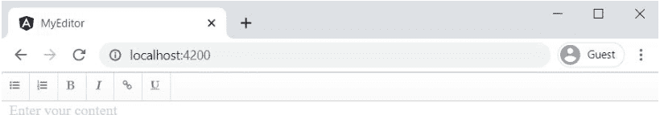

图 5.1 – 应用程序输出

我们的应用程序由以下部分组成：

- 一个带有按钮的工具栏，允许我们对编辑器内容应用不同的样式
- 一个文本区域，用作向编辑器添加内容的主要容器

至此，我们已经使用 Angular 创建了一个包含功能完备的所见即所得编辑器的 Web 应用程序。在下一节中，我们将学习如何使用 Electron 将其转换为桌面应用程序。

## 在工作区中集成 Electron

Electron 框架是一个 npm 包，我们可以使用以下命令安装它：

```bash
npm install -D electron
```

上述命令会将最新版本的 Electron npm 包安装到 Angular CLI 工作区中。它还会在我们的项目的 `package.json` 文件的 `devDependencies` 部分中添加一个相应的条目。

> **重要说明**
>
> Electron 被添加到 `package.json` 文件的 `devDependencies` 部分，因为它是我们应用程序的开发依赖项。它仅用于准备和构建桌面版应用程序，而不在运行时使用。

Electron 应用程序在 Node.js 运行时上运行，并使用 Chromium 浏览器进行渲染。Node.js 应用程序至少有一个 JavaScript 文件，通常称为 `index.js` 或 `main.js`，它是应用程序的主入口点。由于我们使用 Angular 和 TypeScript 作为开发技术栈，我们首先创建一个相应的 TypeScript 文件，该文件最终将被编译为 JavaScript：

+ 1. 在 Angular CLI 工作区的 `src` 文件夹中创建一个名为 `electron` 的文件夹。`electron` 文件夹将包含与 Electron 相关的所有源代码。

> 提示
>
> 我们可以将应用程序视为两个不同的平台。Web 平台是 Angular 应用程序，位于 `src\app` 文件夹中。桌面平台是 Electron 应用程序，位于 `src\electron` 文件夹中。这种方法有很多好处，包括在我们的应用程序中强制实现关注点分离，并且允许每个平台独立开发。从现在开始，我们将它们分别称为 Angular 应用程序和 Electron 应用程序。

+ 2. 在 `electron` 文件夹中创建一个 `main.ts` 文件，内容如下：

```typescript
import { app, BrowserWindow } from 'electron';

function createWindow () {
    const mainWindow = new BrowserWindow({
        width: 800,
        height: 600
    });

    mainWindow.loadFile('index.html');
}

app.whenReady().then(() => {
    createWindow();
});
```

我们首先从 `electron` npm 包中导入 `BrowserWindow` 和 `app` 构件。`BrowserWindow` 类用于为我们的应用程序创建桌面窗口。我们通过在其构造函数中传入一个选项对象来定义窗口尺寸，该对象设置窗口的 `width` 和 `height` 值。然后我们调用 `loadFile` 方法，将我们想要在窗口中加载的 HTML 文件作为参数传入。

> **重要说明**
>
> 我们在 `loadFile` 方法中传入的 `index.html` 文件是 Angular 应用程序的主 HTML 文件。它将通过 `file://` 协议加载，这就是我们在“*添加一个所见即所得的 Angular 库*”部分中移除 `base` 标签的原因。

`app` 对象是桌面应用程序的全局对象，就像网页上的 `window` 对象一样。它暴露了一个 `whenReady` Promise，当该 Promise 被解析时，意味着我们可以运行应用程序的任何初始化逻辑，包括创建窗口。

+ 3. 在 `electron` 文件夹中创建一个 `tsconfig.json` 文件，并添加以下内容：

```json
{
  "extends": "../../tsconfig.json",
  "compilerOptions": {
    "importHelpers": false
  },
  "include": [
    "**/*.ts"
  ]
}
```

`main.ts` 文件需要被编译为 JavaScript，因为浏览器目前不理解 TypeScript。这个编译过程称为**转译**，并且需要一个 TypeScript 配置文件。该配置文件包含驱动 TypeScript **转译器**的选项，转译器负责转译过程。

前面的 TypeScript 配置文件使用 `include` 属性定义了 Electron 源代码文件的路径，并将 `importHelpers` 属性设置为 false。

> **重要说明**
>
> 如果我们启用 `importHelpers` 标志，它将把 `tslib` 库中的辅助函数包含到我们的应用程序中，从而导致更大的打包体积。

4. 运行以下命令来安装 **webpack 命令行工具**：

```bash
npm install -D webpack-cli
```

webpack 命令行工具用于从命令行调用 **webpack**——一个流行的模块打包器。我们将使用 webpack 来构建和打包我们的 Electron 应用程序。

5. 使用以下 npm 命令安装 ts-loader npm 包：

```bash
npm install -D ts-loader
```

ts-loader 库是一个 webpack 插件，可以加载 TypeScript 文件。

现在，我们已经创建了使用 Electron 将 Angular 应用程序转换为桌面应用程序所需的各个部分。我们只需要将它们组合在一起，以便能够构建和运行桌面应用程序。编排 Electron 应用程序的主要部分是 webpack 配置文件，我们需要在 Angular CLI 工作区的根文件夹中创建该文件：

## webpack.config.js

```javascript
const path = require('path');
const src = path.join(process.cwd(), 'src', 'electron');

module.exports = {
  mode: 'development',
  devtool: 'source-map',
  entry: path.join(src, 'main.ts'),
  output: {
    path: path.join(process.cwd(), 'dist', 'my-editor'),
    filename: 'shell.js'
  },
  module: {
    rules: [
      {
        test: /\.ts$/,
        loader: 'ts-loader',
        options: {
          configFile: path.join(src, 'tsconfig.json')
        }
      }
    ]
  },
  target: 'electron-main'
};
```

前面的文件使用以下选项在我们的应用程序中配置 webpack：

- `mode`：表示我们当前正在开发环境中运行。
- `devtool`：启用 source map 文件生成，用于调试。
- `entry`：表示 Electron 应用程序的主入口点，即 `main.ts` 文件。
- `output`：定义 webpack 将生成的 Electron 包的路径和文件名。`path` 属性指向与 Angular CLI 用于生成 Angular 应用程序包相同的文件夹。`filename` 属性设置为 `shell.js`，因为 webpack 生成的默认文件名是 `main.js`，这将会与 Angular 应用程序生成的 `main.js` 文件冲突。
- `module`：指示 webpack 加载 ts-loader 插件来处理 TypeScript 文件。
- `target`：表示我们当前正在 Electron 的主进程中运行。

现在 webpack 包含了构建和打包 Electron 应用程序所需的全部信息。另一方面，Angular CLI 负责构建 Angular 应用程序。让我们看看如何将它们组合起来并运行我们的桌面应用程序：

+ 1. 运行以下 npm 命令来安装 concurrently npm 包：

```bash
npm install -D concurrently
```

concurrently 库使我们能够并发执行多个进程。在我们的场景中，它将使我们能够并行运行 Angular 和 Electron 应用程序。


2. 打开 package.json 文件并在 scripts 属性中添加一个新条目：

```
"scripts": {
    "ng": "ng",
    "start": "ng serve",
    "build": "ng build",
    "watch": "ng build --watch --configuration development",
    "test": "ng test",
    "start:desktop": "concurrently \"ng build --delete-output-path=false --watch\" \"webpack --watch\""
}
```

start:desktop 脚本使用 Angular CLI 的 ng build 命令构建 Angular 应用，并使用 webpack 命令构建 Electron 应用。两个应用都使用 --watch 选项以监视模式运行，因此每次我们在代码中进行更改时，应用都会重新构建以反映更改。每当我们修改 Angular 应用时，Angular CLI 默认会删除 dist 文件夹。我们可以使用 --delete-output-path=false 选项来防止这种行为，因为 Electron 应用也在同一文件夹中构建。

> 重要说明
> 我们没有将 webpack 配置文件传递给 webpack 命令，因为它默认假设 webpack.config.js 文件名。

3. 点击 Visual Studio Code 侧边栏中存在的 Run 菜单：

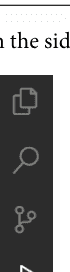

图 5.2 – Run 菜单

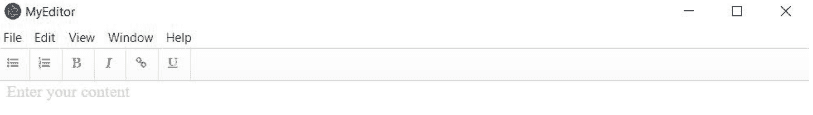

在前面的截图中，我们可以看到我们的 Angular 应用，其 WYSIWYG 编辑器托管在原生桌面窗口内。它包含我们在桌面应用中通常会找到的以下特征：

- 带有图标的标题栏
- 主菜单
- 最小化、最大化和关闭按钮

Angular 应用在 Chromium 浏览器中渲染。要验证这一点，请点击 **View** 菜单项并选择 **Toggle Developer Tools** 选项。

做得好！你已成功创建了自己的桌面 WYSIWYG 编辑器。在下一节中，我们将学习如何让 Angular 和 Electron 之间进行交互。

## Angular 与 Electron 之间的通信

根据项目规范，WYSIWYG 编辑器的内容需要在本地文件系统中持久化。此外，内容将在应用启动时从文件系统加载。

Angular 应用使用 Electron 的渲染进程处理 WYSIWYG 编辑器与其数据之间的任何交互，而 Electron 应用则使用主进程管理文件系统。因此，我们需要建立 IPC 机制在两个 Electron 进程之间进行通信，如下所示：

- 配置 Angular CLI 工作区
- 与编辑器交互
- 与文件系统交互

让我们从第一个开始，设置 Angular CLI 项目以支持所需的通信机制。

### 配置 Angular CLI 工作区

我们需要修改多个文件来配置应用的工作区：

1. 打开 `src\electron` 文件夹中存在的 `main.ts` 文件，并在 `BrowserWindow` 构造函数中将 `nodeIntegration` 属性设置为 `true`：

```javascript
function createWindow () {
  const mainWindow = new BrowserWindow({
    width: 800,
    height: 600,
    webPreferences: {
      nodeIntegration: true,
      contextIsolation: false
    }
  });

  mainWindow.loadFile('index.html');
}
```

前面的标志将启用渲染进程中的 Node.js 并公开 `ipcRenderer` 接口，我们将需要它与主进程通信。

2. 打开 Angular CLI 工作区根文件夹中存在的 `tsconfig.app.json` 文件，并在 `types` 属性内添加 `electron` 条目：

```json
{
  "extends": "./tsconfig.json",
  "compilerOptions": {
    "outDir": "./out-tsc/app",
    "types": [
      "electron"
    ]
  },
  "files": [
    "src/main.ts",
    "src/polyfills.ts"
  ],
  "include": [
    "src/**/*.d.ts"
  ]
}
```

Electron 框架包含可在 Angular 应用中使用的类型。

3. 在 `src\app` 文件夹内创建一个名为 `window.ts` 的新文件并输入以下代码：

```typescript
import { InjectionToken } from '@angular/core';

export const WINDOW = new
  InjectionToken<Window>('Global window object', {
    factory: () => window
  });

export interface ElectronWindow extends Window {
  require(module: string): any;
}
```

Electron 框架是一个 JavaScript 模块，可以从浏览器的全局 `window` 对象加载。我们使用 `InjectionToken` 接口使 window 对象可注入，以便我们可以在 Angular 组件和服务中使用它。此外，我们使用工厂方法返回它，以便在没有 window 对象访问权限的平台上，例如服务器，很容易替换它。

Electron 使用 window 对象的 `require` 方法加载，该方法仅在 Node.js 环境中可用。为了在 Angular 应用中使用它，我们创建了 `ElectronWindow` 接口，它通过定义该方法扩展了 `Window` 接口。

Angular 和 Electron 应用现在已准备好使用 IPC 机制相互交互。让我们先在 Angular 应用中实现必要的逻辑。

### 与编辑器交互

Angular 应用负责管理 WYSIWYG 编辑器。编辑器的内容通过 Electron 的渲染进程与文件系统保持同步。让我们了解如何使用渲染进程：

1. 使用 Angular CLI 的 generate 命令创建一个新的 Angular 服务：

```
ng generate service editor
```

2. 打开 editor.service.ts 文件并在 EditorService 类的构造函数中注入 WINDOW 令牌：

```
import { Inject } from '@angular/core';
import { Injectable } from '@angular/core';
import { ElectronWindow, WINDOW } from './window';

@Injectable({
  providedIn: 'root'
})
export class EditorService {

  constructor(@Inject(WINDOW) private window: ElectronWindow) {}

}
```

3. 创建一个 getter 属性，从 electron 模块返回 ipcRenderer 对象：

```
private get ipcRenderer(): Electron.IpcRenderer {
  return this.window.require('electron').ipcRenderer;
}
```

electron 模块是 Electron 框架的主模块，可访问各种属性，包括主进程和渲染进程。我们还将 ipcRenderer 属性的类型设置为 Electron.IpcRenderer，它是 Electron 内置类型的一部分。

4. 创建一个方法，用于从文件系统获取编辑器的内容：

```
getContent(): Promise<string> {
    return this.ipcRenderer.invoke('getContent');
}
```

我们使用 ipcRenderer 属性的 invoke 方法，将通信通道的名称作为参数传递。getContent 方法的结果是 string 类型的 Promise 对象，因为编辑器的内容是原始文本数据。invoke 方法通过 getContent 通道启动与主进程的连接。在 与文件系统交互 部分，我们将看到如何设置主进程以响应该通道中 invoke 方法的调用。

5. 创建一个方法，用于将编辑器的内容保存到文件系统：

```
setContent(content: string) {
    this.ipcRenderer.invoke('setContent', content);
}
```

setContent 方法再次调用 ipcRenderer 对象的 invoke 方法，但使用不同的通道名称。它还使用 invoke 方法的第二个参数将数据传递给主进程。在这种情况下，content 参数将包含编辑器的内容。我们将在 与文件系统交互 部分看到如何配置主进程以处理数据。

6. 打开 editor.component.ts 文件并创建 myContent 属性来保存编辑器数据。还将 EditorService 注入 EditorComponent 类的构造函数中：

```
import { Component, OnInit } from '@angular/core';
import { EditorService } from '../editor.service';

@Component({
    selector: 'app-editor',
    templateUrl: './editor.component.html',
    styleUrls: ['./editor.component.css']
})
export class EditorComponent implements OnInit {
```


```
myContent = '';

constructor(private editorService: EditorService) {}

ngOnInit(): void {
}
}
```

7. 创建一个调用 editorService 变量的 getContent 方法并在 ngOnInit 方法内部执行它：

```ts
ngOnInit(): void {
  this.getContent();
}

private async getContent() {
  this.myContent = await
    this.editorService.getContent();
}
```

我们使用 async/await 语法，这允许我们在基于 promise 的方法调用中同步执行代码。

8. 创建一个调用 editorService 变量的 setContent 方法：

```ts
saveContent(content: string) {
  this.editorService.setContent(content);
}
```

9. 让我们将我们创建的这些方法与组件的模板连接起来。打开 editor.component.html 文件并添加以下绑定：

```html
<ngx-wig placeholder="Enter your content"
  [ngModel]="myContent"
  (contentChange)="saveContent($event)"></ngx-wig>
```

## 与文件系统交互

主进程使用内置于 Electron 框架中的 `fs` Node.js 库与文件系统交互。让我们看看如何使用它：

1. 打开 src/electron 文件夹中存在的 main.ts 文件并导入以下构件：

```ts
import { app, BrowserWindow, ipcMain } from 'electron';
import * as fs from 'fs';
import * as path from 'path';
```

`fs` 库负责与文件系统交互。`path` 库提供用于处理文件和文件夹路径的实用工具。`ipcMain` 对象允许我们使用 Electron 的主进程。

2. 创建一个变量来保存包含编辑器内容的文件的路径：

```ts
const contentFile = path.join(app.getPath('userData'), 'content.html');
```

保存编辑器内容的的文件是存在于保留的 userData 文件夹中的 content.html 文件。userData 文件夹是每个操作系统的特殊用途系统文件夹的别名，用于存储应用程序特定的文件，例如配置。您可以在 https://www.electronjs.org/docs/api/app#appgetpathname 找到有关 userData 文件夹以及其他系统文件夹的更多详细信息。

> **重要说明**
>
> `app` 对象的 `getPath` 方法跨平台工作，用于获取特殊文件夹的路径，例如用户的主目录或应用程序数据。

3. 调用 `ipcMain` 对象的 `handle` 方法开始监听 getContent 通道中的请求：

```ts
ipcMain.handle('getContent', () => {
    if (fs.existsSync(contentFile)) {
        const result = fs.readFileSync(contentFile);
        return result.toString();
    }
    return '';
});
```

当主进程在此通道中接收到请求时，它使用 `fs` 库的 `existsSync` 方法检查编辑器内容的 文件是否已存在。如果存在，它使用 `readFileSync` 方法读取它并将其内容返回给渲染进程。

4. 再次调用 `handle` 方法，但这次针对 setContent 通道：

```ts
ipcMain.handle('setContent', (event, content: string) => {
  fs.writeFileSync(contentFile, content);
});
```

在前面的代码片段中，我们使用 `fs` 库的 `writeFileSync` 方法将 content 属性的值写入文件中。

5. 打开 package.json 文件并更改 `@types/node` npm 包的版本：

```json
"@types/node": "^15.6.0"
```

现在我们已经连接了 Angular 和 Electron 应用程序，是时候预览我们的 WYSIWYG 桌面应用程序了：

1. 执行 start:desktop npm 脚本并按 F5 运行应用程序。

2. 使用编辑器及其工具栏输入一些内容，例如以下内容：

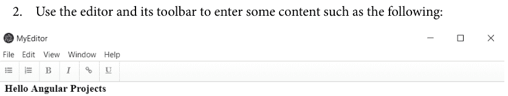

图 5.5 – 编辑器内容

3. 关闭应用程序窗口并重新运行应用程序。如果一切正常，您应该在编辑器中看到您输入的内容。

恭喜！您已通过为其添加持久化功能来丰富了您的 WYSIWYG 编辑器。在下一节中，我们将朝着创建桌面应用程序的最后一步迈进，并学习如何打包和分发它。

## 打包桌面应用程序

Web 应用程序通常捆绑并部署到托管它们的 Web 服务器。另一方面，桌面应用程序被捆绑和打包为单个可执行文件，可以轻松分发。打包我们的 WYSIWYG 应用程序需要以下步骤：

- 为生产模式配置 webpack
- 使用 Electron 打包器

我们将在以下各节中更详细地介绍它们。

### 为生产配置 webpack

我们已经为开发环境创建了 webpack 配置文件。现在我们需要为生产环境创建一个新的。两个配置文件将共享一些功能，所以让我们先创建一个公共的：

1. 在 Angular CLI 工作区的根文件夹中创建 webpack.dev.config.js 文件，其内容如下：

```js
const path = require('path');
const baseConfig = require('./webpack.config');

module.exports = {
  ...baseConfig,
  mode: 'development',
  devtool: 'source-map',
  output: {
    path: path.join(process.cwd(), 'dist', 'my-editor'),
    filename: 'shell.js'
  }
};
```

2. 从 webpack.config.js 文件中删除 `mode`、`devtool` 和 `output` 属性。

3. 打开 `package.json` 文件并在 `start:desktop` 脚本中传递新的 webpack 开发配置文件：

```json
"start:desktop": "concurrently \"ng build --delete-output-path=false --watch\" \"webpack --config webpack.dev.config.js --watch\""
```

4. 在 Angular CLI 工作区的根文件夹中创建 webpack.prod.config.js 文件，其内容如下：

```js
const path = require('path');
const baseConfig = require('./webpack.config');

module.exports = {
  ...baseConfig,
  output: {
    path: path.join(process.cwd(), 'dist', 'my-editor'),
    filename: 'main.js'
  }
};
```

与开发环境的 webpack 配置文件的主要区别是我们将输出 bundle 的文件名更改为 `main.js`。Angular CLI 在生产环境中为 Angular 应用程序的 `main.js` 文件添加哈希号，因此不会有冲突。其他需要注意的是，当我们省略它时，mode 默认设置为 `production`，并且缺少 `devtool` 属性，因为我们不希望在生产模式下启用 source map。

5. 在 `package.json` 文件的 `scripts` 属性中添加一个新条目，用于在生产模式下构建我们的应用程序：

```json
"scripts": {
  "ng": "ng",
  "start": "ng serve",
  "build": "ng build",
  "watch": "ng build --watch --configuration development",
  "test": "ng test",
  "start:desktop": "concurrently \"ng build --delete-output-path=false --watch\" \"webpack --config webpack.dev.config.js --watch\"",
  "build:electron": "ng build && webpack --config webpack.prod.config.js"
}
```

build:electron 脚本同时在生产模式下构建 Angular 和 Electron 应用程序。

我们已经完成了打包桌面应用程序所需的所有配置。在下一节中，我们将学习如何将其转换为特定于每个操作系统的单个 bundle。

### 使用 Electron 打包器

Electron 框架拥有由开源社区创建和维护的各种工具。

您可以在以下链接的 Tools 部分看到可用项目的列表：

https://www.electronjs.org/community

其中一个工具是 electron-packager 库，我们可以使用它将桌面应用程序打包为每个操作系统的单个可执行文件（Windows、Linux 和 macOS）。让我们看看如何将其集成到我们的开发工作流程中：

1. 运行以下 npm 命令将 electron-packager 作为开发依赖项安装到我们的项目中：

```bash
npm install -D electron-packager
```

2. 在 `package.json` 文件的 `scripts` 属性中添加一个新条目用于打包我们的应用程序：

```json
"scripts": {
  "ng": "ng",
  "start": "ng serve",
  "build": "ng build",
  "watch": "ng build --watch --configuration development",
  "test": "ng test",
  "start:desktop": "concurrently \"ng build --


```json
"delete-output-path=false --watch" "webpack --config webpack.dev.config.js --watch",
"build:electron": "ng build && webpack --config webpack.prod.config.js",
"package": "electron-packager dist/my-editor --out=dist --asar"
}
```

在上述脚本中，`electron-packager` 会读取 `dist/my-editor` 文件夹中的所有文件，将它们打包，并将最终的分发包输出到 `dist` 文件夹中。`--asar` 选项指示打包工具将所有文件以 ASAR 格式归档，类似于 ZIP 或 TAR 文件。

3. 在 `src\electron` 文件夹中创建一个 `package.json` 文件，并添加以下内容：

```json
{
  "name": "my-editor",
  "main": "main.js"
}
```

`electron-packager` 库要求输出文件夹中存在一个 `package.json` 文件，并且该文件指向 Electron 应用程序的主入口文件。

4. 打开 `webpack.prod.config.js` 文件，并在 `plugins` 属性中添加 CopyWebpackPlugin：

```javascript
const path = require('path');
const baseConfig = require('./webpack.config');
const CopyWebpackPlugin = require('copy-webpack-plugin');

module.exports = {
  ...baseConfig,
  output: {
    path: path.join(process.cwd(), 'dist', 'my-editor'),
    filename: 'main.js'
  },
  plugins: [
    new CopyWebpackPlugin({
        patterns: [
            {
                context: path.join(process.cwd(), 'src',
                'electron'),
                from: 'package.json'
            }
        ]
    })
  ]
}
```

我们使用 CopyWebpackPlugin 在构建生产模式应用程序时，将 `package.json` 文件从 `src\electron` 文件夹复制到 `dist\my-editor` 文件夹中。

5. 运行以下命令以生产模式构建应用程序：

```
npm run build:electron
```

6. 现在运行以下 npm 命令进行打包：

```
npm run package
```

上述命令会针对你当前运行的操作系统打包应用程序，这是 `electron-packager` 库的默认行为。你可以通过传递额外的选项来改变此行为，这些选项可以在“进一步阅读”部分列出的库的 GitHub 仓库中找到。

7. 导航到 Angular CLI 工作区的 `dist` 文件夹。你会找到一个名为 `my-editor-{OS}` 的文件夹，其中 `{OS}` 是当前操作系统及其架构。例如，在 Windows 中，该文件夹名为 `my-editor-win32-x64`。打开该文件夹，你会得到以下文件：

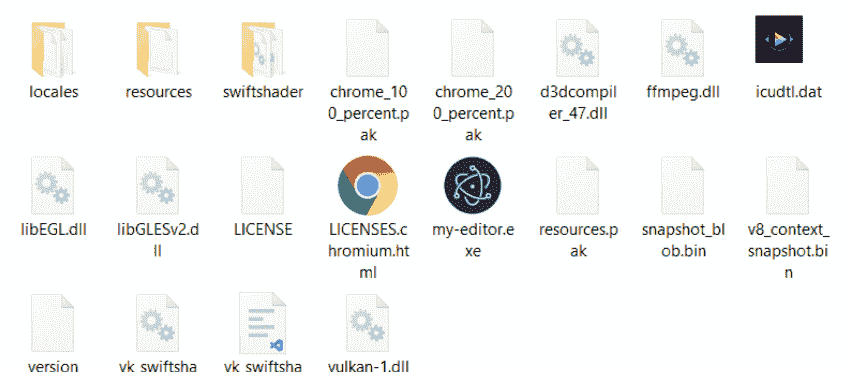

图 5.6 – 应用程序包（Windows）

在上述截图中，`my-editor.exe` 文件是我们桌面应用程序的可执行文件。我们的应用程序代码并不包含在该文件中，而是包含在位于 `resources` 文件夹中的 `app.asar` 文件中。

运行该可执行文件，桌面应用程序应正常打开。你可以将整个文件夹上传到服务器，或通过任何其他方式分发它。你的所见即所得编辑器现在可以触达更多用户，例如那些大部分时间处于离线的用户。太棒了！

## 总结

在本章中，我们使用 Angular 和 Electron 构建了一个桌面端的所见即所得编辑器。首先，我们创建了一个 Angular 应用程序，并添加了流行的 Angular 所见即所得库 `ngx-wig`。然后，我们学习了如何构建一个 Electron 应用程序，并实现了一种在 Angular 应用程序和 Electron 应用程序之间交换数据的通信机制。最后，我们学习了如何打包我们的应用程序并做好分发准备。

在下一章中，我们将学习如何使用 Angular 和 Ionic 构建一个移动端照片地理标记应用程序。

## 练习题

让我们来看几个练习题：

1. 在 Electron 中，哪个类负责创建桌面窗口？
2. 在 Electron 中，我们如何在主进程和渲染进程之间进行通信？
3. 哪个标志允许在渲染进程中使用 Node.js？
4. 我们如何将一个全局 JavaScript 对象转换为 Angular 可注入的对象？
5. 在 Angular 应用程序中，我们如何加载 Electron？
6. 在 Angular 应用程序中，我们使用哪个接口与 Electron 交互？
7. 我们如何从 Angular 应用程序向 Electron 主进程传递数据？
8. 在 Electron 中，我们使用哪个包来操作文件系统？
9. 我们使用哪个库来打包 Electron 应用程序？

## 进一步阅读

以下是一些链接，可以帮助你深入学习本章内容：

- Electron：https://www.electronjs.org/
- Electron 快速入门：https://www.electronjs.org/docs/tutorial/quick-start
- ngx-wig：https://github.com/stevermeister/ngx-wig
- webpack 配置：https://webpack.js.org/configuration/
- ts-loader：https://webpack.js.org/guides/typescript/
- 在 Angular 中注入对象：https://angular.io/guide/dependency-injection-providers#injecting-an-object
- Node.js 文件系统 API：https://nodejs.org/api/fs.html
- electron-packager：https://github.com/electron/electron-packager
- concurrently：https://github.com/kimmobrunfeldt/concurrently

我们将详细讨论以下主题：

- 使用 **Ionic** 创建移动应用程序
- 使用 **Capacitor** 拍照
- 在 **Firebase** 中存储数据
- 使用 **CesiumJS** 预览照片

## 基本背景理论与上下文

Capacitor 是一个原生移动运行时，使我们能够使用 Web 技术（包括 Angular）构建原生的 **Android** 和 **iOS** 应用程序。它为 Web 应用程序提供了一个抽象 API 层，用于与移动操作系统的原生资源进行交互。它不包含 UI 层或任何其他与用户界面交互的方式。

Ionic 是一个移动框架，包含一组 UI 组件，我们可以在使用 Capacitor 构建的应用程序中使用这些组件。Ionic 的主要优点是我们在所有原生移动平台上保持单一代码库。也就是说，我们只需编写一次代码，就可以在任何地方运行。Ionic 支持所有流行的 JavaScript 框架，包括 Angular。

> **重要提示**
>
> 当我们从头开始创建一个新的 Ionic 应用程序时，也会自动安装并配置好 Capacitor。

Firebase 是 Google 提供的一个 **后端即服务（BaaS）** 平台，包含一组用于构建应用程序的工具和服务。**Cloud Firestore** 是 Firebase 提供的一种数据库解决方案，它具有灵活、可扩展的 NoSQL 面向文档的数据库，可用于 Web 和移动应用程序。**Storage** 是 Firebase 的一项服务，允许我们与存储机制交互并上传或下载文件。

CesiumJS 是一个用于在浏览器中创建交互式 3D 地图的 JavaScript 库。它是一个开源、跨平台的库，使用 **WebGL**，并允许我们在多个平台上共享地理空间数据。它由 **Cesium** 提供支持，这是一个用于构建高质量、高性能 3D 地理空间应用程序的平台。

## 项目概述

在这个项目中，我们将构建一个移动应用程序，可以根据当前位置拍照并在地图上预览照片。首先，我们将学习如何使用 Angular 和 Ionic 创建移动应用程序。然后，我们将使用 Capacitor 通过移动设备的摄像头拍照，并通过 GPS 为照片标记当前位置。我们将把这些照片连同位置数据上传到 Firebase。最后，我们将使用 CesiumJS 在 3D 地球上加载位置数据，并附上照片预览。

> **重要提示**
> 在本章中，你将学习如何使用 Angular 和 Ionic 构建移动应用程序。为了继续完成项目并预览应用程序，你需要按照开发环境（Android 或 iOS）的入门指南操作，该指南可以在 *进一步阅读* 部分找到。

构建时间：2 小时

## 开始

你需要以下软件和工具来完成此项目：

- 对于 Android：**Android Studio**（最低 Android SDK 21 或更高版本）以及 **Android WebView**（Chrome 50 或更高版本）。
- 对于 iOS：**Xcode** 11 或更高版本，以及 **Xcode 命令行工具**。
- 一台实体移动设备。
- GitHub 材料：本章的相关代码可以在 https://github.com/PacktPublishing/Angular-Projects-Second-Edition 的 Chapter06 文件夹中找到。

## 使用 Ionic 创建移动应用程序

构建应用程序的第一步是使用 Ionic 工具包创建一个新的移动应用程序。我们将通过以下任务开始构建应用程序：

- 搭建应用程序脚手架
- 构建主菜单

Ionic 有一个非常简单的流程，可以从零开始创建新的移动应用程序，甚至可以在 Ionic 网站上不写一行代码就完成。


# 搭建应用程序

要创建一个新的 Ionic 应用程序，我们需要前往 https://www.ionicframework.com 并完成以下步骤：

- 1. 点击着陆页页眉上显示的 Get Started 按钮：
- 2. 在 App name 字段中输入你的应用程序名称：
- 3. 使用 Pick an icon 字段来定义应用程序的图标。将鼠标悬停在默认图标上，然后从 emoji 画廊中选择一个或上传你自己的图标。
- 4. 在 Pick a theme color 字段中选择应用程序的品牌颜色。品牌颜色用于应用程序的各个地方，例如背景、工具栏和文本。你可以选择预定义的颜色，或使用 RGB 组合创建自定义颜色。
- 5. 使用 Pick a layout template 字段选择应用程序的布局。你可以在三种不同的模板中进行选择。在本项目中，我们将使用 MENU 模板：


你将被重定向到 Create your Ionic App 页面，以填写创建 Ionic 应用程序所需的所有必要详细信息。

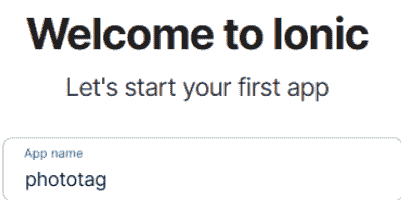

图 6.1 – 开始一个 Ionic 应用程序

图 6.2 – 输入应用程序名称

- 7. 你将被重定向到注册页面，在那里你需要创建一个 Ionic 账户。你可以从头创建一个新账户，或选择使用其中一个免费的 Git 服务：

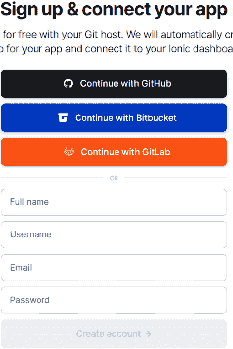

图 6.5 – 创建一个 Ionic 账户

> **提示**
> 
> 如果你选择后者，Ionic 将自动为你的应用程序创建一个仓库并将其与你的 Ionic 控制面板连接。

对于本项目，建议选择其中一个可用的免费 Git 服务。当你选择这样做时，系统会要求你使用所选的 Git 服务进行授权。

8. 点击你选择的 Git 主机上的 **Connect** 按钮，将你的新 Ionic 账户与 Git 服务连接：

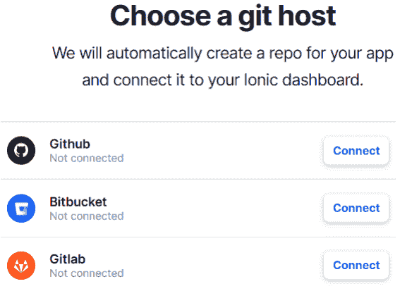

图 6.6 – 连接到 Git 主机

9. 点击 **Choose** 按钮选择你的 Git 账户，Ionic 将开始构建你的应用程序：

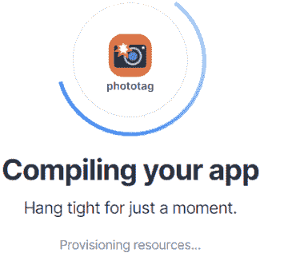

图 6.7 – 构建 Ionic 应用程序

构建完成后，你将被重定向到应用程序的 Ionic 控制面板。从那里，你可以为你的应用程序完成特定任务，例如设置持续集成/开发 CI/CD 管道、构建和预览你的应用程序。

Ionic 为我们创建了一个示例应用程序，其中包含一些现成的[content]

# Scaffolding the application

To create a new Ionic application, we need to head over to https://www.ionicframework.com and complete the following steps:

- 1. Click on the Get Started button that is displayed on the header of the landing page:
- 2. Enter the name of your application in the App name field:
- 3. Use the Pick an icon field to define the icon of your application. Hover with your mouse over the default icon, and either pick one from the emoji gallery or upload one of your choice.
- 4. Select the brand color of your application in the Pick a theme color field. The brand color is used in various places of an application, such as the background, toolbars, and text. You can select either a predefined color or create a custom one using an RGB combination.
- 5. Choose the layout of your application using the Pick a layout template field. You can select among three different templates. In this project, we will use the MENU template:


You will be redirected to the Create your Ionic App page to fill in all the necessary details to create your Ionic application.


Figure 6.1 – Start an Ionic application

Figure 6.2 – Enter the application name

- 7. You will be redirected to the signup page, where you will need to create an Ionic account. You can either create a new one from scratch or select to use one of the free Git services:


Figure 6.5 – Create an Ionic account

> **Tip**
> 
> Ionic will create a repository for your application automatically and connect it with your Ionic dashboard if you select the latter.

For this project, it is recommended to select one of the free Git services available. When you choose to do so, you will be asked to be authorized with the selected Git service.

8. Click the **Connect** button on the Git host of your choice to connect your new Ionic account with the Git service:


Figure 6.6 – Connect to a Git host

9. Click the **Choose** button to select your Git account, and Ionic will start building your application:


Figure 6.7 – Building the Ionic application

After the build has finished, you will be redirected to the Ionic dashboard of your application. From there, you can accomplish specific tasks for your application, such as setting up a Continuous Integration/Development (CI/CD) pipeline, building, and previewing your application.

Ionic has created a sample application for us with some ready-made data. To modify it according to our needs, we need to get a copy of the application locally. Let's see how we can accomplish that in the following section.

## Building the main menu

Ionic provides a command-line tool called the Ionic CLI that is used to build and run an Ionic mobile application. Let's see how we can install it and start building the main menu of our application:

- 1. Install the Ionic CLI using the following npm command:

```
npm install -g @ionic/cli cordova-res
```

The cordova-res library is used to generate the icons and splash screens of our application for native mobile devices.

- 2. Ionic has already created a Git repository for our Ionic application in our Git host. Clone the repository locally into your system and run the following command to install all the dependencies of the application:

```
npm install
```

- 3. Open the main HTML file of the application, index.html, and add the name of your application in the title tag:

```
<title>Phototag App</title>
```

- 4. Open the template file of the main component, app.component.html, and remove the second ion-list element. An ion-list element displays a collection of items in a list view.

- 5. Add the name of your application in the ion-list-header element and change the text of the ion-note element:

```
<ion-list-header>Phototag</ion-list-header>
```

```
<ion-note>Capture geotagged photos</ion-note>
```

An ion-list-header element is the header of a list. An ion-note element is a text element that is used to provide additional information, such as the subtitle of a list.

- 6. Open the TypeScript file of the main component, `app.component.ts`, and modify it as follows:

```
import { Component } from '@angular/core';
@Component({
  selector: 'app-root',
  templateUrl: 'app.component.html',
  styleUrls: ['app.component.scss'],
})
export class AppComponent {
  public appPages = [
    {
      title: 'Take a photo',
      url: '/capture',
      icon: 'camera'
    },
    {
      title: 'View gallery',
      url: '/view',
      icon: 'globe'
    }
  ];
}
```

The appPages property contains all the pages of our application. Each page has a title, the URL from which it is accessible, and an icon. Our application will consist of two pages, one that will be used for taking photos using the camera and another for displaying them on a map.

- 7. Run the `serve` command of the Ionic CLI to start the application:

```
ionic serve
```

The preceding command will build your application and open your default browser at `http://localhost:8100`.

Click on the **Menu** button, and you should see the following output:

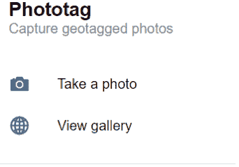

Figure 6.8 – Main menu

> **Tip**
> 
> Try to adjust your browser window size to achieve a more realistic view for a mobile device, or use the **Device toolbar** in the **Google Chrome** developer tools. You can find more details about the Device toolbar at `https://developers.google.com/web/tools/chrome-devtools/device-mode#viewport`.

We have learned how to create a new Ionic application using the getting started page of the Ionic website. We also saw how to get the application locally on our machine and make modifications according to our needs.

If we now try to click on a menu item, we will notice that nothing happens since we have not created the necessary pages that will be activated in each case. In the following section, we will learn how to complete this task by building the functionality of the first page.

## Taking photos with Capacitor

The first page of our application will allow the user to take photos using the camera. We will use the Capacitor runtime to get access to the native resource of the camera. To implement the page, we need to take the following actions:

- Create the user interface.
- Interact with Capacitor.

Let's start building the user interface of the page.

```
<ion-menu-button color="primary">
</ion-menu-button>
</ion-buttons>
<ion-title>Take a photo</ion-title>
</ion-toolbar>
</ion-header>
```

The ion-toolbar element is part of the ion-header element, which is the top navigation bar of the page. It contains an ion-menu-button element for toggling the main menu of the application and an ion-title element that depicts the title of the page.

- 3. Add a second ion-header element inside the ion-content element with the following HTML code:

```
<ion-content>
<ion-header collapse="condense">
<ion-toolbar>
<ion-title size="large">Take a photo</ion-title>
</ion-toolbar>
</ion-header>
</ion-content>
```

The header will be displayed when the page is expanded and the main menu is displayed on the screen. The size attribute of the ion-title element is set to large for supporting collapsible large tiles on iOS devices.

- 4. Add the following HTML code immediately after the second header:

```
<div id="container">
<strong class="capitalize">Take a nice photo with
 your camera</strong>
<ion-fab vertical="center" horizontal="center"
 slot="fixed">
<ion-fab-button>
<ion-icon name="camera"></ion-icon>
</ion-fab-button>
</ion-fab>
</div>
```

It contains an `ion-fab-button` element, which, when clicked, will open the camera of the device to take a photo.

- 5. Finally, let's add some cool styles to our page. Open the `capture.page.scss` file and enter the following CSS styles:

```
```css
#container {
    text-align: center;
    position: absolute;
    left: 0;
    right: 0;
    top: 50%;
    transform: translateY(-50%);
}

#container strong {
    font-size: 20px;
    line-height: 26px;
}

#container ion-fab {
    margin-top: 60px;
}
```
```

Let's run the application using `ionic serve` to get a quick preview of what we have built so far:

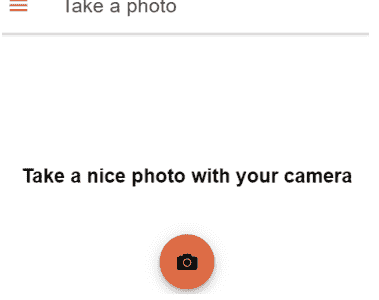

Figure 6.9 – Capture page


页面上的相机按钮需要打开相机进行拍照。在接下来的部分中，我们将学习如何使用 Capacitor 与相机交互。

# 与 Capacitor 交互

在我们的应用中拍照需要用到 Capacitor 库中的两个 API。**Camera** API 将打开相机拍照，**Geolocation** API 将从 GPS 读取当前位置。让我们看看如何在应用中使用这两个 API：

1. 执行以下 npm 命令来安装这两个 API：

   ```bash
   npm install @capacitor/camera @capacitor/geolocation
   ```

2. 使用以下 Ionic CLI 命令创建一个 Angular 服务：

   ```bash
   ionic generate service photo
   ```

3. 打开 `photo.service.ts` 文件并添加以下导入语句：

   ```typescript
   import { Camera, CameraResultType, CameraSource } from '@capacitor/camera';
   import { Geolocation } from '@capacitor/geolocation';
   ```

4. 在 PhotoService 类中创建一个方法，从 GPS 设备读取当前位置：

   ```typescript
   private async getLocation() {
     const location = await
       Geolocation.getCurrentPosition();
     return location.coords;
   }
   ```

Geolocation 对象的 getCurrentPosition 方法包含一个 coords 属性，其中包含各种基于位置的数据，例如纬度和经度。

5. 创建另一个方法，调用 getLocation 方法并打开设备相机拍照：

   ```typescript
   async takePhoto() {
     await this.getLocation();

     await Camera.getPhoto({
       resultType: CameraResultType.DataUrl,
       source: CameraSource.Camera,
       quality: 100
     });
   }
   ```

我们使用 Camera 对象的 getPhoto 方法，并传入一个配置对象来定义每张照片的属性。resultType 属性表示照片将以 data URL 格式保存，以便日后轻松保存到云端。source 属性表示我们将使用相机设备获取照片，quality 属性定义实际照片的质量。

6. 打开 capture.page.ts 文件，并在 CapturePage 类的构造函数中注入 PhotoService：

   ```typescript
   import { Component, OnInit } from '@angular/core';
   import { PhotoService } from '../photo.service';

   @Component({
     selector: 'app-capture',
     templateUrl: './capture.page.html',
     styleUrls: ['./capture.page.scss'],
   })
   export class CapturePage implements OnInit {

     constructor(private photoService: PhotoService) { }

     ngOnInit() {
     }

   }
   ```

7. 创建一个组件方法，调用 photoService 变量的 takePhoto 方法：

   ```typescript
   openCamera() {
     this.photoService.takePhoto();
   }
   ```

8. 打开 `capture.page.html` 文件，并将 `ion-fab-button` 元素的 `click` 事件绑定到 `openCamera` 组件方法：

   ```html
   <ion-fab vertical="center" horizontal="center"
   slot="fixed">
     <ion-fab-button (click)="openCamera()">
       <ion-icon name="camera"></ion-icon>
     </ion-fab-button>
   </ion-fab>
   ```

现在我们已经添加了使用设备相机拍照所需的所有部分。让我们尝试在真实设备上运行应用，测试与相机的交互：

1. 首先，我们需要使用以下 Ionic CLI 命令构建应用：

   ```bash
   ionic build
   ```

上述命令将在项目的根目录中创建一个包含应用包的 www 文件夹。

2. 使用以下命令安装要在其上运行应用的相应平台：

   ```bash
   npm install @capacitor/<os>
   ```

在上一个命令中，`<os>` 参数可以是 `android` 或 `ios`。如果你的应用面向两个平台，则必须执行该命令两次。

3. 然后，使用以下命令将已安装的平台添加到 Capacitor 中：

   ```bash
   ionic cap add <os>
   ```

`cap` 命令是 Capacitor 库的可执行文件。

该命令将为每个平台创建一个文件夹，并且还会在 `package.json` 文件的 `dependencies` 部分添加所需的 npm 包。

> **重要说明**
> 你必须将特定的平台文件夹添加到源代码管理中，以便项目的其他部分可以使用它。

4. 最后，运行以下命令打开应用：

   ```bash
   ionic cap open <os>
   ```

在上一个命令中，`<os>` 可以是 `android` 或 `ios`。执行后，它将根据你指定的平台在相应的 IDE（Android Studio 或 Xcode）中打开原生移动项目。然后必须使用该 IDE 运行原生应用。

> **重要说明**
>
> 每次重新构建应用时，你都需要运行 `npx cap copy` 命令，将应用包从 www 文件夹复制到原生移动项目中。

5. 点击相机按钮，应用将分别请求你允许使用 GPS 和相机。

> **重要说明**
>
> 你可能需要在开发环境的原生移动项目中添加额外的权限。请查看 Capacitor 网站上有关这些 API 的相应文档。

现在，我们应用的第一页拥有一个简洁的界面，允许用户与相机交互。我们还创建了一个 Angular 服务，确保与 Capacitor 无缝交互，从而获取基于位置的数据并拍照。在下一节中，我们将了解如何使用 Firebase 将它们保存到云端。

# 在 Firebase 中存储数据

应用将能够把照片及其位置存储到 Firebase 中。我们将使用 Storage 服务上传照片，并使用 Cloud Firestore 数据库保存它们的位置。我们将通过以下任务进一步扩展应用：

- 创建 Firebase 项目
- 集成 **AngularFire** 库

首先，我们需要为应用创建一个新的 Firebase 项目。

## 创建 Firebase 项目

我们可以使用 https://console.firebase.google.com 上的 Firebase 控制台来设置和配置 Firebase 项目：

1. 单击 **添加项目** 按钮创建一个新的 Firebase 项目：

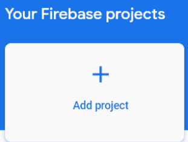

图 6.10 – 创建新的 Firebase 项目

2. 为你的项目输入一个名称，然后单击 **继续** 按钮：

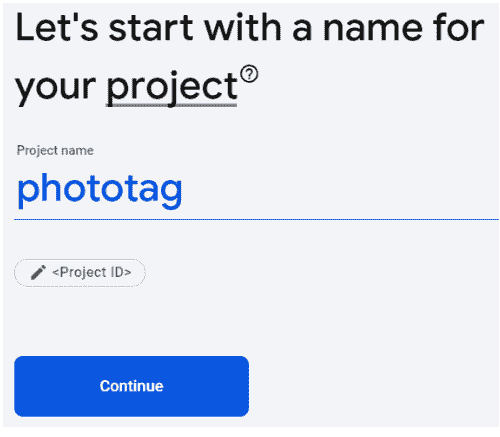

图 6.11 – 输入项目名称

> **重要说明**
> Firebase 会为你的项目生成一个唯一标识符，该标识符位于项目名称下方，并在各种 Firebase 服务中使用。

3. 为此项目禁用 **Google Analytics**，并单击 **创建项目** 按钮：

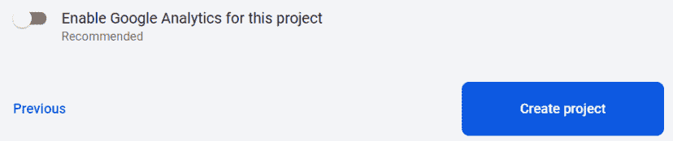

图 6.12 – 禁用 Google Analytics

4. 等待新项目创建完成，然后单击 **继续** 按钮。你将跳转到新项目的仪表板，其中包含一系列选项：

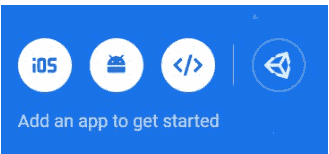

图 6.13 – 选择应用类型

单击带有 *代码* 图标的第三个选项，将 Firebase 添加到 Web 应用中。

5. 在 **应用昵称** 字段中输入应用名称，并单击 **注册应用** 按钮：

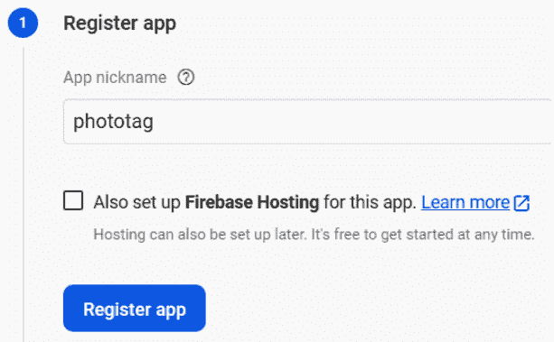

图 6.14 – 应用注册

6. Firebase 将生成一个配置，我们稍后将在移动应用中使用该配置：

   ```javascript
   var firebaseConfig = {
       apiKey: "<Your API key>",
       authDomain: "<Your project auth domain>",
       projectId: "<Your project ID>",
       storageBucket: "<Your storage bucket>",
       messagingSenderId: "<Your messaging sender ID>",
       appId: "<Your application ID>"
   };
   ```

记下 `firebaseConfig` 对象，并单击 **转到控制台** 按钮。

> **提示**
>
> 稍后还可以通过 `https://console.firebase.google.com/project/<project-id>/settings/general` 访问 Firebase 配置，其中 project-id 是你的 Firebase 项目的 ID。

7. 返回仪表板控制台，选择 **Cloud Firestore** 选项以在应用中启用 Cloud Firestore：


图 6.15 – 启用 Cloud Firestore


10. 根据区域设置选择数据库位置并单击 **Enable** 按钮：

   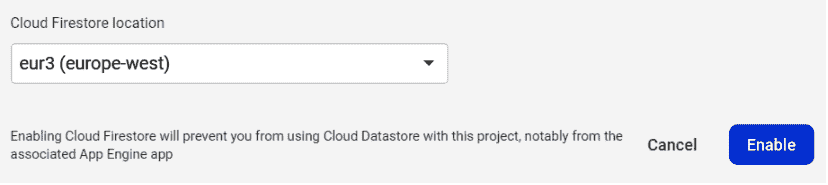

   *Figure 6.18 – Select the database location*

恭喜！你已创建了一个新的 Cloud Firestore 数据库。在下一节中，我们将学习如何将新数据库投入使用，通过我们的移动应用程序保存数据。

## Integrating the AngularFire library

AngularFire 库是一个 Angular 库，我们可以在 Angular 应用中使用它来与 Firebase 家族产品（如 Cloud Firestore 和 Storage 服务）交互。要在我们的应用中安装它，请运行以下 Angular CLI 命令：

```bash
ng add @angular/fire
```

前面的命令会要求你选择我们在上一节中创建的 Firebase 项目，并相应地修改应用结构以使用 AngularFire。现在让我们看看如何在我们的应用中使用 AngularFire 库：

1. 打开 `src\environments\environment.ts` 文件并将你的 Firebase 配置内容复制到 environment 对象中，如下所示：

   ```typescript
   export const environment = {
     production: false,
     firebaseConfig: {
       apiKey: '<Your API key>',
       authDomain: '<Your project auth domain>',
       projectId: '<Your project ID>',
       storageBucket: '<Your storage bucket>',
       messagingSenderId: '<Your messaging sender ID>',
       appId: '<Your application ID>'
     }
   };
   ```

   environment.ts 文件在我们以开发模式运行应用时使用。

2. 我们在生产模式下运行应用时也需要相同的 Firebase 配置。将 Firebase 配置内容复制到生产模式下使用的 `src\environments\environment.prod.ts` 文件中。

3. 打开 app.module.ts 文件并添加以下导入语句：

   ```typescript
   import { AngularFireModule } from '@angular/fire';
   import { AngularFirestoreModule } from '@angular/fire/firestore';
   import { AngularFireStorageModule } from '@angular/fire/storage';
   import { environment } from '../environments/environment';
   ```

   AngularFireModule 是 AngularFire 库的主模块。AngularFirestoreModule 是 AngularFire 的特定模块，我们在处理 Cloud Firestore 数据库时需要它。AngularFireStorageModule 是我们可以用来与 Storage 服务交互的模块。

   在前面的代码中，我们还导入了包含 Firebase 配置的 environment 对象。

   > **Important note**
   > 我们从开发环境文件导入 environment 对象，而不是生产环境文件。Angular 框架足够智能，可以理解我们当前以何种环境运行应用，并在运行时使用适当的文件。

4. 还将 AngularFire 模块添加到 @NgModule 装饰器的 imports 数组中：

   ```typescript
   imports: [BrowserModule, IonicModule.forRoot(),
     AppRoutingModule,
     AngularFireModule.initializeApp
       (environment.firebaseConfig),
     AngularFirestoreModule,
     AngularFireStorageModule
   ]
   ```

   在前面的代码中，我们使用 `AngularFireModule` 类的 `initializeApp` 方法将我们的应用注册到我们的 Firebase 项目。

5. 在继续之前，我们需要为将保存在 Cloud Firestore 数据库中的数据创建一个模型。执行以下 Ionic CLI 命令来创建它：

   ```bash
   ionic generate interface photo
   ```

6. 打开 `photo.ts` 文件并在 Photo 接口中添加以下属性：

   ```typescript
   export interface Photo {
     url: string;
     lat: number;
     lng: number;
   }
   ```

   url 属性将是实际照片的 URL，而 `lat`/`lng` 属性表示当前位置的纬度和经度。

7. 打开 `photo.service.ts` 文件并添加以下导入语句：

   ```typescript
   import { AngularFirestore } from '@angular/fire/firestore';
   import { AngularFireStorage } from '@angular/fire/storage';
   import { Photo } from './photo';
   ```

   AngularFirestore 服务包含我们与 Cloud Firestore 数据库交互所需的所有方法。AngularFireStorage 服务包含用于将文件上传到 Storage 服务的方法。

8. 将两个服务都注入到 PhotoService 类的构造函数中：

   ```typescript
   constructor(private firestore: AngularFirestore, private storage: AngularFireStorage) {}
   ```

9. 创建以下方法以将照片保存到 Firebase：

   ```typescript
   private async savePhoto(dataUrl: string, latitude: number, longitude: number) {
     const name = new Date().getUTCMilliseconds().toString();
     const upload = await this.storage.ref(name).putString(dataUrl, 'data_url');
     const photoUrl = await upload.ref.getDownloadURL();
     await this.firestore.collection<Photo>('photos').add({
       url: photoUrl,
       lat: latitude,
       lng: longitude
     });
   }
   ```

   首先，我们为照片创建一个随机名称，并使用 storage 变量的 putString 方法将其上传到 Firebase 存储。一旦上传完成，我们使用 getDownloadURL 方法获取可下载的 URL，可用于访问该照片。最后，我们使用 add 方法在 firestore 变量的 collection 属性中添加一个新的 Photo 对象。我们使用 collection 属性，因为我们希望在应用中处理照片列表。

   > **Tip**
   > firestore 变量还包含一个 doc 属性，可在我们想要处理单个对象时使用。collection 属性内部维护着一个 doc 对象的列表。

10. 修改 takePhoto 方法以调用我们在步骤 9 中创建的 savePhoto 方法：

    ```typescript
    async takePhoto() {
      const { latitude, longitude } = await this.getLocation();

      const cameraPhoto = await Camera.getPhoto({
        resultType: CameraResultType.DataUrl,
        source: CameraSource.Camera,
        quality: 100
      });

      await this.savePhoto(cameraPhoto.dataUrl, latitude, longitude);
    }
    ```

我们现在准备好检查拍照过程的完整功能：

1. 使用以下 Ionic CLI 命令构建应用：

   ```bash
   ionic build
   ```

2. 运行以下 Capacitor 命令将应用包复制到原生移动项目中：

   ```bash
   ionic cap copy
   ```

3. 使用 Capacitor 的 open 命令打开原生移动项目，并使用相应的 IDE 运行项目。

4. 打开你的应用的 Firebase 控制台并在 **Build** 部分选择 **Storage** 选项。选择 **Rules** 选项卡，删除第 5 行的身份验证检查并单击 **Publish** 按钮。 resulting rules 应如下所示：

   ```text
   rules_version = '2';
   service firebase.storage {
     match /b/{bucket}/o {
       match /{allPaths=**} {
         allow read, write;
       }
     }
   }
   ```

5. 使用应用拍摄一张漂亮的照片。为验证你的照片是否已成功上传到 Firebase，请选择 **Files** 选项卡。你应该会看到如下条目：

   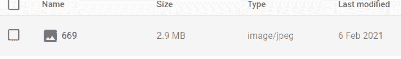

   *Figure 6.19 – Firebase storage*

   在前面的屏幕截图中，名为 **669** 的文件是你拍摄的照片的物理文件。

6. 同样，选择 **Build** 部分中的 **Firestore Database** 选项，你应该会看到如下内容：

   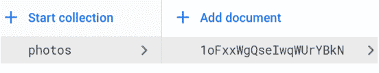

   在前面的屏幕截图中，**1oFxxWgQseIwqWUrYBkN** 条目是照片的逻辑对象，其中包含实际文件的 URL 及其位置数据。

我们应用的第一页现在功能完整。我们已经完成了拍摄照片并将其连同位置数据一起上传到云端的全过程。我们从设置和配置 Firebase 项目开始，最后学习了如何使用 AngularFire 库与该项目交互。在下一节中，我们将通过实现应用的第二页到达最终目的地。

## Previewing photos with CesiumJS

我们应用的下一个功能将是在 3D 地图上显示我们用相机拍摄的所有照片。CesiumJS 库提供了一个带有 3D 地球仪的查看器，我们可以用它来可视化各种事物，例如特定位置的图像。我们应用的这个新功能将包括以下内容：

- Configuring CesiumJS
- Displaying photos on the viewer

我们将首先学习如何设置 CesiumJS 库。

### Configuring CesiumJS

CesiumJS 库是一个 npm 包，我们可以安装它来开始使用 3D 地图和可视化：

1. 运行以下 npm 命令安装 CesiumJS：

   ```bash
   npm install cesium
   ```


2. 打开 `angular.json` 配置文件，并在 `build` 架构选项的 `assets` 数组中添加以下条目：

```
"assets": [
  {
    "glob": "**/*",
    "input": "src/assets",
    "output": "assets"
  },
  {
    "glob": "**/*.svg",
    "input": "node_modules/ionicons/dist/ionicons/svg",
    "output": "./svg"
  },
  {
    "glob": "**/*",
    "input": "node_modules/cesium/Build/Cesium",
    "output": "/assets/cesium"
  }
]
```

前面的条目将在运行时将所有 CesiumJS 源文件复制到我们应用程序的 `assets` 文件夹内的 `cesium` 文件夹中。

3. 还将 CesiumJS widgets 样式表文件添加到 `build` 部分的 `styles` 数组中：

```
"styles": [
  "node_modules/cesium/Build/Cesium/Widgets/widgets.css",
  "src/theme/variables.scss",
  "src/global.scss"
]
```

CesiumJS 的查看器包含一个带有小部件的工具栏，包括搜索栏和用于选择特定地图类型的下拉菜单，例如 Bing Maps 或 Mapbox。

4. 打开我们应用程序的主入口点文件 `main.ts`，并添加以下行：

```
// eslint-disable-next-line @typescript-eslint/dot-
// notation
window['CESIUM_BASE_URL'] = '/assets/cesium/';
```

`CESIUM_BASE_URL` 全局变量指示 CesiumJS 源文件的位置。

5. 使用以下 npm 命令安装自定义 webpack 构建器：

```
npm install -D @angular-builders/custom-webpack
```

**builder** 是扩展 Angular CLI 默认功能的 Angular 库。`@angular-builders/custom-webpack` 构建器允许我们在构建应用程序时提供额外的 webpack 配置文件。当我们想要包含额外的 webpack 插件或覆盖现有功能时，它是有益的。

6. 在项目的根文件夹中创建一个名为 `extra-webpack.config.js` 的新 webpack 配置文件并添加以下内容：

```
module.exports = {
  resolve: {
    fallback: {
      fs: "empty",
      Buffer: false,
      http: "empty",
      https: "empty",
      zlib: "empty"
    }
  },
  module: {
    unknownContextCritical: false
  }
};
```

该配置文件将确保 webpack 不会尝试加载 CesiumJS 无法理解的代码。CesiumJS 使用 webpack 无法从静态分析中得知的模块格式。

7. 打开 `angular.json` 文件并将 `build` 架构部分的 `builder` 属性更改为使用自定义 webpack 构建器：

```
"builder": "@angular-builders/custom-webpack:browser"
```

8. 在 `build` 部分的 `options` 属性中定义自定义 webpack 配置文件的路径：

```
"customWebpackConfig": {
    "path": "./extra-webpack.config.js"
}
```

9. 配置 `serve` 架构部分以使用自定义 webpack 构建器：

```
"serve": {
    "builder": "@angular-builders/custom-webpack:
        dev-server",
    "options": {
        "browserTarget": "app:build"
    },
    "configurations": {
        "production": {
            "browserTarget": "app:build:production"
        },
        "ci": {
            "progress": false
        }
    }
}
```

10. 打开 `tsconfig.app.json` 文件并在 `compilerOptions` 属性中添加 cesium 类型：

```
"compilerOptions": {
    "outDir": "./out-tsc/app",
    "types": ["cesium"]
}
```

现在我们已经完成了 CesiumJS 库的配置，我们可以开始为我们的功能创建页面：

1. 运行 Ionic CLI 的以下命令来创建一个新页面：

```
```bash
ionic generate page view
```
```

2. 打开 `view.page.html` 文件并修改 `ion-header` 元素，使其包含菜单切换按钮：

```
```html
<ion-header>
  <ion-toolbar>
    <ion-buttons slot="start">
      <ion-menu-button color="primary">
      </ion-menu-button>
    </ion-buttons>
    <ion-title>View gallery</ion-title>
  </ion-toolbar>
</ion-header>
```
```

3. 在 `ion-content` 元素内部添加一个 `div` 元素，它将作为我们查看器的容器：

```
```html
<ion-content>
  <div #mapContainer></div>
</ion-content>
```
```

`#mapContainer` 是一个 **模板引用变量**，我们用它为模板中的元素声明一个别名。

4. 打开 `view.page.scss` 文件并设置地图容器元素的大小：

```
```scss
div {
  height: 100%;
  width: 100%;
}
```
```

5. 现在让我们创建我们的查看器。打开 `view.page.ts` 文件并按如下方式修改它：

```
import { AfterViewInit, Component, OnInit, ElementRef, ViewChild } from '@angular/core';
import { Viewer } from 'cesium';

@Component({
  selector: 'app-view',
  templateUrl: './view.page.html',
  styleUrls: ['./view.page.scss'],
})
export class ViewPage implements OnInit, AfterViewInit {

  @ViewChild('mapContainer') content: ElementRef;

  constructor() { }

  ngOnInit() {
  }

  ngAfterViewInit() {
    const viewer = new
      Viewer(this.content.nativeElement);
  }
}
```

我们在组件的 `ngAfterViewInit` 方法内部创建一个新的 `Viewer` 对象。`ngAfterViewInit` 方法在组件的视图完成加载时被调用，并且它在 `AfterViewInit` 接口中定义。`Viewer` 类的构造函数接受我们想要创建查看器的原生 HTML 元素作为参数。在我们的例子中，我们希望将其附加到我们之前创建的地图容器元素。因此，我们使用 `@ViewChild` 装饰器通过将模板引用变量名作为参数传递来引用该元素。

6. 使用 `ionic serve` 运行应用程序并从主菜单中单击 `View gallery` 选项。你应该会看到以下输出：

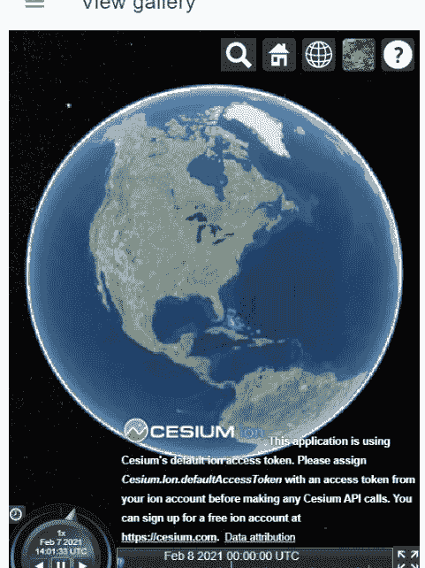

图 6.21 – View gallery 页面

提示
如果查看器上的地图未正确显示，请尝试从查看器工具栏上的地图按钮（位于问号按钮旁边）选择不同的提供商。

我们现在已成功在我们的应用程序中配置了 CesiumJS 库。在下一节中，我们将看到如何从中受益并在 CesiumJS 查看器的 3D 地球仪上显示我们的照片。

## 在查看器上显示照片

我们应用程序要准备好的下一步是在地图上显示我们的照片。我们将从 Firebase 获取所有照片并将它们添加到查看器中指定的位置。让我们看看如何实现这一点：

1. 使用 Ionic CLI 的以下命令创建一个新的 Angular 服务：

```
ionic generate service cesium
```

2. 打开 `cesium.service.ts` 文件并添加以下导入语句：

```
import { AngularFirestore } from '@angular/fire/firestore';
import { Cartesian3, Color, PinBuilder, Viewer } from 'cesium';
import { Observable } from 'rxjs';
import { map } from 'rxjs/operators';
import { Photo } from './photo';
```

3. 在 `CesiumService` 类的构造函数中注入 `AngularFirestore` 服务并创建一个 `viewer` 属性，我们将用它来存储我们的 `Viewer` 对象：

```
export class CesiumService {

  private viewer: Viewer;

  constructor(private firestore: AngularFirestore) { }
}
```

4. 创建一个 `register` 方法来设置 `viewer` 属性：

```
register(viewer: Viewer) {
  this.viewer = viewer;
}
```

5. 创建一个方法来从 Cloud Firestore 获取照片集合：

```
private getPhotos(): Observable<Photo[]> {
  return this.firestore.collection<Photo>('photos')
    .snapshotChanges().pipe(
      map(actions => actions.map(a => a.payload.doc.data()
        as Photo))
}
```

```
);
}
```

在前面的方法中，我们调用 `snapshotChanges` 方法来获取照片集合的数据。我们已经了解到集合由 `doc` 对象组成。因此，我们可以使用每个 `action` 对象的 `doc` 属性上的 `data` 方法到达实际的照片对象。

6. 创建以下方法以将所有照片添加到查看器：

```
addPhotos() {
  const pinBuilder = new PinBuilder();

  this.getPhotos().subscribe(photos => {
    photos.forEach(photo => {
      const entity = {
        position: Cartesian3.fromDegrees(photo.lng, photo.lat),
        billboard: {
          image: pinBuilder.fromColor(Color.fromCssColorString('#de6b45'), 48).toDataURL()
        },
        description: ``
      };
      this.viewer.entities.add(entity);
    });
  });
}
```

每个照片在查看器上的位置将显示为一个图钉。因此，我们首先需要初始化一个 `PinBuilder` 对象。前面的方法订阅 `getPhotos` 方法以从 Cloud Firestore 获取所有照片。对于每张照片，它创建一个 `entity` 对象，其中包含位置，即照片的度数位置，以及一个 `billboard` 属性，显示大小为 48 像素的图钉。它还定义了一个 `description` 属性，当我们单击图钉时将显示照片的实际图像。


每个实体对象都通过其 add 方法添加到查看器的实体集合中。

7. 每个实体的描述都会显示在信息框内。打开包含应用程序全局样式的全局 .scss 文件，并为信息框添加以下 CSS 样式：

```
.cesium-infoBox, .cesium-infoBox-iframe {
  height: 100% !important;
  width: 100%;
}
```

8. 现在，让我们从页面中使用 CesiumService。打开 view.page.ts 文件，并将 CesiumService 类注入到 ViewPage 类的构造函数中：

```
import { AfterViewInit, Component, OnInit, ElementRef, ViewChild } from '@angular/core';
import { Viewer } from 'cesium';
import { CesiumService } from '../cesium.service';

@Component({
  selector: 'app-view',
  templateUrl: './view.page.html',
  styleUrls: ['./view.page.scss'],
})
export class ViewPage implements OnInit, AfterViewInit {

  @ViewChild('mapContainer') content: ElementRef;

  constructor(private cesiumService: CesiumService) {}

  ngOnInit() {
  }

  ngAfterViewInit() {
    const viewer = new
      Viewer(this.content.nativeElement);
  }

}
```

9. 修改 ngAfterViewInit 方法以注册查看器并添加照片：

```
ngAfterViewInit() {
    this.cesiumService.register(new
    Viewer(this.content.nativeElement));
    this.cesiumService.addPhotos();
}
```

我们现在已准备好在地图上查看照片：

- 使用 `ionic serve` 命令运行应用程序。
- 使用应用程序拍摄一些漂亮的照片，最好是在不同的位置。
- 从主菜单中选择 **查看图库** 选项，你应该会看到如下输出：

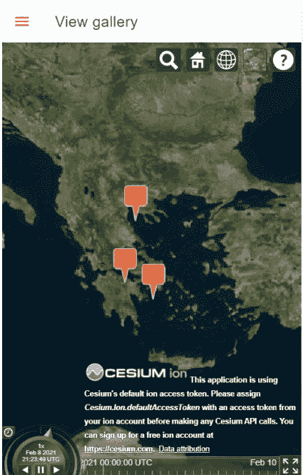

图 6.22 – 地图上的照片

4. 点击地图上的其中一个图钉，你应该会看到你的照片：

查看图库


图 6.23 – 照片显示

我们现在拥有一个完整的移动应用程序，可以拍摄带有地理位置标记的照片并将其显示在地图上。我们了解了如何设置 CesiumJS 库以及如何从 Cloud Firestore 获取照片。CesiumJS 查看器的 API 为我们提供了一种简单的方式来在地图上可视化我们的照片并与之交互。

- 使用 Ionic 进行 Angular 开发：https://ionicframework.com/docs/angular/overview
- AngularFire 库文档：https://firebaseopensource.com/projects/angular/angularfire2/
- CesiumJS 快速入门指南：https://cesium.com/docs/tutorials/quick-start/
- CesiumJS 和 Angular 文章：https://cesium.com/blog/2018/03/12/cesium-and-angular/

## 7 使用 Angular 为 GitHub 作品集构建 SSR 应用程序

# 使用 Angular 为 GitHub 作品集构建 SSR 应用程序

典型的 Angular 应用程序遵循**单页应用程序**（SPA）方法，其中每个页面都是在用户与应用程序交互时在浏览器的 DOM 中创建的。Web 服务器托管应用程序，并负责在应用程序启动时仅提供主页面（通常称为 `index.html`）。

**服务器端渲染**（SSR）是一种与 SPA 完全不同的应用程序渲染技术。当页面在运行时被用户请求时，它使用服务器预渲染这些页面。在服务器上渲染内容可以极大地提升 Web 应用程序的性能，并增强其**搜索引擎优化**（SEO）能力。要在 Angular 应用程序中执行 SSR，我们使用一个名为 **Angular Universal** 的库。

在本章中，我们将通过使用 **GitHub API** 构建一个作品集应用程序，学习如何从 Angular Universal 中受益。我们将涵盖以下主题：

- 使用 GitHub API 构建 Angular 应用程序
- 集成 Angular Universal
- 在构建期间预渲染内容
- 增强 SEO 能力
- 使用 preboot 重放事件

## 基本背景理论与上下文

Angular 应用程序由多个页面组成，这些页面在我们使用应用程序时由 Angular 框架在浏览器的 DOM 中动态创建。Angular Universal 使 Angular 框架能够在应用程序运行时在服务器上静态地创建这些页面。换句话说，它可以创建 Angular 应用程序的完全静态版本，即使不需要启用 JavaScript 也能运行。在服务器上预渲染应用程序具有以下优点：

- 它允许 Web 爬虫索引应用程序，使其在社交媒体网站上可被发现和链接。
- 它使应用程序可用于移动设备和其他无法在其端执行 JavaScript 的低性能设备。
- 它通过快速加载首页，同时在后台加载实际的客户端页面来改善用户体验（**首次内容绘制（FCP）**）。

> **重要说明**
> 在 FCP 期间，除了从 Angular 路由器的 `routerLink` 指令发起的导航事件外，应用程序不会响应用户事件。但是，我们可以使用一个名为 **preboot** 的特殊用途库在应用程序完全加载后重放这些事件。

GitHub API 是一个用于与 GitHub 数据交互的 HTTP REST API。它既可以公开使用，也可以使用开箱即用的身份验证机制以私有方式使用。

> **重要说明**
> 
> 对 GitHub API 的未授权请求限制为每小时 60 次。有关可用身份验证方法的概述，你可以在 `https://docs.github.com/en/rest/overview/other-authentication-methods` 找到更多详细信息。

在 Angular 中通过 HTTP 进行通信时，我们使用 `@angular/common/http` npm 包中内置的 HTTP 客户端。在 SSR 应用程序中与 HTTP 交互可能由于 FCP 时的页面预渲染而导致重复的 HTTP 请求。但是，Angular Universal 可以使用一种名为 **TransferState** 的机制来克服这种重复。

## 项目概述

在本项目中，我们将为我们的 GitHub 用户个人资料构建一个作品集应用程序。我们将首先使用 Angular CLI 来搭建一个与 GitHub API 交互的 Angular 应用程序。我们将学习如何使用 GitHub API 并获取特定于用户的数据。我们还将使用 **Bootstrap CSS** 库来为我们的应用程序设置样式，并创建一个漂亮的用户界面。

在创建 Angular 应用程序后，我们将使用 Angular Universal 将其转换为服务器端渲染的应用程序。我们将了解如何安装和配置 Angular Universal，并学习如何在构建期间预渲染它。然后，我们将配置我们的应用程序，以便在最流行的社交平台上使用 SEO 正确渲染。最后，我们将了解如何使用 preboot 库来重放 SSR 应用程序中不完全支持的浏览器事件。

构建时间：2 小时

## 开始

完成此项目需要以下先决条件和软件工具：

- **GitHub 账户：** 一个有效的 GitHub 用户账户。
- **Angular CLI：** 一个用于 Angular 的 CLI，你可以在 `https://angular.io/cli` 找到它。
- **GitHub 材料：** 本章的相关代码可以在 `https://github.com/PacktPublishing/Angular-Projects-Second-Edition` 的 Chapter07 文件夹中找到。

## 使用 GitHub API 构建 Angular 应用程序

GitHub 包含一个 API，我们可以使用它来获取有关 GitHub 用户个人资料的各种信息。我们正在构建的 Angular 应用程序将与 GitHub API 通信，并为我们的 GitHub 个人资料显示一个简短的作品集。我们的应用程序将包含以下功能：

- **仪表板：** 这将是应用程序的着陆页，它将显示我们 GitHub 个人资料的摘要。
- **信息：** 这将显示关于我们的个人信息。
- **仓库：** 这将显示我们的*公开*仓库列表。
- **组织：** 这将显示我们所属的 GitHub 组织列表。

> **重要说明**
> 
> 本章截图中显示的每个功能的输出结果将根据你的 GitHub 个人资料而有所不同。

仪表板将是应用程序的主页面，它将包含所有其他功能。我们将在下一节中学习如何构建仪表板页面。

## 构建仪表板

在我们可以开始创建应用程序的主要功能之前，我们需要先通过运行以下命令来搭建和配置 Angular 应用程序：

```bash
ng new gh-portfolio --routing=false --style=scss
```

前面的命令将使用 Angular CLI 的 `ng new` 命令，并传递以下选项：

- `gh-portfolio`：我们要创建的 Angular 应用程序的名称
- `--routing=false`：禁用路由，因为我们的应用程序将由单个页面组成
- `--style=scss`：配置 Angular 应用程序在处理 CSS 样式时使用 SCSS 样式表格式


我们将使用 Bootstrap CSS 库来为我们的作品集应用设置样式。让我们看看如何在刚刚创建的 Angular CLI 应用中安装和配置它：

- 1. 执行以下 npm 命令来安装 Bootstrap CSS 库：

```
npm i bootstrap
```

- 2. 打开 `src\styles.scss` 文件并导入 Bootstrap 的 SCSS 样式表：

```
@import "~bootstrap/scss/bootstrap";
```

`styles.scss` 文件包含全局应用于应用的 CSS 样式。`@import` CSS 规则接受我们要加载的样式表文件的绝对路径。

> **重要说明**
> 当我们使用 `@import` 规则导入样式表格式时，我们会省略文件的扩展名。

`~` 字符表示 Angular CLI 应用根目录下的 `node_modules` 文件夹。

- 3. 执行以下命令来安装 Bootstrap Icons，这是一个免费开源的图标库：

```
npm install bootstrap-icons
```

Bootstrap Icons 可以使用多种格式，例如 SVG 或字体。在本项目中，我们将使用后者。

- 4. 将 Bootstrap Icons 库的字体图标格式导入到 `styles.scss` 文件中：

```
@import "~bootstrap/scss/bootstrap";
@import "~bootstrap-icons/font/bootstrap-icons";
```

我们已经创建了 Angular 应用，并添加了设置样式所需的必要资源。现在，我们准备开始创建 Angular 应用的主页面：

- 1. 从 Angular 官方文档的新闻资料包（https://angular.io/presskit）中下载一个你喜欢的 Angular 徽标。
- 2. 将下载的徽标文件复制到 Angular CLI 工作区的 `src\assets` 文件夹中。`assets` 文件夹用于存放静态文件，例如图片、字体和 JSON 文件。

- 3. 打开 `src\environments` 文件夹中的 `environment.ts` 文件，并向 `environment` 对象添加一个新属性：

```typescript
export const environment = {
  production: false,
  username: '<Your GitHub login>'
};
```

将 `username` 属性的值替换为你的 GitHub 登录名。`environment` 对象用于定义应用级属性，例如配置设置或后端 API 的 URL。

- 4. 打开同一文件夹中的 `environment.prod.ts` 文件，并添加与步骤 3 相同的属性。当我们以生产模式运行 Angular CLI 应用时，会使用 `environment.prod.ts` 文件。`environment.ts` 文件是默认文件，在开发模式中使用。

> **重要说明**
> 在所有环境文件中，`environment` 对象必须具有相同的结构和属性。

- 5. 打开 `app.component.ts` 文件，并在 `AppComponent` 类中创建一个属性，以从 `environment` 对象中获取 `username` 属性：

```typescript
import { Component } from '@angular/core';
import { environment } from
  '../environments/environment';

@Component({
  selector: 'app-root',
  templateUrl: './app.component.html',
  styleUrls: ['./app.component.scss']
})
export class AppComponent {
  username = environment.username;
}
```

> **重要说明**
>
> 我们从默认的环境文件中导入 `environment` 对象。Angular CLI 会根据我们当前运行的模式（开发或生产）将其替换为相应的环境文件。

- 6. 打开 `app.component.html` 文件，并将其内容替换为以下 HTML 模板：

```html
<div class="toolbar d-flex align-items-center">
  
  <span>Welcome to my GitHub portfolio</span>
  <a class="ms-auto p-2" target="_blank"
     rel="noopener" href="https://github.com/{{username}}"
     title="GitHub">
    <i class="bi-github"></i>
  </a>
</div>
```

在前面的模板中，我们定义了应用的表头。它包含一个链接到我们 GitHub 个人资料的锚点元素。我们还使用 Bootstrap 图标集中的 `bi-github` 类添加了 GitHub 图标。

- 7. 在应用的表头之后插入以下 HTML 片段：

```html
<div class="content d-flex flex-column">
  <div class="row">
    <div class="col-sm-3"></div>
    <div class="col-sm-9">
      <div class="row">
        <div class="col-12 col-sm-12"></div>
      </div>
      <div class="row">
        <div class="col-12 col-sm-12"></div>
      </div>
    </div>
  </div>
</div>
```

在前面的片段中，我们为应用的基本功能创建了容器元素。带有 `col-sm-3` 类选择器的元素将显示个人信息功能。带有 `col-sm-9` 类选择器的元素将被拆分为两行，分别用于仓库和组织功能。内容的最终布局将如下所示：

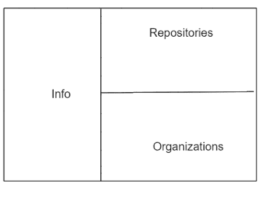

图 7.1 – 主要内容

- 8. 打开 `app.component.scss` 文件，并为应用的表头及内容添加以下 CSS 样式：

```
.toolbar {
  height: 60px;
  background-color: #1976d2;
  color: white;
  font-weight: 600;
}

.toolbar img {
  margin: 0 16px;
}

.toolbar i {
  font-size: 1.5rem;
  color: white;
  margin: 0 16px;
}

.toolbar a {
    margin-bottom: 5px;
}

.toolbar i:hover {
    opacity: 0.8;
}

.content {
    margin: 52px auto 32px;
    padding: 0 16px;
}
```

- 9. 运行 `ng serve` 启动应用，并导航至 http://localhost:4200。应用的表头应如下所示：

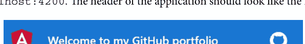

图 7.2 – 应用表头

我们作品集应用的主页面现已准备就绪。它包含一个表头和一个用于添加主要功能的空容器元素。在下一节中，我们将开始构建应用的个人信息功能。

## 显示个人信息

我们应用的第一个功能将是显示来自我们 GitHub 个人资料的个人信息，例如全名、个人资料照片和一些社交媒体链接。在创建该功能之前，我们首先需要配置应用，以便它可以与 GitHub API 通信：

- 1. 打开应用的主模块 `app.module.ts` 文件，并将 `HttpClientModule` 类添加到 `@NgModule` 装饰器的 `imports` 数组中：

```
import { NgModule } from '@angular/core';
import { BrowserModule } from '@angular/platform-browser';
import { HttpClientModule } from
'@angular/common/http';

import { AppComponent } from './app.component';

@NgModule({
  declarations: [
    AppComponent
  ],
  imports: [
    BrowserModule,
    HttpClientModule
  ],
  providers: [],
  bootstrap: [AppComponent]
})
export class AppModule { }
```

`HttpClientModule` 类是内置 HTTP 库的主要 Angular 模块，它导出了与 HTTP 资源交互所需的所有服务。

- 2. 使用以下 Angular CLI 命令创建一个新的 Angular 服务：

```
ng generate service github
```

- 3. 打开 `github.service.ts` 文件，并将 `HttpClient` 服务注入到 `GithubService` 类的构造函数中：

```
import { HttpClient } from '@angular/common/http';
import { Injectable } from '@angular/core';

@Injectable({
  providedIn: 'root'
})
export class GithubService {

  constructor(private http: HttpClient) { }
}
```

- 8. 打开 `personal-info.component.html` 文件，并将其内容替换为以下 HTML 模板：

```html
<div class="card" *ngIf="user$ | async as user">
  
  <div class="card-body">
    <h5 class="card-title">{{user.name}}</h5>
    <p class="card-text">{{user.bio}}</p>
  </div>
  <ul class="list-group list-group-flush">
    <li class="list-group-item" title="Location">
      <i class="bi-geo me-2"></i>{{user.location}}
    </li>
    <li class="list-group-item" title="Followers">
      <i class="bi-people me-2"></i>{{user.followers}}
    </li>
  </ul>
  <div class="card-body">
    <a href="https://www.twitter.com/{{user.twitter_username}}" class="card-link">Twitter</a>
    <a [href]="user.blog" class="card-link">Personal blog</a>
  </div>
</div>
```

在前面的模板中，我们使用了 `async` 管道，因为 `user$` 属性是一个可观察对象，我们需要订阅它才能获取其值。`async` 管道的主要优点是，当组件被销毁时，它会自动取消订阅该可观察对象，从而避免潜在的内存泄漏。

我们还为可观察对象创建了 `user` 别名，以便在组件模板的各个位置轻松引用它。

- 9. 打开 `app.component.html` 文件，并将 `PersonalInfoComponent` 的选择器添加到带有 `col-sm-3` 类选择器的元素中：

```html
<div class="col-sm-3">
  <app-personal-info></app-personal-info>
</div>
```


如果我们运行 `ng serve` 来预览应用，应该会在页面左侧看到个人信息面板：


图 7.3 – 个人信息

我们作品集应用的第一个功能现已完成。它显示了 GitHub 个人资料中的个人信息，附带简短简介和一些社交网络链接。在下一节中，我们将构建应用的仓库功能。

## 列出用户仓库

GitHub 用户资料包含用户拥有的仓库列表，称为**源仓库**（**sources**），以及用户贡献过的仓库，称为**分叉仓库**（**forks**）。我们应用的仓库功能将仅显示源仓库。

仓库和组织功能将具有类似的用户界面。因此，我们需要创建一个可用于这两个功能的组件：

- 1. 执行以下 Angular CLI 命令创建一个新组件：

```bash
ng generate component panel
```

- 2. 打开 `panel.component.ts` 文件，使用 `@Input` 装饰器定义两个输入属性：

```typescript
import { Component, Input, OnInit } from '@angular/core';

@Component({
  selector: 'app-panel',
  templateUrl: './panel.component.html',
  styleUrls: ['./panel.component.scss']
})
export class PanelComponent implements OnInit {

  @Input() caption: string = '';
  @Input() icon: string = '';

  constructor() { }

  ngOnInit(): void {
  }

}
```

- 3. 打开 `panel.component.html` 文件，将其内容替换为以下 HTML 模板：

```html
<div class="card mb-4">
  <div class="card-header">
    <i class="bi bi-{{icon}} me-1"></i>
```

```typescript
constructor(private http: HttpClient) {
  this.userUrl = `${environment.apiUrl}/users/${environment.username}`;
}

getUser(): Observable<User> {
  return this.http.get<User>(this.userUrl);
}
}
```

5. 创建一个新方法，用于获取当前 GitHub 用户的仓库：

```typescript
getRepos(): Observable<Repository[]> {
  return this.http.get<Repository[]>(this.userUrl +
  '/repos');
}
```

现在我们已经完成了从 GitHub API 获取用户仓库的准备工作，可以开始构建显示这些仓库的组件了：

1. 执行以下命令，使用 Angular CLI 创建一个新的 Angular 组件：

```bash
ng generate component repositories
```

2. 打开 `repositories.component.ts` 文件，添加以下导入语句：

```typescript
import { Observable } from 'rxjs';
import { map } from 'rxjs/operators';
import { GithubService } from '../github.service';
import { Repository } from '../repository';
```

3. 将 `GithubService` 注入 `RepositoriesComponent` 类的构造函数中，并创建一个组件属性来获取 `getRepos` 方法的结果：

```typescript
export class RepositoriesComponent implements OnInit {

  repos$: Observable<Repository[]> | undefined;

  constructor(private githubService: GithubService) {}
```

```typescript
ngOnInit(): void {
  this.repos$ = this.githubService.getRepos().pipe(
    map(repos => repos.filter(repo => !repo.fork))
  );
}
}
```

我们使用 `pipe` RxJS 操作符将 `getRepos` 方法返回的可观察对象与 `map` 操作符组合，以过滤掉分叉仓库，仅保留源仓库。过滤操作通过数组的标准 `filter` 方法完成。

4. 打开 `repositories.component.html` 文件，将其内容替换为以下 HTML 模板：

```html
<app-panel caption="Repositories" icon="archive">
  <div class="row row-cols-1 row-cols-md-3 g-4">
    <div class="col p-2" *ngFor="let repo of repos$ | async">
      <div class="card h-100">
        <div class="card-body">
          <h5 class="card-title">
            <a [href]="repo.html_url">{{repo.name}}</a>
          </h5>
          <p class="card-text">{{repo.description}}</p>
        </div>
      </div>
    </div>
  </div>
</app-panel>
```

在上述模板中，我们将组件的主要内容包装在 `app-panel` 组件内，并设置标题和图标属性。

7. 运行 `ng serve` 预览应用，你应该会在个人信息功能旁边看到新的面板：

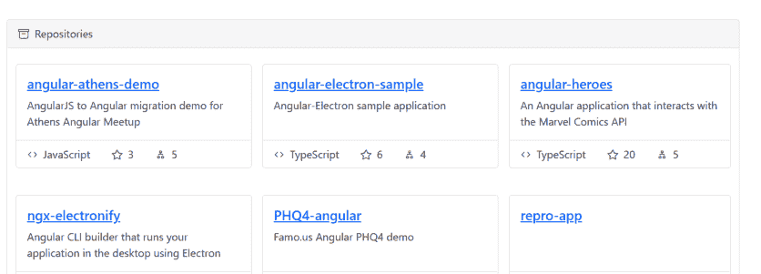

图 7.4 – 仓库

我们应用的第二个功能已完成。它显示了 GitHub 个人资料中的公共仓库列表。我们的应用现在还有一个面板组件，我们可以在下一节中使用它来构建应用的组织功能。

## 可视化组织成员资格

GitHub 用户可以是某个 GitHub 组织的成员。我们的应用将显示用户组织列表，并附带每个组织的一些附加信息。让我们开始构建组织列表：

- 1. 创建一个接口来定义组织的属性：

```bash
ng generate interface organization
```

- 2. 打开 `organization.ts` 文件，添加以下属性：

```typescript
export interface Organization {
  login: string;
  description: string;
  avatar_url: string;
}
```

- 3. 打开 `github.service.ts` 文件，导入 `Organization` 接口：

```typescript
import { Organization } from './organization';
```

- 4. 创建一个新方法，用于获取当前 GitHub 用户的组织：

```typescript
getOrganizations(): Observable<Organization[]> {
  return this.http.get<Organization[]>(this.userUrl +
    '/orgs');
}
```

- 5. 执行以下命令，为我们的功能创建一个 Angular 组件：

```bash
ng generate component organizations
```

- 6. 打开 `organizations.component.ts` 文件，添加以下导入语句：

```typescript
import { Observable } from 'rxjs';
import { GithubService } from '../github.service';
import { Organization } from '../organization';
```

- 7. 将 `GithubService` 注入 `OrganizationsComponent` 类的构造函数中，并将其 `getOrganizations` 方法的结果设置为一个可观察的组件属性：

```typescript
export class OrganizationsComponent implements OnInit {

  orgs$: Observable<Organization[]> | undefined;

  constructor(private githubService: GithubService) { }

  ngOnInit(): void {
    this.orgs$ =
      this.githubService.getOrganizations();
  }

}
```

8. 打开 `organizations.component.html` 文件，将其内容替换为以下 HTML 模板：

```html
<app-panel caption="Organizations" icon="diagram-3">
  <div class="list-group">
    <a href="https://www.github.com/{{org.login}}"
      class="list-group-item list-group-item-action"
      *ngFor="let org of orgs$ | async">
      <div class="row">
        
        <div class="col-sm-9">
          <div class="d-flex w-100 justify-content-between">
            <h5 class="mb-1">{{org.login}}</h5>
          </div>
          <p class="mb-1">{{org.description}}</p>
        </div>
      </div>
    </a>
  </div>
</app-panel>
```

在上述 HTML 模板中，我们将组件的主要内容放在 `app-panel` 组件内，并传入适当的标题和图标。我们显示每个组织的名称和描述。每个组织都被包装在一个指向该组织 GitHub 页面的锚点元素中。

9. 打开 `organizations.component.scss` 文件，为组织徽标添加以下 CSS 样式：

```css
img {
  width: 60px;
  height: 40px;
}
```

10. 打开 `app.component.html` 文件，在第二个带有 `col-12 col-sm-12` 类选择器的元素中添加 `OrganizationsComponent` 的选择器：

```html
<div class="col-sm-9">
  <div class="row">
    <div class="col-12 col-sm-12">
      <app-repositories></app-repositories>
    </div>
  </div>
  <div class="row">
    <div class="col-12 col-sm-12">
      <app-organizations></app-organizations>
    </div>
  </div>
</div>
```

11. 运行 `ng serve` 启动应用，你应该会在仓库功能下方看到组织列表：

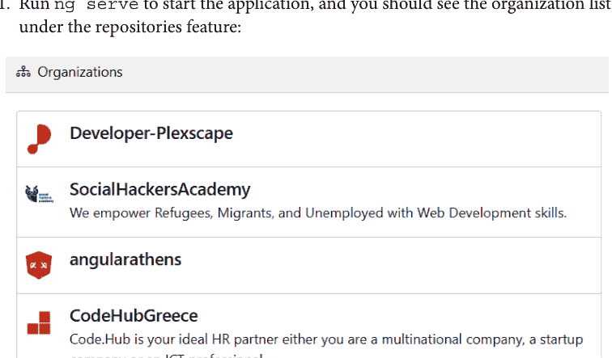

图 7.5 – 组织


我们的应用程序现在为 GitHub 用户的个人资料提供了完整的作品集功能。它显示以下内容：

- 个人信息、简短传记和社交媒体链接
- 用户公开仓库的列表，其中包含指向每个仓库的链接以获取更多信息
- 用户所属组织的列表，其中包含指向每个组织的链接以查看更多详细信息

在下一节中，我们将学习如何集成 Angular Universal 并在服务器上渲染我们的应用程序。

## 集成 Angular Universal

Angular Universal 是一个 Angular 库，它使 Angular CLI 应用程序能够在服务器上渲染。SSR 应用会提高 Angular 应用的加载速度，并改善首屏加载。

要在现有的 Angular CLI 应用程序中安装 Angular Universal，我们将使用 Angular CLI 的以下命令：

```
ng add @nguniversal/express-engine
```

前面的命令使用 Angular CLI 的 `ng add` 命令来安装 `@nguniversal/express-engine` npm 包。`@nguniversal/express-engine` 包是 Angular Universal 库的核心，其核心是一个 **Node.js Express** Web 服务器。

当我们执行上述命令安装 Angular Universal 时，我们不仅在安装该库，还会使用以下文件修改我们的 Angular CLI 工作区：

- `angular.json`：这会在 architect 部分创建新条目，以构建和启用我们的 Angular Universal 应用程序。其中一个条目是 `server` 属性，它负责使用 SSR 构建我们的应用程序。它会将生成的 bundle 输出到 Angular CLI 应用标准输出文件夹内的单独 `server` 文件夹中：

```
"options": {
  "outputPath": "dist/gh-portfolio/server",
  "main": "server.ts",
  "tsConfig": "tsconfig.server.json",
  "inlineStyleLanguage": "scss"
}
```

原始应用程序的 bundle 现在会生成到标准输出文件夹内的 browser 文件夹中：

```
"options": {
  "outputPath": "dist/gh-portfolio/browser",
  "index": "src/index.html",
  "main": "src/main.ts",
  "polyfills": "src/polyfills.ts",
  "tsConfig": "tsconfig.app.json",
  "inlineStyleLanguage": "scss",
  "assets": [
    "src/favicon.ico",
    "src/assets"
  ],
  "styles": [
    "src/styles.scss"
  ],
  "scripts": []
}
```

因此，Angular Universal 应用程序会生成同一 Angular 应用的两个版本：一个用于服务器，另一个用于浏览器。

- `package.json`：这会添加所有必要的 npm 依赖，并创建一组 npm 脚本，用于开始使用 Angular Universal 构建：

```
"scripts": {
  "ng": "ng",
  "start": "ng serve",
  "build": "ng build",
  "watch": "ng build --watch --configuration development",
  "test": "ng test",
  "dev:ssr": "ng run gh-portfolio:serve-ssr",
  "serve:ssr": "node dist/gh-portfolio/server/main.js",
  "build:ssr": "ng build && ng run gh-portfolio:server",
  "prerender": "ng run gh-portfolio:prerender"
}
```

包含 :ssr 后缀的脚本与构建和提供 Angular Universal 应用程序有关。prerender 脚本将在构建期间创建 Angular 应用的预渲染版本。我们将在“在构建期间预渲染内容”一节中了解 prerender 脚本。

- `server.ts`：这包含 Node.js Express 应用程序，它将托管我们作品集的服务器端渲染版本。
- `main.server.ts`：这是我们 Angular Universal 应用程序的主入口点。
- `app.server.module.ts`：这是服务器端渲染应用程序的主应用模块。
- `tsconfig.server.json`：这是我们 Angular Universal 应用程序的 TypeScript 配置。
- `main.ts`：我们 Angular 应用的主入口点仅在 DOM 完全加载后才加载主应用模块：

```
document.addEventListener('DOMContentLoaded', () => {
  platformBrowserDynamic().bootstrapModule(AppModule)
    .catch(err => console.error(err));
});
```

- `app.module.ts`：这调用 BrowserModule 的 withServerTransition 方法，将我们的应用程序作为服务器端渲染的应用加载：

```
@NgModule({
  declarations: [
    AppComponent,
    PersonalInfoComponent,
    PanelComponent
    RepositoriesComponent,
    OrganizationsComponent
  ],
  imports: [
    BrowserModule.withServerTransition({ appId:
      'serverApp' }),
    HttpClientModule
  ],
  providers: [],
```

```
bootstrap: [AppComponent]
})
export class AppModule { }
```

> **重要提示**
> 在服务器上渲染 Angular 应用时，由于没有浏览器，`window` 和 `document` 等全局 JavaScript 对象不可用。Angular 为其中一些对象提供了抽象 API，例如 `DOCUMENT` 注入令牌。如果您需要按条件启用它们，可以注入 `PLATFORM_ID` 令牌，并使用 `@angular/common` npm 包中的 `isPlatformServer` 或 `isPlatformBrowser` 方法来检查您的应用程序当前运行在哪个平台上：

```
import { Inject, PLATFORM_ID } from '@angular/core';
import { isPlatformBrowser } from '@angular/common';

export class CheckPlatformComponent {
  isBrowser: boolean;

  constructor( @Inject(PLATFORM_ID) platformId: any) {
    this.isBrowser = isPlatformBrowser(platformId);
  }
}
```

现在我们可以使用以下 npm 命令在服务器上运行我们的 GitHub 作品集应用：

```
npm run dev:ssr
```

要在服务器上预览您的 GitHub 作品集应用，请在浏览器中打开 http://localhost:4200。

通常情况下，您会看到与之前一样的应用。那么，我们在这里获得了什么呢？Angular Universal 应用在功能强大的处理器和大内存的开发机上运行时，并不会展现出全部潜力。相反，我们需要在真实场景（如慢速网络）中运行和预览它们。我们可以使用 **Google Chrome 开发者工具** 在开发环境中模拟慢速网络：

- 1. 打开 Google Chrome 浏览器。
- 2. 切换开发者工具并选择 **网络** 选项卡。
- 3. 从 **节流** 下拉菜单中选择 **慢速 3G** 选项。
- 4. 在浏览器地址栏中输入 `http://localhost:4200`。

如果在页面加载时点击任何链接，您会注意到没有任何反应。这是为什么呢？服务器首先加载应用的一个静态版本显示给用户，同时在后台等待实际的 Angular 应用加载。在此 FCP 期间，除 `routerLink` 指令外，所有链接都没有响应。当 Angular Universal 在后台完全加载后，它会切换到完整应用。

稍后，在 *使用 preboot 重放事件* 一节中，我们将了解如何处理这些事件。与此同时，我们将在下一节中研究如何使用预渲染来进一步提高应用程序的加载速度。

## 在构建期间预渲染内容

我们的 Angular CLI 工作区的 `package.json` 文件包含 prerender npm 脚本，我们可以使用它来改善应用程序的首次加载。该脚本会运行 `angular.json` 配置文件中 architect 部分的 prerender 命令，并在构建期间预渲染应用程序的内容。让我们看看预渲染会对我们的 GitHub 作品集应用产生什么效果：

- 1. 执行以下 npm 命令以生成应用的预渲染版本：

```
npm run prerender
```

> **重要提示**
> 
> 生产环境文件中的 username 和 apiUrl 属性应该正确设置。否则，该命令将在 VSCode 的终端窗口中输出错误。

上述命令会将应用程序的生产版 bundle 输出到 `dist\gh-portfolio\browser` 文件夹中。

- 2. 导航到 `dist\gh-portfolio\browser` 文件夹，您应该会看到两个 HTML 文件：`index.html` 和 `index.original.html` 文件。
- 3. 打开 `index.original.html` 文件并找到 `app-root` HTML 元素。这是我们 Angular 应用的主组件，Angular 将在浏览器中渲染我们应用的内容。


-   4. 打开 `index.html` 文件，再次查看 `app-root` 元素。

这次主组件不是空的了。Angular Universal 已经向 GitHub API 发出了所有 HTTP 请求，并在运行时预获取了应用的内容。所有组件模板和样式都已预渲染到主 HTML 文件中，这实质上意味着即使不启用 JavaScript，我们也可以在浏览器中查看应用！

-   5. 执行以下命令，启动我们的 GitHub 作品集应用的预渲染版本：

```
npm run serve:ssr
```

上述命令将在 http://localhost:4000 启动应用。

-   6. 在浏览器设置中禁用 JavaScript，然后访问 http://localhost:4000。

我们创建的 GitHub 作品集应用在未启用 JavaScript 的情况下仍能完全正常运行。应用的主页面也能即时渲染，用户无需等待应用加载。

上述场景非常适合那些无法在设备上启用 JavaScript 的用户。但是，当启用了 JavaScript 的用户使用同一个预渲染版本的应用时，会发生什么呢？让我们进一步了解：

-   1. 在浏览器中启用 JavaScript，并切换开发者工具。

-   2. 访问 http://localhost:4000。乍一看似乎没有任何变化。不过，由于预渲染内容的存在，应用会立即加载。

-   3. 检查 Network 标签页，你会注意到以下内容：

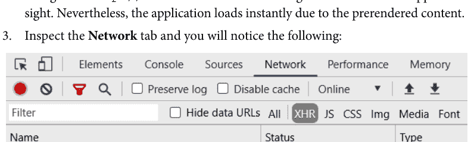

图 7.6 – Network 标签页（Google Chrome）

我们的应用会向 GitHub API 发起所有 HTTP 请求，就像它是从浏览器渲染出来的一样。它实质上重复了应用所需的所有 HTTP 请求，即使数据已经预渲染在 HTML 页面中。这是为什么呢？

应用会为浏览器渲染版本发起一个 HTTP 请求，并为 SSR 应用发起另一个请求，因为这两个版本的状态不同。我们可以通过在服务器和浏览器之间共享状态来避免上述行为。更具体地说，我们可以使用 Angular Universal 库中一个名为 TransferHttpCacheModule 的专用 Angular 模块，将服务器状态传输到浏览器。

如果我们使用 TransferHttpCacheModule，服务器将缓存来自 GitHub API 的响应，浏览器将使用缓存而不是发起新请求。TransferHttpCacheModule 通过在 Angular 应用中安装一个 HTTP 拦截器来解决该问题，该拦截器会忽略服务器最初已处理过的 HTTP 请求。

> **重要说明**
> HTTP 拦截器是一种 Angular 服务，用于拦截源自 Angular 框架内置 HTTP 客户端的 HTTP 请求和响应。

要在我们的 GitHub 作品集应用中安装 TransferHttpCacheModule，请按照以下步骤操作：

-   1. 打开 Angular 应用的主模块文件 `app.module.ts`，并从 @nguniversal/common npm 包中导入 TransferHttpCacheModule：

```
import { TransferHttpCacheModule } from '@nguniversal/common';
```

-   2. 将 TransferHttpCacheModule 类添加到 @NgModule 装饰器的 imports 数组中：

```
@NgModule({
  declarations: [
    AppComponent,
    PersonalInfoComponent,
    PanelComponent,
    RepositoriesComponent,
    OrganizationsComponent
],
imports: [
  BrowserModule.withServerTransition({ appId:
  'serverApp' }),
  HttpClientModule,
  TransferHttpCacheModule
],
providers: [],
bootstrap: [AppComponent]
})
```

-   3. 打开 SSR 应用的主模块文件 `app.server.module.ts`，并从 @angular/platform-server npm 包中导入 ServerTransferStateModule：

```
import { ServerModule, ServerTransferStateModule }
from '@angular/platform-server';
```

-   4. 将 ServerTransferStateModule 类添加到 @NgModule 装饰器的 imports 数组中：

```
@NgModule({
  imports: [
    AppModule,
    ServerModule,
    ServerTransferStateModule
  ],
  bootstrap: [AppComponent],
})
```

-   5. 执行以下命令来预渲染你的应用：

```
npm run prerender
```

-   6. 运行以下命令来启动你预渲染后的应用：

```
npm run serve:ssr
```

如果你预览作品集应用并检查浏览器的 **Network** 标签页，你会注意到它不会发起额外的 HTTP 请求。`TransferHttpCacheModule` 拦截了所有 HTTP 请求，并将它们存储在我们应用的 `TransferState` 存储中。TransferState 是一个键值存储，可以从服务器传输到浏览器。应用的浏览器版本之后可以直接从存储中读取 HTTP 响应，而无需额外发起调用。

我们现在拥有了 GitHub 作品集的完整预渲染版本。但如何进一步优化，以便能在社交媒体平台上分享呢？我们将在下一节中了解更多 SEO 优化技术。

## 增强 SEO 能力

**SEO** 是优化网站以便被网络爬虫正确索引的过程。网络爬虫是一种专用软件，存在于大多数搜索引擎中，能够识别网站并为其建立索引，使其易于通过搜索引擎平台被发现和链接。

Angular Universal 通过在构建时预渲染内容，在 SEO 方面做得非常出色。有些网络爬虫无法执行 JavaScript，也无法构建 Angular 应用的动态内容。使用 Angular Universal 进行预渲染消除了对 JavaScript 的需求，从而使网络爬虫能够尽其所能识别 Web 应用。

我们还可以通过在 Angular 应用的主 `index.html` 文件的 `head` 元素中定义几个标签来帮助 SEO，例如 `title`、`viewport` 和 `charset`：

## index.html

```
<!doctype html>
<html lang="en">
<head>
  <meta charset="utf-8">
  <title>GhPortfolio</title>
  <base href="/">
  <meta name="viewport" content="width=device-width,
    initial-scale=1">
  <link rel="icon" type="image/x-icon" href="favicon.ico">
</head>
<body>

<app-root></app-root>
</body>
</html>
```

你可以在 https://developer.mozilla.org/en-US/docs/Web/HTML/Element/meta/name 找到可用标签的列表。

然而，仅在 index.html 文件中设置标签并不足够，尤其是当 Angular 应用启用了路由并包含多个路由时。Angular 框架提供了几个方便的服务，我们可以用它们以编程方式设置标签。首先，让我们看看如何在应用中设置 title 标签：

-   1. 打开 `app.component.ts` 文件，并导入 Title 和 OnInit 这两个 Angular 构件：

```
import { Component, OnInit } from '@angular/core';
import { environment } from
'../environments/environment';
import { Title } from '@angular/platform-browser';
```

-   2. 将 Title 服务注入到 AppComponent 类的构造函数中：

```
export class AppComponent {
  username = environment.username;

  constructor(private title: Title) {}
}
```

-   3. 将 OnInit 接口添加到组件的实现接口列表中，并在 ngOnInit 方法中调用 title 变量的 setTitle 方法：

```
export class AppComponent implements OnInit {
  username = environment.username;

  constructor(private title: Title) {}

  ngOnInit() {
    this.title.setTitle('GitHub portfolio app');
  }
}
```

-   4. 运行 `npm run dev:ssr` 预览应用，你应该能在浏览器标签页中看到标题：

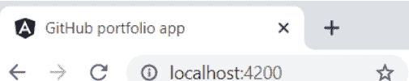

图 7.7 – 浏览器标签页标题

与 Title 服务类似，我们可以使用 Meta 服务为应用设置 meta 标签：

-   1. 打开 `app.component.ts` 文件，并从 `@angular/platform-browser` npm 包中导入 `Meta`：

```
import { Meta } from '@angular/platform-browser';
```

-   2. 将 `Meta` 服务注入到 `AppComponent` 类的构造函数中：

```
constructor(private title: Title, private meta: Meta) {}
```

-   3. 使用 `meta` 变量的 `addTags` 方法向 `ngOnInit` 方法中添加一些 meta 标签：

```
ngOnInit(): void {
  this.title.setTitle('GitHub portfolio app');
  this.meta.addTags([
    {
      name: 'description',
      content: `${this.username}'s GitHub portfolio`
    },
    {
      name: 'author',
      content: this.username
    }
  ]);
}
```

在上述代码中，我们添加了两个 meta 标签。第一个设置 description（描述），其中包含当前 GitHub 个人资料的用户名。第二个将 author（作者）标签设置为与 GitHub 个人资料的用户名相同。


- 4. 运行 `npm run dev:ssr` 启动应用程序，并导航到 http://localhost:4200。

- 5. 使用浏览器检查页面，你应该会在页面的 head 元素中看到以下 meta 标签：

```
<head>
  <meta charset="utf-8">
  <title>GitHub portfolio app</title>
  <base href="/">
  <meta name="viewport" content="width=device-width, initial-scale=1">
  <link rel="icon" type="image/x-icon" href="favicon.ico">
  <link rel="stylesheet" href="styles.css">
  <style>...</style>
  <style>...</style>
  <style>...</style>
  <style>...</style>
  <style>...</style>
  <meta name="description" content="<Your GitHub login>'s GitHub portfolio">
  <meta name="author" content="<Your GitHub login>">
```

图 7.8 – 应用程序 head 元素

诸如 Twitter、Facebook 和 LinkedIn 等热门社交平台都需要各自的 meta 标签，以便 SSR 应用程序的 URL 能够在这些平台上正确显示。如果你不想使用 Angular 框架的 Meta 服务手动添加这些标签，可以使用 ngx-seo 库，该库为每个平台提供了内置方法。你可以从位于 https://www.npmjs.com/package/ngx-seo 的 npm 仓库中获取该库。

在下一节中，我们将学习如何重放 SSR 应用程序不支持的事件，从而完成我们的项目。

## 使用 preboot 重放事件

在*集成 Angular Universal*一节中，我们了解到 SSR 应用程序在被完全引导之前，除了使用 routerLink 指令进行导航外，不会响应用户事件。现在，我们将学习如何使用 preboot 库将这些事件排队，并在应用程序完全加载后重放它们。让我们看看如何使用它：

- 1. 执行以下 npm 命令来安装该库：

```
npm install preboot
```

- 2. 打开 `app.module.ts` 文件，并从 `preboot` npm 包中导入 `PrebootModule`：

```typescript
import { PrebootModule } from 'preboot';
```

- 3. 将 `PrebootModule` 类添加到 `@NgModule` 装饰器的 imports 数组中：

```typescript
@NgModule({
  declarations: [
    AppComponent,
    PersonalInfoComponent,
    PanelComponent,
    RepositoriesComponent,
    OrganizationsComponent
  ],
  imports: [
    BrowserModule.withServerTransition({ appId: 'serverApp' }),
    HttpClientModule,
    TransferHttpCacheModule,
    PrebootModule.withConfig({ appRoot: 'app-root' })
  ],
  providers: [],
  bootstrap: [AppComponent]
})
```

我们使用 `PrebootModule` 的 `withConfig` 方法来定义 Angular 应用程序的主组件。它接受一个 `PrebootOptions` 类型的选项对象，其中包含各种属性，你可以在 https://github.com/angular/preboot#PrebootOptions 找到这些属性。其中一个选项是 `appRoot` 属性，它定义了主组件的选择器。

preboot 库的目的是在应用程序状态从服务器传输到浏览器的过程中保持一致的用户体验。

要验证其功能，请运行 `npm run dev:ssr` 启动 SSR 应用程序，并使用*集成 Angular Universal*一节中描述的步骤来模拟慢速网络。如果在应用程序加载时尝试点击任何链接，你会注意到在应用程序完全加载到浏览器后，浏览器会导航到所选链接。

## 总结

在本项目中，我们为 GitHub 个人资料构建了一个作品集应用程序。最初，我们学习了如何在一个新的 Angular 应用程序中与 GitHub API 交互。我们还使用了 Bootstrap CSS 和 Bootstrap Icons，为我们的作品集应用程序提供了漂亮的用户界面。

随后，我们了解了如何使用 Angular Universal 将 Angular 应用程序转换为 SSR 应用程序。我们学习了当用户使用低端且性能较慢的设备时，如何从预渲染内容中获益，以及这项技术的一些潜在缺陷。

我们使用了 Angular 框架提供的一些可用 SEO 技术来提高应用程序的可发现性。最后，我们安装了 preboot 库，以改善应用程序在加载期间的用户体验。

在下一章中，我们将了解 monorepo 架构，以及如何管理 Angular 应用程序的状态。

## 练习题

让我们来看几个练习题：

- 1. Angular 应用程序中环境文件的用途是什么？
- 2. 我们如何在组件的模板中订阅 observable？
- 3. 我们使用哪个命令来安装 Angular Universal？
- 4. 我们如何以编程方式区分浏览器平台和服务器平台？
- 5. 哪个命令会生成 SSR 应用程序的预渲染版本？
- 6. 我们使用哪个 Angular 模块将状态从服务器传输到浏览器？
- 7. 我们使用哪个 Angular 服务来设置 Angular 应用程序的标题？
- 8. 我们使用哪个 Angular 服务来在 Angular 应用程序中设置 meta 标签？
- 9. preboot 库的用途是什么？
- 10. 我们如何在 SSR 应用程序中启用 preboot？

## 延伸阅读

以下是一些链接，供你基于本章所学内容进一步学习：

- Angular Universal 指南：`https://angular.io/guide/universal`
- GitHub REST API：`https://docs.github.com/en/rest`
- Bootstrap CSS：`https://getbootstrap.com/`
- Bootstrap Icons：`https://icons.getbootstrap.com/`
- Angular HTTP 指南：`https://angular.io/guide/http`
- TransferHttpCacheModule：`https://github.com/angular/universal/blob/master/docs/transfer-http.md`
- preboot：`https://github.com/angular/preboot`
