# 8 使用 Nx Monorepo 工具和 NgRx 构建企业门户

# 使用 Nx Monorepo 工具和 NgRx 构建企业门户

典型的企业应用程序通常由后端系统和前端系统组成。后端负责与数据库交互以实现数据持久化，并对外提供 REST API。前端通过 REST 接口与后端系统通信以交换数据。在某些情况下，前端系统可以由多个应用程序组成，包括 Web 界面或移动应用程序。将所有这类应用程序和系统分别放在独立的源代码控制仓库中，扩展性不佳，并且不易于维护和构建。或者，对于此类大型企业应用程序，我们可以采用 **monorepo** 架构，即每个应用程序都位于同一仓库内的不同位置。

Angular 生态系统中一个采用 monorepo 架构的流行工具是 **Nx Dev Tools**。将 Nx monorepo 应用程序与状态管理库相结合，可以显著提升你的应用程序。**NgRx** 是 Angular 应用程序中流行的状态管理库，可以帮助我们在全局范围内保持一致且可管理的状态。

## 使用 Nx 创建 monorepo 应用程序

Nx Dev Tools 为开发人员提供了用于处理 monorepo 的工具，包括以下内容：

- **create-nx-workspace**：一个用于搭建新 Nx monorepo 应用程序的 npm 包。
- **Nx CLI**：一个针对 monorepo 应用程序运行命令的命令行界面。Nx CLI 扩展了 Angular CLI 以提供更多命令，并且由于分布式缓存机制，其速度更快。

> **提示**
> 在使用 Nx monorepo 时，建议使用 VSCode 的*快速打开*功能。生成的文件夹和文件数量会显著增加，浏览它们将变得很有挑战性。你可以在 https://code.visualstudio.com/docs/editor/editingevolved#_quick-file-navigation 了解更多信息。

当我们使用上述 npm 包创建新的 Nx monorepo 工作区时，它会检查 Nx CLI 是否已安装。要安装 Nx CLI，请在终端中运行以下命令：

```
npm install -g nx
```

上述命令将在我们的系统上全局安装 nx npm 包。现在，我们可以使用以下命令搭建一个新的 Nx monorepo 工作区：

```
npx create-nx-workspace packt --appName=tour --preset=angular --style=css --linter=eslint --nx-cloud=false --routing
```

上述命令使用了 npx，这是一个 npm 命令行工具，允许我们在不预先安装的情况下执行 npm 包。它执行 create-nx-workspace 包，并传递以下选项：

- `packt`：Nx monorepo 工作区的名称。在大型企业环境中，我们通常使用组织名称。
- `--appName=tour`：应用程序的名称。
- `--preset=angular`：Nx 支持使用各种 JavaScript 框架构建的应用程序。preset 选项定义了我们想要构建的应用程序类型。


-   `--style=css`：表示我们的应用将使用 CSS 样式表格式。
-   `--linter=eslint`：将我们的应用配置为使用 **ESLint** 作为默认的 linter。
-   `--nx-cloud=false`：为我们的应用禁用 Nx Cloud。
-   `--routing`：在应用中启用 Angular 路由。

> **重要提示**
> 创建新的 Nx 工作区可能需要一些时间才能完成，因为它会安装企业环境所需的所有必要包。

工作区创建完成后，我们可以运行它来验证一切是否已正确设置：

1.  在 VSCode 编辑器中打开项目，然后点击 VSCode 侧边栏中的 **Nx Console** 菜单。
2.  在 **GENERATE & RUN TARGET** 窗格中选择 **Serve** 选项：
3.  在弹出的对话框中，选择我们创建的应用：

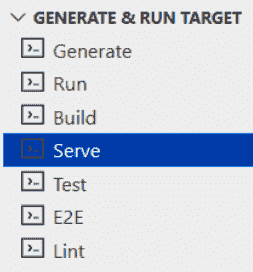

图 8.1 – Serve 选项

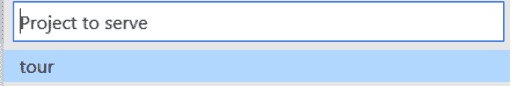

图 8.2 – 应用选择

4.  点击 Serve 选项卡的 Run 按钮来构建应用，并在浏览器中打开 http://localhost:4200：

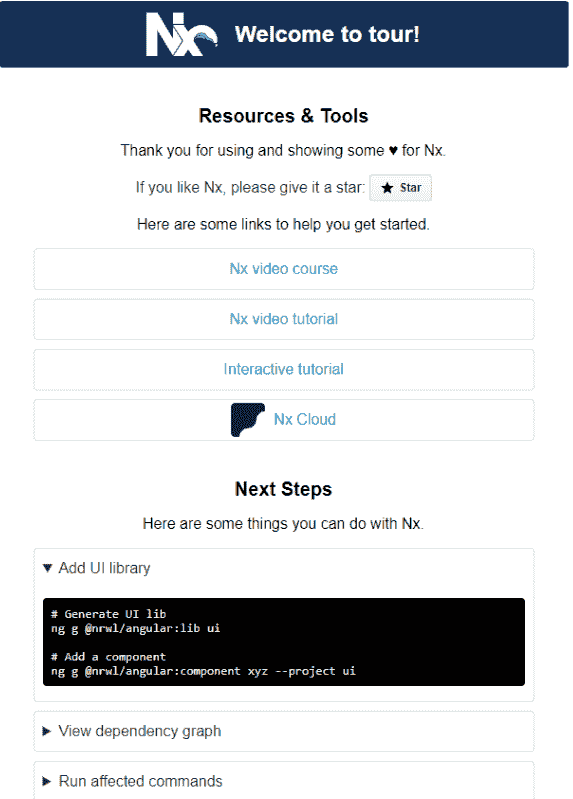

图 8.3 – 最小化的 Nx 应用

恭喜！你的新应用已正确配置！Nx 会像 Angular CLI 一样为我们创建一个最小化的骨架应用，以便我们可以在其基础上构建功能。

在下一节中，我们将通过在工作区中创建管理员门户和访客门户，更深入地了解 Nx Dev Tools。

## 创建用户专属门户

我们的应用将包含两个供不同用户使用的门户。访客将能够查看 POI 列表并在地图上选择它们。管理员将能够查看每个 POI 的统计数据。我们将在以下章节中进一步了解如何使用 Nx Dev Tools：

-   构建访客门户
-   构建管理员门户

每个门户都将是一个独立的 Nx 库，根据在浏览器地址栏中输入的 URL 进行加载。将代码组织在库中使得我们可以在不同应用之间复用它，并单独构建和测试它。我们将在下一节开始构建访客门户。

## 构建访客门户

访客门户将是 Nx 工作区中的一个库，默认情况下会被加载。让我们看看如何通过 Nx Console 构建该库：

1.  从 VSCode 侧边栏运行 Nx Console，并从 GENERATE & RUN TARGET 窗格中选择 Generate 选项：

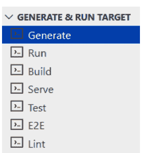

图 8.4 – Generate 选项

2.  在弹出的对话框中选择 @nrwl/angular – library 选项。@nrwl/angular 命名空间包含我们可以在 Angular 应用的 Nx monorepo 中执行的原理图。

**重要提示**
如果在对话框中看不到该选项，请重启 VSCode。

3.  输入 `visitor` 作为库的名称，然后点击 **Generate** 选项卡中的 **Run** 按钮：

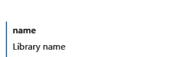

图 8.5 – 库名称

**提示**
在输入库名称时，你可能注意到 Nx 在终端中执行了 `generate` 命令。实际上它并没有执行。相反，它是在模拟在系统中运行该命令的效果；这种技术称为**试运行**。

Nx 将在我们工作区的 `libs` 文件夹中创建 `visitor` 库。该库目前不包含任何组件。根据项目规范，访客门户将包含一个 POI 列表，用户可以在其中选择它们并在地图上查看其位置。因此，我们需要创建一个具有以下布局的 Angular 组件：

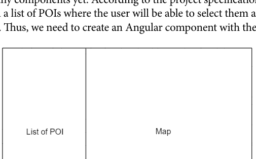

图 8.6 – 访客门户布局

在我们的例子中，我们将使用 `navigation` 组件，因为我们需要一个侧边栏。让我们看看如何生成该组件：

1.  从 VSCode 侧边栏打开 Nx Console，然后选择 **Generate** 选项。
2.  在弹出的对话框中选择 **@angular/material – navigation** 选项。
    **@angular/material** 命名空间包含我们可以运行来创建 Angular Material 组件的原理图。
3.  输入组件的名称：
4.  从我们之前创建的 **project** 下拉列表中选择 **visitor** 库：
5.  勾选 **flat** 选项，这样组件就不会生成在单独的文件夹中：

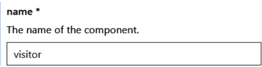

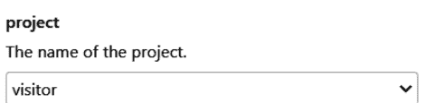

> **重要提示**
> 如果库没有出现在下拉列表中，请重启 VSCode。

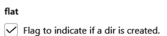

该组件将是库中的主组件，因此我们希望它与其相关的模块文件位于同一个文件夹中。

6.  输入将创建组件的文件夹：

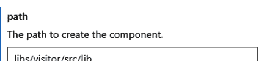

图 8.10 – 组件文件夹

> 提示
> 无需定义将在其中创建组件的模块，因为 Angular CLI 可以直接从 path 选项推断出来。

7.  点击 Run 按钮生成组件。

Nx Console 将在 Nx 工作区的 visitor 库中创建 visitor 组件。我们现在需要将其与工作区的主应用连接起来：

1.  打开 app.component.css 文件并删除所有 CSS 样式，因为我们的应用将使用 Angular Material 库进行样式化。
2.  打开 app.component.html 文件并将其内容替换为以下 HTML 模板：

```
<router-outlet></router-outlet>
```

router-outlet 组件是 Angular 路由的一部分，是一个占位符，我们将在其中加载我们的门户。

3.  打开 app.module.ts 文件，并添加一个路由配置，当 URL 包含 tour 路径时加载访客门户：

```
import { RouterModule } from '@angular/router';
@NgModule({
  declarations: [AppComponent],
  imports: [BrowserModule, BrowserAnimationsModule,
    RouterModule.forRoot([
      { path: 'tour', loadChildren: () =>
        import('@packt/visitor').then(m =>
          m.VisitorModule) },
```

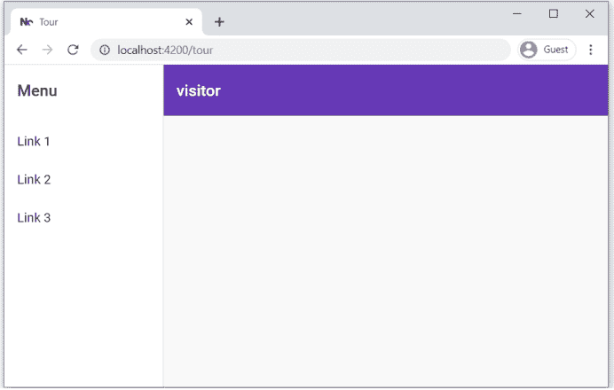

图 8.11 – 访客门户

Angular 路由会将我们重定向到 `http://localhost:4200/tour`，并显示访客门户。它目前包含一些在我们生成 navigation 组件时 Angular Material 输入的演示数据。我们将在*使用 NgRx 管理应用状态*一节中重新讨论它，以使用 NgRx 实现完整功能。目前，我们将在下一节中继续构建管理员门户。

## 构建管理员门户

管理员门户将是一个包含单个组件的 Nx 库，就像访客门户一样，只是它不会基于 Angular Material 模板。让我们开始使用 Nx Console 搭建库的结构：

1.  从 VSCode 侧边栏运行 Nx Console，然后选择 **Generate** 选项。
2.  在弹出的对话框中，选择 **@nrwl/angular – library** 选项。
3.  输入 `admin` 作为库的名称，然后点击 **Run** 按钮。

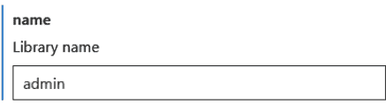

图 8.12 – 库名称

4.  再次点击 Nx Console 中的 **Generate** 选项，然后选择 **@schematics/angular – component** 选项。**@schematics/angular** 命名空间包含我们可以使用 Angular CLI 在 Angular 应用中运行的原理图。

5.  为组件输入与库相同的名称：

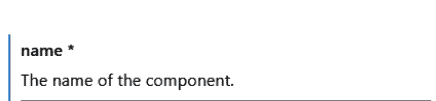

图 8.13 – 组件名称

6.  在 **project** 下拉列表中选择我们创建的库：

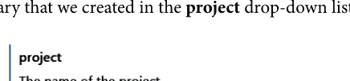

图 8.14 – 项目选择

> **重要提示**
> 如果库没有出现在下拉列表中，请重启 VSCode。

7.  勾选 **flat** 选项，这样组件将创建在与库的模块文件相同的文件夹中：

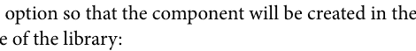

图 8.15 – flat 选项

8.  输入将创建组件的文件夹，然后点击 **Run** 按钮：

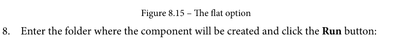

图 8.16 – 组件文件夹


The Angular CLI will create the admin component inside the folder of the admin library. We now need to wire up the admin library to the monorepo application:

1. Open the app.module.ts file and add a new route configuration object for the admin library:

```
RouterModule.forRoot([
  { path: 'admin', loadChildren: () =>
    import('@packt/admin').then(m => m.AdminModule) },
  { path: 'tour', loadChildren: () =>
    import('@packt/visitor').then(m => m.VisitorModule)
  },
  { path: '', pathMatch: 'full', redirectTo: 'tour' }
])
```

2. Open the admin.module.ts file and add a route configuration to activate AdminComponent by default:

```
import { NgModule } from '@angular/core';
import { CommonModule } from '@angular/common';
import { AdminComponent } from './admin.component';
import { RouterModule } from '@angular/router';

@NgModule({
  imports: [
    CommonModule,
    RouterModule.forChild([
      { path: '', component: AdminComponent }
    ]),
  ],
  declarations: [
    AdminComponent
  ],
})
export class AdminModule {}
```

3. Use the Serve option of Nx Console to run the application and navigate to http://localhost:4200.

4. Edit the URL address of the browser and change it to `http://localhost:4200/admin:`

admin works!

Figure 8.17 – Administrator portal

The page will display the default template of the main component of the administrator library.

We have now completed the scaffolding of our enterprise application. First, we created the Nx monorepo workspace that will host the portals of the application. Then, we used Nx Console to generate our portals along with their main components. We also installed Angular Material to use its UI elements in our components.

In the next section, we will implement the functionality of the visitor portal using NgRx.

## Managing application state with NgRx

The visitor portal will allow the user to see a list of available POIs and select one to view its location on a map. The list of available POIs and the selection of a POI is the global state of our application. We will integrate NgRx for managing the application state in the visitor portal by completing the following tasks:

- Configuring the state
- Interacting with the store

Let's begin by configuring the state of our application in the following section.

### Configuring the state

Our application will consist of a root state for the whole application and a feature state for the visitor portal. We will start by executing the following command to create the root state:

```
nx generate ngrx app --root --no-interactive --project=tour --module=apps/tour/src/app/app.module.ts
```

The preceding command uses the generate command of Nx CLI, passing the following options:

- ngrx: Indicates that we want to set up an NgRx state
- app: The name of the state
- --root: Indicates that we want to configure a root state
- `--no-interactive`: Disables interactive input prompts
- `--project=tour`: The name of the application in our workspace
- `--module=apps/tour/src/app/app.module.ts`: Registers the state with the main Angular module of our application

The previous command will add all necessary NgRx npm packages in the `package.json` file and install them. It will also modify the `app.module.ts` file to configure all NgRx-related artifacts such as the store, effects, and **Store DevTools**.

> **Tip**
> Store DevTools is an npm package of the NgRx library that provides debugging, monitoring, and instrumentation capabilities to the state of an NgRx application. It must be used in conjunction with the **Redux DevTools** browser extension, which can be found at https://github.com/zalmoxisus/redux-devtools-extension.

The `visitor` library itself will not manage the data for the state of the visitor portal. Instead, we will create a new library in our Nx workspace that will fetch and store data in the feature state. Execute the following command of Nx CLI to create a new library:

```
nx generate lib poi
```

The preceding command will generate the `poi` library in our Nx monorepo.

> **Tip**
> The `generate` command of Nx CLI that we used has the same effect as creating the library using Nx Console.

Now that we have created the library, we can set up the feature state using the following command:

```
nx generate ngrx poi --project=poi --no-interactive
--module=libs/poi/src/lib/poi.module.ts --barrels
```

The preceding command uses the `generate` command of Nx CLI to register a feature state passing additional options:

- `ngrx`: Indicates that we want to set up an NgRx state.
- `poi`: The name of the state.
- `--project=poi`: The name of the library in our workspace.
- `--no-interactive`: Disables interactive input prompts.
- `--module=libs/poi/src/lib/poi.module.ts`: Registers the state with the Angular module of our library.
- `--barrels`: Indicates to use barrel files to re-export NgRx artifacts such as selectors and state. The name of a barrel file is usually `index.ts` by convention.

The preceding command will create a folder, named `+state` by convention, inside our library that contains the following files:

- `poi.actions.ts`: Defines NgRx actions for the feature state
- `poi.effects.ts`: Defines NgRx effects for the feature state
- `poi.models.ts`: Defines an entity interface for POI data
- `poi.reducer.ts`: Defines NgRx reducers for the feature state
- `poi.selectors.ts`: Defines NgRx selectors for the feature state

Nx CLI has done most of the job by adding the necessary content in the previous files, eliminating the boilerplate code for us. We now need to create an Angular service in the library that will fetch the POI data:

1. Open the `poi.models.ts` file and add the following properties to the `PoiEntity` interface:

```
export interface PoiEntity {
  id: string | number; // Primary ID
  name: string;
  lat: number;
  lng: number;
  description: string;
  imgUrl: string;
}
```

2. Execute the following command to generate the Angular service:

```
nx generate service poi --project=poi
```

The preceding command will create an Angular service called `poi` in the poi library.

3. Open the poi.service.ts file and add the following import statements:

```
import { HttpClient } from '@angular/common/http';
import { Observable } from 'rxjs';
import { PoiEntity } from '...';
```

4. Inject HttpClient in the constructor of the PoiService class and create a method to get POI data from the assets/poi.json file:

```
export class PoiService {

  constructor(private http: HttpClient) {}

  getAll(): Observable<PoiEntity[]> {
    return
      this.http.get<PoiEntity[]>('assets/poi.json');
  }
}
```

We use the built-in HTTP client of the Angular framework to get POI data by initiating a GET HTTP request.

> **Important note**
> You can get the poi.json file from the GitHub repository of the Getting started section and copy it to the apps\tour\src\assets folder of your workspace.

5. Open the poi.effects.ts file and add the following import statements:

```
import { map } from 'rxjs/operators';
import { PoiService } from '../poi.service';
```

6. Inject PoiService in the constructor of the PoiEffects class:

```
constructor(private actions$: Actions, private poiService: PoiService) {}
```

7. Modify the `init$` property to use the `poiService` variable:

```
init$ = createEffect(() =>
  this.actions$.pipe(
    ofType(PoiActions.init),
    fetch({
      run: (action) => {
        return this.poiService.getAll().pipe(
          map(pois => PoiActions.loadPoiSuccess({ poi:
            pois }))
        )
      },

      onError: (action, error) => {
        console.error('Error', error);
        return PoiActions.loadPoiFailure({ error });
      },
    })
  )
);
```

The effect is responsible for listening to all actions that are dispatched in the store. As soon as a `PoiActions.init` action is dispatched, the `init$` property is triggered and calls the `getAll` method of the `poiService` variable. The `init$` property knows which action to listen for by the parameters in the `ofType` operator.

> **Tip**
> The `ofType` operator can accept more than one action.

If the data is fetched successfully, the effect will dispatch a new action in the store, `PoiActions.loadPoiSuccess`, with POI data as the payload. If there is a failure getting the data, it will dispatch a `PoiActions.loadPoiFailure` action in the store.

8. Open the `app.module.ts` file and import `HttpClientModule` from the `@angular/common/http` namespace:

```
import { HttpClientModule } from
  '@angular/common/http';
```

Add the `HttpClientModule` class also in the `imports` array of the `@NgModule` decorator.


应用程序的全局状态现已配置完成，可以开始使用了。在下一节中，我们将在访客库中创建额外的 Angular 组件，使其与应用程序的功能状态进行交互。

## 与 store 交互

访客门户将通过两个 Angular 组件与应用程序的功能状态进行交互。一个组件将显示 POI 列表并允许用户选择其中一个。另一个组件将显示一个 **Google Maps** 地图并在地图上显示所选的 POI。

起初，我们将构建显示 POI 列表的组件：

1. 打开 visitor.module.ts 文件并添加以下 import 语句：

   ```
   import { PoiModule } from '@packt/poi';
   ```

2. 在 @NgModule 装饰器的 imports 数组中添加 PoiModule：

   ```
   @NgModule({
     imports: [CommonModule, LayoutModule,
       MatToolbarModule, MatButtonModule,
       MatSidenavModule, MatIconModule, MatListModule,
       RouterModule.forChild([
         { path: '', component: VisitorComponent }
       ]),
       PoiModule
     ],
     declarations: [VisitorComponent],
   })
   ```

   我们导入 PoiModule，以便在访客门户加载时，poi 功能状态立即在 store 中注册。

3. 执行以下 Nx CLI 命令来创建 Angular 组件：

   ```
   nx generate component poi-list --project=visitor
   ```

4. 打开 poi-list.component.ts 文件并添加以下 import 语句：

   ```
   import { Store } from '@ngrx/store';
   import { PoiActions, PoiSelectors } from '@packt/poi';
   ```

5. 在 PoiListComponent 类的构造函数中注入 Store 服务：

   ```
   constructor(private store: Store) { }
   ```

6. 在组件初始化时，在 store 中分发 PoiActions.init action 以获取 POI 数据：

   ```
   ngOnInit(): void {
     this.store.dispatch(PoiActions.init());
   }
   ```

   我们将 action 作为方法执行，并将其结果传递给 store 变量的 dispatch 方法。

7. 创建一个组件属性，该属性调用 PoiSelectors.getAllPoi 选择器以从 store 中列出 POI 数据：

   ```
   pois$ = this.store.select(PoiSelectors.getAllPoi);
   ```

   我们使用 store 变量的 select 方法来执行选择器。

   > **重要说明**
   > 我们没有创建 PoiSelectors.getAllPoi 选择器。NgRx 在我们在 poi 库中生成功能状态时为我们创建了它。

8. 打开 poi-list.component.html 文件并用以下 HTML 模板替换其内容：

   ```
   <mat-action-list *ngFor="let poi of pois$ | async">
     <button mat-list-item>{{poi.name}}</button>
   </mat-action-list>
   ```

   我们使用 Angular Material 库的 mat-action-list 组件将每个 POI 显示为单个操作项。我们使用 async 管道订阅 pois$ 属性，并为每个 POI 创建带有 mat-list-item 指令的按钮元素。

9. 打开 visitor.component.html 文件并用我们创建的 Angular 组件的选择器替换 mat-nav-list 组件：

   ```
   <mat-sidenav #drawer class="sidenav" fixedInViewport
     [attr.role]="(isHandset$ | async) ? 'dialog' :
     'navigation'"
     [mode]="(isHandset$ | async) ? 'over' : 'side'"
     [opened]="(isHandset$ | async) === false">
     <mat-toolbar>Menu</mat-toolbar>
     <packt-poi-list></packt-poi-list>
   </mat-sidenav>
   ```

使用 Nx Console 启动应用程序，您应该在菜单侧边栏中看到以下输出：

# Menu

Acropolis

Delphi

White Tower

Figure 8.18 – List of POIs

我们已经创建了将显示可用 POI 列表的 Angular 组件。现在让我们看看如何创建使用 Google Maps 显示 POI 的组件。

Angular Material 库包含一个可用于我们应用程序的 Google Maps 组件：

1. 运行以下 npm 客户端命令来安装 Google Maps 组件：

   ```
   npm install @angular/google-maps
   ```

2. 打开 visitor.module.ts 文件并添加以下 import 语句：

   ```
   import { GoogleMapsModule } from '@angular/google-maps';
   ```

3. 将 GoogleMapsModule 添加到 @NgModule 装饰器的 imports 数组中：

   ```typescript
   @NgModule({
     imports: [CommonModule, LayoutModule,
       MatToolbarModule, MatButtonModule,
       MatSidenavModule, MatIconModule, MatListModule,
       RouterModule.forChild([
         { path: '', component: VisitorComponent }
       ]),
       PoiModule,
       GoogleMapsModule
     ],
     declarations: [VisitorComponent, PoiListComponent],
   })
   ```

4. 打开应用程序的 `index.html` 文件并在 head 元素中包含 **Google Maps JavaScript API**：

   ```html
   <script src="https://maps.googleapis.com/maps/api/js">
   </script>
   ```

现在我们已经在应用程序中安装并注册了 Google Maps，让我们创建将托管它的 Angular 组件：

1. 执行以下 Nx CLI 命令来创建一个新的 Angular 组件：

   ```bash
   nx generate component map --project=visitor
   ```

2. 打开 `map.component.ts` 文件并添加以下 import 语句：

   ```typescript
   import { Store } from '@ngrx/store';
   import { PoiSelectors } from '@packt/poi';
   ```

3. 在 MapComponent 类的构造函数中注入 Store 服务并声明一个属性以从 store 获取所选 POI：

   ```typescript
   export class MapComponent implements OnInit {

     poi$ = this.store.select(PoiSelectors.getSelected);

     constructor(private store: Store) { }

     ngOnInit(): void {
     }

   }
   ```

4. 打开 `map.component.html` 文件并用以下 HTML 模板替换其内容：

   ```html
   <google-map height="100%" width="auto" *ngIf="poi$ |
     async as poi" [center]="poi">
     <map-marker [position]="poi"></map-marker>
   </google-map>
   ```

   在前面的模板中，我们使用 `async` 管道订阅 `poi$` 属性。一旦我们从 store 获取到选定的 POI，我们就会显示一个 `google-map` 组件并将地图中心设置为 POI 坐标。此外，我们还在指定的 POI 坐标上添加一个标记。

5. 打开 `visitor.component.html` 文件并用 `MapComponent` 的选择器替换 `mat-sidenav-content` 组件的内容：

   ```html
   <mat-sidenav-content>
     <mat-toolbar color="primary">
       <button
         type="button"
         aria-label="Toggle sidenav"
         mat-icon-button
         (click)="drawer.toggle()"
         *ngIf="isHandset$ | async">
         <mat-icon aria-label="Side nav toggle icon">
           menu</mat-icon>
       </button>
       <span>visitor</span>
     </mat-toolbar>
     <packt-map></packt-map>
   </mat-sidenav-content>
   ```

我们创建的 Angular 组件将在从列表中选择 POI 后立即显示其在地图上的位置。如果您尝试从列表中选择一个 POI，您会注意到什么都没有发生。为什么会这样？

应用程序的全局状态目前不知道何时选择了 POI。我们需要添加必要的代码来设置所选 POI 并与 store 交互：

1. 打开 poi.actions.ts 文件并添加一个用于传递所选 POI ID 的新 action：

   ```
   export const selectPoi = createAction(
     '[Poi/API] Select Poi',
     props<{ poiId: string | number }>()
   );
   ```

2. 打开 poi.reducer.ts 文件并在 poiReducer 属性中添加一个新语句，该语句将监听 selectPoi action 并将所选 POI 保存到 store 中：

   ```
   const poiReducer = createReducer(
     initialState,
     on(PoiActions.init, (state) => ({ ...state, loaded: false, error: null })),
     on(PoiActions.loadPoiSuccess, (state, { poi }) =>
       poiAdapter.setAll(poi, { ...state, loaded: true })
     ),
     on(PoiActions.loadPoiFailure, (state, { error }) =>
       ({ ...state, error })),
     on(PoiActions.selectPoi, (state, { poiId }) => ({
       ...state, selectedId: poiId }))
   );
   ```

3. 打开 poi-list.component.ts 文件并导入 PoiEntity 接口：

   ```
   import { Component, OnInit } from '@angular/core';
   import { Store } from '@ngrx/store';
   import { PoiActions, PoiEntity, PoiSelectors } from '@packt/poi';
   ```


4. 创建一个新方法来将选定的 PoiEntity  along with the selected PoiEntity 分派到 store 的 selectPoi action：

```
selectPoi(poi: PoiEntity) {
    this.store.dispatch(PoiActions.selectPoi({poiId:
        poi.id}));
}
```

5. 打开 poi-list.component.html 文件并将 selectPoi 方法绑定到按钮元素的 click 事件：

```
<mat-action-list *ngFor="let poi of pois$ | async">
    <button mat-list-item
        (click)="selectPoi(poi)">{{poi.name}}</button>
</mat-action-list>
```

要查看新功能的效果，请使用 Nx Console 中的 Serve 选项运行应用程序并从列表中选择一个 POI。应用程序的输出应如下所示：

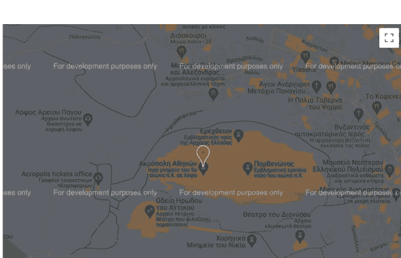

图 8.19 – POI 选择

> **重要提示**
> 我们在该项目中使用开发模式的 Google Maps。对于生产环境，您应该在 https://developers.google.com/maps/gmp-get-started 获取 API 密钥并将其包含在 index.html 文件中加载的 Google Maps JavaScript API 脚本中，例如 `<script src="https://maps.googleapis.com/maps/api/js?key=YOUR_API_KEY"></script>`。

我们现在已完成访客门户所需的所有功能。做得好！实现访客门户的基本功能需要与 NgRx 交互以管理应用程序的全局状态。全局状态被分离为应用程序的根状态和访客门户的功能状态。后者在访客库中用于创建 Angular 组件以显示 POI 列表并选择一个在 Google Maps 中查看。

在下一节中，我们将构建管理员门户以获取每个 POI 的访问统计信息。

## 使用图表可视化数据

管理员门户将负责使用图表显示每个 POI 的流量访问。流量会在访客通过点击地图上的标记访问 POI 时产生。应用程序将在浏览器的本地存储中持久保存访问数据。它将为每次访问保留一条记录，其中包含 POI 的 ID 和总访问次数。管理员门户将包括以下功能：

- 在 store 中持久保存访问数据
- 显示访问统计信息

我们将通过在以下部分实现跟踪访问的机制来开始构建管理员门户。

## 在 store 中持久保存访问数据

我们的应用程序尚未为 POI 记录流量统计信息。让我们看看如何完成此任务：

1. 打开 map.component.html 文件并添加 map-info-window 组件：

```
```html
<google-map height="100%" width="auto" *ngIf="poi$ |
  async as poi" [center]="poi">
  <map-marker [position]="poi"></map-marker>
```
```

```
```html
<map-info-window>
  <mat-card>
    <mat-card-header>
      <mat-card-title>{{poi.name}}</mat-card-title>
    </mat-card-header>
    
    <mat-card-content>
      <p>{{poi.description}}</p>
    </mat-card-content>
  </mat-card>
</map-info-window>
</google-map>
```
```

`map-info-window` 组件是一个弹出窗口，用于显示有关当前地图标记的附加信息。它以 Angular Material 卡组件的形式显示 POI 的标题、图像和描述。

`mat-card` 组件包含由 `mat-card-header` 组件表示的标题，以及带有 `mat-card-image` 指令的 `img` 元素表示的图像。`mat-card-content` 组件表示卡片的主要内容。

2. 打开 `visitor.module.ts` 文件并导入 `MatCardModule`：

```
```typescript
import { MatCardModule } from
  '@angular/material/card';

@NgModule({
  imports: [CommonModule, LayoutModule,
    MatToolbarModule, MatButtonModule,
    MatSidenavModule, MatIconModule, MatListModule,
    RouterModule.forChild([
      { path: '', component: VisitorComponent }
    ]),
    PoiModule,
    GoogleMapsModule,
    MatCardModule
  ],
  declarations: [VisitorComponent, PoiListComponent,
    MapComponent],
})
```
```

MatCardModule 类是一个 Angular Material 模块，公开了我们创建卡片组件所需的所有组件。

3. 打开 map.component.ts 文件并添加以下导入语句：

```
import { Component, OnInit, ViewChild } from
'@angular/core';
import { Store } from '@ngrx/store';
import { PoiSelectors } from '@packt/poi';
import { MapInfoWindow, MapMarker } from
'@angular/google-maps';
```

4. 使用 @ViewChild 装饰器声明一个组件属性以获取对信息窗口的引用：

```
@ViewChild(MapInfoWindow) info: MapInfoWindow |
    undefined;
```

5. 创建一个用于打开信息窗口的方法：

```
showInfo(marker: MapMarker) {
    this.info?.open(marker);
}
```

在前面的代码中，我们调用信息窗口引用的 open 方法，将关联的地图标记作为参数传递。

6. 打开 map.component.html 文件并将 showInfo 组件方法绑定到 map-marker 组件的 mapClick 事件：

```
<map-marker #marker="mapMarker" [position]="poi" (mapClick)="showInfo(marker)"></map-marker>
```

我们创建 marker 模板引用变量以获取对 mapMarker 对象的引用并将其作为参数传递给 showInfo 方法。

7. 使用 Nx Console 的 Serve 选项运行应用程序并从列表中选择一个 POI。

8. 点击地图上的 POI 标记，您应该得到类似于以下的输出：

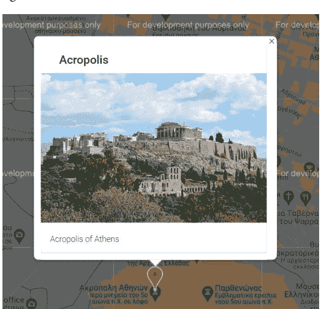

图 8.20 – 地图信息窗口

我们认为当访客点击地图标记并出现信息窗口时，POI 被访问。我们的应用程序随后会通知 store 该操作以将其保存在本地存储中。让我们创建与 store 交互的逻辑：

1. 打开 poi.actions.ts 文件并创建一个新的 action 指示 POI 已被访问：

```
export const visitPoi = createAction(
  '[Poi/API] Visit Poi',
  props<{ poiId: string | number }>(
)
```

2. 打开 poi.effects.ts 文件并添加以下导入语句：

```
import { EMPTY } from 'rxjs';
```

3. 创建一个新的 effect 来监听 `visitPoi` action 并将指定 `poiId` 的总访问次数增加 *one*：

```
```typescript
visit$ = createEffect(() =>
  this.actions$.pipe(
    ofType(PoiActions.visitPoi),
    fetch({
      run: action => {
        const stat = localStorage.getItem('tour-' + action.poiId);
        const total = stat ? Number(stat) + 1 : 1;
        localStorage.setItem('tour-' + action.poiId, total.toString());
        return EMPTY;
      }
    })
  )
);
```
```

在前面的代码中，我们获取以单词 `tour-` 开头后跟 POI ID 的本地存储键。如果存在，我们将其增加 *one* 并更新本地存储。否则，我们将其初始化为 *one*。

> **提示**
> 在实际情况下，最好将 `localStorage` 的逻辑抽象到一个 Angular 服务中，该服务作为全局 `localStorage` 对象的包装器。我们鼓励您在构建此项目时创建此类服务。

effect 的 `run` 方法返回 `EMPTY` RxJS 操作符，这会导致 observable 完成且没有值。

4. 打开 `map.component.ts` 文件并从 `@packt/poi` 命名空间导入 `PoiActions`：

```
```typescript
import { PoiActions, PoiSelectors } from '@packt/poi';
```
```

5. 修改 `showInfo` 组件方法使其向 store 分派 `visitPoi` action：

```
```typescript
showInfo(marker: MapMarker, poiId: string | number) {
  this.store.dispatch(PoiActions.visitPoi({ poiId }));
  this.info?.open(marker);
}
```
```

6. 最后，打开 `map.component.html` 文件并将选定的 POI ID 传递给 `showInfo` 方法：

```
```html
<map-marker #marker="mapMarker" [position]="poi"
  (mapClick)="showInfo(marker, poi.id)"></map-marker>
```
```

我们的应用程序现在可以记录每个 POI 的访问次数并将其保存在浏览器的本地存储中。在下一节中，我们将创建管理员门户的主要组件，该组件利用访问数据。

## 显示访问统计信息

管理员门户将在其主组件上使用图表显示访问统计信息。我们将使用 **ng2-charts** 库在饼图上可视化数据。让我们看看如何在该组件中添加所需的功能：

1. 使用以下命令安装 ng2-charts 库：

```
```bash
npm install ng2-charts chart.js@2.9.3
```
```

前面的命令还将安装 `chart.js` 库，它是 ng2-charts 库的核心。

2. 打开 `admin.module.ts` 文件并从 `@packt/poi` 命名空间导入 `PoiModule`，并从 ng2-charts npm 包导入 `ChartsModule`：

```
```typescript
import { NgModule } from '@angular/core';
import { CommonModule } from '@angular/common';
import { AdminComponent } from './admin.component';
import { RouterModule } from '@angular/router';
import { PoiModule } from '@packt/poi';
import { ChartsModule } from 'ng2-charts';
```
```


```typescript
@NgModule({
  imports: [
    CommonModule,
    RouterModule.forChild([
      { path: '', component: AdminComponent }
    ]),
    PoiModule,
    ChartsModule
  ],
  declarations: [
    AdminComponent
  ],
})
export class AdminModule {}
```

3. 打开 angular.json 文件并在 build 部分的 options 属性中添加以下属性：

```json
"options": {
  "outputPath": "dist/apps/tour",
  "index": "apps/tour/src/index.html",
  "main": "apps/tour/src/main.ts",
  "polyfills": "apps/tour/src/polyfills.ts",
  "tsConfig": "apps/tour/tsconfig.app.json",
  "assets": ["apps/tour/src/favicon.ico",
    "apps/tour/src/assets"],
  "styles": [
    "./node_modules/@angular/material/prebuilt-themes/deeppurple-amber.css",
    "apps/tour/src/styles.css"
  ],
  "scripts": [],
  "allowedCommonJsDependencies": ["chart.js"]
}
```

The chart.js npm package is a **CommonJS** module. The Angular CLI displays a warning when using a CommonJS module because it can prevent it from optimizing your application, resulting in large bundle sizes. Setting the allowedCommonJsDependencies option will not display the warning while building the application.

4. 打开 admin.component.ts 文件并添加以下 import 语句：

```
import { Component, OnDestroy, OnInit } from '@angular/core';
import { Store } from '@ngrx/store';
import { PoiActions, PoiEntity, PoiSelectors } from '@packt/poi';
import { Subscription } from 'rxjs';
```

5. 修改 AdminComponent 类，使其与应用程序 store 交互以获取 POI 数据：

```
export class AdminComponent implements OnInit,
  OnDestroy {

  private subscription: Subscription | undefined;

  constructor(private store: Store) { }

  ngOnInit(): void {
    this.subscription = this.store.select(
      PoiSelectors.getAllPoi).subscribe();
    this.store.dispatch(PoiActions.init());
  }

  ngOnDestroy() {
    this.subscription?.unsubscribe();
  }
}
```

在前面的代码中，我们使用 subscription 属性手动订阅 `getAllPoi` 选择器，而不是使用 async pipe。在这种情况下，我们还必须在组件的 `ngOnDestroy` 生命周期钩子中手动取消订阅，使用 unsubscribe 方法。如果我们未能这样做，我们可能会在应用程序中引入内存泄漏。

现在我们已经设置了与 store 的交互，我们可以从本地存储中获取统计数据并创建饼图：

+   1. 执行以下 Nx CLI 命令在 admin 库中创建一个服务：

```
```bash
nx generate service admin --project=admin
```
```

+   2. 打开 `admin.service.ts` 文件并添加以下 import 语句：

```
```typescript
import { PoiEntity } from '@packt/poi';
```
```

+   3. 创建一个方法来从浏览器本地存储中获取所有保存的流量统计数据：

```
```typescript
getStatistics(pois: PoiEntity[]): number[] {
  return pois.map(poi => {
    const stat = localStorage.getItem('tour-' +
      poi.id) ?? 0;
    return +stat;
  });
}
```
```

在前面的方法中，我们根据其 id 属性获取每个 POI 的流量。我们通过添加 `+` 前缀将 `stat` 属性转换为数字。

+   4. 打开 `admin.component.ts` 文件并添加以下 import 语句：

```
```typescript
import { Label } from 'ng2-charts';
import { AdminService } from './admin.service';
```
```

+   5. 声明用于在饼图上显示的标签和实际数据的组件属性，并在 `AdminComponent` 类的构造函数中注入 `AdminService`：

```
```typescript
data: number[] = [];
labels: Label[] = [];
```
```

```
constructor(private store: Store, private
  adminService: AdminService) { }
```

+   6. 创建一个组件方法来设置图表的标签和数据：

```
private buildChart(pois: PoiEntity[]) {
  this.labels = pois.map(poi => poi.name);
  this.data = this.adminService.getStatistics(pois);
}
```

图表标签是 POI 的标题，数据来自 `adminService` 变量的 `getStatistics` 方法。

+   7. 在 `getAllPoi` 选择器的 `subscribe` 方法内部调用 `buildChart` 方法：

```
ngOnInit(): void {
  this.subscription = this.store.select(
    PoiSelectors.getAllPoi).subscribe(pois => {
      this.buildChart(pois);
    });
  this.store.dispatch(PoiActions.init());
}
```

+   8. 最后，打开 `admin.component.html` 文件并用以下 HTML 模板替换其内容：

```
<div class="chart" *ngIf="data.length">
  <canvas height="100" baseChart
    [data]="data"
    [labels]="labels"
    chartType="pie">
  </canvas>
</div>
```

在前面的模板中，我们使用 `baseChart` 指令将 `canvas` 元素转换为图表。图表使用 `chartType` 属性设置为饼图，并使用相应的组件属性中的 `data` 和 `labels` 属性。

如果我们现在使用 Nx Console 运行应用程序，访问地图上的一些 POI，并切换到 http://localhost:4200/admin URL，我们应该会看到以下输出：

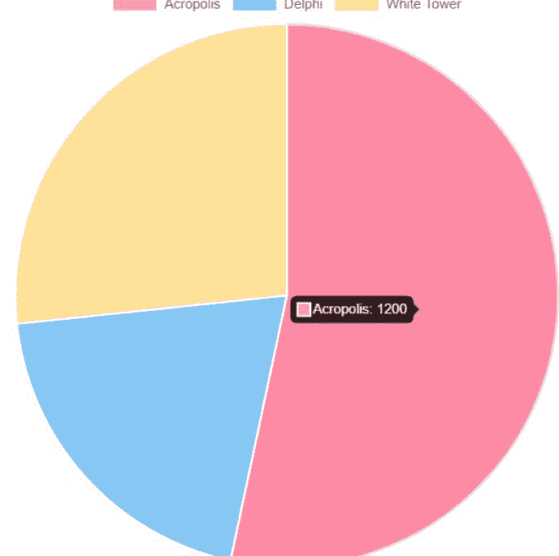

Figure 8.21 – POI statistics

管理员现在可以完全了解每个 POI 在访问方面的表现。我们的管理员门户现已完成。访客门户可以与 store 交互并在浏览器的本地存储中为每个 POI 保存访问统计数据。然后管理员门户可以获取该数据并使用 ng2-charts 库在饼图上显示它。

# Summary

在本项目中，我们为在地图上访问 POI 并为每个 POI 显示访问统计数据构建了一个企业门户应用程序。首先，我们看到了如何使用 Nx Dev Tools 为新的 Nx monorepo 应用程序搭建脚手架。然后，我们为应用程序创建了两个不同的门户，一个访客门户和一个管理员门户。我们学习了如何在访客门户中使用 NgRx 库来维护和管理应用程序的状态。最后，我们看到了如何在管理员门户中使用图表库来为每个 POI 显示统计数据。

在下一章中，我们将使用 Angular CLI 使用 Angular CDK 构建一个 UI 组件库。

# Practice questions

让我们看几个练习题：

+   1. 哪个 npm 包可以创建 Nx monorepo 应用程序？
+   2. Angular CLI 和 Nx CLI 有什么区别？
+   3. 如何在 monorepo 的库中启用 NgRx？
+   4. 如何从 store 中选择数据？
+   5. 如何在 NgRx 中与 HTTP 交互？
+   6. 我们在哪里修改 NgRx store 的状态？
+   7. 根状态和特性状态有什么区别？
+   8. 我们可以在 Angular 应用程序中使用哪个 npm 包来使用 Google Maps？
+   9. 如何手动订阅 NgRx 选择器？
+   10. 我们使用哪个组件在 Google Maps 上显示附加信息？

# Further reading

以下是一些用于在本书章节中学到的内容之上的链接：

+   - Nx Dev Tools: https://nx.dev/
+   - Nx CLI: https://nx.dev/latest/angular/getting-started/cli-overview
+   - NgRx: https://ngrx.io/
+   - NgRx store guide: https://ngrx.io/guide/store
+   - Angular Material card component: https://material.angular.io/components/card/overview
+   - Angular Google Maps: https://github.com/angular/components/tree/master/src/google-maps
+   - ng2-charts: https://valor-software.com/ng2-charts/
+   - create-nx-workspace: https://www.npmjs.com/package/create-nx-workspace
