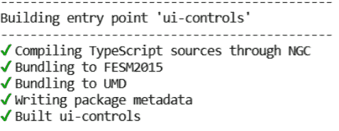
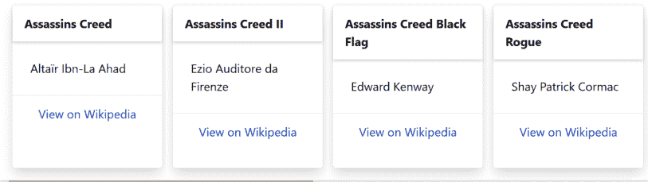
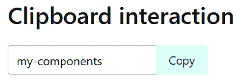
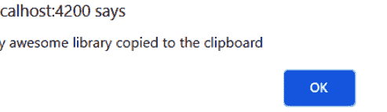
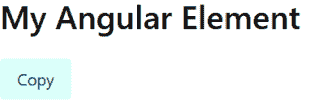
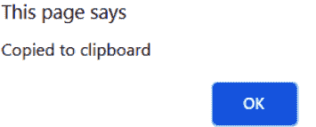
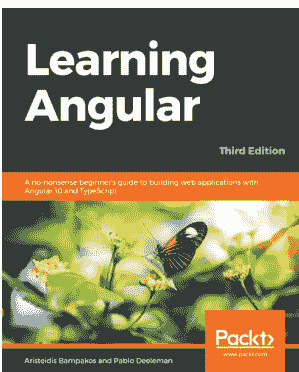

# 9 构建可复用 Angular 库与 Schematics
## Building
a Component
UI Library Using
Angular CLI and
Angular CDK

Angular 应用程序由组织成模块的 Angular 组件组成。当组件需要在模块之间共享相似的外观或行为时，我们将它们的功能提取到可重用组件中并分组到共享模块中。可重用组件可能从具有许多控件的复杂 **user interface**（UI）结构（例如表单）到单个原生 **HyperText Markup Language (HTML)** 元素（例如按钮）不等。

组件 UI 库是一组可重用组件，可以在特定应用程序域之外使用。采用 monorepo 架构构建的大型企业应用程序可以在其所有应用程序中使用这些组件。组织外部的项目也可以将相同的组件库作为外部依赖项使用。


Angular **命令行界面（CLI）** 包含了使用 Angular 创建库所需的全部工具。**Angular 组件开发工具包（CDK）** 提供了广泛的功能，用于创建可访问且高性能的 UI 组件。在本章中，我们将把它们与 **Bulma**（一个现代的**层叠样式表（CSS）** 框架）结合起来，从头创建一个简单的组件 UI 库。

在本章中，我们将更详细地介绍以下主题：

- 使用 Angular CLI 创建库
- 构建可拖拽的卡片列表
- 与剪贴板交互
- 将 Angular 库发布到 npm
- 将组件用作 Angular 元素

## 必备的背景理论与上下文

Angular CDK 包含一系列常见的交互和行为，我们可以将它们应用于 Angular 组件。它是 Angular Material 库的核心，但也可以与 Angular 应用中的任何 CSS 框架一起使用。Angular CDK 可从 @angular/cdk npm 包中获取。

Angular CLI 开箱即支持创建 Angular 库。Angular 库的功能只能在 Angular 应用中使用，并且与特定的业务逻辑解耦。如果我们想在非 Angular 应用中使用 Angular 库，就需要将其转换为 Angular 元素。

**自定义元素**是一种 Web 标准，允许创建独立于任何 JavaScript 框架的 HTML 元素。它的工作原理是声明一个自定义 HTML 标签，并将其与一个 JavaScript 类关联。浏览器能够识别该 HTML 标签并执行该类中定义的 JavaScript 代码。

Angular 元素是使用 @angular/elements npm 包转换为自定义元素的 Angular 组件。将 Angular 组件打包为自定义元素，可以将 Angular 框架与**文档对象模型（DOM）** 连接起来，为原生 HTML 元素赋予数据绑定、组件生命周期和变更检测等特性。

## 项目概览

在本项目中，我们将为 Angular 项目构建一个组件 UI 库。首先，我们将使用 Angular CLI 为我们的库搭建一个新的 Angular 工作区。然后，我们将使用 Angular CDK 和 Bulma CSS 框架创建以下组件：

- 一个可以使用拖放功能重新排列的卡片列表
- 一个允许我们将任意内容复制到剪贴板的按钮

我们将学习如何将库部署到 npm 等包注册表。最后，我们将使用 ngx-build-plus 库将其中一个组件转换为 Angular 元素，以便与非 Angular 应用共享。

构建时间：1½ 小时

## 入门

完成本项目需要以下先决条件和软件工具：

- Angular CLI：一个用于 Angular 的 CLI，可在 https://angular.io/cli 找到。
- GitHub 资料：本章的相关代码可在 https://github.com/PacktPublishing/Angular-Projects-Second-Edition 的 Chapter09 文件夹中找到。

## 使用 Angular CLI 创建库

在使用 Angular CLI 开始处理 Angular 库之前，我们需要创建一个 Angular CLI 工作区。Angular CLI 工作区将包含我们的 Angular 库和一个用于测试该库的 Angular 应用。

使用以下命令生成一个新的 Angular CLI 工作区：

```
ng new my-components --defaults
```

上述命令将创建一个新的 Angular CLI 工作区，其中包含一个名为 my-components 的 Angular 应用。导航到 my-components 文件夹并执行以下命令以生成一个新的 Angular 库：

```
ng generate library ui-controls
```

上述命令将在工作区的 `projects` 文件夹中创建一个 `ui-controls` 库。它将包含与创建 Angular 应用时类似的各种文件，包括以下内容：

- `src\lib`：包含库的源代码，例如模块、组件和服务。
- `src\public-api.ts`：导出我们希望在其它 Angular 应用中公开使用的库构件。
- `ng-package.json`：包含 ng-packagr 库的配置，Angular CLI 在底层使用它来构建库。
- `tsconfig.lib.json`：我们库的 TypeScript 配置文件，还包含若干 Angular 编译器选项。
- `tsconfig.lib.prod.json`：在生产模式下构建库时使用的 TypeScript 配置文件。

Angular CLI 默认会在 `src\lib` 文件夹中为我们生成一个模块、一个组件和一个服务。它还会导出它们，以便任何使用该库的 Angular 应用都可以使用。你可以在此处看到一个示例：

### public-api.ts

```
/*
 * Public API Surface of ui-controls
 */

export * from './lib/ui-controls.service';
export * from './lib/ui-controls.component';
export * from './lib/ui-controls.module';
```

现在我们已经设置好了 Angular CLI 工作区，可以继续安装 Bulma 和 Angular CDK 库了，如下所示：

1. 执行以下 npm 命令安装 Angular CDK：

   ```bash
   npm install @angular/cdk
   ```

2. 运行以下命令安装 bulma CSS 框架：

   ```bash
   npm install bulma
   ```

我们将 Angular CDK 和 Bulma 库添加到 peerDependencies 部分，以确保任何使用方应用都拥有运行我们库所需的特定版本的包。

> **重要说明**
>
> 如果你跟随本项目操作，每个包的版本号可能会有所不同。为确保使用正确的版本，请从工作区根文件夹的 package.json 文件中复制它们。

现在我们已经完成了 UI 组件库的基本设置。我们还配置了 Angular CLI 工作区自带的 Angular 应用，用于预览和测试该库。在下一节中，我们将构建库的第一个组件——一个可以重新排序的卡片列表。

## 构建可拖拽的卡片列表

我们 UI 库的第一个组件将是一个 Bulma 卡片元素列表。每张卡片将显示标题、描述和一个锚点链接元素。我们还将能够使用 Angular CDK 拖拽卡片并更改卡片列表的顺序。构建我们的组件将包括以下任务：

- 显示卡片数据
- 添加拖放功能

在下一节中，我们将首先了解如何在卡片列表上显示数据。

### 显示卡片数据

我们的 Angular 应用应将卡片列表作为输入属性传递给组件以显示它们。让我们看看如何创建一个可拖拽的卡片组件，如下所示：

1. 执行以下 Angular CLI 命令创建一个 Angular 组件：

```
ng generate component card-list --project=ui-controls --export
```

上述命令将在我们 Angular CLI 工作区的 ui-controls 项目中创建一个 card-list 组件。--export 选项还会从 UiControlsModule 中导出该组件。

UiControlsModule 类已经从 public-api.ts 文件中导出。因此，当我们的 Angular 应用导入 UiControlsModule 时，也将可以使用我们的组件。

2. 使用 Angular CLI 的 generate 命令为卡片数据的结构创建一个接口，如下所示：

```
ng generate interface card --project=ui-controls
```

上述命令将在我们工作区的 ui-controls 项目中创建一个 card.ts 文件。

3. 打开 card.ts 文件并向 Card 接口添加以下属性：

```
export interface Card {
  title: string;
  description: string;
  link: string;
}
```

4. 打开 public-api.ts 文件并添加以下导出语句，使组件和接口可供库的使用者使用：

```
export * from './lib/card-list/card-list.component';
export * from './lib/card';
```

5. 打开 card-list.component.ts 文件并使用 @Input 装饰器定义一个 Input 属性，如下所示：

```
import { Component, Input, OnInit } from '@angular/core';
import { Card } from '../card';

@Component({
  selector: 'lib-card-list',
  templateUrl: './card-list.component.html',
  styleUrls: ['./card-list.component.css']
})
export class CardListComponent implements OnInit {
  @Input() cards: Card[] = [];

  constructor() { }
}
```

```typescript
ngOnInit(): void {
    }


}
```

`cards` 属性将在稍后从 Angular 应用中使用我们想要显示的卡片数据进行设置。

6. 打开 `card-list.component.html` 文件，将其内容替换为以下 HTML 模板：

```html
<div>
  <div class="card m-4" *ngFor="let card of cards">
    <header class="card-header">
      <p class="card-header-title">{{card.title}}</p>
    </header>
    <div class="card-content">
      <div class="content">{{card.description}}</div>
    </div>
    <footer class="card-footer">
      <a [href]="card.link" class=
        "card-footer-item">View on Wikipedia</a>
    </footer>
  </div>
</div>
```

前面的模板使用了 Bulma 库的卡片组件，并遍历 `cards` 组件属性来显示每一张卡片，使用的是 `*ngFor` 指令。

7. 打开 `card-list.component.css` 文件，添加以下 CSS 样式：

```css
:host > div {
  display: grid;
  grid-auto-flow: column;
  overflow: auto;
}

.card {
  width: 200px;
}
```

在前面的样式中，我们使用 `:host` 选择器来定位组件宿主元素中的 `div` 元素，并应用 **CSS Grid** 样式将所有卡片显示在一行中。

8. 打开 `ui-controls.module.ts` 文件，将 CommonModule 添加到 `@NgModule` 装饰器的 imports 数组中，如下所示：

```typescript
import { NgModule } from '@angular/core';
import { UiControlsComponent } from './ui-controls.component';
import { CardListComponent } from './card-list/card-list.component';
import { CommonModule } from '@angular/common';

@NgModule({
  declarations: [
    UiControlsComponent,
    CardListComponent
  ],
  imports: [CommonModule],
  exports: [
    UiControlsComponent,
    CardListComponent
  ]
})
export class UiControlsModule { }
```

在卡片列表组件模板中使用的 *ngFor 指令需要 CommonModule 类。

我们的组件现在已经准备好接收数据并以卡片列表的形式显示它。让我们看看如何从 Angular 应用中使用它，如下所示：

1. 首先，执行以下命令来构建组件 UI 库：

```
ng build ui-controls
```

Angular CLI 将开始构建该库，一旦你在终端中看到以下输出，构建就已完成：



图 9.1 – 库构建输出

2. 打开 `app.module.ts` 文件，将 `UiControlsModule` 类添加到 `@NgModule` 装饰器的 `imports` 数组中，如下所示：

```typescript
import { NgModule } from '@angular/core';
import { BrowserModule } from '@angular/platform-browser';
import { UiControlsModule } from 'ui-controls';

import { AppComponent } from './app.component';

@NgModule({
  declarations: [
    AppComponent
  ],
  imports: [
    BrowserModule,
    UiControlsModule
  ],
  providers: [],
  bootstrap: [AppComponent]
})
export class AppModule { }
```

> **重要说明**
> 我们从 ui-controls 命名空间（即库名）导入 UiControlsModule，而不是从工作区中的完整绝对路径导入。

3. 打开 app.component.ts 文件，声明一个 Card[] 类型的组件属性，如下所示：

```typescript
import { Component } from '@angular/core';
import { Card } from 'ui-controls';
import { assassins } from './assassins';

@Component({
  selector: 'app-root',
  templateUrl: './app.component.html',
  styleUrls: ['./app.component.css']
})
export class AppComponent {
  title = 'my-components';
  cards: Card[] = assassins;
}
```

我们使用 assassins.ts 文件中的演示数据来初始化 cards 组件属性，你可以在入门部分的 GitHub 仓库中找到该文件。

4. 打开 app.component.html 文件，将其内容替换为以下 HTML 模板：

```html
<div class="container is-fluid">
  <h1 class="title">Assassins Creed Series</h1>
  <lib-card-list [cards]="cards"></lib-card-list>
</div>
```

5. 要预览应用，运行 `ng serve` 并在浏览器中打开 `http://localhost:4200`。你应该会看到类似以下的内容：

### 刺客信条系列



图 9.2 – 卡片列表组件

卡片列表组件显示消费应用通过 `cards` 输入属性传递的数据。在下一节中，我们将进一步改进我们的组件，使我们的卡片能够更改它们在列表中的位置。

### 添加拖放功能

卡片列表组件的一个功能是，我们将能够通过在列表内拖放卡片来更改卡片的位置。卡片列表的顺序应使用输出属性绑定发送回消费应用。

Angular CDK 包含一个拖放模块，我们可以用于此目的。为此，请按照以下步骤操作：

1. 打开 `ui-controls.module.ts` 文件，从 `@angular/cdk/drag-drop` 命名空间导入 `DragDropModule`，如下所示：

```typescript
import { DragDropModule } from '@angular/cdk/drag-drop';
```

2. 将 `DragDropModule` 类添加到 `@NgModule` 装饰器的 `imports` 数组中，如下所示：

```typescript
@NgModule({
  declarations: [
    UiControlsComponent,
    CardListComponent
  ],
  imports: [
    CommonModule,
    **DragDropModule**
  ],
  exports: [
    UiControlsComponent,
    CardListComponent
  ]
})
```

3. 打开 `card-list.component.html` 文件并修改模板，如下所示：

```html
<div cdkDropListOrientation="horizontal" cdkDropList
(cdkDropListDropped)="sortCards($event)">
  <div cdkDrag class="card m-4" *ngFor="let card of
    cards">
    <header class="card-header">
      <p class="card-header-title">{{card.title}}</p>
    </header>
    <div class="card-content">
      <div class="content">{{card.description}}</div>
    </div>
    <footer class="card-footer">
      <a [href]="card.link" class=
        "card-footer-item">View on Wikipedia</a>
    </footer>
  </div>
</div>
```

首先，我们为每个卡片元素添加 `cdkDrag` 指令，以便能够通过拖动来移动它。然后，我们为容器元素添加 `cdkDropList` 指令，将其标记为放置列表。Angular CDK 中的放置列表表示其内容可以使用拖放操作重新排序。我们将拖放方向设置为 `horizontal`，因为我们的卡片列表渲染在单行中，并且我们还将 `sortCards` 组件方法绑定到放置列表的 `cdkDropListDropped` 事件。

4. 打开 card-list.component.ts 文件并添加以下导入语句：

```typescript
import { Component, Input, Output, OnInit, EventEmitter } from '@angular/core';
import { Card } from '../card';
import { CdkDragDrop, moveItemInArray } from '@angular/cdk/drag-drop';
```

5. 使用 @Output 装饰器创建输出属性，并在 sortCards 组件方法中使用它将重新排序后的列表发送给组件的消费者，如下所示：

```typescript
export class CardListComponent implements OnInit {
  @Input() cards: Card[] = [];
  @Output() cardChange = new EventEmitter<Card[]>();

  constructor() { }

  ngOnInit(): void {
  }

  sortCards(event: CdkDragDrop<string[]>): void {
    moveItemInArray(this.cards, event.previousIndex, event.currentIndex);
    this.cardChange.emit(this.cards);
  }
}
```

在前面的代码片段中，我们使用 DragDropModule 的内置方法 moveItemInArray 来更改 cards 属性的顺序。我们将包含移动卡片的先前索引和当前索引的 event 参数传递给 moveItemInArray 方法。我们还使用 cardChange 属性的 emit 方法将更改传播回 Angular 应用。

卡片列表组件现在获得了拖放超级能力。让我们试一试，如下所示：

1. 打开 app.component.html 文件，为 lib-card-list 组件的 cardChange 事件添加事件绑定，如下所示：

```html
<div class="container is-fluid">
<h1 class="title">Assassins Creed Series</h1>
<lib-card-list [cards]="cards"
(cardChange)="onCardChange($event)">
</lib-card-list>
</div>
```

2. 打开 app.component.ts 文件并创建一个 onCardChange 方法来记录新的卡片列表，如下所示：

```typescript
onCardChange(cards: Card[]) {
  console.log(cards);
}
```

3. 运行以下命令来构建库：

```
ng build ui-controls
```

4. 执行 Angular CLI 的 serve 命令来启动你的应用，如下所示：

```
ng serve
```

5. 尝试从列表中拖放一些卡片，并注意浏览器控制台窗口中的输出。

我们 UI 库的第一个组件现在已具备使其成为拖放列表的所有功能。它可以以 Bulma 卡片格式显示从我们的 Angular 应用传递的列表。它还可以使用 Angular CDK 拖放模块更改列表中每个项目的顺序，并将更改传播回我们的应用。

在下一节中，我们将创建库的第二个组件，用于将数据复制到剪贴板。


```
exports: [
  UiControlsComponent,
  CardListComponent,
  CopyButtonComponent
]
```

+   5. 打开 copy-button.component.ts 文件并声明以下组件属性：

```typescript
import { Component, EventEmitter, Input, OnInit, Output }
from '@angular/core';

@Component({
  selector: 'lib-copy-button',
  templateUrl: './copy-button.component.html',
  styleUrls: ['./copy-button.component.css']
})
export class CopyButtonComponent implements OnInit {

  @Input() data = '';
  @Output() copied = new EventEmitter();

  constructor() { }

  ngOnInit(): void {
  }

}
```

data 属性将用于设置剪贴板数据，而 copied 事件将在数据成功复制到剪贴板时触发。

+   6. 创建一个组件方法以触发 copied 输出事件，如下所示：

```typescript
onCopy() {
  this.copied.next();
}
```

+   7. 打开 copy-button.component.html 文件并用以下 HTML 模板替换其内容：

```
<button
  class="button is-light is-primary"
  [cdkCopyToClipboard]="data"
  (cdkCopyToClipboardCopied)="onCopy() ">
    Copy
</button>
```

在前面的模板中，我们使用了一个 Bulma 按钮元素并向其附加了两个 Angular CDK 绑定。cdkCopyToClipboard 属性绑定表示当按钮被点击时，data 组件属性将被复制到剪贴板。cdkCopyToClipboardCopied 事件绑定将在数据成功复制到剪贴板后立即调用 onCopy 组件方法。

现在我们已经设置好了组件，让我们来看看如何在我们的 Angular 应用中使用它，如下所示：

+   1. 打开 app.component.html 文件并添加一个 div 元素，该元素由一个 input HTML 元素和一个 lib-copy-button 组件组成，如下所示：

```
<div class="container is-fluid">
  <h1 class="title">Assassins Creed Series</h1>
  <lib-card-list [cards]="cards"
    (cardChange)="onCardChange($event)">
  </lib-card-list>
  <h1 class="title mt-5">Clipboard interaction</h1>
  <div class="field has-addons">
    <div class="control">
      <input class="input" type="text"
        [(ngModel)]="title">
    </div>
    <div class="control">
      <lib-copy-button [data]="title"
        (copied)="log()"></lib-copy-button>
    </div>
  </div>
</div>
```

在前面的模板中，我们使用 `ngModel` 指令将组件的 `title` 属性绑定到 `input` 元素。我们还将其绑定到 `lib-copy-button` 组件的 `data` 属性，以将 `input` 元素的内容复制到剪贴板。我们还将 `copied` 事件绑定到 `log` 组件方法。

2. 打开 `app.component.ts` 文件并创建一个 `log` 方法，用于在数据复制到剪贴板时显示信息消息，如下所示：

```
log() {
  alert(this.title + ' copied to the clipboard');
}
```

3. 打开 `app.module.ts` 文件并导入 `FormsModule`，如下所示：

```
import { FormsModule } from '@angular/forms';

@NgModule({
  declarations: [
    AppComponent
  ],
  imports: [
    BrowserModule,
    UiControlsModule,
    FormsModule
  ],
  providers: [],
  bootstrap: [AppComponent]
})
```

`FormsModule` 类是 `@angular/forms` npm 包的一部分，当我们想在应用中使用 `ngModel` 时是必需的。

4. 执行以下命令以构建库，以便我们的应用可以识别新的组件：

```
ng build ui-controls
```

+   5. 使用 Angular CLI 的 `serve` 命令运行应用，你应该会得到以下输出：



图 9.3 – 剪贴板交互

+   6. 在文本框中输入 `my awesome library` 并点击 **Copy** 按钮，如以下屏幕截图所示：



图 9.4 – 警告消息

我们已成功创建了一个按钮，可以将其附加到 Angular 应用并直接与剪贴板交互！

Angular CDK 包含各种其他组件和行为，我们可以在 Angular 应用中使用它们。当与 Bulma 等高度可定制的 CSS 框架结合使用时，它可以创建引人注目且独特的界面。在你的 Angular 项目中尝试它们并构建一个具有丰富组件集的库。在下一节中，我们将学习如何将库发布到 npm 包注册表。

## 将 Angular 库发布到 npm

我们已经看到了如何构建 Angular 库并在同一存储库或组织中将其消费在 Angular 应用中。然而，有时你可能希望通过 npm 等公共包注册表将你的库提供给基础设施之外的 Angular 项目。一个常见的情况是当你想将你的库开源，以便开发社区的其他成员也能受益。让我们看看如何将我们的 `ui-controls` 库发布到 npm，如下所示：

+   1. 如果你没有 npm 账号，请导航到 https://www.npmjs.com/signup 创建一个。否则，继续执行步骤 3。

2. 输入以下详细信息并点击 **Create an Account** 按钮：

## Sign Up

Username

Email address

Password

**Note:** Your email address will be added to the metadata of packages that you publish, so it may be seen publicly.

Your password should be at least 10 characters. [Learn more]()

Agree to the [End User License Agreement]() and the [Privacy Policy]().

Create an Account

or, Login

图 9.5 – 创建 npm 账号

账号创建后，你将被重定向到 npm 上的个人资料页面。

3. 打开 Angular CLI 工作区中 projects\ui-controls 文件夹中存在的 package.json 文件，并相应地更改库的版本，如下所示：

```
{
  "name": "ui-controls",
  "version": "1.0.0",
  "peerDependencies": {
    "@angular/common": "^12.0.2",
    "@angular/core": "^12.0.2",
```

做得好！你的库现在已在公共 npm 注册表上，其他开发者可以在他们的 Angular 应用中使用它。

> **Important note**
> 在发布库之前，请务必更改库的 package.json 文件中的版本号。否则，npm 注册表会抛出错误，指出你尝试发布的版本已存在。也有一些 npm 包，例如 standard-version，可以为你自动化此操作。

在下一节中，我们将学习如何使用 Angular Elements 在非 Angular 应用中使用我们的库。

## 将组件用作 Angular Elements

我们已经学习了如何使用 Angular CLI 创建 Angular 库。我们还看到了如何将库发布到 npm 注册表，以便其他 Angular 项目可以使用它并从中受益。在本节中，我们将更进一步，学习如何构建 Angular 库以在非 Angular 环境中使用。

正如我们已经指出的那样，Angular 框架在许多方面都是跨平台的 JavaScript 框架。它可以使用 Angular Universal 在服务器上运行，并在移动平台上运行。它也可以在原生桌面环境中运行。除了这些平台之外，它甚至可以在使用 Angular Elements 的非 Angular Web 应用上运行。

让我们看看如何将我们的剪贴板组件转换为 Angular Element，如下所示：

+   1. 执行以下 Angular CLI 命令在我们的 workspace 中生成一个新的 Angular 应用：

```
ng generate application ui-elements --defaults
```

前面的命令将使用默认选项在 projects 文件夹中生成 ui-elements Angular 应用。

> **Important note**
> Angular CLI 目前不支持直接在 Angular 库上使用 Angular Elements。因此，我们需要创建一个 Angular 应用，其唯一目的是将我们的组件导出为 Angular Elements。

2. 运行 Angular CLI 的以下 add schematic 以在 ui-elements 应用中安装 Angular Elements 包：

```
ng add @angular/elements --project=ui-elements
```

@angular/elements npm 包包含用于使用 Angular Elements 的所有必要构件。安装将使用最新版本更新我们工作区的 package.json 文件。它还将 document-register-element 库导入 ui-elements 应用的 polyfills.ts 文件，以供不支持自定义元素的浏览器使用。

3. 打开 ui-elements 应用的 app.module.ts 文件并删除对 AppComponent 类的任何引用。

4. 在 app.module.ts 文件顶部添加以下导入语句：

```
import { Injector, NgModule } from '@angular/core';
import { createCustomElement } from '@angular/elements';
import { BrowserModule } from '@angular/platform-browser';
import { UiControlsModule, CopyButtonComponent } from 'ui-controls';
```

5. 将 UiControlsModule 类添加到 @NgModule 装饰器的 imports 数组中，如下所示：

```
@NgModule({
    declarations: [],
    imports: [
        BrowserModule,
        UiControlsModule
    ],
    providers: [],
    bootstrap: []
})
```

6. 向 AppModule 类添加一个构造函数并注入 Injector 服务，如下所示：

```
constructor(private injector: Injector) {}
```


7. 实现一个 ngDoBootstrap 钩子方法来为 CopyButtonComponent 类创建自定义元素，如下所示：

```
export class AppModule {

  constructor(private injector: Injector) {}

  ngDoBootstrap() {
    const el =
      createCustomElement(CopyButtonComponent,
        { injector: this.injector });
    customElements.define('copy-button', el);
  }
}
```

ngDoBootstrap 方法用于挂钩 Angular 应用的手动启动过程。我们使用来自 @angular/elements npm 包的 createCustomElement 方法来创建一个自定义元素，传入组件的类和注入器。最后，我们使用 customElements 对象的 define 方法来声明自定义元素，传入我们想要使用的 HTML 选择器和自定义元素作为参数。

现在我们已经实践了将 Angular 组件转换为 Angular 元素的全部流程，是时候构建它，以便在 Web 应用中使用它了。

构建 Angular 元素与构建标准的 Angular 应用不同。当我们构建 Angular 应用时，Angular CLI 会生成包含应用源代码、Angular 框架和任何第三方库的不同 JavaScript 包。在 Angular 元素场景中，我们只想生成一个包含我们组件的包文件。为此，我们将使用 ngx-build-plus 库，它可以生成单个包等。让我们看看如何安装它并在我们的应用中使用它，如下所示：

1. 执行以下 Angular CLI 命令来安装 ngx-build-plus 包：

```
ng add ngx-build-plus --project=ui-elements
```

前面的命令将修改 Angular CLI 工作区的 angular.json 文件，以使用 ngx-build-plus 库来构建 ui-elements 应用。

2. 运行以下 Angular CLI 构建命令来构建应用：

```
ng build ui-elements --single-bundle
```

前面的命令将构建 ui-elements 应用并为所有应用代码生成一个单一包。

3. 将 dist\ui-elements 文件夹复制到硬盘上你选择的另一个位置并使用你的集成开发环境（IDE）打开 index.html 文件。

4. 从 head 元素中移除 <base> 标签并使用内容分发网络（CDN）添加 Bulma CSS 压缩文件，如下所示：

```
<link rel="stylesheet" href="https://cdn.jsdelivr.net/npm/bulma@0.9.2/css/bulma.min.css">
```

5. 在 body 元素中用以下 HTML 片段替换 app-root 选择器：

```
<div class="container is-fluid">
<h1 class="title">My Angular Element</h1>
<copy-button></copy-button>
</div>
```

在前面的片段中，我们添加了一个使用 Bulma CSS 类样式化的 div 元素，以及我们在 AppModule 中定义的 Angular 元素的选择器。

6. 在 div 元素之后插入以下 JavaScript 代码：

```
<script>
const el = document.getElementsByTagName(
'copy-button')[0];
el.setAttribute('data', 'Some data');
el.addEventListener('copied', () => alert('Copied to
clipboard'));
</script>
```

在前面的脚本中，我们使用原生 JavaScript 与隐藏在 Angular 元素后面的组件进行通信。首先，我们查询全局 document 对象以获取对 Angular 元素的引用。然后，我们使用元素的 setAttribute 方法设置 data 输入属性。最后，我们通过使用 addEventListener 方法附加事件监听器来监听 copied 输出事件。

7. 使用你的浏览器打开 `index.html` 文件，你应该会看到以下输出：



图 9.6 – Angular 元素

8. 点击 **Copy** 按钮，你应该会看到以下警告对话框：



图 9.7 – 警告对话框

我们已经成功地将我们 UI 组件库中的一个 Angular 组件作为原生 HTML 元素用在一个与 Angular 无关的 Web 应用中！自定义元素的外观和行为与它的 Angular 对应版本相同。唯一的区别是我们如何使用纯 JavaScript 在 Web 应用中设置和配置自定义元素。

## Summary

在本项目中，我们构建了一个组件 UI 库，可以在我们的 Angular 应用中使用。最初，我们学习了如何使用 Angular CLI 创建 Angular 库。我们搭建了一个新的 Angular CLI 工作区，其中包含我们的 Angular 库，以及用于测试它的 Angular 应用。

然后我们使用 Angular CDK 和 Bulma CSS 框架构建了我们库的 UI 组件。我们创建了一个可以使用拖放功能重新排序的卡片列表，以及一个用于将内容复制到剪贴板的按钮。

我们还看到了如何将我们的库发布到 npm 仓库以在其他 Angular 项目中使用它。最后，我们使用 Angular Elements 将其转换为自定义元素以分发给非 Angular 应用。

在下一项目中，即本书的最后一个项目，我们将学习如何自定义 Angular CLI 来创建我们的生成 schematics。

## Essential background theory and context

Angular schematics 是可以使用 npm 安装的库。它们用于各种情况，包括创建具有标准用户界面的组件，甚至在组织内部强制执行约定和编码指南。schematic 可以独立使用，也可以作为现有 Angular 库的伴侣。

Angular schematics 被打包到集合中，它们位于 @schematics/angular npm 包中。当我们使用 Angular CLI 运行 ng add 或 ng build 命令时，它会运行该包中的相应 schematic。Angular CLI 目前支持以下类型的 schematics：

- **Add schematic**：这用于使用 ng add 命令在 Angular CLI 工作区中安装 Angular 库。
- **Update schematic**：这用于使用 ng update 命令更新 Angular 库。
- **Generate schematic**：这用于使用 ng generate 命令在 Angular CLI 工作区中生成 Angular 工件。

在本项目中，我们将专注于 generate schematics，但相同的规则适用于所有其他命令。

## Project overview

在本项目中，我们将学习如何使用 schematics API 构建自定义 Angular CLI generate schematics 来创建组件和服务。首先，我们将构建一个用于创建在模板中使用 Tailwind CSS 框架的 Angular 组件的 schematic。然后，我们将创建一个 schematic 来生成一个 Angular 服务，该服务默认注入内置 HTTP 客户端并为 CRUD 操作中的每个 HTTP 请求创建一个方法。

构建时间：1 小时

## Getting started

完成本项目需要以下先决条件和软件工具：

- Angular CLI：Angular 的命令行界面，可在 https://angular.io/cli 找到。
- GitHub 资料：本章的代码可在 https://github.com/PacktPublishing/Angular-Projects-Second-Edition 的 Chapter10 文件夹中找到。

## Installing the schematics CLI

schematics CLI 是一个命令行界面，我们可以使用它与 schematics API 交互。要安装它，运行以下 npm 命令：

```bash
npm install -g @angular-devkit/schematics-cli
```

前面的命令将在我们的系统上全局安装 @angular-devkit/schematics-cli npm 包。然后我们可以使用 schematics 可执行文件创建一个新的 schematics 集合：

```bash
schematics blank my-schematics
```

前面的命令将生成一个名为 my-schematics 的 schematics 项目。它默认在 src 文件夹内包含一个同名的 schematic。schematic 包含以下文件：

- `collection.json`：描述属于 my-schematics 集合的 schematics 的 JSON 模式
- `my-schematics\index.ts`：my-schematics schematic 的主要入口点
- `my-schematics\index_spec.ts`：my-schematics schematic 主要入口点的单元测试文件

集合的 JSON 模式文件为与该集合关联的每个 schematic 包含一个条目：

### collection.json

```json
{
  "$schema": "../node_modules/@angular-devkit/schematics/collection-schema.json",
  "schematics": {
    "my-schematics": {
      "description": "A blank schematic.",
      "factory": "./my-schematics/index#mySchematics"
    }
  }
}
```


集合中的每个原理图都包含一个简短描述（由 `description` 属性指示），以及一个 `factory` 属性，该属性使用特殊语法指向该原理图的主入口点。它包含文件名 `./my-schematics/index`，后跟 `#` 字符，以及该文件导出的函数名 `mySchematics`。

原理图的主入口点包含一个默认导出的规则工厂方法，该方法返回一个 `Rule` 对象：

### index.ts

```typescript
import { Rule, SchematicContext, Tree } from '@angular-devkit/schematics';

// You don't have to export the function as default.
// You can also have more than one rule factory
// per file.
export function mySchematics(options: any): Rule {
  return (tree: Tree, _context: SchematicContext) => {
    return tree;
  };
}
```

原理图不直接与文件系统交互。相反，它会创建一个由 `Tree` 对象表示的虚拟文件系统。虚拟文件系统包含一个暂存区，原理图的所有转换都在此发生。该区域旨在确保任何无效的转换都不会传播到实际文件系统。一旦原理图可以有效执行，虚拟文件系统就会将更改应用到真实文件系统。原理图的所有转换都在 `SchematicContext` 对象中操作。

在下一节中，我们将学习如何使用原理图 CLI 并创建一个组件生成原理图。

## 创建 Tailwind 组件

Tailwind 是一个非常流行的 CSS 框架，它遵循实用优先的核心原则。它包含可在 Angular 应用程序中使用的类和样式，用于创建易于组合的用户界面。

我们将使用 Angular CLI 的原理图 API 为 Angular 组件构建一个生成原理图。该原理图将生成一个使用 Tailwind 容器布局进行样式设置的新 Angular 组件。

> **重要提示**
> 
> 我们将构建的原理图默认不需要安装 Tailwind CSS。但是，我们将使用该原理图的应用程序需要安装它。

让我们看看如何实现这一点：

1. 执行以下原理图 CLI 命令，向我们的集合中添加一个新原理图：
   
   ```bash
   schematics blank tailwind-container
   ```
   
   上述命令将更新 `collection.json` 文件，使其包含 `tailwind-container` 原理图的新条目。它还将在我们工作区的 `src` 文件夹中创建一个 `tailwind-container` 文件夹。

2. 在 `tailwind-container` 文件夹内创建一个 `schema.json` 文件，并添加以下内容：

```json
{
  "$schema": "http://json-schema.org/schema",
  "id": "TailwindContainerSchema",
  "title": "My Tailwind Container Schema",
  "type": "object",
  "properties": {
    "name": {
      "description": "The name of the component.",
      "type": "string"
    },
    "path": {
      "type": "string",
      "format": "path",
      "description": "The path to create the component.",
      "visible": false
    }
  },
  "required": ["name"]
}
```

每个原理图都可以有一个 JSON schema 文件，用于定义运行原理图时可用的选项。由于我们要创建一个组件生成原理图，因此需要为组件提供 `name` 和 `path` 属性。每个属性都有与之关联的元数据，例如类型和描述。如 `required` 数组属性所示，调用原理图时组件名称是必需的。

3. 打开 `collection.json` 文件，按如下方式设置 `tailwind-container` 原理图的属性：

```json
{
  "$schema": "../node_modules/@angular-devkit/schematics/collection-schema.json",
  "schematics": {
    "my-schematics": {
      "description": "A blank schematic.",
      "factory": "./my-schematics/index#mySchematics"
    },
    "tailwind-container": {
      "description": "Generate a Tailwind container component",
      "factory": "./tailwind-container/index#tailwindContainer",
      "schema": "./tailwind-container/schema.json"
    }
  }
}
```

在上述文件中，我们为原理图设置了适当的描述。我们还添加了 `schema` 属性，该属性指向我们在第 3 步中创建的 `schema.json` 文件的绝对路径。

4. 在 `tailwind-container` 文件夹内创建一个 `schema.ts` 文件，并添加以下内容：

```typescript
export interface Schema {
    name: string;
    path: string;
}
```

上述文件定义了 `Schema` 接口，其中包含与 `schema.json` 文件中定义的属性相对应的映射属性。

我们现在已经创建了用于创建原理图的所有底层基础设施。让我们看看如何编写将运行我们原理图的实际代码：

1. 在 `tailwind-container` 文件夹内创建一个名为 `files` 的文件夹。

2. 在 `files` 文件夹内创建一个名为 `__name@dasherize__.component.html.template` 的文件，并添加以下内容：

```html
<div class="container mx-auto">
</div>
```

上述文件表示我们原理图将生成的组件的模板。`__name` 前缀将被我们作为原理图选项传递的组件名称替换。`@dasherize__` 语法表示如果以驼峰式传递名称，则该名称将用短划线分隔并转换为小写。

3. 创建一个名为 `__name@dasherize__.component.ts.template` 的文件，并添加以下内容：

```typescript
import { Component } from '@angular/core';

@Component({
    selector: 'my-<%= dasherize(name) %>',
    templateUrl: './<%= dasherize(name) %>.component.html'
})
export class My<%= classify(name) %>Component {}
```

上述文件包含将要生成的组件的 TypeScript 类。`@Component` 装饰器的 `selector` 和 `templateUrl` 属性使用 `dasherize` 方法和组件名称构建。类名包含一个名为 `classify` 的不同方法，该方法以组件名称为参数并将其转换为标题大小写。

4. 打开 `tailwind-container` 文件夹的 `index.ts` 文件，将 `options` 的类型设置为 `Schema`，并删除 `return` 语句：

```typescript
import { Rule, SchematicContext, Tree } from '@angular-devkit/schematics';
import { Schema } from './schema';

// You don't have to export the function as default.
// You can also have more than one rule factory
// per file.
export function tailwindContainer(_options: Schema): Rule {
  return (_tree: Tree, _context: SchematicContext) => {};
}
```

5. 在文件顶部添加以下 import 语句：

```typescript
import { normalize, strings } from '@angular-devkit/core';
import { apply, applyTemplates, chain, mergeWith, move, Rule, SchematicContext, Tree, url } from '@angular-devkit/schematics';
import { Schema } from './schema';
```

6. 在 `tailwindContainer` 函数内插入以下代码：

```typescript
_options.path = _options.path ?? normalize('src/app/' + _options.name as string);

  const templateSource = apply(url('./files'), [
    applyTemplates({
      classify: strings.classify,
      dasherize: strings.dasherize,
      name: _options.name
    }),
    move(normalize(_options.path as string))
]);
```

在上述代码中，首先，我们在原理图中未传递组件 `path` 属性的情况下设置该属性。默认情况下，我们在 `src\app` 文件夹内创建一个与组件同名的文件夹。然后，我们使用 `apply` 方法从 `files` 文件夹读取模板文件，并使用 `applyTemplates` 函数传递 `dasherize`、`classify` 和 `name` 属性。最后，我们调用 `move` 方法在提供的路径中创建生成的组件文件。

7. 在工厂函数末尾添加以下语句：

```typescript
return chain([
    mergeWith(templateSource)
]);
```

在上述代码片段中，我们调用 `chain` 方法来执行我们的原理图，并传递 `mergeWith` 函数的结果，该函数使用我们在 *第 6 步* 中创建的 `templateSource` 变量。

现在我们可以继续测试我们的新组件原理图：

1. 执行以下 `npm` 命令来构建原理图：

```bash
npm run build
```

上述命令将调用 TypeScript 编译器，并将 TypeScript 源文件转译为 JavaScript。它将在与 TypeScript 文件相同的文件夹中并排生成 JavaScript 输出文件。

2. 运行以下命令，将原理图库安装到我们的全局 npm 缓存中：

```bash
npm link
```

上述命令用于使我们稍后可以安装原理图，而无需查询公共 npm 注册表。

3. 在工作区外你选择的文件夹中执行以下 Angular CLI 命令，以使用默认选项搭建一个新的 Angular 应用程序：

```bash
ng new my-app --defaults
```


## 创建 HTTP 服务

为了构建我们的原理图库，我们将创建一个用于搭建 Angular 服务的原理图。它会生成一个导入内置 HTTP 客户端的服务，并且包含 CRUD 操作中每个 HTTP 请求对应的一个方法。

我们将要构建的生成原理图不会独立运行。相反，我们会将其与 Angular CLI 现有的服务生成原理图结合起来。因此，我们不需要单独的 JSON schema。

让我们从创建原理图开始：

- 1. 执行以下命令，向我们的集合中添加一个新的原理图：

  ```
  schematics blank crud-service
  ```

- 2. 打开 collection.json 文件，并为该原理图提供描述性说明：

  ```
  "crud-service": {
    "description": "Generate a CRUD HTTP service",
    "factory": "./crud-service/index#crudService"
  }
  ```

- 3. 在工作区的 crud-service 文件夹内创建一个名为 files 的文件夹。

- 4. 在 files 文件夹内创建一个名为 `__name@dasherize__.service.ts.template` 的文件，并添加以下代码：

  ```
  import { Injectable } from '@angular/core';
  import { HttpClient } from '@angular/common/http';
  import { Observable } from 'rxjs';

  @Injectable({
    providedIn: 'root'
  })
  export class <%= classify(name) %>Service {
    constructor(private http: HttpClient) { }
  }
  ```

上面的文件是我们的原理图将要生成的 Angular 服务文件的模板。它默认在类的构造函数中注入 `HttpClient` 服务。

- 2. 重命名 `tree` 参数，并将其从 return 语句中移除，因为我们不会用到它。由此产生的工厂函数应如下所示：

  ```
  export function crudService(_options: any): Rule {
    return (_tree: Tree, _context: SchematicContext) =>
      {};
  }
  ```

- 3. 在 `crudService` 函数中添加以下代码片段：

  ```
  const templateSource = apply(url('./files'), [
    applyTemplates({
      ..._options,
      classify: strings.classify,
      dasherize: strings.dasherize
    }),
    move(normalize(_options.path ??
      normalize('src/app/')))
  ]);
  ```

上面的代码片段与我们用于组件原理图的代码片段看起来完全相同。主要区别在于默认路径是 `src/app` 文件夹，并且我们通过 `_options` 参数将所有可用的选项传递给原理图。

> **重要说明**
>
> 我们无法预先知道哪些选项会被用来生成 Angular 服务。因此，我们使用*展开*运算符将所有可用选项传递给 `templateSource` 方法。这也是 `_options` 参数类型为 `any` 的原因。

- 4. 在函数末尾添加以下 return 语句：

  ```
  return chain([
    externalSchematic('@schematics/angular', 'service',
      _options),
    mergeWith(templateSource, MergeStrategy.Overwrite)
  ]);
  ```

在上述语句中，我们首先使用 `externalSchematic` 方法调用内置的生成原理图来创建 Angular 服务。然后，我们将执行该原理图得到的结果与我们的 `templateSource` 变量合并。我们还使用 `MergeStrategy.Overwrite` 定义了合并操作的策略，以便我们原理图所做的任何更改都会覆盖默认的更改。

我们用于创建 CRUD 服务的原理图现已完成。让我们在示例应用程序中使用它：

- 1. 执行以下命令来构建原理图库：

  ```
  npm run build
  ```

  > **提示**
  >
  > 我们不需要再次链接原理图库。只要我们重新构建原理图，我们的应用程序就会自动更新。

- 2. 导航到我们的应用程序所在的 `my-app` 文件夹。

- 3. 执行以下命令，使用我们的新原理图生成一个 Angular 服务：

  ```
  ng generate my-schematics:crud-service --name=customers
  ```

  我们使用 Angular CLI 的 generate 命令，再次传入我们原理图集合的名称，但这次目标是 crud-service 原理图。

- 4. 新的 Angular 服务创建在 `src/app` 文件夹中，终端窗口中的输出如下所示：

  ```
  CREATE src/app/customers.service.spec.ts (372 bytes)
  CREATE src/app/customers.service.ts (545 bytes)
  ```

图 10.2 —— 生成 Angular 服务

请注意，该原理图自动为我们生成了一个单元测试文件。这怎么可能呢？嗯，回想一下，我们将自己的原理图与 Angular CLI 内置的生成原理图合并了。所以，默认原理图所做的任何操作，都会直接反映到自定义原理图的执行中。

我们刚刚为原理图集合添加了一个有用的新命令。我们可以生成一个与 HTTP 端点交互的 Angular 服务。此外，我们还添加了与端点通信所需的基本方法。


Packt.com

订阅我们的在线数字图书馆，即可完整访问超过 7,000 本图书和视频，以及行业领先的工具，帮助你规划个人发展并推进职业生涯。如需了解更多信息，请访问我们的网站。

## 为什么订阅？

- 通过来自 4,000 多位行业专业人士的实用电子书和视频，减少学习时间，增加编码时间
- 通过专为你打造的 Skill Plans 改进学习
- 每月免费获得一本电子书或视频
- 完全可搜索，便于快速访问重要信息
- 复制、粘贴、打印和书签内容

你知道吗，Packt 提供每本已出版图书的电子书版本，并附有 PDF 和 ePub 文件？你可以升级到 packt.com 上的电子书版本，作为纸质书客户，你还有权享受电子书折扣。如需更多详情，请通过 customercare@packtpub.com 与我们联系。

在 www.packt.com 上，你还可以阅读一系列免费技术文章，注册各种免费新闻通讯，并享受 Packt 图书和电子书的独家折扣和优惠。



## 学习 Angular（第三版）

Aristeidis Bampakos, Pablo Deeleman

ISBN: 978-1-83921-066-2

- 使用 Angular CLI 搭建、构建和部署新的 Angular 应用程序
- 构建组件，即 Angular 应用程序的基本构建块
- 探索使 Angular 组件相互交互的技术
- 理解 Angular 支持的不同类型的模板
- 创建 HTTP 数据服务以访问 API 并向组件提供数据
- 使用 Angular Material 增强应用程序的用户体验
- 将最佳实践和编码约定应用于大规模 Web 开发项目
