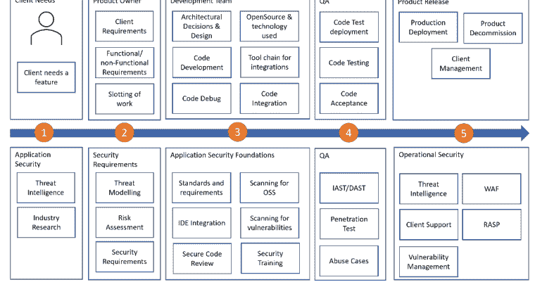
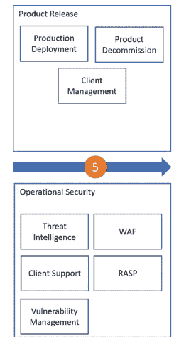
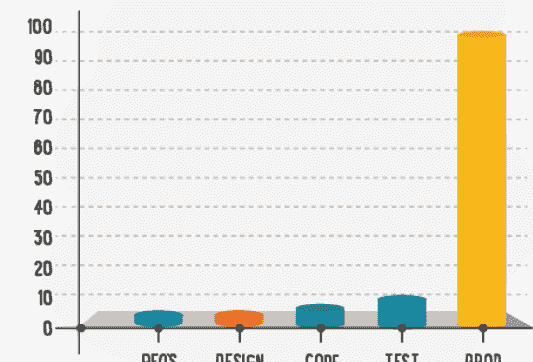
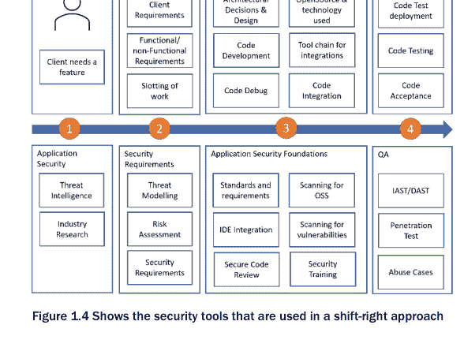
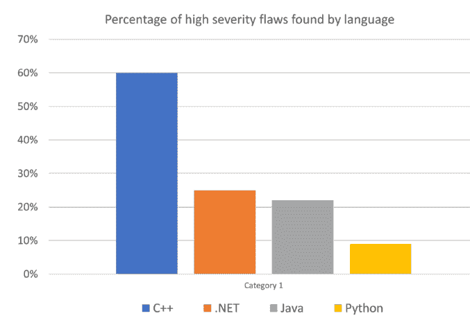
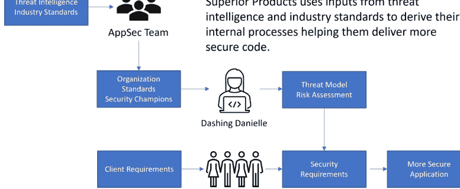

# 应用安全项目手册：软件工程师和团队领导的指南 (MEAP V02)

## welcome

Thank you for your interest in this book *Application Security Program Handbook*. This book is intended for developers, architects, and leaders that are looking to understand the purpose and benefit of building security into the development lifecycle. Although you don’t need to be a developer, having an understanding of how code is developed and delivered to production will make the content easier to understand.

I have been working in application security for nearly a decade and have seen the successes and failures in organizations that are fighting the good fight of delivering secure software. Although the fundamentals of application security haven’t changed much in that time, the tools, processes, and technology have. The threats have changed, the attacker’s techniques are getting more robust, and the risks to organizations have grown. Organizations need to change with them and develop the framework that enables them to build security in from the start.

My desire for this book is that it will show how application security is applied in organizations and where it can provide the most amount of assistance in delivering secure software. The book is made up of three sections that take the reader through an effective application security program. The first section is dedicated to what are common application security practices and technology that you find in an organization. The second section dives more into how application security is evolving to meet the current demands of rapid development. This includes how application security should be developed as a service and not as the gated exercises. The last section will focus on delivering application security in an organization and measuring success.

I appreciate you picking up this book and my hope is that it brings you an appreciation for what it takes to deliver secure software in today’s complex systems. Please be sure to post any questions, comments, or suggestions you have about the book in the liveBook discussion forum. Your feedback is essential in developing the best book possible.

-Derek Fisher

# 1

# Why do we need application security?

This chapter covers:

- Current state of application security
- Going right or going left
- Breaches as a result of insecure applications
- The cost of inaction

Every company uses software to function. Whether they are a Fortune 500 technology company or a sole proprietor landscaping company, software is integral to businesses large and small. Software provides a means to track employees, customers, inventory, and scheduling. Data moves from a myriad of systems, networks, and software providing insights to businesses looking to stay competitive. Some of that software used is built within the organization or it is purchased and integrated. What this means is that every organization, regardless of size and industry, has a software need. It enables organizations to move quickly and stay ahead of their competition. In the United States, the growth of software in various industries including finance, sales, human resource, and supply chain has seen a steady increase with that trend continuing. Over the next decade these industries will see a steady increase of market size. For instance, in 2020 the market size of nearly 390 billion USD in the global business software and services. This is expected to have an annual growth of 11% from 2021-2028. This expansion is based on the increasing need for automation and processing solutions in nearly every sector on the economy.

The shift to software driven organizations can be seen in several prominent examples. Movies were rented at a physical store before Netflix began streaming them in 2007 directly to your television. Books were purchased in a shop before Amazon upended not just the book buying experience but the overall retail market for any item you can think of. It used to take a phone call to order food, now a mobile app allows you to not only order your food but track it from the restaurant to your front door. Moreover, software is used in all parts of the supply chain for every organization. Leaders in these organizations can get real-time updates on product as it moves around the world and to their customers hands. This isn’t a nice to have any more for organizations but is critical to any organization’s ability to compete.

> "In short, software is eating the world" Marc Andreessen.

Each new piece of software brings new capabilities but also new challenges, especially when that software is available over a network where it is open to a wide audience. More capabilities mean more software. More software means more data. This data is intended to assist an organization and its customers to gain insight into the services the organization offers. However, the additional software and data means more opportunity for bad actors to leverage weaknesses that might exist. Data is a lucrative target for attackers and difficult for organizations to protect especially when the organization collects a large amount of it. By the beginning of 2020, the amount of data created worldwide had reached 44 zettabytes and this is expected to reach 463 exabytes by 2025.

The increasing software landscape and the repository of data growing every second offers a target rich environment for malicious actors looking for a way in and access to the data. There is constant background noise of malicious activity that pervades the internet. The moment that any software becomes available online, it is immediately probed and prodded. Some of that activity is from automated tools that will then alert when it finds software that can be compromised. Some of it is from bad actors waiting for the latest vulnerability to become public so they can hunt the internet for applications that are vulnerable to it and create exploitation software. Other activity comes from well financed bad actors that are simply looking for any weaknesses so that they can gain a foothold in an organization in order to come back later for exploitation. If ever there was a more fitting metaphor for software on the internet, it would be the Wild West of the early United States where lawlessness was rampant, and sheriffs were often overwhelmed and outgunned by the range of activity.

Software, data, attackers, oh my! When organizations don’t take software security seriously, they run the risk of not only putting their client’s data at risk, but the organizations future as well. Most organizations that are not in the software building industry will often say that they are not a prime target, or that their data is not interesting to an attacker. They would be wrong. Almost all data that is collected and processed by an organization can be used and misused by an attacker. Nothing is too unimportant. And although many large organizations can weather a data breach, smaller companies often cannot while remaining in business.

It is often said that data is the new oil. Mining, processing, and selling data is a lucrative business both for the organizations that do so openly and the malicious actors who are looking for ways to profit off an organization’s missteps. Building security into the software from the start is the first, and primary, step to ensuring that organizations have the means to protect their software, their data, and their livelihood.

## 1.1 应用安全计划的作用

应用安全是通过在开发生命周期中实施安全实践、工具、技术、人员和流程来实现的。本书的其余部分将介绍应用安全如何在整个开发生命周期中使用，以确保组织降低了对其软件的风险，并且这种做法不会妨碍组织及时交付软件的能力。重要的是要知道，解决安全问题永远没有万能的灵丹妙药。没有任何一种工具、流程或个人可以声称做到这一点，因为攻击不断演变，技术也在不断发展。然而，确保你拥有一个健全的应用安全方法，该方法不仅包括应用安全计划的基础，还包括持续适应和不断发展方法的能力，这才是区分良好计划与不良计划的关键。这正是我们将在本书中发现的内容。

产品始于客户或组织内部某人的一个想法。将这个想法从概念、到纸面、到最小可行产品、再到生产应用，需要来自多个学科的一支团队来将其变为现实。大多数人首先会想到所有参与打造成功产品的开发人员、测试人员和产品人员，但那些让产品安全的人呢？目标不仅仅是打造一个满足客户需求的产品，而且要使其免受缺陷和安全问题的影响，否则这些问题不仅会贬低产品本身，还会贬低整个组织。

### 1.1.1. 从概念到生产的 安全

软件开发生命周期在每个组织中定义方式都不同，但总体而言，每个组织从概念到生产都有类似的路径。图 1.1 描述了标准的软件开发生命周期，其中：

- 客户或产品负责人设想一个新功能或增强功能。
- 用例和需求被开发出来。团队确定在即将到来的版本中安排工作的位置。
- 开发团队随后决定需求将如何通过技术选择来实现。开发开始，代码被集成到功能分支中。
- 功能随后被移至较低环境，如测试或暂存环境，以便进行测试。产品负责人将接受测试结果，并同意将其发布到生产环境供客户使用。
- 功能发布给客户，组织通过客户和技术支持将该功能作为更大应用的一部分进行管理。最终，该功能将被停用，以支持新版本。

图 1.1 SDLC 的阶段

在第一步中，产品可能已经存在，在这种情况下客户会请求增强或新功能。例如，也许需要在应用内访问报告的新方法，或在用户界面中提供新的数据集。否则，产品负责人可能会从多个客户收集信息，并为新功能提交增强请求。在这两种情况下，组织都会以用例的形式收集客户需求。一个简单的用例可以写成：

> “作为管理员，我希望能够创建每周报告，显示我组织中用户对应用的使用情况。”

这是一个简单的用例，适用于基于 SaaS（软件即服务）的应用，该应用被许多组织用于提供某种服务。在这种情况下，细节并不重要，因为无论行业如何，每个组织都不同。在大多数情况下，一个功能会包含多个用例。

一旦客户或产品负责人定义了用例，这将与产品的开发负责人一起评审。架构师、主导开发人员和开发团队的运营成员评审用例并确定请求的合理性。

这就将用例带到了流程的下一步，即定义功能和非功能需求。与存在多个用例一样，每个用例都可能有许多需求。以下是针对前述用例的功能和非功能需求示例：

> 功能：“应用应提供按用户创建应用使用情况报告的能力。”
> 非功能：“报告创建仅应对管理员可用。”

这不是一本关于如何编写需求的书，但简单解释是，功能需求描述功能应该做什么，而非功能需求描述功能应该如何做。大多数关于需求的信息将安全描述为非功能需求。然而，将安全功能描述为功能需求并不罕见，尤其是在加密、身份验证和访问等事项上。

### 1.1.2. 应用安全计划在哪里

产品负责人将确定需求并与开发团队一起决定可能需要调整的优先级以及新功能交付日期。到目前为止，还缺少一些东西。带来产品安全的人员、工具和流程在哪里？如前所述，安全通常是非功能需求。然而，这些非功能需求不应由产品负责人和开发团队自行决定。更成熟的组织会引入应用安全团队，不仅评审用例和需求，还定义应作为功能开发一部分的安全要求。如果产品团队在与应用安全团队接触之前就定义了需求并开始编码，他们就有可能在功能接近完成或准备发布时产生更难解决的安全问题。例如，开发团队可能知道需要提供授权，并可能决定开发内部解决方案来管理授权，而不考虑组织内使用且更符合行业标准（如 OAUTH）的更合适的解决方案。

在初始阶段融入安全，是通过采用行业和组织的标准和最佳实践，并将其构建到创建需求的流程中来实现的。例如，使用行业对加密的指导将导致对密钥管理和加密强度设置要求。或者组织可能有标准要求开发遵循某些架构或监管要求，例如使用特定的分析工具。此外，在构建这些需求时，团队将从威胁模型和风险评估等项目中获取输入，以进一步开发与业务需求一致的需求，以便尽可能早地将安全构建到流程中。我们将在后续章节中更深入地讨论威胁模型和风险评估。

## 1.2 应用安全的现状

如前所述，应用安全是将安全实施到开发组织中的过程。现实情况是，应用安全团队如果在组织中存在的话，通常与他们合作的工程团队是外部的。他们可能隶属于企业范围的功能，如企业架构组织，或隶属于更广泛的安全组织。后者是最典型的。这些应用安全团队会引入工具、流程和人员来识别软件漏洞，然后将这些漏洞排入待修复的积压任务中。这些漏洞是通过以下几个机会发现的，包括：

- 通过应用安全团队为工程提供的工具。
- 通过应用安全团队或外部供应商分别完成的外部或内部渗透测试。
- 通过客户或其他外部来源（如漏洞赏金计划或漏洞披露政策）发现的问题。有关这些内容将在后续章节中介绍。

如果应用安全团队和组织被认为成熟，那么一旦发现这些漏洞，就会阻止构建。你可以看到这如何导致两者之间出现问题

工程团队正致力于代码的发布，却突然被外部团队设立的工具和流程阻断。阻止构建是应用安全团队确保产品安全时最青睐的方法，但这很容易成为争执的焦点。在不够成熟的组织中，会设立流程让工程团队继续进行构建和部署，同时将发现的漏洞排期到未来解决。

应用安全团队与功能发布持续竞争。每次新发布都会带来新功能。新功能带来新缺陷。新缺陷带来新的安全漏洞。如前所述，在某些情况下这些漏洞会破坏构建并阻断功能的发布。然而，大多数组织会优先考虑功能发布而非模糊的漏洞。我稍后会更详细讨论这一点，但许多扫描工具噪音很大，产生的结果开发人员难以消化。此外，并非所有应用安全团队都擅长将工具和其他测试的结果转化为工程团队无需开会或工作会议即可理解的内容。这在大型组织中显然无法很好地扩展。

安全问题被排期积压，并附带一个“欠条”承诺在未来解决。但每次新发布都会为不断增长的积压带来更多漏洞，循环持续。大多数组织会采取系统性方法来减少漏洞，例如只关注高危和严重级别的漏洞，或特定类型的漏洞如 SQL 注入或跨站脚本。其他组织可能会根据产品能力和暴露面关注风险最高的漏洞，例如处理敏感账户信息的金融机构。一些组织甚至会采取“安全发布”的做法，在一次发布中集中解决大量安全问题。这些不同方法有助于集中减少漏洞，但并未解决整体问题。

就像查尔斯·狄更斯《圣诞颂歌》中的雅各布·马利一样，这些漏洞变成了拖累开发团队的锁链，并最终会困扰组织。漏洞的持续累积形成了所谓的“安全债务”，组织不断将新漏洞添加到已存在的旧漏洞之上。这种安全债务增加了所开发产品和销售该产品的组织的风险水平。最终，其中一个或多个漏洞会导致恶意行为者利用该应用。这与技术债务的概念类似，当组织选择快速便捷的方式将功能交付给客户，而不是选择更可持续的设计方案时就会产生技术债务。

进一步复杂化应用安全团队工作的是，他们通常在开发过程的太晚阶段才被引入。通常是在功能或产品已经经过多个设计和架构决策之后。代码开发可能已经在进行中，甚至更糟糕的是，在应用安全团队介入时已接近完成。这意味着许多“单向”决策可能已经做出，应用安全团队只能对设计和代码提供某种认可，或为发现的威胁识别缓解措施。这并非到处都是如此，但在足够大的组织中这种情况会发生。如果应用安全团队有机会在早期提供指导、要求和安全工具，潜在漏洞就可以减少。不幸的是，应用安全团队早期介入的案例少之又少，尽管这种做法有效。这使得应用安全团队陷入两难：要么成为“那个阻断发布的人”以在生产前强制执行安全要求，要么因允许存在已知弱点的代码发布而面临整个组织的后果。

这就是应用安全现状的图景，其中存在着在推动业务和降低组织整体风险之间不断斗争。

## 1.3 为什么将安全内置具有挑战性

> “总有一天，我们需要停止只是在河里救人。我们需要上游去找出他们为何落水。”
> 
> — 德斯蒙德·图图

应用安全团队拥有最先进的工具，包括机器学习、人工智能、自然语言处理和自动化等技术。然而，其中一些工具在代码编写后才检测问题，并且很可能已签入并正走向你附近的生产环境。我将在后续章节中谈论各种工具，但如前所述，现代开发流水线中通常会发现与安全相关的几种工具。静态应用安全测试（SAST）可以扫描已编写的软件，查找常见的硬编码密码和 SQL 注入等安全问题。动态应用安全测试（DAST）会尝试在 Web 应用在环境中运行时对其进行实时安全测试。软件成分分析（SCA）工具会查找构建整体应用所使用的第三方和开源软件中已知的漏洞和许可问题。此外，还有云架构、容器、基础设施模板和移动安全工具可以产生扫描结果，识别代码或软件部署中的漏洞或其他弱点。

当检测到漏洞时，工具可以向应用安全团队和工程团队打开工单，前提是安全工具与缺陷跟踪工具之间已设置集成。然后问题由应用安全和工程团队进行分诊、优先级排序并处理到关闭。

EXERCISE 查看 OWASP 关于源代码分析工具的页面并回顾一些可用工具。其中有几个是“开源或免费”。其中一个开源工具是 APIsecurity.io 安全审计（https://apisecurity.io/tools/audit/）。你可以使用此工具上传 OpenAPI JSON 文件以检测可能的漏洞。如果你没有自己的 OpenAPI JSON 文件可以使用，你可以在线搜索一个，或使用类似以下示例：

https://github.com/OAI/OpenAPI-Specification/blob/main/examples/v2.0/json/api-with-examples.json#L31

查看 APIsecurity.io 返回的结果并判断问题是否为真阳性。开始思考如何缓解发现的问题。

### 1.3.1. 尝试在运行时保护

尽管上述工具是检测工具，但也有保护工具，它们会部署在运行中的应用前面，尝试阻止看起来恶意的活动。Web 应用防火墙（WAF）可防止攻击者利用运行中 Web 应用的弱点。运行时应用安全保护（RASP）提供类似 WAF 的功能，不同之处在于 RASP 通常与应用并行运行，甚至在应用内部运行。机器人缓解软件和拒绝服务保护都会尝试阻止发送大量恶意流量以致使应用瘫痪或执行重复任务如暴力破解的流量攻击。安全网关也会通过阻止未经授权的访问和活动并提供实时监控来提供类似保护。

同样，这些保护工具使用最新的技术如机器学习和人工智能来尝试提供保护。其中一些工具非常擅长阻止恶意行为者的不受欢迎活动，但与此同时，一些工具如果未正确调优，则存在阻止组织客户按预期使用软件的风险。一个常见的例子是批处理作业在短时间内调用 API 或函数数百或数千次。这可能看起来像保护工具眼中的自动化恶意活动，并可能阻止合法流量。为了区分两者，应用安全团队和工程组织必须共同合作，将行为模式化为规则集，以阻止恶意流量并允许正常流量。这可以采用为某些 URL 和 IP 建立允许列表的形式。启用保护工具需要克服陡峭的障碍，因为许多组织可以理解地会担心性能和对合法流量的可能中断。

### 1.3.2. 仅获得工具输出是不够的

就像舒适的毯子一样，在开发过程和流水线中分层的安全工具可以给组织带来安心感。然而，与大多数工具一样，其有效性取决于工具与组织的集成程度以及其保护或提供合法结果的能力。组织仅为了说自己使用这些工具，或（*cringe*）说自己阻断了 OWASP Top Ten 而启用一个或多个工具，并不会对自己或组织有任何帮助。

**DEFINITION** OWASP 是开放 Web 应用安全项目，是一个由应用安全专业人员组成的开源社区，开发标准、工具和项目以协助组织在其应用中开发安全。

当然，在审计期间，组织可以说他们在开发生命周期中使用工具 ‘x’ 或 ‘y’。无论审计员的铅笔是否开始打勾，组织可能实际上并未更安全。

现实是，这些工具会为工程团队和应用安全团队制造大量噪音。扫描工具不断输出需要分诊、评级和分配的发现，其中许多是误报。阻止工具会产生误报并引发对合法活动影响的担忧。并且很多时候，存在一个

过度依赖安全工具来提供保护，尤其是在存在已存在很长时间且没有修复计划的漏洞时。例如，一个组织可能会严重依赖 WAF 来保护一个被指定为“日落”状态且有多年退役计划的应用程序中发现的 SQL 注入漏洞。我们在讨论漏洞管理时将更详细地谈论这一点。

### 1.3.3. 在安全工具中区分信号与噪音

组织中使用的安全工具可能像任何其他工具一样昂贵且配置不当。此外，那些未精细调校的工具会产生大量误报。就像那些开启后就被遗忘的工具一样。这不仅为应用安全和工程团队增加了额外的工作量，还降低了对这些工具的信心水平，进而降低了对应用安全团队的信心。当误报变得正常时，它们就为工程团队提供了一个容易的逃避途径，让他们找到一种说法，声称他们的应用程序并非漏洞百出。如果工具标记的最后十个 SQL 注入问题都是误报，为什么这个新问题就不是呢？这就使得应用安全团队和工程团队在证明一个发现是真正的漏洞还是误报时陷入僵局。对于通常不具备工程团队对其自身应用的广泛上下文的应用安全团队来说，这极具挑战性。召集合适的主题专家（SME）来仔细研究代码细节与发现相关的过程也是耗时的。

随着各种工具及其各自产生的发现数量的增加，成熟的应用安全团队专注于从噪音中筛选出信号，并向工程团队提供高质量的结果。这提高了发现的可信度，并在安全与工程之间建立了更稳固的关系。

应用安全团队将与工程团队密切合作，尽可能获取尽可能多的应用上下文，以便将举证负担从工程团队手中移开。换句话说，应用安全团队的目标是确保以下几点：

- 结果是已被应用安全团队分拣过的真正阳性。
- 工程团队清楚地理解修复漏洞的步骤。如果可能或适用，应用安全团队应提供展示利用和修复的代码示例。
- 根据漏洞的严重程度，对修复时间线有明确的预期。

我们将在未来章节中更深入地探讨这个问题，但现在让我们看看安全如何集成到开发生命周期中。

## 1.4 开发中向右移与向左移

尽管每个组织以自己的方式发布软件，但对于大多数组织而言，从想法到生产的过程是相对相同的。图 1.2 显示了常见的发布模式。

从客户端需求到生产发布的代码开发的常见阶段

图 1.2 代码部署的开发流水线示例

短语 shift left 是将安全尽可能移至软件开发生命周期开始的概念。在图 1.2 中，这意味着在收集和构建需求的初始阶段以及开发阶段。这一术语在应用安全领域被频繁使用，用来描述能够在开发生命周期的尽可能早的阶段发现安全问题的构建实践和工具。其中许多我之前已经提到过。挑剔的人会告诉你，实现这一目标的最佳方式是确保安全人员在开发者用键盘创建新功能时就在场。那些挑剔的人是对的。纠正安全漏洞的最佳时机是在它被创建时。

向左移比向右移更不显眼。在向右移模型中，工具被策略性地放置在整个开发生命周期和生产环境中，以确保漏洞被识别并得到保护。渗透测试被执行以识别问题。你可以验证工具是否正常工作，并且可以生成报告来展示所实施工具的有效性或无效性。这依赖于一种检测和响应范式，它非常被动，并增加了我之前谈到的漏洞积压，其中关键和高风险的通常被优先处理，而其他则进入积压。这也可能扰乱 DevOps 模型，该模型希望快速进行更改，并且对构建中断或门禁处理得并不好。

让开发者创建更安全的代码通常意味着使用以下控制措施：

- 安全培训。
- 用于制定安全程序、流程和标准的顶层安全政策。
- 集成到开发环境和流水线中、提供更快反馈的工具
- 构建可重用的安全架构。

然而，其中一些可以被规避。像大多数培训一样，安全教育可能很快被遗忘或为交付新功能的速度而搁置。开发者也会更换角色、职位和职能，并且经常被截止日期、工单、请求、突发事件和会议所困扰，这更倾向于快速推进而非安全。这使得即使是最有善意的、具有安全意识的开发者也会将安全推到优先级更低的位置。尤其是在依赖之前描述的保护工具来检测和提醒安全问题时。安全很快就变成了别人的问题。此外，工具成为业务阻碍，这为产品负责人提供了机会，当功能发布因发现的安全问题而面临风险时请求例外。架构经常被误用或在组织内没有得到很好的推广，这意味着并非所有开发团队都了解提供更多安全的、频繁变化的架构模式。

### 1.4.1. 在开发生命周期中向右移

当组织决定其安全态势将主要是向右移时，他们将工具集成到开发生命周期中以检测问题并向安全或开发团队打开工单。这些工具中的大多数用于在生产环境或开发过程后期发现问题。这些组织将启用一些保护机制，如 Web 应用防火墙（WAF），并主要通过跟踪传入的漏洞、对它们进行分拣和优先级排序，并分配给团队解决来采取防御姿态。

向右移时，工具用于在开发生命周期后期检测问题。

图 1.3 向右移方法中使用安全工具

众所周知，解决缺陷，在本例中为安全漏洞，在金钱和时间上的成本高于在生命周期早期解决的问题。解决已在生产环境中的缺陷所需的努力和中断可能比在需求阶段解决时贵数十倍，每个逐步的开发阶段成本都会更高。还有服务等级协议可能面临风险，如果在生产中修复漏洞时发生停机。 这进一步使组织暴露于超出工程修复成本的额外成本之上。安全漏洞还具有可能导致可报告事件甚至声誉损害的额外影响，如果漏洞导致大规模泄露，暴露客户数据或使应用程序离线。

然而，向右移确实允许开发团队以快速的速度生产功能，因为当软件已在生产中运行时，安全在很大程度上是防御性的。这使开发团队可以花费更少的时间在早期解决問題，而转而依赖现有的保护机制。依赖右侧工具和流程的决定是通过在风险与回报之间取得平衡而做出的，因为未能按时交付功能也会对组织的底线产生影响。

### 修复缺陷的相对成本

### 1.4.2. 向右转移会失败

安全控制已到位却未能阻止更大规模入侵或泄露的故事并不少见。这发生在多种原因之下：警报疲劳、安全是别人的问题、竞争优先级太多。在安全行业工作的人都知道，总会有开放的端口、软件的不安全版本，以及缺乏安全控制的地方。而攻击者对这些情况的了解程度与安全人员一样。攻击者只需要一次在正确的时间出现在正确的位置。防御者则需要每次都正确。

如果你是僵尸故事的粉丝，你会熟悉这样一个场景：一个或一群活人被困在一栋建筑物内，四周是流着口水、呻吟的亡灵。在大多数情况下，他们所在的建筑物表面和弱点实在太多。随着外面的群潮不断壮大，防御变得越来越薄弱，建筑物内的幸存者能用来抵御僵尸的选项也越来越少。在网络安全领域工作有时会让人有这种感觉。每次你加固一道防御弱点时，又会发现新的弱点，你的团队被要求制定计划来关闭弱点并提供有意义的防御。此外，攻击者并不总是像无脑的僵尸一样冲击你的防御，他们往往聪明、耐心，并且清楚自己想要什么。好在防御者也是如此。

恶意行为者发现攻击应用的方式越来越多，而对这些应用的防御者来说，感觉漏洞比他们能管理的还要多。更多的功能意味着更多的攻击面，这意味着恶意行为者有更多机会窃取数据、冒充用户、实施欺诈或其他恶意活动。此外，与内部或外部应用和服务的集成越多，就可能存在组织无法控制的暴露面。

例如：在 2018 年，Facebook 的一个漏洞导致数千万个 Facebook 账户被攻破。该缺陷存在于一个允许用户从不同账户视角查看其个人资料的功能中。毫不奇怪，这个功能被称为“查看为”。恶意行为者能够窃取 Facebook 账户的访问令牌，从而以访问令牌关联的用户身份登录。他们首先从自己的好友开始，继而窃取好友好友的访问令牌，直到收集了数十万个账户，然后是数百万个账户。他们能够收集个人数据，包括姓名、联系信息、用户签到地点等常见信息，以及其他私人数据。

这个例子展示了为数百万用户提供开放且功能众多的安全产品的难度。即便是非常重视安全的庞大组织也是如此。我们之前提到的工具可能有助于在代码发布之前识别此问题，或在生产环境运行后检测并阻止它。然而，这些工具的一个局限性在于它们无法发现业务逻辑或工作流相关的漏洞。此外，很难指望工具比终端用户更快地发现这些问题。这就是为什么在开发生命周期的早期拥有适当的流程、需求和测试会提高尽早发现此问题的机会，此时工具、测试和敏锐的安全目光的集体力量得以发挥。

### 1.4.3. 在开发生命周期中向左转移

向右转移意味着组织试图在生命周期的后期投入更多精力来保护和检测安全问题，而向左转移则是将这些工作提前到生命周期的早期。这无疑是开发安全的首选方法，因为它成本更低、效果更好。然而，它更难实施，并且在需要时可能被迅速绕过。

向左转移时，组织会更强调将安全工具提前到生命周期中，以便在进入生产环境之前捕获问题。

图 1.4 显示了在向右转移方法中使用的安全工具

想象一下建房子。你有一张建筑图纸、材料清单和实际的建筑材料。你召集一群工人开始建房。在建造房屋时就安装窗户和门的锁、建造逃生窗、安装烟雾报警器要好得多。等到房子建好后，或房子被抢劫后、或烧毁后才做就太晚了。是的，你在建造过程中会节省时间和金钱，但安全性会降低。这个例子听起来很荒谬，但现实是这种情况在软件开发中经常发生。有时是因为在软件构建后才发现了更新的安全模式和架构，但通常是因为一开始就没有在构建中加入安全。

在开发过程中从设计决策和需求收集开始分层加入安全要实用得多。采取这种方法时，组织正在采取必要的步骤来培养更好的习惯并产生更持久的影响。考虑一下你的个人健康。研究表明，调整习惯而不是追求快速减肥的节食不仅对你更健康，而且为更可持续的健康提供了更长久的路径。向左转移培养了这些健康的安全习惯，确保组织站在正确的起点上，并能维持更安全的整体态势。

一个健康的安全开发环境始于做出正确的架构和设计决策并将安全纳入考虑。这意味着在会话管理、加密、授权等领域选择合适的安全控制。它还包括利用来自 OWASP 等知名且经过验证的组织的可信模式和标准。例如，选择合适的数据保护方案的时间应在围绕数据流和数据库技术做出架构决策时确定。加密策略的需求应得到充分记录，并根据数据分类提供适当的保护级别。此外，像字段级加密以及适当的加密密钥生命周期管理这样的需求，在数据库中还没有数 TB 数据需要对大型数据集应用加密之前，更容易开发。复杂之处在于遗留应用，大多数组织由于旧技术可能不支持更精细、更强大、更现代的加密，因此无法提供磁盘级别之外的加密。这仅仅是因为该应用可能从未被设计为处理加密数据。

甚至所选择的语言也会影响应用的安全性。开发人员可以选择的开发语言 literally 有数百种。每种语言都有其针对特定用例的优缺点。然而，许多现代语言提供了一些护栏，可以防止开发人员产生不安全的代码。例如，Java 和 C++ 在易受攻击的代码方面往往名列前茅，这并不令人意外。很大程度上可以归因于这两种语言的强大功能以及开发人员可以“自伤”的能力。

**NOTE** 使用 C++ 等强大语言最常见的问题之一是其手动管理内存的能力。大多数现代语言会出于便利性将这种能力从开发人员手中夺走。C++ 的一个具体例子是调用 free() 的能力，允许开发人员释放内存地址。如果对同一个内存地址调用两次，就会变成双重释放问题。攻击者能够利用由此产生的内存泄漏并注入代码，可能允许攻击者获得具有提升权限的交互式 shell。

此外，这些语言在全球数十亿台设备中被广泛使用。覆盖面越大，找到安全问题的机会就越多。其他语言如 Python、Ruby 和 Go 显示出总体漏洞更少，但这些语言编写的代码行数也更少。

Figure 1.5 Application with high-severity flaws by language 2020

语言和设计选择对左移策略的影响很大，测试同样如此。单元测试、QA、集成测试和系统测试都可以用于在生命周期早期识别安全问题，并为开发团队在问题进入生产环境之前纠正问题争取时间。这假设已经创建了适当的安全测试，理想情况下是自动化的，并且在发现问题时会提醒团队。进一步假设发现的问题不会消失在待办清单的安全漏洞深渊中。

我们将在后面的章节中更多地谈论左移，包括威胁建模、衡量风险、创建滥用案例、使用开发工具、提高意识等内容。不要误会，将安全左移是将应用安全带到您身边的组织中最具成本效益和可持续的方法。

### 1.4.4. 左移失败

通常，开发团队中的一两个人会被指定为团队的“安全负责人”[我们不会称他们为冠军。那是后来的事]，团队的大部分安全相关工作都会被推给他们。这个人有责任参加做出安全决策的会议，对安全相关的变更进行代码审查，为团队做出决策，并且通常有责任纠正或设定漏洞管理方向。顺便说一下，这个人还有一份日常工作，通常是团队的开发人员或架构师。他们可能甚至不想担任“安全负责人”的角色，但他们可能被自愿指派了。这对个人以及整个团队都有巨大影响。这个人很快就会不堪重负，几乎没有休息或反对的机会。

这通常就是漏洞管理崩溃的地方。在其中一种安全工具中发现了新的漏洞，或在渗透测试中发现了漏洞。该漏洞被放入缺陷跟踪工具中并分配给安全负责人，然后他们放下可能正在进行中的常规开发工作来对安全问题进行分类并尝试解决。与此同时，已经识别出另外几个漏洞，积累了我们之前谈到的安全债务。这通常是产品负责人、Scrum Master 或开发经理介入询问为什么开发交付物落后的时候。

这种类型的失败过去曾多次出现。其中一起最近的高调案例是 Equifax 泄露事件，导致超过 1.43 亿美国人的个人和财务信息暴露。Equifax 是美国三大信用局之一，为美国人提供消费者信用报告。2017 年 3 月，在 Apache Struts 中发现了一个漏洞，Apache Struts 是一个用于开发 Web 应用程序的框架。补丁发布后，大多数组织开始修补其软件。这通常说起来容易做起来难，因为某些框架升级可能需要额外的开发更改和测试。在最坏的情况下，应用程序可能需要重新架构或完成重大的开发工作。到 2017 年 5 月，Apache 发布补丁两个月后，攻击者已获得 Equifax 数据库的访问权限并开始窃取信息。Equifax 在 7 月才意识到泄露事件。安全组织中的几次失败导致了个人身份信息 [PII] 的泄露。虽然问题在内部被识别出来，但已知问题的电子邮件通知发送到了一个旧的邮件分发列表，因此从未被适当团队接收到。此外，数据库未与剩余网络隔离，允许攻击者横向移动到其他服务器，在那里他们找到了未加密的凭据，使他们能够升级攻击。

我们很容易坐下来挑剔此案中缺乏修补和其他安全控制。然而，从初始披露到被利用的两个月对于许多组织来说是一个很短的窗口。其中一些组织可能运行着技术，其未被修补的时间远比这更长。更重要的是，如今从漏洞披露到被利用的时间要短得多，攻击者能够在几天甚至几小时内收集足够的信息来逆向工程补丁并构建利用代码。但开发团队中的安全负责人有责任与为发布而安排的其他功能进行协调，并确保应用程序得到保护。鉴于 Apache Struts 漏洞在被利用时仅有两月历史，团队手中很可能已有更旧、更关键的漏洞，使这个 Struts 漏洞深陷于安全历史的尘埃中。这也凸显了早先的事实，即每个公司都是软件公司。Equifax 并非以技术为业，但由于其由使他们及其客户得以运行的软件层驱动，他们发现自己身处软件业务中。

## 1.5 左移比右移更好吗

正如我提到的，将安全左移将为组织带来更好的结果。它使开发团队能够建立一种更可持续的安全文化，能够管理安全漏洞“何时”而非“是否”会被引入的问题。

任何组织的任何软件都无法编写成对所有时间 100% 安全。会有漏洞。组织需要具备管理这一点的文化、流程、人员和技术。

没有错误或正确[双关语并非有意]的应用安全方法。无论阶段和目的如何，应用安全相关的人员、流程和技术在整个生命周期中都是必需的。为了说明这一点，让我描述两个不同组织及其对应用安全的方法。

第一个组织名为 Acme Services，已决定在发布前让应用安全团队执行简单的扫描和渗透测试，以确定开发过程中是否引入了任何漏洞。这是之前描述过的右移方法。第二家公司 Superior Products 知道，尽早引入安全不仅更容易，而且比等到后来更具成本效益。他们要求尽早让应用安全团队参与进来。更妙的是，他们团队中有安全冠军 Dashing Danielle，可以在整个开发过程中提供指导。

Superior Products 拥有一个成熟的应用安全团队，时刻关注安全行业的动态。他们在整个组织中整合了安全冠军团队，并与该团队保持开放沟通，以确保他们了解行业变化。凭借这些信息和结构，他们能够执行威胁情报，为新需求和技术决策提供信息。在许多情况下，这使他们能够在客户提出请求之前就实施安全功能。Acme Services 通常会被客户对更严格的安全和隐私的要求弄得措手不及，因为他们决定在流程后期才实施安全。

Superior Products 雇用 Dashing Danielle 来审查来自产品所有权的用例。她能够对该功能进行快速威胁建模，以确定影响该功能的安全问题。根据她之前与产品和应用安全团队进行的风险评估，她知道该应用程序和报告中的信息被视为组织敏感信息。这意味着她希望创建安全需求来维护数据中包含的信息的保密性，并确保访问仅限于适当组织内的少量用户。

Dashing Danielle 能够在审查用户故事和需求期间根据她掌握的信息提出有关报告访问的问题。在与应用安全团队讨论她认为对新功能存在担忧的问题后，她提出了以下有助于保护生成报告中的数据并维护访问控制的需求：

- Security Requirement: "Application shall ensure that access to the report is limited to authenticated users of the organization that the report belongs to."
- Security Requirement: "Application shall log information related to the admin accounts that create and change the reports."

开发团队同意这些需求很重要，并且有能力在不影响产品功能发布时间表的情况下实现它们。

Dashing Danielle 支持开发团队在白板上梳理工作流程，以便开发团队明确并理解需求。

Figure 1.6 Superior Products path to more secure code

在 Acme Services 那边，一名开发人员提出了一个担忧，即未通过身份验证的用户是否可以访问报告。由于产品负责人承诺在很短的时间窗口内交付此功能，这一担忧很快被驳回，而且开发团队也不知道报告中的数据是否真的被视为敏感数据。大家耸耸肩，然后继续前进。

这是一个相当清晰的区分，说明应用安全在哪些地方有效、在哪些地方无效。这则故事看起来可能有些夸张，但请理解，这类故事是典型的。选择这本书意味着你希望更像 Superior Products。

## 1.6 Application security needs you!

要做成任何有价值的事情都需要众人齐心。安全也不例外。通常，安全团队只占整个组织的很小比例，并且主要依靠自动化以及其合作的工程组织的善意来扩展以满足需求。应用安全团队没有“正确”的规模，但规模并不能说明有效性。应用安全与工程师的规模比例在不同组织之间差异很大。

> DEFINITION Building Security in Maturity Model (BSIMM) is a study on the posture of software security initiatives and programs by quantifying the application security practices of different organizations across industries, sizes, and geographies.

在 BSIMM 中，他们将软件安全组（SSG）定义为专注于组织内软件安全的团队。他们发现，SSG 团队规模可能大到 160 人，也可能小到 1 人，团队平均规模为 13.9 人。这当然取决于组织的规模以及软件安全组需要管理的覆盖范围。而且，当你看到安全支出相对于整体 IT 预算的总支出时，就不足为奇了，应用安全在整个工程组织中仍是较小的部分。根据 Gartner 在 2019 年的一项研究，在大多数情况下这一比例约为 5-6%。应用安全在该安全预算中占比更小，因为很大一部分资金用于边界防御以及检测和响应能力。

**EXERCISE** Take a look at BSIMM’s website for SSDL Touchpoints:

https://www.bsimm.com/framework/software-security-development-lifecycle.html

根据我所描述的左移和右移，这些触点都是左移模型的一部分。如果你在预算有限的组织中，你认为将你和你的团队的重点放在哪里以便将安全构建到开发生命周期中是最好的地方？思考架构分析的影响。这需要资源来深入基层。安全测试可以扩展，但可能很昂贵，并且需要时间来实施。

### 1.6.1. Democratizing application security

应用安全与其说是一个专职团队，不如说更多是建立支持安全开发的习惯、文化和基础设施。无论规模大小，应用安全团队都严重依赖开发组织内部的其他人来在更广泛的组织内推广和宣传安全。对于一个相对较小的应用安全团队来说，不可能与每个开发团队集成并参与每一次设计决策。没有从开发组织借用资源，应用安全很少会被集成。为了推进应用安全，能够找到盟友、建立信任并将安全民主化给整个工程组织至关重要。在整本书中我将概述实现这一进步的方法，然而要明确的是，应用安全需要一种安全文化，并在所有层级获得认同。

这里的关键部分是助手。一些组织称他们为冠军、传教士或教练。无论称呼如何，主题都是一样的。我们将在未来的章节中更多地谈论冠军计划；然而，基本原则是这些冠军是工程组织与应用安全计划之间的联系。他们在那里代表应用安全计划的利益，并确保他们所代表领域的的安全标准、设计和架构得到正确实施。冠军通常是来自工程组织内部的某个应用或业务单元的资深或经验丰富的工程资源。冠军的存在很重要，因为他们是自愿在那里，而不是被迫在那里，因为成功的冠军会欣赏安全。

这些冠军通过在应用安全团队无法到场的地方提供存在感来帮助应用安全团队推进安全。许多决策是在站会、走廊里或开发人员之间的即兴对话中做出的。拥有更接近代码开发地点的眼睛和耳朵有助于确保安全在软件开发生命周期的每个部分都被考虑。

应用安全民主化成功的一个条件是确保这些冠军精通组织的 安全文化，了解在哪里找到与需求、标准和架构相关信息的地方，并最终能够自如地代表应用安全团队发言。甚至在冠军可以承担该角色之前，可能还会有正式的培训和评估计划。为了确保这些冠军拥有成功所需的 信息，应用安全团队需要公开其文档和指导，并在定期基础上与冠军一起审查并就新项目达成共识。这可以通过正式的定期论坛或通过电子论坛来完成。这取决于组织的文化和最实用的受众覆盖方式。

### 1.6.2. Users will be users

冠军不足以增强应用安全团队。听到开发人员、终端用户、领导者或其他技术人员说“我们有安全团队负责这件事”并不罕见。我们可以为系统构建所有技术安全控制，但一旦用户接触到系统，就会引入不可预测性。用户希望完成工作或找到完成某项活动的方法。我们都曾遇到过因安全控制而被系统限制的情况。大多数人不会束手无策地离开。我们会寻找其他方法来完成我们设定的目标。用户对你构建的应用也是如此，他们会寻找完成工作的方法，无论应用是否允许。此外，恶意用户正在探测应用以寻找弱点。他们不会局限于你开发的应用范围内。事实上，他们正试图做与你的应用设计目的完全相反的事情，以便制造他们可以利用的错误条件。应用安全始终在努力跟上好奇的用户和恶意攻击者，没有任何工具能给我们带来我们所寻求的安心程度。它需要一个致力于应用安全的村庄，从一开始就致力于构建安全的应用。

我一开始就说过，每家公司都是软件公司，这意味着每家公司都需要一定程度的软件安全。同样，软件安全是每个人的问题。这是一个相当常见的说法，但这到底意味着什么。这类似于公共服务公告敦促人们“看到异常，说出来”。这并不意味着旅客应该尝试打开他们在机场航站楼发现的、有电线垂出并发出蜂鸣声的行李。这意味着旅客应提醒最近的权威人士，以便他们进行调查。安全人员没有要求终端用户对 Web 应用中的 SQL 注入漏洞进行分类并编写代码来解决它。他们只是要求向最近的冠军或安全人员发出警报。把拆弹交给专业人士吧！

## 1.7 软件安全失败的案例

新闻中充斥着各种安全失败的案例，应用程序因多种原因被攻破。介绍这些案例的目的并不是为了嘲笑这些组织，而是为了聚焦于如何发生以及为何发生。相信我，如果你的组织销售或使用软件，那么问题不是是否会遇到安全事件，而是何时遇到。事件可能很小且无需上报，但你的组织总会在某个时间、某个地方遭遇软件安全事件。

**练习** 去你喜欢的搜索引擎查找最新安全漏洞的文章。你也可以访问 www.threatpost.com 或 www.securityweek.com 查看近期报道。我敢肯定，如果你今天看不到相关报道，至少本周内会看到。深入阅读文章，并设身处地为安全团队着想。你会如何应对？如果文章中没有说明，推测问题出在哪里。我经常看这些报道并问自己“自己或我的团队如何避免这种情况？”

### 1.7.1. SolarWinds

SolarWinds 是一个令人不寒而栗的例子，展示了复杂的软件生态系统及其构成组件如何导致大规模且影响深远的入侵。这种类型的入侵通常被称为供应链攻击，原因显而易见。攻击者只需攻破构建整体软件时使用的一个组件，就能让其恶意载荷广泛传播。这利用了供应链中的一个根本性复杂问题，即主软件开发者与用于构建最终产品的第三方软件之间存在固有信任。

SolarWinds 的 Orion 产品是一种监控解决方案，用于监控组织的网络和应用程序。在 2020 年攻击发生时，SolarWinds 被美国大多数顶尖组织使用，包括大多数财富 500 强公司、大学以及许多顶级政府机构和军方。

攻击者能够修改名为 SolarWinds.Orion.Core.BusinessLayer.dll 的插件。攻击者使用名为 SUNSPOT 的工具，能够注入恶意版本的 dll 并由 SolarWinds 数字签名后发送给数千名客户。恶意 dll 包含 SUNBURST，使攻击者能够与命令与控制（C2）服务器通信。攻击者煞费苦心地隐藏其活动，在一段时间内潜伏等待后再检索和执行命令，同时伪装成合法的 Orion 流量并使用阻止列表来识别取证和防病毒工具以规避它们。

一旦插件进入目标系统，它就会使用删除-创建-执行-删除-创建的模式劫持合法任务，运行恶意活动，然后恢复为合法任务。这种复杂性进一步表明攻击者为保持活动隐蔽付出了多大努力。

该行动持续了数月，直到攻击者入侵了领先的网络安全公司 FireEye 后才最终被发现。攻击者获得了 FireEye 的攻击模拟和其他安全相关工具的访问权限，但被发现，这导致了更广泛活动的检测。

如此复杂的攻击很难防御。加密这里、清理那里是不够的。FireEye 的警惕性、SolarWinds 迅速发布补丁的能力，以及受影响组织积极的补丁管理，显示了我们的数字世界已发生变化，我们不能再依赖将精力投入到保护软件上，而是需要转向始终假设已被入侵的世界。关键在于我们如何应对，更重要的是，当检测到恶意行为时，我们响应的速度有多快。

### 1.7.2. Accellion

对于我们这些拥有房屋或任何需要维护和持续关注的物品的人来说，我们有时会故意走过那个嘈杂的电器，或吱嘎作响的门，想着总有一天会修好它。

软件也差不多如此。让旧软件继续运行有很多原因。客户坚持继续与旧软件集成，使得组织难以将其停用。组织保留旧软件是因为保持运行比升级或更换更便宜。无论原因如何，几乎所有组织中都普遍存在旧软件。

Accellion 为医疗、金融和教育组织开发软件。其文件传输设备（FTA）产品被医疗组织用于执行大文件传输。该产品在 2020 年底遭到网络攻击时已近二十年历史，接近生命周期结束。攻击者首先窃取了 Accellion 的数据，然后转向直接攻击 Accellion 客户，目的是窃取数据并勒索钱财。初始攻击利用了针对 document_root.html 文件的 SQL 注入攻击，使其能够检索用于生成合法访问令牌的密钥。这些令牌随后被用于访问 sftp_account_edit.php 文件，攻击者在此能够利用操作系统命令注入，从而向主机系统发出命令。这最后一步使攻击者能够创建 shell。此时攻击者能够上传更复杂的工具并开始窃取信息并转向客户服务器。

Accellion 的医疗客户被迫根据 HIPAA 泄露通知规则通知受影响患者、媒体以及卫生与公众服务部。随后提起诉讼，最终近 350 万患者的受保护健康信息（PHI）被窃。更糟的是，攻击者随后向 UC Davis 的学生发送威胁邮件，在该大学发现其信息属于泄露范围后。

组织无法停用旧软件的影响是广泛的。组织大多运行最新最好的软件版本，但有一个客户运行的是几个版本之前的软件版本，这也不罕见。这是产品所有权未能推动客户向前发展的失败，使组织及其服务的客户都面临风险。组织必须制定并坚持日落和生命周期结束政策。两个关键要点：

- 软件的停用是软件生命周期的最后阶段
- 记住技术债务就是安全债务。

#### 有趣事实

微软宣布 Windows 7 的生命周期结束日期为 2020 年 1 月 14 日。2020 年 1 月到来时，这款深受喜爱的系统仍在 39% 的 PC 上使用。许多人推测这是因为终端用户不愿迁移到 Windows 10。这表明即使是微软也难以说服用户升级到新版本。相反，他们采取更强硬的做法，即停止为旧版本提供补丁。即便如此，这也阻止不了用户使用它，微软甚至允许用户和企业付费以继续接收更新。

### 1.7.3. 假软件

SolarWinds 展示了攻击者如何利用构建最终产品所用组件之间的信任。然而，这个故事并不罕见。攻击者总是在寻找将软件引入供应链的方法以最大化其影响范围。为什么要专门针对一个组织进行入侵，而可以通过进入供应链来入侵多个组织呢。

进入供应链还有其他方式。如果可以相信的话，还有更大的方式。2021 年，明尼苏达大学的两名学生发布了一篇研究论文，称之为“伪善提交”。这些提交据称旨在为 Linux 内核提供价值，但反而引入了关键问题。就像你的父母会把蔬菜藏在饭菜里让你吃一样。也许你也这样对你的孩子。没什么好羞愧的！

这种提交不仅在 Linux 社区不受欢迎，也在更广泛的安全和工程社区不受欢迎。Linux 内核被全球数十亿系统使用，从最小到最大的计算机。这两名学生的行为导致该大学被禁止未来向 Linux 内核贡献代码。他们之前的 Linux 提交也被撤销。

开源社区依赖于向其开放分支提交高质量、经过充分审查且出于善意的提交。尽管两名明尼苏达大学学生的例子表明该系统可以被滥用。

用于构建整体应用程序的开源软件的爆炸式增长进一步加剧了组织在此方面的暴露。根据 SonaType 2020 年软件供应链状况报告，2020 年开发者将请求 1.5 万亿个开源软件组件和容器。大多数软件都是由第三方库、软件论坛的代码以及一小群软件工程师和架构师手工编写的逻辑组成的拼凑物。根据 Synopsys 2020 年开源安全与风险分析报告，平均应用程序的 70% 由开源软件组成。依赖第三方软件会导致恶意行为者进入供应链并添加恶意代码的风险。拥有如此高比例第三方开源软件的组织需要采取防御性方法来管理其供应链，通过扫描第三方库中的漏洞、仅使用来自可靠来源的库，以及维护强大的补丁管理计划，以便在漏洞被识别后迅速修补易受攻击的库。

## 1.8 总结

- 应用安全团队通常来得比较晚，导致发现的问题被移至待办清单。
- 该待办清单会持续增长，成为安全债务。
- 应用安全团队使用的扫描工具通常是检测工具，并不会修复或阻止不良代码。
- 保护工具可以启用，但由于担心会阻止合法流量，有时很难让工程团队接受。
- 向右转移是后期才发现缺陷，而向左转移则能更早发现。
- 向左转移不仅仅是培训和培养倡导者。
- 在生产环境中修复问题比在生产前修复要昂贵得多。
