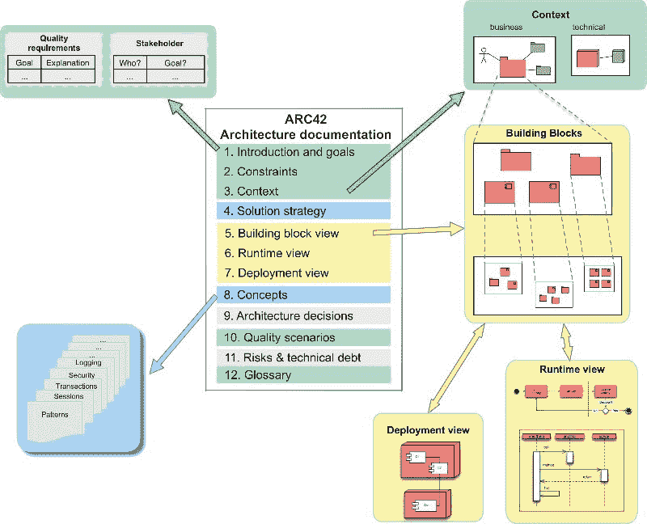
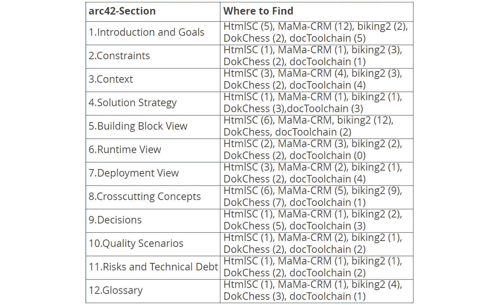

# 第 1 章
## I - 引言
本章解释以下主题：
* 什么是 arc42？
* 为什么是这本书？
* 这本书不是什么！
* 示例概述
* arc42 部分表

本书包含多个基于实用、经济、成熟且系统的 arc42 方法的 *Software Architecture Documentation* 示例。

它展示了如何交流软件架构，但不会展示如何开发或实现系统！

### I.1 什么是 arc42？
.jpg)

arc42 是架构文档的模板。

它以务实的方式回答以下两个问题，但可根据你的具体需求进行定制：
* *什么*是我们应该记录/传达的关于我们架构的内容？
* *如何*记录/传达它？

*图 1.1* 为你提供了整体概览：它展示了 arc42 结构的（略有简化）概述：

###### 图 1.1：arc42 的结构

Compare `arc42` to a cabinet with drawers: the drawers are clearly marked with labels indicating the content of each drawer. `arc42` contains 12 such drawers (a few more than you see in the diagram that follows). The meaning of these `arc42` drawers is easy to understand:

#### 图 1.2：arc42 抽屉

`arc42` offers you a simple and clear structure to document and communicate your (complex!) system. Starting with the goals and requirements of your system and how its embedded into its environment, you can provide the important stakeholders of your system with adequate information about the architecture.

`arc42` is optimized for understandability and adequacy. It guides you to explain any kind of architecture information or decision in an understandable and reproducible context.

Individuals and organizations using `arc42` especially like two things about it:

1. The understandability of the documentation, resulting from its standardized structure (the drawers)
2. The manageable amount of effort needed to create such documentation - we call it "painless documentation"

## 为什么选择 arc42？

你在开玩笑吧？听说过 Douglas Adams 吗，那位（非常英国的）已故科幻作家？他的小说 *《银河系漫游指南》* 将 `arc42` 称为：

*生命、宇宙以及一切的终极问题的答案* (https://en.wikipedia.org/wiki/Phrases_from_The_Hitchhiker's_Guide_to_the_Galaxy#Answer_to_the_Ultimate_Question_of_Life.2C_the_Universe.2C_and_Everything_.2842.29)

`arc42` aims to provide the answer to *everything* related to your software architecture. (Yes, I know it's a little pretentious, but we couldn't think of a better name back in 2005.)

`arc42` 旨在为与您的软件架构相关的 *一切* 提供答案。（是的，我知道这有点自负，但在 2005 年时我们想不出更好的名字。）

## 如何获取更多信息

With the latest release (V7) of `arc42` in January 2017, the project now has extensive online help and FAQs (frequently asked questions) available:

在 2017 年 1 月发布了 `arc42` 的最新版本（V7）后，该项目现在提供了广泛的在线帮助和常见问题解答（FAQ）：

* The documentation site docs.arc42.org ([`docs.arc42.org`](https://docs.arc42.org)) contains the full documentation plus many (more than 100) tips for efficient and effective usage.
* 文档站点 docs.arc42.org（[`docs.arc42.org`](https://docs.arc42.org)）包含完整文档以及大量（超过 100 条）高效使用技巧。
* The FAQ site faq.arc42.org ([`faq.arc42.org`](https://faq.arc42.org)) answers more than 100 typical questions.
* FAQ 站点 faq.arc42.org（[`faq.arc42.org`](https://faq.arc42.org)）回答了超过 100 个典型问题。

### I.2 为什么要写这本书？

### 注

Examples are often better suited to show how things can work than lengthy explanations.

示例通常比冗长的解释更适合展示事物如何运作。

`arc42` users have often asked for examples to complement the (quite extensive) conceptual documentation of the template, which was, unfortunately, only available in German for several years.

`arc42` 用户经常要求提供示例来补充模板的（相当详尽的）概念文档，而该文档不幸地在数年内仅提供德语版本。

There were a few approaches to illustrating how `arc42` can be used in real-world applications, but those were (and still are) scattered around numerous sources, and are not carefully curated.

有几种方法可以说明 `arc42` 如何在实际应用中使用，但这些方法（现在仍然如此）分散在众多来源中，且未经过精心整理。

After an incredibly successful (again, German-only) experiment to publish one single example as a (very skinny) 40-page booklet, we decided to publish a collection of examples on a modern publishing platform – so we can quickly react to user feedback and add further samples without any hassle.

在一次非常成功的（再次，仅德语）实验中，我们将一个单一示例作为一本（非常精简的）40 页小册子出版后，我们决定在现代出版平台上发布一系列示例——这样我们就可以快速响应用户反馈并在没有麻烦的情况下添加更多示例。

### I.3 本书不是什么

In this book, we focus on examples for `arc42` to document and communicate software architectures. We only give a brief introduction to `arc42` (if you'd like to know more, see *Appendix B* for details).

在本书中，我们专注于 `arc42` 用于记录和传达软件架构的示例。我们仅对 `arc42` 做简要介绍（如果您想了解更多，请参阅 *附录 B* 了解详情）。

This book is *not* an introduction to:

本书 *不是* 对以下内容的介绍：

* Software architecture
* 软件架构
* Architecture and design patterns
* 架构与设计模式
* Modeling, especially `UML` (`Unified Modeling Language`)
* 建模，尤其是 `UML`（`Unified Modeling Language`）
* Chinese cooking (but you probably didn't expect that here)
* 中式烹饪（但您可能也没在这里期待这个）

### I.4 示例概览

We have encountered exciting software and system architectures during our professional lives. Several of those would have made instructive, interesting, and highly relevant examples – too bad they were declared confidential by their respective owners. Our nondisclosure agreements stated that we're not allowed to even mention clients' names without violating those contracts.

在我们的职业生涯中，我们遇到了令人兴奋的软件和系统架构。其中一些本可以成为富有启发性、有趣且高度相关的示例——可惜它们已被各自所有者列为机密。我们的保密协议规定，未经违反合同就不得提及客户名称。

Therefore, it has been quite difficult to find practical examples that we can freely write and talk about.

因此，找到我们可以自由撰写和讨论的实用示例相当困难。

Now, let's get an overview of the examples that are waiting in the rest of this book.

现在，让我们了解一下本书其余部分中等待的示例概览。

### HTML 健全性检查

The HTML Sanity Checker is a tiny open source system for checking HTML files for semantic errors such as broken cross-references, missing images, unused images, and similar stuff.

HTML 健全性检查器是一个用于检查 HTML 文件语义错误的小型开源系统，例如损坏的交叉引用、缺失图像、未使用图像等。

Dr. Gernot wrote the initial version of this system himself when working on a rather large (100+ pages) documentation based upon the `AsciiDoctor` ([`asciidoctor.org`](https://asciidoctor.org)) markup language.

Dr. Gernot 在使用 `AsciiDoctor`（[`asciidoctor.org`](https://asciidoctor.org)）标记语言编写一份相当庞大（100 多页）的文档时，自己编写了该系统的初始版本。

`HtmlSanityCheck` (or `HtmlSC` for short) is described in *Chapter 2,* *HTML Sanity Checking*, of this book.

`HtmlSanityCheck`（简称 `HtmlSC`）在本书记述于 *第 2 章*，*HTML 健全性检查*。

### 大众市场客户关系管理

Gosh, what an awkward name – so, let's shorten it to `MaMa-CRM`: mass market refers to consumers of several kinds of enterprises, such as health insurance, mobile telecommunications, or large real-estate companies.

天哪，多么拗口的名字——所以，让我们将其缩短为 `MaMa-CRM`：大众市场指的是各类企业的消费者，例如健康保险、移动电信或大型房地产公司。

We are reasonably sure you know these 86 × 54 mm plastic cards (experts call them ISO/IEC 7810 – [`en.wikipedia.org/wiki/ISO/IEC_7810`](https://en.wikipedia.org/wiki/ISO/IEC_7810)). Chances are, you even own several of these cards. If they contain your photo, the chances are high that they were produced by a system such as `MaMa-CRM`.

我们有理由相信您认识这些 86 × 54 毫米的塑料卡片（专家称之为 ISO/IEC 7810 – [`en.wikipedia.org/wiki/ISO/IEC_7810`](https://en.wikipedia.org/wiki/ISO/IEC_7810)）。很可能您甚至拥有几张这样的卡片。如果它们包含您的照片，那么它们很可能由 `MaMa-CRM` 之类的系统制作。

`MaMa-CRM` takes the burden of (usually paper-based) customer contacts from organizations working in such mass markets. It was initially built by an independent mid-sized data center to support the launch of the German (government-enforced) *e-Health Card* and was later used to support campaigns such as telephone billing, electrical-power metering, and similar stuff.

`MaMa-CRM` 为在这些大众市场中运营的组织承担了（通常基于纸质的）客户联系负担。它最初由一家独立的中型数据中心构建，以支持德国（政府强制推行）的 *电子健康卡* 的推出，后来还被用于支持电话计费、电力计量等活动。

The architecture of `MaMa-CRM` is covered in *Chapter 3, Mass Market Customer Relationship Management.*

`MaMa-CRM` 的架构在 *第 3 章，大众市场客户关系管理* 中有所介绍。

### biking2

`biking2` or "*Michis mileage*" is a web-based application for tracking biking-related activities. It allows the user to track the mileage covered, collect GPS tracks of routes, convert them to different formats, track the location of the user, and publish pictures of bike tours.

`biking2` 或 "*Michis mileage*" 是一个用于跟踪骑行相关活动的基于网络的应用程序。它允许用户跟踪行驶里程、收集路线的 GPS 轨迹、将其转换为不同格式、跟踪用户位置并发布自行车旅行的照片。

The architecture of `biking2` is covered in *Chapter 4, biking2*.

`biking2` 的架构在 *第 4 章，biking2* 中有所介绍。

### DokChess – 一款国际象棋引擎

`DokChess` is a fully functional chess engine. The architecture of `DokChess` is covered in *Chapter 5, DokChess*.

`DokChess` 是一个功能齐全的国际象棋引擎。`DokChess` 的架构在 *第 5 章，DokChess* 中有所介绍。

### docToolchain

`docToolchain` ([`doctoolchain.github.io/docToolchain`](https://doctoolchain.github.io/docToolchain)) is a heavily used and highly practical implementation of the `docs-as-code` ([`docs-as-co.de`](https://docs-as-co.de)) approach. The basic idea is to facilitate the creation and maintenance of technical documentation.

`docToolchain`（[`doctoolchain.github.io/docToolchain`](https://doctoolchain.github.io/docToolchain)）是 `docs-as-code`（[`docs-as-co.de`](https://docs-as-co.de)）方法的高度使用且非常实用的实现。其基本思想是促进技术文档的创建和维护。

The architecture of `docToolchain` is covered in *Chapter 6, docToolChain*.

`docToolchain` 的架构在 *第 6 章，docToolChain* 中有所介绍。

### MiniMenu

`MiniMenu` surely has some of the *leanest* architecture documentation you will ever encounter. It captures some design and implementation decisions for a tiny MacOS menu bar application.

`MiniMenu` 无疑拥有您所能遇到的最 *精简* 的架构文档之一。它记录了针对一个微小的 MacOS 菜单栏应用程序的一些设计和实现决策。

The main goal is to show that `arc42` even works for very small systems. Skip to *Chapter 7, Mac OS Menubar Application*, to see for yourself.

主要目标是展示 `arc42` 即使对于非常小的系统也适用。跳到 *第 7 章，Mac OS 菜单栏应用程序*，亲自看看吧。

### I.5 arc42 主题表

This table will help you to quickly find the `arc42` topics you're looking for. For each section of `arc42`, you'll find references to each of the book's examples. The digits after the links denote the size of the section in the respective example. We have marked the most extensive or complete examples in bold so that you can easily recognize them:

本表将帮助您快速找到所需的 `arc42` 主题。对于 `arc42` 的每个部分，您都会找到本书每个示例的引用。链接后的数字表示该示例中该部分的大小。我们已将最详尽或最完整的示例标记为粗体，以便您轻松识别：

#### 图 1.3：arc42 主题表
