# 第 2 章

## II - HTML 健全性检查

By **Dr. Gernot Starke**

由 **Dr. Gernot Starke**

The system that's documented in this lesson is a small open source tool that's hosted on GitHub ([`github.com/aim42/htmlSanityCheck`](https://github.com/aim42/htmlSanityCheck)).

本课中记录的系统是一个小型开源工具，托管在 GitHub 上（[`github.com/aim42/htmlSanityCheck`](https://github.com/aim42/htmlSanityCheck)）。


完整的源代码可从前面的链接获取——你甚至可能希望配置你的 `Gradle` 构建以使用此软件。如果你基于 `Asciidoctor` 编写文档，这将是一个好主意！

但前言就到此为止。让我们开始吧。

### II.1 引言和目标

本节将解释架构相关决策的驱动因素以及重要的用例或功能，所有这些都将用几句话概括。如果可能，请参考现有的需求文档。

本节的主要目标是确保您的利益相关者理解手头的解决方案。

`HtmlSanityCheck` (`HtmlSC`) 通过检查超链接、图像和类似资源来支持创建数字格式的作者。

### 1.1 需求概述

#### 注

如果您希望对系统的重要目标和需求、用例以及功能有一个简要说明，请参考现有的需求文档。

在查看系统架构（从 `arc42-section 3` 开始）之前，了解系统的核心任务非常重要。

`HtmlSC` 的总体目标是创建整洁清晰的报告，显示 HTML 文件中的错误。以下是示例报告：

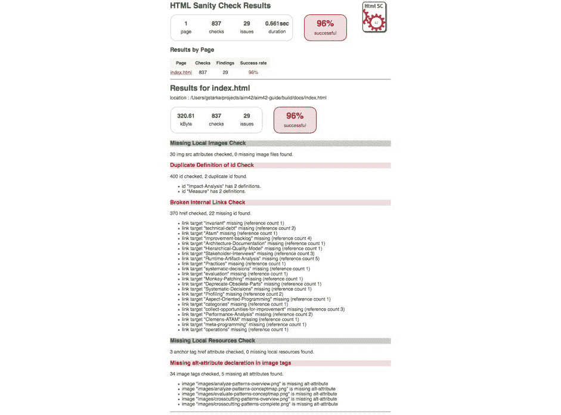

###### 图 2.1：示例报告

`HtmlSanityCheck` (`HtmlSC`) 检查 HTML 中的语义错误，例如损坏的链接和缺失的图像。它是为了支持将 HTML 作为输出格式创建的作者而创建的。此操作可以解释如下：

1. 作者使用 `AsciiDoc` ([`asciidoctor.org/docs/what-is-asciidoc/`](https://asciidoctor.org/docs/what-is-asciidoc/))、`Markdown` ([`www.daringfireball.net/projects/markdown/syntax`](https://www.daringfireball.net/projects/markdown/syntax)) 等格式以及其他格式编写，这些格式由相应的生成器转换为 HTML。
2. `HtmlSC` 检查生成的 HTML 是否存在损坏的链接、缺失的图像和其他语义问题。
3. `HtmlSC` 创建一个类似于众所周知的单元测试报告的测试报告。

下图说明了 `HtmlSC` 的运行方式：

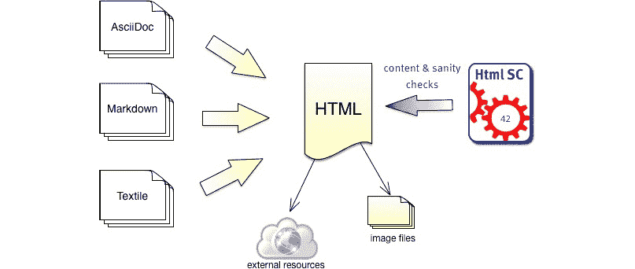

###### 图 2.2：HTML 页面的语义检查

### 基本用法

`HtmlSC` 的使用说明如下：

1. 用户配置一个或多个 HTML 文件的位置（目录和文件名）以及相应的图像目录。
2. `HtmlSC` 对 HTML 执行各种检查，并将结果报告到控制台或作为 HTML 报告。

`HtmlSC` 可以从命令行运行或作为 `Gradle` 插件运行。

### 基本需求

`HtmlSC` 的需求列在下表中：

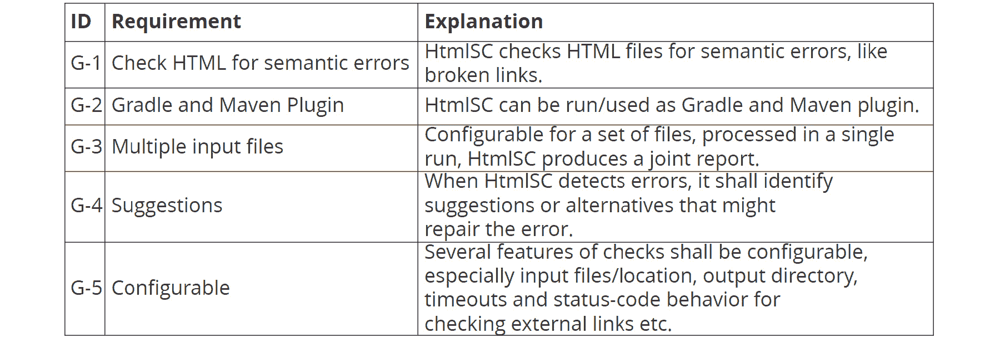

###### 图 2.3：基本需求

### 所需检查

`HtmlSC` 在 HTML 文件中提供以下检查：

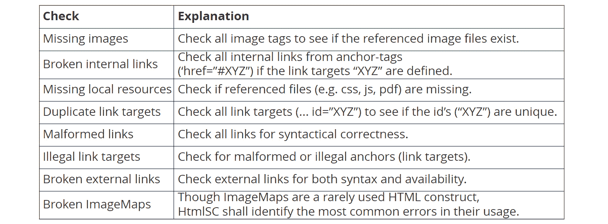

###### 图 2.4：所需检查

### 1.2 质量目标

#### 注

您需要了解质量目标（架构目标），以便将架构和设计决策与这些目标保持一致。

这些（通常是长期）质量目标与开发项目（通常是短期）目标不同。请牢记这些差异！

质量目标如下：

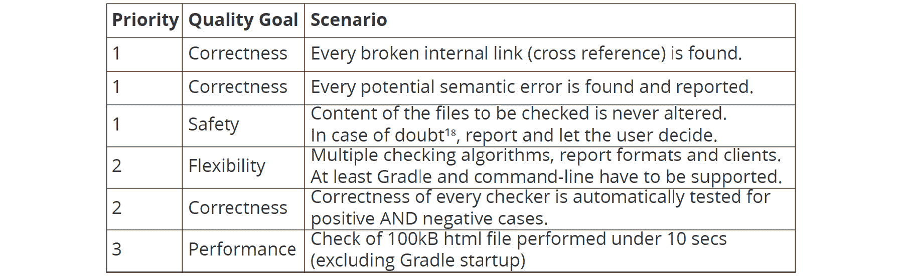

###### 图 2.5：质量目标

#### 注

特别是在检查外部链接时，链接的正确性取决于外部因素，例如网络可用性、延迟和服务器配置，在这些情况下 `HtmlSC` 不能总是识别潜在问题的根本原因。

### 1.3 利益相关者

#### 注

您希望了解影响、受影响或可以为系统及其架构做出贡献的人员、角色或组织。明确这些利益相关者对架构及其文档的具体期望。将这些收集到一个简单的表格中。

对于我们简单的 `HtmlSC` 示例，我们只有极少数利益相关者。在现实生活中，您可能会有更多利益相关者！让我们在这里回顾一下：

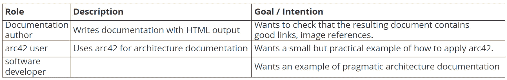

###### 图 2.6：利益相关者

### II.2 约束

#### 注

您希望了解限制您在设计决策或开发过程方面的自由的约束条件。此类约束通常由多个 IT 系统中的组织施加。

`HtmlSC` 应具备以下条件：

* 跨平台运行，并在主要操作系统（Windows、Linux 和 macOS）上运行。
* 使用 `Java` 或 `Groovy` 实现。
* 与 `Gradle` 构建工具集成。
* 可从命令行运行。
* 具有最少的运行时和安装依赖项（运行 `HtmlSC` 可能需要 `Java` 运行时）。
* 在宽松的开源许可证下开发。此外，所有必需的依赖项/库需要与知识共享许可兼容。

### II.3 上下文

您希望了解系统的边界和范围，以将其与邻近系统区分开来。上下文标识具有相关外部接口的系统。

### 3.1 业务上下文

#### 注

您希望识别所有邻近系统以及在系统与其邻居之间交换的不同类型的（业务）数据或事件。

下表列出了所有邻近系统以及每个系统的描述：

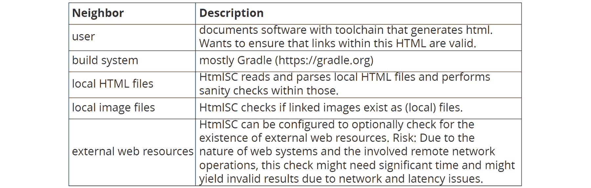

###### 图 2.7：业务上下文

### 3.2 部署上下文

#### 注

您还希望了解系统的技术或物理基础设施，以及物理通道或协议。

下图显示了参与的计算机（节点）及其技术连接，以及 `HtmlSC` 的主要构件 `hsc-plugin-binary`：

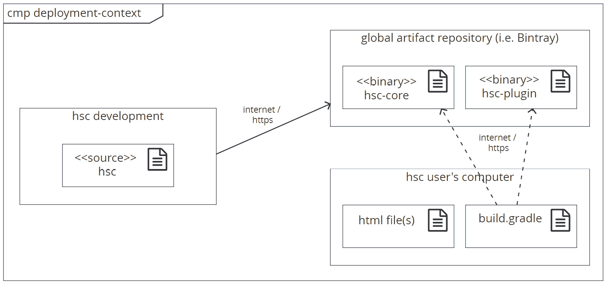

###### 图 2.8：部署上下文

下表解释了 `hsc-plugin-library` 中每个节点的目的：

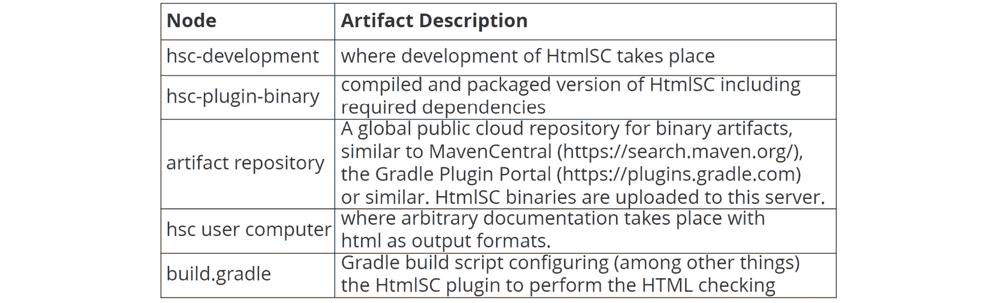

###### 图 2.9：部署上下文组件的描述

### II.4 解决方案策略

#### 注

您需要提供基本解决方案思路和策略的简要总结和说明。这些关键思想应为开发和架构过程中的每个人所熟悉。

简要说明如何实现最重要的质量要求。

以下步骤将解释解决方案设计的基础：

1. 主要使用 `Groovy` 编程语言，部分使用 `Java` 实现 `HtmlSC`，并保持外部依赖最小化。
2. 我们将此实现封装为 `Gradle` 插件，以便在自动化构建中使用。详细信息请参阅 `Gradle` 用户指南（[`docs.gradle.org/current/userguide/userguide.html`](https://docs.gradle.org/current/userguide/userguide.html)）。`Maven` 插件仍在开发中。
3. 应用模板方法模式（[`sourcemaking.com/design_patterns/template_method/`](https://sourcemaking.com/design_patterns/template_method/)）以启用多个检查算法（参见检查算法的概念）以及 HTML（文件）和文本（控制台）输出。
4. 依赖标准 `Gradle` 和 `Groovy` 约定进行配置，并拥有单个配置文件。对于 `Maven` 插件，这可能会导致问题。

### II.5 构建块视图

构建块视图解释并将系统的静态分解划分为构建块（模块、组件、子系统和包）及其关系。它显示了源代码的整体结构。

此视图按自上而下的层次组织。

### 5.1 HtmlSanityChecker（白盒）

下图显示了白盒：


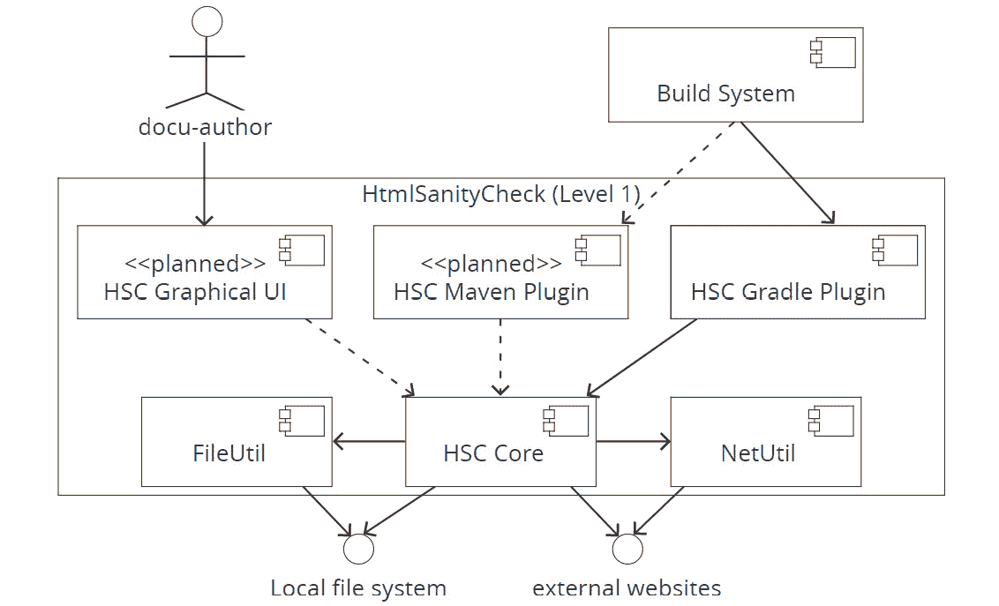

###### 图 2.10：白盒 (HtmlSC)

理由：我们使用 *功能分解* 来分离职责：
* `HSC` `Core` 将封装检查逻辑和 HTML 解析/处理。
* `Plugins` 和 `GraphicalUI` 封装所有使用方面

### 包含的黑盒

下表显示了 HtmlSC 白盒的构建块列表：

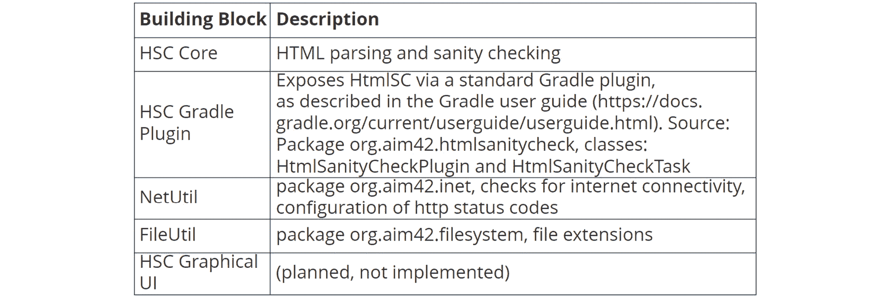

###### 图 2.11：包含的黑盒

### 5.2 构建块 – 第 2 级

#### 5.2.1 HSC Core (白盒)

下图显示了 `HSC Core`（白盒）：

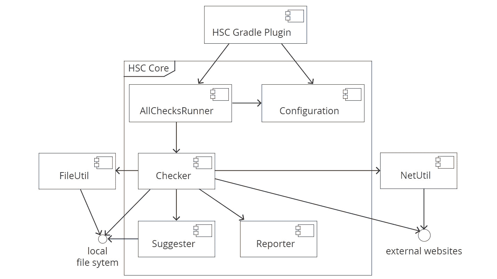

###### 图 2.12：HSC-Core (白盒)

`HSC Core` 的内部结构遵循功能分解，如下所示：
* 配置
* 解析和处理 HTML 输入
* 检查
* 创建建议
* 收集检查结果

### 包含的黑盒

下表描述了包含黑盒的构建块：

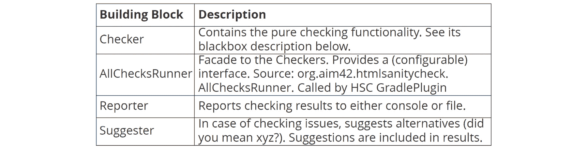

###### 图 2.13：包含的黑盒

##### 5.2.1.1 Checker (黑盒)

抽象的 `Checker` 类为不同的检查算法提供统一接口（`public void check()`）。

基于多态，实际检查由抽象 `Checker` 类的子类处理，该子类使用模板方法模式。它使用可扩展检查算法的概念。

##### 5.2.1.2 Suggester (黑盒)

对于给定的输入（目标），`Suggester` 在一组可能的值（选项）中搜索以找到 `n` 个最相似的值，例如：
* 目标："McDown"。
* 选项：{"McUp", "McDon", "Mickey"}。
* 生成的建议将是 "McDon"，因为它与目标 "McDown" 的相似度最大。

此实现基于 Jaro-Winkler 距离（[`en.wikipedia.org/wiki/Jaro%E2%80%93Winkler\_distance`](https://en.wikipedia.org/wiki/Jaro%E2%80%93Winkler_distance)），它是计算字符串之间相似度的算法之一。

`Suggester` 用于以下情况：
* 损坏的图像链接：比较缺失图像的名称与所有可用的图像文件名以找到最接近的匹配项
* 缺失的交叉引用（损坏的内部链接）：将损坏的链接与所有可用的链接目标（锚点）进行比较

来源：`package org.aim42.htmlsanitycheck.suggest.Suggester`

### 5.3 构建块 – 第 3 级

#### 5.3.1 ResultsCollector (白盒)

下图显示了 ResultsCollector 的白盒：

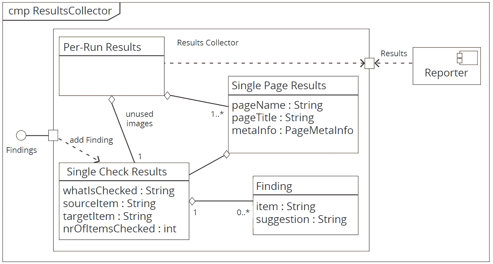

###### 图 2.14：结果收集器 (白盒)

前述结构遵循检查的层次结构，管理以下结果：
* 若干页面/文档（`PerRunResults`）
* 单个 HTML 页面（`SinglePageResults`）
* 单个检查的结果，例如 `MissingImagesChecker`（`SingleCheckResults`）

### 包含的黑盒

下表描述了 `ResultsCollector` 白盒的构建块：

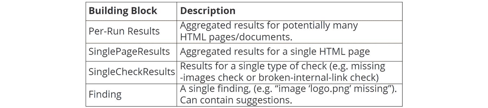

###### 图 2.15：包含的黑盒

## II.6 运行时视图

#### 注

运行时视图以具体场景的形式显示构建块的行为、交互和运行时依赖关系。

这有助于我们了解系统的构建块如何在运行时履行各自的任务，以及它们如何在运行时相互通信/交互。

### II.6.1 执行所有检查

HtmlSC 中的典型场景是对一组 HTML 页面执行所有可用的检查算法。下图描述了 HtmlSC 中的检查操作：

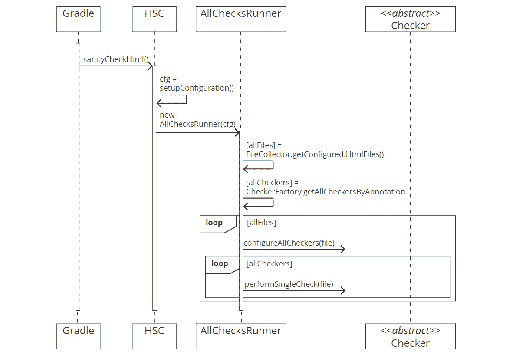

###### 图 2.16：检查算法的执行

前述图可以解释如下：
1. 用户或构建调用 `htmlSanityCheck` 构建目标。
2. Gradle（在构建内部）调用 `sanityCheckHtml`。
3. HSC 配置输入文件和输出目录。
4. HSC 创建一个 `AllChecksRunner` 实例，将所有配置的文件放入 `allFiles`（计划中），并根据注解获取所有可用的 `Checker` 类。
5. 最后，它执行检查并收集结果。

### II.6.2 报告检查结果

下图描述了 HtmlSC 中检查和报告结果的过程：

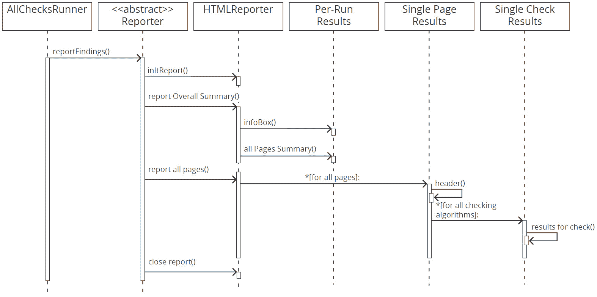

###### 图 2.17：序列图 – 报告结果

报告是在结果的自然层次结构中进行的。让我们逐步了解步骤：
1. 每个“运行”（`PerRunResults`）：报告此运行的日期/时间，检查文件，一些配置信息，并准备结果摘要。
2. 每个“页面”（`SinglePageResults`）：创建页面结果标题，其中包含页面名称和结果的摘要。
3. 对于在此页面上执行的每个检查，使用 `SingleCheckResults` 创建一个部分。
4. 对于“页面上的单个检查”，报告该特定检查的结果。

## II.7 部署视图

#### 注

您可能想了解系统及其构建块将被执行的技术基础设施。这对于软件分布在或部署在多台不同机器、应用服务器或容器上时尤其重要。

有时，您需要了解不同的环境（例如 dev、test 和 production）。

在大型商业或 Web 系统中，可扩展性、集群、自动部署、防火墙和负载均衡等方面发挥着重要作用，而对于我们的这个小示例，我们绝对不需要这些。

下图描述了 HtmlSC 部署：

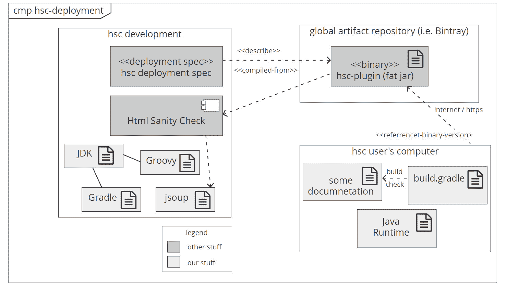

###### 图 2.18：HtmlSC 部署（用于 Gradle）

下表描述了 HtmlSC 部署的不同节点：

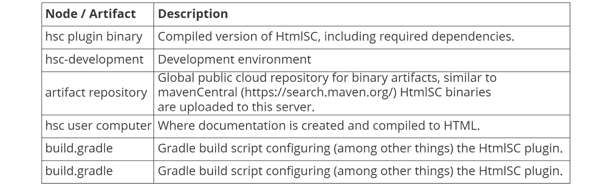

###### 图 2.19：工件描述

前述图中显示的三个节点（*计算机*）通过互联网连接。

### 先决条件

让我们回顾一些先决条件：
* HtmlSC 开发人员需要 Java 开发工具包、Groovy、Gradle 和 `JSoup` HTML 解析器。
* HtmlSC 用户需要 Java 运行时（> 1.6），以及一个名为 `build.gradle` 的构建文件。有关完整示例，请参阅以下代码。

以下是示例 `build.gradle` 文件：
```
buildscript {

repositories {

mavenLocal()

maven {

url "https://plugins.gradle.org/m2/"

    }

    }

dependencies {

// in case of mavenLocal(), the following line is valid:

classpath(group: 'org.aim42',

// in case of using the official Gradle plugin repository:

//classpath (group: 'gradle.plugin.org.aim42',

name: 'htmlSanityCheck', version: '1.0.0-RC-3')

    }

    }

plugins {

id 'org.asciidoctor.convert' version '1.5.8'

    }

// ==== path definitions =====

ext {

srcDir = "$projectDir/src/docs/asciidoc"

// location of images used in AsciiDoc documentation

srcImagesPath = "$srcDir/images"

// (input for htmlSanityCheck)

htmlOutputPath = "$buildDir"

    targetImagesPath = "$buildDir/images"

    }

    // ==== asciidoctor ==========

    apply plugin: 'org.asciidoctor.convert'

asciidoctor {

outputDir = file(buildDir)

sourceDir = file(srcDir)

sources {

include "many-errors.adoc", "no-errors.adoc"    }

attributes = \[

doctype    : 'book',

icons    : 'font',

sectlink    : true,

sectanchors: true \]

resources {

from(srcImagesPath) { include '\*\*' }

into "./images"    }

    }

    // ========================================================

    apply plugin: 'org.aim42.htmlSanityCheck'

    htmlSanityCheck {

// ensure asciidoctor->html runs first
```


// 以及图像被复制到构建目录

    dependsOn asciidoctor

    sourceDir = new File("${buildDir}/html5")

// 要检查的文件，以集合表示法表示

sourceDocuments = ["many-errors.html", "no-errors.html"]

// 如果遇到任何错误则使构建失败

failOnErrors = false

// 将 HTTP 连接超时设置为 2 秒

httpConnectionTimeout = 2000

ignoreLocalHost = false

ignoreIPAddresses = false

    }

    defaultTasks 'htmlSanityCheck'
```
## II.8 横切概念
应解释横切关注点以及系统的普遍规则。`arc42`称之为概念：它们通常影响多个构建块，并在系统的多个部分及其实现中相关。示例包括技术和/或框架的使用规则以及实现规则，以及所使用的设计或架构模式。

### 8.1 领域模型
下图显示了一个领域模型：

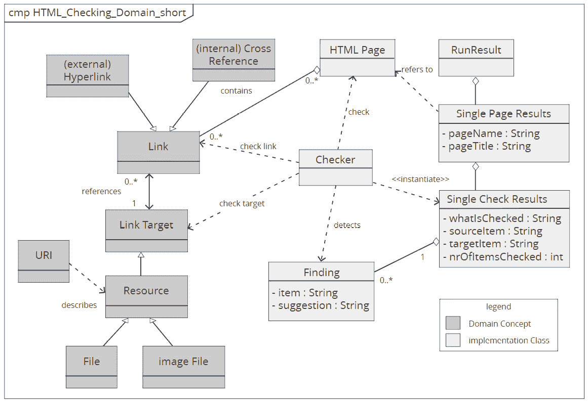

###### 图 2.20：领域检查模型

实现类的属性是私有的，因为我们通过 getter/setter 方法来操作它们。

下表描述了领域模型中的每个组件：

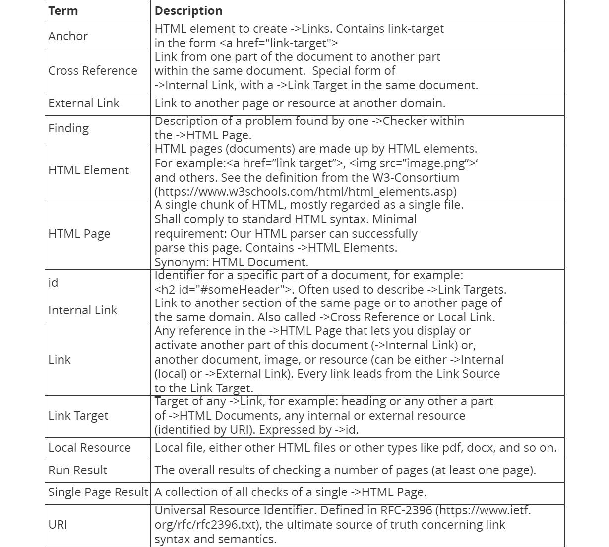

###### 图 2.21：HTML 领域检查模型中术语的描述

### 8.2 HTML 链接的结构
对于许多网页开发者或 HTML 专家来说，以下关于 URI 语法的信息可能完全显而易见。我们为不同类型的人编写了这本书，因此以防万一我们包含了这些信息。

`HtmlSC` 对 HTML 链接（超链接）执行各种检查，这些链接通常遵循 RFC-2396 指定的 URI 语法（[`www.ietf.org/rfc/rfc2396.txt`](https://www.ietf.org/rfc/rfc2396.txt)）。URI 通常用于提供对任意资源（文档、文件或文档内的部分）的链接。

其通用结构在下图中描述。随后是一个单元测试：


###### 图 2.22：通用 URI 结构

测试通用 URI 语法

以下代码片段是用于通用 URI 语法的一些测试代码：
```
@Test

public void testGenericURISyntax() {

// based upon an example from the Oracle(tm) Java tutorial:

// https://docs.oracle.com/javase/tutorial/networking/urls/urlInfo.\\

html

def  aURL  =  new  URL(

"https://example.com:42/docs/tutorial/index.html?name=aim42#INT\\

     RO");

    aURL.with  {

assert getProtocol() == "http"

assert getAuthority() == "example.com:42"

assert getHost() == "example.com"

assert getPort() == 42

assert getPath() == "/docs/tutorial/index.html"

assert getQuery() == "name=aim42"

assert getRef() == "INTRO"

    }

    }
```

### 8.3 多种检查算法
`HtmlSC` 使用模板方法模式（[`sourcemaking.com/design_patterns/template_method/`](https://sourcemaking.com/design_patterns/template_method/)）来实现灵活的检查算法：

"The Template Method defines *a skeleton of an algorithm* in an operation and defers some steps to subclasses."

我们通过在一个操作（`performCheck`）中定义检查算法的骨架来实现这一点，从而将具体的检查算法步骤推迟到子类。不变的步骤在抽象基类中实现，而可变的检查算法必须由子类提供。

使用模板方法执行单一类型检查
```
/**
* Prerequisite: pageToCheck has been successfully parsed,
* prior to constructing this Checker instance.
*/

public CheckingResultsCollector performCheck() {

// assert prerequisite

assert  pageToCheck  !=  null

initResults()

return check() // subclass executes the actual checking algorithm

    }
```
下图描述了模板方法：

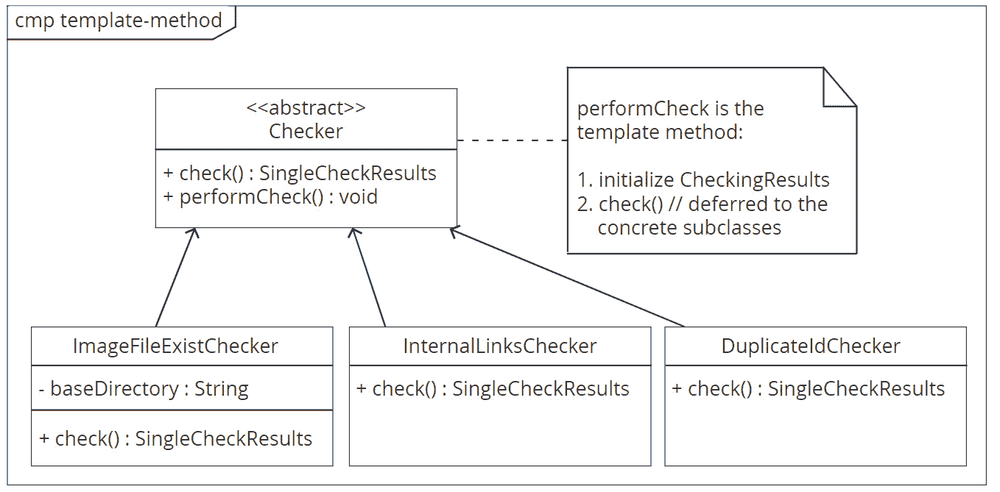

###### 图 2.23：模板方法（摘录）

下表描述了模板的组件：

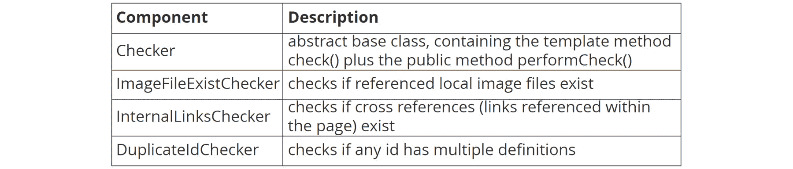

###### 图 2.24：模板组件的描述

### 8.4 报告
`HtmlSC` 支持以下输出（`== reporting`）格式和目标：
* 格式包括 HTML 和文本。
* 目标包括文件和控制台。

报告子系统使用模板方法模式来允许不同的输出格式（例如，控制台和 HTML）。报告的整体结构始终相同。

使用模板方法模式报告发现

（通用且抽象的）报告在抽象 `Reporter` 类中实现，如下所示：
```
/**
* main entry point for reporting - to be called when a report is requested
* Uses template-method to delegate concrete implementations to subclasses
*/

public void reportFindings() {

initReport() // (1)

reportOverallSummary() // (2)

reportAllPages() // (3)

closeReport() // (4)

}

private void reportAllPages() {

pageResults.each { pageResult ->

reportPageSummary( pageResult ) // (5)

pageResult.singleCheckResults.each { resultForOneCheck ->

reportSingleCheckSummary( resultForOneCheck ) // (6)

reportSingleCheckDetails( resultForOneCheck ) // (7)

reportPageFooter()

}

}
```
前述代码可总结如下：
1. 初始化报告，即创建并打开文件，并复制 `CSS`、`JavaScript` 和图像文件。
2. 创建总体摘要，以及总体成功百分比和所有已检查页面及其成功率的列表。
3. 遍历所有页面。
4. 写入报告页脚。在 HTML 报告中，还创建返回顶部的链接。
5. 对于单个页面，报告检查次数和问题数，以及成功率。
6. 对于该页面上的每个 `singleCheck`，报告摘要和 `singleCheck` 的所有详细发现。
7. 对于每个已检查页面，创建页脚、分页符或类似内容以在图形上区分页面。

以下示例报告说明了这些步骤：

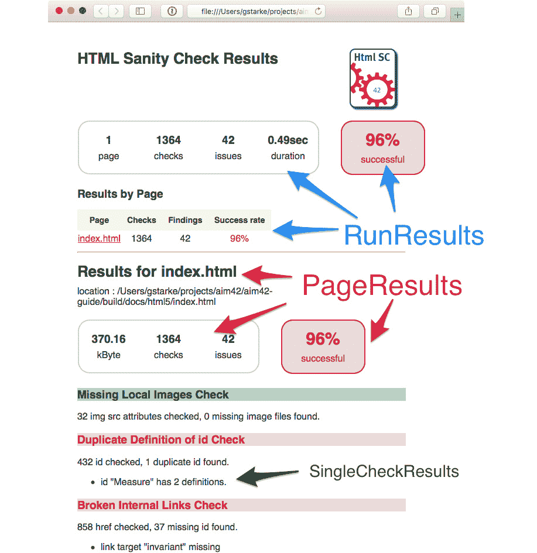

###### 图 2.25：显示运行/页面/检查结果层级关系的示例报告

## II.9 设计决策
#### 注
您可能希望了解一些重要、巨大、昂贵、有风险或其它特殊的架构和设计决策。

了解这些决策的原因尤其有趣。

### 9.1 外部链接检查推迟
在 `HtmlSC` 的当前版本中，我们无法检查外部链接。这些检查已推迟到后续版本。

### 9.2 使用 jsoup 进行 HTML 解析
为了检查 HTML，我们将其解析为内部（`DOM` 类似）表示。为此任务，我们使用 `jsoup`（[`jsoup.org`](https://jsoup.org)），这是一个没有外部依赖的开源解析器。

引用其网站的话：

"*jsoup is a Java library for working with real-world HTML. It provides a very convenient API for extracting and manipulating data, using the best of DOM, CSS, and jQuery-like methods*."

此决策的目标：通过使用现有的 API 以编程方式检查 HTML，该 API 提供对要检查的文件（s）的 `DOM` 树的访问和查找方法。

决策标准如下：
* 依赖项很少，因此 `HtmlSC` 二进制文件保持尽可能小
* 非常易于使用：简单而优雅的（访问器和查找器）方法，可轻松在 `DOM` 树中定位图像、链接和链接目标
* 高度灵活：可以解析文件和字符串（以及其他）输入

HTML 解析器的替代方案如下：
* `jsoup`：一个没有依赖项的纯 HTML 解析器，具有丰富的 API，可以 `DOM` 类似语法访问所有 HTML 元素。这是明显的赢家！


* `HTTPUnit`：用于 Web 应用和网站的测试框架。其主要关注点是 Web 测试，并且存在大量依赖项。
* `HtmlCleaner` (`http://htmlcleaner.sourceforge.net/`).

## II.10 Quality Scenarios

### Note
您可能希望以特定质量树的形式了解具体且可操作的质量需求。本节补充、增强或细化了 arc42 第 1.2 节中已给出的顶层质量目标。

对于我们的这个小型示例，这样的质量树过于庞大，而在实际系统中，我们见过包含超过 100 个场景的质量树。因此，我们在此仅坚持（重复）几个场景。

### Quality Scenarios
此处列出了质量场景：

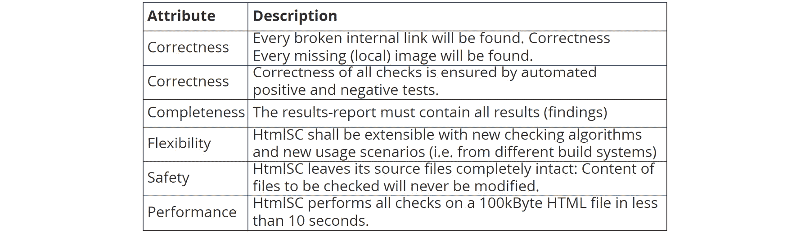

*图 2.26：质量参数的描述*

## II.11 Risks and Technical Debt

### Note
您可能希望了解系统的技术风险，以便应对潜在的未来问题。

此外，通过识别技术风险，您可能希望支持您的管理相关方（即项目管理、产品负责人等）。

在我们的这个小型示例中，我们看不到架构和实现方面的任何 *真实* 风险。因此，以下风险有点人为。

### 11.1 Technical Risks
技术风险如下：

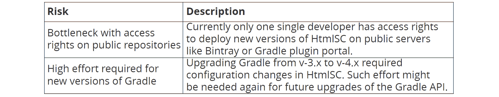

*图 2.27：技术风险*

### 11.2 Business or Domain Risks
业务或领域风险如下：


*图 2.28：业务风险*

## II.12 Glossary

### Note
您需要了解利益相关者在与系统、其接口、目标和需求进行沟通时使用的最重要的领域术语和表达。

术语表是我们“显式，而非隐式”承诺的一种体现，因为它将词语或术语与意义、含义和语义关联起来。

就我们的这个小型示例而言，此处给出的术语对大多数开发人员来说应该是老朋友。

下表列出了在整个文档中使用的[content]
* `HTTPUnit`：用于 Web 应用和网站的测试框架。其主要关注点是 Web 测试，并且存在大量依赖项。
* `HtmlCleaner` (`http://htmlcleaner.sourceforge.net/`).

## II.10 Quality Scenarios

### Note
您可能希望以特定质量树的形式了解具体且可操作的质量需求。本节补充、增强或细化了 arc42 第 1.2 节中已给出的顶层质量目标。

对于我们的这个小型示例，这样的质量树过于庞大，而在实际系统中，我们见过包含超过 100 个场景的质量树。因此，我们在此仅坚持（重复）几个场景。

### Quality Scenarios
此处列出了质量场景：


*图 2.26：质量参数的描述*

## II.11 Risks and Technical Debt

### Note
您可能希望了解系统的技术风险，以便应对潜在的未来问题。

此外，通过识别技术风险，您可能希望支持您的管理相关方（即项目管理、产品负责人等）。

在我们的这个小型示例中，我们看不到架构和实现方面的任何 *真实* 风险。因此，以下风险有点人为。

### 11.1 Technical Risks
技术风险如下：


*图 2.27：技术风险*

### 11.2 Business or Domain Risks
业务或领域风险如下：


*图 2.28：业务风险*

## II.12 Glossary

### Note
您需要了解利益相关者在与系统、其接口、目标和需求进行沟通时使用的最重要的领域术语和表达。

术语表是我们“显式，而非隐式”承诺的一种体现，因为它将词语或术语与意义、含义和语义关联起来。

就我们的这个小型示例而言，此处给出的术语对大多数开发人员来说应该是老朋友。

下表列出了在整个文档中使用的[content]
* `HTTPUnit`：用于 Web 应用和网站的测试框架。其主要关注点是 Web 测试，并且存在大量依赖项。
* `HtmlCleaner` (`http://htmlcleaner.sourceforge.net/`).

## II.10 Quality Scenarios

### Note
您可能希望以特定质量树的形式了解具体且可操作的质量需求。本节补充、增强或细化了 arc42 第 1.2 节中已给出的顶层质量目标。

对于我们的这个小型示例，这样的质量树过于庞大，而在实际系统中，我们见过包含超过 100 个场景的质量树。因此，我们在此仅坚持（重复）几个场景。

### Quality Scenarios
此处列出了质量场景：


*图 2.26：质量参数的描述*

## II.11 Risks and Technical Debt

### Note
您可能希望了解系统的技术风险，以便应对潜在的未来问题。

此外，通过识别技术风险，您可能希望支持您的管理相关方（即项目管理、产品负责人等）。

在我们的这个小型示例中，我们看不到架构和实现方面的任何 *真实* 风险。因此，以下风险有点人为。

### 11.1 Technical Risks
技术风险如下：


*图 2.27：技术风险*

### 11.2 Business or Domain Risks
业务或领域风险如下：


*图 2.28：业务风险*

## II.12 Glossary

### Note
您需要了解利益相关者在与系统、其接口、目标和需求进行沟通时使用的最重要的领域术语和表达。

术语表是我们“显式，而非隐式”承诺的一种体现，因为它将词语或术语与意义、含义和语义关联起来。

就我们的这个小型示例而言，此处给出的术语对大多数开发人员来说应该是老朋友。

下表列出了在整个文档中使用的[content]
* `HTTPUnit`：用于 Web 应用和网站的测试框架。其主要关注点是 Web 测试，并且存在大量依赖项。
* `HtmlCleaner` (`http://htmlcleaner.sourceforge.net/`).

## II.10 Quality Scenarios

### Note
您可能希望以特定质量树的形式了解具体且可操作的质量需求。本节补充、增强或细化了 arc42 第 1.2 节中已给出的顶层质量目标。

对于我们的这个小型示例，这样的质量树过于庞大，而在实际系统中，我们见过包含超过 100 个场景的质量树。因此，我们在此仅坚持（重复）几个场景。

### Quality Scenarios
此处列出了质量场景：


*图 2.26：质量参数的描述*

## II.11 Risks and Technical Debt

### Note
您可能希望了解系统的技术风险，以便应对潜在的未来问题。

此外，通过识别技术风险，您可能希望支持您的管理相关方（即项目管理、产品负责人等）。

在我们的这个小型示例中，我们看不到架构和实现方面的任何 *真实* 风险。因此，以下风险有点人为。

### 11.1 Technical Risks
技术风险如下：


*图 2.27：技术风险*

### 11.2 Business or Domain Risks
业务或领域风险如下：


*图 2.28：业务风险*

## II.12 Glossary

### Note
您需要了解利益相关者在与系统、其接口、目标和需求进行沟通时使用的最重要的领域术语和表达。

术语表是我们“显式，而非隐式”承诺的一种体现，因为它将词语或术语与意义、含义和语义关联起来。

就我们的这个小型示例而言，此处给出的术语对大多数开发人员来说应该是老朋友。

下表列出了在整个文档中使用的[content]
* `HTTPUnit`：用于 Web 应用和网站的测试框架。其主要关注点是 Web 测试，并且存在大量依赖项。
* `HtmlCleaner` (`http://htmlcleaner.sourceforge.net/`).

## II.10 Quality Scenarios

### Note
您可能希望以特定质量树的形式了解具体且可操作的质量需求。本节补充、增强或细化了 arc42 第 1.2 节中已给出的顶层质量目标。

对于我们的这个小型示例，这样的质量树过于庞大，而在实际系统中，我们见过包含超过 100 个场景的质量树。因此，我们在此仅坚持（重复）几个场景。

### Quality Scenarios
此处列出了质量场景：


*图 2.26：质量参数的描述*

## II.11 Risks and Technical Debt

### Note
您可能希望了解系统的技术风险，以便应对潜在的未来问题。

此外，通过识别技术风险，您可能希望支持您的管理相关方（即项目管理、产品负责人等）。

在我们的这个小型示例中，我们看不到架构和实现方面的任何 *真实* 风险。因此，以下风险有点人为。

### 11.1 Technical Risks
技术风险如下：


*图 2.27：技术风险*

### 11.2 Business or Domain Risks
业务或领域风险如下：


*图 2.28：业务风险*

## II.12 Glossary

### Note
您需要了解利益相关者在与系统、其接口、目标和需求进行沟通时使用的最重要的领域术语和表达。

术语表是我们“显式，而非隐式”承诺的一种体现，因为它将词语或术语与意义、含义和语义关联起来。

就我们的这个小型示例而言，此处给出的术语对大多数开发人员来说应该是老朋友。

下表列出了在整个文档中使用的[content]
* `HTTPUnit`：用于 Web 应用和网站的测试框架。其主要关注点是 Web 测试，并且存在大量依赖项。
* `HtmlCleaner` (`http://htmlcleaner.sourceforge.net/`).

## II.10 Quality Scenarios

### Note
您可能希望以特定质量树的形式了解具体且可操作的质量需求。本节补充、增强或细化了 arc42 第 1.2 节中已给出的顶层质量目标。

对于我们的这个小型示例，这样的质量树过于庞大，而在实际系统中，我们见过包含超过 100 个场景的质量树。因此，我们在此仅坚持（重复）几个场景。

### Quality Scenarios
此处列出了质量场景：


*图 2.26：质量参数的描述*

## II.11 Risks and Technical Debt

### Note
您可能希望了解系统的技术风险，以便应对潜在的未来问题。

此外，通过识别技术风险，您可能希望支持您的管理相关方（即项目管理、产品负责人等）。

在我们的这个小型示例中，我们看不到架构和实现方面的任何 *真实* 风险。因此，以下风险有点人为。

### 11.1 Technical Risks
技术风险如下：


*图 2.27：技术风险*

### 11.2 Business or Domain Risks
业务或领域风险如下：


*图 2.28：业务风险*

## II.12 Glossary

### Note
您需要了解利益相关者在与系统、其接口、目标和需求进行沟通时使用的最重要的领域术语和表达。

术语表是我们“显式，而非隐式”承诺的一种体现，因为它将词语或术语与意义、含义和语义关联起来。

就我们的这个小型示例而言，此处给出的术语对大多数开发人员来说应该是老朋友。

下表列出了在整个文档中使用的[content]
* `HTTPUnit`：用于 Web 应用和网站的测试框架。其主要关注点是 Web 测试，并且存在大量依赖项。
* `HtmlCleaner` (`http://htmlcleaner.sourceforge.net/`).

## II.10 Quality Scenarios

### Note
您可能希望以特定质量树的形式了解具体且可操作的质量需求。本节补充、增强或细化了 arc42 第 1.2 节中已给出的顶层质量目标。

对于我们的这个小型示例，这样的质量树过于庞大，而在实际系统中，我们见过包含超过 100 个场景的质量树。因此，我们在此仅坚持（重复）几个场景。

### Quality Scenarios
此处列出了质量场景：


*图 2.26：质量参数的描述*

## II.11 Risks and Technical Debt

### Note
您可能希望了解系统的技术风险，以便应对潜在的未来问题。

此外，通过识别技术风险，您可能希望支持您的管理相关方（即项目管理、产品负责人等）。

在我们的这个小型示例中，我们看不到架构和实现方面的任何 *真实* 风险。因此，以下风险有点人为。

### 11.1 Technical Risks
技术风险如下：


*图 2.27：技术风险*

### 11.2 Business or Domain Risks
业务或领域风险如下：


*图 2.28：业务风险*

## II.12 Glossary

### Note
您需要了解利益相关者在与系统、其接口、目标和需求进行沟通时使用的最重要的领域术语和表达。

术语表是我们“显式，而非隐式”承诺的一种体现，因为它将词语或术语与意义、含义和语义关联起来。

就我们的这个小型示例而言，此处给出的术语对大多数开发人员来说应该是老朋友。

下表列出了在整个文档中使用的[content]
下表列出了在整个文档中使用的[content]
* `HTTPUnit`：用于 Web 应用和网站的测试框架。其主要关注点是 Web 测试，并且存在大量依赖项。
* `HtmlCleaner` (`http://htmlcleaner.sourceforge.net/`).

## II.10 Quality Scenarios

### Note
您可能希望以特定质量树的形式了解具体且可操作的质量需求。本节补充、增强或细化了 arc42 第 1.2 节中已给出的顶层质量目标。

对于我们的这个小型示例，这样的质量树过于庞大，而在实际系统中，我们见过包含超过 100 个场景的质量树。因此，我们在此仅坚持（重复）几个场景。

### Quality Scenarios
此处列出了质量场景：


*图 2.26：质量参数的描述*

## II.11 Risks and Technical Debt

### Note
您可能希望了解系统的技术风险，以便应对潜在的未来问题。

此外，通过识别技术风险，您可能希望支持您的管理相关方（即项目管理、产品负责人等）。

在我们的这个小型示例中，我们看不到架构和实现方面的任何 *真实* 风险。因此，以下风险有点人为。

### 11.1 Technical Risks
技术风险如下：


*图 2.27：技术风险*

### 11.2 Business or Domain Risks
业务或领域风险如下：


*图 2.28：业务风险*

## II.12 Glossary

### Note
您需要了解利益相关者在与系统、其接口、目标和需求进行沟通时使用的最重要的领域术语和表达。

术语表是我们“显式，而非隐式”承诺的一种体现，因为它将词语或术语与意义、含义和语义关联起来。

就我们的这个小型示例而言，此处给出的术语对大多数开发人员来说应该是老朋友。

下表列出了在整个文档中使用的[content]
* `HTTPUnit`：用于 Web 应用和网站的测试框架。其主要关注点是 Web 测试，并且存在大量依赖项。
* `HtmlCleaner` (`http://htmlcleaner.sourceforge.net/`).

## II.10 Quality Scenarios

### Note
您可能希望以特定质量树的形式了解具体且可操作的质量需求。本节补充、增强或细化了 arc42 第 1.2 节中已给出的顶层质量目标。

对于我们的这个小型示例，这样的质量树过于庞大，而在实际系统中，我们见过包含超过 100 个场景的质量树。因此，我们在此仅坚持（重复）几个场景。

### Quality Scenarios
此处列出了质量场景：


*图 2.26：质量参数的描述*

## II.11 Risks and Technical Debt

### Note
您可能希望了解系统的技术风险，以便应对潜在的未来问题。

此外，通过识别技术风险，您可能希望支持您的管理相关方（即项目管理、产品负责人等）。

在我们的这个小型示例中，我们看不到架构和实现方面的任何 *真实* 风险。因此，以下风险有点人为。

### 11.1 Technical Risks
技术风险如下：


*图 2.27：技术风险*

### 11.2 Business or Domain Risks
业务或领域风险如下：


*图 2.28：业务风险*

## II.12 Glossary

### Note
您需要了解利益相关者在与系统、其接口、目标和需求进行沟通时使用的最重要的领域术语和表达。

术语表是我们“显式，而非隐式”承诺的一种体现，因为它将词语或术语与意义、含义和语义关联起来。

就我们的这个小型示例而言，此处给出的术语对大多数开发人员来说应该是老朋友。

下表列出了在整个文档中使用的[content]
* `HTTPUnit`：用于 Web 应用和网站的测试框架。其主要关注点是 Web 测试，并且存在大量依赖项。
* `HtmlCleaner` (`http://htmlcleaner.sourceforge.net/`).

## II.10 Quality Scenarios

### Note
您可能希望以特定质量树的形式了解具体且可操作的质量需求。本节补充、增强或细化了 arc42 第 1.2 节中已给出的顶层质量目标。

对于我们的这个小型示例，这样的质量树过于庞大，而在实际系统中，我们见过包含超过 100 个场景的质量树。因此，我们在此仅坚持（重复）几个场景。

### Quality Scenarios
此处列出了质量场景：


*图 2.26：质量参数的描述*

## II.11 Risks and Technical Debt

### Note
您可能希望了解系统的技术风险，以便应对潜在的未来问题。

此外，通过识别技术风险，您可能希望支持您的管理相关方（即项目管理、产品负责人等）。

在我们的这个小型示例中，我们看不到架构和实现方面的任何 *真实* 风险。因此，以下风险有点人为。

### 11.1 Technical Risks
技术风险如下：


*图 2.27：技术风险*

### 11.2 Business or Domain Risks
业务或领域风险如下：


*图 2.28：业务风险*

## II.12 Glossary

### Note
您需要了解利益相关者在与系统、其接口、目标和需求进行沟通时使用的最重要的领域术语和表达。

术语表是我们“显式，而非隐式”承诺的一种体现，因为它将词语或术语与意义、含义和语义关联起来。

就我们的这个小型示例而言，此处给出的术语对大多数开发人员来说应该是老朋友。

下表列出了在整个文档中使用的[content]
下表列出了在整个文档中使用的[content]
* `HTTPUnit`：用于 Web 应用和网站的测试框架。其主要关注点是 Web 测试，并且存在大量依赖项。
* `HtmlCleaner` (`http://htmlcleaner.sourceforge.net/`).
## II.10 Quality Scenarios
### Note
您可能希望以特定质量树的形式了解具体且可操作的质量需求。本节补充、增强或细化了 arc42 第 1.2 节中已给出的顶层质量目标。
对于我们的这个小型示例，这样的质量树过于庞大，而在实际系统中，我们见过包含超过 100 个场景的质量树。因此，我们在此仅坚持（重复）几个场景。
### Quality Scenarios
此处列出了质量场景：

*图 2.26：质量参数的描述*
## II.11 Risks and Technical Debt
### Note
您可能希望了解系统的技术风险，以便应对潜在的未来问题。
此外，通过识别技术风险，您可能希望支持您的管理相关方（即项目管理、产品负责人等）。
在我们的这个小型示例中，我们看不到架构和实现方面的任何 *真实* 风险。因此，以下风险有点人为。
### 11.1 Technical Risks
技术风险如下：

*图 2.27：技术风险*
### 11.2 Business or Domain Risks
业务或领域风险如下：

*图 2.28：业务风险*
## II.12 Glossary
### Note
您需要了解利益相关者在与系统、其接口、目标和需求进行沟通时使用的最重要的领域术语和表达。
术语表是我们“显式，而非隐式”承诺的一种体现，因为它将词语或术语与意义、含义和语义关联起来。
就我们的这个小型示例而言，此处给出的术语对大多数开发人员来说应该是老朋友。
下表列出了在整个文档中使用的[content]
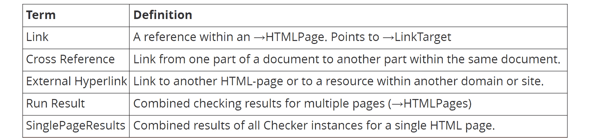

*图 2.29：常见术语词汇表*
