# Chapter 3

## III - Mass Market Customer Relationship Management

By **Dr. Gernot Starke**

**Mass Market Customer Relationship Management** (**MaMa-CRM**) 承担了面向大众市场组织的（通常为纸质）客户联系负担，例如保险公司、信用卡提供商、移动电信提供商、能源和水务提供商以及大型房地产公司（在 MaMa 的说法中，这些被称为 **Mandators**）。

MaMa-CRM 最初是为一家独立的中型数据中心订制的，以支持德国（政府强制）电子健康卡的推出，该卡现已用于支持电话计费和电力计量等活动。

对于每个委托方，至少运行一个完全独立的 MaMa-CRM 实例，该实例专门为其委托方和活动配置。

MaMa-CRM 架构文档在需求方面相当庞大，描述了多个灵活性方面，这些方面触发了许多核心架构决策。

构建该系统的团队由 7-10 人组成，在约 15 个月的时间里以 2-4 周为迭代周期工作。

我（Dr. Gernot Starke）有幸以负责的角色参与了该团队。原始客户允许我在不披露公司名称的情况下谈论和撰写该系统。我不被允许使用任何原始文档或源代码。

感谢 Thorsten、Sven、Arno 等人的出色合作。

## III.1 Introduction and Requirements
本章描述了 MaMa-CRM 平台，一种协调大众市场服务提供商与其客户之间流程的软件产品族。MaMa-CRM 为需要针对特定 CRM 领域进行定制或配置的单个系统提供了基础。

MaMa-CRM 由 **Innovative DAta Center**（我们称之为 **InDAC**）构建并运营——一家为其客户提供多种托管软件服务的公司。在业务流程外包举措中，InDAC 为其客户运营 MaMa-CRM 的特定实例。

让我们通过几个简要示例来阐明 MaMa-CRM 的范围（您将在 *Requirements Overview* 部分找到更多详细信息）：

* 电信提供商向其客户提供新的或更新的资费。这可通过多种可能的渠道实现，例如电子邮件、电话、信件或传真，以便服务提供商对这些优惠做出回应或提出支持查询。
* 零售组织向特定客户发送特定的广告或营销材料。同样，这些客户可以通过多种不同的通信渠道做出反应。这类广告是目标群体营销的一部分。
* 保险公司向特定客户群体提出对现有合同的修改或增强。被保险人或组织可以通过不同的通信渠道做出反应，例如电话、邮件、电子邮件，甚至面对面。如果消费者接受该提议，他们必须提交具有法律约束力的签名。

### Note
MaMa-CRM 系统背后的真实公司希望在此不被披露。因此，“InDAC”这个名字纯属虚构。原始系统并不叫 MaMa，而是另一个名字——我希望你不介意。

下图显示了 MaMa-CRM 的概括性概述：

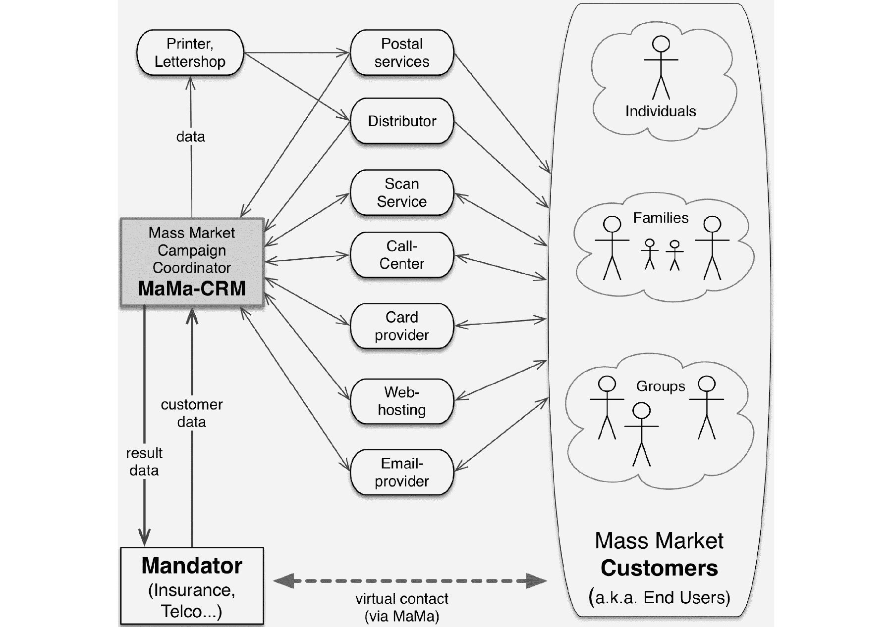

*图 3.1：MaMa – 概括性概述*

在前面的图中，**mandator** 代表一个为大众市场客户服务的任意公司或组织。**MaMa**，我们的系统，可以为来自不同行业的许多不同委托方托管 CRM 活动。

### 1.1 Requirements Overview
MaMa-CRM 控制 InDAC（MaMa 的承包商）为其委托方开展的客户关系 CRM 活动。InDAC 的委托方是保险或电信企业等公司，它们本身为大众市场客户提供服务或产品。这些委托方将其 CRM 相关业务流程外包给 InDAC。

MaMa-CRM 支持以下活动类型：

* 保险公司、电信和互联网服务提供商以及能源供应商的资费或合同变更。您将在后面找到此过程的详细示例。
* 为按次拨号电话服务提供商处理计费信息：委托方将计费数据提交给 MaMa，后者协调打印、提交和对由此产生的发票的支持。MaMa-CRM 的范围不包括付款的管理或处理。
* 为信用卡和保险公司管理二进制图像，这些公司将持卡人的图像打印在卡上以防止滥用。德国电子健康卡属于此类。
* 为公司或大型房地产企业提供能源或水的抄表。

由于 MaMa 是整个 CRM 系统家族的基础，它可以适应各种不同的输入和输出接口和渠道，而无需任何源代码修改！

#### 1.1.1 Campaign Example: Mobile Phone Contract Modification
此示例应阐明 MaMa 的复杂业务和技术需求。

**MoPho** 是一个（假设的）拥有庞大客户群和多种不同资费选项（固定费用、按时计费、按量计费等）的移动电话提供商。其中一些资费或资费组合不再具有市场性（简而言之，**MoPho** 不能从中获得所需的利润——但这是另一个故事）。其他则在技术上已过时。


在其持续优化业务的努力中，**MoPho**的管理层决定简化其资费结构。在一次大规模活动中，他们联系所有使用过时资费的客户，并提供升级到新且大多更优惠的资费方案。部分客户可以支付更少的费用，但必须接受更长的合同期限。其他客户需要多支付一点，但可获得增加的容量、带宽或其他福利等附加服务。当客户接受新的资费方案时，**MoPho**与客户之间的正式合同必须更新，这需要有效的签名才能具有法律约束力。

### 注意
在某些国家或某些合同类型中，可能存在比书面签名更简单的解决方案。请暂时忽略这一点。

**MoPho**打算通过印刷信件向某些客户告知新的资费方案。客户可以通过信件、传真、电话或亲自前往**MoPho**众多销售网点之一进行回复。由于**MoPho**的核心竞争力涉及电话服务，他们不想费心打印信件、扫描和处理回复、回答电话咨询以及处理其他超出范围的活动。因此，他们采用 MaMa-CRM 作为一站式省心解决方案。请看以下 MaMa 对此场景的处理方式：

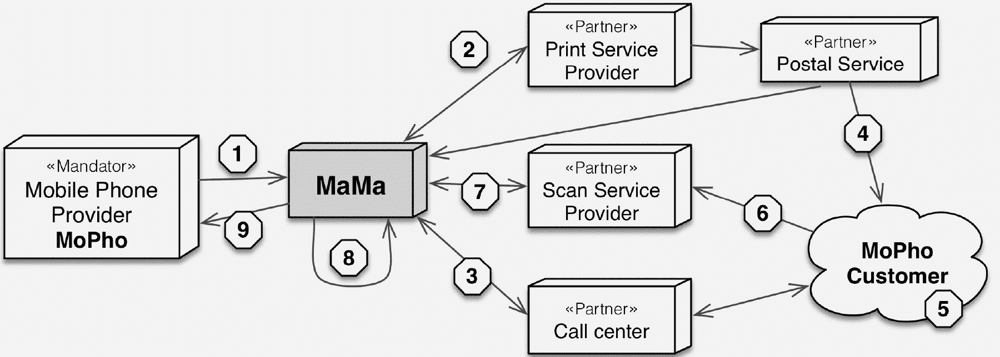

#### 图 3.2：电信示例场景

前述场景中描绘的步骤需要一些解释：
1.  **MoPho**从其内部 IT 系统中挑选合适的客户。我们谈论的是超过 3000 万的客户群，其中大约 1000 万客户将参与此次活动。**MoPho**导出其地址、合同和资费数据并将其传输至 MaMa-CRM。**MaMa**导入这些客户数据。
2.  **MaMa**仅将客户数据的相关部分转发给印刷服务提供商（即“**Partner**”）。该公司根据地址和资费数据创建个性化信件，打印这些信件，最后将它们交付给邮政服务（确保信件最终送达客户的邮箱）。
3.  MaMa 现在通知参与此次活动的呼叫中心（同样是“**Partner**”），以便他们为客户的反应做好准备。
4.  与此同时，印刷服务已将信件交付给邮政服务，后者将信件递送给相应客户。这比听起来要困难：根据客户群的不同，1-5%的地址在 12 个月内往往会发生变化。一些客户拒绝接受营销信件。邮政服务会将所有这些问题案例（地址未知、转寄请求等）告知 MaMa，以便 MaMa 决定后续行动。
5.  客户决定如何处理信件：这里有多种选择：
    客户填写随附的回执表格并签名。
    客户填写了回执表格但忘记签名。
    客户不理解此优惠并通过信件发送咨询。
    客户通过电话咨询。
    客户忽略信件且完全不予回复。
    还有其他特殊情况（客户无合同行为能力、有监护人或法定监护人、未成年、已故或暂时无法联系）。
    假设客户接受并通过邮政服务将信件寄回。这些信件将被转发给扫描服务提供商（同样是“**Partner**”），后者对其进行扫描并执行光学字符识别。**MaMa**从扫描服务提供商导入扫描结果。这里同样可能出现多种情况。**MaMa**区分所有可能的情况并采取适当措施：
    表格已完整填写并签名。
    表格已完整填写，但客户忘记签名。
    客户已签名但忘记填写表格中的其他重要字段。
    如果表格在适当的时间内未被退回，**MaMa**可能会决定重新发送信件，也许采用不同的版式、措辞，甚至是不同的合同方案。
    你当然可以想象还有其他多种可能的选择。
6.  最后，对于每位接受了变更资费协议的客户，**MaMa**会返回相应信息，以便**MoPho**的委托方在内部更改相应的主数据，即合同和资费，并执行所有其他所需操作（**MaMa**中的活动）。
    对于**MoPho**而言，主要优势在于所有客户交互的集中式接口：开展此次关键活动所需的所有流程均由 MaMa-CRM 处理，无需**MoPho**干预。对**MoPho**来说另一个实用的特点是 MaMa-CRM 导入和导出多种不同数据格式的几乎无限灵活性。这种灵活性使 MaMa-CRM 能够轻松纳入新的活动合作伙伴（例如第二家扫描服务提供商、额外的电子邮件服务提供商或网络托管合作伙伴）。

## 1.1.2 活动配置
**MaMa**为活动实例提供软件基础，这些实例必须经过大量配置才能为特定委托方与若干特定合作伙伴运营。

以下部分概述了针对我们在上一节中描述的**MoPho**活动的此类配置：
1.  配置客户主数据：
    定义和配置所需的数据属性和附加类。通常，这些信息完全由委托方提供。
    这些数据（例如合同、资费、优惠以及其他业务特定实体或属性）被建模为**MaMa**基础模型在 UML 中的扩展。
    在**MoPho**电信示例中，这些数据包括现有资费、潜在新资费列表、合同号码、现有资费的有效期以及新资费的有效期。
2.  配置所需的通信渠道：
    定义和交换安全凭证（密码、证书和用户 ID）。
    确定联系地址，特别是用于处理技术和流程问题。
3.  定义活动元数据：
    这包括开始和结束日期、特定活动的目标日期、信件的回复地址、回复电子邮件地址以及呼叫中心的电话号码。
4.  定义活动活动：
    活动活动可以是输入、输出或**MaMa**内部活动。
    输出活动*export*数据给合作伙伴或委托方，例如，**PrintLetter**、**DataToCallCenter**、**0044ataToScanServiceProvider**、**ResultsToMandator**和**ProductionOrderToCardProvider**。
    输入活动*import*由委托方或合作伙伴提供的数据，例如，**MasterDataFromMandatorImport**、**ScanDataImport**、**CallCenterImport**和**SalesOutletImport**。
    内部活动定义数据维护操作，例如，完成后 60 天删除客户数据，并在活动终止后 120 天删除所有活动数据。
5.  模型活动流程：
    所需的活动流程，即在什么条件下需要发生什么（包括合理性检查）。

## 1.1.3 收费活动
部分活动会产生费用，例如以下：
*   通过邮政服务发送信件会产生邮资费用。
*   生产电子健康卡会产生卡片生产费用。

由于我们谈论的是可能数百万的客户活动，这些费用将构成一笔可观的资金流动：
*MaMa-CRM 不处理计费和支付流程。*

相反，这些工作由 InDAC 的财务部门与 MaMa 活动并行处理。

### 注意


在实际系统中，开票和付款通常由委托方（！）处理，但这些第三方流程对于软件架构而言并不重要，因此在本文档中被省略。

## 1.1.4 其他需求

本节将按如下方式描述其他需求：

### 状态和财务报告

MaMa 必须创建包含所有活动及其结果的活动报告（例如，打印了多少封信，呼叫中心处理了多少客户来电，有多少客户寄回了回信，等等）。

特别重要的是报告涉及收费（具有财务后果）的活动。虽然 MaMa-CRM 不负责由此产生的开票和付款流程，但委托方和合作伙伴需要有关此类活动的可靠且可信的报告。

MaMa 提供了涵盖这些情况的充分标准报告。

### 客户数据归委托方所有

MaMa-CRM 遵循非常严格的数据保护政策：活动中所有数据处理都与客户有关，需要严格保密。委托方始终是所有此类数据的所有者，无论数据转移到哪个合作伙伴或通过何种活动。

活动正式结束后，所有数据，包括备份、配置、数据和元数据，都需要被删除。

#### 注

实际上，这一要求禁止使用众所周知的版本控制系统 SubVersioN（SVN），因为在 MaMa-CRM 开发时，SVN 无法可靠地从其版本历史中 `purge` 文件！

因此，不允许使用跨越 SVN 仓库的活动。

## 1.2 质量目标

质量目标列举如下：

### 1.2.1 灵活性优先

下图说明了灵活性的重要方面：


###### 图 3.3：灵活性的方面

简单来说，MaMa 是一个数据中心，在多个方面具有灵活性：它导入通过各种传输渠道（方面 2）传输的数据（方面 1），并执行一组特定的业务规则（方面 3），以确定对这些数据应执行哪些进一步活动。此类活动包括向特定业务合作伙伴（例如打印、扫描或传真服务提供商、呼叫中心等）导出数据（方面 4）。

MaMa 必须在这些方面具有灵活性。

#### 方面 1：数据结构和格式的灵活性

MaMa 始终处理客户数据的变体——最简单的版本可能看起来像以下类定义的实例：

```
public class Client
String primaryKey
String lastName
String firstName
Date birthDate
String title
Address postalAddress
```

MaMa 需要从各个活动合作伙伴导入此类数据。这些合作伙伴使用自己的 IT 系统和自己的数据格式。他们会将受影响的数据记录导出为他们选择的格式。MaMa 需要处理许多此类格式：
* 逗号分隔值（CSV）：属性由（可配置的）分隔符分隔，例如，"id01," "starke," "gernot," "23-jul-1963," "willi-lauf," "D-50858," "cologne," 和 "germany."
* 字段顺序和分隔符可能不同。
* 元素可以用 " 或 " 甚至 "" 括起来。
* 定长格式，其中每个数据记录都有固定长度。较短的条目用空字符串或零填充。
* XML 方言，符合适当的模式或文档类型定义（DTD）。

无论格式如何，数据元素都需要符合验证或合理性规则。好消息是，无需处理来自编程语言运行时（例如 Java 虚拟机）的序列化对象。

#### 方面 2：传输格式和模式的灵活性

MaMa 需要处理以下与传输相关的方面：
* 作为客户端和服务器的标准传输协议（`FTP`、`SFTP`、`HTTP` 和 `HTTPS`）。
* 压缩
* 加密
* 创建校验和，至少使用计数器、MD5 和 SHA-1。
* 用于安全传输的委托方或活动特定的凭据。
* 传输元数据，即统计成功传输次数并将上一次成功传输的次数作为前缀发送到下一次传输。

#### 方面 3：业务/活动规则的灵活性

MaMa 需要支持以下几类活动规则（有时称为业务规则）：
* 此活动中需要和可能的活动是什么？
* 这些活动应按什么顺序执行？
* 某些类型的活动（尤其是数据导入活动）有时由合作伙伴组织触发。什么样事件触发什么活动？
* 我们应多久通过信件提醒客户/顾客一次？
* 我们应在何时通过电话联系客户/顾客？
* 客户的哪些数据是强制性的，哪些是可选的？
* 我们应保留数据记录多长时间，何时应删除或归档数据记录？
* 当出现某些（数据）条件时，我们应联系谁？

#### 方面 4：数据导出的灵活性

现在 MaMa 已接收并处理了数据（通过导入、传输和规则处理），它需要将数据发送给活动合作伙伴。与数据导入类似，这些接收方合作伙伴对数据格式有非常具体的要求。

MaMa 从合作公司或委托方以 CSV 格式接收数据，将其导入自己的关系数据库，按记录处理，然后向一个合作伙伴以 XML 格式导出某些记录，向另一个合作伙伴以定长格式导出其他记录的情况相当常见。

### 1.2.2 质量目标（场景）

以下为如前所述的质量目标的各种场景：

#### 优先级 1：灵活性

MaMa-CRM 可以执行以下操作：
* 导入和导出（可配置的）CSV 和定长记录数据。
* 通过 `FTP`、`SFTP`、`HTTP` 和 `HTTPS` 作为客户端和服务器导入和导出数据。
* 处理压缩数据。压缩算法可按活动配置，同时必须支持标准无损压缩。
* 处理加密数据。安全凭据需要在活动设置期间在活动开始前在各方之间交换。推荐使用 Pretty Good Privacy（PGP）或其衍生产品。
* 处理哈希或类似的传输元数据，可按活动配置。

对于所有这些主题，InDAC 管理员可以在一个工作日内完全配置所有活动特定方面。

#### 优先级 2：安全性

MaMa 将确保其所有客户和活动相关数据安全。活动外部方永远无法访问数据或元数据。

InDAC 管理员需要签署保密协议才能管理活动数据。此组织问题不在 MaMa 范围内。

#### 优先级 3：运行时性能

MaMa 可以在 24 小时内完全处理 250,000 封扫描的回信。

### 1.2.3 非目标（超出范围）

* MaMa 只能由 InDAC 独家运营。它不应演变为可销售的产品。
* MaMa 不应取代传统的 CRM 系统，如 Siebel™、salesforce.com 或其他系统。
* MaMa 不处理其活动产生的任何费用（如发送信件等）的开票和付款。

## 1.3 利益相关者

以下表格说明了每个利益相关者的重要性：

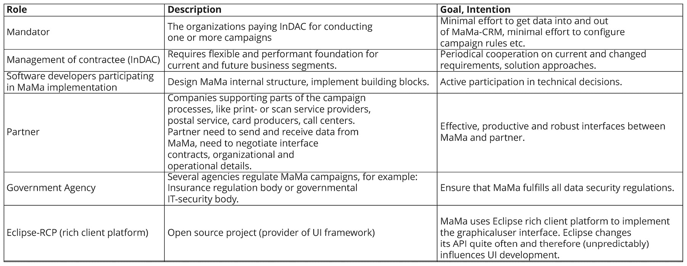

###### 图 3.4：利益相关者表

### 1.3.1 特殊案例：德国电子健康卡

下图显示了德国电子健康卡的一个示例：


###### 图 3.5：德国电子健康卡示例


`InDAC` 在德国电子健康卡评估阶段托管了多个活动，这些活动必须遵守相应标准化机构发布的业务和技术标准。为此目的，德国政府成立了一家公司。关于 `MaMa-CRM` 开发团队的一个有趣事实是，该公司在 `MaMa` 开发启动时尚未运营，因此必须遵守的标准甚至尚未创建或发布。

## 1.3.2 合作伙伴或委托方特定接口细节
`MaMa-CRM` 提供详细的接口规范文档，合作伙伴（如打印或扫描服务提供商）可据此在 `MaMa` 中实现、配置和运行其接口。由于 `MaMa` 的高度灵活性，通常情况正好相反：`Mandators` 和 `Partners` 向 `MaMa` 提供其接口描述，`MaMa` 管理员只需对其进行配置即可使其运行。

# III.2 约束
`MaMa` 的约束如下：

## 一般约束
`MaMa` 的一般约束如下：
* 无需编程即可设置活动：
* 设置活动时无需编程。允许以各种形式进行配置。
* 基于 Java 的实现：
* `MaMa-CRM` 运行在较新的 `Java` 运行时（>1.6）上。
* 使用 Oracle 作为数据库：
`InDAC` 控股公司已与 `Oracle Inc.` 就许可和维护费用达成优惠协议。因此，必须使用 `Oracle DB` 进行数据存储。

## 软件基础设施约束
软件相关的约束如下：
* Linux 操作系统（最好使用 `Red Hat Enterprise Linux`，因为存在多个安全组织认证的加固版本）。
* 具有宽松许可证的开源框架可以使用（不允许 `GNU` 和 `FSF` 许可证）。
* 开发中优先采用代码生成/ `Model Driven Software Development`（`MDSD`）。
* 建议使用 `UML` 建模工具。
* `InDAC` 偏好迭代开发流程，但不强制要求。
* 健全的技术文档：`InDAC` 强调持久、稳健且成本效益高的软件系统，因此强烈要求可维护、易理解且表达力强的技术文档（您当前正在阅读的部分内容即属此类）。

## 运行约束
运行约束如下：
* 每个 `MaMa-CRM` 实例都应在自己的虚拟机中运行。
* `MaMa` 应以批处理/后台模式运行，以最小化运行开销。
* 完整的配置应可通过自定义 `Eclipse` 插件完成（或者，我们也可以通过浏览器完成）。

# III.3 上下文
以下是对 `MaMa` 产生影响的不同上下文：

## 3.1 （通用）业务上下文
每个 `MaMa` 实例都与单个委托方和一个或多个合作伙伴组织通信，如下图所示。合作伙伴是外部服务提供商，例如打印服务、邮件投递服务、扫描服务以及呼叫中心或互联网托管提供商。请考虑下图：
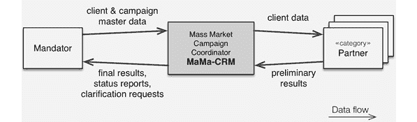
###### 图 3.6：MaMa 通用业务上下文（非正式）
`Client data (outbound)`
客户端数据按“按需知晓”原则发送给合作伙伴，以实现数据最小化：每个合作伙伴组织仅获得其履行活动任务所绝对必需的数据。
例如，`MaMa` 不会向呼叫中心披露客户的街道地址（他们通常只会获知姓名、电话号码，有时还会获知一两个用于验证目的的额外属性）。
另一方面，打印服务提供商通常不会获知客户的电话号码，因为后者对于通过邮政服务投递印刷信件并非必需。

### 3.1.1 正式业务上下文
下图提供了上下文图的更正式版本。它包括一个管理界面，该界面在非正式版本中被省略：
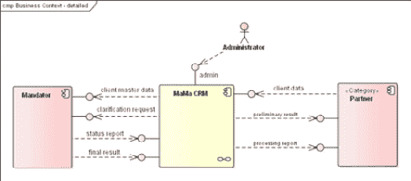
###### 图 3.7：MaMa 通用业务上下文（正式）
管理界面允许 `MaMa` 和活动管理员执行初始化、配置和运行活动所需的所有管理任务。

### 3.1.2 特定业务上下文：手机合同修改
下图详细说明了我们之前查看的示例：
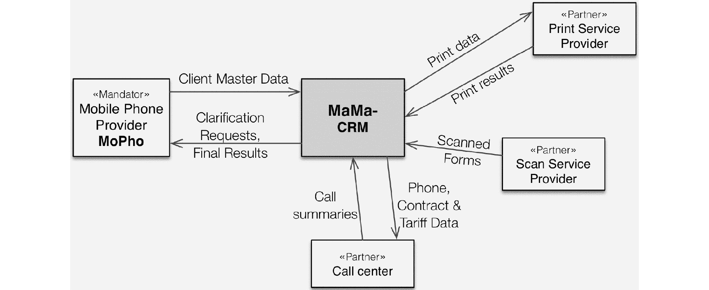
###### 图 3.8：手机示例上下文
数据流在下表中进行了详细说明（节选）：
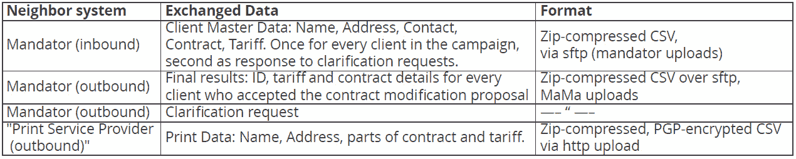
###### 图 3.9：手机合同修改活动的上下文详情
`Mapping Attributes to CSV Fields`
对于 `MaMa` 的每个实例，必须详细指定数据属性到数据传输中字段/记录的映射。这由一种领域特定语言完成；详情请参见 `CSV Import/Export` 部分。

### 3.1.3 技术/部署上下文
`MaMa` 实例应运行在独立的虚拟机中（而某些委托方或活动要求实例部署在其自己的物理硬件上，这会导致活动成本显著增加）。
#### 注
一些对安全性要求极高的委托方为其 `MaMa` 实例协商了各自独立的物理硬件。
下图提供了典型的 `MaMa` 部署设置的示意概述：
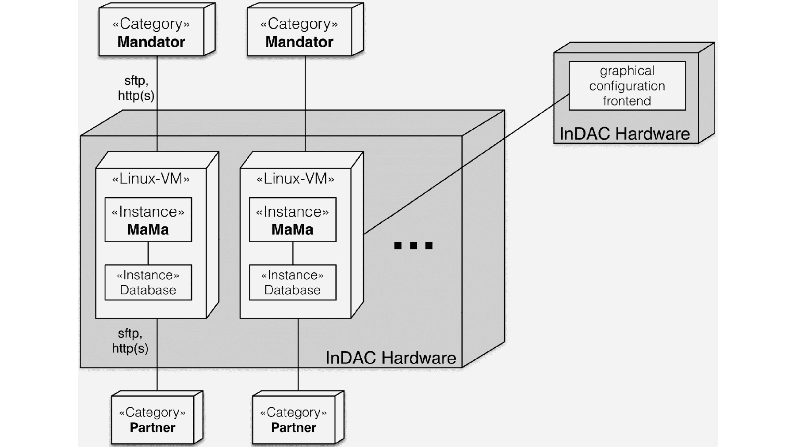
###### 图 3.10：典型的 MaMa 部署上下文
下表描述了 `MaMa` 部署设置中的每个元素：
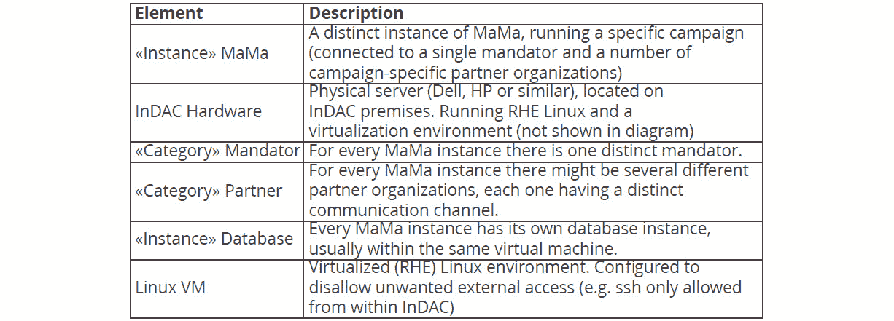
###### 图 3.11：MaMa 部署元素的描述

# III.4 解决方案策略
这里，我们将仅找到针对最重要的（质量）需求的架构方法简写形式，以及指向相应横切概念的链接。
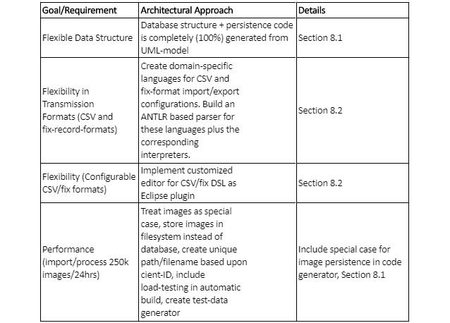
###### 图 3.12：解决方案策略目标

# III.5 构建块
本节描述部署设置中的每个构建块：
## 5.1 MaMa 白盒 Level 1
下图描绘了 `MaMa` 白盒的结构：
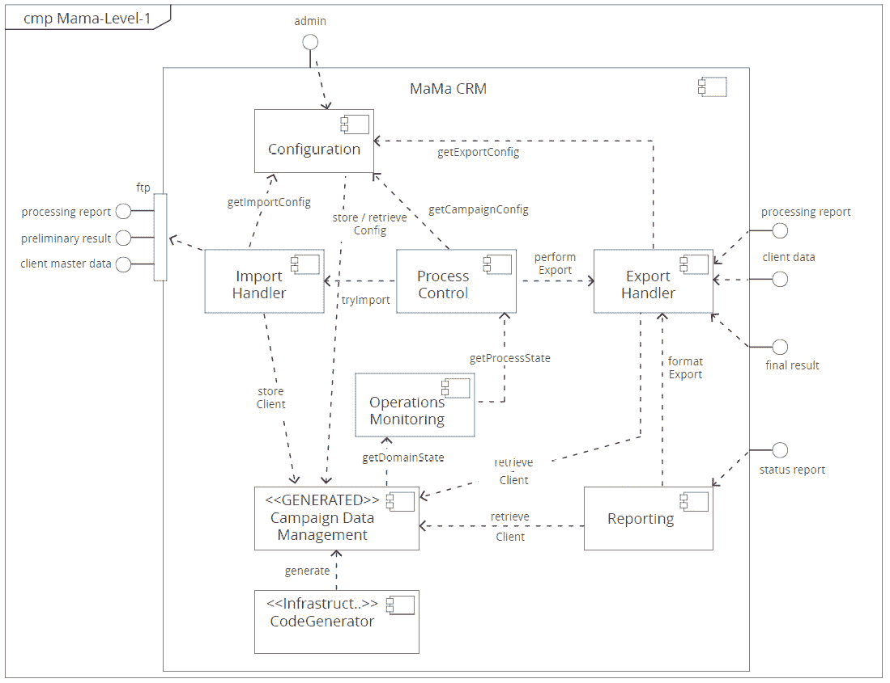
###### 图 3.13：MaMa 白盒（第 1 级）
`MaMa` 内部构建块的结构基于功能分解和生成的持久化概念。
它包含以下组件：
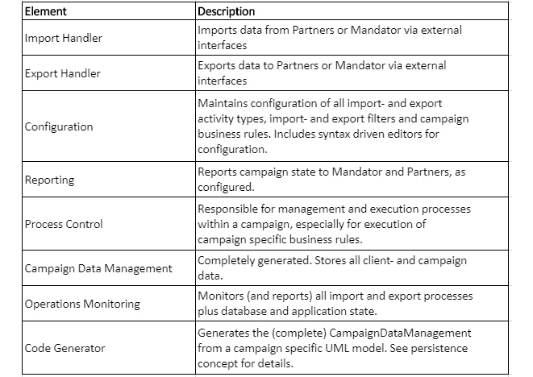
###### 图 3.14：MaMa 白盒 Level 1 的组件
`Import Handler`（黑盒）：
`Import Handler` 包含通过外部接口从合作伙伴或委托方导入数据的核心功能。它处理 `CSV`、固定格式或 `XML` 输入，可加密或压缩（或两者兼有）到可配置的结构中。
以下是接口：
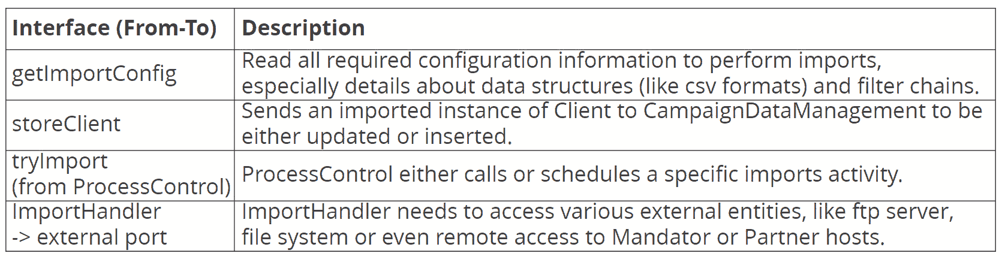
###### 图 3.15：Import Handler 接口
服务质量：
`Import Handler` 实现了广泛的故障处理机制，因此可以处理大量错误类别（例如，通信错误、数据格式错误、压缩和加密问题等）。
详情请参见 `Import Handler (Whitebox)` 部分。
`Configuration`（黑盒）
`Configuration` 负责为所有 `MaMa` 子系统提供部署时灵活性。它处理以下类型的配置信息：


## 配置

* 数据导入和导出配置，由 CSV、定长格式和 XML 格式、传输和路由信息、端点、网络配置、压缩、加密以及类似的过滤操作配置，以及 MaMa 与特定活动外部系统通信所需的信息和安全信息组成。
* 活动配置，由验证规则和活动组成，指示此活动需要进行何种导入、导出和维护活动。
* 导入数据的归档配置。

### 接口

* 对于所有配置方法，`campaignID` 和 `mandatorID` 始终需要作为输入参数。
* 配置信息始终是（抽象）超类 `configuration` 的子类。让我们现在逐一介绍：

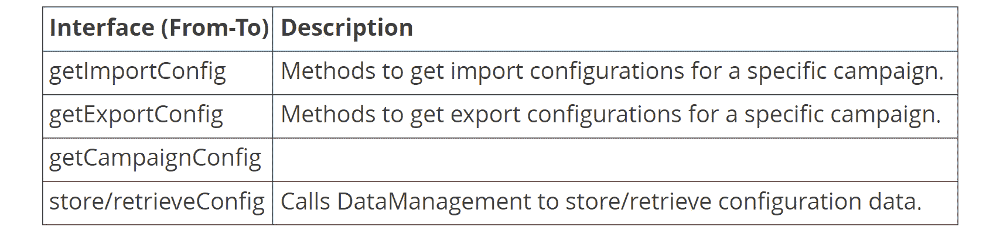

###### 图 3.16：配置的接口（黑盒）

服务质量未记录。

### MaMa 白盒级别 2

本节按如下方式描述 MaMa 级别 2 的组件：

#### 导入处理器（白盒）

下图描述了 MaMa 级别 2 的导入处理器：

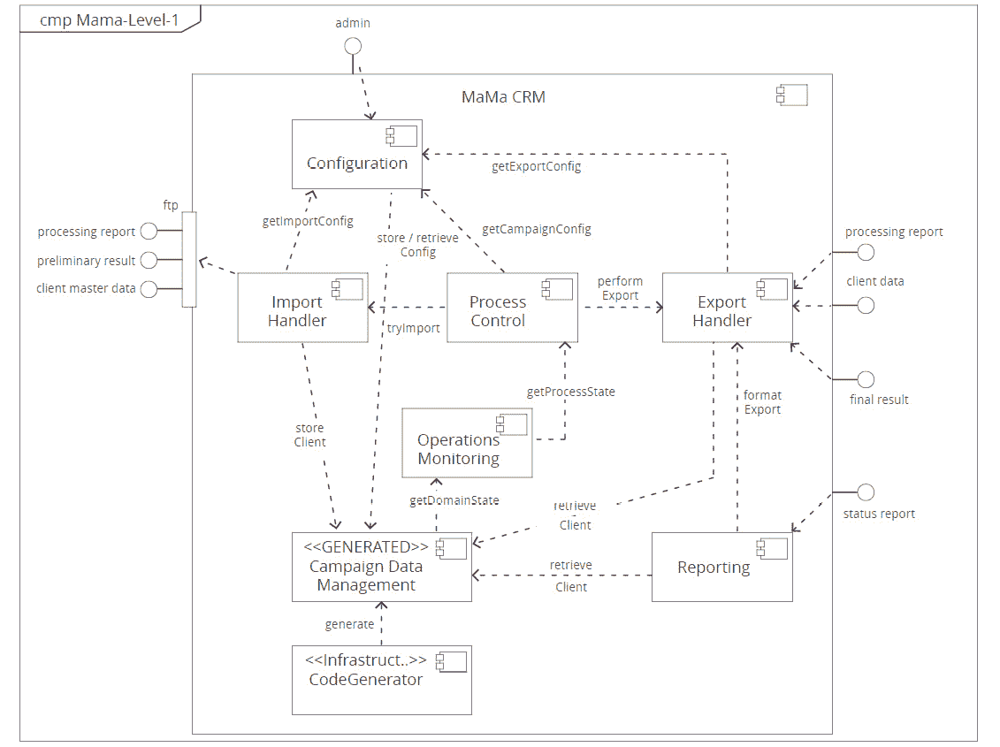

###### 图 3.17：导入处理器的复合结构

这（再次）基于通用导入过程的 *功能分解*。

它包含以下黑盒：

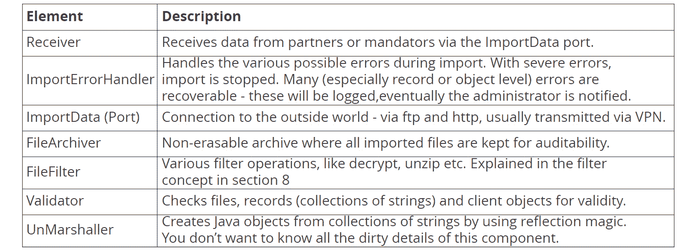

###### 图 3.18：MaMa 白盒级别 2 的导入处理器接口

接口未记录。

### MaMa 白盒级别 3

下图描述了 MaMa 级别 3 的设置：

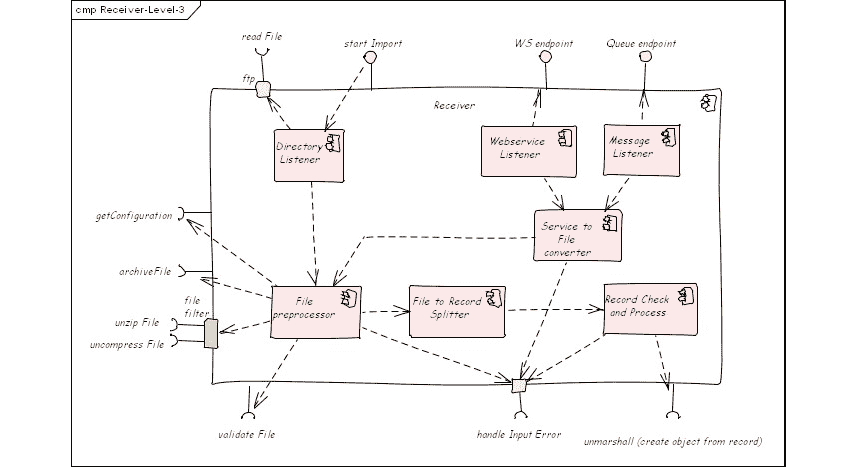

###### 图 3.19：接收器（白盒）

我们必须承认，该结构只是从多个原型中演变而来。更面向功能的设计很可能会提高可理解性，但由于优先级不同，我们从未朝那个方向重构代码。

它包含以下黑盒：

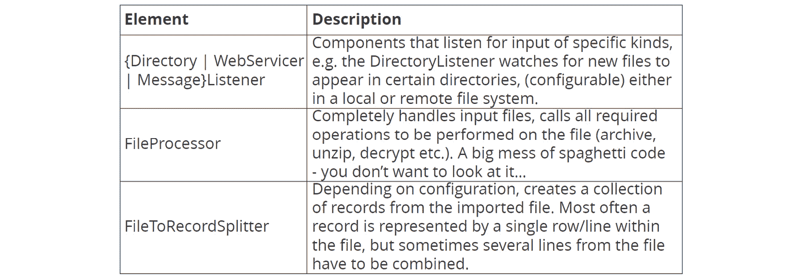

###### 图 3.20：接收器白盒中的元素

## III.6 运行时视图

本节重点介绍运行时视图的描述。

### 6.1 导入文件

主要用例之一是 *Import File*，可以来自委托方和合作伙伴。这些文件始终包含以可配置格式（CSV、定长格式或 XML）表示的与客户相关的数据。

我们将把 *import file* 的解释分为两个阶段：

1. 导入原始通用文件（来自外部源）。
2. 验证导入的数据并更新内部客户数据库。

#### 6.1.1 导入原始通用文件

首先，我们将解释通用导入，其中不执行特定活动的活动。这涉及 `configureReceiveChannel` 和 `instantiateFilterChain()` 活动：

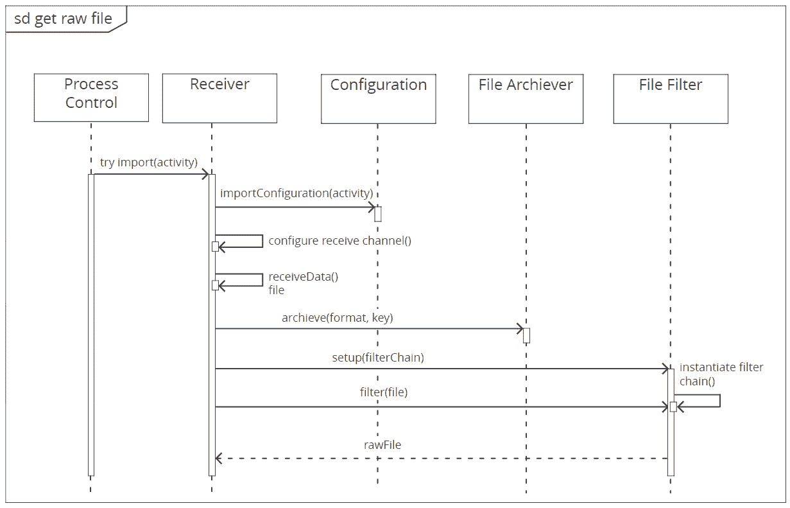

###### 图 3.21：导入原始文件（第一部分）

导入原始文件的过程可以描述如下：

1. `tryImport` `ProcessControl` 启动导入。活动是唯一标识委托方、活动和活动的 ID。
2. `importConfiguration` 获取所有必需的配置信息。
3. `configureReceiveChannel` 准备从外部源获取数据所需的一切。例如，外部 FTP 服务器的 URL、文件名和身份验证凭据需要在此处配置。
4. 归档系统将文件发送到（已配置的）归档系统，通常是光学一次性不可擦除备份归档。
5. `setup` 初始化所需的过滤器，例如 `unzip` 或 `decrypt`。
6. `filter` 执行所有过滤器

步骤 5 和 6 是一个动态配置的管道和过滤器数据流子系统。我们稍后会更详细地讨论过滤器概念。

#### 6.1.2 验证文件

就先决条件而言，数据需要从外部源导入并成功过滤（即解密和解压缩）。有关更多信息，请参阅上一节。

下图包含错误处理。在成功的情况下，不会出现错误。仅在发生错误时才会执行对 `ImportErrorHandler` 的调用：

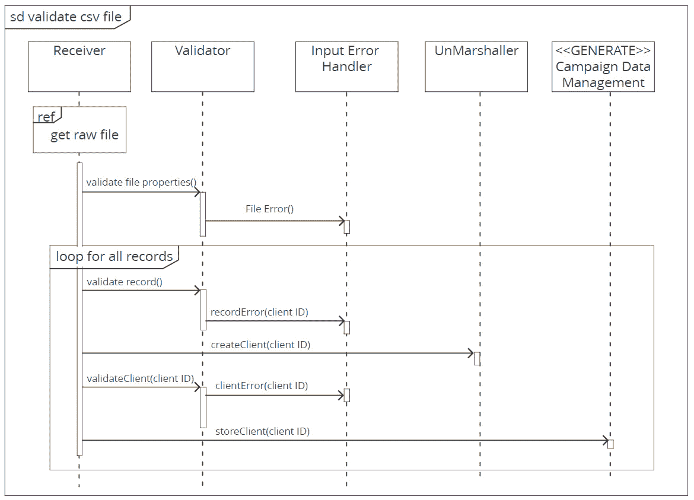

###### 图 3.22：验证导入的数据（数据导入的第二部分）

## III.7 部署视图

本节重点介绍部署视图设置的描述。

### 7.1 部署概述

MaMa 的长期目标是在专用虚拟机上部署和运行每个 MaMa 活动，以便清楚地将委托方特定数据与其他实例分开。

这些虚拟机及其主机操作系统的配置和操作模式直接影响活动的安全级别。这些主题必须成为定期安全检查和审查的对象。

#### 注意

由于原始 MaMa 系统处理的数据的敏感性，所有者要求在此方面严格保密。因此，我们不允许就安全问题进行任何详细说明。

下图描述了 MaMa 部署的概述：

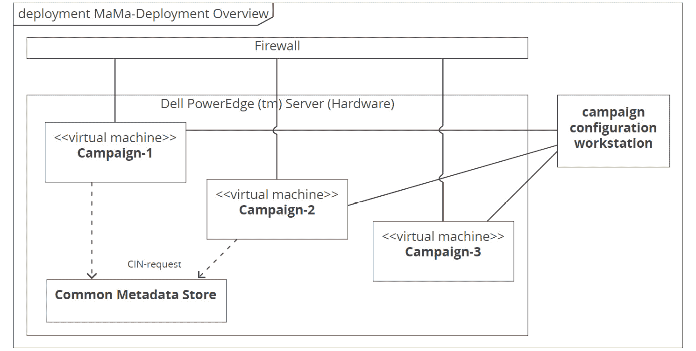

###### 图 3.23：MaMa 部署概述

下表描述了 MaMa 部署的组件：

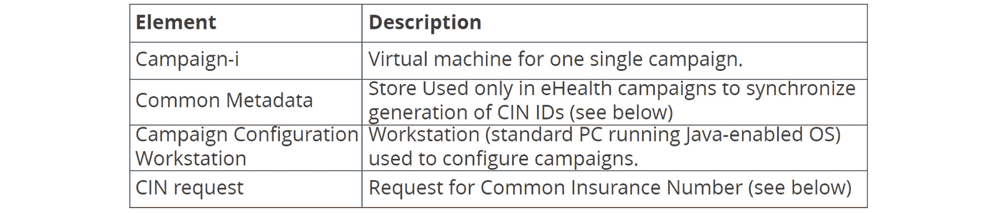

###### 图 3.24：MaMa 部署的元素

### 7.2 特定活动的虚拟机

对于 InDAC 运行的每个活动，都将有一个专用虚拟机，包含数据库实例和所有必需的 MaMa 代码（图形配置 UI 除外）。

### 7.3 通用元数据存储（CoMeS）

德国政府关于电子健康卡的法规包含生成个人通用保险 ID（`CID`）的非常具体的流程。此 ID 只能由单一政府机构生成（以前是 GPFunds，“Deutsche Rentenanstalt。” 自 2012 年起，它们被称为 ISTG：[`de.wikipedia.org/wiki/Informationstechnische_Servicestelle_der_gesetzlichen_Krankenversicherung`](https://de.wikipedia.org/wiki/Informationstechnische_Servicestelle_der_gesetzlichen_Krankenversicherung)）。

计算 10 位 `CID` 的请求必须封装在包含以下元数据的请求信封中：

* 请求实体的唯一 ID（通常是发出请求的组织/公司的税号）。MaMa 需要使用 InDAC 数据中心的税号。
* 请求目的（对于 MaMa，这是一个常量）。
* 请求序列号（`RSN`）。

该 `RSN` 必须是连续的数字序列，因为 GPFunds 希望确保不会遗漏任何请求。对于 MaMa，这意味着在相互独立的虚拟机之间需要同步机制。因此我们决定实现通用元数据存储。

出于安全原因，MaMa 没有使用真正的数据库，而是使用了定制的同步解决方案。

### 7.4 活动配置机器

一个（或多个）操作员工作站（标准 PC）将在 MaMa 实例在各自的虚拟机上物理部署后用于配置 MaMa 实例。

配置 UI 构建为 Eclipse RCP（`Rich Client Platform`）插件。

## III.8 横切概念

本节将描述 MaMa 部署的各种技术相关概念：

### 8.1 基于领域模型的生成持久性


MaMa 使用代码生成器从 `UML` 实体模型生成所有所需持久化代码。该生成的整体概念在下图中描述。图中通用部分和活动特定部分以构造型标注。`"campaign-specific"` `Data Management` 组件由构建过程自动创建并打包：

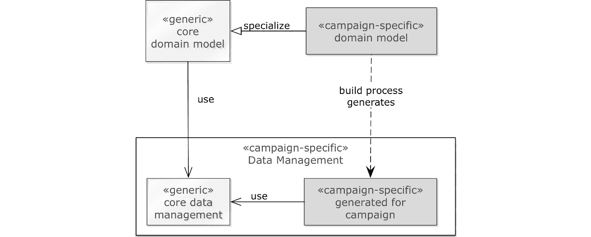

###### 图 3.25：代码生成的概述

下表描述了代码生成设置的各个元素：

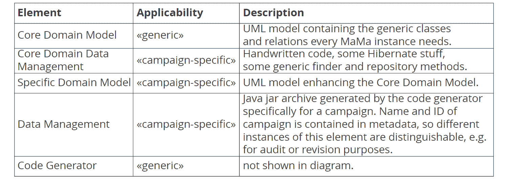

###### 图 3.26：代码生成设置的要素

该概念依赖于若干先决条件。

### 先决条件

如下：
* 每个 MaMa 实例都将处理与个人相关的数据，在 MaMa 领域术语中称为 `clients`。
* 所有客户端都将具有少量通用属性。
* 对于所有生产型活动，MaMa 需要处理任意数量的额外属性。
* 每个委托方都会为客户端添加若干活动特定属性，和/或添加活动特定类型（如保险合同或移动和电话合同）。
* 在活动开始前配置后，这些活动特定数据结构很少会发生变化。

#### 注
在 MaMa 运行的数年中，活跃活动中的数据结构始终保持固定。因此，MaMa 从未需要任何数据迁移工具。

### 8.1.1 通用领域模型 (`MaMa-Core-Domain`)

下图描绘了 MaMa 领域的通用模型：

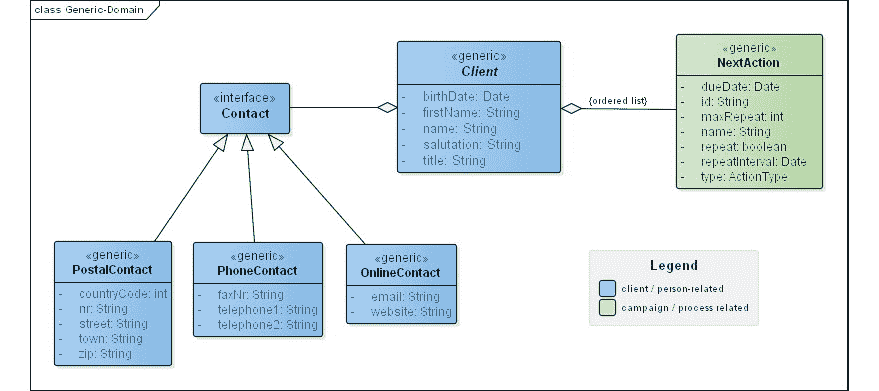

###### 图 3.27：MaMa 通用领域模型

下表描述了 MaMa 通用领域模型的每个元素：

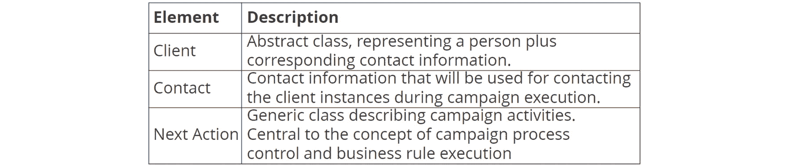

###### 图 3.28：MaMa 通用领域模型的要素

### 8.1.2 活动特定领域模型的示例

特定活动模型始终包含完整核心域的（物理）副本。抽象 `Client` 类始终需要被子类化，并且可能与额外类进行 1:n 关联。这在下图中显示：

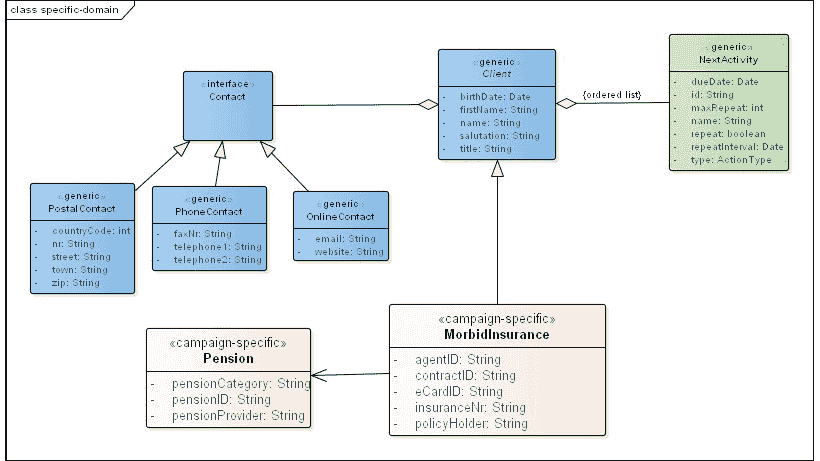

###### 图 3.29：特定领域模型（针对假设的保险活动）

### 8.1.3 生成器细节

以下是 MaMa 部署特定领域模型的细节：
* MaMa 使用 `OpenArchitectureWare` 生成完整的持久化代码。
* 生成依赖于开源 `Hibernate` O/R 映射和持久化框架。
* 生成器生成了元素，即用于创建数据库、模式、表和索引的 `Data Definition Language` (`DDL`) 代码、`Hibernate` 映射文件、`findClientByXY`、`findNextActivity` 等方法的活动特定实现，以及用于报告和监控的若干活动和配置特定方法。
* 不支持 `m:n` 关联。
* 活动已激活时我们无法修改数据结构。

由于与 InDAC 的保密协议，我们无法展示持久化概念的示例源代码。

### 替代方案
* 最初，MaMa 使用 `AndroMDA` 代码生成框架，但该开源项目失去了流行度，无法提供所需支持，并在更新的 Maven 版本中停止工作。因此，MaMa 切换到 `OAW`。
* MaMa 使用商业 `MagicDraw UML`（版本 9.0）建模工具，该工具原则上可以根据模型生成代码。然而，它对于期望的 `Hibernate` 集成来说被证明过于不灵活。承包实体（`InDAC`）拒绝升级到更新版本或替代工具。

### 8.2 CSV 导入/导出
* TODO：描述 `CSV` 配置 `DSL` 的（部分）细节
* TODO：描述这些 `DSL` 的（定制）`Eclipse` 编辑器

### 8.3 可配置文件过滤器

如在运行时场景 `import raw` 中所述，从外部源导入期间读取的每个文件都需要通过可配置过滤器进行转换。我们通常有两种过滤器：加密和压缩。

每个过滤器的名称和所需参数设置作为活动配置的一部分在活动中进行管理。

#### 加密过滤器

加密过滤器符合 `Java Cryptography Architecture` (`JCA` – https://docs.oracle.com/javase/8/docs/technotes/guides/security/crypto/CryptoSpec.html) 接口。

我们敦促委托方和合作伙伴使用来自 `BouncyCastle` (https://www.bouncycastle.org/java.html) 组合的加密提供程序。加密和解密过滤器需要在其配置中包含凭据或证书。

#### 注
由于原始 MaMa 系统处理的数据的敏感性，所有者要求在此方面严格保密。因此，我们不允许就安全问题提供任何细节。

#### 压缩过滤器

MaMa 仅支持无损压缩算法。压缩可以配置为 `DEFLATE`（如 .zip 或 .gzip 中使用）或 `Lempel-Ziv` 压缩的变体。压缩过滤器没有参数。

### 8.4 流程和流控制的规则引擎

本节将重点介绍 MaMa 部署的流程和工作流所需遵循的规则集：

### 8.4.2 Drools 作为规则引擎

MaMa 使用开源规则引擎 `Drools` (www.drools.org) 来定义、实现和执行业务规则。规则定义为文本文件，在运行时由规则引擎解释。这使得可以在不重新编译和重新部署整个系统的情况下修改和维护规则。

另一方面，错误的规则可能会严重阻碍正在进行的活动——因此，业务规则的修改应始终经过彻底测试！

规则始终具有简单的 "when `<A>` then `<B>`" 格式，其中 `<A>` 和 `<B>` 是 `Java` 表达式。

你可以在 Drool 的文档 (http://www.drools.org/learn/documentation.html) 中找到规则语言的完整参考和许多示例。

## III.9 架构决策

以下是被认为适用于 MaMa 的架构决策：
* 无商业 `CRM` 工具：
  不要使用任何商业 `CRM` 工具作为 MaMa 的基础。这么做的主要原因是需要极大的灵活性来快速设置活动。这一决策被证明是正确的，因为几家早期竞争对手（使用略微定制的标准 `CRM` 工具运营）未能进入 MaMa 所运营的市场。
* `JBoss Drools` 用于规则处理：
  使用 `JBoss Drools` 作为规则处理引擎。我们评估了 `Python` (`Jython`) 作为替代方案，但对于我们这种类型的处理来说速度极慢。
* 无 `ETL` 工具用于数据导入：
  不要使用 `ETL` 工具导入数据。承包商 `InDAC` 拒绝考虑商业 `ETL` 工具的许可费用。因此，开发团队甚至没有机会将这些工具作为数据导入解决方案进行评估。

## III.10 质量场景

以下是需要处理的各种质量场景类型：

### 灵活性场景

下表描述了为保持质量标准而需要考虑的灵活性场景：

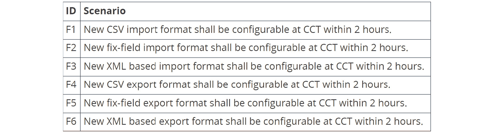

###### 图 3.30：灵活性场景

`CCT`：活动配置时间


In all cases, we require documentation of the desired format, plus a minimum of 10 different test data records.

## Runtime Performance Scenarios

The following table depicts the runtime performance scenarios:

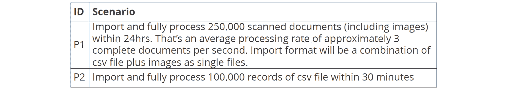

#### 图 3.31：运行时性能场景

## Security Scenarios

The following are the security scenarios to be considered:

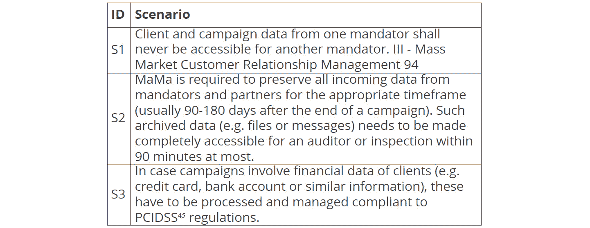

#### 图 3.32：安全场景

## III.11 Risks

Following are the risks that influence the architectural decisions:

* The `Receiver` component suffers from overly complicated source code that's created by a number of developers without consent. Most production bugs result from this part of MaMa-CRM.
* The runtime flexibility of import/export configurations and campaign processes might lead to incorrect and undetected behavior at runtime as there are no configuration checks. Mischievous administrators can misconfigure any MaMa-CRM instance at any time.
* Configuration settings are not archived and therefore might get lost (so there might be no fallback to the last working configuration in case of trouble).
* `CoMeS` is an overly trivial and resource-wasting synchronization mechanism and should be replaced with a decent async/event-based system as soon as possible.

## III.12 Glossary

The following table defines the important terms used through the chapter.

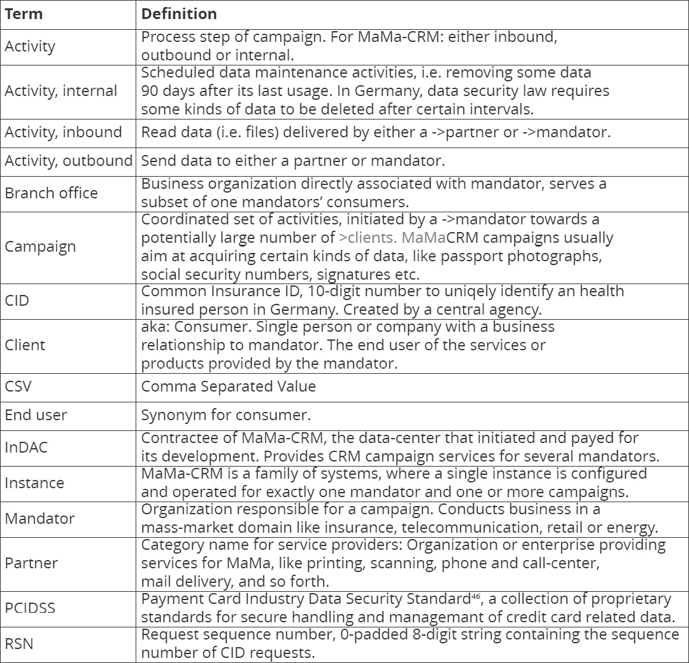

#### 图 3.33：术语表
