# Chapter 4

## IV - biking2

By Michael Simons

biking2 or "Michis milage" is primarily a web-based application for tracking biking-related activities. It allows the user to track their covered milage, collect GPS tracks of routes and convert them into different formats, track their location, and publish pictures of bike tours.

The secondary goal of this application is to experiment with various technologies; for example, Spring Boot on the server side and AngularJS, JavaFX, and others on the client side.

biking2 has been around since 2009 and in its current Java-based form since 2014. With the production fulfilling its primary goal of releasing architecture for biking-related activities, it's been in production ever since.

The project is published under the Apache License on GitHub ([`github.com/michael-simons/biking2`](https://github.com/michael-simons/biking2)), and you can use it however you like. Though I've been blogging regularly about this pet project, the documentation (in its current form) was created after I met Dr. Gernot and Peter at an awesome workshop in Munich.

## IV.1 Introduction and Requirements

In this section, we will be looking at biking2 in depth and will study its requirements.

### 1.1 Requirements Overview

**What is biking2?**

The main purpose of biking2 is to keep track of bicycles and their milage, as well as converting **Garmin** files ([`en.wikipedia.org/wiki/Training\_Center\_XML`](https://en.wikipedia.org/wiki/Training_Center_XML)) into standard files ([`en.wikipedia.org/wiki/GPS\_Exchange\_Format`](https://en.wikipedia.org/wiki/GPS_Exchange_Format)) and storing them in an accessible way.

In addition, biking2 is used to study and evaluate technology, patterns, and frameworks. The functional requirements are simple enough to leave enough room for us to concentrate on quality goals.

**Main features**

**The following are the distinct features of biking2:**

* It stores bikes and their milage
* It converts **tcx** files into **GPX** files and provides them in a library of tracks
* It visualizes those tracks on a map and provides a way to embed them in other web pages
* It visualizes biking activities with images
* It offers optional, near-real-time tracking of a biker

The application can only handle one user with write permissions. Most bike aficionados have problems understanding the question "why more than one bike?" As such, the system should be able to keep track of between 2 and 10 bikes for one user and store the total milage per bike and per month. All milage per month, milage per year, and other metrics should be derived from this running total so that the user only needs to look at their odometer and enter the value.

The application should store an "unlimited" number of tracks.

The images should be collected from ([`dailyfratze.de`](https://dailyfratze.de)). The source contains images that are tagged with **Radtour**. In addition, the user should be able to provide an "unlimited" number of "gallery pictures," along with a date and a short description.

### 1.2 Quality Goals

The following are the quality goals that need to be considered:

* **Understandability**: The functional requirements are simple enough to allow a simple, understandable solution that lets us focus on learning about new Java 8 features, Spring Boot, and AngularJS.
* **Efficiency**: Collecting milage data should be a no-brainer; that is, reading the milage from an odometer and entering it.
* **Interoperability**: The application should provide a simple API that allows access to new clients.
* **Attractiveness**: Collected milage metrics should be presented in easy-to-grasp charts.
* **Testability**: The architecture should allow us to easily test the main building blocks.

### 1.3 Stakeholders

The following list explains the most important personas for this application:

* **Developers**: Developers who want to learn about developing modern applications with Spring Boot and various frontends, which should use Java 8 in the backend.
* **Bikers**: Bike aficionados who are looking for a non-Excel, self-hosted solution to keep track of their bikes and milage.
* **Software Architects**: Who are looking for an **arc42** example to get ideas for their daily work.
* **Michael Simons**: Improving his skills; wants to blog about Spring Boot; looking for a topic he can eventually hold a talk about; needed a project to try out new Java 8 features.

## IV.2 Architecture Constraints

The constraints of this project are reflected in the final solution. This section explains them and, if applicable, their motivation.

### 2.1 Technical Constraints

The following table lists the various technical constraints of biking2:

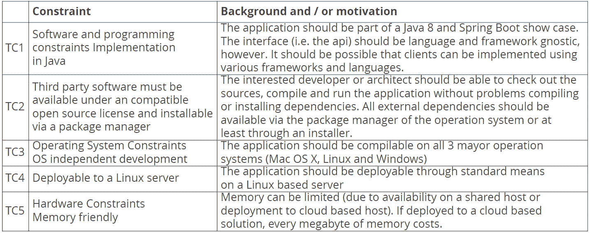

#### 图 4.1：技术约束

### 2.2 Organizational Constraints

The following table lists the organizational constraints of biking2:

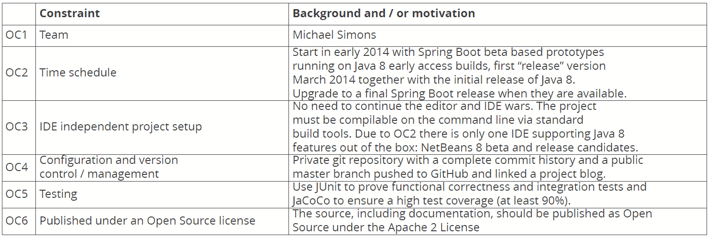

#### 图 4.2：组织约束

### 2.3 Conventions

The following table lists the various conventions followed:

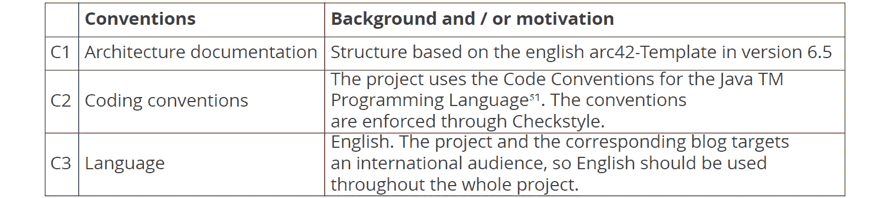

#### 图 4.3：使用的约定

The following naming conventions are used throughout the project:

* All Java types must be located in packages that start with `ac.simons`.

```
MATCH
(project:Maven:Project)-[:CREATES]->(:Artifact)-(:CONTAINS)->(type:Type)
WHERE
NOT type.fqn starts with 'ac.simons'
RETURN
project as Project, collect(type) as TypeWithWrongName
```

* All Java types must be located in packages that contains the `artifactld` of the Maven Project.

```
MATCH
(project:Maven:Project)-[:CREATES]->(:Artifact)-(:CONTAINS)->(type:Type)
WHERE
NOT type.fqn contains project.artifactld
RETURN
project as Project, collect(type) as TypeWithWrongName
```

* All Java types annotated as @Entity must have a name that ends with the suffix `Entity`.

```
MATCH
(t:Jpa:Entity)
WHERE
NOT t.name ends with "Entity"
RETURN
t as Entity
```

* All Java types that represent a repository must have a name that ends with the suffix `Repository`.

```
MATCH
(t:Repository)
WHERE t:Java
AND NOT t.name ends with "Repository"
RETURN
t as Repository
```

## IV.3 System Scope and Context


This section describes the environment and context of `biking2`: who uses the system and the other systems that `biking2` depends on?

## 3.1 Business Context

The following figure depicts the business context setup for `biking2`:

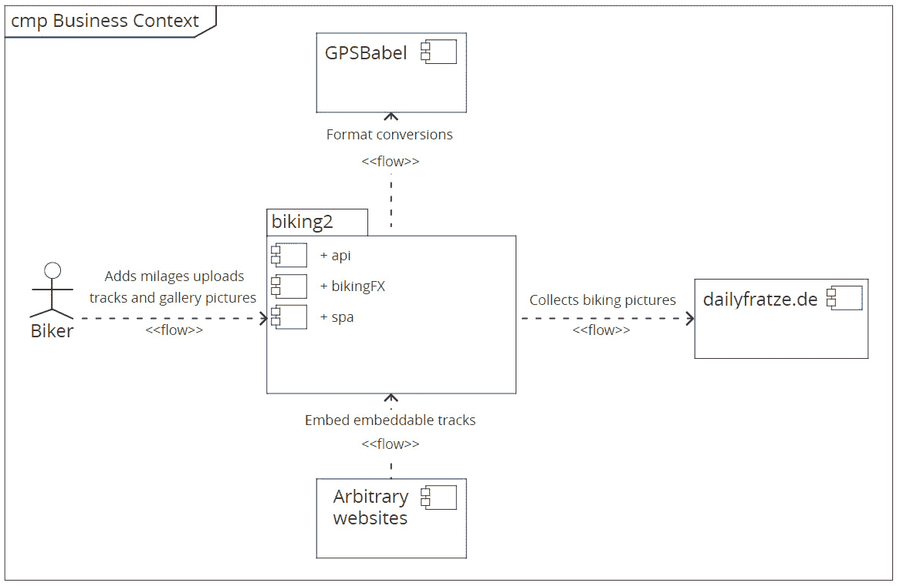

#### 图 4.4：业务上下文

The following are the various components of the business context setup:

### Biker

A passionate biker uses `biking2` to manage their bikes, milage, tracks, and visual memories (that is, images) that they took on tours. They also want to embed their tracks as interactive maps on other websites.

### Daily Fratze

Daily Fratze ([`dailyfratze.de`](https://dailyfratze.de)) provides a list of images tagged with certain topics. `biking2` should collect all the images for a given user tagged with `Theme/Radtour`.

### GPSBabel

`GPSBabel` is a command-line utility for manipulating GPS-related files in various ways. `biking2` uses it to convert `TCX` files into `GPX` files. The heavy lifting is done by `GPSBabel` and the resulting file will be managed by `biking2`.

### Arbitrary Websites

The user may want to embed (or brag about) tracks on arbitrary websites. They'll only want to paste a link to a track on a website that supports embedded content to embed a map with the given track.

## 3.2 Technical Context

The technical context setup is depicted in the following figure:

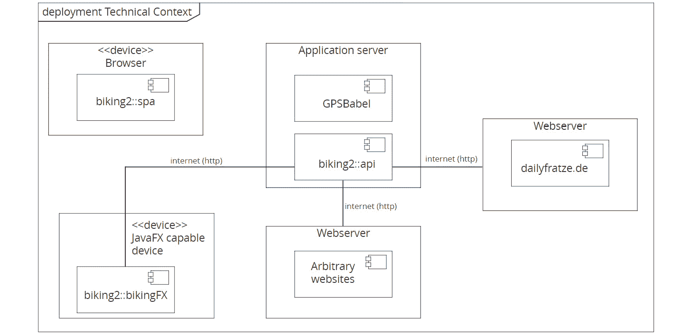

#### 图 4.5：技术上下文

`biking2` is broken down into two main components: the backed and the frontend.

### Backend (`biking2::api`)

The API runs on a supported application server using either an embedded container or an external container. It communicates via operating system processes with `GPSBabel` on the same server.

The connection to Daily Fratze is an `HTTP`-based `RSS` feed. The feed is paginated and provides all images with a given tag, but older images may not be available if the owner decides to add a digital expiry date.

Furthermore, `biking2` provides an `oEmbed` ([`oembed.com`](https://oembed.com)) interface for all the tracks that are stored on the system. Arbitrary websites that support that protocol can request embeddable content over `HTTP` with only a link to the track without working on the track or map APIs themselves.

### Frontend (`biking2::spa` and `biking2::bikingFX`)

The frontend is implemented with two different components, and the `biking2::spa` Single-Page Application (`SPA`) is part of this package. The `SPA` runs in any modern web browser and communicates with the API via `HTTP`.

The following table lists the various channels used by the different business interfaces:

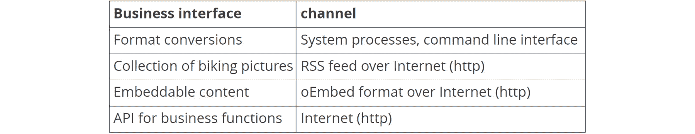

#### 图 4.6：业务接口列表

## IV.4 Solution Strategy

At the core of `biking2` is a simple yet powerful domain model based on a few entities, of which a `Bike` and its `Milage` are the most important.

Although data-centric, the application refrains from using too much `SQL` to create reports, summaries, and so on, but tries to achieve that with new `Java 8` features related to `streams`, `lambdas`, and `map/reduce` functions.

Building the application with `Spring Boot` is an obvious choice as one of the main quality goals is learning about it. Furthermore, using `Spring Boot` as a "framework" for `Spring Framework` allows us to concentrate on the business logic. On the one hand, there is no need to understand a complex `XML` configuration, while on the other, all of the building blocks are still put together using dependency injection.

Regarding dependency injection and testability, all injection should be done via constructor injection; setter injection is only allowed when there's no other technical way of completing the task at hand. This way, only units that are under test can be correctly instantiated; otherwise, we may forget about collaborators. Think of it this way: 20 injected attributes may not hurt, but a constructor with 20 parameters will. This hopefully prevents centralized "God classes" that control pretty much every other aspect of the application.

`Spring Boot` applications can be packaged as single `fat jar` files. Since `Spring Boot` 1.3, these files contain a startup script and can be directly linked to `/etc/init.d` on a standard Linux system that serves TC4.

Interoperability can be achieved by using `JSON` over a simple `HTTP` protocol for the main API. Security is not the main focus of this application. It should be secure enough to prevent others from tampering with the data, and so confidentiality is not a main concern (passwords can be transmitted in plain text over `HTTP`).

The internal single-page application (`SPA`) will be implemented using `AngularJS`. The deployable artifact will contain this application, so there is no need to host a second web server for the static files.

For real-time tracking, the `MQTT` protocol will be used, which is part of `Apache ActiveMQ` and is supported out of the box by `Spring messaging`.

Graphing should not be implemented here; instead, the `Highcharts` ([`www.highcharts.com`](https://www.highcharts.com)) library should be used. The configuration for all charts should be computed on the server side.

## IV.5 Building Blocks-Level 1

The application that's packaged as `biking2.jar` contains two of three main parts (the `api` and the `spa`), as shown in the business context:

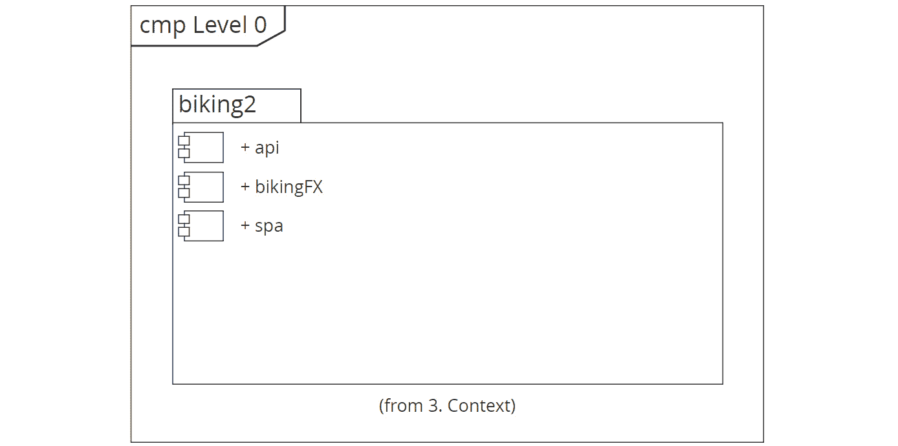

#### 图 4.7：0 级构建块

Let's have a closer look at the API. For details regarding the structure of an `AngularJS 1.2.x` application, have a look at their developer's guide ([`code.angularjs.org/1.2.28/docs/guide`](https://code.angularjs.org/1.2.28/docs/guide)).

#### Note

To comply with the Java coding style guidelines, the `bikingPictures` and `galleryPictures` modules reside in the `bikingpictures` and `gallerypictures` Java packages.

### 5.1 Whitebox `biking2::api`

The following diagram shows the main building blocks of the system and their interdependencies:

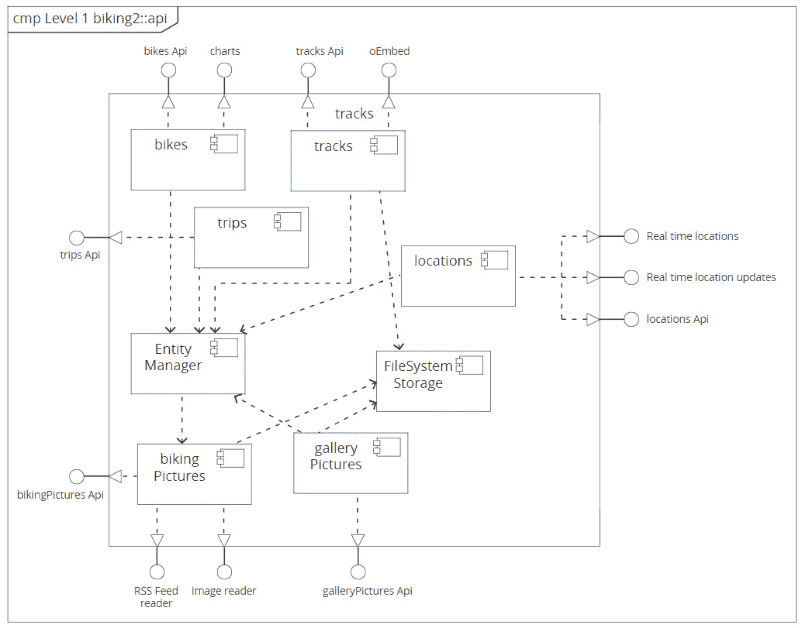

#### 图 4.8：1 级构建块

I used functional decomposition to separate responsibilities. The single parts of the API are all encapsulated in their own components, represented as Java packages.

All of the components depend on a standard `JPA` `EntityManager` and some local file storage. I won't go into detail about those black boxes.

#### Contained Blackboxes

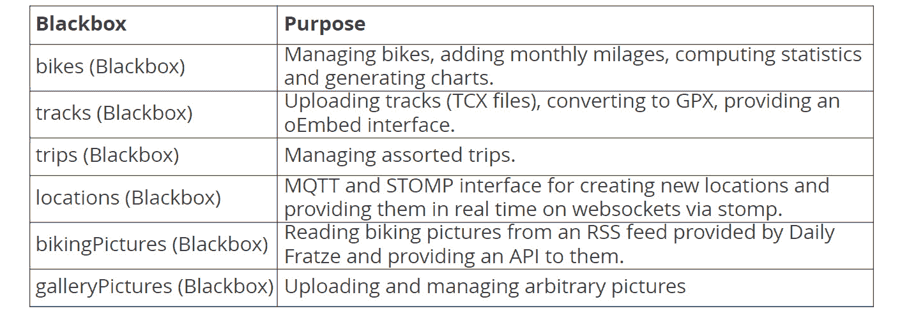

#### 图 4.9：包含的黑盒

All the blackboxes above should correspond to Java packages. Those packages should have no dependencies to other packages outside themselves but for the support or shared package:

* Top level packages should conform to the main building blocks.

```
MATCH (a:Main:Artifact)
MATCH (a) -[:CONTAINS]-> (p1:Package) -[:DEPENDS_ON]-> (p2:Package) <-[:CONTAINS]- (a) WHERE not p1:Config
and not (p1) -[:CONTAINS]-> (p2)
and not p2:Support
and not p1.fqn = ‘ac.simons.biking2.summary’
RETURN p1, p2
```

Additional configuration apart from properties lives in the `config` package:

* Returns the `config` package.

```
MATCH (p:Package)
WHERE p.fqn in Uac.simons.biking2.configi SET p:Package:Config
return p
```

The `support` package contains technical infrastructure classes while the shared package contains application wide messages. Those packages are used as supporting packages:

* Returns `support` and `shared` packages.

```
MATCH (p:Package)
WHERE p.fqn in [‘ac.simons.biking2.shared’, ‘ac.simons.biking2.support’] SET p:Package:Support
return p
```

#### Interfaces

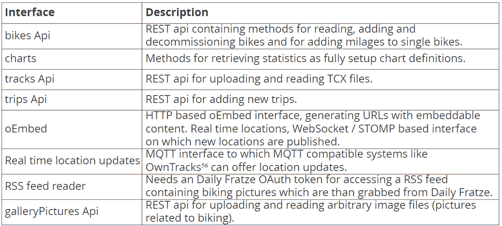

#### 图 4.10：接口

#### 5.1.1 bikes (Blackbox)


### 5.1.1 bikes (黑盒)

意图/职责：`bikes` 提供用于读取、创建和操作自行车及其里程的外部 API，以及计算统计数据和生成图表。

下表列出了不同的接口：

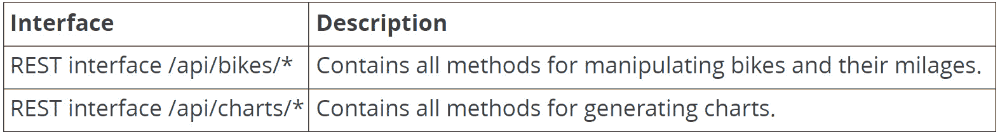

###### 图 4.11：REST 接口

#### 文件

`bikes` 模块及其所有依赖项都包含在名为 `ac.simons.biking2.bikes` 的 Java 包中。

### 5.1.2 tracks (黑盒)

意图/职责：`tracks` 管理文件上传（TCX 文件），将其转换为 GPX 文件，并使用 GPSBabel 计算其周围矩形（包络）。它还提供 oEmbed 接口，可将 URL 解析为可嵌入的轨迹。

#### 文件

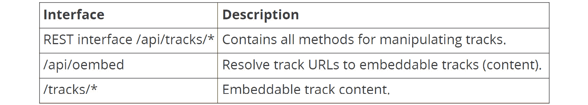

###### 图 4.12：文件接口

`tracks` 模块及其所有依赖项都包含在名为 `ac.simons.biking2.tracks` 的 Java 包中。

### 5.1.3 trips (黑盒)

意图/职责：`trips` 管理单日行驶的距离，且不与自行车关联：


###### 图 4.13：旅行

#### 文件

`trips` 模块及其所有依赖项都包含在名为 `ac.simons.biking2.trips` 的 Java 包中。

### 5.1.4 locations (黑盒)

`locations` 以接近实时的方式存储带时间戳的位置，并提供最近 30 分钟位置的访问。

#### 接口

下表描述了所使用的各种接口：

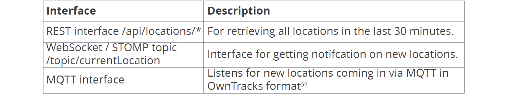

###### 图 4.14：接口

#### 注释

有关 OwnTracks 的更多信息，请参阅：[`owntracks.org/booklet/tech/json/`](https://owntracks.org/booklet/tech/json/)

#### 文件

`locations` 模块及其所有依赖项都包含在名为 `ac.simons.biking2.tracker` 的 Java 包中。该模块通过 `ac.simons.biking2.config.TrackerConfig` 类进行配置。

### 5.1.5 bikingPictures (黑盒)

意图/职责：`bikingPictures` 用于定期检查 Daily Fratze 的 RSS 源，同时收集新图像并将其本地存储。它还提供获取所有收集图像的 API。

#### 接口

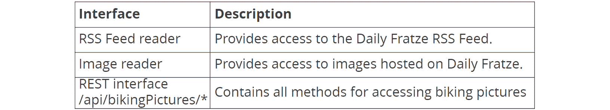

###### 图 4.15：接口

#### 文件

`bikingPictures` 模块及其所有依赖项都包含在名为 `ac.simons.biking2.bikingpictures` 的 Java 包中。

### 5.1.6 galleryPictures (黑盒)

意图/职责：`galleryPictures` 管理文件上传（图像）。它将它们本地存储并提供 RSS 接口以获取元数据和图像数据。

#### 接口


###### 图 4.16：接口

#### 文件

`galleryPictures` 模块及其所有依赖项都包含在名为 `ac.simons.biking2.gallerypictures` 的 Java 包中。

### 5.2 构建块 – 第 2 级

### 5.2.1 bikes (白盒)

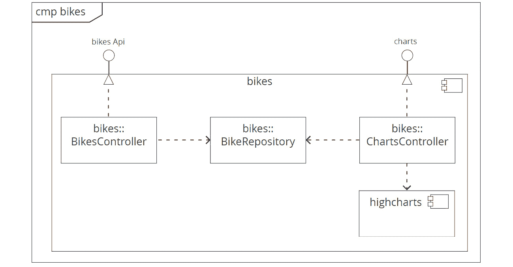

###### 图 4.17：构建块 – bikes

`BikeRepository` 是基于 Spring Data JPA 的 `BikeEntities` 仓库。`BikeController` 和 `ChartsController` 访问它以检索和存储 `BikeEntity` 实例并提供外部接口。

#### 包含的黑盒


###### 图 4.18：黑盒

### 5.2.2 tracks (白盒)

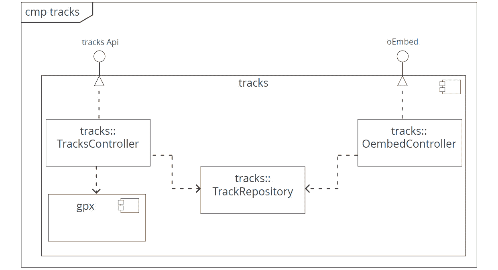

###### 图 4.19：构建块 – tracks

`TrackRepository` 是基于 Spring Data JPA 的 `TrackEntities` 仓库。`TracksController` 和 `OembedController` 访问它以检索和存储 `TrackEntity` 实例并提供外部接口。

#### 包含的黑盒


###### 图 4.20：黑盒

### 5.2.3 trips (白盒)

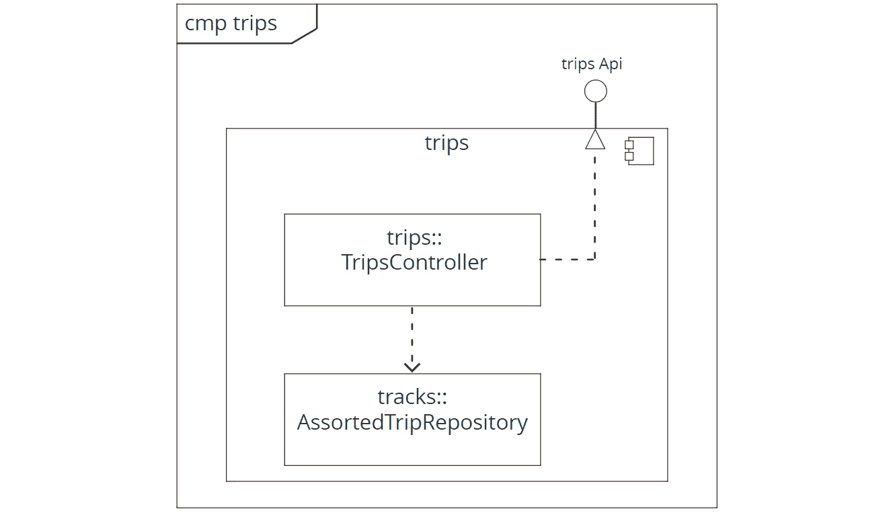

###### 图 4.21：构建块 – trips

`AssortedTripRepository` 是基于 Spring Data JPA 的 `AssortedTripEntities` 仓库。`TripsController` 访问它以检索和存储 `TrackEntity` 实例并提供外部接口。

### 5.2.4 locations (白盒)

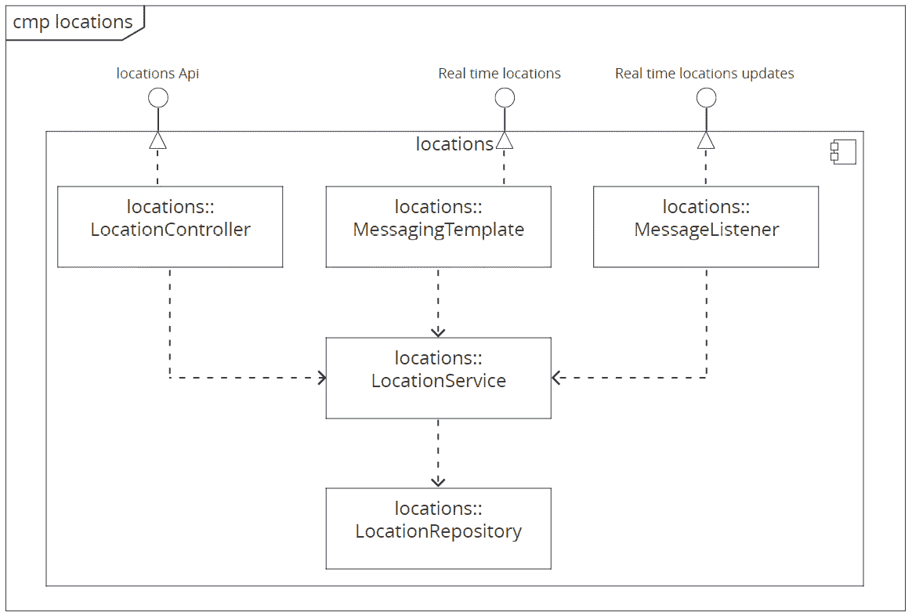

###### 图 4.22：构建块 – locations

位置通过名为 `LocationRepository` 的基于 Spring Data JPA 的仓库进行存储和读取。该仓库仅通过 `LocationService` 访问。这通过 `SimpMessagingTemplate` 为已连接客户端提供实时更新，而 `LocationController` 使用该服务提供对最近 30 分钟内创建的所有位置的访问。

新位置由服务通过 `LocationController` 形式的 REST 接口或通过 MQTT 通道上的 `MessageListener` 创建。

### 5.2.5 bikingPictures (白盒)

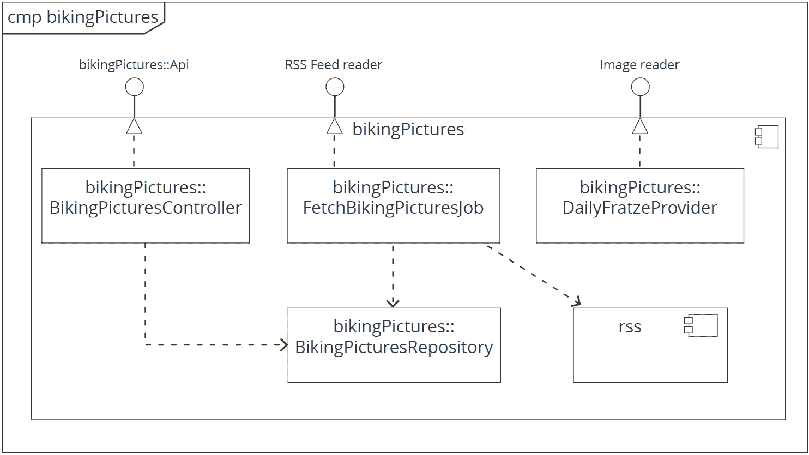

###### 图 4.23：构建块 – bikingPictures

使用名为 `BikingPicturesRepository` 的 Spring Data JPA 仓库来访问 `BikingPictureEntities`。用于读取图片的外部 REST API 由 `BikingPicturesController` 实现。RSS 源由 `FetchBikingPicturesJob` 使用名为 "`rss`" 的 `JAXBContext` 读取。受各种方式保护的图像文件 URL 通过 `DailyFratzeProvider` 提供给该作业。

#### 包含的黑盒


###### 图 4.24：黑盒

### 5.2.6 galleryPictures (白盒)

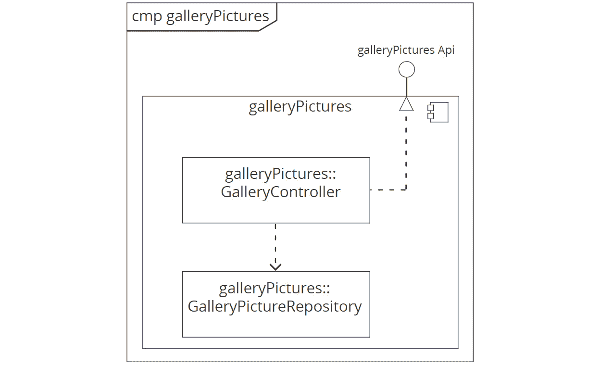

###### 图 4.25：构建块 – galleryPictures

`GalleryPictureRepository` 是基于 Spring Data JPA 的 `GalleryPictureEntity` 仓库。

`GalleryController` 访问它以检索和存储 `GalleryPictureEntity` 实例并提供外部接口。

## IV.6 运行时视图

与 `biking2` 的用户交互和错误处理相当基础。我挑选了两个实际运行时视图很有趣用例。

### 创建新轨迹

下图描述了创建新轨迹的过程：

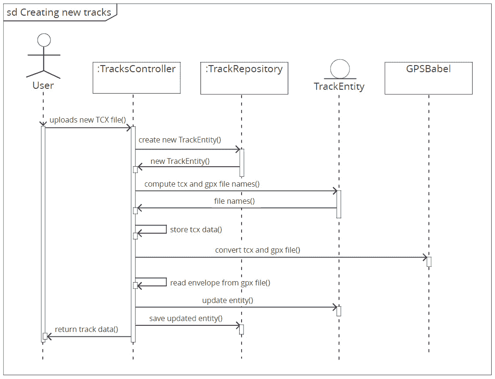

###### 图 4.26：创建新轨迹

### 从 Daily Fratze 获取骑行图片

下图显示了如何从 Daily Fratze 获取骑行图片：


###### 图 4.27：获取骑行图片

## IV.7 部署视图

下图显示了自行车应用的部署视图：

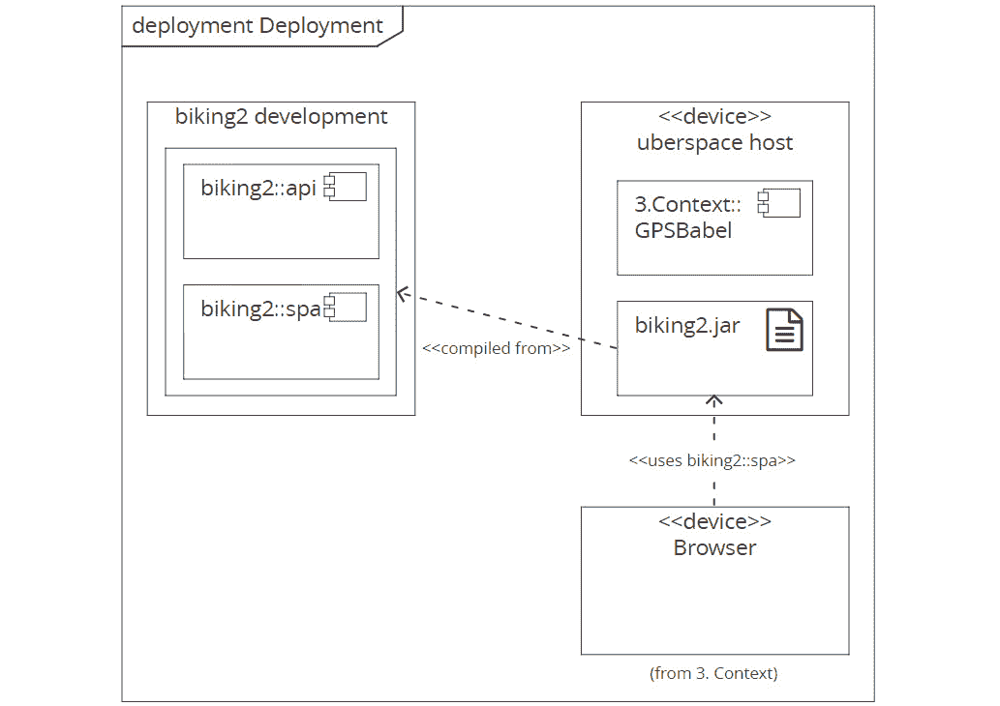

###### 图 4.28：部署视图

下表描述了应用程序部署中使用的各种节点：

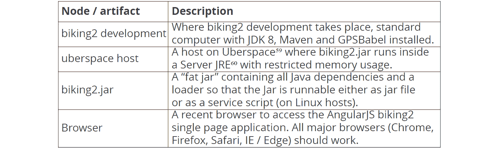

###### 图 4.29：节点

## IV.8 技术和横切概念

本节重点介绍应用程序涉及的技术概念和其他重要概念。

### 领域模型

`biking2` 是一个以数据为中心的应用；因此，一切都基于以下实体关系图（ERD）：

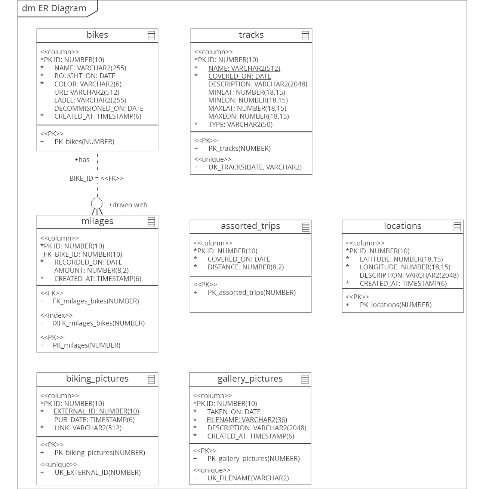

###### 图 4.30：biking2 中的实体

这些实体体现为表。

#### 表

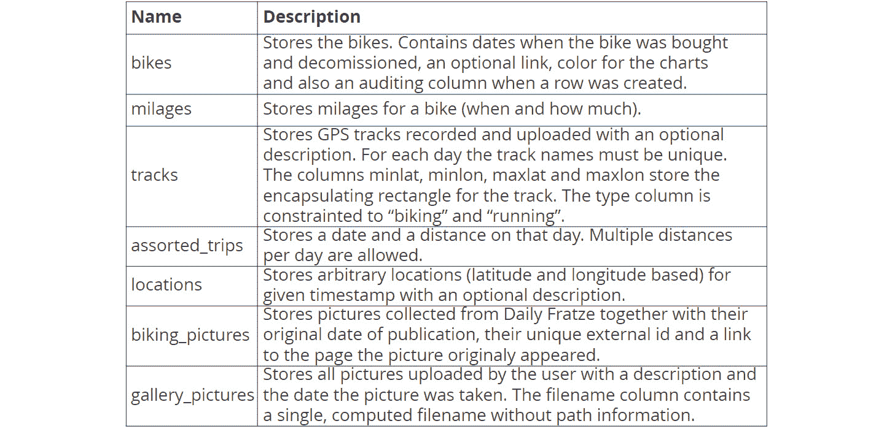

###### 图 4.31：表

这些表映射到以下领域模型：

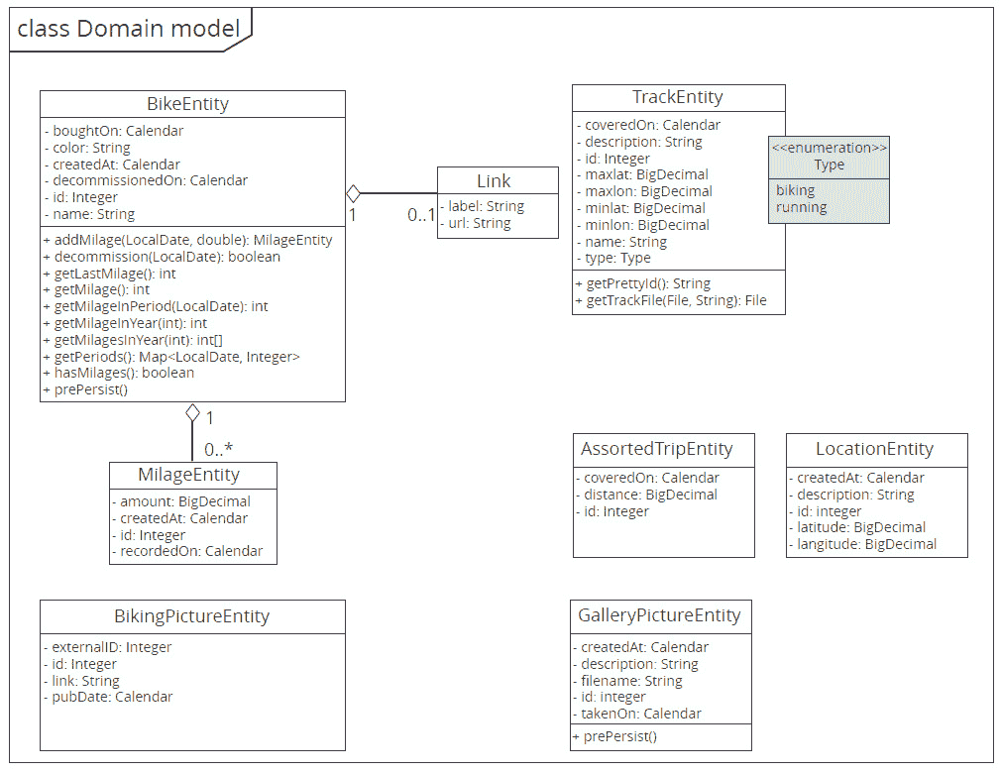

###### 图 4.32：领域模型（JPA 实体）

#### 领域模型

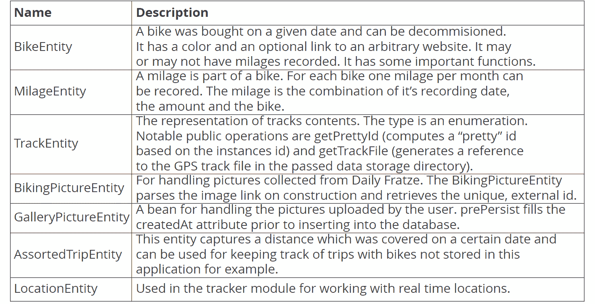

###### 图 4.33：领域模型组件

#### 关于 `BikeEntity` 的重要业务方法


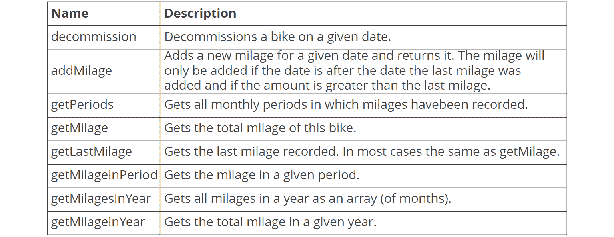

### 图 4.34：业务方法

## 持久性

`biking2` 使用 H2 (https://www.h2database.com/html/main.html) 数据库存储关系数据，并使用文件系统存储二进制图像文件和大型 ASCII 文件（尤其是所有 GPS 文件）。

在开发和生产环境中，H2 数据库会被保留且不是基于内存的。该文件的位置通过 `biking2.database-file` 属性配置，开发期间的默认值是 `./var/dev/db/biking-dev`，其相对 VM 的工作目录。

所有对数据库的访问都通过 JPA 进行，其使用 Hibernate 作为提供者。有关应用中使用的所有实体，请参阅 `Domain Models`。JPA Entity Manager 不会被直接访问——只能通过 Spring Data JPA 提供的设施访问；即通过仓库。所有以文件形式存储的数据都相对于 `biking2.datastore-base-directory` 存储，默认值为 `./var/dev`。其中包含三个目录：
* `bikingPictures`：包含从 Daily Fratze 收集到的所有图片
* `galleryPictures`：包含所有上传的图片
* `tracks`：包含上传的 GPS 数据以及将 TCX 文件转换为 GPX 文件的结果

## 用户界面

打包在最终构件中的 `biking2` 默认用户界面是一个使用 AngularJS 编写的 JavaScript SPA，并配有默认的 Bootstrap 模板。

要使用实时位置更新界面，请选择众多 MQTT 客户端之一。

还有一个用 Java 编写的第二个用户界面，名为 `bikingFX` ([`info.michael-simons.eu/2014/10/22/getting-started-with-javafx-8-developing-a-rest-client-application- from-scratch/`](https://info.michael-simons.eu/2014/10/22/getting-started-with-javafx-8-developing-a-rest-client-application-%20from-scratch/))。

## JavaScript 和 CSS 优化

JavaScript 和 CSS 依赖尽可能通过 Maven 依赖以 webjars 形式管理（[`www.webjars.org`](https://www.webjars.org)），无需 `brew`、`npm`、`bower` 等。

此外，`biking2` 使用 `wro4j`（[`alexo.github.io/wro4j/`](https://alexo.github.io/wro4j/)），以及一个小型 Spring Boot Starter（[`github.com/michael-simons/wro4j-spring-boot-starter`](https://github.com/michael-simons/wro4j-spring-boot-starter)）来优化 JavaScript 和 CSS 网络资源。

### Wro4j 配置

`wro4j` 提供如下模型：
```
<groups xmlns="http://www.isdc.ro/wro">

<!-- Dependencies for the full site -->

<group name="biking2">

<group-ref>osm</group-ref>

<css minimize="false">/webjars/bootstrap/@bootstrap.version@/css/b\
ootstrap.min.css</css>

<css>/css/stylesheet.css</css>

<js minimize="false">/webjars/jquery/@jquery.version@/jquery.min.j\
s</js>

<js minimize="false">/webjars/bootstrap/@bootstrap.version@/js/boo\
tstrap.min.js</js>

<js minimize="false">/webjars/momentjs/@momentjs.version@/min/mome\
nt-with-locales.min.js</js>

<js minimize="false">/webjars/angular-file-upload/@angular-file-up\
load.version@/angular-file-upload-html5-shim.min.js</js>

<js minimize="false">/webjars/angularjs/@angularjs.version@/angula\
r.min.js</js>

<js minimize="false">/webjars/angularjs/@angularjs.version@/angula\
r-route.min.js</js>

<js minimize="false">/webjars/angular-file-upload/@angular-file-up\
load.version@/angular-file-upload.min.js</js>

<js minimize="false">/webjars/angular-ui-bootstrap/@angular-ui-boo\
tstrap.version@/ui-bootstrap.min.js</js>

<js minimize="false">/webjars/angular-ui-bootstrap/@angular-ui-boo\
tstrap.version@/ui-bootstrap-tpls.min.js</js>

<js minimize="false">/webjars/highcharts/@highcharts.version@/high\
charts.js</js>

<js minimize="false">/webjars/highcharts/@highcharts.version@/high\
charts-more.js</js>

<js minimize="false">/webjars/sockjs-client/@sockjs-client.version\
@/sockjs.min.js</js>

<js minimize="false">/webjars/stomp-websocket/@stomp-websocket.ver\
sion@/stomp.min.js</js>

<js>/js/app.js</js>

<js>/js/controllers.js</js>

<js>/js/directives.js</js>

</group>

</groups>
```

该模型文件由 Maven 构建过滤。版本占位符将被替换，并且 `webjars` 中的所有资源以及文件系统内部的资源将分别作为 `biking.css` 和 `biking.js` 文件可用。

这些文件如何被优化、压缩或以其他方式处理取决于 `wro4j` 的配置，但在开发期间可以关闭压缩。

## 事务处理

`biking2` 依赖 Spring Boot 创建处理 JPA EntityManager 中本地事务所需的所有 bean。`biking2` 不支持分布式事务。

## 会话处理

`biking2` 仅提供无状态的公共 API；没有会话处理。

## 安全

`biking2` 为其 API 端点提供安全性，但仅通过 HTTP 基本访问认证（[`en.wikipedia.org/wiki/Basic_access_authentication`](https://en.wikipedia.org/wiki/Basic_access_authentication)）。对于 MQTT 模块，它使用 MQTT 的默认安全模型。安全性可以通过在 SSL 代理后面运行应用程序或在嵌入式 Tomcat 容器中配置 SSL 支持来提高。对于此处管理的数据类型，保持应用程序简单是一种商定的权衡。有关更多信息，请参阅安全部分。

## 安全

系统没有任何危及生命的部分。

## 通信和集成

`biking2` 在与应用程序相同的 VM 上使用内部 Apache ActiveMQ 代理来提供 STOMP 通道和 MQTT 传输。该代理是易失性的，因此在应用程序重启期间消息不会被持久化。

## 合理性和有效性检查

数据类型和范围通过 `JSR-303`（[`beanvalidation.org/1.0/spec/`](https://beanvalidation.org/1.0/spec/)）对表示 `Domain Models` 的类上的注解进行检查。这些类直接绑定到外部 REST 接口。

有三项重要的业务检查：
1. 已退役的自行车不能被修改（即不能有新的里程）。在 `BikesController` 中检查。
2. 对于每个月，每辆自行车只能添加一次里程。在 `BikeEntity` 中检查。
3. 新的里程必须大于上一次的里程。也在 `BikeEntity` 内部检查。

## 异常/错误处理

处理不一致数据（关于数据模型约束）以及验证失败的错误会被映射为 HTTP 错误。这些错误由前端的控制器代码处理。技术错误（硬件、数据库等）未被处理，可能导致应用程序失败或数据丢失。

## 日志和追踪

Spring Boot 默认将日志配置为标准输出。在这方面默认配置未被更改，因此所有框架日志（尤其是 Spring 和 Hibernate）都以标准格式输出到标准输出，可通过特定于操作系统的手段捕获或忽略。

所有业务组件都使用 Java 简单日志门面（SLF4J）。日志的实际配置通过 Spring Boot 配置。没有手动包含特殊实现；相反，`biking2` 通过传递依赖于 `spring-boot-starter-logging`。

记录器的名称与实例化记录器的类的包名相对应，以便在日志中立即识别模块。

## 可配置性

Spring Boot 提供大量配置选项。这些是配置 Spring Boot 的主要选项，并且有可用的启动器：通用应用程序属性（[`docs.spring.io/spring-boot/docs/current/reference/html/common-application-properties.html`](https://docs.spring.io/spring-boot/docs/current/reference/html/common-application-properties.html)）。


默认配置可在 `src/main/resources/application.properties` 中获取。

开发期间，这些属性会与 `src/main/resources/application-dev.p` 合并。附加属性可通过系统环境或当前 JVM 目录中的 `application-*.properties` 添加。

测试期间，可使用额外的 `application-test.properties` 来添加或覆盖附加属性或值。

以下是 biking2 特定属性：

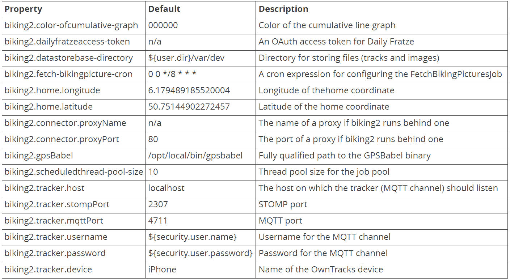

#### 图 4.35：biking2 属性

## 国际化

唯一支持的语言是英语。前端没有国际化的钩子，也没有创建它的计划。

## 迁移

biking2 替换了基于 Sinatra 框架的 Ruby 应用程序。数据存储在 SQLite 数据库中，该数据库已手动迁移到 H2 数据库。

## 可测试性

项目在 Maven 项目的标准位置包含 JUnit 测试。在撰写本文时，这些测试覆盖了超过 95% 的代码。测试必须在构建阶段执行，不应跳过。

## 构建管理

该应用程序可使用 Maven 构建，无需 Maven 之外的外部依赖。不过，要运行所有测试，`gpsbabel` 必须在路径上。

## IV.9 架构决策

我们现在将研究在构建应用程序时将影响架构决策的各种因素。

### 使用 GPSBabel 将 TCX 转换为 GPX 格式

**问题**

流行的 JavaScript 映射框架允许我们在地图上包含来自 GPX 数据的几何图形。然而，大多数 Garmin 设备以 TCX 格式记录轨迹数据，因此我需要一种将 TCX 转换为 GPX 的方法。这两种格式相对简单，尤其是 GPX，是文档完善的格式。

**约束**

* 转换应能处理包含单条轨迹、圈数和额外点的 TCX 文件，且不会出现任何问题。
* 本项目的重点是为 AngularJS SPA 开发现代应用程序后端，而不是解析 GPX 数据。

**假设**

* 使用外部的非 Java 工具会使只想尝试此应用程序的人更困难。
* 尽管文档完善，但这两种文件类型都可能包含各种信息（路线、轨迹、航点等），这使得它们难以解析。

**考虑过的替代方案**

* 编写自己的转换器。
* 使用现有的 GPS 数据瑞士军刀；即 GPSBabel ([`www.gpsbabel.org`](https://www.gpsbabel.org))。`GPSBabel` 在流行的 GPS 接收器（如 Garmin 或 Magellan）和映射程序（如 Google Earth 或 Basecamp）之间转换航点、轨迹和路线。支持数百种 GPS 接收器和程序。它还具有强大的数据操作工具。例如，这些工具用于过滤重复点或简化轨迹。自 2001 年首次创建以来，它已被下载和使用数千万次，因此稳定可靠。

**决策**

biking2 使用 `GPSBabel` 处理 GPS 相关数据的繁重工作。项目包含一个 README 文件，说明必须安装 `GPSBabel`。`GPSBabel` 可在 Windows 上使用安装程序安装，在大多数 Linux 系统上可通过官方包管理器安装。对于 OS X，它可通过 MacPorts 或 Homebrew 获取。

### 使用本地文件存储图像和轨迹数据

**问题**

biking2 需要存储“大型”对象；即图像数据（骑行和图库图片）以及轨迹数据。

**考虑过的替代方案**

* 使用云存储，例如 S3
* 使用本地文件系统

**决策**

我选择了本地文件系统，因为我不想花费太多精力评估云服务。如果 biking2 在基于云的环境中运行，我们必须为当前使用的本地文件系统创建一个抽象层。

## IV.10 质量场景

以下是构建应用程序时需要处理的各种质量场景。

### 10.1 质量树


#### 图 4.36：质量树

### 10.2 评估场景

**可测试性/覆盖率**

在开发和构建过程中使用 `JaCoCo` ([`info.michael-simons.eu/2014/05/22/jacoco-maven-and-netbeans-8-integration/`](https://info.michael-simons.eu/2014/05/22/jacoco-maven-and-netbeans-8-integration/)) 可确保我们获得至少 95% 的代码覆盖率。

**可测试性/独立于外部服务**

架构应设计成依赖外部服务的算法可以在没有外部服务可用时进行测试；也就是说，所有外部依赖都应可模拟。

例如，`FetchBikingPicturesJob` 需要包含 RSS 源的资源。获取资源和解析它至少是两个不同的任务。通过单独的类 `DailyFratzeProvider` 获取资源，使得实际解析的测试独立于 HTTP 连接，从而相对简单。

## IV.11 风险

biking2 已运行近 2 年，架构在我的使用场景中没有已知风险。

H2 数据库可能因 VM 非预期关闭（即操作系统或硬件故障）而损坏。这种风险通过定期备份序列化数据库文件来缓解：

## IV.12 术语表

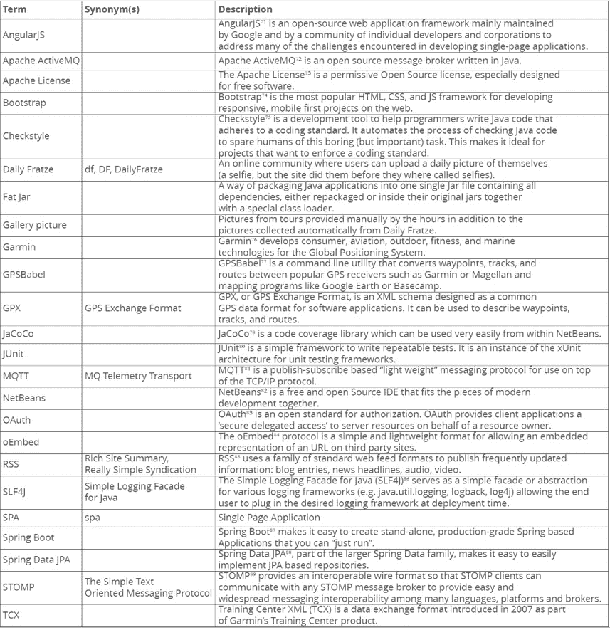

#### 图 4.37：术语表
