# 第 5 章

## V - DokChess

由 **Stefan Zörner**

"*总有一天计算机会让我们所有人都过时。*" - *Robert ("Bobby") Fisher, 世界国际象棋冠军 1972-1975，1975 年。*

本章描述了国际象棋程序 `DokChess` 的架构。我最初将其创建为软件架构和设计演示和培训的示例。后来，我用 Java 实现了它，并为一本关于记录软件架构的德文书籍进行了完善（参见 [`www.swadok.de`](http://www.swadok.de)）。源代码可在 GitHub 上获取，更多信息请访问 [`www.dokchess.de`](http://www.dokchess.de)：


#### 图 5.1：DokChess 虚拟产品盒

在以下架构概述中，您将了解 DokChess 的重要设计决策。它展示了与结构和设计相关的需求、问题的基本解决方案、软件的结构以及关键元素的交互。内容提纲遵循 arc42 模板。

本架构概述的目标受众主要是寻求建议和示例以适当记录架构的软件架构师。

计划自行创建国际象棋程序的软件开发人员将学到一些宝贵的技巧，并了解软件架构。

## V.1 引言和需求

本节介绍任务并概述 DokChess 所追求的目标。

### 1.1 需求概述

**DokChess**

以下是 DokChess 的不同特性：

* DokChess 是一个功能完整的国际象棋引擎。
* 它既可作为易于访问且引人注目的软件架构设计、评估和文档案例研究。
* 易于理解的结构邀请开发者进行实验和扩展引擎。
* 高水平的象棋能力并非目标。尽管如此，DokChess 仍能进行休闲象棋玩家会喜欢的对局。

**主要功能**

以下是 DokChess 的一些主要功能：

* 完全遵守国际棋联国际象棋规则
* 支持与人类对手和其他象棋程序对弈
* 精通基本的象棋战术，如叉子和钉子
* 可与现代图形化象棋前端配合使用

### 1.2 质量目标


下表描述了 DokChess 的关键质量目标。目标的顺序大致反映了其重要性：

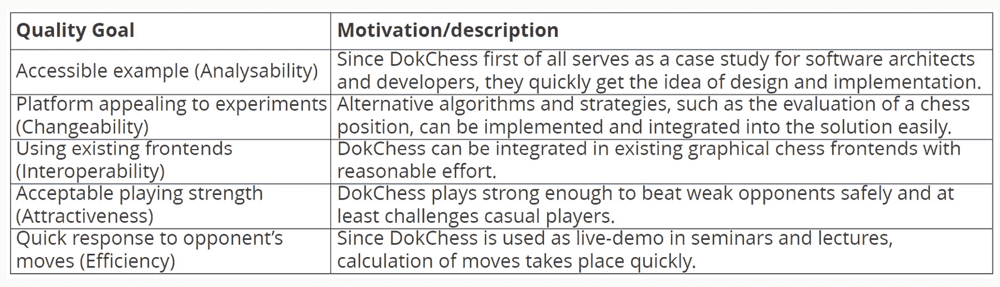

###### 图 5.2：DokChess 的质量目标

质量场景在第 V 5.10 节中详细说明了这些目标，并用于评估其实现情况。

### 1.3 利益相关者

下表说明了 DokChess 的利益相关者及其各自的意图：

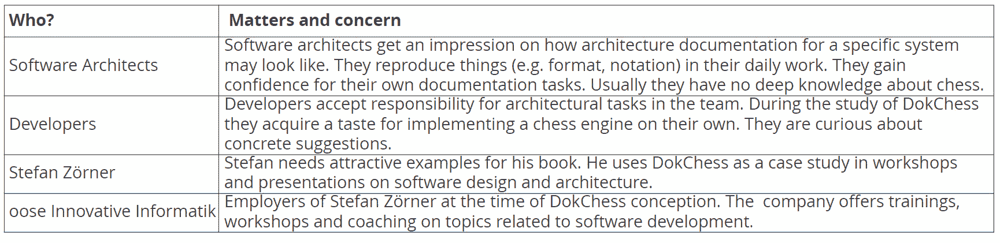

###### 图 5.3：利益相关者

## V.2 约束

项目开始时，DokChess 的设计中必须遵守各种约束。它们仍然影响解决方案。本节列出了这些限制，并在必要时解释其动机。

### 2.1 技术约束

下表描述了使用 DokChess 引擎时遇到的各种技术约束：

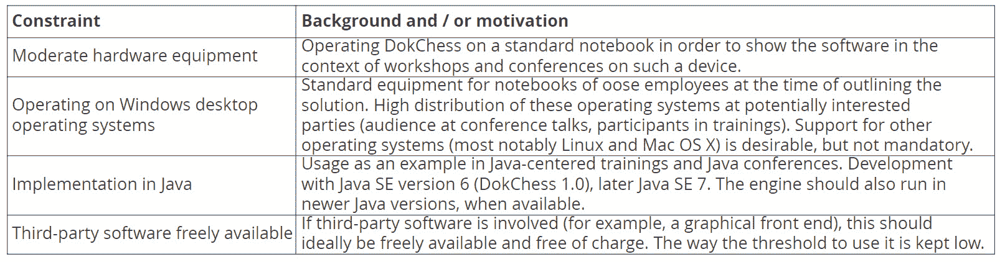

###### 图 5.4：技术约束

### 2.2 组织约束

下表列出了构建 DokChess 引擎的组织约束：

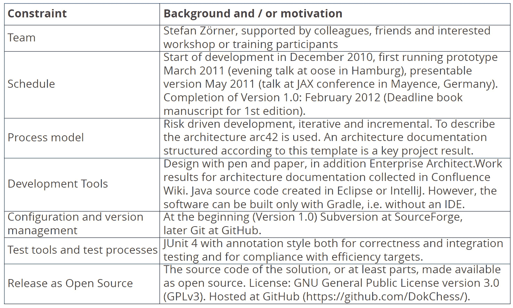

###### 图 5.5：组织约束

### 2.3 惯例

以下是在构建 DokChess 引擎时遵循的惯例：

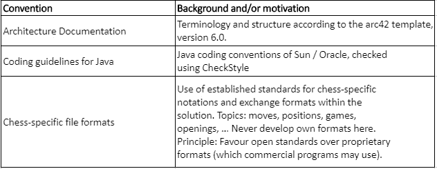

###### 图 5.6：惯例

## V.3 上下文

本节描述了 DokChess 的环境——其用户是谁，以及它与哪些其他系统交互。

### 3.1 业务上下文

下图描绘了 DokChess 的领域视角：

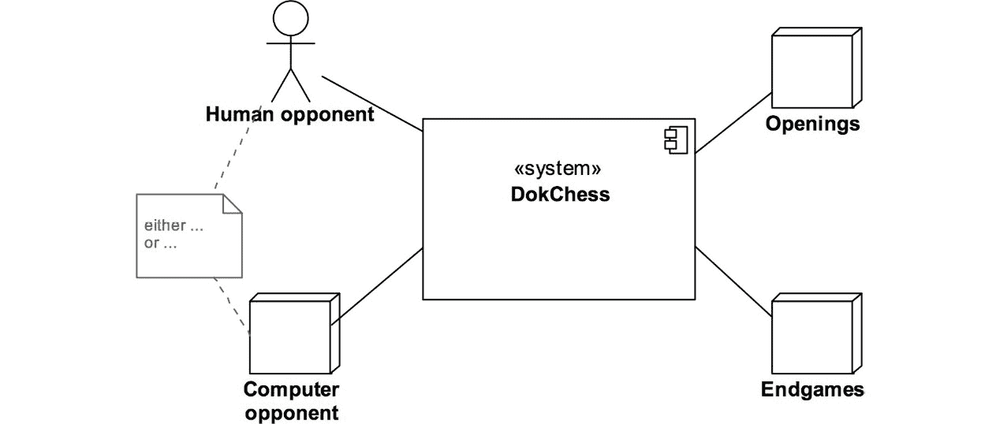

###### 图 5.7：DokChess 业务上下文

下表列出了 DokChess 业务上下文的各个不同元素：

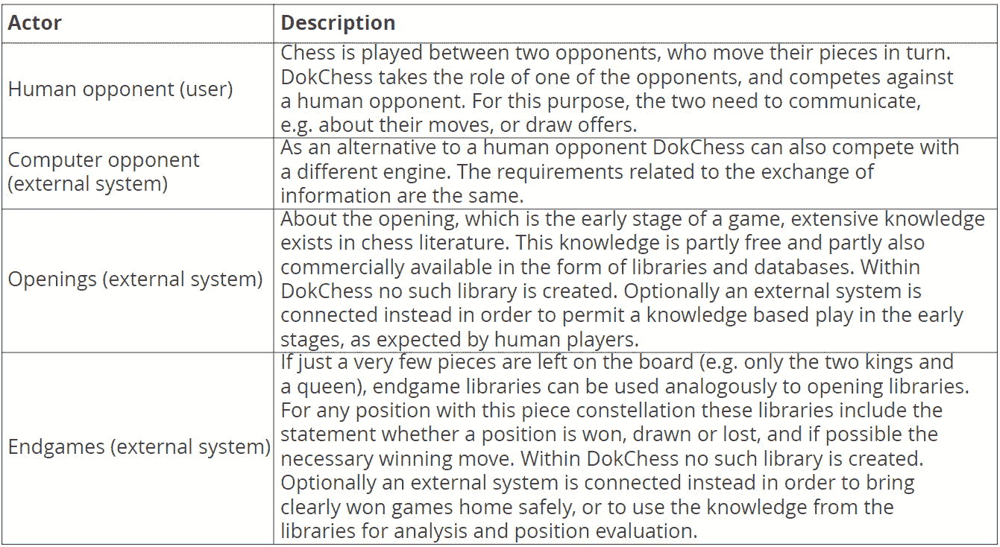

###### 图 5.8：DokChess 的参与者

### 3.2 部署上下文

下图描绘了 DokChess 的部署视角：

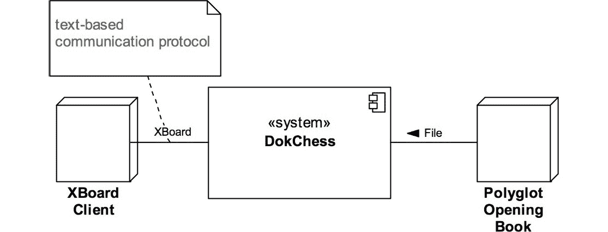

###### 图 5.9：DokChess 与第三方之间的技术通信

下表描述了 DokChess 部署上下文的各个元素：

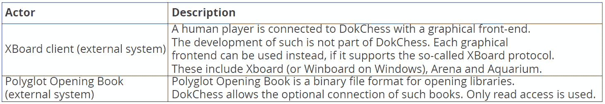

###### 图 5.10：DokChess 的部署元素

### 关于残局

由于实现工作量过大（参见 V 11.2 风险*：*实现工作量*），连接残局数据库（如 Nalimov 残局表库（[`en.wikipedia.org/wiki/Endgame\_tablebase`](https://en.wikipedia.org/wiki/Endgame_tablebase)））的实现已被放弃。然而，设计仍然对适当的扩展开放。

## V.4 解决方案策略

下表将 DokChess 的质量目标与匹配的架构方法进行对比，从而便于访问解决方案：

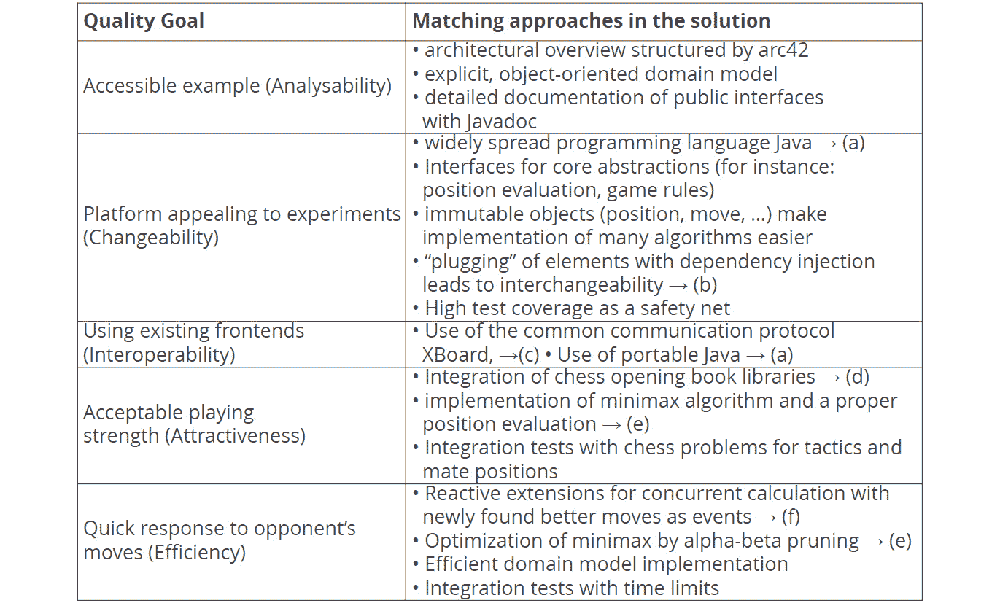

###### 图 5.11：质量目标与匹配方法

### 注

括号中的小写字母，例如 (x)，将表格右侧的各个方法链接到以下架构概览图。

下图展示了 Dokchess 架构的总体概览：

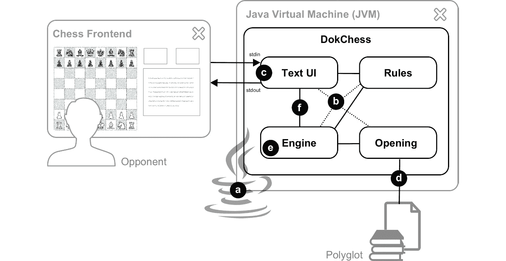

###### 图 5.12：DokChess 架构概览

剩余的第 V 4 节介绍了重要的架构方面，并参考了第 V 章中的进一步信息。

### 4.1 DokChess 的结构

DokChess 被实现为一个带有 `main` 例程的 `Java` 程序。它大致分为以下几个部分：
*   国际象棋规则的实现
*   引擎本身，用于选择走法
*   通过 `XBoard` 协议与图形用户界面的连接
*   特定开局库格式的适配器（`Polyglot Opening Book`）

这种分解允许在必要时替换诸如通信协议或开局库格式等内容。所有部分都通过接口抽象。它们的实现通过依赖注入组装（参见 V 5. 构建块视图 和 V 8.1 概念 "模块间依赖"）。这种分解还允许软件，特别是国际象棋算法，自动进行测试（参见概念 V 8.7 "可测试性"）。。

算法之间的交互通过基于领域的数据结构交换进行，这些数据结构被实现为 `Java` 类（`piece`、`move` 等，参见 V 8.2 *国际象棋领域模型*）。在此，可理解性优先于效率。尽管如此，DokChess 达到了可接受的对弈强度，正如通过相应场景的运行所示（参见 V 10 质量场景）。

数据结构设计的关键要素是游戏局面。这包括棋子的摆放位置以及属于该局面的其他方面（如轮到哪一方走棋）。再次，基于领域的类实现中，可理解性优先于效率。一个重要方面是，与所有其他领域类一样，该类是不可变的（参见决策 V 9.2 位置对象是否可更改？）。

### 4.2 游戏策略

为了集成开局库，实现了 `Polyglot Opening Book` 文件格式（参见 V 5 *构建块视图，子系统开局（黑盒）*）。这样，DokChess 从一开始就能以深厚的国际象棋知识做出回应。

经典的 `minimax` 算法（[`en.wikipedia.org/wiki/Minimax`](https://en.wikipedia.org/wiki/Minimax)）在游戏树中具有固定的搜索深度，负责游戏进行中的策略。其基本实现是单线程的。游戏树中末端节点的局势评估仅基于 V 5.2 *构建块视图第 2 级，引擎（白盒）* 中提到的材料。尽管如此，在给定约束条件下，这些简单实现已满足质量场景。

`Alpha-beta pruning`（[`en.wikipedia.org/wiki/Alpha–beta\_pruning`](https://en.wikipedia.org/wiki/Alpha-beta_pruning)）说明了算法的简单替换。在相同计算时间内通过更深入地搜索树，棋力与效率显著提高。DokChess 的不可变数据结构也有助于实现并发算法；作为示例，包含了一个并行的 `minimax` 算法。

### 4.3 引擎的连接

DokChess 没有图形用户界面。相反，通信通过标准输入和输出进行。基于文本的 `XBoard` 作为通信协议（参见决策 V 9.1 *引擎如何与外部世界通信？*）。如果你知道 `XBoard` 命令并能够解释引擎响应，就可以使用命令行与 DokChess 交互（参见概念 V 8.3 用户界面"）。请看以下截图：

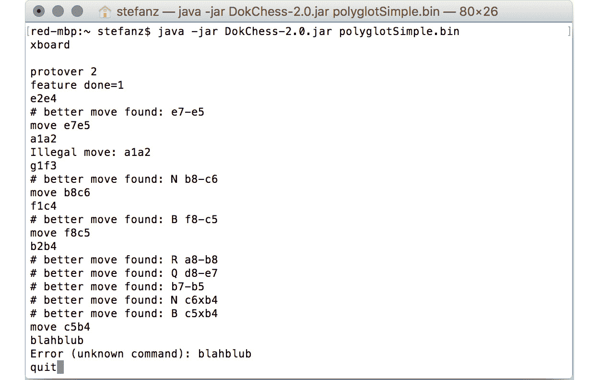

###### 图 5.13：命令行上的 DokChess

实际的 DokChess 引擎通过响应式方法（`Reactive Extensions`）附加（参见 *运行时视图*，V.6.1 走法计算演练）。即使在分析过程中，DokChess 也是可访问的。这样，例如，用户可以强制引擎立即走棋。

在 Windows 上，将 DokChess 集成到 UI 中是通过批处理文件（`*.bat`）完成的。它使用带有 `main` 方法的类作为参数启动 Java 虚拟机（`JVM`）（参见 V 7. "部署视图"）。

## V.5 构建块视图


本节描述了 DokChess 的模块分解情况。这些内容也在 Java 源代码的包结构中有所体现。在 DokChess 中，我们将第一层分解的模块称为子系统。构建块视图层级 1 展示了它们，包括其接口。对于 `Engine` 子系统，此概述还包括更详细的层级 2 分解（参见 V.6.1 *Move Determination Walkthrough* 包含子系统在运行时交互的示例）。

## 5.1 构建块视图-层级 1

DokChess 被分解为四个子系统，如下图所示。

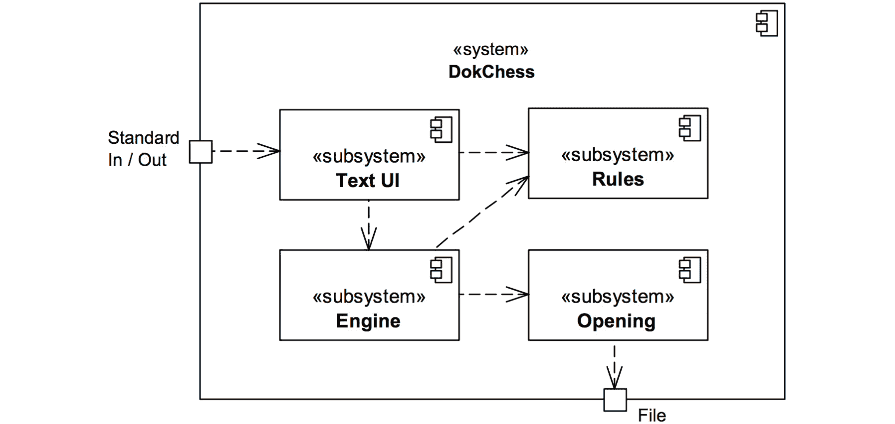

###### 图 5.14：DokChess 的构建块视图，层级 1

虚线箭头表示子系统之间的逻辑依赖关系（`x -> y` 表示 `x` 依赖于 `y`）。系统膜上的方框是与外部世界的交互点（端口）（参见 V.3.2 *Deployment Context*）：

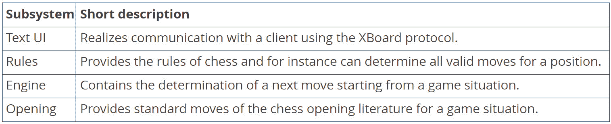

###### 图 5.15：DokChess 的子系统

### 5.1.1 子系统 Text UI（黑盒）

**意图/职责**

本子系统使用基于文本的 XBoard 协议（参见 V.9.1 *Decision*）实现与客户端（例如图形用户界面）的通信。它从标准输入读取命令，根据游戏规则检查它们，并将其转换为 `Engine`。来自 `Engine` 的响应（尤其是走法）将被子系统作为事件接收，按照协议格式化并通过标准输出返回。因此，子系统驱动整个游戏。

**接口**

子系统通过 `org.dokchess.textui.xboard.XBoard` Java 类提供其功能：

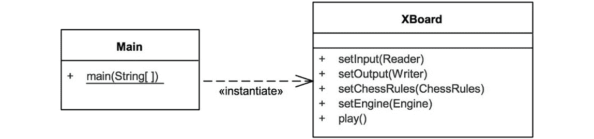

###### 图 5.16：XBoard 和 Main 类

下表描述了 `XBoard` 类的每个方法：

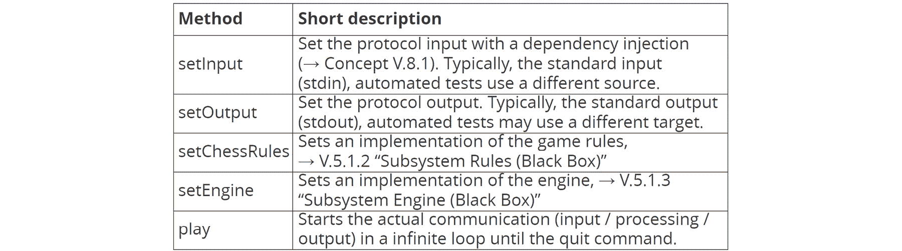

###### 图 5.17：XBoard 方法

**文件**

实现位于以下包之下

`org.dokchess.textui...`

**开放问题**

XBoard 协议的实现不完整。尽管如此，它足以满足 DokChess 的需求。但特别是，以下功能不受支持：

* 时钟控制
* 永久大脑（在对手思考时思考）
* 提出和棋以及对手认输
* 国际象棋变体（替代规则，例如 Chess960）

### 5.1.2 子系统 Rules（黑盒）

**意图/职责**

本子系统根据 *国际象棋联合会（FIDE）* 的规则处理国际象棋。它确定某个位置的所有合法走法，并判断是否为将军、将死或逼和。

**接口**

子系统通过 `org.dokchess.rules.ChessRules` Java 接口提供其功能。

接口的默认实现是 `org.dokchess.rules.DefaultChessRules` 类：


###### 图 5.18：ChessRules 接口

下表描述了接口中使用的每个方法：

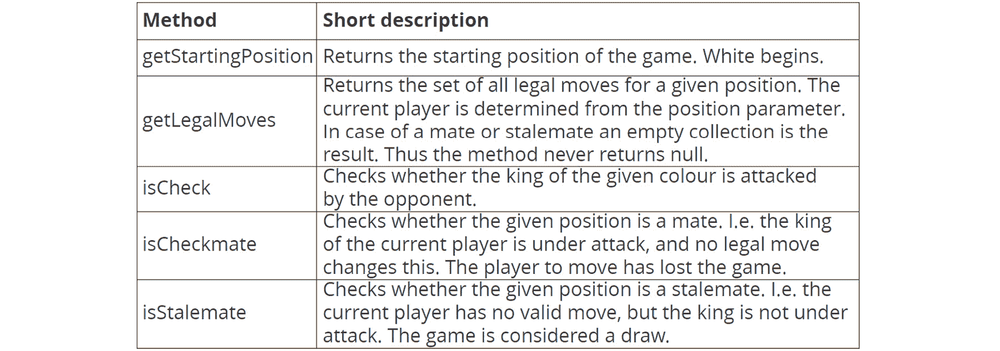

###### 图 5.19：ChessRules 方法及简短描述

*概念 V 8.2 国际象棋领域模型* 描述了接口中作为调用和返回参数使用的类型（`Move`、`Position`、`Colour`）。有关更多详细信息，请参阅源代码文档（`javadoc`）。

**文件**

实现位于以下包之下

`org.dokchess.rules...`

**开放问题**

除逼和外，子系统无法识别任何和棋。特别是，以下规则未实现（参见 V.11.2 *风险：实现工作量*）：

* 50 步规则
* 三重重复

### 5.1.3 子系统 Engine（黑盒）

**意图/职责**

本子系统包含在特定对局位置中确定下一步走法。位置由外部实体提供。引擎本身是有状态的，并且一次只进行一局游戏。默认实现需要游戏规则的实现才能工作。开局库 however 是可选的。

**接口**

`Engine` 子系统通过 `org.dokchess.engine.Engine` Java 接口提供其功能。

默认实现是 `org.dokchess.engine.DefaultEngine` 类：

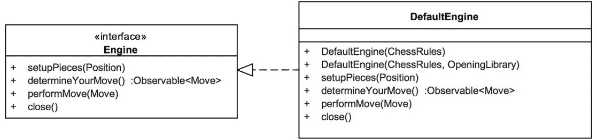

###### 图 5.20：Engine 接口和 DefaultEngine 类

`Engine` 接口的方法描述如下：

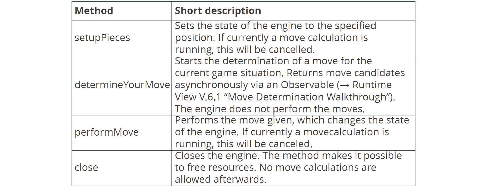

###### 图 5.21：Engine 接口的方法

`DefaultEngine` 类的方法（除 `Engine` 接口外）列出如下：

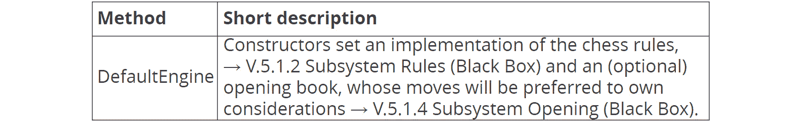

###### 图 5.22：DefaultEngine 方法

*概念 V 8.2 国际象棋领域模型* 描述了接口中作为调用和返回参数使用的类型（`Move` 和 `Position`）。有关更多信息，请参阅源代码文档（`Javadoc`）。

**文件**

`Engine` 子系统的实现和相应的单元测试位于以下包之下：

`org.dokchess.engine...`

### 5.1.4 子系统 Opening（黑盒）

**意图/职责**

本子系统提供开局库并实现 `PolyglotOpeningBook` 格式。该格式目前是唯一可用的非专有格式。相应的棋谱文件和相关工具在互联网上可自由获取。

**接口**

Opening 子系统通过 `org.dokchess.opening.OpeningLibrary` Java 接口提供其功能。

`org.dokchess.opening.polyglot.PolyglotOpeningBook` 类提供一种可能实现：

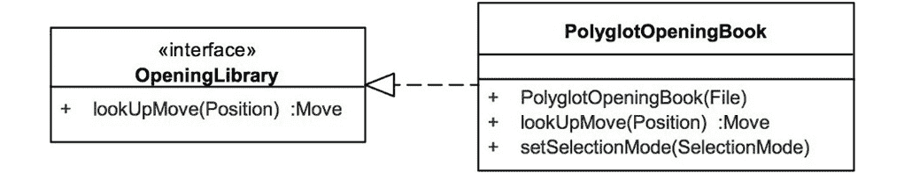

###### 图 5.23：接口 OpeningLibrary 和 PolyglotOpeningBook 类

以下是 `OpeningLibrary` 接口的方法：

`lookUpMove`：从库中返回指定位置的标准走法，或 null。

`PolyglotOpeningBook` 类是 `PolyglotOpeningBook` 文件格式的适配器。`OpeningLibrary` 的实现读取适当格式的二进制文件，如果库中包含，则返回指定位置的走法。

以下是 `PolyglotOpeningBook` 类的方法（除 OpeningLibrary 接口外）：


###### 图 5.24：PolyglotOpeningBook 类的方法

*概念 V 8.2 国际象棋领域模型* 描述了接口中作为调用和返回参数使用的类型（`Move` 和 `Position`）。有关更多信息，请参阅源代码文档（`Javadoc`）。

**文件**

Polyglot 文件格式的实现、单元测试和测试数据位于以下包之下：

`org.dokchess.opening...`

**开放问题**

以下是遇到的开放问题：

* 从 `PolyglotOpeningBook` 中在多个候选情况下选择走法的已实现选项有限（第一个、最常下、随机）。
* 实现无法同时处理多个库文件。因此，它无法将它们混合以组合知识。

## 5.2 层级 2：Engine（白盒）

`Engine` 被分解为 `Search` 和（位置）`Evaluation` 模块，如下图所示。如果可用，走法的确定最初会委托给开局库。只有在库未提供标准走法时才使用 `Search`：

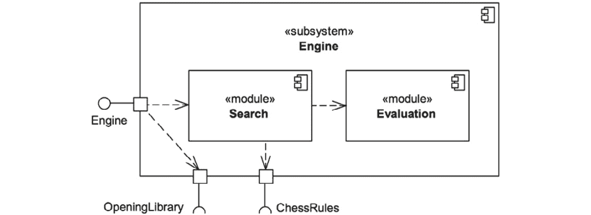


**图 5.25：引擎，构建块视图，第 2 级**

下列列表描述了第 2 级引擎中的模块：

* `Search`：在特定条件下确定位置的最佳走法
* `Evaluation`：从对手的角度评估位置。

### 5.2.1 Search（黑盒）

#### 意图/职责
该模块在特定条件下确定位置的最佳走法。在国际象棋游戏中，理论上总是存在最佳走法。可能走法的数量庞大，以及由此产生的令人难以置信的游戏局面数量，使得在实践中确定最佳走法是不可能的。常见的算法如 Minimax 仅探索到游戏树的特定深度。

#### 接口
该模块通过 `org.dokchess.engine.search.Search` Java 接口提供其功能。
`org.dokchess.engine.search.MinimaxAlgorithm` 类使用 Minimax 算法实现该接口。`MinimaxParallelSearch` 类使用该算法并实现相同的 `Search` 接口。它并发检查多个子树；如果找到更好的走法，调用方将通过观察者模式接收 `onNext` 消息。`Search` 通过 `onComplete` 消息指示其工作完成：
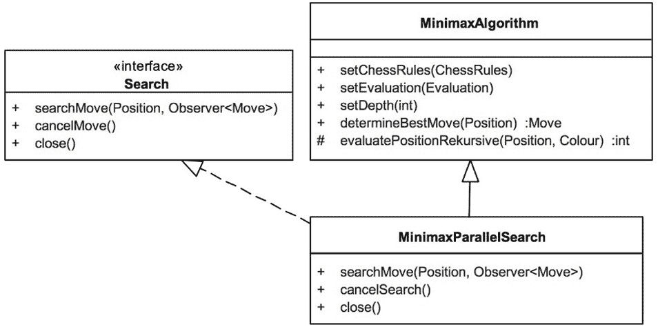
**图 5.26：`Search` 接口和 `MinimaxAlgorithm` 和 `MinimaxParallelSearch` 类**
以下是 `Search` 接口的方法：
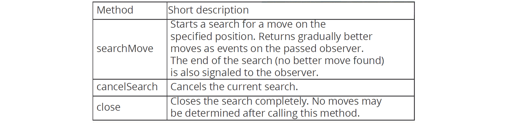
**图 5.27：`Search` 接口的方法**
以下是 `MinimaxAlgorithm` 类的方法：
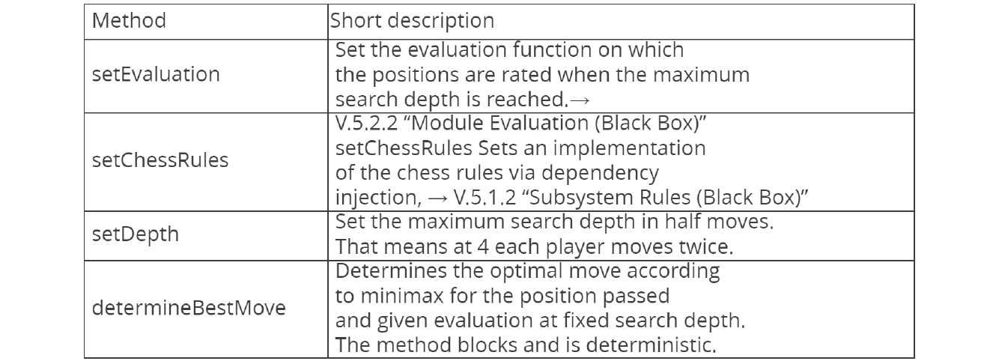
**图 5.28：`MinimaxAlgorithm` 类的方法**
#### 文件
实现位于包 `org.dokchess.engine.search.` 下。

### 5.2.2 Evaluation（黑盒）

#### 意图/职责
该模块从对手的角度评估位置。结果是一个数字，0 表示平衡局面。正数描述玩家优势，负数表示劣势。数字越高，优势或劣势越大。因此该模块使得可以相互比较位置。

#### 接口
`Evaluation` 模块通过 `org.dokchess.engine.eval.Evaluation` Java 接口提供其功能。
`org.dokchess.engine.eval.StandardMaterialEvaluation` 类是一个非常简单的实现。接口包含典型评级的常量：
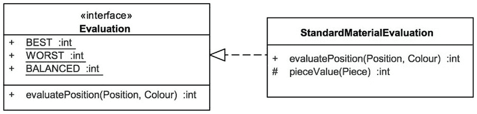
**图 5.29：`Evaluation` 接口和 `StandardMaterialEvaluation` 类**
以下是 Evaluation 接口的一个方法：
`evaluatePosition`：返回指定玩家颜色视角下给定位置的评估值。越高越好。
`StandardMaterialEvaluation` 实现类仅考虑现有的棋子（材料）。每种棋子类型都有一个值（兵 1，马 3，…，后 9）。棋盘上的棋子相应地相加。玩家的棋子为正，对手的棋子为负。因此，在材料平衡时，结果为 0。如果失去一枚后，数值将下降 9。

#### 文件
实现位于包 `org.dokchess.engine.eval.` 下。

#### 开放问题
在纯材料评估中，棋子所在位置无关紧要。起始位置的兵与即将升变的兵价值相同。边缘的马相当于中心的马。改进空间很大，但未被利用，因为 DokChess 应该邀请他人进行实验。

## V.6 运行时视图
与静态构建块视图相反，本节可视化动态方面。各个部分如何协同工作？

### 6.1 走法确定演练
在建立 `XBoard` 协议后，客户端（白方）通过指示走法开始游戏。下面的时序图显示了从输入 "`e2e4`"（白兵 e2-e4）到 DokChess 响应的子系统级示例交互，输出为 "move `b8c6`"（*黑马 b8-c6，即“尼姆佐维奇防御”*（[`en.wikipedia.org/wiki/Nimzowitsch_Defence`](https://en.wikipedia.org/wiki/Nimzowitsch_Defence)））：
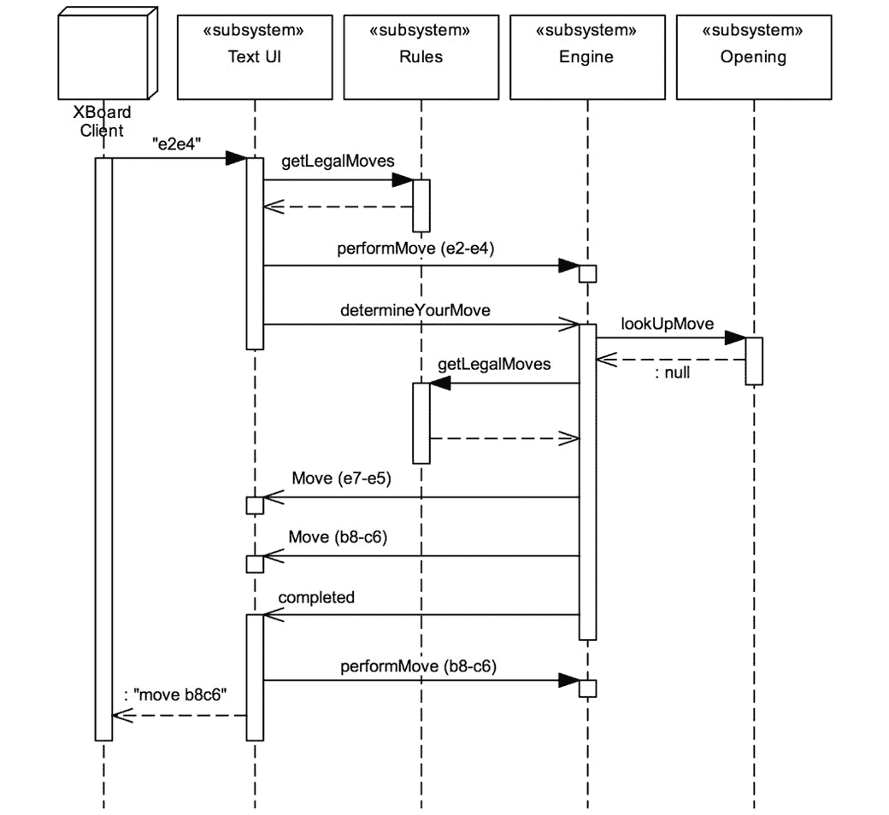
**图 5.30：走法确定的示例交互**
首先，`Text UI` 子系统借助 `Rules` 子系统验证输入（参见 V 8.4，*合理性检查和验证*）。示例中的走法被识别为合法，随后在（有状态的）`Engine` 上执行（`performMove` 消息）。然后，`Text UI` 子系统要求 `Engine` 确定其走法。由于走法计算可能需要很长时间，但 DokChess 仍应继续响应输入，因此此调用是异步的。引擎会返回可能的走法。
`Engine` 首先检查开局库是否有提供。在示例中并非如此。`Engine` 必须自行计算走法。然后它访问 `Rules` 并确定所有有效走法作为候选。之后，它调查并对其进行评级，并逐步向调用方（`Text UI` 子系统）报告更好的走法（从 `Engine` 的角度来看更好）。这里使用了观察者模式（使用响应式扩展实现（[`reactivex.io/intro.html`](http://reactivex.io/intro.html)））。
示例图显示找到了两个走法（兵 `e7-e5` 和马 `b8-c6`），最后是搜索完成的[content]
**图 5.25：引擎，构建块视图，第 2 级**

下列列表描述了第 2 级引擎中的模块：

* `Search`：在特定条件下确定位置的最佳走法
* `Evaluation`：从对手的角度评估位置。

### 5.2.1 Search（黑盒）

#### 意图/职责
该模块在特定条件下确定位置的最佳走法。在国际象棋游戏中，理论上总是存在最佳走法。可能走法的数量庞大，以及由此产生的令人难以置信的游戏局面数量，使得在实践中确定最佳走法是不可能的。常见的算法如 Minimax 仅探索到游戏树的特定深度。

#### 接口
该模块通过 `org.dokchess.engine.search.Search` Java 接口提供其功能。
`org.dokchess.engine.search.MinimaxAlgorithm` 类使用 Minimax 算法实现该接口。`MinimaxParallelSearch` 类使用该算法并实现相同的 `Search` 接口。它并发检查多个子树；如果找到更好的走法，调用方将通过观察者模式接收 `onNext` 消息。`Search` 通过 `onComplete` 消息指示其工作完成：

**图 5.26：`Search` 接口和 `MinimaxAlgorithm` 和 `MinimaxParallelSearch` 类**
以下是 `Search` 接口的方法：

**图 5.27：`Search` 接口的方法**
以下是 `MinimaxAlgorithm` 类的方法：

**图 5.28：`MinimaxAlgorithm` 类的方法**
#### 文件
实现位于包 `org.dokchess.engine.search.` 下。

### 5.2.2 Evaluation（黑盒）

#### 意图/职责
该模块从对手的角度评估位置。结果是一个数字，0 表示平衡局面。正数描述玩家优势，负数表示劣势。数字越高，优势或劣势越大。因此该模块使得可以相互比较位置。

#### 接口
`Evaluation` 模块通过 `org.dokchess.engine.eval.Evaluation` Java 接口提供其功能。
`org.dokchess.engine.eval.StandardMaterialEvaluation` 类是一个非常简单的实现。接口包含典型评级的常量：

**图 5.29：`Evaluation` 接口和 `StandardMaterialEvaluation` 类**
以下是 Evaluation 接口的一个方法：
`evaluatePosition`：返回指定玩家颜色视角下给定位置的评估值。越高越好。
`StandardMaterialEvaluation` 实现类仅考虑现有的棋子（材料）。每种棋子类型都有一个值（兵 1，马 3，…，后 9）。棋盘上的棋子相应地相加。玩家的棋子为正，对手的棋子为负。因此，在材料平衡时，结果为 0。如果失去一枚后，数值将下降 9。

#### 文件
实现位于包 `org.dokchess.engine.eval.` 下。

#### 开放问题
在纯材料评估中，棋子所在位置无关紧要。起始位置的兵与即将升变的兵价值相同。边缘的马相当于中心的马。改进空间很大，但未被利用，因为 DokChess 应该邀请他人进行实验。

## V.6 运行时视图
与静态构建块视图相反，本节可视化动态方面。各个部分如何协同工作？

### 6.1 走法确定演练
在建立 `XBoard` 协议后，客户端（白方）通过指示走法开始游戏。下面的时序图显示了从输入 "`e2e4`"（白兵 e2-e4）到 DokChess 响应的子系统级示例交互，输出为 "move `b8c6`"（*黑马 b8-c6，即“尼姆佐维奇防御”*（[`en.wikipedia.org/wiki/Nimzowitsch_Defence`](https://en.wikipedia.org/wiki/Nimzowitsch_Defence)））：

**图 5.30：走法确定的示例交互**
首先，`Text UI` 子系统借助 `Rules` 子系统验证输入（参见 V 8.4，*合理性检查和验证*）。示例中的走法被识别为合法，随后在（有状态的）`Engine` 上执行（`performMove` 消息）。然后，`Text UI` 子系统要求 `Engine` 确定其走法。由于走法计算可能需要很长时间，但 DokChess 仍应继续响应输入，因此此调用是异步的。引擎会返回可能的走法。
`Engine` 首先检查开局库是否有提供。在示例中并非如此。`Engine` 必须自行计算走法。然后它访问 `Rules` 并确定所有有效走法作为候选。之后，它调查并对其进行评级，并逐步向调用方（`Text UI` 子系统）报告更好的走法（从 `Engine` 的角度来看更好）。这里使用了观察者模式（使用响应式扩展实现（[`reactivex.io/intro.html`](http://reactivex.io/intro.html)））。
示例图显示找到了两个走法（兵 `e7-e5` 和马 `b8-c6`），最后是搜索完成的[content]
**图 5.25：引擎，构建块视图，第 2 级**

下列列表描述了第 2 级引擎中的模块：

* `Search`：在特定条件下确定位置的最佳走法
* `Evaluation`：从对手的角度评估位置。

### 5.2.1 Search（黑盒）

#### 意图/职责
该模块在特定条件下确定位置的最佳走法。在国际象棋游戏中，理论上总是存在最佳走法。可能走法的数量庞大，以及由此产生的令人难以置信的游戏局面数量，使得在实践中确定最佳走法是不可能的。常见的算法如 Minimax 仅探索到游戏树的特定深度。

#### 接口
该模块通过 `org.dokchess.engine.search.Search` Java 接口提供其功能。
`org.dokchess.engine.search.MinimaxAlgorithm` 类使用 Minimax 算法实现该接口。`MinimaxParallelSearch` 类使用该算法并实现相同的 `Search` 接口。它并发检查多个子树；如果找到更好的走法，调用方将通过观察者模式接收 `onNext` 消息。`Search` 通过 `onComplete` 消息指示其工作完成：

**图 5.26：`Search` 接口和 `MinimaxAlgorithm` 和 `MinimaxParallelSearch` 类**
以下是 `Search` 接口的方法：

**图 5.27：`Search` 接口的方法**
以下是 `MinimaxAlgorithm` 类的方法：

**图 5.28：`MinimaxAlgorithm` 类的方法**
#### 文件
实现位于包 `org.dokchess.engine.search.` 下。

### 5.2.2 Evaluation（黑盒）

#### 意图/职责
该模块从对手的角度评估位置。结果是一个数字，0 表示平衡局面。正数描述玩家优势，负数表示劣势。数字越高，优势或劣势越大。因此该模块使得可以相互比较位置。

#### 接口
`Evaluation` 模块通过 `org.dokchess.engine.eval.Evaluation` Java 接口提供其功能。
`org.dokchess.engine.eval.StandardMaterialEvaluation` 类是一个非常简单的实现。接口包含典型评级的常量：

**图 5.29：`Evaluation` 接口和 `StandardMaterialEvaluation` 类**
以下是 Evaluation 接口的一个方法：
`evaluatePosition`：返回指定玩家颜色视角下给定位置的评估值。越高越好。
`StandardMaterialEvaluation` 实现类仅考虑现有的棋子（材料）。每种棋子类型都有一个值（兵 1，马 3，…，后 9）。棋盘上的棋子相应地相加。玩家的棋子为正，对手的棋子为负。因此，在材料平衡时，结果为 0。如果失去一枚后，数值将下降 9。

#### 文件
实现位于包 `org.dokchess.engine.eval.` 下。

#### 开放问题
在纯材料评估中，棋子所在位置无关紧要。起始位置的兵与即将升变的兵价值相同。边缘的马相当于中心的马。改进空间很大，但未被利用，因为 DokChess 应该邀请他人进行实验。

## V.6 运行时视图
与静态构建块视图相反，本节可视化动态方面。各个部分如何协同工作？

### 6.1 走法确定演练
在建立 `XBoard` 协议后，客户端（白方）通过指示走法开始游戏。下面的时序图显示了从输入 "`e2e4`"（白兵 e2-e4）到 DokChess 响应的子系统级示例交互，输出为 "move `b8c6`"（*黑马 b8-c6，即“尼姆佐维奇防御”*（[`en.wikipedia.org/wiki/Nimzowitsch_Defence`](https://en.wikipedia.org/wiki/Nimzowitsch_Defence)））：

**图 5.30：走法确定的示例交互**
首先，`Text UI` 子系统借助 `Rules` 子系统验证输入（参见 V 8.4，*合理性检查和验证*）。示例中的走法被识别为合法，随后在（有状态的）`Engine` 上执行（`performMove` 消息）。然后，`Text UI` 子系统要求 `Engine` 确定其走法。由于走法计算可能需要很长时间，但 DokChess 仍应继续响应输入，因此此调用是异步的。引擎会返回可能的走法。
`Engine` 首先检查开局库是否有提供。在示例中并非如此。`Engine` 必须自行计算走法。然后它访问 `Rules` 并确定所有有效走法作为候选。之后，它调查并对其进行评级，并逐步向调用方（`Text UI` 子系统）报告更好的走法（从 `Engine` 的角度来看更好）。这里使用了观察者模式（使用响应式扩展实现（[`reactivex.io/intro.html`](http://reactivex.io/intro.html)））。
示例图显示找到了两个走法（兵 `e7-e5` 和马 `b8-c6`），最后是搜索完成的[content]
**图 5.25：引擎，构建块视图，第 2 级**

下列列表描述了第 2 级引擎中的模块：

* `Search`：在特定条件下确定位置的最佳走法
* `Evaluation`：从对手的角度评估位置。

### 5.2.1 Search（黑盒）

#### 意图/职责
该模块在特定条件下确定位置的最佳走法。在国际象棋游戏中，理论上总是存在最佳走法。可能走法的数量庞大，以及由此产生的令人难以置信的游戏局面数量，使得在实践中确定最佳走法是不可能的。常见的算法如 Minimax 仅探索到游戏树的特定深度。

#### 接口
该模块通过 `org.dokchess.engine.search.Search` Java 接口提供其功能。
`org.dokchess.engine.search.MinimaxAlgorithm` 类使用 Minimax 算法实现该接口。`MinimaxParallelSearch` 类使用该算法并实现相同的 `Search` 接口。它并发检查多个子树；如果找到更好的走法，调用方将通过观察者模式接收 `onNext` 消息。`Search` 通过 `onComplete` 消息指示其工作完成：

**图 5.26：`Search` 接口和 `MinimaxAlgorithm` 和 `MinimaxParallelSearch` 类**
以下是 `Search` 接口的方法：

**图 5.27：`Search` 接口的方法**
以下是 `MinimaxAlgorithm` 类的方法：

**图 5.28：`MinimaxAlgorithm` 类的方法**
#### 文件
实现位于包 `org.dokchess.engine.search.` 下。

### 5.2.2 Evaluation（黑盒）

#### 意图/职责
该模块从对手的角度评估位置。结果是一个数字，0 表示平衡局面。正数描述玩家优势，负数表示劣势。数字越高，优势或劣势越大。因此该模块使得可以相互比较位置。

#### 接口
`Evaluation` 模块通过 `org.dokchess.engine.eval.Evaluation` Java 接口提供其功能。
`org.dokchess.engine.eval.StandardMaterialEvaluation` 类是一个非常简单的实现。接口包含典型评级的常量：

**图 5.29：`Evaluation` 接口和 `StandardMaterialEvaluation` 类**
以下是 Evaluation 接口的一个方法：
`evaluatePosition`：返回指定玩家颜色视角下给定位置的评估值。越高越好。
`StandardMaterialEvaluation` 实现类仅考虑现有的棋子（材料）。每种棋子类型都有一个值（兵 1，马 3，…，后 9）。棋盘上的棋子相应地相加。玩家的棋子为正，对手的棋子为负。因此，在材料平衡时，结果为 0。如果失去一枚后，数值将下降 9。

#### 文件
实现位于包 `org.dokchess.engine.eval.` 下。

#### 开放问题
在纯材料评估中，棋子所在位置无关紧要。起始位置的兵与即将升变的兵价值相同。边缘的马相当于中心的马。改进空间很大，但未被利用，因为 DokChess 应该邀请他人进行实验。

## V.6 运行时视图
与静态构建块视图相反，本节可视化动态方面。各个部分如何协同工作？

### 6.1 走法确定演练
在建立 `XBoard` 协议后，客户端（白方）通过指示走法开始游戏。下面的时序图显示了从输入 "`e2e4`"（白兵 e2-e4）到 DokChess 响应的子系统级示例交互，输出为 "move `b8c6`"（*黑马 b8-c6，即“尼姆佐维奇防御”*（[`en.wikipedia.org/wiki/Nimzowitsch_Defence`](https://en.wikipedia.org/wiki/Nimzowitsch_Defence)））：

**图 5.30：走法确定的示例交互**
首先，`Text UI` 子系统借助 `Rules` 子系统验证输入（参见 V 8.4，*合理性检查和验证*）。示例中的走法被识别为合法，随后在（有状态的）`Engine` 上执行（`performMove` 消息）。然后，`Text UI` 子系统要求 `Engine` 确定其走法。由于走法计算可能需要很长时间，但 DokChess 仍应继续响应输入，因此此调用是异步的。引擎会返回可能的走法。
`Engine` 首先检查开局库是否有提供。在示例中并非如此。`Engine` 必须自行计算走法。然后它访问 `Rules` 并确定所有有效走法作为候选。之后，它调查并对其进行评级，并逐步向调用方（`Text UI` 子系统）报告更好的走法（从 `Engine` 的角度来看更好）。这里使用了观察者模式（使用响应式扩展实现（[`reactivex.io/intro.html`](http://reactivex.io/intro.html)））。
示例图显示找到了两个走法（兵 `e7-e5` 和马 `b8-c6`），最后是搜索完成的[content]
**图 5.25：引擎，构建块视图，第 2 级**

下列列表描述了第 2 级引擎中的模块：

* `Search`：在特定条件下确定位置的最佳走法
* `Evaluation`：从对手的角度评估位置。

### 5.2.1 Search（黑盒）

#### 意图/职责
该模块在特定条件下确定位置的最佳走法。在国际象棋游戏中，理论上总是存在最佳走法。可能走法的数量庞大，以及由此产生的令人难以置信的游戏局面数量，使得在实践中确定最佳走法是不可能的。常见的算法如 Minimax 仅探索到游戏树的特定深度。

#### 接口
该模块通过 `org.dokchess.engine.search.Search` Java 接口提供其功能。
`org.dokchess.engine.search.MinimaxAlgorithm` 类使用 Minimax 算法实现该接口。`MinimaxParallelSearch` 类使用该算法并实现相同的 `Search` 接口。它并发检查多个子树；如果找到更好的走法，调用方将通过观察者模式接收 `onNext` 消息。`Search` 通过 `onComplete` 消息指示其工作完成：

**图 5.26：`Search` 接口和 `MinimaxAlgorithm` 和 `MinimaxParallelSearch` 类**
以下是 `Search` 接口的方法：

**图 5.27：`Search` 接口的方法**
以下是 `MinimaxAlgorithm` 类的方法：

**图 5.28：`MinimaxAlgorithm` 类的方法**
#### 文件
实现位于包 `org.dokchess.engine.search.` 下。

### 5.2.2 Evaluation（黑盒）

#### 意图/职责
该模块从对手的角度评估位置。结果是一个数字，0 表示平衡局面。正数描述玩家优势，负数表示劣势。数字越高，优势或劣势越大。因此该模块使得可以相互比较位置。

#### 接口
`Evaluation` 模块通过 `org.dokchess.engine.eval.Evaluation` Java 接口提供其功能。
`org.dokchess.engine.eval.StandardMaterialEvaluation` 类是一个非常简单的实现。接口包含典型评级的常量：

**图 5.29：`Evaluation` 接口和 `StandardMaterialEvaluation` 类**
以下是 Evaluation 接口的一个方法：
`evaluatePosition`：返回指定玩家颜色视角下给定位置的评估值。越高越好。
`StandardMaterialEvaluation` 实现类仅考虑现有的棋子（材料）。每种棋子类型都有一个值（兵 1，马 3，…，后 9）。棋盘上的棋子相应地相加。玩家的棋子为正，对手的棋子为负。因此，在材料平衡时，结果为 0。如果失去一枚后，数值将下降 9。

#### 文件
实现位于包 `org.dokchess.engine.eval.` 下。

#### 开放问题
在纯材料评估中，棋子所在位置无关紧要。起始位置的兵与即将升变的兵价值相同。边缘的马相当于中心的马。改进空间很大，但未被利用，因为 DokChess 应该邀请他人进行实验。

## V.6 运行时视图
与静态构建块视图相反，本节可视化动态方面。各个部分如何协同工作？

### 6.1 走法确定演练
在建立 `XBoard` 协议后，客户端（白方）通过指示走法开始游戏。下面的时序图显示了从输入 "`e2e4`"（白兵 e2-e4）到 DokChess 响应的子系统级示例交互，输出为 "move `b8c6`"（*黑马 b8-c6，即“尼姆佐维奇防御”*（[`en.wikipedia.org/wiki/Nimzowitsch_Defence`](https://en.wikipedia.org/wiki/Nimzowitsch_Defence)））：

**图 5.30：走法确定的示例交互**
首先，`Text UI` 子系统借助 `Rules` 子系统验证输入（参见 V 8.4，*合理性检查和验证*）。示例中的走法被识别为合法，随后在（有状态的）`Engine` 上执行（`performMove` 消息）。然后，`Text UI` 子系统要求 `Engine` 确定其走法。由于走法计算可能需要很长时间，但 DokChess 仍应继续响应输入，因此此调用是异步的。引擎会返回可能的走法。
`Engine` 首先检查开局库是否有提供。在示例中并非如此。`Engine` 必须自行计算走法。然后它访问 `Rules` 并确定所有有效走法作为候选。之后，它调查并对其进行评级，并逐步向调用方（`Text UI` 子系统）报告更好的走法（从 `Engine` 的角度来看更好）。这里使用了观察者模式（使用响应式扩展实现（[`reactivex.io/intro.html`](http://reactivex.io/intro.html)））。
示例图显示找到了两个走法（兵 `e7-e5` 和马 `b8-c6`），最后是搜索完成的[content]
**图 5.25：引擎，构建块视图，第 2 级**

下列列表描述了第 2 级引擎中的模块：

* `Search`：在特定条件下确定位置的最佳走法
* `Evaluation`：从对手的角度评估位置。

### 5.2.1 Search（黑盒）

#### 意图/职责
该模块在特定条件下确定位置的最佳走法。在国际象棋游戏中，理论上总是存在最佳走法。可能走法的数量庞大，以及由此产生的令人难以置信的游戏局面数量，使得在实践中确定最佳走法是不可能的。常见的算法如 Minimax 仅探索到游戏树的特定深度。

#### 接口
该模块通过 `org.dokchess.engine.search.Search` Java 接口提供其功能。
`org.dokchess.engine.search.MinimaxAlgorithm` 类使用 Minimax 算法实现该接口。`MinimaxParallelSearch` 类使用该算法并实现相同的 `Search` 接口。它并发检查多个子树；如果找到更好的走法，调用方将通过观察者模式接收 `onNext` 消息。`Search` 通过 `onComplete` 消息指示其工作完成：

**图 5.26：`Search` 接口和 `MinimaxAlgorithm` 和 `MinimaxParallelSearch` 类**
以下是 `Search` 接口的方法：

**图 5.27：`Search` 接口的方法**
以下是 `MinimaxAlgorithm` 类的方法：

**图 5.28：`MinimaxAlgorithm` 类的方法**
#### 文件
实现位于包 `org.dokchess.engine.search.` 下。

### 5.2.2 Evaluation（黑盒）

#### 意图/职责
该模块从对手的角度评估位置。结果是一个数字，0 表示平衡局面。正数描述玩家优势，负数表示劣势。数字越高，优势或劣势越大。因此该模块使得可以相互比较位置。

#### 接口
`Evaluation` 模块通过 `org.dokchess.engine.eval.Evaluation` Java 接口提供其功能。
`org.dokchess.engine.eval.StandardMaterialEvaluation` 类是一个非常简单的实现。接口包含典型评级的常量：

**图 5.29：`Evaluation` 接口和 `StandardMaterialEvaluation` 类**
以下是 Evaluation 接口的一个方法：
`evaluatePosition`：返回指定玩家颜色视角下给定位置的评估值。越高越好。
`StandardMaterialEvaluation` 实现类仅考虑现有的棋子（材料）。每种棋子类型都有一个值（兵 1，马 3，…，后 9）。棋盘上的棋子相应地相加。玩家的棋子为正，对手的棋子为负。因此，在材料平衡时，结果为 0。如果失去一枚后，数值将下降 9。

#### 文件
实现位于包 `org.dokchess.engine.eval.` 下。

#### 开放问题
在纯材料评估中，棋子所在位置无关紧要。起始位置的兵与即将升变的兵价值相同。边缘的马相当于中心的马。改进空间很大，但未被利用，因为 DokChess 应该邀请他人进行实验。

## V.6 运行时视图
与静态构建块视图相反，本节可视化动态方面。各个部分如何协同工作？

### 6.1 走法确定演练
在建立 `XBoard` 协议后，客户端（白方）通过指示走法开始游戏。下面的时序图显示了从输入 "`e2e4`"（白兵 e2-e4）到 DokChess 响应的子系统级示例交互，输出为 "move `b8c6`"（*黑马 b8-c6，即“尼姆佐维奇防御”*（[`en.wikipedia.org/wiki/Nimzowitsch_Defence`](https://en.wikipedia.org/wiki/Nimzowitsch_Defence)））：

**图 5.30：走法确定的示例交互**
首先，`Text UI` 子系统借助 `Rules` 子系统验证输入（参见 V 8.4，*合理性检查和验证*）。示例中的走法被识别为合法，随后在（有状态的）`Engine` 上执行（`performMove` 消息）。然后，`Text UI` 子系统要求 `Engine` 确定其走法。由于走法计算可能需要很长时间，但 DokChess 仍应继续响应输入，因此此调用是异步的。引擎会返回可能的走法。
`Engine` 首先检查开局库是否有提供。在示例中并非如此。`Engine` 必须自行计算走法。然后它访问 `Rules` 并确定所有有效走法作为候选。之后，它调查并对其进行评级，并逐步向调用方（`Text UI` 子系统）报告更好的走法（从 `Engine` 的角度来看更好）。这里使用了观察者模式（使用响应式扩展实现（[`reactivex.io/intro.html`](http://reactivex.io/intro.html)））。
示例图显示找到了两个走法（兵 `e7-e5` 和马 `b8-c6`），最后是搜索完成的[content]
**图 5.25：引擎，构建块视图，第 2 级**

下列列表描述了第 2 级引擎中的模块：

* `Search`：在特定条件下确定位置的最佳走法
* `Evaluation`：从对手的角度评估位置。

### 5.2.1 Search（黑盒）

#### 意图/职责
该模块在特定条件下确定位置的最佳走法。在国际象棋游戏中，理论上总是存在最佳走法。可能走法的数量庞大，以及由此产生的令人难以置信的游戏局面数量，使得在实践中确定最佳走法是不可能的。常见的算法如 Minimax 仅探索到游戏树的特定深度。

#### 接口
该模块通过 `org.dokchess.engine.search.Search` Java 接口提供其功能。
`org.dokchess.engine.search.MinimaxAlgorithm` 类使用 Minimax 算法实现该接口。`MinimaxParallelSearch` 类使用该算法并实现相同的 `Search` 接口。它并发检查多个子树；如果找到更好的走法，调用方将通过观察者模式接收 `onNext` 消息。`Search` 通过 `onComplete` 消息指示其工作完成：

**图 5.26：`Search` 接口和 `MinimaxAlgorithm` 和 `MinimaxParallelSearch` 类**
以下是 `Search` 接口的方法：

**图 5.27：`Search` 接口的方法**
以下是 `MinimaxAlgorithm` 类的方法：

**图 5.28：`MinimaxAlgorithm` 类的方法**
#### 文件
实现位于包 `org.dokchess.engine.search.` 下。

### 5.2.2 Evaluation（黑盒）

#### 意图/职责
该模块从对手的角度评估位置。结果是一个数字，0 表示平衡局面。正数描述玩家优势，负数表示劣势。数字越高，优势或劣势越大。因此该模块使得可以相互比较位置。

#### 接口
`Evaluation` 模块通过 `org.dokchess.engine.eval.Evaluation` Java 接口提供其功能。
`org.dokchess.engine.eval.StandardMaterialEvaluation` 类是一个非常简单的实现。接口包含典型评级的常量：

**图 5.29：`Evaluation` 接口和 `StandardMaterialEvaluation` 类**
以下是 Evaluation 接口的一个方法：
`evaluatePosition`：返回指定玩家颜色视角下给定位置的评估值。越高越好。
`StandardMaterialEvaluation` 实现类仅考虑现有的棋子（材料）。每种棋子类型都有一个值（兵 1，马 3，…，后 9）。棋盘上的棋子相应地相加。玩家的棋子为正，对手的棋子为负。因此，在材料平衡时，结果为 0。如果失去一枚后，数值将下降 9。

#### 文件
实现位于包 `org.dokchess.engine.eval.` 下。

#### 开放问题
在纯材料评估中，棋子所在位置无关紧要。起始位置的兵与即将升变的兵价值相同。边缘的马相当于中心的马。改进空间很大，但未被利用，因为 DokChess 应该邀请他人进行实验。

## V.6 运行时视图
与静态构建块视图相反，本节可视化动态方面。各个部分如何协同工作？

### 6.1 走法确定演练
在建立 `XBoard` 协议后，客户端（白方）通过指示走法开始游戏。下面的时序图显示了从输入 "`e2e4`"（白兵 e2-e4）到 DokChess 响应的子系统级示例交互，输出为 "move `b8c6`"（*黑马 b8-c6，即“尼姆佐维奇防御”*（[`en.wikipedia.org/wiki/Nimzowitsch_Defence`](https://en.wikipedia.org/wiki/Nimzowitsch_Defence)））：

**图 5.30：走法确定的示例交互**
首先，`Text UI` 子系统借助 `Rules` 子系统验证输入（参见 V 8.4，*合理性检查和验证*）。示例中的走法被识别为合法，随后在（有状态的）`Engine` 上执行（`performMove` 消息）。然后，`Text UI` 子系统要求 `Engine` 确定其走法。由于走法计算可能需要很长时间，但 DokChess 仍应继续响应输入，因此此调用是异步的。引擎会返回可能的走法。
`Engine` 首先检查开局库是否有提供。在示例中并非如此。`Engine` 必须自行计算走法。然后它访问 `Rules` 并确定所有有效走法作为候选。之后，它调查并对其进行评级，并逐步向调用方（`Text UI` 子系统）报告更好的走法（从 `Engine` 的角度来看更好）。这里使用了观察者模式（使用响应式扩展实现（[`reactivex.io/intro.html`](http://reactivex.io/intro.html)））。
示例图显示找到了两个走法（兵 `e7-e5` 和马 `b8-c6`），最后是搜索完成的[content]
**图 5.25：引擎，构建块视图，第 2 级**

下列列表描述第 2 级引擎的模块：

* `Search`：在特定条件下确定位置的最佳走法
* `Evaluation`：从对手视角评估位置。

### 5.2.1 Search（黑盒）

#### 意图/职责
该模块在特定条件下确定位置的最佳走法。国际象棋理论上总存在最佳走法。可能走法数量庞大，导致需考虑的局面不可思议多，实践中无法确定最佳走法。常见算法如 Minimax 仅探索游戏树到一定深度。

#### 接口
该模块通过 `org.dokchess.engine.search.Search` Java 接口提供功能。
`org.dokchess.engine.search.MinimaxAlgorithm` 类用 Minimax 算法实现该接口。`MinimaxParallelSearch` 类使用该算法并实现相同的 `Search` 接口。它并发检查多个子树；若找到更好走法，调用方通过观察者模式收到 `onNext` 消息。`Search` 用 `onComplete` 消息指示工作完成：

**图 5.26：`Search` 接口和 `MinimaxAlgorithm` 和 `MinimaxParallelSearch` 类**
以下是 `Search` 接口的方法：

**图 5.27：`Search` 接口的方法**
以下是 `MinimaxAlgorithm` 类的方法：

**图 5.28：`MinimaxAlgorithm` 类的方法**
#### 文件
实现位于包 `org.dokchess.engine.search.` 下。

### 5.2.2 Evaluation（黑盒）

#### 意图/职责
该模块从对手视角评估位置。结果为数字，0 为平衡。正数表示玩家优势，负数表示劣势。数值越高优势或劣势越大。该模块因此可比较位置。

#### 接口
`Evaluation` 模块通过 `org.dokchess.engine.eval.Evaluation` Java 接口提供功能。
`org.dokchess.engine.eval.StandardMaterialEvaluation` 类是简单实现。接口包含典型评级常量：

**图 5.29：`Evaluation` 接口和 `StandardMaterialEvaluation` 类**
以下是 Evaluation 接口的方法：
`evaluatePosition`：返回指定玩家颜色视角下给定位置的评估值。越高越好。
`StandardMaterialEvaluation` 实现类仅考虑现有棋子（材料）。每种棋子有值（兵 1，马 3，…，后 9）。棋盘棋子相应相加。玩家棋子为正，对手棋子为负。材料平衡时结果为 0。失去一后数值下降 9。

#### 文件
实现位于包 `org.dokchess.engine.eval.` 下。

#### 开放问题
纯材料评估中棋子位置无关紧要。起始兵与将升变兵价值相同。边缘马相当于中心马。改进空间很大但未被利用，因 DokChess 应邀请他人实验。

## V.6 运行时视图
与静态构建块视图相反，本节可视化动态方面。部件如何协作？

### 6.1 走法确定演练
建立 `XBoard` 协议后，客户端（白）通过指示走法开始游戏。下时序图显示子系统级示例交互，从输入 "`e2e4`"（白兵 e2-e4）到 DokChess 响应输出 "move `b8c6`"（*黑马 b8-c6，即“尼姆佐维奇防御”*（[`en.wikipedia.org/wiki/Nimzowitsch_Defence`](https://en.wikipedia.org/wiki/Nimzowitsch_Defence)））：

**图 5.30：走法确定的示例交互**
首先 `Text UI` 子系统借助 `Rules` 子系统验证输入（参见 V 8.4，*合理性检查和验证*）。示例走法被识别为合法，随后在有状态的 `Engine` 上执行（`performMove` 消息）。然后 `Text UI` 子系统要求 `Engine` 确定其走法。因计算可能耗时但 DokChess 仍需响应输入，此调用为异步。引擎会返回可能走法。
`Engine` 首先检查开局库是否有提供。示例中没有。`Engine` 需自行计算走法。然后访问 `Rules` 确定所有有效走法为候选。之后调查并评级，逐步向调用方（`Text UI` 子系统）报告更好走法（从 `Engine` 视角更好）。这里使用观察者模式（用响应式扩展实现（[`reactivex.io/intro.html`](http://reactivex.io/intro.html)））。
示例图显示找到两走法（兵 `e7-e5` 和马 `b8-c6`），最后搜索完成消息，引擎不再提供更好走法。`Text UI` 子系统取 `Engine` 最后走法，按 `XBoard` 协议以字符串打印到标准输出："move `b8c6`"。

## V.7 部署视图
本视图描述 DokChess 运行。作为 Java 程序，命令行使用要求不高。但不便，若用户不能盲目下棋需实体带坐标棋盘。因此说明如何与图形前端配置 DokChess。

### 7.1 Windows 基础设施
下部署图显示无开局库在 Windows 上使用 DokChess。Arena 为示例前端（参见 V 9.1，*决策 如何使引擎与外部世界通信？*）：
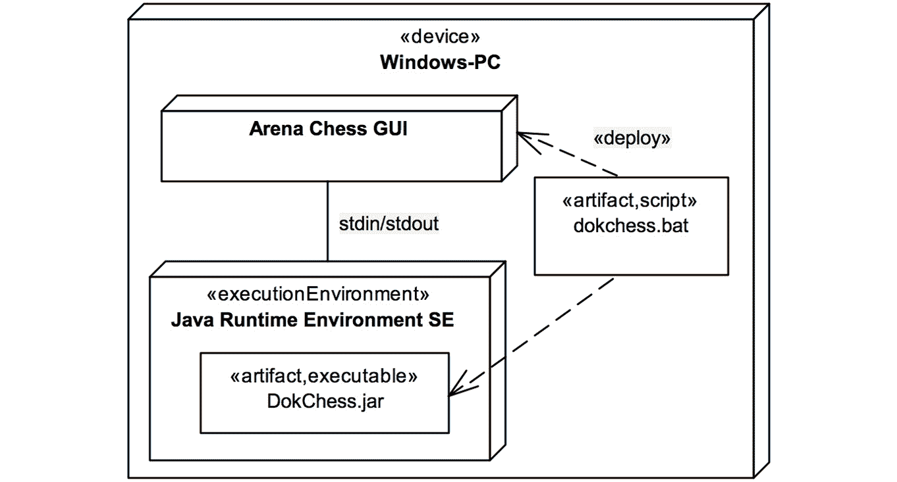
**图 5.31：在 Windows PC 上部署 DokChess**
PC 软件要求如下：
* Java Runtime Environment SE 7 或更高。
* JVM（`javaw.exe`）在路径中，否则调整 `dokchess.bat`。
* Arena（[`www.playwitharena.de`](http://www.playwitharena.de)）。
`DokChess.jar` 包含所有模块编译 Java 源代码及必要依赖（Uber-jar）。`dokchess.bat` 脚本启动 JVM 运行 DokChess。两者在同一目录，因 `dokchess.bat` 地址 JAR 文件。
在 Arena 中，脚本在菜单 `Engine` *|* `Install a new Engine` 声明。会显示文件选择。可限制为 `*.bat` 文件。然后将引擎类型设为 `WinBoard`。其他象棋前端声明引擎类似，详见对应文档。

## V.8 技术和横切概念
本节描述通用结构和系统范围方面。也介绍各种技术方案。

### 8.1 模块间依赖关系


DokChess 邀请开发者进行实验并扩展引擎（*V 1.2 质量目标*）。为此，模块松散耦合。DokChess 模块是 Java 接口的实现。需要部件的 Java 类通过适当的方法 `set"Module"("Interface" …)` 来表明这一点。它们不负责解析依赖，例如使用工厂。相反，客户端通过使用 `new` 创建合适的实现并通过 setter 方法将它们组合在一起，从而解析依赖，这也称为 **依赖注入**（**DI**）。

接口和 DI 使 DokChess 内部能够使用替代实现。借助装饰器模式（**Gamma+94**）添加功能也是可行的。此外，依赖于 Java 动态代理的 **面向方面编程**（**AOP**）解决方案也适用于接口。此外，这种依赖处理方式对可测试性有积极影响（参见 V 8.7，*概念 可测试性*）。

DokChess 避免使用具体的 DI 框架。模块在代码中是硬连线的，然而仅在单元测试和胶水代码中（例如 `main` 类）。代码中没有基于注解的配置。

这为有冒险精神的开发者提供了关于特定 DI 实现的自由选择。由于 Java 模块是纯 **普通的旧 Java 对象**（**POJOs**），没有任何东西阻止使用 Spring Framework 等进行配置，或用于 Java EE 平台的 **上下文和依赖注入**（**CDI**）。

### 8.2 国际象棋领域模型
"*国际象棋游戏由两位对手进行，他们在称为‘棋盘’的方格板上移动棋子。*" - *国际棋联象棋规则*

DokChess 的不同模块交换象棋特定数据。这包括棋盘上的游戏情况（位置），例如，以及对手和引擎的走法。所有接口都使用相同的领域对象作为 **调用** 和 **返回** 参数。

本节包含这些数据结构及其关系的简要概述。所有类和枚举类型（enums）都位于 `org.dokchess.domain` 包中。详情请参阅源文档（Javadoc）。

棋子以颜色（黑或白）和类型（王、后等）为特征。在 DokChess 领域模型中，棋子不知道自己在棋盘上的位置。`Piece` 类是不可变的，其他所有领域类也是如此：

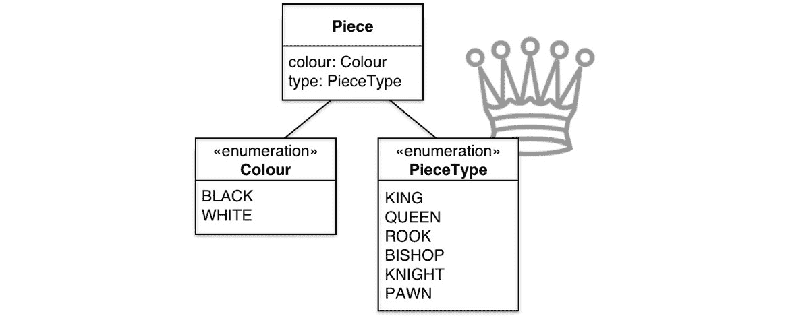

###### 图 5.32：棋子属性

棋盘由 *8 x 8* 个方格组成，这些方格排列成 8 行称为等级（1-8）和 8 列称为文件（a-h）。`Square` 类描述其中之一。由于一个方格只能被一个棋子占据，源方格和目标方格足以指定一个走法（`Move` 类）。唯一的例外是兵在对手底线的升变。在此，玩家决定要将兵转换为哪种棋子类型（通常，但不一定是皇后）。王车易位走法表示为国王在相应方向上移动两格。移动棋子的额外属性以及走法是否为吃子对引擎的分析任务很有用：

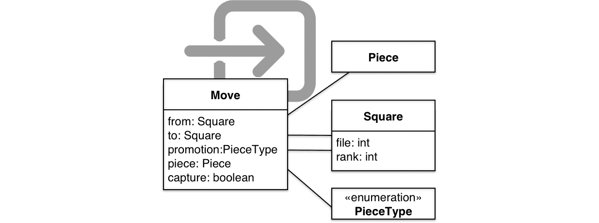

###### 图 5.33：从方格到方格的一步走法

`Position` 类描述棋盘上的当前情况。特别是棋盘上的棋子位置，内部表示为二维数组（**8 x 8**）。如果一个方格未被占据，则在数组中存储 `null`。为了完整描述游戏情况，`Position` 类包括关于接下来轮到哪一方走棋、哪些王车易位仍可能进行（如果有的话），以及是否允许吃过路兵的信息：

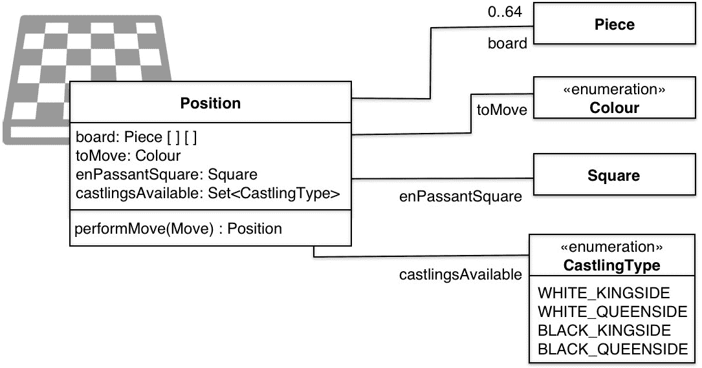

###### 图 5.34：一个位置描述了游戏状态

`Position` 类也是不可变的。因此，`performMove()` 方法返回一个具有修改后游戏情况的新位置（参见 V 9.2 *决策，位置对象是否可变？*）。

### 8.3 用户界面
DokChess 没有图形用户界面。它通过 XBoard 协议与外部世界交互（参见 V 9.1，*决策 引擎如何与外部世界通信？*）。

XBoard 协议基于文本。如果您已在命令行（Unix shell 或 Windows 命令提示符）中掌握了主要的 DokChess 命令，您就可以与引擎交互。下表显示了一个示例对话。所有命令均以新行结束。默认情况下，引擎执黑棋。您可以使用 XBoard 的 `white` 命令更改此设置：

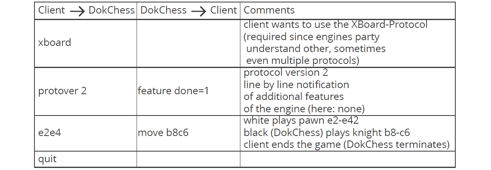

###### 图 5.35：DokChess 示例对话

**Mann+2009** ([`www.gnu.org/software/xboard/engine-intf.html`](https://www.gnu.org/software/xboard/engine-intf.html)) 详细描述了该协议。在 DokChess 中，Text UI 子系统负责协议实现（*参见 构建块视图，V 5.1.2，子系统 Text UI（黑盒）*）。

DokChess 更典型的用法是图形象棋前端，如 Arena（如下图所示）。它在舒适的界面中接受对手的走法，以 XBoard 命令的形式传递给 DokChess（如下表所示（**Client | DokChess** 列），并将答案（**DokChess | Client** 列）图形化显示：

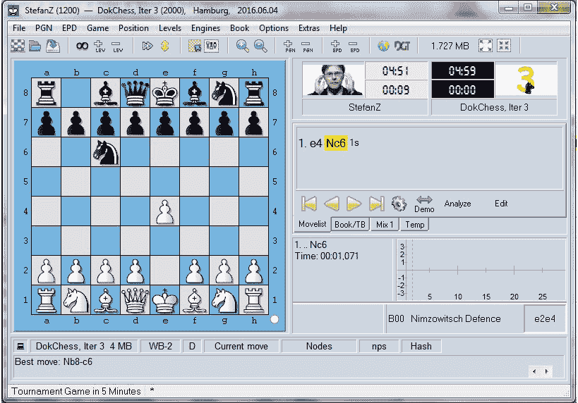

###### 图 5.36：DokChess 与 Windows 上的 Arena 象棋前端结合

### 8.4 合理性检查和验证
简单来说，DokChess 是一个算法。它用自己的走法回应对手的走法。输入验证涉及两个通道：
*   用于对手交互用户输入的 XBoard 协议
*   以文件形式开局库

通过 Xboard 协议传入的输入由相应子系统解析。在未知或未实现命令的情况下，DokChess 向客户端报告 Xboard `Error` 命令。

如果发出走法命令，DokChess 会检查规则子系统以查看该走法是否允许。在非法走法的情况下，DokChess 向客户端报告 `Illegal move` XBoard 命令。使用图形前端时，这不应该发生，因为这些前端通常只接受有效走法。此情况在通过命令行交互时可能相关（*参见 概念 V 8.3 用户界面*）。

通过 XBoard 协议传入的输入由相应子系统解析。对于未知或未实现的命令，DokChess 向客户端报告 `Error` XBoard 命令。在设置位置时，DokChess 检查是否符合协议，但不检查位置是否允许。在极端情况下（例如棋盘上没有王），引擎子系统在游戏过程中可能会引发错误。

对于开局库，DokChess 只检查是否可以打开和读取文件。如果失败（例如，`file not found`），它会引发异常（参见概念 *V.8.5 异常和错误处理*）。在读取文件时，开局子系统对已识别的问题作出运行时错误响应（例如，`invalid file format`）。然而，库本身的内容并未被检查。例如，如果为某个位置存储了无效走法，则不会被识别。用户负责库的质量（参见 *V 3.1 业务背景*）。在极端情况下，引擎可能会作出非法走法。

### 8.5 异常和错误处理
DokChess 没有自己的用户界面。因此，它必须向外部世界指示问题。


All DokChess subsystem methods throw runtime exceptions. In addition, *引擎子系统错误消息* (`onError`) may occur during an asynchronous search. Your own extensions (for example, a custom search) must be implemented accordingly. Checked exceptions (for example, `java.io.IOException`) need to be wrapped in runtime exceptions.

The Javadoc of methods and constructors in question shows the rare cases where exceptions are expected in DokChess, such as difficulty with reading or opening a book file, or when trying move calculations within the engine at an invalid position (if identified). All other exceptions would be programming errors (please report them at [`github.com/DokChess/`](https://github.com/DokChess/)).

The XBoard subsystem catches all exceptions and communicates them via the XBoard protocol outwards (using the `tellusererror` command). A graphical frontend usually visualizes them in an error dialog or alert box. The following screenshot depicts that for the Arena chess frontend:

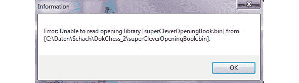
*图 5.37：Arena 中的错误对话框*

DokChess continues to work normally. The client decides whether proceeding in this specific situation makes sense. For example, it could continue to play without an opening book.

## 8.6 日志记录与追踪
For improvements and extensions, the analysis capabilities provided by DokChess are of note, particularly in case of an error.

The DokChess functionality can be checked easily with unit tests. This is particularly true for the correct implementation of the game rules and for the gameplay of the engine (refer V 8.7, *可测试性*). It holds true for your own extensions in this area as well.

Therefore, there is no fine-grained logging output within DokChess. Solutions such as SLF4J ([`www.slf4j.org`](https://www.slf4j.org)) are not present. In this way, we avoid dependency on an external library, and the source code is not polluted by this aspect at all.

For communication between the client and DokChess via the XBoard protocol, in addition to interactive operations via a shell (refer, Concept *V 8.3 用户界面*), the client may monitor the conversation. Common chess frontends permit this by writing log files and/or a simultaneous display of a log window during the game. The following screenshot shows this functionality within Arena:

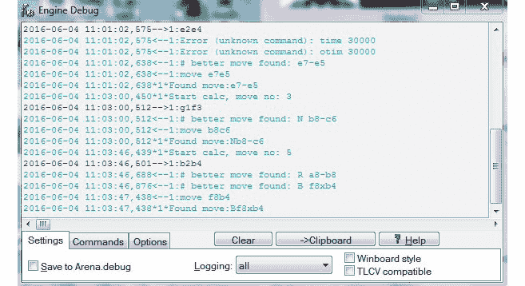
*图 5.38：Arena 中 XBoard 协议的日志和调试窗口*

If the engine blocks and it is unclear what went on the XBoard protocol, such tools are simply invaluable. Due to the availability of this feature, communication protocol tracing was not implemented within DokChess at all.

## 8.7 可测试性
Nothing is more embarrassing for an engine than an illegal move.

The functionality of the individual modules of DokChess is ensured by extensive unit tests. You find a `src/test` folder next to `src/main`, where the Java source code of the modules is stored. It mirrors the package structure, and in the corresponding packages, unit tests for the classes are implemented with JUnit 4 ([`junit.org/junit4/`](https://junit.org/junit4/)).

Standard unit testing, which examines individual classes, is named after the class itself with the suffix `Test`. In addition, there are tests that examine the interaction of modules, and in extreme cases, the whole system. With the help of such tests, the correct playing of DokChess is ensured. More complex, long-running integration tests are in `src/integTest`. This includes playing entire games.

In many tests, positions must be provided as call parameters. Here, the **Forsyth-Edwards 记法** (**FEN**) is used. This notation allows the specification of a complete game scenario as a compact string without a line break and is therefore perfect for use in automated tests.

The starting position in FEN is as follows:

```
rnbqkbnr/pppppppp/8/8/8/8/PPPPPPPP/RNBQKBNR w KQkq - 0 1
```

Lowercase letters stand for black pieces, and uppercase letters stand for white pieces. For the piece types, the initials of the English names (r for rook, p for pawn, and so on) are used:

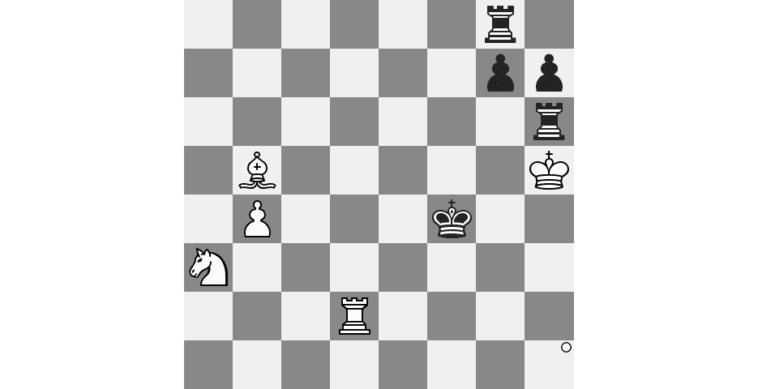
*图 5.39：示例局面*

The game situation in the preceding diagram, with white before its 79th move, with 30 half-moves long no piece was captured and no pawn was moved, looks like this in FEN:

```
6r1/6pp/7r/1B5K/1P3k2/N7/3R4/8 w - - 30 79
```

And it reads 6 squares free, black rook, square free, new rank ….

Details about the notation can be found on Wikipedia at [`en.wikipedia.org/wiki/Forsyth–Edwards_Notation`](https://en.wikipedia.org/wiki/Forsyth-Edwards_Notation). The `Position` class has a constructor that accepts a string in FEN. The `toString()` method of this class also provides FEN.

## V.9 设计决策
This section enables you to understand two fundamental design decisions of DokChess in detail.

### 9.1 引擎如何与外部世界通信？
#### 问题背景
As a central requirement, DokChess must work together with existing chess frontends. How do we connect them?

A whole series of graphical user interfaces are available for playing against chess programs. Moreover, there are software solutions with a larger scope for chess enthusiasts. In addition to the game *Human vs. Machine*, they offer more functionality, such as analyzing games. Over time, new chess programs will be released – and others will possibly disappear from the market.

Depending on how the connection with such programs is realized, DokChess can or cannot communicate with specific frontend clients. Thus, the issue affects DokChess' interoperability with existing chess software and its adaptability to future chess software.

#### 决策影响因素
#### 约束条件
The following are the constraints that influence the decisions for designing:
* Operation of the frontend at least on Windows desktop operating systems
* Support for freely available frontends
* Favoring established (chess) standards (see V 2.3 *惯例*)

#### 显著受影响的质量属性
* Using existing frontends (see V 1.2 *互操作性*, *质量目标*)
* Platform appealing to experiments (see V 1.2 *可变性*, *质量目标*)
* Adaptability to future chess software

#### 受影响的风险
Connecting to a frontend is a considerable risk (see V 11.1 *风险*).

#### 假设
The investigation of just a few available frontends leads to all interesting integration options.

#### 考虑的替代方案
In early 2011, the following chess frontends were investigated:
* Arena Chess GUI (available for free, runs on Windows)
* Fritz for Fun (commercially provided by ChessBase GmbH, runs on Windows)
* WinBoard/XBoard (Open source, runs on Windows, Mac OS X, *nix)

As a result, two communication protocols have been identified as options:
* **选项 1**: UCI Protocol (**通用棋类接口**), see *MeyerKahlen2004*
* **选项 2**: XBoard protocol (also known as Winboard and as Chess Engine Communication Protocol), see *Mann+2009*

Neither of the two protocols are formally specified, but both are publicly documented. Both protocols are text-based, and communication between the frontend and the engine is via stdin/stdout. In both cases, the frontend starts the engine in a separate process.

The following table compares the three investigated frontends to their implemented protocols:


*图 5.40：前端比较*

#### 决策
Under the given constraints, the quality goals can generally be achieved with both options. Depending on which protocol is implemented, different frontends are supported.


The decision in favor of the `XBoard` protocol was made in early 2011. The structure of `DokChess` allows us to add alternative communication protocols (`UCI` or other) without having to change the engine itself. See dependencies in the building block view (refer V 5.1, *构建块视图，级别 1*).

The preferred frontend for Windows is `Arena`. It is freely available and excels the functionality of `WinBoard`. It has good debugging facilities. For example, it can present the communication between the frontend and the engine live in a window. `Arena` supports both protocols.

By opting for the `XBoard` protocol, other operating systems (in addition to Windows, especially Mac OS X and Linux) are also supported with freely available frontends (see the preceding table). As such, a larger circle of interested developers may use the engine, which was finally essential.

## 9.2 位置对象是否可变？

### 问题背景

For various `DokChess` modules, game situations on the chessboard (so-called positions) must be provided and exchanged between them. Do we make the associated data structure changeable or unchangeable (immutable)?

During a game, the position changes when the opposing players move their pieces. In addition, the engine performs possible moves in its analysis, tries to counter the moves of the opponent, evaluates the outcoming positions, and then discards moves. The result is a tree that contains many thousands of different positions, depending on the search depth.

Depending on whether the position is immutable as a data structure or not, algorithms are easier or more difficult to implement, and its execution is efficient in a different way.

All modules depend on the `Position` interface. A subsequent change would affect all of `DokChess`.

### 决策的影响因素

#### 约束
* 在 Java 中实现 ( refer V 2.1 *技术约束*)
* 适中的硬件设备 (refer V 2.1 *技术约束*)

#### 显著受影响的质量属性
* 对实验具有吸引力的平台（可变性，refer to V 1.2 *质量目标*)
* 可接受的对弈强度（吸引力，refer to V 1.2 *质量目标*)
* 对对手走法的快速响应（效率，refer to V 1.2 *质量目标*）

#### 受影响的风险
* 实施工作量（see V 11.2 *风险*）
* 达到对弈强度（see V 11.3 *风险*）

#### 假设
* 可以实现一个具有细粒度对象模型（即 `Piece` 和 `Move` 等类）的数据结构，其效率足以在适当的响应时间内提供所需的对弈强度。
* 未来，还应使用该数据结构实现并发算法。

### 考虑的替代方案

The starting point is domain-driven classes for `square`, `piece`, and `move` (refer V 8.2, *国际象棋领域模型*). These classes are realized immutable as value objects (the `e4` field always remains `e4` after its construction).

For the `Position`, two alternatives are considered:
* **选项（1）：位置可变**：接口的各个方法，例如执行走法或撤回走法，会改变对象状态。

*选项 1 的伪代码如下：*
```
Position p = new Position(); // starting position, white side to move
p.performMove(e2e4); // king's pawn advances two squares, black to move
p.takeBackLastMove(); // starting position again
```
* **选项（2）：位置不可变（不可变）**：这意味着执行走法的方法会提供新的位置（它复制旧位置，然后进行走法）作为另一个不可变对象作为结果。

*选项 2 的伪代码如下：*
```
Position p = new Position();
newPosition = p.performMove(e2e4); // p keeps unchanged
```

The following table summarizes the strengths and weaknesses of the two options:

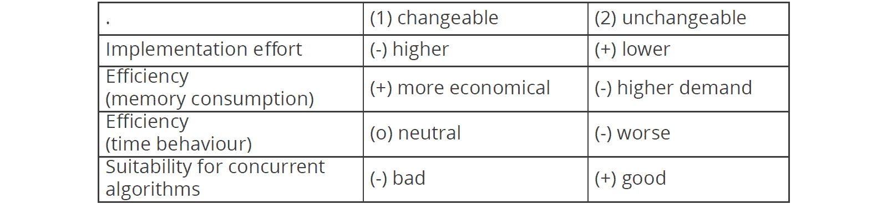
###### 图 5.41：优势与劣势

### 选项（1）：位置可变

*(+) 积极论点*

The position with its extensive state is not copied in each move. This saves memory and CPU time, and it treats the garbage collector with care. For analysis algorithms, however, it is necessary to implement functionality that takes back the effect of moves (undo). This `Undo` also takes time, hence the neutral rating for the time behavior.

*(-) 消极论点*

The implementation of an `Undo` functionality is complex. Not only does it have to set up captured pieces back on the board, the castling rule and en passant require special treatment as well. The `Gamma+94` command pattern suggests itself as an option. The use of that pattern within algorithms is also more complex because the latter must explicitly call methods to take back the moves.

Finally, changeable state has drawbacks related to concurrency.

### 选项（2）：位置不可变

*(+) 积极论点*

When you perform a move, the position is copied. It does not change the original position. This eliminates the implementation of move reversal (`Undo`). Clients can simply store the old position as a value. This saves effort in the implementation compared to option (1).

Immutable objects offer significant advantages in concurrent algorithms.

*(-) 消极论点*

Copying the state for each new position takes time. When analyzing situations, it covers many positions, which can take a lot of time.

Beyond that, copying the state for each new position costs memory. The implementation of search algorithms with backtracking at least prevents complete game trees from ending up on the heap. Nevertheless, more memory is required, and the garbage collector has more work to do.

Both points have a negative effect on efficiency.

### 决策

The decision for the unchangeable position (option 2) was made in early 2011 due to the advantages in terms of ease of implementation and the prospect of exploiting concurrency. All the disadvantages of option 2 are related to efficiency.

Due to the risk of failing to achieve the objectives with respect to the playing strength in an acceptable computing time (attractiveness, efficiency), prototypes of both versions have been implemented and compared in a mate search (checkmate in three moves) with the `minimax` algorithm. With option 2, the search took 30% longer, assuming you implement copying efficiently. But this option met the constraints as well.

Further optimization options could reduce the efficiency disadvantage compared with option 1, if necessary. But they have not been implemented in the first run in order to keep the implementation simple.

These options included the use of multiple processors/cores with concurrent algorithms. In the meantime (with `DokChess` 2.0), this was illustrated with a parallel `minimax` example.

## V.10 质量场景

The quality scenarios in this section depict the fundamental quality goals of `DokChess` as well as other required quality properties. They allow the evaluation of decision alternatives.

### 10.1 效用树

The following diagram gives an overview of the relevant quality attributes and their associated scenarios:

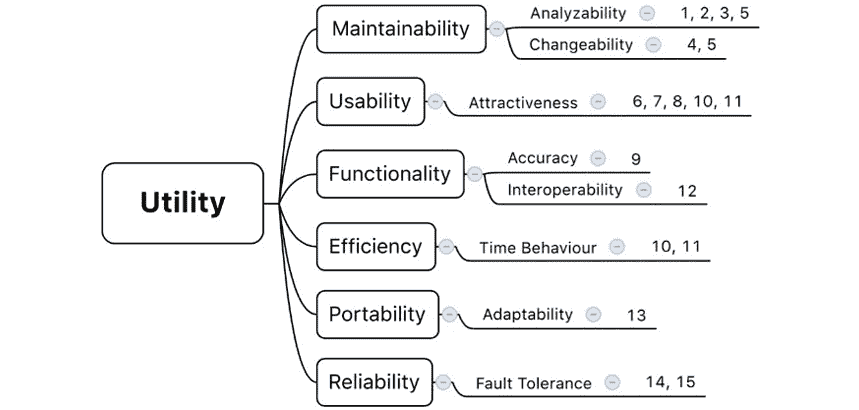
###### 图 5.42：效用树

### 10.2 评估场景

The evaluation scenarios can be listed as follows:
1. A person with basic knowledge of UML and chess looks for an introduction to the `DokChess` architecture. They get the idea of the solution strategy and the essential design within 15 minutes.
2. An architect wishes to apply `arc42` searches to a concrete example for an arbitrary section of the template. They find the relevant content immediately in the documentation.
3. An experienced Java developer searches for the implementation of a module described in the design. They find it in the source code without detours or help from others.


## 质量场景

4. 开发人员实现了一个新的位置评估。他们将其集成到现有策略中，无需修改且无需重新编译现有源代码。
5. 开发人员实现了游戏情况的基于棋子的位棋盘表示。工作量（包括替换现有的基于方格的表示）低于一人周。
6. 弱玩家正在与引擎对弈。玩家将棋子移动到未受保护的位置，该位置正被引擎攻击。引擎随后吃掉被丢弃的棋子。
7. 在一盘棋比赛中，引擎出现两步将杀。引擎安全地走棋以赢得比赛。
8. 在一盘棋比赛中，引擎出现马叉以夺取王后或车。引擎以马换取王后（或车）。
9. 在游戏情况下，引擎有一种或多种符合规则的走法可供选择。它下其中一种。
10. 在游戏过程中，引擎在 5 秒内用自己的走法回应对手的走法。
11. 集成在图形前端中的引擎执黑，人类玩家先行。引擎在 10 秒内作出首步走法，且用户在 5 秒内收到引擎“思考中”的消息。
12. 用户计划使用 DokChess 与一个支持解决方案已实现的通信协议的前端。集成不需要任何编程工作。与前端的配置在 10 分钟内完成并测试。
13. 一名 Java 程序员计划使用允许集成引擎的象棋前端，但不支持 DokChess 实现的任何协议。新协议可以在不更改现有代码的情况下实现，然后引擎可以像往常一样集成。
14. 在游戏过程中，引擎收到一个无效走法。引擎拒绝该走法，之后允许输入另一走法，并以无错误的方式继续进行。
15. 引擎接收到一个非法起始位置。引擎的行为未定义，允许取消游戏，也允许无效走法。

## V.11 风险

以下风险在项目开始时（2010 年 12 月）被识别。它们显著影响了前三次迭代的规划。自第三次迭代完成以来，风险已得到控制。本架构概述展示了风险，包括之前的应急规划，因为它们对解决方案影响很大。

### 11.1 风险：连接到前端

关于如何将引擎连接到现有象棋前端没有任何知识。现有的开源引擎是用 C 编写的，并作为可执行程序 `*.exe` 提供。由于 DokChess 使用 Java 开发，它们作为示例的用途有限。项目中对象棋通信协议一无所知。
如果无法建立工作连接，解决方案就无法与现有前端一起使用。这不仅缺少一个重要功能（参见 V.1.1 需求概述），而且使整个解决方案，尤其是作为案例研究时，变得不可信。

**应急规划**
可以实现一个简单的文本用户界面以便与引擎交互。实现 DokChess 专用的图形前端将成本高昂（参见风险 V.11.2 实现工作量）。

**风险最小化**
通过早期概念验证，这里能够尽快获得确定性。

### 11.2 风险：实现工作量

没有象棋编程经验。同时，完全要实现的规定（参见 V1.1 *需求* *概述*）非常广泛且复杂。不同棋子的移动方式不同，还有诸如逼和和升变等特殊规则。在王车易位和吃过路兵的情况下，走法历史，而不仅仅是棋盘上的当前情况，是相关的。
算法的编程也并非微不足道。连接开局库和残局数据库需要大量研究。
DokChess 的实现作为业余爱好在业余时间进行。尚不清楚这是否足以在计划时间内呈现雄心勃勃的结果（参见 V 2.2 *约束*）。

**应急规划**
如果在 2011 年 3 月和 9 月的会议期间没有可运行的版本，可以省略现场演示。3 月在 oose 的免费晚间演讲甚至可以完全取消（这可能会对声誉产生负面影响）。

**风险最小化**
为减少工作量，起初不实现以下规则：
* 50 步规则
* 三重重复
它们的缺失对弈力影响不大，对引擎的正确性也没有影响。
连接开局库和残局数据库的优先级较低，起初放在次要位置。

### 11.3 风险：达到弈力

质量目标要求既有可接受的弈力，又有简单易用的解决方案。此外，对效率也有要求。尚不确定计划中的 Java 解决方案（具有面向对象的领域模型和简单的走法选择）能否实现这些相互竞争的目标。

**应急规划**
在会议演讲中，可以省略现场演示的部分内容。如有必要，我们可以展示之前下过的棋局。

**风险最小化**
合适的场景（例如，参见 V.10 *质量* *场景*）具体化质量目标。在象棋文献（准确地说是象棋问题）的帮助下，我们开发测试用例（单元测试），以指定可以期望的弈力。因此至少我们可以及早发现引擎的水平。

## V.12 术语表

“象棋游戏由两位对手进行，他们在称为棋盘的方格板上移动棋子。”
来自 *国际棋联象棋规则*
以下术语表包含英语象棋术语和计算机象棋领域的术语。其中一些超出了不常玩或休闲象棋玩家的词汇范围。
有关更多信息，请参阅 *国际棋联象棋规则 或 Wikipedia 象棋术语表。*
棋子的名称如下图所示：
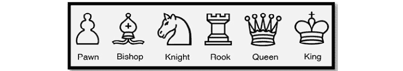
###### 图 5.43：棋子（或棋具）
棋盘几何形状可以表述如下：
"*棋盘由 8 x 8 的网格组成，共 64 个相等的方格，交替为浅色（‘白’方格）和深色（‘黑’方格）。*"
*来自国际棋联象棋规则*
下图描绘了棋盘：
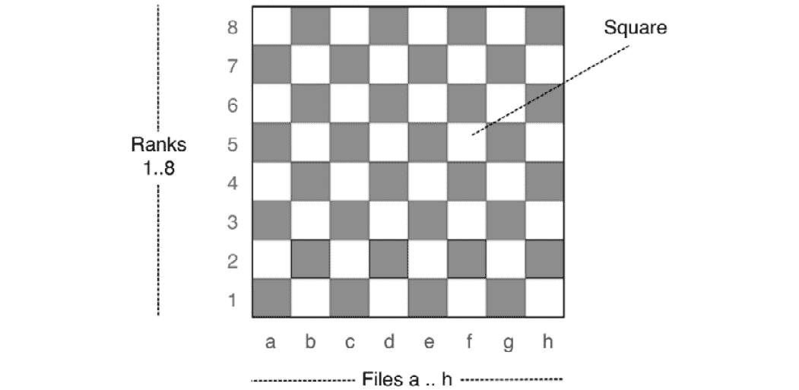
###### 图 5.44：棋盘
下表描述了象棋中的不同术语：
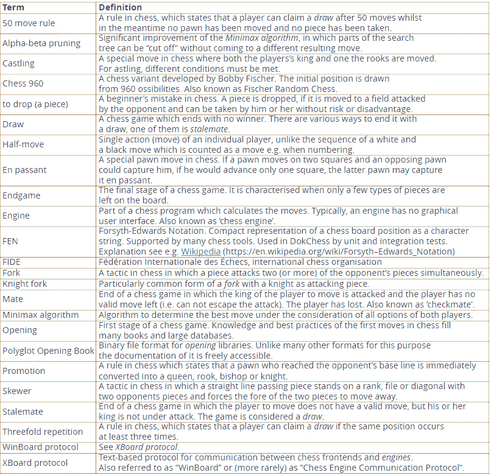
###### 图 5.45：象棋术语
