# 第 6 章

## VI - docToolchain

由 **Ralf D. Müller**

`docToolchain` ([`doctoolchain.github.io/docToolchain/`](https://doctoolchain.github.io/docToolchain/)) 最初作为 `arc42-generator` 开始；即一个 `Gradle` 构建，将 arc42 模板从 `AsciiDoc` 转换为各种其他格式，例如 Word、HTML、EPUB 和 Confluence。
在使用 AsciiDoc 的过程中，我想出了一些其他的小脚本任务，它们帮助了我的工作流程。这些被添加到原始的 arc42-generator 中，并演变成我现在称之为 "docToolchain" 的东西。
`docToolchain` 的目标是为你作为技术作者提供一些重复转换任务的支持，并使你更容易实现有时相当复杂的 **Docs-as-Code** 方法。
我从它实现了一个文档工具链这一事实中得出了名称 "docToolchain"。几个工具，例如 `Asciidoctor`、`Pandoc` 和 `Microsoft Visio`（仅举几例），通过 `Gradle` 粘合在一起，形成一个链（或流程），满足你所有的文档需求。


以下章节描述了 docToolchain 的架构。整个项目及其剩余文档托管在 GitHub 上，网址为 [`doctoolchain.github.io/docToolchain/`](https://doctoolchain.github.io/docToolchain/)。

## VI.1 简介和目标

将 `arc42` 解决方案架构以不同格式交付的需求是 docToolchain 诞生的主要驱动力。作为一名技术人员，我看到了基于文本的文档的价值。然而，其他利益相关者希望文档：
*   *"其他所有文档所在之处"*—在 wiki 中
*   *"我们一直以来文档化的方式"*—使用 MS Word
*   *"以可修订安全格式"*—作为 PDF

不久，在满足这些需求后，我注意到更新变化的 UML 图表相当困难。“这不能自动化吗？”，我自问并创建了 `exportEA` 任务作为一个简单的 Visual Basic 脚本。

我并没有在绘图板上规划 docToolchain。相反，它以敏捷的方式演进；也就是说，通过用户的需求。

与 Dr. Gernot Starke 一起，我就这种方法做了演讲，并从观众那里收到了一些有趣的反馈，例如 *"…但我不使用 Enterprise Architect——我也可以使用 MS Visio 吗？"*

我的回答大致如下：
*"不，目前不行。但 docToolchain 不仅仅是一个工具。我希望它成为一种理念——一种思维方式的改变。如果 EA 可以轻松自动化，我相信 Visio 也可以被自动化！"*

我没有预料到的是，在我做出此陈述的几天后，我们收到了带有 `exportVisio` 任务的 pull request！

以这种方式，docToolchain 通过其用户的需求和想象力演进。

### 1.1 问题陈述

下图描述了 docToolchain 需要解决的问题：

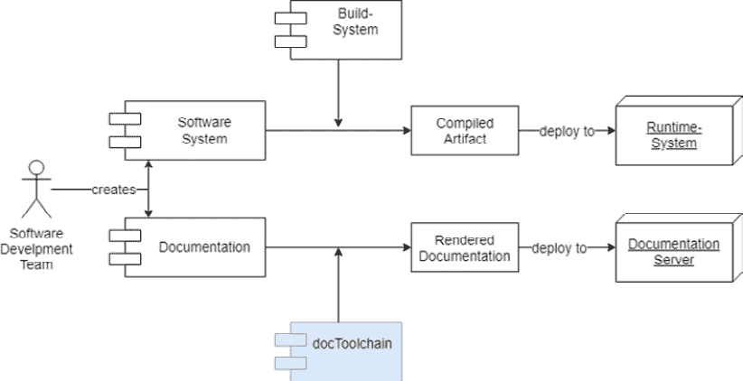

*图 6.1：问题陈述机制*

当软件开发团队创建软件系统时，会使用构建系统创建编译后的构件，然后部署到运行时系统（参见 `Figure 6.1`）。

你可以将同样的方法应用于你的文档。这称为 `Docs-as-Code` 方法；也就是说，你像对待代码一样对待你的文档。为此，你需要多个辅助脚本来自动化构建文档的重复任务；为每个项目从头开始设置这些任务是浪费时间。

docToolchain——本文件中描述的系统——通过提供一套可以轻松安装的构建脚本来解决此问题。它们为你提供了一组任务来解决标准的 `Docs-as-Code` 需求。

功能需求主要分为两类：
*   从专有文件格式导出内容以在 AsciiDoc 中使用
*   生成或转换不同的输出格式

这些随后被转化为架构需求：

`RQ1`: 构建系统集成

系统应易于集成到标准软件构建中，以便像对待代码一样对待文档。

`RQ2`: 易于修改和扩展

docToolchain 应易于修改和扩展。

文档工具链有很多不同的功能需求——每个用户都应能够根据自己的需求进行调整。

`RQ3`: 企业就绪

项目应在不同的企业环境中运行。它必须与不同的版本控制系统一起运行，并且无需直接访问互联网（例如，仅通过代理进行依赖解析）。

文档不仅对开源项目至关重要，对企业项目也至关重要。

`RQ4`: 操作系统无关

工具链应在 Windows、Linux 和 macOS 上运行。

这使开发人员能够在自己选择的 operating system 上使用 docToolchain。

`RQ5`: Maven 和 Gradle

工具链应可用于两个主要的构建系统，Maven 和 Gradle。

这确保大多数基于 JVM 的项目可以使用它。

#### 注

`RQ5` 目前已被放弃（仅实现了 Gradle）——请参阅 DD3：对 Maven 和 Gradle 的支持。通过混合构建的变通方法可用。

`RQ6`: 克隆、构建、测试并运行

项目应设置成在你克隆仓库后即可运行。

这是为了避免使用它或更改项目代码所需的特殊设置。

### 1.2 质量目标

主要的质量目标如下：
*   `QS1`: 保密性：此质量目标不是 docToolchain 特有的，但在安全方面非常重要。
由于系统不仅针对开源环境，还针对企业环境，我们需要确保在用户不知情的情况下不会将任何数据发送到第三方系统。例如，有许多基于服务器的文本分析工具和库会将待分析的文本发送到第三方服务器。像这样的工具和库不得使用。
*   `QS2`: 易用性：docToolchain 项目仍是一个年轻的开源项目，因此需要一个稳定且不断增长的用户群。实现这一目标最简单的方法是使 docToolchain 极易使用。
*   `QS3`: 可维护性：docToolchain 背后没有大公司——只有在业余时间推动其发展的用户。因此，开发人员应在 1 到 3 小时的时限内完成大部分使 docToolchain 发展的更改。

### 1.3 利益相关者

`OSS Contributors`: `OSS Contributors` ([`github.com/docToolchain/docToolchain/graphs/contributors`](https://github.com/docToolchain/docToolchain/graphs/contributors)) 需要了解架构，以便遵循决策并在正确的方向上发展系统。

贡献者大多是系统的用户，他们需要将 docToolchain 任务适配到自己的需求或需要额外的任务。

*   `General docToolchain users`: 这些主要是具有开发背景的软件架构师和技术作家。很可能 docToolchain 用户也会使用 `arc42` 并且熟悉它。
当前重点是那些在企业环境中工作的软件架构师用户，他们使用 JVM、Git 和 Gradle。
这些用户需要在文档中包含架构图，并在受限环境中工作（例如使用代理、在本地 Maven 仓库中、互联网访问受限等）。
他们还需要能够为不同的利益相关者创建不同的输出格式。
*   `Users not working with the JVM`: docToolchain 也引起了那些不主要在 JVM 上工作的用户的注意。这些用户需要像使用任何其他命令行工具一样使用 docToolchain。
*   `Readers`: 文档的主要目的是被需要特定信息的人阅读。

## VI.2 架构约束

以下是各种架构约束：
*   `C1`: 在任何地方运行：docToolchain 必须在用户开发所需的现代操作系统上运行，例如 Windows、Linux 和 macOS。
*   `C2`: 为 JVM 构建：docToolchain 为 JVM 构建。虽然提供的一些功能可能也与其他环境一起工作，但不能保证所有任务都如此。
*   `C3`: 企业就绪：docToolchain 必须在受限的企业环境中运行。它必须使用代理、最小依赖、受限的互联网访问等运行。
这也列为需求 `RQ3`。
*   `C4`: 无头：docToolchain 必须无头运行；也就是说，无需显示即可在构建服务器上运行。必须避免用户交互和 Windows 功能。

## VI.3 系统范围和上下文

本章描述了 docToolchain 设计的各种上下文，包括其功能范围。

### 业务上下文

下图显示了 docToolchain 运行的业务上下文：


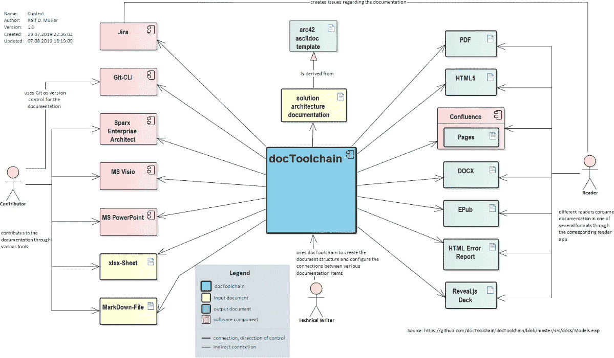

#### 图 6.2：业务上下文

前面的图表在来自 `docToolchain` 的连接方面是正确的；然而，两个参与者 `Contributor` 和 `Reader` 之间的关系是抽象的。

这些参与者代表为文档做出贡献或访问文档的用户。图中显示的参与者与邻近系统之间的连接是抽象的，因为这些用户不会直接访问文件。此外，他们可能使用不同的应用程序来阅读和修改内容。

`docToolchain` 本身使用所示的确切应用程序，或直接读取和修改文件。

它直接以文件内容的形式创建输出文档。注意，仅对于 Confluence，才使用 `Confluence API`，因此使用 `Confluence as a System`。

为了读取输入文档，`docToolchain` 通常需要一个可以远程控制以转换和读取它们的应用程序。然而，它可以直接读取 `XLSX` 和 `Markdown` 文件。

参与者代表角色。每个用户都可以通过所有这些角色访问系统。每个用户很可能有一个主要角色。

`Reader` 和 `Contributor` 角色与 `docToolchain` 没有直接连接。他们可能通过与 `docToolchain` 用于访问内容不同的应用程序来阅读和修改内容。下面的表格描述了 `docToolchain` 中的重要实体。

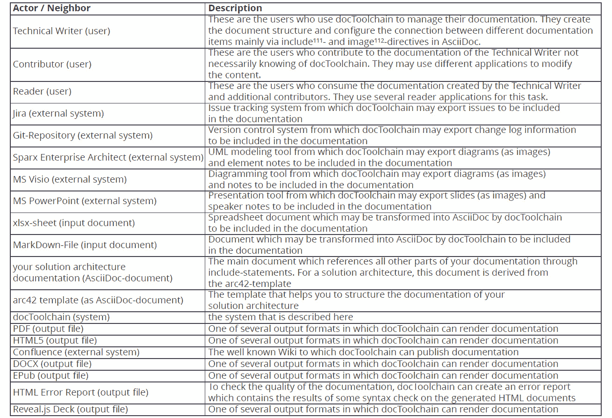

#### 图 6.3：docToolchain 的参与者

### 技术上下文

本节描述了前表中列出的组件的技术接口：

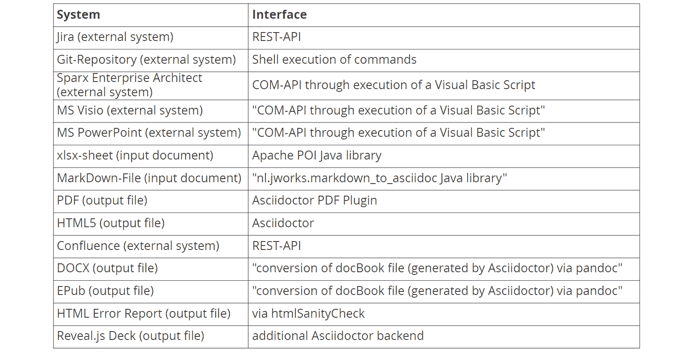

#### 图 6.4：技术接口的描述

### 范围

本节解释了 `docToolchain` 的范围；例如，`docToolchain` 负责哪些类型的任务，以及不负责哪些任务。

`docToolchain` 可以描述如下：
* 它是一组用于使创建和维护文档更轻松的任务。
* 它尽可能将任务委托给其他可用工具。

`docToolchain` *不* 执行以下操作：
* 重新实现其他可用工具的任务
* 修改手动创建的内容
* 提供生成的內容并且不是文档的构建服务器

## VI.4 解决方案策略

本章描述了我们过去解决问题所使用的策略以及未来将如何处理问题。

### 通用解决方案策略

初始的 `docToolchain` 任务源自从命令行执行的独立脚本。下一步的逻辑步骤是将它们纳入构建系统。

在 `Gradle` 中，将基于 `Groovy` 的脚本作为新任务包含进去相对简单：

```
task newTask (
    description: 'just a demo',
    group: 'docToolchain'
)   {
    doLast {
        // here you can put any Groovy script
    }
}
```

原始的 `build.gradle` 不久就变成了一个巨大的单个文件。为了使其更模块化，我们将其拆分为所谓的 `script-plugins` (https://docs.gradle.org/current/userguide/plugins.html#sec:script_plugins)。你将属于一起的任务提取到额外的 `.gradle` 文件中（对于 `docToolchain`，你会在 `/scripts` 文件夹中找到这些文件），并从主 `build.gradle` 中引用它们：

`apply from: 'script/exportEA.gradle'`

为了让 `docToolchain` 更易于使用，一个建议是将这些脚本插件迁移到二进制插件。这些插件引用存储库中的预编译 `.jar` 文件，而不是下载的脚本。

### 个别解决方案策略

个别任务的解决方案策略可以分为两大类任务。

### 导出任务

这些是导出其他工具中的图表和纯文本的任务。所有工具都不同，因此大多数都需要单独的解决方案策略。

这些工具通常以专有的二进制数据格式保存其数据，这不利于版本控制。

导出任务的解决方案策略是首先尝试直接读取文件格式以导出数据。 `exportExcel` 任务就是一个很好的例子，它使用 Apache POI 库（[`poi.apache.org/`](https://poi.apache.org/)）直接访问文件。此解决方案使任务独立于 `MS Excel` 本身。

然而，有些工具的文件格式无法直接读取，或者工作量太大。在这些情况下，解决方案策略是自动化工具本身。 `exportEA` 任务就是一个很好的例子，其中任务以不可见、无头模式启动 `Enterprise Architect` (`EA`)，并通过 `COM` 接口导出所有图表和注释。缺点是此任务只能在 Windows 系统上运行。它也可能很慢，而且虽然 Enterprise Architect 是不可见的，但它仍然占用输入焦点，因此在导出期间无法使用机器。然而，除了这些缺点之外，自动化仍然很有价值。

`docToolchain` 可以导出数据的第三种工具包括基于 Web 的工具，例如 `Atlassian Jira`。这里的明显解决方案是使用可用的 `REST API` 进行导出。还有一个封装 `REST API` 的 `Java API`；然而，直接使用 `REST API` 更受青睐。

### 导出制品的版本控制

大多数导出任务速度相当慢；也就是说，慢到你不希望每次生成文档时都运行它们。此外，其中一些导出（如 `exportEA`）无法在基于 Linux 的构建服务器上运行。因此，一般策略是将导出的制品置于版本控制之下。任务会创建 *特殊* 文件夹，其中放置——在导出数据中——一个 `README.adoc` 文件，警告用户文件夹中的文件将在下一次导出时被覆盖。

起初，将导出或生成的制品置于版本控制之下可能听起来很奇怪，但你确实会获得额外的好处。与其专有的源文件相比，导出的文件可以轻松比较和审查！

当软件系统具有更长的生命周期时，可能会出现某些输入系统过时的情况。这可能导致源文件无法读取。在这些情况下，版本控制的制品也可能非常有用，因为它们采用易于阅读的纯文本或图像格式。

### 生成任务

这些是根据源生成不同输出格式的任务。

对于这些任务，一般的解决方案策略应该是将其实现为额外的 `Asciidoctor` 后端（如 `reveal.js` 所做的那样），或至少作为插件（如 `PDF` 插件所做的那样）。然而，由于缺少文档，创建 `Asciidoctor` 后端所需的工作量相当大。

因此，我们使用另外两种解决方案方法：
* 从另一个已有的格式转换（`HTML` >> `Confluence`）
* 通过 `Pandoc` 转换（`Docx`、`EPUB`）

## VI.5 构建块视图

以下为构建块的不同级别：

### 5.1 第一层

下图显示了第一层的构建块：

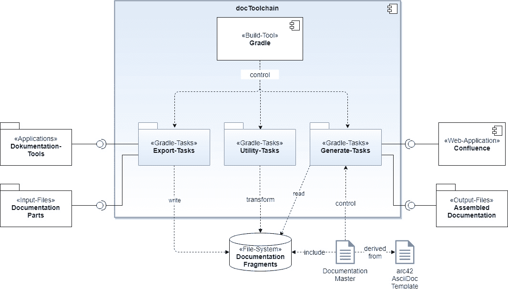

#### 图 6.5：第一层构建块

下表描述了第一层构建块的不同组件：

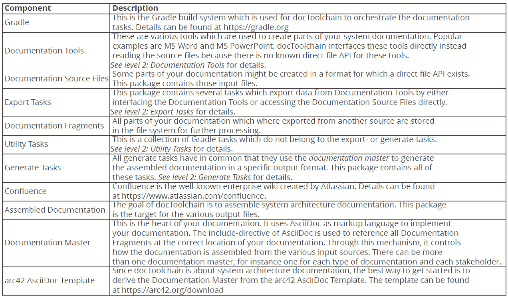

#### 图 6.6：第一层构建块组件的描述

### 5.2 第二层

以下为构建块第二层包含的不同类型的任务。

#### 5.2.1 导出任务

下图描绘了第二层构建块的导出任务块：

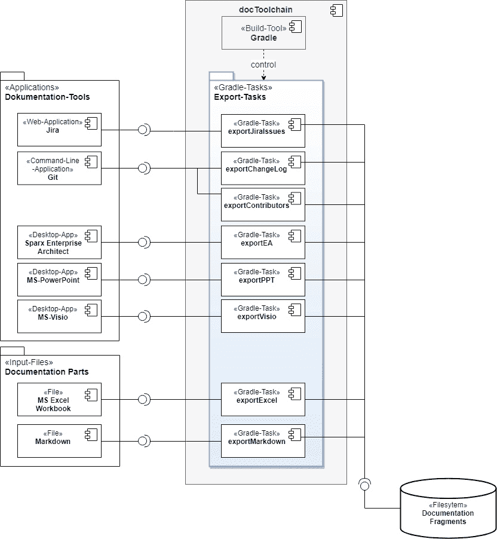

#### 图 6.7：第二层构建块中的导出任务

### 文档工具和导出任务


These are the tools that docToolchain is able to export documentation fragments from. Each tool is interfaced with at least one export task through a specific interface:

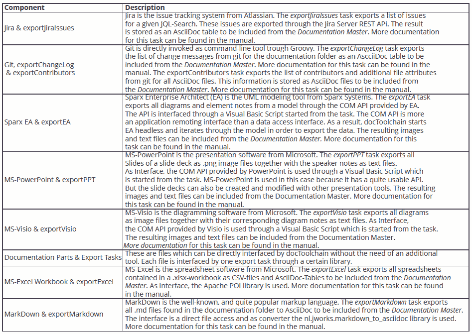

*Figure 6.8: Description of export tasks components*

### Utility Tasks

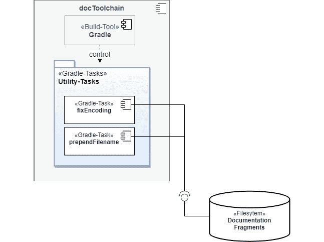

*Figure 6.9: Utility tasks in building blocks view*

These are tasks that might be helpful in certain situations but do not directly belong to the scope of docToolchain:

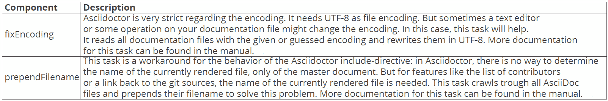

*Figure 6.10: Description of utility components*

### 5.2.4 Generate Tasks

The following figure depicts the Generate-Tasks block in level 2 building blocks:

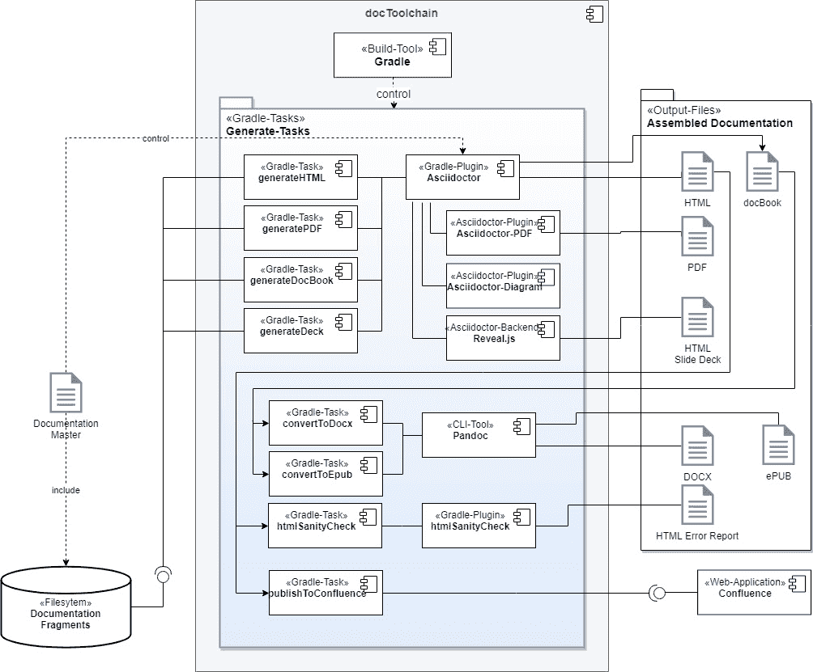

*Figure 6.11: Generating tasks*

This package contains all the tasks that assemble your documentation to various output files in different formats:

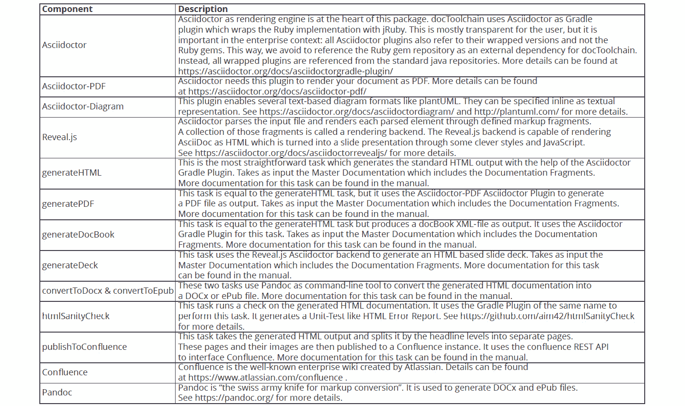

*Figure 6.12: Description of components in generating tasks*

## VI.6 Runtime View

There are no special runtime situations that need to be explained as a sequence diagram. However, the following diagrams shows the flow of information through the toolchain:

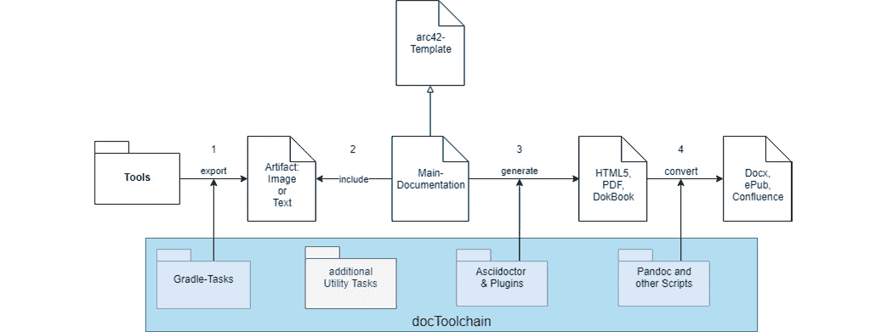

*Figure 6.13: Runtime view: abstract flow*

The preceding figure can be explained as follows:

1. docToolchain exports data (that is, diagram images and plain text) from documentation tools.
2. The main documentation (on the basis of the `arc42` template) includes the exported artifacts.
3. The final output is generated via `Asciidoctor` and plugins.
4. It is finally converted through additional scripts and tools.

Besides this, docToolchain contains some additional utility tasks that do not directly fit into the preceding schema, such as the `HtmlSanityCheck` task.

The following diagram shows the details of all the currently implemented tasks. It focuses on the various input artifacts, which are transformed through the `Gradle` tasks that make up docToolchain. Each connection is either a `Gradle` task that transforms the artifact or an `AsciiDoc` `include` directive that references the input artifacts from the main documentation, and thus instructs `Asciidoctor` to assemble the whole documentation:

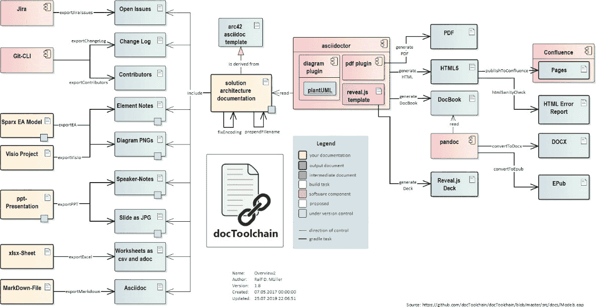

*Figure 6.14: Runtime view*

## VI.7 Deployment View

docToolchain is only used to generate documentation and is, therefore, not deployed to a production environment. However, depending on your requirements, you might want to deploy it not only to your development machine but also to a build server.

The general deployment is done by cloning the docToolchain source repository. Depending on your needs, the details will vary.

### 7.1 Option 1: Installed the Command-Line Tool

For this option, you clone the docToolchain repository to a location outside of the project you want to write the documentation for. You then add the `<docToolchain home>/bin` folder to your `PATH` variable. Now you can use docToolchain as a command-line tool:

`doctoolchain <docDir> <task>`

This approach works quite well and is independent of your project. However, it violates `RQ6` (clone, build, test, and run) for your project. Someone who clones your project will also have to install docToolchain before they can work on the documentation. Also, making any changes in docToolchain is likely to break your build if you do not update docToolchain on all systems.

### 7.2 Option 2: Git Submodule

This approach is the currently preferred option. Here, you add docToolchain to your project by adding it as a Git submodule:

`git submodule add https://github.com/docToolchain/docToolchain.git`

This preceding line of code adds one additional folder to your project, containing the whole docToolchain repository:

| yourProject/ || |
| --- | --- |
| ├─ docToolchain/ || <-- || docToolchain as submodule |
| ├─ src/ || || |
| │ ├─ docs || <-- || docs for yourProject |
| │ ├─ test || <-- || tests for yourProject |
| │ └─ java || <-- || sources of yourProject |
| ├─ ... || || |
| ├─ build.gradle || <-- || build of yourProject |
| ├─ ... || || |

As you can see, this provides a clean separation between your project and docToolchain. The `git submodule` is just a pointer to the docToolchain repository—not a copy. It points to a specific release. This approach ensures that whoever clones your project also gets the correct version of docToolchain.

To use docToolchain with this approach, you configure it as a subproject of your main Gradle project (you can find further details in this tutorial at [`docs-as-co.de/getstarted/tutorial2`](https://docs-as-co.de/getstarted/tutorial2)).

If your project uses another build system, such as `Maven`, you can still use this approach. You simply use `Maven` to build your code and `Gradle` to build your documentation.

*See also: `TR3`: Git Submodules*

### 7.3 Option 3: Docker Container

Last but not least, you can deploy docToolchain as a command-line tool to a Docker container. This can then be used in various ways (for instance, in a GitLab pipeline).

## VI.8 Cross cutting Concepts

Because of the nature of docToolchain (as a locally used development tool), most of the standard cross cutting concepts (for example, security, monitoring, and so on) do not apply.

This is why this section is short.

### Automated Testing

In an ideal world, we would have covered all code with unit tests. However, currently, the smallest unit of docToolchain is a `Gradle` task. Because of the dependencies on `Gradle`, we can't easily test these tasks in isolation.

The current solution for automated tests is to use the `gradleTestKit` ([`docs.gradle.org/4.9/userguide/userguide.html`](https://docs.gradle.org/4.9/userguide/userguide.html)) and `Spock` ([`spockframework.org/`](http://spockframework.org/)).

Through the `gradleTestKit`, `Gradle` will start another `Gradle` instance with its own test configurations. The `gradleTestKit` ensures that all tasks can be integration-tested in an automated way.

Spock helps to define the tests in an easy-to-maintain, behavior-driven development (`BDD`, [`en.wikipedia.org/wiki/Behavior-driven_development`](https://en.wikipedia.org/wiki/Behavior-driven_development)) way.

## VI.9 Design Decisions

This section lists the important design decisions that were made while docToolchain has evolved. They fulfill two tasks:

* Explain to users and contributors who are new to the project why things are the way that they are
* Help to revise decisions for which the base has changed

### DD1: Wrapped Plugins instead of Ruby Gems

**Problem**: Asciidoctor plugins can be referenced directly as Ruby gems or as Java dependencies to the JRuby-wrapped `.jar` files. While Ruby gems always provide the latest version, it might take a number of days for the JRuby versions to become available. Both types of plugins are downloaded from different repositories. In an enterprise environment, the Ruby Gems repository might not be accessible. Since the user of docToolchain is likely to be a JVM developer, and `Gradle` already depends on Java repositories, the Ruby Gems repository is an additional dependency and would violate `C3`: Enterprise-ready.

**Decision**: docToolchain will always use the JRuby version because the necessary `.jar` files can be downloaded from the same repository as all the other Java dependencies.

Decided by *Ralf D. Müller*, April 2017 ([`rdmueller.github.io/enterprise-edition2/`](https://rdmueller.github.io/enterprise-edition2/))

### DD2: Visual Basic Script for EA Automation

**Problem**: The UML-tool *Enterprise Architect* by Sparx Systems can be interfaced in several ways.

**Via internal scripts**


这需要在项目的 EA 项目设置中进行更改。

### 通过 Sparx Java API 或 JaCoB 等 COM 桥接

两种方案都需要安装 *DLL*。这违反了 *C3: 企业就绪*。此外，我们的经验表明，Java API（在测试时）并非没有缺陷。

### 通过 Visual Basic

这需要一定的 Visual Basic 知识，而不是现有的 Java 经验。

**决策**：第一种方法并不容易，第二种甚至违反了约束条件。因此，决定使用 Visual Basic 作为自动化工具。由于这是 COM 对象（Enterprise Architect 提供）的原生接口，因此接口中的错误数量预计会最少。对于第一个概念验证，我使用了 Visual Basic 和 Visual Studio。此设置提供 IntelliSense 和代码补全功能，因此可以轻松探索 API。然而，最终任务使用的是 Visual Basic Script，它略有不同，并且不提供代码补全功能。

由 *Ralf D. Müller* 于 2016 年 8 月决定。

### DD3：对 Maven 和 Gradle 的支持

**问题**：我最初计划支持我所知的两个主要构建系统：Maven 和 Gradle。虽然 Asciidoctor 通过插件支持这两种构建系统，但我很快注意到即使是 PlantUML 和 PDF 生成等基本功能，对于这两种系统来说也难以维护。此外，一些功能通过 Gradle 实现起来很容易（对我而言），而在 Maven 中实现则更困难。

**决策**：已放弃对 Maven 的支持。

由 *Ralf D. Müller* 于 2016 年 8 月决定

### DD4：二进制 Gradle 插件

**问题**：docToolchain 由 Gradle 脚本插件组成。一些开发者不认为这些插件是一种干净的方法，并认为它们使使用 docToolchain 变得更困难（参见 *部署视图*）。

然而，脚本插件也有优势。它们使代码更紧凑、更易于维护，因为它们由单个文件组成，而不是分布在多个类中。任务通常很小，以至于我们将它们的源代码包含在 docToolchain 手册中。当用户阅读手册时，他们可以立即了解任务是如何实现的。这样的用户在获得这些知识后，很可能会成为贡献者。

**决策**：目前使用脚本插件的优点大于缺点。docToolchain 必须易于维护和扩展（参见 *RQ2: 易于修改和扩展*）。

此规则有一个例外：某些任务——例如 Pandoc 任务——只是对其他可执行文件的包装。二进制插件甚至可以通过提供可执行文件的自动下载来帮助解决此问题。（事实上，二进制 Pandoc 插件的第一个版本已在 [`github.com/docToolchain/pandocGradlePlugin`](https://github.com/docToolchain/pandocGradlePlugin) 可用。）

*由 Ralf D. Müller 于 2018 年中决定*

### DD5：以 AsciiDoc 为基础

**问题**：为了遵循 Docs-as-Code 方法，需要一种完全基于纯文本的编写文档的格式。二进制格式——主要由文字处理器使用——不太适合开发人员使用的工具，因此不适合 Docs-as-Code 方法。

有多种纯文本标记格式可用，例如 Markdown、Restructured Text、Latex 和 AsciiDoc。

**决策**：docToolchain 使用 AsciiDoc 作为编写文档的标记格式。AsciiDoc 易于使用但也功能强大，并且已经证明它非常适合编写技术文档。

### DD6：部署选项

**问题**：docToolchain 不是可以部署到服务器的应用程序。因此，docToolchain 没有标准的部署模式。

**决策**：使用（即部署）docToolchain 的最常见选项是 *部署视图* 中描述的三个选项。

**已考虑的替代方案**：以下部署选项已被考虑但未实现。

### DD6.1：嵌入式

这是最初使用的方法，但我们不再推荐。在这种方法中，您将 docToolchain 本身用作基础项目，并将所有代码和文档添加到该基础项目中。

这种方法使更新 docToolchain 本身变得困难，因为 docToolchain 和您的项目混在一起：

```
yourProject/
├─ scripts/               <-- docToolchain task definitions
│  ├─ AsciiDocBasics.gradle
│  │  ...
│  └─ publishToConfluence.gradle
├─ docs/                  <-- docToolchain rendered manual
├─ resources/             <-- docToolchain external submodules
├─ src/
│  ├─ docs                <-- docs for docToolchain AND yourProject
│  ├─ test                <-- tests for docToolchain AND yourProject
│  └─ java                <-- sources of yourProject
├─ ...
├─  build.gradle <-- merged build file of docToolchain
├─ ...  AND yourProject
```

如您所见，这在开始时只是一个好主意，当时 docToolchain 主要由扩展的 Asciidoctor 构建模板组成。

### DD6.2：Gradle 脚本插件

目前这种方法只是一个理论选项。它尚未使用，但在本文中为了完整性而提及。

Gradle 有一个名为脚本插件的功能。docToolchain 以同样的方式引用不同任务的模块化、本地 Gradle 文件：

`apply from: 'scripts/exportExcel.gradle'`

您也可以在项目的 `build.gradle` 文件中将这些脚本作为远程文件引用：

`apply from: 'https://github.com/docToolchain/docToolchain/blob/b415bfb/\\ scripts/exportExcel.gradle'`

这一行引用了文件的确切版本——因此，只要您信任 GitHub 和与 GitHub 的连接，这种方法就是安全的，并且适用于所有自包含的任务。

### DD6.3：Gradle 二进制插件

您可以通过参考 *DD4: 二进制 Gradle 插件* 了解为什么过去这不是一个选项。

对于此选项，现有的脚本插件必须转换为 Gradle 的二进制插件。

结果，它们可以直接从您的 `build.gradle` 文件中引用。HTML Sanity Check 是这种方法的绝佳示例：

```
plugins {
  id "org.aim42.htmlSanityCheck" version "1.0.0-RC-2"
}
```

我们可以将 docToolchain 变成一个二进制插件，该插件引用所有其他插件作为其依赖项。或者，我们可以将 docToolchain 变成一组二进制插件，docToolchain 的用户将引用他们需要的插件。

## VI.10 质量要求

### QS1：保密性

为了控制文档内容，docToolchain 在未经用户明确知晓的情况下，绝不会对任何任务使用基于网络的远程服务。

### QS2：安全性（除保密性外）

当你想到文档时，安全并不是首先想到的，对吧？

然而，当你自动化文档的某些部分，甚至只是包含远程源时，安全性就变得重要了。

甚至可能你使用了一个插件（例如 asciidoctorj-screenshot 插件，可在 [`github.com/asciidoctor/asciidoctorj-screenshot`](https://github.com/asciidoctor/asciidoctorj-screenshot) 获取），它允许你在生成阶段执行任意代码。

在 docToolchain 中，我们假设文档在您的控制之下，因此除了遵守 *QS1: 保密性* 外，不会采取任何特殊的安全措施。

### QS3：可重复性

每次运行 docToolchain 任务都会产生相同的可预测输出。

此规则确保无论您是否将源代码或生成的输出从一个阶段移动到另一个阶段都没有关系。

### QS4：转换稳定性

没有 docToolchain 任务会删除内容。任务（例如导出任务）只能添加内容。此规则是为了确保所有生成的内容都包含相同的信息。

然而，一些格式可能无法显示相同的布局和文本样式。

### QS5：性能


功能优先；docToolchain 关注于重复性手动任务的自动化。因此，即使自动化任务很慢，它仍然具有价值。

然而，我们应在有优化任务的机会时，努力追求更好的性能。

## QS6: 易用性
docToolchain 应该尽可能易于使用。目标是 docToolchain 易于安装，并且使用所有任务不需要对系统的内部工作原理有任何额外知识。

目前，单一的二进制 Gradle 插件被视为实现这一质量目标的正确解决方案，但它尚未在路线图上（你也可以参考 DD4：Binary Gradle Plugins）。

## QS7: 可维护性
许多具有不同需求的用户使用 docToolchain。这些不同的需求源于所使用的不同环境和不同工具。

因此，docToolchain 任务应易于修改以适应每个人的需求；也就是说，至少那些尚未稳定的任务。

还应为新任务提供蓝图。

“易于修改”这一质量目标目前通过 Gradle 脚本插件的脚本特性实现。源代码在文档中被引用且易于理解——因此，易于修改。

然而，这与“易用性”质量目标相矛盾；也就是说，脚本插件与二进制插件。

## VI.11 风险和技术债务
本节描述了使用 docToolchain 可能带来的风险，以及从架构角度如何缓解这些风险。

### TR1: 过时技术
**描述**：一个软件系统可能存在数十年。在此期间，工具链的某些部分可能会过时。例如，你没有购买新许可证的 UML 建模工具。

在这种情况下，你可能无法重新生成文档的某些部分。

**缓解措施**：此类最大的风险与图表和文本导出的专有工具有关。docToolchain 有意将这些制品导出到 `/src/docs` 文件夹，而不是 `/build` 文件夹：
* 如果其中一个工具过时了，你仍然拥有导出的数据，因此仍可以继续使用它。
* 此外，导出的 **.png** 图像和纯文本文件比常见的二进制源格式更容易比较。这使你能更好地审阅文档中的更改。

### TR2: 缺少对 Docs-as-Code 方法的接受
**描述**：当你开始使用 docToolchain 并因此实施 Docs-as-Code 方法时，存在同事可能不接受这种“新”方法的风险。

根据我们的经验，这是一个较低的风险。我们从未见过有人从 AsciiDoc 切换回 MS Word。然而，能够这样做可能会让用户感到安心。

**缓解措施**：你可以将文档转换为多种输出格式，例如 PDF、MS Word 和 Confluence。这不仅在你认为 Docs-as-Code 方法不符合需求时提供了回退方案，还允许你与尚未转向 Docs-as-Code 的同事一起工作。

### TR3: Git 子模块
**描述**：`git` 子模块在理论上很棒。一旦你使用它们，你会注意到它需要一些练习：
* 如果通过 SSH 协议添加，没有为其 `git` 账户配置 SSH 的用户将无法克隆它们。
* 子模块很容易进入 *detached head* 状态。
* 至少在 Windows 上的 `git` 在子模块方面存在身份验证问题（使用 Pageant 有帮助）。

这可能会降低人们对 docToolchain 的整体接受度。

**缓解措施**：
* 始终使用 HTTP 添加子模块。
* 应该有人为 docToolchain 编写一份 *Guide to Git Submodules*。

### TR4: 自动化测试（技术债务）
**描述**：该项目没有良好的测试覆盖率。这是因为 Travis 检查经常中断。

**缓解措施**：除了改进测试覆盖率外，目前还没有适当的缓解措施。

## VI.12 术语表
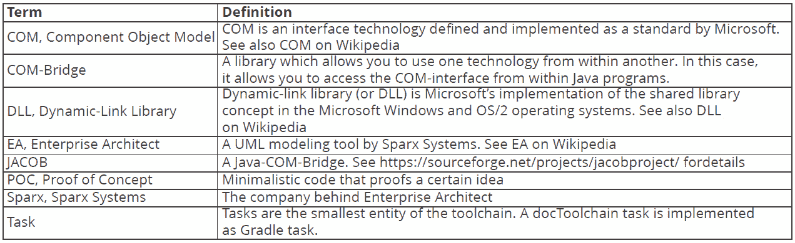
###### 图 6.15：术语表
