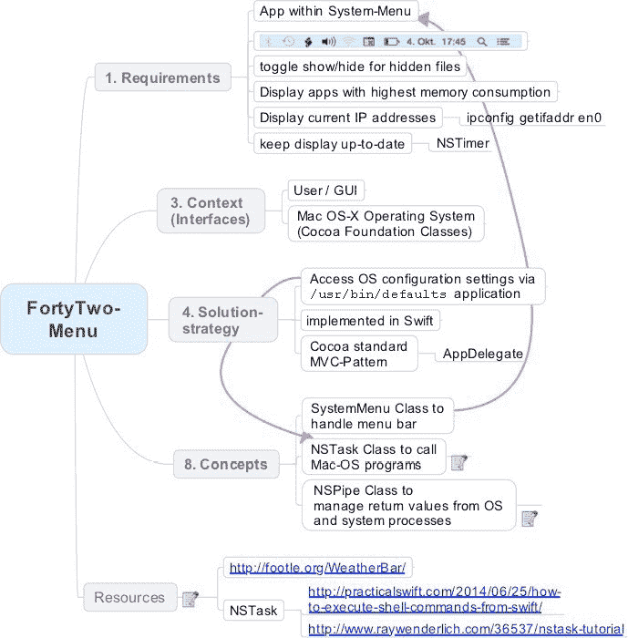

# 第 7 章
## VII - macOS 菜单栏应用程序
作者 **Dr. Gernot Starke**

这无疑是最短且最紧凑的架构文档之一。

其目标是展示 arc42 可以根据你的需求进行定制并精简，只保留最少的文档。

我将此示例实现为对 Swift 编程语言的一次简短探索。我不想在文档上投入太多时间，尽管我想突出此实现的最重要事实。

结果：关于需求的几个关键词，一些重要 OS 类的名称，以及我在实现过程中发现有用的几个资源链接。

我使用思维导图代替了文本、表格和图表：

###### 图 7.1：极简文档
