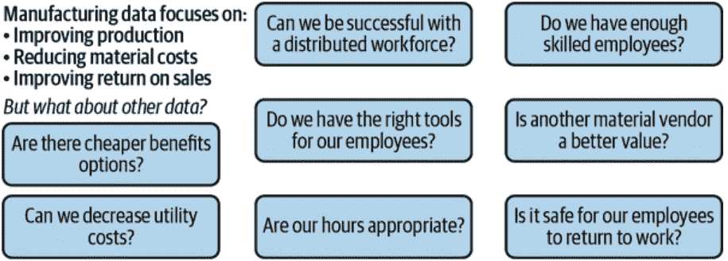
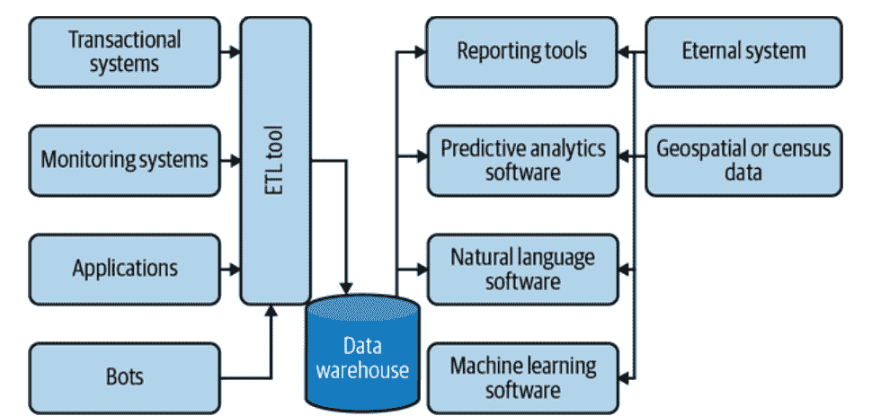
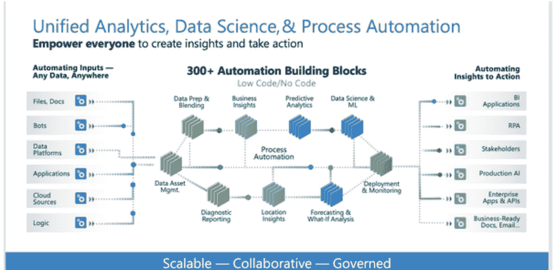
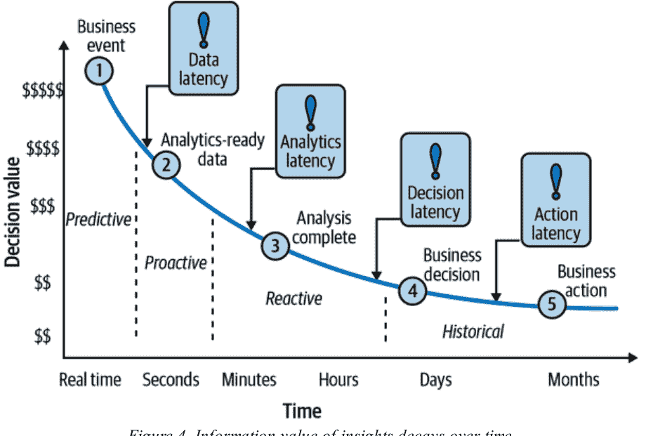
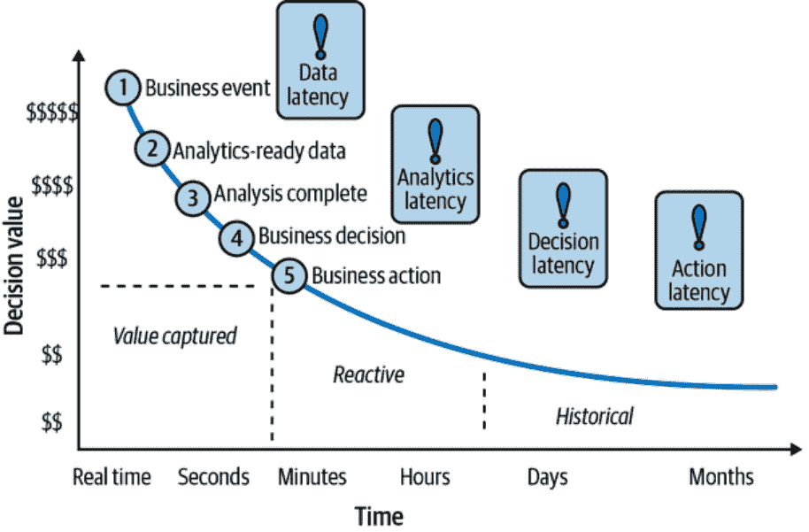
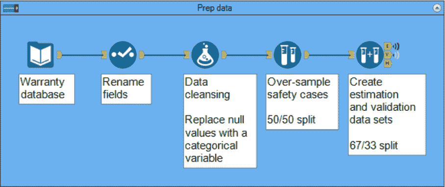
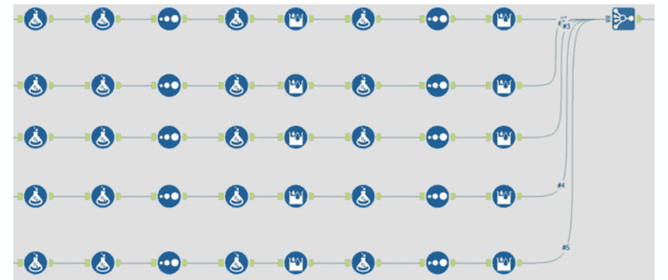
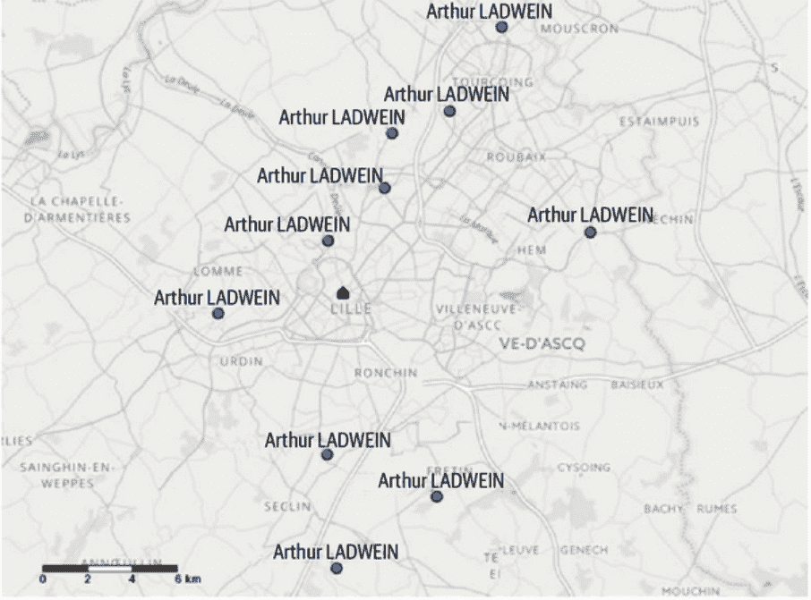
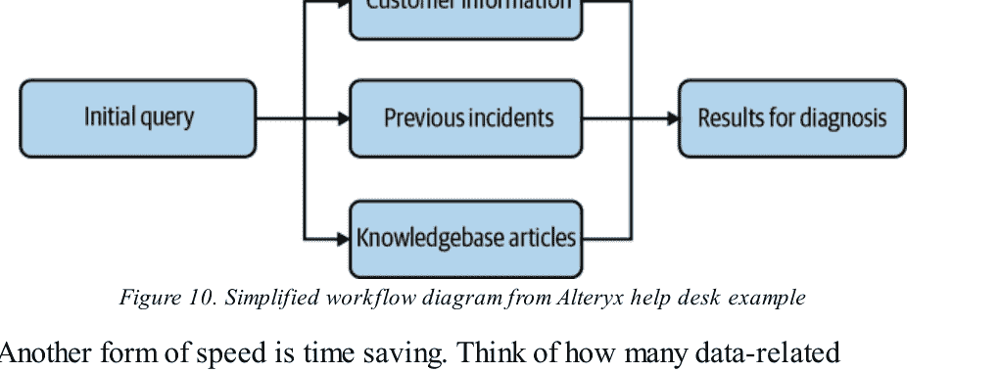

# 分析自动化：以人为中心的方法实现变革性业务成果

## Automating Analytics

> *Transformation without analytics is just digitization. Analytics makes it transformative.*
>
> —David Sweenor, Alteryx

Your business changes. It is inevitable. Consumer trends shift, supply chains evolve, and technology advances. You rely on sales reports, market intelligence, and performance indicators to track the health of your business, but how do you keep track of it all? Do you have a method for seeing all the data flowing through your organization? Is it easy to use? Is it fast? Does it get to the right people and systems at the right time? How you get information and insights from all that data and how you do it quickly enough to make decisions that keep your business moving forward differentiates you from the competition. It is a constant struggle to keep up with the huge amounts of data flowing through and around your organization. Successful industries and organizations understand the need for prompt, reliable insights, and they realize that these insights are founded on fast, reliable analytics.

Creating insights is only part of the equation. How do you get those insights to the people who need them? Business information isn’t just for executives and leadership. What if your employees could identify bottlenecks in your manufacturing process by understanding insights hidden within your data? Could your marketing team use data to identify personas and trends in customer habits to better align their campaigns? Could your HR team rely on personnel data to identify hot spots for turnover or target new talent? Data is everywhere in your organization, and the insights within it can benefit the company at every level. So, the final question you have to ask yourself is this: “How can I get my employees the access, skills, knowledge, and tools they need to make data-driven decisions that will improve my organization’s business outcomes?”

One solution that many organizations and businesses rely on is analytics software combined with data and analytics experts to transform data into insights. While this may be a common solution, it creates a gap in the analytics workflow. In this scenario, data analysts and experts lack the deep domain knowledge of your business to create the insights your business may need. On the other hand, those who have the knowledge of the business usually lack the tools or analytics expertise to do their own analysis. This gap can result in analytic output that misses key business insights or arrives too late to be actionable, resulting in missed opportunities or revenue being left on the table.

Take a look at your own organization. Does data-driven insight flow smoothly through it? Can anyone on any team access the information necessary to make important decisions related to their job? How long does it take to get from your transactional systems to decision-making insights? How easy is it to update your analytic processes if your business changes? Does your leadership team have access to the transformative insights they need? Understanding the typical flow of data (which is ultimately transformed into actionable insights) through an organization will help illustrate the bottlenecks and pitfalls of legacy data and analytic processes, a topic we’ll dig into in the next section.

A more effective approach is to upskill your workforce so they’re able to pair their business domain expertise with reliable data analysis. The result is an organization with employees that are empowered to utilize and analyze data to accelerate and improve decision making. Giving nontechnical users access to information systems and allowing them the power to do analysis and develop insights on their own has been shown to result in unique and meaningful insights that drive the business forward.

But how do you do that? You provide a bridge to give the individuals running the business the capability to derive their own insights without the need of complex tools, code, or technical expertise. By delivering data and analytics capabilities to your workforce, you’re creating an environment of data and analytics democratization within your organization. This means less time is spent relying on outdated processes and waiting on experts to generate analysis results, and more time is spent finding insights across your business so you can achieve your strategic objectives. With these resources, domain experts have the ability to do data preparation, analysis, predictive analytics, and insight generation on their own.

What does this mean for your business? It means that decisions can be made faster and closer to the point where they can be most impactful. It means that your company saves time, money, and effort by empowering your employees with the tools they need to better understand how your business works and to act upon insights that will make it run more efficiently.

So how do you achieve data democratization and empower your employees? Fortunately, there are already platforms available that enable organizations to expand the scope of people benefiting from using analytics, effectively moving this expertise beyond data scientists to allow anyone within the organization to be able to transform data into insights. While no tool will completely eliminate the need for highly skilled data analysts and data scientists, there are several key things that can be done to improve the flow of data from transaction to insight within your business. These tools can also improve the efficiency and capabilities of your business analysts.

To this end, we’ll illuminate how analytics automation can improve or eliminate legacy data-process issues and enable the gains described above. Analytics automation focuses on a human-centered approach to data, analysis, and insights. In this article, we will see how it makes the data flow process easier to understand and work with, enabling data and analytics democratization. We’ll examine how data flow automation reduces labor-intensive tasks, saving time and effort. We’ll also uncover how analytics automation can provide continuous and easily maintained insights to employees and leadership. Through all of these transformational capabilities, we’ll see how analytics automation helps to create an agile organization that can better serve its customers and clients while improving financial success.

## The Critical Role of Data in Modern Organizations

我们都知道数据很重要，但为什么数据对*你的业务*如此重要？经过适当分析的数据会转化为信息和可操作的洞察，可用于更有效的决策。它可以告诉你业务的运营状况。它可以突出模式和隐藏趋势，识别积极和消极的影响，提供未来应采取步骤的见解，并在相互竞争的决策中优化最佳选择。它是决策的生命线，没有它，你只是在猜测或依赖直觉。《*哈佛商业评论*》的一份报告引用了一项高管调查，显示 70% 拥有成熟分析能力的组织报告了生产力、财务绩效、风险降低和决策改善方面的提升。¹

但如果信息如此重要，为什么从数据中提取它如此困难、昂贵且耗时？要理解这一点，我们需要了解数据如何在组织中流动，以转化为信息和洞察，最终用于做出更好的商业决策。

> > *毕竟，如果你的业务没有因分析而做出反应和改变，那么拥有它们有什么意义呢？*

首先要检查的地方是数据收集。可能很容易看一个组织并猜测其数据来自哪里。商店产生销售数据。学校产生学生数据。医院产生患者数据。人员和设备通过其连接设备随时产生数据。但这只是冰山一角。组织内的交易系统无法也不可能单独运行。让我们更仔细地看一个制造示例。

一家典型的生产产品或服务的公司有两个主要目标：满足客户需求并降低成本。满足客户需求的重点在于能够尽可能多地创建最终产品以供交付，而不会生产过多。这意味着找到满足客户需求同时仍保持收入高于成本的适当机器、员工和工作时间。但要真正理解业务的相互交织的复杂性，你必须检查所有变量。有些成本是有形的，而有些则不是。这就是分析洞察可以帮助你快速识别低效率的地方，从而实现数据驱动的决策并提高业务绩效。

让我们更深入地探讨这个例子。作为一家制造公司的领导者，你通过向消费者或其他企业销售产品来产生利润。你可能有几个关于向谁销售、销售多少以及以什么价格销售的指标。你可能还了解产品或服务的使用方式。虽然这些方面的分析总能改进，但让我们看看另一面——成本。是什么在消耗你公司的资金？你是否在材料上花费太多？材料是否在规格内或超出规格？是否有更好的供应商可供采购？你是否在每个岗位上都有最好的员工？他们是否有改善工作绩效所需的知识？正如图 1 所示，有许多地方可以获取数据来改善业务。让我们进一步探讨。

*图 1. 仅检查生产数据不足以全面评估一家制造企业*

想象一下，如果你的组织超越了仅与制造执行系统（MES）、企业资源规划（ERP）和客户关系管理（CRM）相关的数据来创建产品，会发生什么。有许多地方你可以使用数据来降低成本、优化流程和提高效率。你的生产线是否在夜间运行？在这些非工作时间运行需要多少额外员工和多少额外的电力和水？制造环境是否应根据天气条件进行调整？这笔额外成本是否被生产量所覆盖？你的设备是否会意外故障？要获得这些答案，你需要将财务数据与人力资源、设备、设施和公用事业成本随时间推移的数据结合起来。你需要能够按小时比较生产回报。你的企业现在能做到这一点吗？

你的供应链呢？你如何及时了解资源供应商的价格和价值？通过更换供应商可以节省多少钱？材料可能更便宜，但你可能为运输支付更多费用。对于敏感材料，供应商之间的规格如何比较？你需要所有潜在供应商的供应商数据、材料数据和运输信息，并且需要能够快速、定期地组合这些数据以进行比较。这些数据对你作为领导者很有价值，但想象一下它能让你的前线员工做什么。你的采购总监能否利用这些数据集的快速洞察？想象他或她正在做出关键且及时的数据驱动采购决策。如果他们能够在没有数据分析师或高级分析知识的情况下自行完成会怎样？你的公司可能会节省多少？你的公司的其他部分呢？

这个想法当然不仅仅适用于采购，而是适用于你组织每个职能领域。员工、财务、公用事业、设备、用户、运输等都会产生数据，而这些数据对于使业务成功至关重要。要理解整个业务，单独的数据孤岛是不够的。每个职能领域的数据必须结合起来，才能全面了解整个业务。将交易数据和非结构化数据以及相关的外部数据联系起来的能力是无价的。最重要的是，数据转化为决策洞察的速度越快，你的公司就能越快做出反应并提高绩效。让我们检查组织内典型的从数据到洞察的工作流程，以帮助我们更好地理解挑战和对业务的影响。

## 传统方法的挑战

那么，你采取什么步骤来收集组织创建和需要的所有数据？你如何从交易系统、记录保存、外部来源和其他地方提取数据，以获得对业务的完整和整体的视图？是否有对你的公司有益且未被使用的数据？在大多数组织中，使用一种称为“提取、转换和加载”，或 ETL 的流程。通常，ETL 系统会按计划从生产系统收集数据。然后它会转换这些数据，使其更易于阅读和使用。最后，它会将数据存储到中央存储库，例如数据仓库，供其他系统使用——包括报告和仪表板工具。ETL 是一种将分散的数据源集中到一个区域的有效方法，但使用它有哪些陷阱和缺点？

企业从多个来源收集大量数据，如图 2 左侧的交易系统段所示。一般来说，ETL 工具将无法收集你的所有数据。来源实在太多，分布在太多地方，维护数据的人员根本跟不上。因此，组织通常会收集关键职能数据集，并依赖其他方法，例如数据准备、分析和报告软件，来融合额外数据。这使得数据仓库可能缺乏对业务成功至关重要的数据。这对于与业务流程无关但对分析相关的数据尤其如此，例如地理空间、人口统计、企业图和参考数据。

图 2. 数据在典型组织中从交易系统流向报告和洞察生成的示例

不仅仅是缺失数据可能成为传统流程的问题。现有的数据和分析软件需要熟悉所涉及编程语言的专业、受过培训的员工。提取和转换数据的过程可能复杂且耗时。需要克服的障碍包括编写 SQL 代码来访问数据、准备和清理数据的复杂计算，以及将数据转化为洞察所需的统计学和预测分析知识。这通常耗时，代码往往僵化且难以更改。用于提取数据的代码是针对当时需求编写的，但数据可能会发生变化。随着流程的演变或引入新软件或方法，表、字段和数据会随之变化。需要主题专家、数据架构师、报表编写者等持续工作，以保持分析管道准确可靠。

数据标准和治理也至关重要。想象一家销售电子产品的公司。当然会有销售和利润数据，但也有库存管理、运输、退货等数据。现在，这些领域使用的软件可能（并且很可能）不同。产品名称在系统之间可能不同。一个系统，如运输，可能在托盘级别汇总数据，而另一个系统可能跟踪

零散地获取数据项。让这些系统相互通信并使用共同的数据定义通常是一项巨大的挑战。大量数据，加上当今业务中生成的数据的复杂性，正迅速超越最初用于分析这些数据的基础设施。

我们审视了组织内检索数据的典型方法，突出了流程中的低效之处。我们需要找到一种解决方案，能够访问和准备数据，同时提供灵活性、速度和易用性，以便连接其他潜在数据源，动态适应不断变化的业务需求，并促进组织内的数据民主化。这正是分析自动化发挥作用的领域。

## 分析自动化如何改善业务成果

什么是分析自动化？它与你目前使用的工具有何不同？就像典型的ETL流程一样，分析自动化软件可以连接到多种来源和类型的数据，然后执行混合、连接、过滤、排序、清理、聚合等操作。ETL止步于此，而分析自动化则在此基础上继续构建分析、报告、预测、预测性分析等功能。事实上，分析自动化提供了一个单一平台，可以连接、准备、混合、丰富、分析数据，并通过数据科学和机器学习将数据转化为洞察，如图3所示。

图3. Alteryx提供的分析自动化平台内置步骤和功能的模型

## 可复用工作流释放洞察的信息价值

许多数据和解析流程是基于代码的，但分析自动化并非如此。实际上，以人为本的方法正是分析自动化优势的基础。与其他软件不同，分析自动化依赖于解析工作流，即一系列将数据转化为洞察的步骤。一旦工作流构建完成，其结果可以输入到其他工作流中。这创建了一组可复用、可重复的解析流程，使组织能够通过避免耗时地重建现有解析流程来加速其分析计划。

获取正确数据所需的主要步骤可以由业务专家执行，而数据准备、分析和预测性分析等功能可以提供给其他人使用，以便他们操作生成的结果。这确保了被调查数据的准确性，同时为更深入的分析提供了灵活性。高管现在可以提出问题，而最接近数据的员工可以使用现有工作流或在其基础上进行构建，以快速获得准确的答案。更好的是，工作流经过审核后可以共享，并可供整个组织中的每个人使用。这意味着任何人都可以按需获取准确的洞察，只需很少的培训，同时确保遵循组织的最佳实践。这条从数据到分析洞察的缩短路径，通过提高数据的可访问性、特异性、灵活性和速度来改善决策制定。

公司收集的数据本身缺乏内在业务价值。只有当数据被转换、组织并操作成可操作的信息时，才能做出业务决策。延迟的影响如图4所示。洞察的延迟，无论多小，都可能是盈利与亏损之间的差别。

自动化减少了损失的时间，使领导者能够在数据创建后更快地做出有效决策。这种灵活性使公司能够迅速适应流程或绩效的突然波动，如图5所示。它允许公司调整业务，将资源转移到运行良好的方面，并响应那些失败的方面。它也使公司转向预测性洞察，而不是被动反应。²

图5. 通过缩短业务事件到行动周期所获取的价值

在分析自动化平台中，速度是双重的。首先，分析自动化减少了从源数据到洞察所需的工具数量和专业知识量。一个典型的数据工作者在执行单一分析或数据科学活动时，平均会连接六个不同的数据源，拉取并处理四千万行数据，并产生七个不同的输出。³ 此外，他们还会使用四到七种不同的工具来完成这些任务。分析自动化简化了这些操作，提供连接多个数据源的能力，以易于管理和可重复的方式拉取和处理数百万行数据的能力，以及生成多种类型结果的能力。它在单一端到端平台上完成所有这些工作，简化了学习曲线，并减少了对特定工具培训的需求。

其次，分析自动化是自动化的。虽然任何数据或分析流程的初始构建都需要时间，但分析自动化设计时具备可复用的构建模块功能。它允许最终用户在现有经过验证的工作流基础上构建新的洞察，并且无需搜索一行行代码即可修改现有工作流。单一工具消除了数据工作流步骤之间的摩擦。可以构建自动化流程来搜索、准备和分析数据，从而节省大量宝贵的专家时间。IDC在2019年的一项调查表明，这类任务每周花费分析师约16个小时。⁴ 这相当于每周40%的时间，否则这些时间本可用于提供有关如何改善业务的有价值洞察。

分析自动化不需要取代你现有的软件。它是现有软件工具的完美补充。它可以访问ETL生成的数据仓库中的数据，并生成可用于报告和其他应用程序的分析就绪数据集。

> *任何集中式系统在解决您的特定业务需求方面都只能做到一定程度。您现在有一个需要解决的问题，无法等待IT部门。分析自动化通常被视为分析工作的最后一英里。*

当您开始在业务中使用分析自动化时，请将其与现有技术和方法论一起使用。随着时间推移，评估您可以在哪些方面采用分析自动化来改进现有流程。将其整合到您的工作和分析流程中。它在哪里可以加速洞察的产生？它在哪里可以快速回答目前需要很长时间才能回答的问题？最终，分析自动化的价值将通过节省时间、自动化和易用性而变得显而易见。

## 通过无代码可视化工作流赋能业务用户

分析自动化将数据到洞察过程的步骤转化为画布上的图标可视化工作流，每个步骤进一步修改生成的数据集。这个图形用户界面为您的业务带来了难以置信的好处。首先，它比代码更容易理解和解读。这意味着任何领导者或员工都可以在没有编程语言背景的情况下与数据交互。数据分析的可访问性意味着决策可以转移到最接近业务的用户手中，赋予他们洞察力，以更高效、更有效地工作。这种易用性也使得在整个组织中采用和分发分析自动化变得更加简单。

数据专家也从分析自动化中受益。他们可以生成执行业务特定任务的工作流，例如销售和使用税合规、需求预测、欺诈检测、资本预算和审计，然后保存供其他人使用。这确保了在未来的分析中内置最佳实践。它还使业务领域专家能够与数据交互并自行探索。您的数据专家还可以轻松可视化数据准备过程并快速进行更改，而在传统的基于代码的系统中，这可能需要数小时或数天。图形用户接口的一个示例见图6。

图6. 分析自动化接口示例——Alteryx

一旦构建了分析自动化流程，该流程可以按需调度运行，或安排在特定日期、时间和频率自动运行。图形用户界面有数十个构建模块，允许您：

- 访问和混合多种类型的数据——包括结构化和非结构化数据
- 通过填补缺失值、去除异常值和删除冗余变量来准备数据
- 通过将数据与组织内外部的其他数据集组合来丰富数据

transformed and analyzed by the process. The workflow can update, clean, and combine the data, correcting errors and adjusting data types. Take, for example, a CSV data source. By default, the values in a CSV file are all strings. You can quickly review the data in an analytics automation building block and change the data type accordingly, making dates into dates, numbers into numbers, and so on. Like many tools, the underlying data sources are not modified, only the resulting output of the analytics pipeline. This means that a process can be automated to run again and again against several data sources —on premises and in the cloud. If something in the source system changes, you can quickly adjust the workflow to account for the change. This is a significant time-and-effort improvement versus asking IT to update their ETL flow and waiting six to nine months for it to happen!

As mentioned, the visual interface eliminates the need to understand code, democratizing access and analysis. This is also beneficial to your company in two other ways. First, it decreases the need for employees who specialize in understanding specific programming techniques. While developers will always be needed to maintain data structures within an organization, the ability to analyze data without knowing how to write code gives the power of analytics to everyone throughout the organization. Second, the ease of use of a graphical interface saves time. Developers no longer have to spend hours or days refining context, joins, and filters, nor do they need to know how to create predictive analytic and ML (machine learning) algorithms. Instead, they can focus on utilizing the analytics automation building blocks to piece together a workflow that solves specific business problems—like predictive maintenance. Analytics automation employs techniques from common data analytic tools as well. By implementing techniques found in other common data and analytic tools, an analytics automation platform can provide resources that are familiar and easy to use. For example, users can use common spreadsheet methods for manipulating data.

The main feature of analytics automation is giving the ability to analyze data to those without programming knowledge. Macromill Inc. took advantage of this usability in its work.⁵ Prior to the implementation of an analytics automation platform, analysts were required to load survey data into statistical software. The resulting output was then transitioned into a reporting tool where report writers generated the visualizations. This setup relied heavily on the technical expertise of analysts to correctly interpret and process the data through the statistical tools. The complexity of the survey data and the slowness of the statistical software often created delays in the analysis, resulting in slow turnaround time for Macromill’s customers.

The company development group manager decided to try implementing an analytics automation process. He hoped that translating the existing data process into an analytics automation workflow would improve performance and reduce employee training needs. The implementation was very successful. Macromill no longer needed separate tools to clean up and analyze the data. Instead, workflows were developed that did the steps automatically. If a customer changed requirements, the workflow could easily be modified and run again. More importantly, the application the company chose was easy to use and reduced the need for employee training. Now there were more users available to analyze survey data and generate results. The faster turnaround time for analysis led to more time for data visualization, faster results for the customer, and repeatable processes for analysis.

## Analyzing Data No Matter Where It’s Stored

Ease of use is only one benefit of the analytic process. The ability to connect to disparate data sources across multiple IT environments in a single interface is also key. Normally, an organization would need separate applications to combine and blend data into new sets. Analytics automation building blocks do this through the visual drag-and-drop interface. They can connect to local files such as Excel, CSV, or Access. They can also connect to hosted data sets such as MySQL, Oracle, PostgreSQL, or Salesforce, as well as cloud sources within Amazon, Microsoft, and Snowflake. An analytics automation application can access and analyze data on premises, in the cloud, and in hybrid environments. The ability to combine different data types opens up possibilities to examine how parts of your company interact and impact each other. This is best illustrated in an example.

A quick-service café franchise well known for its smoothies wanted to dig deeper than just its sales data.⁶ It wanted to know what things impacted sales, asking questions such as “Is weather related to sales?”, “Do certain flavors have better success in one region over another?”, and “Which marketing plan is most successful during down times?” These types of questions relied on point-of-sale data, of course, but they also needed weather, location, traffic, calendar dates, and promotion data. They even brought in information about their menu layouts! It was suspected that these external factors played a role in the success of the business, and the company wanted a way to analyze and compare this external data to its sales to look for patterns.

Imagine the amount of work and effort that would be required to tie all these data sets together using another platform. Analytics automation, combined with Amazon Web Services and Tableau, made it simple. Analytics automation allowed the company to connect to multiple data sources, identify relationships, and build workflows to answer its critical business questions. The company brought in over three years of historical data and used analytics automation to transform it. The workflows were then automated to run on new data coming in each day. The company was able to establish rules for the six hundred new data sets it receives at the end of each day, tailoring the data flow to only run once 95% of the results are available.

In the end, the company used the results of 15 different workflows together to generate a super workflow. This super workflow generates and updates the data sources needed to populate local self-service reporting tools and company-wide dashboards. It is a central source of truth for all insights related to the company and a complete solution with minimal IT infrastructure. The super workflow also gave the company insights on market trends, identified business inefficiencies, and provided a start toward establishing a data-driven culture.

Another example of combining multiple data sources was demonstrated by Coca-Cola, which used analytics automation building blocks to combine data sets across the organization, making them more accessible.⁷ In an example from Coca-Cola’s senior business analytics manager, data from multiple, separate bottling data sets was combined and processed in just a few hours. Prior to implementing an analytics automation platform, the analysis was nearly impossible, as the size of the data sets prohibited the use of traditional tools. It is also worth noting that this analysis was done without writing any code and without any experience in the analytics automation platform.

It’s important to know that data doesn’t have to be sourced from files or databases with analytics automation. The building blocks allow you to manually enter data into tables for use in the cleanup process. This may sound like it opens a door for potential errors or data manipulation; however, there are several beneficial uses. First, it can be used to clean up data that has typos or errors (although fixing the issue at the source is a better idea!). Second, it allows you to create bridge tables, small tables of data that can be used to connect or clarify other data sets brought into the workflow. Third, it provides a method to validate a workflow process by allowing you to create a smaller data set to test with as opposed to running a data set of millions of rows.

The ability to connect to and blend together a plethora of data sources gives analytics automation flexibility that is not available in a conventional data flow. The diversity of data types and formats it can connect to gives your company the ability to reach beyond your standard data sets and explore how other factors influence your success. It brings these data sets together in an easy-to-use interface with a multitude of options to clean, prepare, and dissect them. This is not the limit of analytics automation, however. Once the data is collected, it must be analyzed to derive the insights your company needs to be successful.

## Accelerating Insights with Automation

The ability to quickly transform data into insights is a key element within analytics automation and a huge benefit to your company. As with data preparation, analytics moves through analytics automation as part of a visual workflow. The analytic steps can home in on key performance indicators within the organization, allowing your business to identify patterns, trends, and outliers quickly. It can perform analytic processes independently or in

与其他分析工具协同合作，使其既强大又灵活。最重要的是，生成洞察的工作流可以保存并根据需要重复运行，从而按需提供数据驱动的监控和洞察。它还允许工作流在组织内共享、复用和受管，以确保遵循最佳实践。

分析自动化还能以其他方式提升分析速度。通过多种技术进行数据采样的能力，使组织无需处理整个数据集即可快速检查趋势和模式。软件的积木式结构允许你在工作流的任意节点停下，从而能够边进行边评估工作流的功能。如前所述，一个工作流可以成为其他工作流的基础，确保分析基于准确、受管、可靠的数据进行。

与此同时，分析自动化还具备面向未来的能力。随着业务增长或软件变化，分析工作流会自动调整以纳入额外的信息列。这意味着可以减少重建和重新配置数据流程的工作量，而将更多时间用于研究新字段对数据的影响。这能显著减少开发和等待编码人员的时间。该选项通常可以根据分析和数据集的具体情况启用或禁用。

所有这些处理步骤在救世军如何使用分析自动化来整合、去重和组织其在澳大利亚的HR信息中得到了体现。⁸ 其团队负责人接受的任务是，收集从 Excel 到纸质副本的多个不同数据集，并将它们合并为单一事实来源，以便加载到新的软件应用程序中。利用分析自动化平台的功能，他能够连接、去重并清理多个数据集。他通过分析自动化平台使用可重复的自动化数据迁移，合并了一万多名员工记录，节省了数千小时的体力劳动。

救世军的分析团队很可能依赖排序后的数据来验证其工作流。尽管分析自动化的输出不一定需要排序，但这样做可以将预览结果按顺序排列，有助于检查数据、验证和工作流测试。一些分析自动化平台还可以忽略特殊字符和值，允许你按字段中的值排序，同时忽略空格、引号和标点符号。

数据经过工作流转换后，需要一个去处。分析自动化提供了简便的数据导出选项。这些选项通常包括分隔文本文件、电子表格、其他系统、机器人、RPA（机器人流程自动化）平台、数据库以及许多其他目标系统。

工作流的输出也不仅限于平面文件。分析自动化可以集成到现有工具和报表功能中。通过将工作流输出传递给其他系统，组织可以利用自动化来提供监控系统、定期更新的报告以及基于数据的动态流程。简而言之，可以设计工作流，在达到或超过阈值时向你发出警报，为业务流程提供定期数据源，向决策者生成更新报告，以及执行许多其他自动化任务。最终，分析自动化平台使你能够从噪音中分离出信号，让业务能够及时关注相关洞察。

Precision Analytics Group 依靠这种摄取更新数据的能力，作为其流程的一部分，发布了关于 COVID-19 的实时数据。⁹ 它的任务是提供关于疫情及其对饥饿、健康、教育和住房影响的洞察。这些洞察对于努力识别需要支持领域的援助组织而言，将被证明极具价值。虽然美国人口普查局提供了大量可供分析的数据，但这些数据通常存放在单独的文件中，包含不同信息以及存在缺失和需注意说明数据的区域，并且会定期更改。Precision Analytics 需要一种工具来自动化数据检索，而无需在每次请求时手动处理数据。

该公司转向分析自动化寻求帮助，利用该工具合并数据、清理数据并将其拆分为可用的块。一旦所有数据收集并组织完毕，产生的输出就会被反馈到另一个工作流中。该工作流将数据与之前几周的数据相结合，使组织能够基于多种人口统计特征展示结果。更重要的是，工作流中添加了逻辑，使团队能够根据托管站点上的文件名来拆分人口普查局提供的数据。

如图 7 所示，这是一个分析自动化工作流的极端示例，但它突出了软件的能力。这家公司采用了具有变化名称的异构数据源，并使用分析自动化工作流来应对这些变化。这个示例还说明了，原本需要手动花费数小时或数天的工作，如何通过分析自动化在极短时间内重复运行。可重复性和易用性结合复杂的数据处理，可以将一项极其复杂的任务分解为一系列简单易懂的步骤。同样重要的是，该软件允许你在每一步之后查看数据，从而快速直观地了解更改的影响。

图 7. Precision Analytics Group 的示例工作流，详细说明了其从多样化、定期更新的人口普查局数据集中提取数据的方法

## 让洞察生成民主化

让员工掌握数据，使他们能够分析自己的具体任务和绩效。它将数据从一份遥远的报告，转变为与那些实际工作人员更贴近的内容。它为你的业务提供了灵活性、可重复性、知识共享和数据素养。让我们来看看分析自动化与典型工作流有何不同，并考察它如何为企业改进从数据到洞察的过程。

## 有限的数据访问等于有限的结果

为了理解民主化为何重要，我们首先需要理解员工无法访问有关其工作的数据和洞察会引发哪些问题。据估计，数据工作者44%的时间浪费在搜索、准备和分析数据上。¹⁰ 此外，在典型的财富500强公司中，每年有50万个经理日因无效决策而被浪费。¹¹ 我们需要考察一个典型的分析工作流，看看数据来自哪里，谁有权访问，以及广泛部署这些数据可能存在哪些约束。让我们回到之前提到的电子公司示例。

假设该组织使用传统的ETL处理方法。数据从对公司最重要的领域摄取，如销售、运输，也许还有HR。有数名开发人员专门编写代码来访问这些事务数据、修改数据并将其存储在数据仓库中。该公司精通数据最佳实践，并提供数据字典、标准和定义以供应用。它还聘请了一个核心数据分析团队来摄取数据并为公司生成报告。那么这有什么问题呢？

首先，让我们看看访问权限。虽然数据分析师和开发人员可能擅长他们的工作，但他们的全部精力都集中在数据流上。开发人员埋头于代码和代码更改中，可能对公司如何运作了解有限。同样，分析师可能对业务方法论有一些基础知识，但他们的专长在于使用报表构建工具生成供公司理解的可视化。他们依赖于主题专家——这些专家在

企业需要用这些数据来确定哪些数据表和字段是重要的，以及需要报告哪些内容。

数据的访问权限很可能仅限于报表编写者和每个特定领域中的少数关键利益相关者。报表编写者专注于为领导层生成报告，展示公司的绩效，而领域专家则利用手中可用的一小部分数据，就其所负责的业务部分的绩效做出决策。这种限制性访问方式带来了两方面的问题。首先，那些真正让公司运转的员工——从销售到库存再到库存管理——很可能无法访问公司产生的数据。其次，许多能够访问数据的人，要么缺乏主题专业知识，要么缺乏足够的分析工具技能，无法恰当地分析这些数据。

除了访问权限之外，速度也是传统数据工作流中的一个问题。如果领导层对业务有疑问，或者业务所处的环境正在发生变化，他们需要尽快看到影响；然而，传统方法充满了延迟。首先，所提出的问题未必能通过事务系统中所提供的数据来回答。如果必要的数据点缺失，这可能需要对ETL进行更新和更改——这一过程可能需要数天才能完成。接下来，报表编写者需要时间来摄取数据、分析数据，并开发能够回答所提问题的可视化内容。他们还需要时间与主题专家沟通，以验证和确认数据。总之，从提出问题到得到答案，可能相隔许多天！当这么长时间过去之后，这个答案还有价值吗？

典型的数据流过程只向一小部分员工提供数据：

- 对业务有深入理解但对分析工具了解有限的员工
- 在分析和分析工具使用方面技能娴熟但对业务运作方式了解有限的员工

此外，典型的数据流充满了延迟和低效，为组织中各级领导层提供了无用甚至有害的洞察。我们如何改进这种访问方式？将数据分发给不仅仅局限于那些具备专业技能的人，可能会带来哪些好处？我们如何弥合主题专业知识与数据分析能力之间的鸿沟？这两个问题的答案，正是分析自动化如此强大的原因。

## 提升员工技能，加速获得洞察

分析自动化改善了对数据的访问，但你为什么要这样做呢？公司数据的安全性和隐私性怎么办？这并没有听起来那么可怕。让员工能够利用数据，是让你的业务走向分析驱动型的一个有益步骤。它消除了在最基层运营业务时的猜测，为主题专家和一线员工提供了在需要做出决策的时间和地点进行决策所需的工具。这个简单的转变可以通过在问题萌芽之前将其消除，从而为你的公司节省时间和金钱。

或许，理解数据民主化如何积极影响业务的最佳方式是看一个它取得成功的案例。当你想到制造业中的分析自动化和数据时，你可能会想到降低供应商成本、提高效率和减少开支。Polaris公司则以一种完全不同的方式使用了它。¹² Polaris没有专注于提升其产品的性能和创新能力，而是想了解可以采取哪些措施来提高其产品对客户的安全性。

Polaris是一家制造雪地摩托和越野车的公司，该公司想知道其客户遇到了哪些类型的安全问题，以及如何提高产品质量以避免这些问题。通常，这类故障排查归属于技术服务团队，但Polaris希望利用数据，特别是保修索赔数据。其思路是，保修索赔中会包含大量定量和定性的数据，可以对这些数据进行检查，以识别潜在的趋势和问题。

Polaris向其数据团队和售后监测团队寻求帮助。这两个团队共同利用分析自动化来分析数据。他们仔细梳理了保修索赔数据，将其与预测模型和经销商更新信息联系起来。通过使用分析自动化来处理数据，并使用分析模块来运行预测模型，这两个团队成功创建了一种算法，该算法可以将保修索赔标记为可能需要处理的潜在缺陷或安全问题。随后，他们将该流程自动化，并将其与公司的电子邮件系统关联起来。现在，每一条进入系统的保修索赔都会经过该工作流处理，并进行模式分析。如果发现某种模式，就会向组织内的安全团队发送一封电子邮件，以进一步检查。最终结果是，制造商能够更快地识别并处理与安全相关的索赔。

花点时间思考一下Polaris的这个例子。该公司的成功在于将数据关联起来，并将其交付给有能力解读、分析并据此采取行动的员工。在传统系统中，这很可能是不可能的。他们的售后监测团队需要手动梳理大量的电子邮件，寻找模式和趋势。仅这一项工作就可能需要数天甚至数周才能完成，而在此期间，新的索赔还会不断涌入。通过采用分析自动化技术，该团队现在可以动态地接收这些索赔，并快速提供预防性解决方案。公司不仅提高了产品的安全性和可靠性，而且通过将数据交给合适的员工，节省了大量的人工时间和精力。

我们再来看一个将数据处理技能交给员工以解决问题的例子。香港理工大学机构研究与规划办公室需要一种方法，在不具备编码技术背景的情况下分析大学的各个部门。¹³ 这所大学拥有大量涉及人力资源、学生、财务等方面的数据。在没有技术知识的情况下，如何检验所有这些层面的数据？更重要的是，一旦找到了方法，规划办公室如何确保使用该方法开发出的流程能够被新员工掌握，并且当大学流程发生变化时能够轻松修改？

该办公室的两位研究分析师迎难而上。他们的目标是为大学领导层提供围绕大学各个方面的数据和洞察，以辅助决策。直到最近，他们还在依赖容易出错的手工流程来收集、检查和剖析数据。这些数据大多存放在数以百计的Excel和Access文件中。这种方法缓慢、繁琐且耗时。于是他们转向了分析自动化。

分析自动化为该团队带来了几个关键优势。首先，它易于使用。他们不需要计算机科学或数据科学背景就可以提取必要的数据并进行收集分析。其次，它提供了一种简化的方法来组织和汇总包含学生、人力资源和财务数据的大量文件。第三，它具有可重复性和可追溯性。这些工作流不仅使研究分析师能够将其分析过程分解为可理解的模块，而且还提高了其执行过程的透明度。这使得问题发生时能够轻松地被识别和纠正。分析自动化还提供了在其数据上创建和运行预测分析的能力，使他们能够为收到的申请、录取和入学情况提供预测和洞察。

最终的结果是，这些工作流被设计为定期处理向大学领导层提供涵盖大学运营各个方面的、基于分析的洞察。这些工作可以轻松快速地运行，并且足够简单易懂，新员工加入团队时也能轻松交接。通过切换到自动化流程所节省的时间，现在可以投入到额外的分析工作中，而且由于流程是可重复的，团队对其结果也更有信心。

我们已经看到了几个关于业务一线员工如何利用数据来改善公司的例子，但让我们从更宏观的角度来看一下你可能会在自己公司看到的好处。数据驱动型员工队伍可能带来哪些好处？如何提升员工的技能，让他们能够利用数据？让我们回到我们的电脑零部件销售组织，看看它如何能从分析自动化的这一方面受益。

如前所述，分析自动化平台是一个低代码/无代码用户界面，用户可以轻松地从调色板将工具拖放到画布上。这意味着组织内数据的操作是通过基于工作流的构建块集来完成的。这对你的员工有什么帮助呢？首先，它将一些复杂的基于代码的方法转化为一个图标。具有一些基本数据知识的用户可以轻松地将过滤器构建块拖入工作流，以限制数据集中的数据。无需理解 SQL 代码或如何编写算法（例如，回归、决策树、神经网络）来从数据中提取洞察。其次，员工能够自行构建分析的能力消除了对技术分析师时间和可用性的依赖。主题专家可以在需要时随时提取数据。第三，它提供了保存工作流并创建可重用模板的能力，这使员工能够与同事分享数据操作技术和结果。

分析自动化还打开了与可能原本没有数据暴露的系统连接的能力。假设我们的想象中的公司有一个交易系统，用于跟踪到店访问与所做购买情况。该系统可能是特定门店的，并且没有为全公司使用而提取数据。有了分析自动化，门店级别的管理人员或员工可以将该访问数据与门店的销售数据联系起来。它帮助他们获取有关可能来做除购买以外的其他事情（例如价格比较或退货）的人数的相关信息。

我们之前提到过一个现实生活中的例子，即一家以奶昔闻名的快餐咖啡连锁店。该公司整合了区域数据，例如天气和位置信息，以了解其对销售的影响。这些数据并未集成到全公司数据库中，而是特定于某家门店或特定区域的门店。这使得可以在本地层面做出数据洞察和决策以提高销售，而无需等待数据分析师、基于 ETL 代码的流程或中央报告完成。

这个例子以及许多其他例子说明了将数据传递到组织更细粒度层面的好处。但交付数据只是过程的一部分。数据需要被分析和解释才能成为洞察。让我们接下来看看数据报告，比较传统方法和分析自动化。

## AI 和业务分析

数据需要被转化为信息和洞察。这是如何发生的？我们如何将数百万或数十亿行和数千列的数据转化为易于理解和解释的东西——一种让洞察一目了然的东西？

### 传统分析和报告

报告撰写者承担着梳理我们所有数据并将其转化为易于理解的任务的重任。他们需要能够识别与他们相关的数据，而这并非易事。如前所述，报告撰写者和分析师缺乏对业务的深入了解，而业务专家则缺乏进行分析和报告生成的资源和技能。这导致为业务生产有意义的洞察出现延迟。此外，与数据相关的问题会根据提出问题的时间、人员或团队而变化。换句话说，它是情境化的。

让我们以你自己的业务为例。你的业务可能需要报告员工人数。你的人力资源部门希望每个人只被计算一次，并统计不同的员工 ID，无论他们在哪里工作。你业务的另一个部门（如 IT）可能关注物理资源分配，并意识到某些员工从事两份不同的工作。他们会根据员工需要计算机和设备的位置，将个人平均分配到各部门进行计数。你的财务部门可能对每位员工对成本的影响感兴趣，并根据他们在各部门的投入来统计员工。

这三个部门在为其任务统计员工的方式上可能都是正确的，但最终结果是三份不同的员工人数报告。关键在于，一份报告通常是不够的，因为它没有针对需要信息的人进行情境化。你如何收集数据并使其对这些部门的需求可用且有益？每个部门开发其所需报告以完成任务需要多长时间？许多公司面临类似的挑战，如果组织有多個地点、多种产品或服务，或多层报告要求，情况会变得更加复杂。

这引出了下一个问题：如果我不知道去哪里找，我该如何找到洞察？这长期以来一直是分析师的困境，尤其是在数据量和种类增长的情况下。为了填补这一空白，许多组织转向数据科学家。这些数据专家应用广泛的统计和计算机科学知识来识别数据中的模式、趋势和异常值，然后将这些元素与概率结合起来，以确定未来可能影响公司的因素。他们采用预测分析和机器学习技术来执行分析和生成洞察和预测；然而，这一过程复杂且耗时。

数据科学家使用统计编程语言，如 R、Python 和 Julia，来应对其工作的复杂性和深度，并使他们能够更快、更彻底地分析数据；然而，分析仍然需要他们理解数据以及业务如何运作，以便识别适当的洞察。停下来想一想你自己的组织。想象一下你在日常业务中产生的数据量。现在想想，平均分析师，即使对你的业务有基本了解，要剖析和从所有这些数据中提取洞察需要多长时间。几乎是不可能的。

即使使用专门的软件工具，也需要人工输入来识别与业务最相关的模式和洞察。这在识别与业务相关的关键绩效指标和模式时尤其重要。人的参与涉及剔除可能无关或不重要的信息。虽然洞察可能在数据中有效且被正确识别，但用户需要理解某些异常值和模式很重要，而有些则不重要。

像上面提到的许多工具一样，这些类型的软件存在问题。首先，并非许多这些工具都包含了分析所涉及的所有流程，分析不仅仅是另一个工具，而是一系列需要资金、技术专业知识和支持、部署和维护的软件产品。它需要一定程度的人机交互，并对业务相关流程和标准有理解。这些软件程序也是数据可能被存储并必须维护的另一个地方。这需要数据安全、访问性和完整性。如果数据未在此额外系统中维护，工具的价值就会开始下降。

### 通过端到端能力改善洞察

我们已经确定，分析自动化通过易用性和技能提升来民主化洞察，从而改善工作流程。最终目标是从任何流程中获得所需的洞察并基于结果做出决策。最能正确分析流程的人是直接参与该流程运作的人。也就是说，你希望你的主题专家分析数据，因为他们最熟悉该特定流程的运作方式。问题是如何将数据和分析能力交到受过业务流程培训的用户手中，而不是数据分析培训？

简化分析和洞察生成流程需要构建块，这些构建块能够在无需专门代码的情况下重现专门软件的功能。分析自动化需要承担报告撰写者和分析师执行的流程任务，但它需要足够简单，任何人都能使用。这些是分析自动化应用程序需要能够执行的功能：

- *人工智能*：利用迭代过程和智能算法挖掘大量数据，以识别可能被忽视的模式或异常值。

## 数据访问

访问数十种不同类型的数据源，让用户能够从多个位置提取并连接信息。

## 数据准备

提供用于处理缺失值和格式问题的选项，同时处理特殊字符、空格和大小写不规范的情况。

## 数据探索

包含快速查看输出的选项，以便更好地理解数据内容、质量和结果。

## 数据增强

将贵公司的数据与常见的公共数据集（如人口普查数据和地理空间数据）相结合，从而提供超出公司范围的洞察，例如人口统计数据、购买习惯和交通效率。

## 数据编目

提供一个集中的存储库，将数据集和分析工作流结合在一起，可进行搜索以快速找到与业务相关的数据，从而更轻松地跟踪数据资产，并建立治理和标准以统一您的组织。

## 报告

提供多种返回结果的方法，包括可视化和交叉表形式，并能够在工作流中的任何时点生成动态报告。

## 数据科学与机器学习

支持简单的模型构建和深度数据分析，确保所有数据工作者（不仅仅是数据科学家）生成的预测模型易于解释且可靠。

## 其他工具

从机器学习到文本挖掘等其他能力，以易于使用的格式呈现，让组织中的任何人都能执行自己的数据分析。

分析自动化简化了洞察生成的流程。通过提供直观、易用的图形用户界面，它为业务用户提供了一种将数据转化为洞察的方法。同时，它也提供了让分析师开发工作流和构建模块的方法，其他人可以利用这些工作流和模块来自动化业务流程。如果您的分析师已经为您处理了工具中提取、清理和连接数据的过程，您的员工就无需了解这些方法。相反，您的员工可以专注于使用工具来摄取数据或构建与其特定需求相关的洞察。为了阐明这一点，让我们看一个示例。

可口可乐公司使用分析自动化来处理多家供应商、多种需求的复杂性，同时在公司层面开发报告。¹⁴ 与许多企业和组织一样，它一直依赖几年前开发的软件。这是一个较旧的、基于 Excel 的解决方案，为主伞形组织下的每个子群提供单独的位置数据。遗憾的是，该系统开始不堪重负，而且已经有好几年没有更新了。公司需要一种方法来收集来自多个零售地点的所有数据，并整合格式和内容以进行集中报告。它还需要一种方法来分解这些数据，以便向店主提供针对特定地点的报告。

分析经理需要以某种方式组织数据结构，以便使用 Tableau 创建快速响应的可视化。他求助于分析自动化，使用清洗和整合工具将基于公司的数据和基于客户的数据汇集到一个工作流中。

每年超过 3000 万次患者就诊。战略分析团队希望向其领导层提供运营和财务报告，但由于组织规模庞大，且领导层处于不同级别，因此在正确级别提供报告颇具挑战性。最高层的领导希望获得整个组织的总体分析，而职能经理则专注于他们负责的具体领域。此外，战略分析团队还希望为本地分析团队提供工具，以验证和改进本地报告。

与我们之前的许多示例一样，最大的挑战在于提供数据的平台和系统数量众多。数据有多种形式，从 Oracle 到 Salesforce 再到 Teradata，HCA 需要找到一种方法将这些数据整合在一起。同样，分析自动化是解决海量数据集、庞大数据量以及团队需要提供的报告层级问题的方案。团队得以创建工作流，将数据在功能上联系起来，并按报告层级进行汇总：一个工作流供高层管理人员使用，一个供职能经理使用，一个供本地分析团队使用。

HCA Healthcare 的最终成果是能够自动将数据洞察传递到组织中的三个层级。HCA 的分析副总裁指出，易用性和格式对于触达这三类受众至关重要。部分数据接收者只想看到数字，而另一些人则渴望点击查看详细信息。分析自动化软件能够在同时满足这两种需求的层面上生成结果。利用分析自动化的工作流，实现了向不同专业和技术能力水平的管理层提供洞察的需求。

上述示例重点说明了分析自动化可以如何以不同方式使用。两家组织都利用分析自动化实现了各自的目标，从而通过数据驱动的洞察和分析自动化中的可重复流程，更好地了解了其组织的运营方式。所提供的洞察正激励着两家组织中的其他领域也考虑分析自动化的力量。数据使用在整个组织内的这种草根式传播，在许多分析自动化实施案例中都很常见，也是测试数据自动化流程功能和能力的绝佳方式。分析自动化还帮助它们快速识别与业务相关的信息，以帮助它们做出有效的决策。

## 让分析走进每个人

想象一家着眼未来的零售店。如果这家店能够分析成功与失败的历史数据，发现其中的模式，它就能有效确定促销的正确日期、产品的定价以及营销对象。预测分析为领导者和员工提供了基于已知数据做出最佳决策所需的知识。

分析自动化将分析的所有复杂过程变得人人可用。分析自动化的内置功能使业务用户不仅能够快速获取数据，还能通过拖放界面将不同构建模块连接起来进行分析。由于界面是可视化的，而非基于代码，用户不再需要掌握专业软件或编码的广泛知识即可进行分析。

利用历史数据和分析，可以提供关于额外分析维度、需要跟踪的关键绩效指标以及提升业务成功方法的洞察。分析自动化将这个分析过程从数据分析师转移给任何最终用户。结合机器学习算法，洞察可以聚焦于关键指标并持续积累。

以农业为例。如果机器学习软件识别出所用肥料与所种作物之间存在相关性，它可能会记住这一点，并在未来其他人查询数据时将其作为潜在洞察提供。它还可能会将该相关性与其他数据维度（如作物、天气、地点和温度）进行比较，以寻找更多关联。通过利用这种自动化调查，农民可以了解何时种植、种植什么以及在何处种植以获得最佳产量。它还可以控制设备和施肥，以优化植物生长和健康。¹⁶ 农民不需要理解统计学，也不要知道如何编写代码。分析自动化为解锁这些洞察提供了更简单的界面。

分析自动化还包括文本分析和自然语言处理。如前所述，来自事务系统并用于报告的数据是针对特定流程的。自然语言处理将这些数据转换成听起来更像是日常对话而非查询的内容。最终用户无需查找利润总和除以销售额总和，只需直接提问：“我的利润率是多少？”这些工具大多既能生成自然语言，也能响应自然语言查询。也就是说，它们可以利用其他数据源选项为关键词生成同义词，并将词汇变体编目。然后，它们可以将书面问题分解为生成答案所需的关键组成部分。

Stratasys 是一家三维打印机和生产系统制造商，它利用分析自动化与企业合作伙伴进行沟通。¹⁷ 近年来，对三维打印产品的需求呈指数级增长，供应商数量也是如此。Stratasys 需要一种方法来挖掘来自不同来源和平台的大量数据，以获取整个公司绩效的洞察。在发现分析自动化之前，分析师被迫从 Salesforce、Excel 文件和 Oracle 中提取售前和售后事务数据中的所有信息。他们手动合并数据，并在最终的 Excel 文件或 PowerPoint 演示文稿中进行分析。整个过程需要数天时间运行，并且还需要额外时间来处理区域和合作伙伴数据的问题。

分析自动化的自助服务和多来源功能吸引了 Stratasys 分析师的注意。该工具不仅能够整合海量数据集，还能考虑区域供应商、处理数据错误并自动处理结果。团队可以利用其功能剖析来自售前售后、企业合作伙伴和其他来源的数据，创建一致的信息来源，并在此基础上构建报告。他们将结果接入 Tableau，并用它来生成

信息和洞察供其领导层使用。因此，一份过去需要 5 小时运行的报告，现在只需 30 分钟。

分析自动化带来的好处并未止步于简化分析团队的数据工作流程。自实施以来，Stratasys 通过为其企业合作伙伴生成细粒度的报告和洞察，在效率和沟通方面取得了多项提升。该公司还利用分析自动化为营销和经销商提供数据，以提高营销活动成效。流程映射和文档也得到了改善，因为该流程现在是点按操作，而非复杂的、多层次的 Excel 文件维护。

分析自动化也在医疗保健领域产生影响。数据和洞察在医疗领域的影响不容小觑；数据的正确使用可能意味着生与死的差别。由于医疗保健系统存在已久，行业内的数据和分析也随之老化，许多地方仍依赖陈旧的系统和方法。让我们看看一个组织如何利用分析自动化将数据、分析和报告提升到下一个水平。

两家大型医疗系统在名为 SCL Health 的伞形组织下合并。随着新诊所、患者、医生和员工的涌入，围绕人员以及保持医疗用品库存充足所需的库存和供应商管理出现了新的挑战。在下一年度，组建了一个团队，其唯一目的是回答关于为新组织供应的重要问题，重点关注库存管理和供应商关系。

最初，该组织严重依赖 Excel 电子表格。它将大量数据和简单的可视化生成到一张工作表中，然后通过电子邮件发送给供应团队领导层。这极其无效且低效。洞察既无用也不有趣，生成报告所需的时间也令人望而却步。SCL 需要另一种解决方案——一种将数据带给需要数据的用户，并让他们能够深入到其特定部门所需的颗粒度的方法。简而言之，它需要将数据带给人们。

团队在介绍会上被介绍到分析自动化，随后着手开发满足组织需求的工作流程。第一步是整合数据源，将库存、采购、合同等数据合并。从那里，团队开发了额外的流程来纠正错误并使用动态定价更新他们使用的物品的数据。一旦数据稳定下来，他们就利用输出生成 Tableau 仪表板，具有多级交互性，使终端用户能够深入数据并将发票与采购订单进行比较。

最终结果不言自明。该组织能够取消不必要的软件订阅，减少错误的供应商使用，并减少差异。总计，每年节省了数十万美元的浪费。分析自动化将数据带给人们的能力，为该组织提供了削减成本和节省开支的资源。此外，软件的成功也扩大了其范围。该公司现在使用该工具进行主要医疗和外科分销转换、缺货管理以及产品召回管理。

## 更快的分析和更好的决策

正如我们所见，分析自动化正被用来克服庞大且数据量大的技术挑战。它通过自动化简化分析、报告和洞察交付。这些变化节省了时间、精力和金钱。更重要的是，易用性和自动化也使得这些公司中的许多人能够让组织内更多的人将数据转化为洞察。

分析构建块在功能上也极其深入。它们包括数据解析、分组、建模和预测等功能。更重要的是，通过能够连接多种数据类型并整合数据资源，用户可以从空间上审视业务，并将其与人口普查数据等常见数据集联系起来。让我们看看一些组织如何使用这些功能。

一家专注于生命科学行业的咨询公司为其他公司提供咨询，在本例中，它利用分析自动化来检查和分析医疗保健分销。¹⁹ 该公司希望了解美国各地区医疗保健分销情况，以根据工作量和潜在销售额优化生产力。简而言之，它希望将医疗保健和药物利用数据与地理位置联系起来，以确定如何最好地分配人员。该示例是独特的，因为所使用的基础数据并非由公司本身生成，而是由政府提供的空间数据和药物利用数据的组合。它由约 120 亿份医疗保健索赔数据与地理和人口统计数据结合而成。

那么该公司做了什么，又如何利用这些数据生成洞察呢？分析自动化用户将两个工作流结合起来，使其系统有效。第一个结合了上述数据，每年运行几次以保持最新。第二个工作流采用包含药物类型、医疗服务以及用户工作力和工作量期望的基于 Excel 的输入，并使用统计语言 R 处理以创建工作量区域优化（见图 8）。完整的分析在一天内完成，而非数月。它还通过消除完成分析所需的第三方供应商，为组织节省了资金。

另一家公司 Altab Solutions 实际上是在使用分析自动化进行咨询。它提供培训、实施、概念验证等服务。Altab 已使用 Alteryx 帮助其客户，方式与上述生命科学管理咨询公司类似，但与其分析在哪里分配人员和资源不同，Altab Solutions 的客户希望获得帮助来决定在哪里放置医疗中心。哪些地区对服务有需求，他们需要什么类型的服务？

## 按治疗领域和销售团队规模进行最优区域划分 of geographies

## 

| TA | 10 | 25 | 50 | 100 | 200 |
|---|---|---|---|---|---|
| Rheumatology |  |  |  |  |  |
| Oncology |  |  |  |  |  |
| Cardiovascular |  |  |  |  |  |
| Endocrinology/diabetes |  |  |  |  |  |
| Pulmonology |  |  |  |  |  |
| Neurology |  |  |  |  |  |
| Gastroenterology |  |  |  |  |  |
| Orthopedics/pain |  |  |  |  |  |
| Ophthalmology |  |  |  |  |  |

*Figure 8. Example healthcare data analysis represented by map output from a management consulting firm specializing in the life sciences industry*

由于 Altab Solutions 专注于协助医疗设施选址，因此它不仅需要了解该地区对某些医疗服务的需求，还需要了解实际需要哪些类型的服务。它最初关注某一地区的过敏和骨科，但范围很快扩展到大量地区的众多医疗专业。数据分散在多个地方，涵盖现有患者就诊、人口统计和空间分析。该公司需要将所有数据整合以获得所需的洞察，而分析自动化提供了这些能力。

随着范围的扩大，Altab 需要设计流畅且动态的工作流程。终端用户需要能够使用图形界面或地址在地图上选择区域，然后快速确定所选医疗需求是否在该地区有需求。他们还需要将人口统计与位置周围的区域对齐。

农村医疗中心需要覆盖更大的区域才能容纳与城市较小区域相同数量的患者。Altab Solutions 将多个插件空间工具与分析自动化相结合，例如 Guzzler Drivetime Methodology，以提供端点解决方案，使其客户能够快速收集有关位置、医疗服务需求以及新增长机会的洞察。

虽然这两个示例与前一个示例相似，但很容易推断出这些技术如何适用于消防、警察甚至商业选址等其他服务。哪些地区火灾或犯罪风险更高？目前这些服务存在什么？或者该地区是否存在提供与我希望开设的服务类似的服务企业？我的竞争对手会是什么，我提供的服务或产品在此地区的需求有多大？很容易看出数据驱动的方法如何帮助许多类型的企业和行业。

## 预测分析和数据丰富

分析的强大之处不在于报告事情如何进行，而在于利用结果结合概率预测事情可能会如何进行。分析也不必局限于组织生成的数据。外部数据可以添加以提供与地理、人口统计和人口相关的额外洞察。分析自动化在此基础上更进一步，通过工作流图实现。 由于流程嵌入在可视化工作流中，分析师在整个流程中进行修改以了解哪些变量影响业务。他们随后可以识别业务成功的关键因素以及避免陷阱的步骤。

到目前为止，我们的示例仅关注公司如何使用分析自动化深入挖掘其组织特定数据；然而，分析自动化还包括可用于丰富公司内部数据并有益于分析的数据集。这些包括地理空间、企业图、人口统计和人口普查数据。随着更多数据被引入与公司的功能数据结合，企业可用的可能性会扩大。让我们看看几家企业如何利用这些功能做出业务决策。

各团队共同努力，针对因一次安装而获得电力供应量的新家庭、新企业以及基础设施建筑数量等几个关键问题寻找答案。最终，他们确定收集有关节点安装位置的数据的最佳方式是进行试验。他们在卢旺达的众多地点进行了安装，并将这些地点的数据与现有的普查指标以及分析自动化的空间能力相结合。

结果是 MeshPower 可以使用的基线和预测模型，可快速识别最有益的潜在安装位置。它与一种应用程序设计相连，该设计允许组织快速将参数与结果进行测试。输出是一份报告，详细说明了预期电网、影响以及覆盖距离。这说明了分析自动化在以改善有需要者生活为基础的应用程序中的灵活性和易用性。

## 流程监控与即时洞察

分析自动化软件连接多种类型数据的速度和能力已经得到说明，但还有一个嵌套的好处：能够接近实时地监控系统。贵组织每天有多少流程在员工的注视下运行？他们是否有工具或系统来帮助他们监控这些系统？如果出现问题会怎样？为员工提供必要的资源来监控和参与业务流程，对于避免潜在的财务损失或停机时间至关重要。分析自动化的快速速度和易用性有利于为员工提供数据驱动的监控。

分析流程可以组织起来跟踪生产系统中的数据，以观察负面模式或趋势。监控工具会定期对交易系统运行工作流。如果工作流的结果满足某些标准，就会发送警报消息。接近实时的监控可以防止灾难或抓住业务机会。让我们看看一些已付诸实践的例子。

Caisse d’Epargne 银行以完全不同的方式使用了分析自动化。它是一家法国银行，为客户提供传统的储蓄和支票账户。²² 由于银行历史悠久，曾一度在中央银行名称下有超过两百家公司和子公司。随着时间的推移，这些较小的子公司合并成较大的公司，合并为整体下仅有的 15 个较小的集团。这种合并造成了很大动荡，因为原本各自独立、方法论和工具不同的集团突然被推到一起，被要求统一其系统。

其中一个最大的挑战是，如何激励这些新合并集团的员工。如何奖励获取大量新账户的员工，同时不惩罚失去客户的员工？此外，部分员工从事常规银行运营，而其他人则从事私人银行业务。总计，他们有 35 个不同的职位名称和 90 个不同的指标需要分析！所有这些变量和可能性使得制定公平的激励制度具有挑战性。

负责新系统的团队需要一种方法来查看与客户保留率相关的员工绩效和参与度的大量数据。他们转向了分析自动化。起初，团队试图开发一个庞大的工作流来确定最适合每位员工的激励计划，但很快意识到庞大的工作流存在蝴蝶效应。流程早期一个微小的变化可能会在最终结果中造成巨大差异。团队意识到需要将工作流分解为更小的部分。分析自动化使这变得简单。

在分析自动化中，工作流可以输入到其他工作流中。这种功能使团队能够专注于较小的数据块和清理工作，而不是试图一次完成所有工作。最终，庞大的工作流变成了几个较小的子工作流：

- 一个用于清理激励数据并将庞大的数据集缩小为仅包含职位、目标和指标的单一数据集
- 一个用于将人力资源部门提供的员工名单减少到每个员工每个职位每个地点的单行
- 一个用于从交易数据仓库中提取数据以分析员工相对于关键绩效指标的表现
- 一个用于合并前三个步骤
- 一个用于清理最终结果并进行验证
- 一个最终工作流用于重新分组拆分的数据

最终结果是一系列工作流，能够快速准确地分析员工绩效以提供适当的激励水平。团队利用分析自动化开发了一种方法，打开了与人力资源部门的沟通并简化了流程。多个小部分使得不仅可以轻松识别数据中的错误或问题，还可以快速找到、修复或调整工作流以解决这些问题。此外，工作流易于重复，并简化了原本复杂的流程，为银行节省了时间和金钱以及精力。

Caisse d’Epargne 也需要分析自动化的强大功能用于另一个项目。23 这次用例围绕员工安置而非绩效展开。简单来说，银行需要一种方法来将员工的邻近性和工作经验相结合，以用合适的人填充分支机构。它能否找到技能合适且居住足够近的员工来填补分支机构的所有必要职位？让我们看看数据项目经理是如何处理这一问题的。

为了了解分析自动化如何帮助项目成功，我们需要回溯并检查之前的流程。首先，人力资源部门使用 Google 地图以及员工信息的 Excel 电子表格来确定为每个人分配的最佳位置。这不仅耗时，而且充满错误。他们需要一种能够结合数据集与空间分析并轻松浏览数据以找到合适人选的方法。

分析自动化使这项任务变得更加简单。分析师使用了分析平台内置的地理空间功能，不仅绘制了分支机构的位置，还绘制了员工的地址。将这两部分数据结合起来后，可以分析员工基于所需前往的分支机构的驾驶时间。接下来，他们确定了在给定距离内能够填补特定分支机构空缺职位的可用员工。最后，分析团队在分析自动化报表工具中编写了用户界面，允许人力资源部门指定位置和技能集，然后返回地图和有关所有能够填补该角色的附近员工的数据。此输出的示例可在图 9 中看到，其中显示了银行位置以及最合格且最接近以填补相关角色的员工。

*图 9. Caisse d’Epargne 用于帮助人力资源识别能够填补分支机构空缺职位的附近员工的示例输出*

最终结果是在仅六个月内就完成了 350 名员工的重新安置！被调动的员工与工作岗位匹配并被安排得更靠近其住所，减少了通勤时间并提高了员工满意度。新方法也在内部节省了时间，将安置一个人的时间从 3 小时减少到仅 10 分钟。这为银行每年节省了 1,700 小时的劳动力！

塔拉哈西市利用分析自动化的监控功能来监控其客户家庭内的漏水情况。24 这并不意味着该市在每个家庭内安装了压力监控系统或技术；它只是使用数据。每个月，都会返回每个客户的用水量数据。在实施分析自动化之前，该市的分析师依赖于 PDF 格式生成的六百页数据表。他们必须手动翻阅页面寻找每月用量的变化。

有了分析自动化，他们能够自动化该流程。首先，该市利用分析自动化改善了在计划道路重新铺设前对某一区域供水主管道和消防栓的评估。通过检查该区域的工作订单，他们可以快速确定供水基础设施的状态，并在道路维修时进行修复。其次，该市通过其再开发机构提高了对补助金提供和机会的认识。塔拉哈西通过 Tableau 和 ArcGIS 等其他空间工具开发地图来应对挑战，但最终选择了分析自动化，因为它能够提供灵活性、易用性和动态结果。现在，取而代之的是人类搜索数据，对用量应用了阈值。如果客户超过阈值，则会自动生成电子邮件警报并发送给客户，以安排检查可能的泄漏！

## 分析自动化策略的优势

将洞察力交到主题专家手中有什么好处？让我们从服务台的一个例子来看。在这种情况下，分析自动化公司依靠其自己的工具来更好地支持其帮助台人员。25 Alteryx 是一家专门从事分析自动化平台的软件公司。与大多数 IT 组织一样，它在获得快速和

为其最终用户提供精准的解决方案。原因在于，现有解决方案都埋藏在基于知识和社区的文章中。服务台员工不得不搜索多个位置才能获取所需信息。那么，如何才能提高响应速度和准确性呢？

最终，Alteryx 转向了自己的工具。他们在分析自动化软件中开发了一个工作流，用于收集工单信息，并利用这些信息搜索潜在解决方案的资源，如图 10 所示。随后，这些数据可以快速拆解，并与来电者的信息相结合，不仅能提供对问题的准确诊断，还能为技术人员提供一组建议的解决方案。这显著提升了服务台的绩效和响应时间。过去通常需要数小时才能完成的支持工单，现在只需几分钟。同时，这也为技术人员提供了一种分析客户环境的方法，而无需让来电者自行收集信息。

图 10. Alteryx 服务台示例的简化工作流示意图

速度的另一种形式是节省时间。想一想你所在组织中有多少与数据相关的流程。其中有多少每周、每月、每季度或每年都以完全相同的方式重复？这正是分析自动化中固有的自动化发挥作用的地方。如果生成定期报告的任务很少变动，就可以开发工作流来自动运行该任务。这在多个方面都有益处。首先，分析师无需记住流程、重新编码流程并重新运行流程，只需打开旧工作流并再次运行即可。此外，由于流程保存在工作流中，如果有人离开公司或报告的常规负责人不在，其他人也可以运行它。无需担心是否执行了正确的步骤，因为这些步骤应该是现有工作流的一部分。任务可以由不同用户反复运行，而不必担心遗漏步骤或意外更改结果。

除了速度之外，分析自动化还可以为企业提供提升收入的方法。我们已经探讨了使用单一工具而非多个特定任务平台所能节省的成本，但让我们从业务流程的角度来看待成本节约。分析自动化不仅能让你创建报告，还能生成预测性和增强型分析。动态处理趋势和异常值的能力可以快速洞察公司的发展方向以及可能的结果。多个数据源可以结合起来，以提高准确性和可靠性。

预测性分析通过预测未来可能发生的情况来节省资金。以 OnePlus Systems 为例。²⁶ 该公司的业务是为零售商、制造商、医院和酒店提供资源，以更好地管理运营效率。OnePlus Systems 的成功完全依赖于维持强大的回头客基础。招募新客户需要投入大量精力和时间；然而，留住现有客户的工作量要少得多。那么，OnePlus 是如何利用分析自动化进行预测性分析，又是如何为公司节省资金的呢？

当你查看公司的客户群时，你会发现忠诚、铁杆的客户，也会发现一些可能不太愿意继续将该公司作为其服务提供商的客户。OnePlus Systems 意识到了这一点，并开发了一种解决方案，对其从部署到业务理解的工作流程进行了评估。公司将这一点以及其历史成功和失败的数据结合起来，进行预测性分析。分析自动化软件使公司能够针对数据开发多种情景和模型。将这些情景的结果与现有数据进行比较，以确定哪个预测模型最能代表 OnePlus 的客户。

最终，OnePlus 能够确定哪些客户存在流失风险，哪些客户是忠诚的。忠诚的客户会收到最少的沟通，例如电子邮件；而那些更可能离开的客户则会被识别出来，并通过电话等方式进行个性化联系。将这两类客户区分开来的能力，使 OnePlus Systems 能够根据预测模型的结果调整资源，定制其策略并降低成本。此外，该模型现在已保存下来，可在下一个续订期间再次使用。即使发生变化，分析师也只需更新数据流中的步骤，而无需重写整个流程。

分析自动化还可以减少员工资源需求。由于一系列工具被集成到一个具有通用界面的单一平台中，你只需要培训专家掌握一两个应用程序即可。你不需要在数据提取、准备、报告、统计分析等每个领域都拥有多名专家。这创造了一个环境，用户可以执行工作流的多个步骤并组合工作流以生成定制结果。仍然需要技术专家来创建专门的工作流和流程，但如果构建正确，这些工作流将提供一个任何人都可以访问数据的基础。

另一个分析自动化如何让任何人都能访问数据的例子来自世界最大的会计和咨询公司之一。这家公司是一个由审计、税务和咨询公司组成的组织，处理来自 SAP、Oracle 和 Excel 等各种类型系统的大量数据。其挑战在于找到一种组织内任何人都能用于进行分析的工具。员工需要具备快速准确分析大量数据所需的技能。简而言之，公司需要其员工成为会计师，而不是数据软件方面的 IT 专家。

为了解决这个问题，公司转向了分析自动化。该软件为简化流程和简化分析创造了机会。首先，公司开发了工作流，以组合、清理、结构化和聚合数据，用于其特定的税务软件。这些工作流易于调整，公司中的任何人都可以使用，也适用于他们可能遇到的任何潜在数据集类型。因此，分析师可以专注于为客户进行分析和寻找洞察，而不是连接、复制、清理和组合客户的数据。

## 可访问、可复用、可重复的洞察

数据民主化在分析自动化应用中也更为简单。通过使用分析工作流，处理信息可以被分解为更小的片段，然后可以通过各种方式组合和共享。这些由领域专家和分析师构建的积木式组件，锁定了细微差别，并将数据聚焦为有针对性的、准确的结果。一旦结果得到验证，就可以通过内置的筛选器、排序等功能进行共享和使用，使最终用户能够查看数据并获得与其角色相关的洞察。

此外，分析自动化系统可以更接近事务系统使用。这意味着数据正在更接近实时地被分析。这不仅为开展业务团队提供了丰富的信息，还允许进行基于机器人的监控。分析自动化系统可以包含逻辑，根据满足某些条件来运行工作流并生成结果或警报。如果系统接近临界故障点，分析自动化系统可以在负面后果发生之前识别潜在问题并警告企业。更重要的是，随着业务增长和需求变化，这些监控数据流可以快速适应变化。

嘉吉公司（Cargill）利用这种与事务系统接近的洞察力来跟踪其制造工厂的停机时间。27 在实施分析自动化之前，嘉吉依靠一名分析师从每个工厂的独立服务器中复制数据。数据分析师会登录每台服务器，复制停机数据，并将其追加到 Excel 电子表格中。该公司拥有 19 家运营工厂，这项任务每月需要花费 80 多个小时才能完成！

随着分析自动化实现的推进，一切都发生了巨大的变化。分析师编写了一个自动化工作流，用于访问每台服务器并收集数据。从那里，它被保存为一个分析自动化文件，然后可以输入到许多其他工作流中。这些工作流被翻译成 Power BI 报表，供各个工厂使用。最重要的是，交付给工厂的洞察是持续更新的，而不像以前那样每月才收到一次报表。这对工厂终端用户有利，他们依赖这些数据来识别问题并改进绩效。

分析自动化简化了将数据转化为洞察的技术流程。通过取代数据迁移过程中多个冗长的步骤，它将数据从交易资源中取出，进行转换并生成结果。这些数据流可以大也可以小，可以复杂也可以简单。它们可以从公司内部或外部的特定数据源获取数据，也可以整合内置资源。目标是将原本复杂、混乱且不完整的数据，转化为一套完整、用于决策的思想和信息。在数据清理和配置完成后，分析自动化中有哪些选项可用？除了工作流构建工具之外，还有哪些资源可用于将数据作为故事呈现？

像 Alteryx 这样的分析自动化平台会操作数据并通过小块步骤对其进行组织。这些工作流省去了对复杂编码知识的需求，而是用分析师和其他人可以用来获得洞察的图形界面取而代之。工作流还可以被收集、组合和/或共享，以便让其他用户访问他们可能原本不知道的数据。工作流并不一定完全是关于分析数据。使分析工具成功的很大一部分在于能够以干净、易于理解的输出形式展示该分析，而这些展示也可以整合到工作流中。

使数据分析结果对他人可用有两个部分。第一部分是制作一个强有力且连贯的结果，该结果可以在几分钟内快速解读和理解。为此，分析自动化软件具有可添加到工作流中的步骤，用于将结果数据转化为图表、易读的交叉表或其它图形表示。这些步骤通常与清理和准备数据的现有工作流一起使用。准备过程完成后，报表设计步骤就会运行。这些步骤将工作流的输出生成为多个小块，然后可以组合成一个整体仪表板。

分析师可以使用这些构建块来生成动态报表和仪表板。他们可以用它们建立一个由组合图表组成的仪表板，讲述数据中存在情况的完整故事，并可与社区、领导层或其他利益相关者共享。通过将设计过程作为工作流的一部分，数据在每次运行流程时都会被拉取并刷新，每次运行流程时，仪表板也会随之更新。

使数据分析结果可用的第二部分是明确定义生成所呈现结果所采取的步骤。分析自动化提供了许多报表工具在这方面所缺乏的功能。工作流的最终结果是一个清晰的图表，显示了将数据带到当前洞察状态所采取的步骤。分析师只需点击工作流的每个部分，即可清楚地看到所采取的步骤以及对所提取数据的影响。这缓解了数据经过哪些流程的担忧，并向终端用户提供了保证，即所采取的步骤准确地代表了所报告的业务流程。

让我们再看一个例子。香港科技大学首次通过其信息系统办公室的一名系统分析师使用的试用许可证发现了分析自动化。28 他正在寻找一种简化跨 20-30 个不同 Excel 文件构建的费用分配模型的方法，这些文件包含超过一百万个复杂公式。这些文件从每个部门获取费用报告并对其进行操作，以创建满足香港大学拨款委员会要求的输出。这绝非小事，成功运行需要花费长达 16 小时/月。

该系统分析师发现了 Alteryx，并花费了几天时间使用在线培训工具学习该软件。然后他把注意力转向了复杂的 Excel 文件网络，看看是否能简化流程。他从多个来源获取数据，并在工具中进行连接和合并。然后他开始复制 Excel 文件中嵌入的计算和流程。在一年的时间里，他慢慢地处理了 Excel 文件，使用汇总工具、追加、联合等。最后，他得到一个复杂的工作流，将 16 小时的工作缩短到 1 小时。他还拥有一个具有视觉任务大纲的工具，易于理解到足以将整个工作流移交给他的财务部门。无需复杂的 SQL 或 VBA 脚本，终端用户现在有足够的知识可以即时进行更改，系统分析师也不再需要每月花费 16 小时生成结果。

这说明了庞大、复杂且耗时的事物如何被简化为即使终端用户也能理解的快速事物。该流程可重复且可由业务领域专家和非技术用户轻松调整。这也得益于庞大的复杂系统被分解为更易于消化的较小部分。这只是分析自动化的技术层面。它展示了分析自动化如何产生节省时间和精力的结果，但这些结果会影响整个业务。

## 一个致力于提升技能的社区

分析自动化平台拥有来自商业、教育、政府、医疗保健和其他行业的大量且不断增长的用户社区。通过鼓励和培育支持社区，软件公司正在改变传统的技术支持模式。

传统上，软件支持遵循线性路径。你会遇到问题，提交支持票，等待一段时间，然后公司会回复解决方案。有时这有效，但经常你需要发送更多信息，或者提供的解决方案不起作用。最终结果是与软件公司来回沟通的漫长过程，试图找到答案。新的功能开发也进展缓慢。没有了解用户如何以及为何使用其产品的洞察，公司通常很难确定软件的哪些方面有效，哪些需要额外功能。在许多情况下，支持票是针对与如何使用软件无关的问题而提交的，而是关于如何用软件解决特定业务问题。换句话说，用户有教育需求而不是软件问题！

为了帮助教育，新的支持模式应运而生，它依赖于同行社区。用户不再直接联系公司寻求支持，而是可以转向充满洞察和如何操作的资源的社区。论坛已开发出来，用户可以在其中向其他用户询问问题以及解决或绕过问题所需的步骤。用户可以与志同道合的人建立联系，了解如何解决特定的业务问题。在这些在线社区中，有大量以可搜索的标签格式生成的对话、问题和解决方案。经常是你遇到的那个问题也曾被他人遇到。现在，有一个在线位置可以联系到这些其他用户以找到解决方案。

这些社区不仅惠及用户。软件公司也可以利用它们来产生改进和更新软件的新想法。如果足够多的用户要求某种变通方法或解决方案，就可以在发布周期中开发修复。大软件公司已开始举办聚会，让用户可以与其他领域的人建立联系，分享想法并建立联系。这种支持模式还开辟了提供培训、展示功能和宣传潜在协同软件解决方案的机会。

一些社区，如 Alteryx 的社区，拥有超过 250,000 名活跃成员的庞大用户群。25 万人！Alteryx 用户社区提供按主题划分的学习路径，如预测、地理空间和高级分析；旨在提高特定主题技能水平的每周挑战；可快速消化的操作视频；以及认证课程。根据你的学习偏好，每个人都能找到适合自己的东西。随着你技能水平的提升，你可以成为 Alteryx

## 表 1. 分析自动化与匹配分析自动化能力的等效工具数量的比较

| 分析自动化 | 匹配能力的传统软件工具需求 |
|---|---|
| - 分析自动化服务器和客户端软件 | - ETL
- 数据虚拟化
- 数据可视化
- 地理空间分析
- 诊断分析
- 规范性分析
- 预测性分析
- 计算机视觉（例如，光学字符识别、图像和对象检测）
- AI 或自然语言处理 |

我们一直专注于消除组织中其他软件以腾出空间给分析自动化，但必须再次提到，分析自动化不需要单独存在。如果你已经拥有 ETL 工具、数据仓库或报告平台，分析自动化可以集成以与其协同工作。例如，一个组织已经拥有 ETL 工具从交易系统提取数据到数据仓库。这与分析自动化配合得很好，后者可以从数据仓库中提取数据并将其与其他数据集结合起来。另一个例子是，报告软件 Tableau 定期在其会议上展示 Alteryx，突出展示了在 Tableau 中报告之前从多个来源组合和准备数据的能力。

有几个公司使用分析自动化与其他工具的优秀案例。救世军就是这样做的，以生成干净的数据填充 Workday 中的人力资源数据。PASHA Holding 使用分析自动化简化其管理与财务用途的报告流程。输出被翻译成 Tableau 以及单独的数据仓库。²⁹

阿迪达斯甚至使用分析自动化为其 PowerPoint 演示文稿生成更新，以保持数据最新且准确。³⁰

但软件成本并不是你的业务可能受益的唯一地方。分析自动化也提供了来自人力方面的节省。这并不是说你可以通过实施该平台来消除分析师或专家。相反，你将所有这些其他工具的功能使其人人可及。你的人力资源团队可以分析招聘，你的销售团队可以合并来自多个商店的数据。你的广告团队可以预测最佳促销活动以及何时进行。简而言之，你正在组织内部提供一次转型，通过提供易于使用、可访问且易于理解的数据收集、分析和洞察收集资源来赋能*所有*员工。

你的分析师在使用更少工具以及改进的界面和性能方面也会受益。分析自动化提供的效率可以减少业务分析师团队执行基本分析任务所需的人力资源时间。IDC 分析了实施分析自动化时对业务分析师的好处，结果令人震惊。分析自动化将业务分析师花费在劳动密集型任务上的平均时间减少了一半到三分之二，如表 2 所示。想象一下，你自己的分析师团队可以用这额外的时间做什么。

## 表 2. 组织中传统工作流程与分析自动化之间平均业务分析师全职人力需求的比较ᵃ

| 任务 | 非分析自动化所需工作量 | 分析自动化所需工作量 | 分析自动化效率回报 |
|---|---|---|---|
| 收集和准备数据 | 1,575 FTE | 870 FTE | 1.8x |
| 数据分析和报告数据 | 2,420 FTE | 1,685 FTE | 1.4x |
| 运营化数据 | 1,119 FTE | 926 FTE | 1.2x |

a IDC - The Business Value of the Alteryx Analytic Process Automation Platform

你的业务在正常运营中也可能看到成本节省。通过利用分析自动化的自动化和易用性，企业可以将视角从响应式转变为预测式。这为决策者提供了基于趋势和模式的宝贵洞察，使他们能够做出主动决策，而不是等到事情出错时才做出响应。通过对变化保持敏捷和响应，你的公司可以抓住机会并避开潜在的陷阱。

总之，分析自动化实施有多种方式可以自行收回成本。特定任务的软件汇聚起来收集、分析和报告数据，但它需要专业知识、时间和额外努力才能将数据处理为洞察。分析自动化将这些功能收集到一个易于使用的单一平台中，具有自动化能力。它使数据易于访问和操作，让组织中的每个人都能分析和收集洞察。生成洞察的速度提高意味着决策可以是预测性的而非响应性的。这不仅使你的公司保持精简和敏捷，而且还能让你更好地为客户、员工和整个公司提供服务。

## 分析自动化的无风险评估

第一步是尝试分析自动化。许多公司提供其软件的有限试用。在许多情况下，最好的步骤是让你的技术和主题专家使用该软件并将其与当前流程进行比较。此外，向你的业务专家提供分析自动化软件。你的分析师能否开发出更快速地将数据转化为可用资源的工作流？你的业务速度是否提高，或者你能否找到否则可能被遗漏的洞察？你的非技术员工能否使用拖放界面轻松与你的数据交互？最重要的是，该软件是否有助于弥合技术与业务知识之间的差距？

一旦你尝试了试用，查看现有流程并确定分析自动化平台可能适合的位置。它是否允许终端用户引入额外数据并生成洞察？关于分析呢？在某些情况下，你可能会发现分析自动化平台

为在其他工具中使用提供生成数据的平台。也许与其在你的报告软件中研究数据处理工具，你可以使用分析自动化为你完成工作。查看对你的业务及其成功至关重要的数据处理的所有方面，例如易用性、速度和功能。分析自动化在该方案中适合什么位置？

分析自动化可以支持的典型数据路径中有多个步骤。参考回表 1 并思考你的业务。你可能正在使用几种不同的工具来完成此流程中的任务。此外，你可能依赖技术专家运行其中许多流程。如果你可以转移这种知识并将权力交给离数据最近的人会怎样？你会节省多少时间？分析得出的洞察会提高多少？数据分析师和技术专家始终需要支持我们使用的软件工具，但分析自动化使得消除部分技术需求成为可能。
