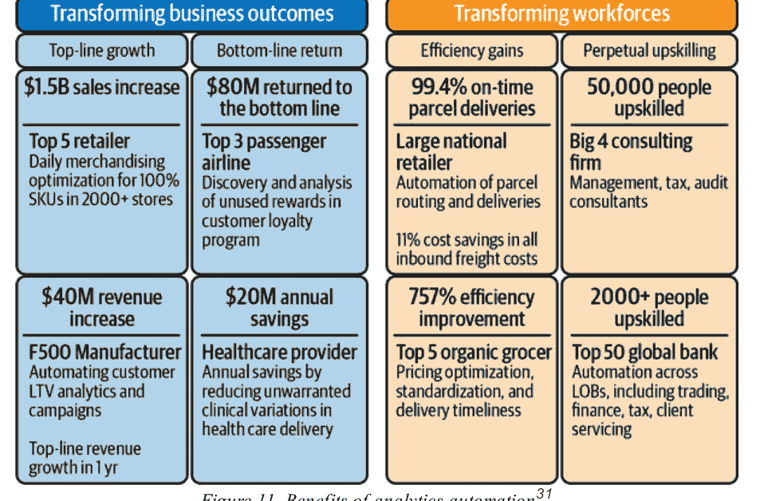

## 总结与结论

我们已通过技术、业务和现实案例的视角审视了分析自动化的力量。我们看到了它如何用于解决复杂问题、提高生产力和改善效率。但所有这些对你的业务意味着什么？你能从描述、考虑和示例中推断出什么可能对你有用？让我们花点时间总结一下我们迄今为止学到的内容。

## 分析自动化平台易于接近

分析自动化平台的界面是图形化的。除计算或宏外，无需编码。简单的界面展示了每个构建块的逐步性质，让你能够可视化和检查转换对数据的影响。这些构建块使数据更易于解析、更易于清理、更易于检查。为了

如果某个过滤器没有得到你期望的结果，你只需在*该点*与流程交互，就能看到数据因该步骤而如何被改变。这意味着另一位用户可以进入一个工作流，快速查看并拆解达到最终结果所采取的步骤。

这也意味着任何用户都可以访问数据，而不仅仅是受过训练的分析师。图形界面直观易懂，需要的培训很少。分析师过去需要花几年时间学习如何编码，现在可以通过界面在几分钟内教会普通用户。这意味着数据现在可以传递给最需要它的人：领导层、本地经理以及执行工作的员工。它消除了主题专家与分析技术专业人员之间的关键差距。

除了提升员工的分析技能之外，改善数据治理、标准、安全、性能和可访问性也仍然是关键。你的洞察力好坏取决于其所构建的数据和分析。数据治理和标准将通过采用通用术语和定义来帮助执行数据质量，同时速度将提高快速获得洞察的能力。可访问性意味着数据对每个人开放，而不会被锁定在创建它的信息孤岛中。这意味着在团队之间安全地共享数据，并了解组织中每个群体对其他群体的影响。

分析自动化还为分析师提供了构建自定义界面和客户交互方法的工具。通过提供输入和参数选项，分析师可以为特定用户或用户组定制工作流。这通过将分析层带得更接近主题领域来提升平台的价值。人力资源可以轻松专注于人员，而财务可以从货币角度审视数据。

分析工作流也可以用于自动化业务流程。无需依赖分析师筛选数据页面，可以开发工作流来监控业务产生的数据值。可以设置阈值，如果未满足某些标准则触发警报。该过程可以简单、适应性强，最重要的是可重复，按需运行或按计划运行。这种监控方法依赖于硬

除了组织内部和外部的数据集外，分析自动化软件还包括集成数据集。用于空间分析的详细数据集，如城市、国家、州和邮政编码，可在软件内使用。分析自动化还支持旨在访问其他特定数据集并提供独特见解的插件和扩展。这些通过提供针对您的数据挑战的易于使用的集成工具，使分析自动化内的分析变得不那么复杂。

## 分析自动化与现有工具集成

现有软件平台无需移除，分析自动化实施才能成功。分析自动化与许多不同类型的数据库和平文件接口，将多层次的分析带入工作流。如果您的业务拥有现有数据源，例如云数据仓库或交易数据仓库，分析自动化平台能够从中读取。与其他数据工具不同，这些独立系统的数据可以轻松组合，使分析师和终端用户能够以其他方式无法实现的方式提取洞察。

在另一端，工作流可以组合、清理和准备数据以供其他报告工具使用。上面讨论的许多示例都提到了使用分析自动化为 Tableau 生成数据的情况。该软件协同工作，通过快速、可重复的数据准备和高质量的数据可视化功能创造洞察。虽然分析自动化具有内置的可视化功能，但它也足够灵活，可以与贵公司分析师熟悉的工具配合使用。这降低了培训成本，并提供了其他人以前见过、了解并信任的样式化可视化结果。

数据管理并不是与分析自动化协同工作的全部。编程语言如 R 和 Python 可以作为数据工作流的一部分或接收者使用。这种集成允许使用整个组织中数据集的组合进行预测分析、统计建模和预测。想象一下，对销售数字或生产结果进行分析以监控趋势、为事件做计划，或为业务建立基线。预测分析使公司能够以简单报告无法实现的方式进行战略规划，同时考虑多个变量和影响因素并预测可能的结果。

## 分析自动化是一项具有回报价值的投资

每次软件采购都存在机会成本。用你刚花在该软件上的钱还能买什么？优秀企业的目标是降低该成本或完全消除它。如果购买软件没有机会成本，那么你可以预期你做出了正确的决定。分析自动化的机会成本很容易拆解。

首先，分析自动化软件的成本与其他市场上大多数数据工具相当。然而，当你将其与购买足够软件以匹配分析自动化功能所需的成本进行比较时，很容易看出传统数据流程中的每个单独工具很快就会超过分析自动化的成本。如前所述，与拥有单独工具执行相同工作所需的成本相比，平台的成本很快就会收回。此外，它可以轻松集成到现有系统中，使组织能够在确定分析自动化实施价值的同时保持现有业务流程。

接下来，你必须重新审视采用分析自动化实施后的业务成本。即使你只能集成一个工作流，那一个工作流节省了多少工作？由于工作流可以轻松重复，需要多少更少的工时？你的分析师有多少更多的时间可以花在其他更高优先级的任务上？专家知识呢？贵公司支付给精通 SQL、分析或数据科学工具的员工的费用是多少？通过实施分析自动化，这些知识可以转移到其他更重要的事情上。

再次，你需要考虑公司从更快、更可靠的洞察中获得什么。供应商零件的成本会下降吗？你可以通过改变营销或针对特定买家来增加收入吗？贵公司还能通过数据分析、自动化和员工数据赋能从哪些方面改进？要真正了解软件的成本，你需要了解它提供的节省。数据分析将帮助你做出改善业务的决策，但你必须决定进行数据分析的最佳方式。图 11 突出了不同公司采用分析流程自动化所取得的益处示例。

### 四个方面的投资回报

Alteryx 客户示例

图 11. 分析自动化的益处³¹

## 多种能力，单一平台的成本

由于分析自动化涵盖了数据的整个光谱，从分析到洞察，它能够做很多很多事情。无论您业务中目前使用何种工具和技术，分析自动化都提供了一个全面的数据工作流所有步骤的集合，界面用户友好。这意味着无论您组织中数据发生什么，分析自动化都可用于改善流程。它可以在数据工作流的任何部分集成并以多种不同的方式使用。

它提供了一个有效的端到端平台，可从一个或多个来源提取数据。然后它可以清理、过滤和转换数据以用于分析和数据科学。它可以自动化流程，将复杂分析和工作负载所需的时间从数小时或数天减少到仅几分钟。通过报告，它可以生成详细的视觉效果或提供特定于您报告需求的数据源。它可以在您的数据上运行预测分析和机器学习，为组织内的趋势和模式提供可靠的数据驱动洞察。所有这些功能都说明该平台足够灵活，无论已存在什么，都能提供影响。

只要有数据，就有通过降低成本、增加收入或提高效率来改进的机会。我们已经研究了分析自动化如何影响多种类型的行业及其内部部门。无论您经营何种类型的组织，数据都存在，而分析自动化能够将该数据消化成洞察和决策。

无关紧要您的数据是关于什么。重要的是能够深入挖掘该数据并提取出让贵公司在同一市场中领先于其他公司的洞察。重要的是您的员工更快乐，因为激励计划是为他们量身定制的，或工作岗位更靠近家，让他们有更多时间陪伴家人。重要的是村庄拥有电力以改善居民的生活，以及作物产量会更好，因为种子在正确的位置种植，水和肥料水平也合适。这很重要，因为，如果没有一种能够快速准确地提取、分析和报告结果的工具，数据就只是数字。分析自动化提供了将这些数字驱动到决策和可能改变生活的洞察中的缺失环节。

2 来自 Scott Burk、David Sweenor 和 Gary Miner 的插图，*It’s All Analytics, Part II: Designing an Integrated AI, Analytics, and Data Science Architecture for Your Organization*（Boca Raton, FL: Routledge, 2022）。

3 Chandal Gopal、Stewart Bond、Matthew Mardem，“IDC Data Preparation, Analytics and Science Survey Commissioned by Alteryx”，2019 年 2 月，https://www.alteryx.com/resources/report/idc-state-of-data-science-and-analytics。

4 Gopal、Bond、Mardem，“IDC Survey”。

5 Ryota Mori，“Macromill Accelerates Reporting with Alteryx”，Alteryx，2020 年 1 月 14 日，https://community.alteryx.com/t5/Alteryx-Use-Cases/Macromill-Accelerates-Reporting-with-Alteryx/ta-p/513811。

6 Nelson Davis，“Transforming 4 Billion Rows of Data into Insights with Alteryx, AWS, and Tableau”，Alteryx，2018 年 5 月 11 日，https://community.alteryx.com/t5/Alteryx-Use-Cases/Transforming-4-Billion-Rows-of-Data-into-Insights-with-Alteryx/ta-p/161798。

7 “Taste the Feeling: Coca-Cola + Alteryx”，Alteryx，访问日期 2021 年 9 月 19 日，https://www.alteryx.com/customer-center/taste-the-feeling-coca-cola-alteryx。

8 “The Salvation Army Improves Data Migration Process by 5x with Alteryx”，Alteryx，访问日期 2021 年 9 月 19 日，https://www.alteryx.com/customer-story/salvation-army-improves-data-migration-process-by-5x-with-alteryx。

9 David Gump，“Automatic Charting of Weekly Covid-19 Hunger Data from the Census Bureau”，Alteryx，2020 年 7 月 29 日，https://community.alteryx.com/t5/Alteryx-Use-Cases/Automatic-Charting-of-Weekly-Covid-19-Hunger-Data-from-the/ta-p/609986。

10 Gopal、Bond、Mardem，“IDC Survey.”

11 Aaron De Smet、Gregor Jost 和 Leigh Weiss，“Three Keys to Faster, Better Decisions”，*McKinsey Quarterly*，2019 年 5 月 1 日，https://www.mckinsey.com/business-functions/organization/our-insights/three-keys-to-faster-better-decisions。

12 Jason Lahr，“Building the Safety Culture at Polaris”，Alteryx，2019 年 4 月 30 日，https://community.alteryx.com/t5/Alteryx-Use-Cases/Building-the-Safety-Culture-at-Polaris/ta-p/408544。

13 Anson Wun 和 Amanda Li，“Solving Student Number Projections Work in 2 Minutes Using Alteryx”，Alteryx，2019 年 12 月 2 日，https://community.alteryx.com/t5/Alteryx-Use-Cases/Solving-Student-Number-Projections-Work-in-2-Minutes-Using/ta-p/497570。

14 Jay Caplan，“Coca-Cola Reduces 60% Cost Using Alteryx to Build a Store Dashboard”，Alteryx，2019 年 7 月 25 日，https://community.alteryx.com/t5/Alteryx-Use-Cases/Coca-Cola-Reduces-60-Cost-Using-Alteryx-to-Build-a-Store/ta-p/443300。

15 Ryan Richardson，“Connecting with your Audience on their Terms with Alteryx”，Alteryx，2019 年 7 月 26 日，https://community.alteryx.com/t5/Alteryx-Use-Cases/Connecting-with-your-Audience-on-their-Terms-with-Alteryx/ta-p/444348

16 “Precision Ag”，North Dakota State University，访问日期 2021 年 9 月 19 日，https://www.ndsu.edu/agriculture/ag-hub/ag-topics/ag-technology/precision-ag。

March 25, 2021, https://community.alteryx.com/t5/Alteryx-Use-Cases/PASHA-Holding-Enhances-Reporting-with-Alteryx/ta-p/734793。

30 Luisa Bez，“Adidas Automates PowerPoint Presentations to Save Time and Cut Errors”，Alteryx，2020 年 10 月 19 日，https://community.alteryx.com/t5/Alteryx-Use-Cases/Adidas-Automates-PowerPoint-Presentations-to-Save-Time-and-Cut/ta-p/652483。

31 “Investor Presentation: Q2 2021”，Alteryx，访问日期 2021 年 9 月 19 日，https://investor.alteryx.com/news-and-events/presentations/default.aspx。
